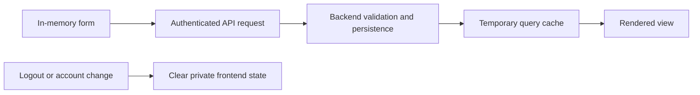

# Customer and Merchant Frontend: Data and Persistence

Owner: Sajini, Member 6  
Date: 24 October 2026  
Status: Proposed data handling

## Data ownership

My frontend does not own PostgreSQL tables, migrations or authoritative parcel records. I will reference the shared database schema instead of making another ER diagram for the same tables. The backend owns record relationships, constraints and transactions.

| Data | Authority | Frontend use |
| --- | --- | --- |
| User and roles | M1 | Navigation and current-user display |
| Parcel and accepted price | M2 | Booking confirmation, lists and details |
| Quote and validity | M2 | Fee review before submission |
| Parcel history and public status | M2 / M5 | Timeline and tracking |
| Merchant and approval state | M4 | Application and merchant portal |
| Webhook settings | M4 | Authorized settings form |
| Receipt | M2 | Authorized view/download |

## Frontend data dictionary

| Model | Expected fields | Rules |
| --- | --- | --- |
| Current user | ID, display name, agreed roles | Private; clear on logout |
| Booking draft | Contact/address fields, weight, dimensions, service | Keep in component memory by default |
| Quote | ID, amount in minor units, currency, validity | Invalidate when relevant inputs change |
| Parcel summary | ID, tracking number, status, timestamps | Use backend response, not local inferred state |
| Status event | Status, timestamp, tracking reference, version if supplied | Public fields only for anonymous tracking |
| Merchant order | Order/parcel reference, state, allowed details | Scope cache to authenticated merchant |
| API error | Code, safe message, field details, correlation reference | Do not display raw internal errors |

These are expected model categories. Exact DTOs and constraints remain with the approved API schemas.

## Storage policy

- Access tokens stay in memory in the shared auth context.
- Refresh tokens are handled through the backend's HttpOnly cookie flow, subject to M1's approved contract.
- I will not put tokens in localStorage, sessionStorage, URL parameters or logs.
- I will not persist address/contact form drafts in browser storage by default.
- Non-sensitive preferences may use browser storage only after agreement; they must not include shipment or identity data.
- I will not add offline storage or a persistent query cache for private records without a separate requirement and privacy review.

## Cache rules

TanStack Query will keep temporary server data. User/tenant context belongs in private query keys. Logout, account switch and tenant changes clear or remove the previous private cache. Mutations invalidate the affected parcel/order queries. A cached quote must not remain usable after expiry or changed inputs.

Tracking re-fetches current state after stream reconnect. If the page displays old cached data during an outage, it must label the connection/data state clearly. Cache freshness and polling intervals need agreement with backend owners.

## Validation and consistency

I will validate form fields for usability and show server validation errors. The backend still enforces all constraints and ownership. Money arrives in integer minor units and is formatted for display; I will not calculate delivery charges. API timestamps are UTC and displayed with an understandable local date/time.

I will cancel or ignore stale quote responses so an older response cannot replace a quote for newer inputs. A pending booking is not added as a confirmed record until the backend confirms it. The backend handles concurrency and atomic writes.

## Data flow

## Retention, deletion and audit

The backend decides retention and deletion for parcel, merchant, proof and audit records. My frontend will not promise deletion that the API does not provide. Navigation/logout will release sensitive frontend state where applicable. I will not send full addresses, phone numbers, tokens or merchant credentials to analytics or debug logging.

## Fixtures and migrations

Frontend fixtures will use clearly fictional names, contacts and addresses. I need sample users with the agreed roles, approved/pending merchant examples, empty and paginated lists, unknown tracking numbers, expired quotes and failed requests. There are no frontend-owned database migrations in this plan. Backend seed data and migration ordering remain with their owners.
