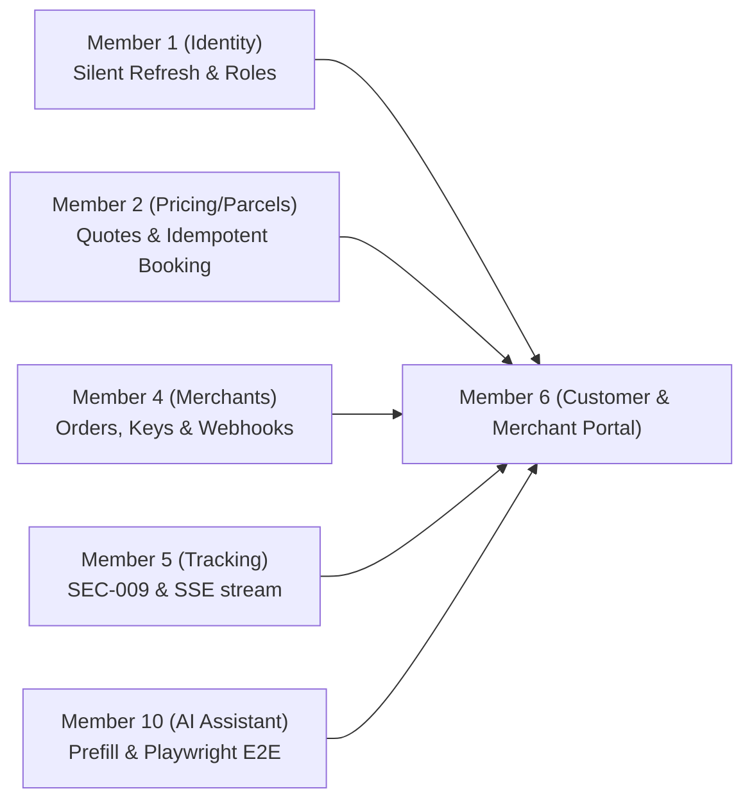
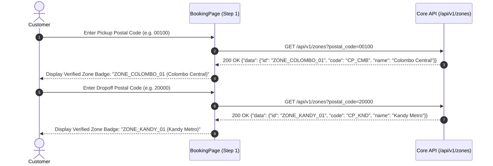

# SwiftDrop Member 6 — Frontend Audit, Redesign & Action Plan

> **Author:** Antigravity AI Engineering Assistant  
> **Audience:** Sajini (Member 6 — Customer & Merchant Frontend Owner) & SwiftDrop Team  
> **Status:** Authoritative Action Guide & Implementation Blueprint  
> **Target Production Codebase:** `web/src/features/customer-merchant/`  
> **Governing Standards:** SwiftDrop SRS v1.0, `AGENTS.md`, `web/design.md`, ADR-001/002/003/004, and Member 10 E2E Playwright Contracts  
> **Date:** 14 November 2026 | **Version:** 2.1.0

---

## Table of Contents
1. [Executive Summary & Core Objectives](#1-executive-summary--core-objectives)
2. [Complete Technical Audit: Issues & Contract Fixes](#2-complete-technical-audit-issues--contract-fixes)
   - [2.1 Identity & Authentication (Member 1)](#21-identity--authentication-member-1)
   - [2.2 Parcels, Pricing & Booking (Member 2)](#22-parcels-pricing--booking-member-2)
   - [2.3 Live Tracking & Privacy Masking (Member 5)](#23-live-tracking--privacy-masking-member-5)
   - [2.4 Commercial Merchant Self-Service (Member 4)](#24-commercial-merchant-self-service-member-4)
   - [2.5 AI Assistant & Generative UI (Member 10)](#25-ai-assistant--generative-ui-member-10)
3. [Visual Redesign, Aesthetics & Clean Navigation](#3-visual-redesign-aesthetics--clean-navigation)
   - [3.1 The Apple Cupertino Precision Archetype](#31-the-apple-cupertino-precision-archetype)
   - [3.2 Modern Glassmorphism Navigation Topbar](#32-modern-glassmorphism-navigation-topbar)
   - [3.3 Authentic Logistics Imagery & Visual Depth](#33-authentic-logistics-imagery--visual-depth)
   - [3.4 Package Category Visual Selector Cards](#34-package-category-visual-selector-cards)
   - [3.5 Connected Rail Stepper & Milestone Rail Primitives](#35-connected-rail-stepper--milestone-rail-primitives)
4. [Address, Postal Code Resolution & Zone Mapping](#4-address-postal-code-resolution--zone-mapping)
5. [The Authoritative `data-testid` Register](#5-the-authoritative-data-testid-register)
6. [Step-by-Step Refactoring Plan & Legacy Ledger Removal](#6-step-by-step-refactoring-plan--legacy-ledger-removal)

---

## 1. Executive Summary & Core Objectives

Hi Sajini,

This document is your complete, step-by-step blueprint to bring the **Customer & Merchant Frontend** (`web/src/features/customer-merchant/`) to production readiness, fully align it with our backend microservices, transform its visual aesthetics to match Apple Human Interface Guidelines (HIG), and eliminate all technical debt.

### Core Objectives for Member 6:
1. **Fix All Backend Contract Discrepancies:** Ensure all API calls, DTO casings, HTTP headers (`Idempotency-Key`), and validation schemas match the authoritative Go Core API and Python AI Assistant contracts.
2. **Elevate Frontend Aesthetics to Apple Cupertino Precision:** Eliminate raw form fields, monotonous gray blocks, and non-canonical CSS (`portal.css` and `swift-signature.css`). Replace them with a refined, high-trust user interface featuring a sticky glassmorphism navigation bar, authentic logistics photography, interactive package preset cards, and 1px hairline borders with zero blur shadows.
3. **Enforce 100% `data-testid` & Address Resolution Compliance:** Guarantee every form input, button, table cell, and modal dialog contains the exact semantic `data-testid` attribute required by Member 10's Playwright E2E suite, and implement reliable 5-digit postal code to delivery zone resolution via `GET /api/v1/zones?postal_code=...`.
4. **Graduate from the Legacy Exemption Ledger:** Refactor all screens to compose strictly from `@/shared/components/ui/` primitives so that every file can be removed from `scripts/lint-ui.mjs` and `.eslintrc.cjs`, passing CI linting cleanly.

---

## 2. Complete Technical Audit: Issues & Contract Fixes



### 2.1 Identity & Authentication (Member 1)
- [ ] **Silent Token Refresh upon Merchant Approval:**
  - *Problem:* When an administrator approves a merchant's onboarding application, the merchant's current JWT lacks the `tenant_id` claim. Accessing merchant routes triggers `403 Forbidden`.
  - *Fix:* Upon detecting an `APPROVED` merchant status or navigating to `/portal/merchants/*`, invoke `POST /api/v1/auth/refresh` with the `swiftdrop_refresh_token` HttpOnly cookie. Member 1 issues an updated access token containing the resolved `tenant_id` and `MERCHANT` role.
- [ ] **Consolidate Registration Screens:**
  - *Problem:* There are currently two competing registration components: `src/features/auth/RegisterPage.tsx` (supports email OTP verification) and `src/features/customer-merchant/portal/RegisterPage.tsx` (simple form with raw inputs).
  - *Fix:* Unify these into a single Apple-styled registration page in `src/features/auth/RegisterPage.tsx` that supports the verified OTP workflow, and redirect `/portal/register` to `/auth/register`.
- [ ] **In-Memory JWT Access Token Storage:**
  - *Rule (ADR-003):* The 15-minute JWT access token must reside **exclusively in React memory** (`AuthContext`). It must never be stored in `localStorage` or `sessionStorage`.

---

### 2.2 Parcels, Pricing & Booking (Member 2)
- [ ] **Standardize Fee Quote Request Payload:**
  - *Problem:* The M6 Guide text specifies `pickup_zone_id`, `dropoff_zone_id`, `weight_kg`, etc. However, the Go Core API (`core-api/internal/pricing/transport/dto.go`) requires:
    ```json
    {
      "origin_zone_id": "ZONE_COLOMBO_01",
      "destination_zone_id": "ZONE_KANDY_01",
      "actual_weight_kg": 2.50,
      "dimensions": {
        "length_cm": 30.0,
        "width_cm": 25.0,
        "height_cm": 15.0
      },
      "service_level": "STANDARD"
    }
    ```
  - *Fix:* Ensure `BookingPage.tsx` transmits the exact schema above to `POST /api/v1/pricing/quotes`.
- [ ] **Active 15-Minute Countdown Timer on Step 3:**
  - *Problem:* `BookingPage.tsx` displays only a static date string (`Valid until ...`).
  - *Fix:* Implement an active countdown clock (e.g. `14:52 remaining`). If the timer hits `00:00`, disable confirmation, display a warning banner (*"Quote expired"*), and prompt the user to refresh the quote.
- [ ] **Immediate Quote Invalidation on Dimension Modification:**
  - *Rule:* If the user clicks "Back" from Step 3 or Step 4 and alters weight, dimensions, or postal codes, immediately clear the cached `quote_id` and total amount.
- [ ] **Eradicate Client-Side Fee Calculations:**
  - *Violation:* `CustomerDashboard.tsx` contains an illegal `calculateQuote()` function with hardcoded math. All delivery fees displayed to the user must originate exclusively from `POST /api/v1/pricing/quotes`.
- [ ] **Dual-Mode Official Receipt Download:**
  - *Contract:* `GET /api/v1/parcels/{id}/receipt` can return binary PDF or structured JSON. Inspect the HTTP `Content-Type` header:
    - If `application/pdf`: Trigger browser file download (`swiftdrop-receipt-{id}.pdf`).
    - If `application/json`: Render a clean, printable modal dialog with receipt number, breakdown, and barcode.

---

### 2.3 Live Tracking & Privacy Masking (Member 5)
- [ ] **Strict SEC-009 Public Tracking Privacy Masking:**
  - *Contract:* Anonymous visitors viewing `/track/:trackingNumber` must see **only**:
    - Tracking Number (`SD-YYYYMMDD-XXXXX`)
    - Lifecycle Status Badge (`CREATED`, `PICKED_UP`, `IN_TRANSIT`, `OUT_FOR_DELIVERY`, `DELIVERED`, `ATTEMPT_FAILED`)
    - Destination City (e.g., `Kandy`)
    - Chronological milestone timestamps
  - *Strictly Redacted:* Recipient phone number, sender name/address, recipient street address, courier private details, internal operator notes, and proof-of-delivery photos/signatures.
- [ ] **SSE Stream Event Name Aliasing:**
  - *Contract:* Member 5's SSE endpoint emits `event: status_update\ndata: ...\n\n`. Ensure your `useSSE` hook listens for `status_update` while defensively aliasing `tracking-update`.
- [ ] **Event Deduplication & Auto-Reconnect Resync:**
  - Maintain an in-memory `Set<string>` of processed event IDs to prevent duplicate timeline animations.
  - When the browser `EventSource` reconnects after a disconnect, automatically fire a background REST fetch (`GET /api/v1/tracking/public/{trackingNumber}`) to resynchronize authoritative state.
- [ ] **Bounded Polling Degradation Badge:**
  - If SSE fails after 3 consecutive connection attempts, degrade gracefully to 30-second REST polling and display an unobtrusive indicator: *"Live updates degraded — polling"*.

---

### 2.4 Commercial Merchant Self-Service (Member 4)
- [ ] **One-Time Credential Modal with Mandatory Confirmation Checkbox:**
  - *Security Invariant:* When creating an API key (`sd_live_*`) or webhook signing secret (`whsec_*`), render an emergency modal.
  - The modal must contain:
    1. Warning callout: ⚠️ *"Copy this secret now. It will never be displayed again."*
    2. Read-only code block with a one-click copy button (`data-testid="one-time-key-copy-btn"`).
    3. Mandatory confirmation checkbox (`data-testid="dismiss-key-modal-checkbox"`): *"I have safely copied and stored this secret in my secure vault."*
    4. The "Done" / "Close" button remains **disabled** until this checkbox is checked.
  - *Zero Persistence Guarantee:* Store the raw key/secret **only in transient React state**. It must never be written to `localStorage`, `sessionStorage`, cookies, query caches, or console logs.
- [ ] **Dynamic Webhook Event Catalog:**
  - Do not hardcode static event strings. Query `GET /api/v1/merchants/webhook-event-types` to dynamically render checkboxes for all active broker topics.
- [ ] **Batch CSV Order Ingestion & Syntax Feedback:**
  - In `MerchantOrderImport.tsx`, enforce client-side validation for:
    - Maximum 100 rows per batch.
    - Required headers: `recipient_name,recipient_phone,address_line1,city,zone_id,weight_kg,length_cm,width_cm,height_cm,description`.
    - Weights between $0.01\text{ kg}$ and $30.00\text{ kg}$.
    - E.164 phone numbers (`+947XXXXXXXX`).
  - Render an interactive preview table with green ("Ready") and red ("Invalid") badges before submitting.
  - Assign each row an individual UUIDv4 `Idempotency-Key` and submit via `POST /api/v1/merchant/orders` using the merchant's JWT Bearer session.

---

### 2.5 AI Assistant & Generative UI (Member 10)
- [ ] **Ingest `NAVIGATE_BOOKING` Generative UI Action:**
  - When a user in the Assistant Chat asks for a shipping quote and clicks **"Book Shipment Now"**, the assistant redirects to `/portal/book` with prefilled parameters in query string or router state.
  - `BookingPage.tsx` must parse:
    - `pickup_postal_code` &rarr; Step 1 Pickup Postal Code
    - `delivery_postal_code` &rarr; Step 1 Delivery Postal Code
    - `weight_kg`, `length_cm`, `width_cm`, `height_cm` &rarr; Step 2 Dimensions
    - `service_type` &rarr; Step 2 Service Level (`STANDARD` vs `EXPRESS`)
  - Automatically advance to Step 3 to trigger `POST /api/v1/pricing/quotes` and display the authoritative quote.
- [ ] **Router Alias:** Add a client-side redirect from `/customer/book` to `/portal/book` in `App.tsx` for backward compatibility.

---

## 3. Visual Redesign, Aesthetics & Clean Navigation

To make the frontend look exceptionally premium, modern, and trustworthy, we will discard the ad-hoc prototype styles (`portal.css`, `swift-signature.css`) and strictly follow the **Apple Cupertino Precision** archetype defined in `web/design.md`.

```
Visual Architecture:
├── Sticky Glassmorphism Header (backdrop-blur-md, hairline border, brand squircle, role pill)
├── Role-Scoped Accents:
│   ├── [data-role="CUSTOMER"]: Apple System Blue (#0071e3)
│   └── [data-role="MERCHANT"]: Merchant Teal (#0b5955)
├── Authentic Photography Banners (curated unslop imagery from web/public/)
├── Connected Rail Stepper (26px circular nodes, completed checkmarks, hairline rail)
├── Interactive Package Preset Cards (Documents, Small Parcel, Heavy Box)
└── Tabular Figures (tabular-nums font-mono for currencies, tracking numbers, weights)
```

### 3.1 The Apple Cupertino Precision Archetype
- **Color Budget $\le$ 3%:** Pure neutral canvas (`bg-canvas`: `#f5f5f7` light / `#000000` dark) and clean white card panels (`bg-surface`: `#ffffff` light / `#1c1c1e` dark). Saturated colors are reserved exclusively for primary CTA buttons, active wizard steps, and status badge indicators.
- **Zero-Elevation Invariant:** Stripping all drop shadows (`shadow-sm`, `shadow-md`, `shadow-lg` are completely forbidden). Depth is achieved exclusively through 1px hairline borders (`border-border`) and subtle background tone steps (`bg-surface-subtle`).
- **Standardized Apple Radii:**
  - Badges, Inputs, Select triggers, Buttons: `rounded-[8px]` (`--radius-sm`)
  - Cards, Data Tables, Popovers, Dropdowns: `rounded-[12px]` (`--radius-md`)
  - Dialog Modals, Sheets: `rounded-[16px]` (`--radius-lg`)
  - Pills, Avatars, Status Dots: `rounded-full` (`--radius-full`)
- **Micro-Interactions:** Subtle button active compression (`active:scale-[0.98] transition-transform duration-100 ease-out`). No bouncy or playful animations.

---

### 3.2 Modern Glassmorphism Navigation Topbar

Replace the cramped `.m6-header` with a modern, responsive navigation bar modeled after `LandingPage.tsx` and Apple's portal headers:

```tsx
<header className="sticky top-0 z-40 border-b border-border bg-surface/85 backdrop-blur-md px-4 sm:px-8 py-3 transition-colors">
  <div className="mx-auto flex max-w-6xl items-center justify-between gap-4">
    {/* Brand Logo & Context */}
    <div className="flex items-center gap-3">
      <Link to="/dashboard" className="flex items-center gap-2.5 font-semibold text-text hover:opacity-90">
        <div className="flex size-8 items-center justify-center rounded-[8px] bg-primary-tint text-primary border border-border">
          <Package className="size-4" />
        </div>
        <span className="text-base font-bold tracking-tight">
          Swift<span className="text-primary">Drop</span>
        </span>
      </Link>
      <Badge variant="neutral" className="hidden sm:inline-flex text-[11px] font-medium uppercase tracking-wider">
        {role === 'MERCHANT' ? 'Merchant Portal' : 'Customer Portal'}
      </Badge>
    </div>

    {/* Navigation Links */}
    <nav className="flex items-center gap-1 sm:gap-2">
      {role === 'CUSTOMER' && (
        <>
          <NavLink
            to="/dashboard"
            className={({ isActive }) =>
              `px-3 py-1.5 text-xs font-medium rounded-[8px] transition-colors ${
                isActive ? 'bg-primary-tint text-primary font-semibold' : 'text-text-muted hover:text-text hover:bg-surface-subtle'
              }`
            }
          >
            Dashboard
          </NavLink>
          <NavLink
            to="/portal/book"
            className={({ isActive }) =>
              `px-3 py-1.5 text-xs font-medium rounded-[8px] transition-colors ${
                isActive ? 'bg-primary-tint text-primary font-semibold' : 'text-text-muted hover:text-text hover:bg-surface-subtle'
              }`
            }
          >
            Book Parcel
          </NavLink>
        </>
      )}
      {role === 'MERCHANT' && (
        <>
          <NavLink to="/portal/merchants/orders" className={/* ... */}>Orders</NavLink>
          <NavLink to="/portal/merchants/api-keys" className={/* ... */}>API Keys</NavLink>
          <NavLink to="/portal/merchants/webhooks" className={/* ... */}>Webhooks</NavLink>
        </>
      )}
      <NavLink to="/portal/tracking" className={/* ... */}>Track Shipment</NavLink>
    </nav>

    {/* User Actions */}
    <div className="flex items-center gap-2">
      <span className="text-xs text-text-muted hidden md:inline-block font-mono">
        {user?.email}
      </span>
      <Button variant="ghost" size="sm" onClick={handleLogout} className="h-8 px-2.5 text-xs">
        Sign Out
      </Button>
    </div>
  </div>
</header>
```

---

### 3.3 Authentic Logistics Imagery & Visual Depth

To prevent the portal from feeling sterile, embed real curated photography from `web/public/`:

| Screen / Flow | Image Asset (`/public/`) | Placement & Visual Purpose |
| :--- | :--- | :--- |
| **Booking Wizard Hero Banner** | `/feature-smart-sorting.jpg` | Subtle header banner card ($120\text{px}$ high) behind the booking stepper with dark gradient overlay (`bg-gradient-to-r from-black/80 via-black/50 to-transparent`). Displays heading: *"Doorstep Delivery Across Sri Lanka"*. |
| **Merchant Orders Console** | `/feature-courier-fleet.jpg` | Top summary card visual background showing delivery motorbikes and vans, reinforcing nationwide logistics infrastructure. |
| **Delivery Receipt & Success** | `/feature-proof-delivery.jpg` | Success screen card image highlighting contactless handover and digital proof-of-delivery. |
| **Public Tracking Card** | `/feature-courier-fleet.jpg` | Thumbnail companion on tracking search card providing high-trust branding for first-time visitors. |

---

### 3.4 Package Category Visual Selector Cards

Instead of requiring users to manually guess dimensions for everyday shipments, provide visual preset cards on Step 2 that automatically populate length, width, height, and suggested weight:

```tsx
<div className="grid grid-cols-1 sm:grid-cols-3 gap-3 mb-6">
  <Card
    className={`cursor-pointer transition-all border p-4 ${
      selectedPreset === 'DOCS' ? 'border-primary ring-2 ring-primary-tint bg-primary-tint/20' : 'hover:bg-surface-subtle'
    }`}
    onClick={() => applyPreset('DOCS', { weight: 0.5, l: 30, w: 22, h: 2 })}
  >
    <div className="flex items-center gap-3">
      <div className="p-2 rounded-[8px] bg-primary-tint text-primary">
        <FileText className="size-5" />
      </div>
      <div>
        <h4 className="text-sm font-semibold">Documents & Letters</h4>
        <p className="text-xs text-text-muted">Up to 1.0 kg · Envelope</p>
      </div>
    </div>
  </Card>

  <Card
    className={`cursor-pointer transition-all border p-4 ${
      selectedPreset === 'STANDARD' ? 'border-primary ring-2 ring-primary-tint bg-primary-tint/20' : 'hover:bg-surface-subtle'
    }`}
    onClick={() => applyPreset('STANDARD', { weight: 2.5, l: 25, w: 20, h: 15 })}
  >
    <div className="flex items-center gap-3">
      <div className="p-2 rounded-[8px] bg-primary-tint text-primary">
        <Package className="size-5" />
      </div>
      <div>
        <h4 className="text-sm font-semibold">Small Parcel / Box</h4>
        <p className="text-xs text-text-muted">Up to 5.0 kg · Shoebox</p>
      </div>
    </div>
  </Card>

  <Card
    className={`cursor-pointer transition-all border p-4 ${
      selectedPreset === 'HEAVY' ? 'border-primary ring-2 ring-primary-tint bg-primary-tint/20' : 'hover:bg-surface-subtle'
    }`}
    onClick={() => applyPreset('HEAVY', { weight: 15.0, l: 50, w: 40, h: 30 })}
  >
    <div className="flex items-center gap-3">
      <div className="p-2 rounded-[8px] bg-primary-tint text-primary">
        <Truck className="size-5" />
      </div>
      <div>
        <h4 className="text-sm font-semibold">Heavy Cargo / Freight</h4>
        <p className="text-xs text-text-muted">Up to 30.0 kg · Large Carton</p>
      </div>
    </div>
  </Card>
</div>
```

---

### 3.5 Connected Rail Stepper & Milestone Rail Primitives

Implement the two missing specialized logistics primitives in `src/shared/components/ui/`:

#### 1. Connected Stepper (`stepper.tsx`)
```tsx
export function Stepper({ steps, activeStep }: { steps: string[]; activeStep: number }) {
  return (
    <div className="relative flex items-center justify-between max-w-2xl mx-auto my-8">
      {/* Background Rail Line */}
      <div className="absolute left-0 top-1/2 -translate-y-1/2 h-0.5 w-full bg-border -z-0" />

      {steps.map((label, idx) => {
        const isDone = idx < activeStep;
        const isActive = idx === activeStep;
        return (
          <div key={label} className="relative z-10 flex flex-col items-center gap-2">
            <div
              className={`flex size-8 items-center justify-center rounded-full text-xs font-bold transition-all ${
                isDone
                  ? 'bg-primary text-primary-foreground'
                  : isActive
                  ? 'bg-surface text-primary border-2 border-primary ring-4 ring-primary-tint'
                  : 'bg-surface-subtle text-text-muted border border-border'
              }`}
            >
              {isDone ? <Check className="size-4" /> : idx + 1}
            </div>
            <span className={`text-xs ${isActive ? 'font-semibold text-text' : 'text-text-muted'}`}>
              {label}
            </span>
          </div>
        );
      })}
    </div>
  );
}
```

#### 2. Milestone Rail (`milestone-rail.tsx`)
```tsx
export function MilestoneRail({ milestones }: { milestones: Array<{ status: string; timestamp: string; description?: string }> }) {
  return (
    <div className="relative border-l border-border ml-3 my-6 space-y-6">
      {milestones.map((m, idx) => (
        <div key={idx} className="relative pl-6">
          {/* Milestone Pin */}
          <div className="absolute -left-[7px] top-1.5 size-3.5 rounded-full border-2 border-primary bg-surface ring-4 ring-primary-tint" />
          <div className="flex flex-wrap items-center justify-between gap-2">
            <Badge variant="active">{m.status.replace(/_/g, ' ')}</Badge>
            <time className="text-xs font-mono text-text-muted tabular-nums">
              {new Date(m.timestamp).toLocaleString('en-LK')}
            </time>
          </div>
          {m.description && <p className="text-xs text-text-muted mt-1">{m.description}</p>}
        </div>
      ))}
    </div>
  );
}
```

---

## 4. Address, Postal Code Resolution & Zone Mapping

Accurate delivery fee estimation depends on mapping Sri Lankan postal codes to internal delivery zones (`delivery_zones.id`).



### Mandatory Rules for Address & Zone Handling:
1. **5-Digit Postal Code Pattern:** Restrict postal code inputs to exactly 5 digits (`pattern="^[0-9]{5}$"`, `inputMode="numeric"`).
2. **Dynamic Zone Resolution:**
   - On blur or valid 5-digit input, query `GET /api/v1/zones?postal_code={postalCode}`.
   - Display a verified checkmark and zone badge: `<Badge variant="success">ZONE_COLOMBO_01 (Colombo Central)</Badge>`.
3. **Graceful Zone Fallback:**
   - If the postal code is unrecognized or not yet covered, show an inline warning: *"No direct zone mapped for postal code {code}. Please select your regional zone manually."*
   - Render a `<Select>` dropdown populated from `GET /api/v1/zones` (public list of enabled zones).
4. **Phone Number Formatting:**
   - Validate mobile numbers against Sri Lankan and international formats (`/^\+?947[0-9]{8}$/` or `/^\+?[0-9]{9,15}$/`).

---

## 5. The Authoritative `data-testid` Register

To guarantee that Member 10's automated Playwright end-to-end test suite (`tests/e2e/`) passes without brittle selector failures, you must preserve and apply the following exact `data-testid` attributes:

| Screen / Flow | Exact `data-testid` | Target Element / Action |
| :--- | :--- | :--- |
| **Authentication** | `login-email-input` | Sign-in email text field |
| | `login-password-input` | Sign-in password field |
| | `login-submit-btn` | Sign-in submit button |
| | `register-email-input` | Registration email field |
| | `register-send-otp-btn` | Trigger OTP verification request |
| | `register-otp-input` | 6-digit OTP verification input |
| | `register-first-name-input` | Customer first name |
| | `register-last-name-input` | Customer last name |
| | `register-phone-input` | Mobile phone number (`+947...`) |
| | `register-password-input` | Account password |
| | `register-terms-checkbox` | Terms and conditions checkbox |
| | `register-submit-btn` | Account registration submit button |
| **Booking Wizard** | `booking-wizard` | Root `<form>` container |
| | `booking-pickup-name-input` | Step 1 Sender full name |
| | `booking-pickup-phone-input` | Step 1 Sender phone number |
| | `booking-pickup-address-input` | Step 1 Sender street address |
| | `booking-pickup-city-input` | Step 1 Sender city |
| | `booking-pickup-postal-input` | Step 1 Sender 5-digit postal code |
| | `booking-dropoff-name-input` | Step 1 Recipient full name |
| | `booking-dropoff-phone-input` | Step 1 Recipient phone number |
| | `booking-dropoff-address-input`| Step 1 Recipient street address |
| | `booking-dropoff-city-input` | Step 1 Recipient city |
| | `booking-dropoff-postal-input` | Step 1 Recipient 5-digit postal code |
| | `booking-weight-input` | Step 2 Package weight (kg) |
| | `booking-length-input` | Step 2 Package length (cm) |
| | `booking-width-input` | Step 2 Package width (cm) |
| | `booking-height-input` | Step 2 Package height (cm) |
| | `booking-description-input` | Step 2 Package contents description |
| | `booking-service-select` | Step 2 Service level dropdown (`STANDARD` vs `EXPRESS`) |
| | `booking-next-btn` | Advance wizard step |
| | `booking-back-btn` | Return to previous wizard step |
| | `quote-price-cents` | Step 3 Authoritative quote fee display (in LKR) |
| | `booking-submit-btn` | Step 4 Confirm & dispatch booking |
| | `booking-confirmation` | Confirmation screen card |
| | `booking-confirmation-tracking-no` | Monospace tracking number display (`SD-YYYYMMDD-XXXXX`) |
| | `booking-receipt-btn` | View / Download official receipt |
| | `booking-receipt` | Receipt dialog / container |
| **Shipment Tracking** | `tracking-search-input` | Tracking lookup input field |
| | `tracking-search-btn` | Trigger tracking lookup |
| | `tracking-status-badge` | Current parcel status badge |
| | `tracking-timeline` | Milestone ordered list (`<ol>`) |
| **Merchant Portal** | `merchant-application-submit-btn` | Submit merchant application |
| | `merchant-application-status` | Display application status badge |
| | `merchant-order-search` | Orders search input |
| | `merchant-order-filter` | Orders status dropdown filter |
| | `merchant-order-table` | Orders data table (`<table>`) |
| | `merchant-order-empty` | Zero-results empty state container |
| | `merchant-order-reset-btn` | Reset filters button |
| | `batch-csv-file-input` | Batch CSV file upload input |
| | `batch-csv-submit-btn` | Submit CSV batch orders button |
| | `merchant-key-label-input` | API key descriptive label input |
| | `merchant-credential-create-btn` | Create API key or webhook button |
| | `one-time-key-copy-btn` | Copy raw secret button in modal |
| | `dismiss-key-modal-checkbox` | Mandatory checkbox to dismiss secret modal |
| | `merchant-secret-close-btn` | Close one-time secret modal |
| | `merchant-webhook-url-input` | Webhook endpoint URL input |
| | `merchant-key-revoke-btn` | Revoke API key button |
| | `merchant-webhook-delete-btn` | Delete webhook button |
| **AI Assistant Chat** | `assistant-open-btn` | Chat widget floating launcher button |
| | `assistant-prompt-input` | Chat natural language textarea |
| | `assistant-send-btn` | Send chat message button |

---

## 6. Step-by-Step Refactoring Plan & Legacy Ledger Removal

Follow these exact steps to complete the migration and remove all Member 6 files from the exemption ledger:

```
Step 1: Add Specialized Primitives
  ├── web/src/shared/components/ui/stepper.tsx
  └── web/src/shared/components/ui/milestone-rail.tsx

Step 2: Refactor Customer & Merchant Screens (Composing exclusively from @/shared/components/ui/)
  ├── web/src/features/customer-merchant/portal/PortalLayout.tsx (Modern glassmorphism navbar)
  ├── web/src/features/customer-merchant/portal/BookingPage.tsx (Stepper, Card, Input, Select, Button, 15-min countdown)
  ├── web/src/features/customer-merchant/portal/TrackingPage.tsx (MilestoneRail, Badge, Input, Card)
  ├── web/src/features/customer-merchant/portal/MerchantPage.tsx (Table, Dialog with mandatory checkbox)
  ├── web/src/features/customer-merchant/portal/MerchantOrderImport.tsx (Card, Button, Progress, Table preview)
  └── web/src/features/dashboards/RoleHome.tsx (Apple HIG card dashboard, real metrics)

Step 3: Delete Obsolete Legacy Prototypes
  ├── web/src/features/customer-merchant/portal/portal.css (RETIRED)
  ├── web/src/features/customer-merchant/preview/swift-signature.css (RETIRED)
  ├── web/src/features/customer-merchant/preview/SwiftSignatureTheme.tsx (RETIRED)
  └── web/src/features/customer-merchant/preview/DesignPreviewPage.tsx (RETIRED)

Step 4: Remove Exemptions from Guardrail Ledgers
  ├── web/scripts/lint-ui.mjs (Remove M6 paths from LEGACY_PRE_SHADCN_FILES)
  └── web/.eslintrc.cjs (Remove M6 paths from ignorePatterns)

Step 5: Automated Verification
  └── Run: npm run lint:ui && npm run build
```

### Verification Command
Run the build script from the `web/` directory:
```bash
cd web
npm run lint:ui
npm run build
```
When successful, you will see:
```text
✅ [1/3] Dependency freeze intact: exactly 14 approved @radix-ui/* packages verified.
✅ [2/3] Pattern analysis passed: all feature files analyzed, 0 violations.
✅ [3/3] UI design governance passed cleanly.
✓ built in ...ms
```

---
*End of Member 6 Frontend Audit, Redesign & Action Plan.*
