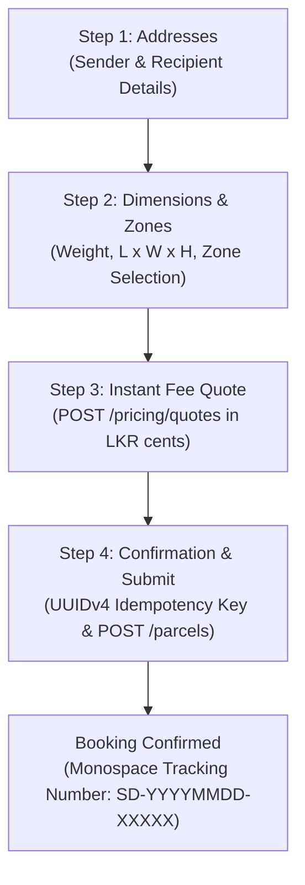
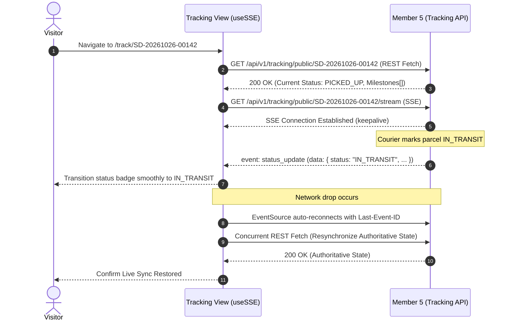

# Member 06 — Customer & Merchant Frontend Alignment & Specification Guide

> **Domain Ownership:** Member 6 — Customer & Merchant Frontend (Sajini)  
> **Workspace Directory:** `web/src/features/customer-merchant/` (Inside Unified React SPA)  
> **Specification Version:** `2.0.0` (Authoritative Baseline Harmonized Across All 10 Members)  
> **Governing Standards:** SwiftDrop SRS v1.0, `AGENTS.md`, ADR-001, ADR-002, ADR-003, ADR-004, and Member 9 Team Agreements  
> **Date:** 26 October 2026

---

## 1. Executive Summary & Domain Scope

Member 6 owns the primary customer-facing and merchant-facing web experiences within the unified React Single-Page Application (SPA) located at `web/`. The frontend is served via an optimized Nginx container on container port `3000` behind the Traefik API Gateway.

### 1.1 In-Scope Responsibilities
- **Customer Onboarding & Authentication UI:** Self-registration (`/auth/register`), shared login (`/auth/login`), Google OAuth 2.0 / OIDC initiation (`/auth/google`), and in-memory JWT session management.
- **Four-Step Customer Booking Wizard (`/portal/book`):** Contact/address entry, physical parcel dimensions & zone selection, authoritative fee quotation preview (`POST /api/v1/pricing/quotes`), and idempotent submission (`POST /api/v1/parcels`) with client-generated UUIDv4 idempotency key.
- **Public & Authenticated Live Shipment Tracking:** Sanitized public tracking view (`/track/:trackingNumber`) with strict privacy masking (**SEC-009**), authenticated customer tracking (`/portal/tracking`), and real-time Server-Sent Events milestone stream (`useSSE`).
- **Commercial Merchant Portal (`/portal/merchants/*`):** Merchant onboarding application form, order management dashboard, browser-based CSV batch order upload with local validation, one-time API key display modal (`sd_live_*`), and one-time webhook secret modal (`whsec_*`).
- **AI Assistant Generative UI Action Ingestion:** Seamless pre-filling of the booking wizard when navigated via Member 10's AI Assistant `NAVIGATE_BOOKING` generative directive.
- **Automated E2E Test Compatibility:** Semantic `data-testid` attributes on all interactive elements matching Member 10's Playwright test matrix.

### 1.2 Out-of-Scope Responsibilities (Strict DDD Boundaries)
- **Dispatcher Board, Fleet & Admin Backoffice:** Owned exclusively by Member 7 (`web/src/features/dispatcher-admin/`).
- **Courier Mobile Task List & POD Photo Capture:** Owned exclusively by Member 7 (`/courier/tasks`).
- **Traefik Gateway & Edge Routing:** Owned by Member 7 and Member 9.
- **Docker, Nginx & Kubernetes Packaging:** Authored and maintained by Member 9.
- **Client-Side Tariff & Fee Calculations:** Strictly forbidden by Engineering Standards. The frontend never computes delivery fees or volumetric weights independently; all pricing is fetched authoritatively from Member 2.
- **Client-Side Parcel State Machine Transitions:** The frontend never determines valid lifecycle transitions; all state changes are evaluated by Core API aggregates.

---

## 2. Requirements Traceability Matrix

| Requirement ID | SRS Clause | Functional Scope & UI Component | Owning Backend API | Test Verification |
| :--- | :--- | :--- | :--- | :--- |
| **FR-IAM-001** | §3.1 Customer Signup | Registration form (`RegisterForm.tsx`) with client validation | Member 1 (`POST /auth/register`) | Unit + E2E `AT-001` |
| **FR-IAM-002** | §3.1 Customer Login | Unified login (`CustomerLoginForm.tsx`) with HttpOnly cookie | Member 1 (`POST /auth/login`) | Unit + E2E `AT-001` |
| **FR-IAM-003** | §3.1 Google Sign-In | "Continue with Google" button redirecting to OIDC flow | Member 1 (`GET /auth/google`) | Integration `AT-002` |
| **FR-PAR-001** | §3.2 Parcel Booking | 4-step wizard (`BookingWizard.tsx`) with address & contact fields | Member 2 (`POST /parcels`) | Unit + E2E `AT-003` |
| **FR-PRC-001** | §3.2 Fee Estimation | Instant quote card (`Step3QuotePreview.tsx`) in LKR cents | Member 2 (`POST /pricing/quotes`) | Unit + E2E `AT-003` |
| **FR-PAR-004** | §3.2 Idempotency | Stable UUIDv4 key retention during form submission/retries | Member 2 (`Idempotency-Key` header) | Unit + E2E `AT-003` |
| **FR-TRK-001** | §3.4 Public Tracking | Mobile-responsive tracking page (`PublicTrackingView.tsx`) | Member 5 (`GET /tracking/public/:id`) | Unit + E2E `AT-005` |
| **FR-TRK-002** | §3.4 Real-Time SSE | Custom `useSSE.ts` hook streaming live milestone updates | Member 5 (`GET /tracking/public/:id/stream`)| Integration `AT-005` |
| **SEC-009** | §8.1 Privacy Masking | Redaction of recipient street, phone, notes, and POD photos | Member 5 (`/tracking/public/*`) | E2E `AT-005` |
| **FR-MER-001** | §3.3 Merchant Apply | Business onboarding application (`MerchantApplyForm.tsx`) | Member 4 (`POST /merchants/applications`)| E2E `AT-006` |
| **FR-MER-002** | §3.3 Merchant Orders | Orders table with pagination, filters, and single order dispatch | Member 4 (`GET & POST /merchant/orders`) | E2E `AT-006` |
| **FR-MER-003** | §3.3 CSV Batch Order | Browser CSV parser & batch submit (`CSVBatchUploadModal.tsx`) | Member 4 (`POST /merchant/orders`) | E2E `AT-007` |
| **FR-MER-004** | §3.3 API Key Management| Modal displaying raw `sd_live_*` key once with zero persistence | Member 4 (`POST /merchants/me/api-keys`) | E2E `AT-008` |
| **FR-MER-005** | §3.3 Webhooks Config | Webhook registration and one-time `whsec_*` secret modal | Member 4 (`POST /merchants/me/webhooks`) | E2E `AT-008` |
| **FR-AI-006** | Bonus 2 / Generative UI | Pre-filling booking wizard from AI assistant `NAVIGATE_BOOKING` | Member 10 (`services/ai-assistant`) | E2E `AT-015` |

---

## 3. Contradictions Identified & Reconciled

| # | Conflict / Contradiction | Root Cause in Drafts | Authoritative Resolution (`v2.0.0`) |
| :--- | :--- | :--- | :--- |
| **1** | **DTO Casing (`camelCase` vs `snake_case`)** | In `doc-04` and `doc-02`, Member 6 defined response models using `camelCase` (`trackingNumber`, `amountMinor`, `perPage`, `totalRecords`). | **Standardized to `snake_case`**: Conforming strictly to `docs/contracts/api-conventions.md`. All TypeScript interfaces map `tracking_number`, `fee_cents`, `created_at`, `per_page`, `total_items`, `total_pages`. |
| **2** | **SSE Event Name & Payload Inconsistency** | `doc-02` line 168 specified listening to `tracking-update` with camelCase fields. Member 5's v2.0.0 contract emits `status_update` with `data.data.status`. | **Configured `useSSE` for `status_update`**: The hook listens for `status_update` (while defensively aliasing `tracking-update`) and parses snake_case payloads. Heartbeats (`:keepalive\n\n`) are automatically ignored. |
| **3** | **Privacy Masking ID Mapping & Field Leaks** | `doc-01` and `doc-07` cite `SEC-016` (which is Container Hardening in the SRS) for tracking privacy and displayed "origin city". | **Corrected to `SEC-009`**: Re-mapped to SRS §8.1 `SEC-009` (Public Tracking Privacy Masking). Strictly displays only destination city/district, status badge, and milestone timestamps; origin details, street addresses, phone numbers, and notes are completely hidden. |
| **4** | **Merchant Session Invalidation on Admin Approval** | When an administrator approves an onboarding application, the merchant's active JWT lacks `tenant_id`, causing `403 Forbidden` on `/merchants/me/**`. | **Enforced Silent JWT Refresh Flow**: Upon receiving an `APPROVED` notification or navigating to merchant routes, the frontend initiates a silent token refresh (`POST /api/v1/auth/refresh`), prompting Member 1 to issue a new JWT containing the resolved `tenant_id` and `MERCHANT` role. |
| **5** | **Dynamic Webhook Events vs Hardcoded Topics** | `doc-02` line 217 hardcoded static event strings, including outdated strings like `parcel.in_transit.v1`. | **Dynamic Event Querying**: Frontend dynamically fetches available subscription topics from `GET /api/v1/merchants/webhook-event-types` (Member 4), guaranteeing 100% alignment with the active broker catalog. |
| **6** | **AI Assistant Generative UI Action Ingestion** | Previous draft did not specify how the booking wizard consumes AI-generated quotes from Member 10. | **Structured Ingestion (`NAVIGATE_BOOKING`)**: The wizard reads React Router `location.state` or URL parameters to pre-populate sender, recipient postal codes, weight, dimensions, and cached quote when redirected from the AI assistant chat widget. |

---

## 4. Core UI Workflows & State Machines

### 4.1 Four-Step Customer Booking Wizard (`/portal/book`)



1. **Step 1: Address & Contact Details:**
   - Sender details: Defaults to authenticated user's name, phone, and profile address. Includes an *"Edit Sender Info"* toggle for one-time overrides.
   - Recipient details: Full name, international/local mobile number (`+947XXXXXXXX`), street address lines, city, and delivery postal code.
2. **Step 2: Parcel Dimensions & Zone Selection:**
   - Weight: Numeric input in kg (`weight_kg`, min: 0.1 kg, max: 50.0 kg).
   - Physical dimensions: Length, Width, Height in cm (1–200 cm).
   - Zones: Pickup Zone (`pickup_zone_id`) and Dropoff Zone (`dropoff_zone_id`) populated dynamically from active system delivery zones.
3. **Step 3: Instant Fee Quotation:**
   - Dispatches `POST /api/v1/pricing/quotes` with dimensional parameters.
   - Renders authoritative amount in Sri Lankan Rupees (formatted from integer cents, e.g. `75000` cents &rarr; `LKR 750.00`).
   - Displays tariff breakdown (Base fee, weight surcharge, volumetric surcharge) and an active 15-minute validity countdown timer.
   - Caches `quote_id` in wizard state. If the user navigates back to alter dimensions, the quote is immediately invalidated and re-fetched.
4. **Step 4: Confirmation & Idempotent Submission:**
   - Client generates a UUIDv4 idempotency key (e.g. `c89f2a41-61b8-4c32-b912-32b0d7a6e114`).
   - Dispatches `POST /api/v1/parcels` with header `Idempotency-Key: <uuid>` and body referencing `"quote_id"`.
   - **Network Retry Semantics:** Retries of timed-out or dropped requests strictly reuse the exact same UUIDv4 idempotency key.
   - Upon `201 Created`, displays authoritative tracking number (`SD-YYYYMMDD-XXXXX`), copy button, direct link to live tracking, and receipt download.

---

### 4.2 Resilient Live Tracking Stream (`useSSE`)



- **Initial REST Synchronization:** The hook fetches initial authoritative state from `GET /api/v1/tracking/public/{trackingNumber}` before mounting SSE listeners.
- **Event Deduplication:** Maintains an internal `Set<string>` of processed event IDs to prevent duplicate timeline animations.
- **Auto-Reconnect & REST Re-Sync:** When the browser `EventSource` reconnects after a disconnect, the hook executes a background REST fetch to catch up on any missed milestone transitions.
- **Bounded Polling Fallback:** If SSE connection errors persist beyond 3 consecutive attempts, the hook smoothly degrades to periodic REST polling (every 30 seconds) with an unobtrusive *"Live updates degraded — polling"* badge.

---

### 4.3 Merchant Self-Service Portal

1. **Merchant Application (`/portal/merchants/apply`):**
   - Collects enterprise registration details (Business name, BRN, contact email, phone, registered address).
   - Displays live status badge: `PENDING` (yellow alert; orders disabled), `APPROVED` (full portal unlocked), `REJECTED` (admin rejection reason displayed), or `SUSPENDED`.
2. **Orders Dashboard & Batch CSV Upload (`/portal/merchants/orders`):**
   - Paginated, filterable table of merchant shipments scoped to the authenticated tenant.
   - **CSV Batch Upload Workflow:**
     - In-browser parsing and client-side validation of CSV headers (`recipient_name`, `recipient_phone`, `address_line1`, `city`, `zone_id`, `weight_kg`, `length_cm`, `width_cm`, `height_cm`, `description`).
     - Preview table with syntax validation badges (max 100 orders per batch).
     - Submits orders via `POST /api/v1/merchant/orders` using the merchant's **JWT Bearer session**. Each row receives a distinct UUIDv4 `Idempotency-Key`.
3. **One-Time Credential Display Modals (Strict Zero-Persistence Rule):**
   - **API Key Generation (`/portal/merchants/api-keys`):**
     - Submitting `POST /api/v1/merchants/me/api-keys` returns the raw key `"key": "sd_live_..."`.
     - Displays emergency modal: ⚠️ *"Copy this API Key now. It will never be shown again!"*
     - Raw key is stored **only in transient React component state**. It is **never** written to `localStorage`, `sessionStorage`, cookies, query cache, or console logs.
     - Confirmation checkbox required to dismiss modal; subsequent key lists display only masked metadata (`prefix: "sd_live_a8f9..."`).
   - **Webhook Secret Registration (`/portal/merchants/webhooks`):**
     - Submitting `POST /api/v1/merchants/me/webhooks` returns raw secret `"secret": "whsec_..."`.
     - Rendered in an identical one-time copy modal with zero browser persistence.

---

### 4.4 AI Assistant Generative UI Action Ingestion (`NAVIGATE_BOOKING`)

When a user in Member 10's AI Assistant chat requests a shipping quote and clicks the resulting **"Book This Shipment"** button, the AI assistant generates an action payload:

```json
{
  "action_type": "NAVIGATE_BOOKING",
  "label": "Book This Shipment",
  "payload": {
    "weight_kg": 2.5,
    "length_cm": 30.0,
    "width_cm": 20.0,
    "height_cm": 15.0,
    "service_type": "EXPRESS",
    "pickup_postal": "00100",
    "delivery_postal": "20000",
    "estimated_fee_cents": 75000,
    "currency": "LKR"
  }
}
```

The Booking Wizard (`/portal/book`) inspects `location.state`:
- Automatically populates Step 1 (pickup/delivery postal codes).
- Automatically populates Step 2 (`weight_kg: 2.5`, dimensions: `30x20x15`, `service_type: EXPRESS`).
- Automatically transitions to Step 3, triggering `POST /api/v1/pricing/quotes` to lock in an authoritative `quote_id` before confirming.

---

## 5. Authoritative Consumed API Inventory & Data Contracts

All endpoints return JSON wrapped in standard envelopes (`{"data": ...}`) with fields formatted strictly in **`snake_case`**.

| Method | Canonical URI Path | Owning Module | Required Auth | Request Headers | Key Request / Response Schema |
| :--- | :--- | :--- | :--- | :--- | :--- |
| `POST` | `/api/v1/auth/register` | Member 1 | Public | `Content-Type: application/json` | Body: `{ full_name, email, password, phone }`<br/>Response: `201 Created` |
| `POST` | `/api/v1/auth/login` | Member 1 | Public | `Content-Type: application/json` | Body: `{ email, password }`<br/>Response: `200 OK` `{ access_token, user: { id, email, role, tenant_id } }` + HttpOnly cookie |
| `POST` | `/api/v1/auth/refresh` | Member 1 | Cookie | `Cookie: swiftdrop_refresh_token` | Response: `200 OK` `{ access_token }` |
| `POST` | `/api/v1/auth/logout` | Member 1 | Bearer JWT | `Authorization: Bearer <token>` | Response: `200 OK` (Clears cookie) |
| `GET` | `/api/v1/auth/me` | Member 1 | Bearer JWT | `Authorization: Bearer <token>` | Response: `200 OK` `{ user: { id, email, role, tenant_id } }` |
| `GET` | `/api/v1/auth/google` | Member 1 | Public | None | Initiates Google OIDC redirect |
| `POST` | `/api/v1/pricing/quotes` | Member 2 | Public / Bearer | `Content-Type: application/json` | Body: `{ pickup_zone_id, dropoff_zone_id, weight_kg, length_cm, width_cm, height_cm, service_level }`<br/>Response: `200 OK` `{ quote_id, base_fee_cents, total_fee_cents, expires_at }` |
| `POST` | `/api/v1/parcels` | Member 2 | Bearer JWT | `Idempotency-Key: <uuid>` | Body: `{ quote_id, pickup: {...}, dropoff: {...}, parcel: {...} }`<br/>Response: `201 Created` `{ id, tracking_number, status }` |
| `GET` | `/api/v1/parcels` | Member 2 | Bearer JWT | `Authorization: Bearer <token>` | Response: `200 OK` `{ data: [...], meta: { page, per_page, total_items } }` |
| `GET` | `/api/v1/parcels/{id}` | Member 2 | Bearer JWT | `Authorization: Bearer <token>` | Response: `200 OK` `{ id, tracking_number, status, fee_cents, ... }` |
| `GET` | `/api/v1/parcels/{id}/history` | Member 2 | Bearer JWT | `Authorization: Bearer <token>` | Response: `200 OK` `[{ status, occurred_at, actor_role }]` |
| `GET` | `/api/v1/parcels/{id}/receipt` | Member 2 | Bearer JWT | `Authorization: Bearer <token>` | Response: `200 OK` (Receipt download) |
| `GET` | `/api/v1/tracking/public/{trackingNumber}` | Member 5 | Public | None | Response: `200 OK` `{ tracking_number, status, destination_city, milestones: [...] }` (SEC-009 masked) |
| `GET` | `/api/v1/tracking/public/{trackingNumber}/stream` | Member 5 | Public | `Accept: text/event-stream` | SSE Stream emitting `status_update` and `:keepalive\n\n` |
| `POST` | `/api/v1/merchants/applications` | Member 4 | Bearer JWT | `Content-Type: application/json` | Body: `{ business_name, brn, contact_email, contact_phone, registered_address }` |
| `GET` | `/api/v1/merchants/me` | Member 4 | Bearer JWT | `Authorization: Bearer <token>` | Response: `200 OK` `{ merchant_id, business_name, status }` |
| `GET` | `/api/v1/merchants/webhook-event-types` | Member 4 | Bearer JWT | `Authorization: Bearer <token>` | Response: `200 OK` `{ event_types: ["parcel.booked.v1", ...] }` |
| `GET` | `/api/v1/merchants/me/api-keys` | Member 4 | Bearer JWT | `Authorization: Bearer <token>` | Response: `200 OK` `[{ key_id, key_prefix, label, created_at }]` |
| `POST` | `/api/v1/merchants/me/api-keys` | Member 4 | Bearer JWT | `Content-Type: application/json` | Body: `{ label }`<br/>Response: `201 Created` `{ key_id, key_prefix, key: "sd_live_..." }` (Raw key shown once) |
| `DELETE`| `/api/v1/merchants/me/api-keys/{id}` | Member 4 | Bearer JWT | `Authorization: Bearer <token>` | Response: `200 OK` (Revokes key) |
| `GET` | `/api/v1/merchants/me/webhooks` | Member 4 | Bearer JWT | `Authorization: Bearer <token>` | Response: `200 OK` `[{ id, url, subscribed_event_types, enabled }]` |
| `POST` | `/api/v1/merchants/me/webhooks` | Member 4 | Bearer JWT | `Content-Type: application/json` | Body: `{ url, subscribed_event_types }`<br/>Response: `201 Created` `{ id, url, secret: "whsec_..." }` (Raw secret shown once) |
| `DELETE`| `/api/v1/merchants/me/webhooks/{id}` | Member 4 | Bearer JWT | `Authorization: Bearer <token>` | Response: `200 OK` (Deletes webhook) |
| `POST` | `/api/v1/merchants/me/webhooks/{id}/rotate-secret` | Member 4 | Bearer JWT | None | Response: `200 OK` `{ secret: "whsec_..." }` (New raw secret shown once) |
| `GET` | `/api/v1/merchant/orders` | Member 4 | Bearer JWT | `Authorization: Bearer <token>` | Response: `200 OK` `{ data: [...], meta: { page, per_page, total_items } }` |
| `POST` | `/api/v1/merchant/orders` | Member 4 | Bearer JWT | `Idempotency-Key: <uuid>` | Body: `{ pickup: {...}, dropoff: {...}, parcel: {...} }`<br/>Response: `201 Created` `{ order_id, tracking_number }` |

---

## 6. Playwright E2E Integration Standards (`data-testid`)

To ensure Member 10's automated E2E test suite (`tests/e2e/full-lifecycle.spec.ts`) executes reliably without brittle DOM or CSS selectors, Member 6 guarantees the following semantic attributes:

| Element / Component | Required `data-testid` | Description |
| :--- | :--- | :--- |
| Login Email Input | `data-testid="login-email-input"` | User email input field |
| Login Password Input | `data-testid="login-password-input"` | User password input field |
| Login Submit Button | `data-testid="login-submit-btn"` | Triggers login request |
| Customer Register Button | `data-testid="register-submit-btn"` | Submits registration form |
| Booking Sender Phone Input | `data-testid="booking-sender-phone"` | Step 1 sender phone |
| Booking Recipient Name Input | `data-testid="booking-recipient-name"` | Step 1 recipient name |
| Booking Recipient Phone Input| `data-testid="booking-recipient-phone"`| Step 1 recipient phone |
| Booking Address Input | `data-testid="booking-address-input"` | Step 1 street address |
| Booking City Input | `data-testid="booking-city-input"` | Step 1 destination city |
| Booking Weight Input | `data-testid="booking-weight-input"` | Step 2 package weight (kg) |
| Booking Dimensions Input | `data-testid="booking-dims-input"` | Step 2 L x W x H fields |
| Quote Request Button | `data-testid="get-quote-btn"` | Step 2 -> Step 3 trigger |
| Quote Price Display | `data-testid="quote-price-cents"` | Step 3 displays LKR fee |
| Booking Confirm Button | `data-testid="booking-submit-btn"` | Step 4 idempotent submission |
| Booking Tracking Link | `data-testid="booking-success-tracking-link"` | Confirmation screen tracking link |
| Public Tracking Search Input | `data-testid="tracking-search-input"` | Tracking lookup input field |
| Public Tracking Submit Button| `data-testid="tracking-search-btn"` | Tracking lookup submit button |
| Tracking Status Badge | `data-testid="tracking-status-badge"` | Current lifecycle status badge |
| Tracking Milestone List | `data-testid="tracking-milestone-list"` | Ordered timeline milestone list |
| Merchant Apply Submit Button | `data-testid="merchant-apply-submit-btn"` | Submits merchant application |
| Batch CSV File Input | `data-testid="batch-csv-file-input"` | File upload input |
| Batch CSV Submit Button | `data-testid="batch-csv-submit-btn"` | Submits parsed CSV batch orders |
| Generate API Key Button | `data-testid="generate-api-key-btn"` | Triggers API key creation |
| One-Time Key Copy Button | `data-testid="one-time-key-copy-btn"` | Copies newly generated raw key |
| Dismiss Key Modal Checkbox | `data-testid="dismiss-key-modal-checkbox"`| Checkbox confirming key is saved |

---

## 7. 10-Member Cross-Boundary Harmonization Matrix

| Member | Interface Boundary | Shared Contract & Data Flow | Alignment Status |
| :--- | :--- | :--- | :---: |
| **Member 1 (Identity)** | `/api/v1/auth/*` | In-memory JWT access token, HttpOnly refresh cookie, role-based route guards, and silent refresh for tenant resolution. | **Harmonized (v2.0.0)** |
| **Member 2 (Parcels & Pricing)**| `/pricing/quotes`, `/parcels` | Plural `/pricing/quotes`, integer `fee_cents`, 15-minute quote TTL, and UUIDv4 `Idempotency-Key` header. | **Harmonized (v2.0.0)** |
| **Member 3 (Dispatch & Delivery)**| Milestone Tracking | Reflects status transitions (`PICKED_UP`, `IN_TRANSIT`, `DELIVERED`, `ATTEMPT_FAILED`) in customer tracking views. | **Harmonized (v2.0.0)** |
| **Member 4 (Merchants)** | `/merchants/*`, `/merchant/orders` | JWT Bearer authentication for merchant browser session, batch CSV upload, one-time raw credential modals. | **Harmonized (v2.0.0)** |
| **Member 5 (Tracking API)** | `/tracking/public/*` | Sanitized public tracking, SEC-009 privacy masking, SSE live updates via `status_update` events. | **Harmonized (v2.0.0)** |
| **Member 7 (Dispatcher & Gateway)**| Traefik Routing & Layouts | Shared application shell in `src/app/`, isolated feature directories, edge gateway routing to `web:3000`. | **Harmonized (v2.0.0)** |
| **Member 8 (Events & Messaging)** | Asynchronous Webhooks | Merchant webhook configuration UI aligns with worker delivery pipelines and event topic catalog. | **Harmonized (v2.0.0)** |
| **Member 9 (DevOps & K8s)** | Nginx Container & Base URL | Nginx static container on port `3000`, `npm run build` targeting `dist/`, `VITE_API_BASE_URL` environment variable. | **Harmonized (v2.0.0)** |
| **Member 10 (AI Assistant & QA)** | Generative UI & Playwright | Ingests `NAVIGATE_BOOKING` actions; provides semantic `data-testid` attributes for all 16 E2E scenarios. | **Harmonized (v2.0.0)** |

---

## 8. DevOps, Build & Environment Configuration

| Configuration Parameter | Authoritative Value | Cross-Member Agreement |
| :--- | :--- | :--- |
| **Serving Runtime** | Nginx Alpine Reverse Proxy | Member 9 Agreement A1 & A3 |
| **Container Port** | `:3000` | Member 9 Agreement A1 |
| **Build Command** | `npm run build` | Outputs optimized static bundle to `web/dist/` |
| **Lint & Typecheck** | `npm run lint` (`tsc --noEmit && eslint`) | Zero TypeScript `any` tolerance |
| **API Base URL Variable** | `VITE_API_BASE_URL` | Defaults to `/api/v1` through Traefik Gateway |
| **Gateway Routing Rule** | PathPrefix `/`, `/portal/*`, `/auth/*`, `/track/*` | Traefik routes web traffic to `web:3000` |

---
*End of Member 06 Alignment & Specification Guide v2.0.0.*
