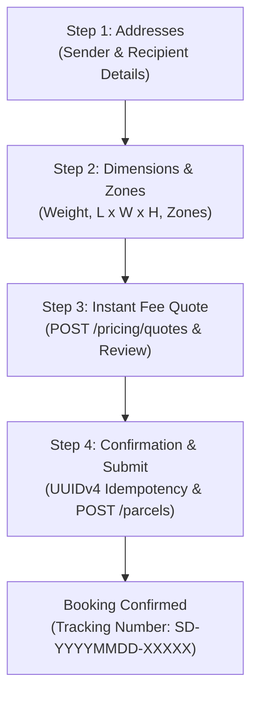
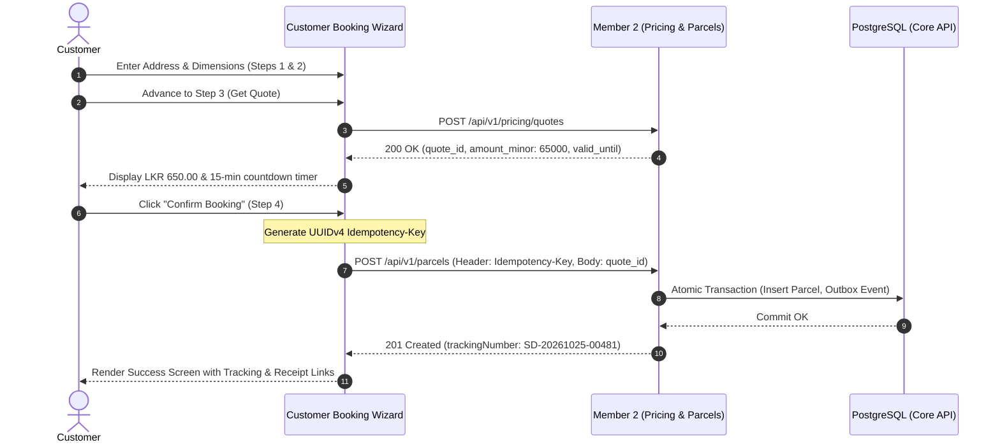
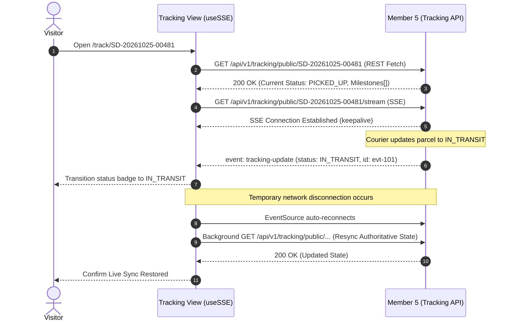

# Document 2 — Functional Flows & Business Rules

> **Module:** Customer & Merchant Frontend  
> **Owning Member:** Sajini, Member 6 — Customer & Merchant Frontend  
> **Target Workspace:** `web/src/features/customer-merchant/` (Inside Unified React SPA)  
> **Status:** Draft Specifications Complete (Ready for Team Review in Meeting 2)  
> **Governing Standards:** SwiftDrop SRS, ADR-001, ADR-003, `AGENTS.md`, and `.agents/rules/frontend.md`  
> **Date:** 25 October 2026 | **Version:** 1.0.0

---

## 1. Overview & Actor Personas

This document defines the functional user journeys, interaction lifecycles, and client-side business rules for the customer and merchant experiences within SwiftDrop.

### 1.1 Primary Actors
- **Public Visitor:** Unauthenticated guest accessing public shipment tracking via tracking number.
- **Registered Customer:** Authenticated individual booking parcel deliveries, reviewing quotes, inspecting order histories, and downloading receipts.
- **Commercial Merchant:** Authenticated business tenant onboarding their enterprise, dispatching single or batch CSV delivery orders, generating integration API keys, and managing real-time webhook endpoints.

---

## 2. Customer Onboarding & Authentication Journeys

### 2.1 Customer Self-Registration Flow (`/auth/register`)
1. The user navigates to the registration form.
2. Form fields collected:
   - Full Name (`fullName`, 2–100 characters)
   - Email Address (`email`, validated RFC 5322 format)
   - Mobile Phone Number (`phone`, E.164 pattern `^\+?[0-9]{9,15}$`)
   - Password (`password`, 8–128 characters, requiring at least one uppercase, lowercase, digit, and symbol)
   - Password Confirmation (`confirmPassword`, asserted identical)
3. Client-side validation triggers on blur and submission using Zod schema.
4. On submission, the client dispatches `POST /api/v1/auth/register`.
5. Upon receiving `201 Created`, the UI displays a registration success toast and redirects to `/auth/login?registered=true`.
6. Error handling:
   - `400 Bad Request`: Renders specific inline field validation errors.
   - `409 Conflict` (`AUTH_EMAIL_ALREADY_EXISTS`): Displays an alert banner stating *"An account with this email already exists. Please log in or reset your password."*

### 2.2 Shared Login & Session Initiation (`/auth/login`)
1. User supplies email and password.
2. Client submits `POST /api/v1/auth/login`.
3. Upon `200 OK`:
   - The backend sets an `HttpOnly`, `SameSite=Strict`, `Secure` cookie named `swiftdrop_refresh_token`.
   - The response JSON body returns `accessToken` (15-minute JWT) and `user` profile details (`id`, `email`, `fullName`, `role`, `tenantId`).
   - The token is placed **only in memory** within React `AuthContext`.
   - Role-based redirection is invoked:
     - `CUSTOMER` &rarr; `/portal/book` or `/portal/tracking`
     - `MERCHANT` &rarr; `/portal/merchants/orders`
     - `DISPATCHER` / `ADMIN` / `COURIER` &rarr; Handed off to Member 7's operational routes (`/ops/dispatch`, `/courier/tasks`).

### 2.3 Google OAuth 2.0 / OIDC Flow
1. User clicks **"Continue with Google"**.
2. Frontend redirects to `GET /api/v1/auth/google` (Member 1).
3. The server generates cryptographic `state` and `nonce` values stored in temporary cookies and redirects to Google Accounts.
4. Google returns to `GET /api/v1/auth/google/callback`, which validates the token, links or provisions the customer record, sets the refresh cookie, and redirects to `/portal/dashboard?auth=success`.
5. The frontend SPA shell initiates a background profile fetch (`GET /api/v1/auth/me`) to populate user context without exposing tokens in the redirect URL.

---

## 3. The Four-Step Customer Booking Wizard (`/portal/book`)

The parcel booking wizard is structured into 4 sequential steps with client-side form validation using `react-hook-form` and `zod`:



### 3.1 Step 1: Address & Contact Details
- **Sender Details:** Defaults to the authenticated user's name, phone, and saved profile address. An *"Edit Sender Info"* toggle allows one-time overrides.
- **Recipient Details:**
  - Full Name (`recipientName`, required)
  - Mobile Phone (`recipientPhone`, required, format `+947XXXXXXXX`)
  - Delivery Street Address (`addressLine1`, required; `addressLine2`, optional)
  - City / Town (`city`, required)
  - Delivery Postal Code (`postalCode`, optional)
- **Validation:** Both contact phone numbers are asserted valid Sri Lankan/international mobile numbers.

### 3.2 Step 2: Parcel Dimensions & Zone Selection
- **Weight:** Numeric input in kilograms (`weight_kg`, min: 0.1 kg, max: 50.0 kg).
- **Physical Dimensions:**
  - Length in cm (`length_cm`, min: 1 cm, max: 200 cm)
  - Width in cm (`width_cm`, min: 1 cm, max: 200 cm)
  - Height in cm (`height_cm`, min: 1 cm, max: 200 cm)
- **Zone Selection:**
  - Pickup Zone (`pickup_zone_id`, dropdown populated from active zones)
  - Dropoff Zone (`dropoff_zone_id`, dropdown populated from active zones)
- **Package Description / Category:** Optional text field for contents description (e.g., *"Documents"*, *"Electronics"*).

### 3.3 Step 3: Instant Fee Quotation
- **Quote Dispatch:** Upon advancing to Step 3, the wizard dispatches:
  `POST /api/v1/pricing/quotes`
  ```json
  {
    "pickup_zone_id": "ZONE_COLOMBO_01",
    "dropoff_zone_id": "ZONE_KANDY_01",
    "weight_kg": 2.5,
    "length_cm": 25,
    "width_cm": 15,
    "height_cm": 10,
    "service_level": "STANDARD"
  }
  ```
- **Quote Display Card:**
  - Authoritative amount in Sri Lankan Rupees (formatted via `formatLKR(cents)`, e.g., `65000` cents &rarr; `LKR 650.00`).
  - Breakdown: Base delivery fee, chargeable volumetric weight surcharge, and applicable service fee.
  - Active countdown timer displaying remaining validity (quotes are guaranteed for 15 minutes by Member 2).
  - Internal `quote_id` cached in wizard state.
- **Invalidation Invariant:** If the user clicks *"Back"* and alters weight, dimensions, or zones, the cached `quote_id` and countdown are immediately cleared; Step 3 will re-fetch an authoritative quote before allowing confirmation.

### 3.4 Step 4: Confirmation & Idempotent Submission
- **Summary Review:** Read-only confirmation screen reviewing sender, recipient, dimensions, service level, guaranteed fee, and delivery terms.
- **Stable Idempotency Key Generation:**
  - Upon entering Step 4, a unique UUIDv4 idempotency key is generated (e.g. `c89f2a41-61b8-4c32-b912-32b0d7a6e114`).
  - This key is stored in wizard component state.
  - When the user clicks *"Confirm Booking"*, the client submits:
    - **Header:** `Idempotency-Key: c89f2a41-61b8-4c32-b912-32b0d7a6e114`
    - **Body:**
      ```json
      {
        "quote_id": "0192e4a8-6b2a-7c91-9e12-3456789abcde",
        "pickup": {
          "name": "Sajini Perera",
          "phone": "+94771234567",
          "address_lines": ["12 Flower Road"],
          "city": "Colombo",
          "zone_id": "ZONE_COLOMBO_01"
        },
        "dropoff": {
          "name": "Kamal Gunaratne",
          "phone": "+94719876543",
          "address_lines": ["45 Peradeniya Road"],
          "city": "Kandy",
          "zone_id": "ZONE_KANDY_01"
        },
        "parcel": {
          "weight_kg": 2.5,
          "dimensions_cm": { "length": 25, "width": 15, "height": 10 },
          "description": "Textbooks and Stationery"
        }
      }
      ```
- **Network Retry Semantics:** If the submission times out or suffers a connection drop, retrying the submission **reuses the exact same UUIDv4 idempotency key**. The backend recognizes the key, preventing duplicate parcel aggregates or billing charges.
- **Success State:**
  - The API returns `201 Created` containing the authoritative `trackingNumber` (e.g., `SD-20261025-00481`).
  - The wizard transitions to the Booking Success screen displaying:
    - Generated tracking number in large monospace font.
    - Copy-to-clipboard button.
    - Direct button: **"Track Live Shipment"** (&rarr; `/track/SD-20261025-00481`).
    - Direct button: **"Download Official Receipt"** (&rarr; invokes `GET /api/v1/parcels/{id}/receipt`).

---

## 4. Real-Time Shipment Tracking Workflows

### 4.1 Public Live Tracking View (`/track/:trackingNumber`)
- **Anonymous Access:** Any visitor can access the page without logging in.
- **Privacy Masking Compliance (SEC-016):**
  - **Displayed:** Current lifecycle status badge (`CREATED`, `ASSIGNED`, `PICKED_UP`, `IN_TRANSIT`, `OUT_FOR_DELIVERY`, `DELIVERED`, `ATTEMPT_FAILED`), milestone timestamps, origin city, destination city/district, and estimated delivery window.
  - **Strictly Redacted:** Full recipient street address, recipient phone number, sender name/address, courier private identity, proof-of-delivery photos/signatures, and internal operational notes.
- **Streaming Architecture:**
  - Page loads initial authoritative state from `GET /api/v1/tracking/public/{trackingNumber}`.
  - Concurrently opens `GET /api/v1/tracking/public/{trackingNumber}/stream` via Server-Sent Events (`useSSE`).
  - When the courier marks a milestone, the backend emits a `tracking-update` event; the timeline smoothly transitions without full-page reloads.

### 4.2 Authenticated Tracking View (`/portal/tracking`)
- Logged-in customers and merchants view their own shipments with unmasked delivery details, courier contact details (when `OUT_FOR_DELIVERY`), and downloadable delivery receipts once `DELIVERED`.

---

## 5. Commercial Merchant Portal Workflows (`/portal/merchants/*`)

### 5.1 Merchant Onboarding & Status Lifecycle
- Business owners submit enterprise details via `/portal/merchants/apply`:
  - Business Name, Business Registration Number (BRN), Contact Email, Phone, Registered Address.
- The portal displays current approval status:
  - `PENDING`: Yellow banner stating application is under admin review; order dispatch disabled.
  - `APPROVED`: Full portal unlocked (Orders, Batch CSV, API Keys, Webhooks).
  - `REJECTED`: Red banner displaying admin rejection reason and contact support link.
  - `SUSPENDED`: Account suspended alert; read-only access to existing order history.

### 5.2 Orders Dashboard & CSV Batch Upload
- **Orders Table:** Server-paginated, sortable table of merchant shipments with status filters.
- **CSV Batch Order Upload Workflow:**
  1. Merchant clicks **"Batch CSV Upload"** and downloads standard CSV template.
  2. Supported CSV Header format:
     ```csv
     recipient_name,recipient_phone,address_line1,city,zone_id,weight_kg,length_cm,width_cm,height_cm,description
     Sunil Perera,+94771112233,10 Main St,Colombo,ZONE_COLOMBO_01,1.5,20,15,10,Clothing
     ```
  3. Client parses CSV locally using a lightweight in-browser parser:
     - Validates mandatory headers, row counts (max 100 rows per batch), phone number formatting, and numeric bounds.
     - Displays preview table with validation badges (Green = Ready, Red = Syntax Error).
  4. Merchant clicks **"Submit Batch Orders"**.
  5. The client submits orders via `POST /api/v1/merchant/orders` using the logged-in merchant's **JWT Bearer session**. Each row is assigned a unique UUIDv4 `Idempotency-Key`.
  6. Progress bar displays batch processing status; a summary modal displays successful tracking numbers and any rejected rows.

### 5.3 One-Time Credential Display Modals (Strict Security Rule)

#### API Key Generation Modal (`/portal/merchants/api-keys`)
1. Merchant clicks **"Generate New API Key"**, enters a descriptive label (e.g., `"Shopify-Backend"`), and confirms.
2. Client submits `POST /api/v1/merchants/me/api-keys` with Bearer JWT.
3. Backend returns `201 Created` containing the raw key:
   `"key": "sd_live_a8f9021b47c928e192837465..."`
4. The frontend renders an emergency modal dialog:
   - Warning banner: ⚠️ **"Copy this API Key now. It will never be shown again!"**
   - Read-only password field with one-click copy button.
   - Explicit confirmation checkbox: *"I have safely copied and stored this API key in my secure vault."*
   - Close button remains disabled until the checkbox is checked.
5. **Zero Persistence Rule:** The raw key is held **only in transient component memory**. It is **never** written to `localStorage`, `sessionStorage`, cookies, Redux/query cache, or console logs. When the modal is dismissed, the raw key is purged from memory; subsequent key lists display only masked metadata (`prefix: "sd_live_a8f9...", created_at, label`).

#### Webhook Secret Registration Modal (`/portal/merchants/webhooks`)
1. Merchant enters target HTTPS endpoint URL and selects subscribed event topics (`parcel.booked.v1`, `parcel.in_transit.v1`, `parcel.delivered.v1`).
2. Client submits `POST /api/v1/merchants/me/webhooks`.
3. Backend returns the HMAC-SHA256 signing secret:
   `"secret": "whsec_98f7a6b5c4d3e2f1..."`
4. The UI displays the one-time secret modal with identical copy/save warnings and zero browser persistence.

---

## 6. End-to-End Sequence Diagrams

### 6.1 Four-Step Customer Booking Sequence


### 6.2 Resilient Live Tracking Stream (`useSSE`) Sequence

