# Document 2 — Functional Flows & Business Rules

> **Status:** Draft / Proposed (For Review in Meeting 2)  
> **Author:** Member 7 — Dispatcher/Admin UI, Courier Web, Traefik Gateway  
> **Target Module / Location:** `web/src/features/dispatcher-admin/` (ops + courier screens), `core-api/internal/admin/` (admin module), `deploy/gateway/traefik/` (gateway)  
> **Key Upstream Dependencies:** Member 1 (Auth, RBAC, JWT), Member 2 (Parcels, Pricing), Member 3 (Dispatch, Delivery), Member 4 (Merchants), Member 5 (Tracking SSE), Member 8 (Outbox, events), Member 9 (Compose, Kubernetes)  
> **Open Questions / Needs Clarification:** Section 12. The 26 Oct review closed U-18 to U-23, U-25 to U-27 (Member 3 and Member 4 contracts). Still open: U-24 (Idempotency-Key on the remaining writes) and the new U-67 (assignment status name)

**Module:** Dispatcher/Admin/Courier Frontend, Admin Backend Module & API Gateway (Member 7) **Project:** SwiftDrop Parcel Delivery & Courier Management System **Based on:** Document 1 v4 (Module Scope), Member 3 Doc 4, Member 4 Doc 4 and OpenAPI, Member 9 team agreements, SRS v1.0 (sections 4, 5, 6.2), ADR-001, ADR-003, ADR-004, domain-boundaries.md, database-schema.md, api-conventions.md, sequence-diagrams.md, security-notes.md, web/README.md, deploy/gateway/ and the module API.md and README.md files **Status:** Draft v3 (applies the 26 October docs audit). Items marked **\[TBD\]** wait for a teammate or a team decision. Decisions R-01 to R-20 are listed in Document 1 section 11.4. **Date:** 26 October 2026

> **What changed in v3.** Sections 4 to 8 now use Member 3's dispatch, courier and delivery endpoints (cancel, reschedule, start-run, proof-photo, complete, failed) and Member 4's merchant admin routes; the reassign, reattempt and return endpoints are gone. Zones have a text id and no money. Reports use `/admin/reports/deliveries` for ADMIN and DISPATCHER. A public zone list (A-06) was added. Gateway flows use the security-notes.md limits and CORS, strip `X-Tenant-ID`, and use `X-Request-ID`.

## 1. How to read this document

This document answers two questions for every part of my module: **when is it used**, and **what happens step by step**.

Each flow has the same parts:

- **Trigger:** what starts it.
- **Actors:** who takes part.
- **Preconditions:** what must be true before it starts.
- **Main flow:** the normal, successful steps.
- **Alternate flows:** other valid paths.
- **Failure flows:** what happens when something goes wrong.
- **Postconditions:** what is true after it ends.
- **Rules:** business rules that apply.

Each statement is tagged by where it comes from:

| Tag | Meaning |
| --- | --- |
| **\[Repo\]** | Written in the team repository today |
| **\[Proposed\]** | Proposed by a teammate or by me, not yet agreed |
| **\[TBD\]** | Not decided. Linked to an open question U-xx |

Important reminder from Document 1: my screens and the gateway **show and route**. They never decide if an action is allowed (X-01, X-02). Every rule below that says "the backend rejects" is enforced by the owning module, not by my screen. My screen only shows the result.

## 2. Actors and triggering conditions

### 2.1 Actors

| Actor | Role in JWT | Uses | Notes |
| --- | --- | --- | --- |
| Dispatcher | DISPATCHER | `/ops/dispatch`, `/ops/couriers`, `/ops/failed-deliveries`, `/ops/reports` | Assigns parcels, schedules reattempts, reads reports |
| Administrator | ADMIN | All `/ops/*` screens | Everything a dispatcher can do, plus merchants, users, zones, pricing, reports |
| Courier | COURIER | `/courier/*` on a phone | Sees only own tasks |
| Core API modules | none (system) | Identity (M1), Parcels and Pricing (M2), Dispatch and Delivery (M3), Merchants (M4), Admin (M7 shared) | Make every business decision |
| Tracking API | none (system) | Live updates (M5) | Behind the gateway |
| Traefik gateway | none (system) | All traffic | Routes and limits only |
| Cloudflare | none (system) | Production edge | DNS, DDoS shield, first HTTPS hop |
| Anonymous visitor, customer, merchant | various | Not my screens | Only relevant to gateway flows |

**Figure 2.1 Context: who talks to my module**

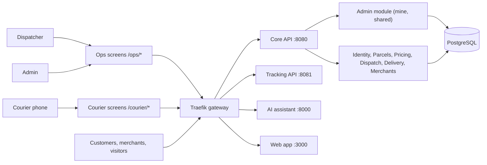


### 2.2 When is the module used (triggers)

| ID | Trigger | Actor | Flow |
| --- | --- | --- | --- |
| T-01 | Staff or courier opens the app or the access token expires | Any staff, courier | F-01, F-02 |
| T-02 | New parcel is booked (status CREATED) and appears on the board | Dispatcher | F-03, F-04 |
| T-03 | A courier is unavailable or overloaded and work must move | Dispatcher | F-05 |
| T-04 | A courier reports a failed delivery (status ATTEMPT\_FAILED) | Dispatcher | F-06 |
| T-05 | Dispatcher checks courier load, status and shifts | Dispatcher, admin | F-07 |
| T-06 | A merchant applies or a merchant must be stopped | Admin | F-08 |
| T-07 | A new staff member joins, changes job or leaves | Admin | F-09 |
| T-08 | The business opens a new area or changes delivery prices | Admin | F-10, F-11, A-01, A-02 |
| T-09 | Management wants delivery numbers for a period | Admin, dispatcher | F-12, A-03 |
| T-10 | An incident or dispute needs an audit trail check | Admin | F-13, A-04 |
| T-11 | A parcel has wrong status data and must be fixed | Admin | F-14 \[TBD U-08\] |
| T-12 | Courier starts the day, collects, delivers or fails a delivery | Courier | C-01 to C-05 |
| T-16 | A booking form needs the list of zones, or the zone for a postal code | Member 6's screens | A-06 |
| T-13 | Any HTTP request reaches the system | Any client | G-01 to G-05 |
| T-14 | A teammate needs a new route or limit | Members 1 to 10 | G-06 |
| T-15 | Gateway config is changed and deployed | Member 7, Member 9 | G-07 |

## 3. Shared rules for every screen

These rules apply to every flow in sections 5 and 6. Flows do not repeat them.

### 3.1 Calling the API

| ID | Rule | Source |
| --- | --- | --- |
| R-API-01 | Every call goes through the shared API client in `web/src/shared/api/`. Base URL is `VITE_API_BASE_URL` (default `/api/v1`) | \[Repo\] web/README 4 |
| R-API-02 | Every protected call sends `Authorization: Bearer <access token>`. The token is read from memory only | \[Repo\] ADR-003 4.1 |
| R-API-03 | The client never sends who the user is (actor id, role) in the body. The backend reads it from the token | \[Repo\] security-notes 1, INV-03 |
| R-API-04 | The client sends only the fields listed in the API contract. It never sends a target status chosen by the user, except where the contract has an action field | INV-03 |
| R-API-05 | Every POST that creates or changes something sends `Idempotency-Key: <uuid-v4>` (rules in 3.3). Backends that do not list it simply ignore it | \[Repo\] web/README 4; Member 3 lists it on assignments and complete (U-24 for the rest) |
| R-API-09 | The client never sends `X-Tenant-ID`, `X-User-ID` or `X-User-Role`; it sends `X-Request-ID` when it has one | Doc 1 R-11, R-15 |
| R-API-06 | Responses use the standard envelope: `data` for success, `error.code`, `error.message`, `error.correlation_id`, `error.details[]` for errors | \[Repo\] api-conventions 2 |
| R-API-07 | Money arrives as integer cents in LKR and is shown with `formatLKR(cents)`. The screen never adds, multiplies or rounds money | \[Repo\] web/README 5, INV-13 |
| R-API-08 | Times arrive in UTC. Screens show them in Sri Lanka time (Asia/Colombo, UTC+05:30) | \[Repo\] database-schema 3.5 |

### 3.2 Showing results and errors

| HTTP result | What the screen does |
| --- | --- |
| 200 / 201 | Show a short success message. Refresh the data that changed (do not edit the list by hand) |
| 400 / 422 | Show `error.message` near the form. Show each `error.details[].issue` next to its field. Keep what the user typed |
| 401 | Run the token refresh flow (F-02) once, then repeat the request once. If refresh fails, go to login |
| 403 | Show "You do not have permission for this action." Do not retry. Do not hide the error |
| 404 | Show "This item no longer exists." Refresh the list |
| 409 | Show `error.message` (for example "Courier has reached maximum capacity"). Refresh the data, because someone else changed it |
| 413 | Show "File is too large (maximum 10 MB)." |
| 429 | Show "Too many requests. Please wait and try again." Use `Retry-After` if present. Do not auto-retry in a loop |
| 500 / 502 / 503 / network error | Show a safe message plus the `correlation_id` (if any) so support can find the log. Offer a "Try again" button that reuses the same Idempotency-Key |

Every screen also has a **loading** state and an **empty** state (M7-UI-15). Status is always shown as text plus colour (M7-UI-16). Raw stack traces, tokens or personal data are never shown (INV-10).

**Figure 3.1 How every screen handles a response**

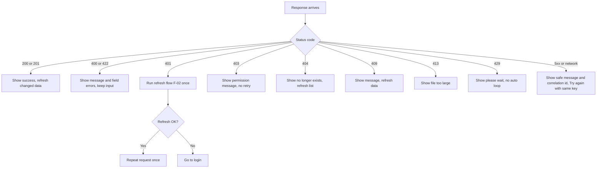


### 3.3 Idempotency key rules (frontend side)

1. When the user presses a create or change button, the client makes **one** new key for that action.
2. If the request fails with a network error, timeout or 5xx, and the user presses "Try again" **without changing the input**, the client sends **the same key**.
3. If the user changes the input, the client makes a **new key**.
4. After a success, the key is thrown away.
5. Keys live in memory only (same as tokens). If the page is reloaded, the key is lost; the user then sees fresh data from the server and decides again.
6. Backend behaviour \[Repo\] api-conventions 4: same key and same body within 24 hours returns the saved response with header `Idempotent-Replay: true`. Same key and a different body returns 409 `IDEMPOTENCY_KEY_PAYLOAD_MISMATCH`. The screen treats a replay as a normal success.

**Figure 3.2 Life of one Idempotency-Key in the browser**

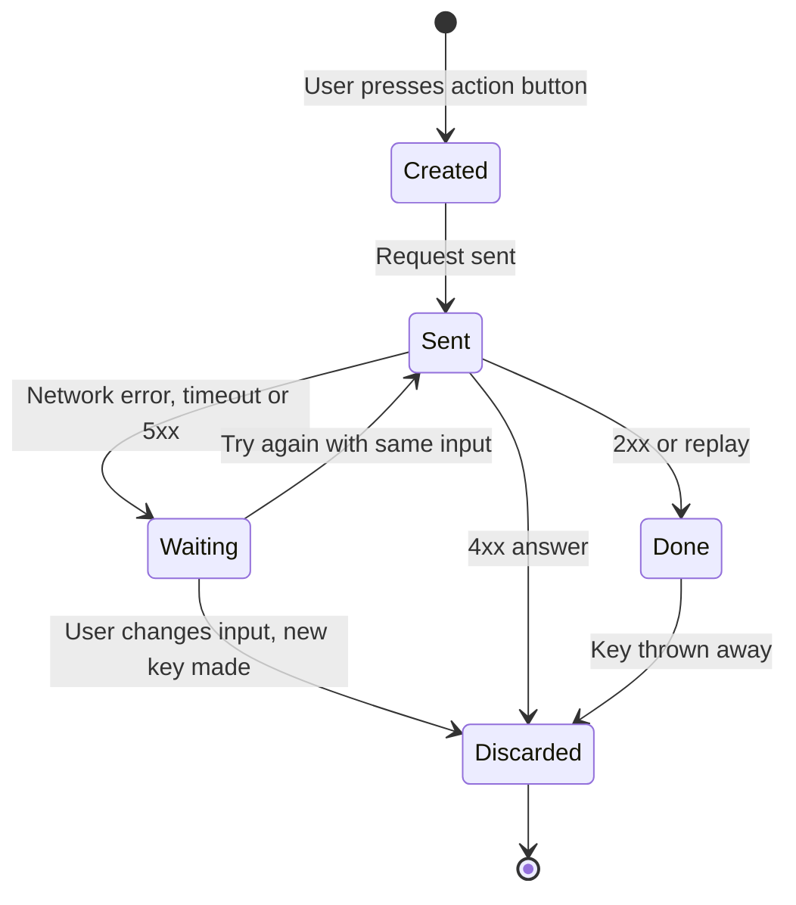


### 3.4 Double-click and double-submit

- Every action button is disabled from the first press until the response arrives. It shows a spinner.
- Forms submit only once even if Enter is pressed twice.
- This is a usability guard only. The real protection is the backend (idempotency key, parcel version, status checks).

### 3.5 Keeping data fresh

- Lists use TanStack Query. Data is fetched again when the screen opens, when the window gets focus again, and after every action. \[Repo\] web/README stack
- The dispatch board also refreshes on a timer, proposed every 30 seconds. **\[Proposed; no live-update stream exists for staff screens yet\]**
- If the server and the screen disagree, the server wins (Doc 1 section 5).

**Figure 3.3 When lists are fetched again**

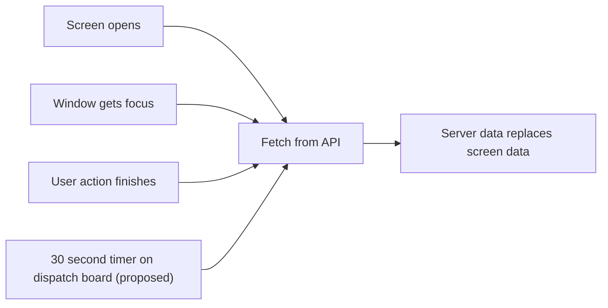


## 4. State machines

These state machines belong to other modules. I copy them here so my screens show the right buttons. If a module changes its machine, this section must be updated.

### 4.1 Parcel lifecycle (owner: Member 2; dispatch steps by Member 3) \[Repo\] domain-boundaries.md 3, Member 3 Doc 4

The arrows below are the ones my screens can trigger through Member 3's endpoints (Doc 1 R-01).

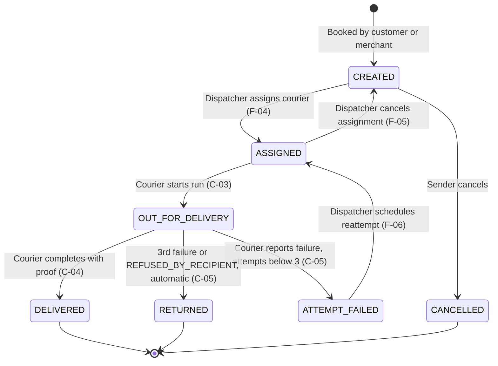

**Permitted transitions and which of my screens can ask for them**

| From | To | Who may ask | My screen and button | Endpoint (Member 3 Doc 4) |
| --- | --- | --- | --- | --- |
| CREATED | ASSIGNED | Dispatcher, admin | Dispatch board, "Assign" | `POST /api/v1/dispatch/assignments` (3.5) |
| ASSIGNED | CREATED (assignment CANCELLED) | Dispatcher, admin | Dispatch board, "Unassign" or first half of "Reassign" | `POST /api/v1/dispatch/assignments/{id}/cancel` (3.6) |
| ASSIGNED | OUT\_FOR\_DELIVERY | Assigned courier | Courier task, "Start run" (one or many) | `POST /api/v1/courier/parcels/{id}/start-run`, `POST /api/v1/courier/runs/start-batch` (3.10, 3.11) |
| OUT\_FOR\_DELIVERY | DELIVERED | Assigned courier | POD screen, "Confirm delivery" | `POST /api/v1/deliveries/{id}/complete` (3.13) |
| OUT\_FOR\_DELIVERY | ATTEMPT\_FAILED or RETURNED | Assigned courier | Courier task, "Delivery failed" | `POST /api/v1/deliveries/{id}/failed` (3.14) |
| ATTEMPT\_FAILED | ASSIGNED | Dispatcher, admin | Failed-delivery review, "Schedule reattempt" | `POST /api/v1/dispatch/parcels/{id}/reschedule` (3.7) |
| CREATED | CANCELLED | Sender | Not on my screens | Member 2 |

**Rules for my screens**

- A button is shown only when the parcel's current status allows that transition in the table above. This is for usability only (INV-01). The backend still checks.
- DELIVERED, RETURNED and CANCELLED are final. No action buttons are shown for them.
- There is **no** dispatcher "Return" button. Member 3 sets RETURNED itself after the 3rd failed attempt or a refusal (BR-ATM-004).
- Every status change is one database transaction that updates `parcels`, adds a row to `parcel_status_history` and adds an `outbox_events` row \[Repo\] database-schema 3.4. My screens never see a "half done" change.
- A rejected (illegal) transition creates no history and no event (SRS AT-007). The screen shows the error and refreshes.

**Known gap (not mine to decide):** Member 3's start-run goes from ASSIGNED straight to OUT\_FOR\_DELIVERY, while domain-boundaries.md also has PICKED\_UP and IN\_TRANSIT. The docs audit (decision 6) asks Members 2 and 3 to settle the path. My screens show whatever status the API returns, including PICKED\_UP and IN\_TRANSIT, so no screen change is needed either way.

### 4.2 Delivery attempt and failed-delivery decision (owner: Member 3) \[Repo\] ADR-004, Member 3 Doc 2

A **delivery attempt** is a separate record from the parcel status. An attempt row is never changed after it is written (ADR-004 section 2).

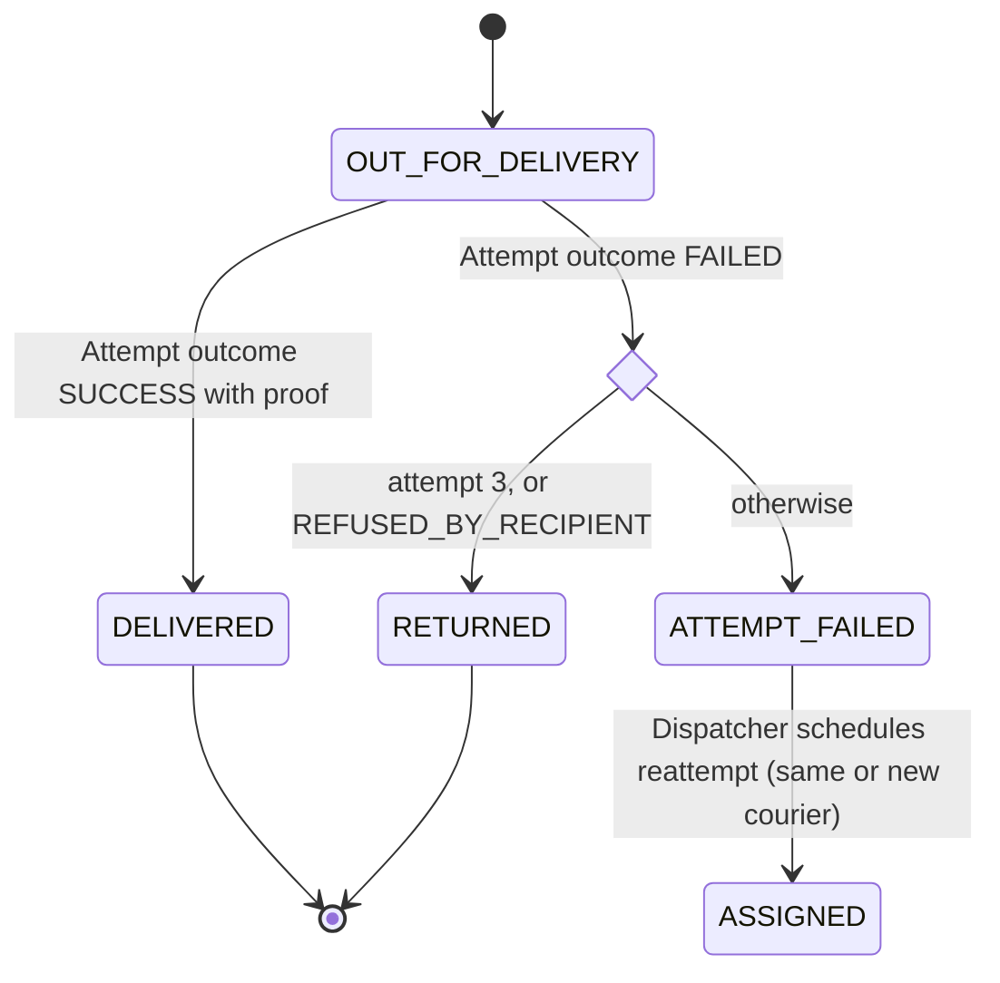

**Failure reason codes** (Member 3 BR-ATM-001, same list as ADR-004) and what the review screen suggests

| Reason code | What Member 3 does | Review screen |
| --- | --- | --- |
| RECIPIENT\_UNAVAILABLE | ATTEMPT\_FAILED (RETURNED on the 3rd) | "Schedule reattempt" (default) |
| CUSTOMER\_REQUESTED\_RESCHEDULE | Same | "Schedule reattempt" with a date and time window |
| ACCESS\_RESTRICTED | Same | "Schedule reattempt" |
| INVALID\_ADDRESS | Same | Reattempt shown with the warning "Check the address first" **\[TBD: who corrects an address, U-08\]** |
| REFUSED\_BY\_RECIPIENT | RETURNED at once | Read only: "Returned to sender (refused)" |
| DAMAGED\_IN\_TRANSIT | Same as the first three | "Schedule reattempt", with the note shown in full |
| OTHER (note of at least 15 characters) | Same as the first three | Note shown in full |

The "suggested" button is a hint only. The backend decides if the action is valid; a 4th attempt is refused with 400 `MAX_ATTEMPTS_EXCEEDED`.

### 4.3 Courier assignment (owner: Member 3)

The API returns assignment `status` values `ASSIGNED` (active) and `CANCELLED` (Member 3 Doc 4 3.5 and 3.6). Member 3's table design uses `ACTIVE`, `COMPLETED`, `REASSIGNED`, `CANCELLED` (Member 3 Doc 5); Member 3 must make the two match **\[TBD U-67\]**. My screens show the API value as text and never compute it. There is no courier accept or reject step.

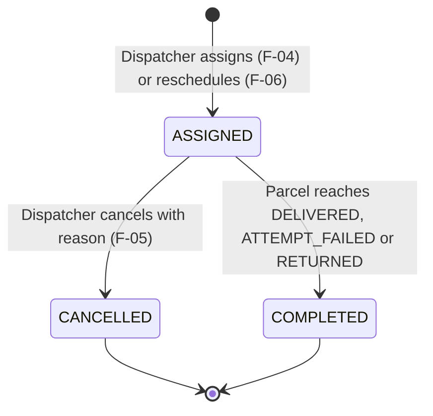

**Rules** \[Repo\] SRS 5.3, Member 3 Doc 2

- A parcel has **at most one active** assignment at a time.
- A courier cannot have more active assignments than their vehicle capacity (MOTORCYCLE 25, VAN 60, TRUCK 120).
- Only couriers who are ON\_SHIFT can get new work (400 `COURIER_NOT_ON_SHIFT`).
- Reassignment keeps the old assignment row (CANCELLED with `cancellation_reason`) and creates a new one (BR-DSP-005).
- "Active workload" is Member 3's `active_assignments` number; the board shows it as is.

### 4.4 Courier operational status (owner: Member 3)

Values: OFF\_SHIFT, ON\_SHIFT, ON\_BREAK, SUSPENDED (Member 3 Doc 4 3.8). The courier changes their own shift with `POST /api/v1/courier/shift`; a suspended courier gets 403 `COURIER_SUSPENDED`. The fleet screen shows the value as text and never computes it.

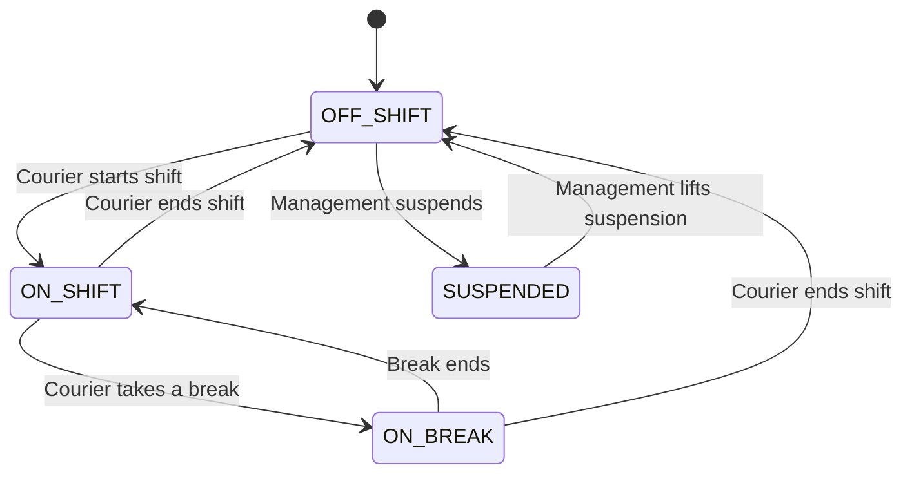

### 4.5 Merchant account (owner: Member 4) \[Repo\] Member 4 Doc 2 2.1 and OpenAPI

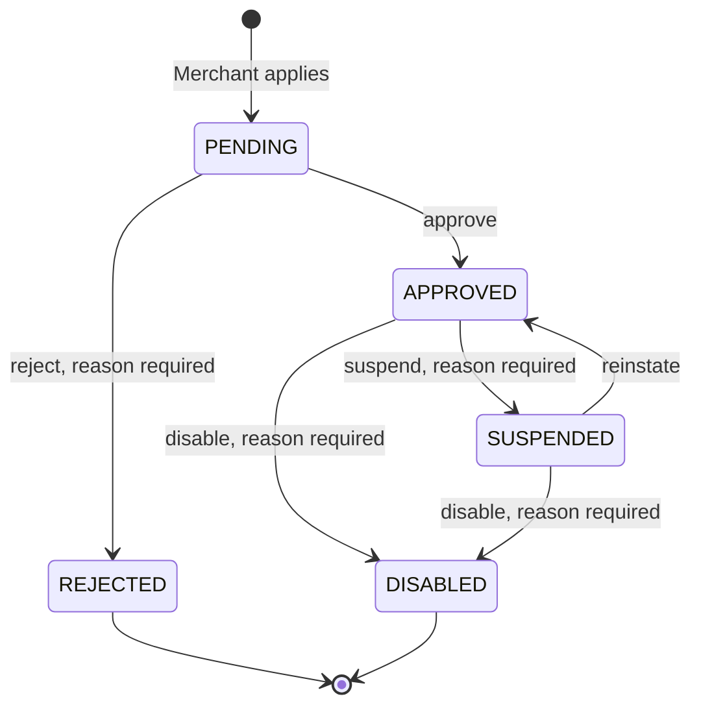

**Rules:** each action is `POST /api/v1/admin/merchants/{id}/{action}` with `expected_version`; reject, suspend and disable also need `reason` (5 to 500 characters). Disable revokes all API keys and turns off all webhooks. Every change writes an `audit_logs` row (for example `MERCHANT_APPROVED`) in the same transaction \[Repo\] SRS FR-IAM-009. A merchant that is not APPROVED cannot create orders (SRS AT-011). That check is done by Member 4, not by my screen.

### 4.6 Delivery zone and pricing rule (owners: admin module and Member 2)

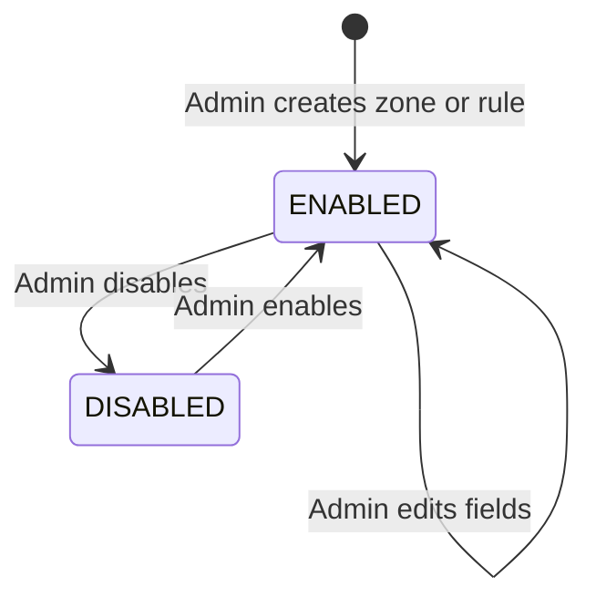

- A zone or rule is never deleted. It is disabled (database-schema 3.1, soft deletes only).
- Pricing rules have a `version` and `effective_from` / `effective_to`. Editing a rule that is already in use should create a **new version**, so old quotes keep their rule version (SRS 5.2, pricing\_quotes stores `rule_version_id`) **\[TBD U-14: Member 2 to confirm "edit makes new version"\]**.
- The on/off field is `enabled` for both zones and rules (database-schema.md). Zones carry no money; any per-zone charge is a pricing rule (Doc 1 R-04).

### 4.7 Staff session in the browser (UI state only)

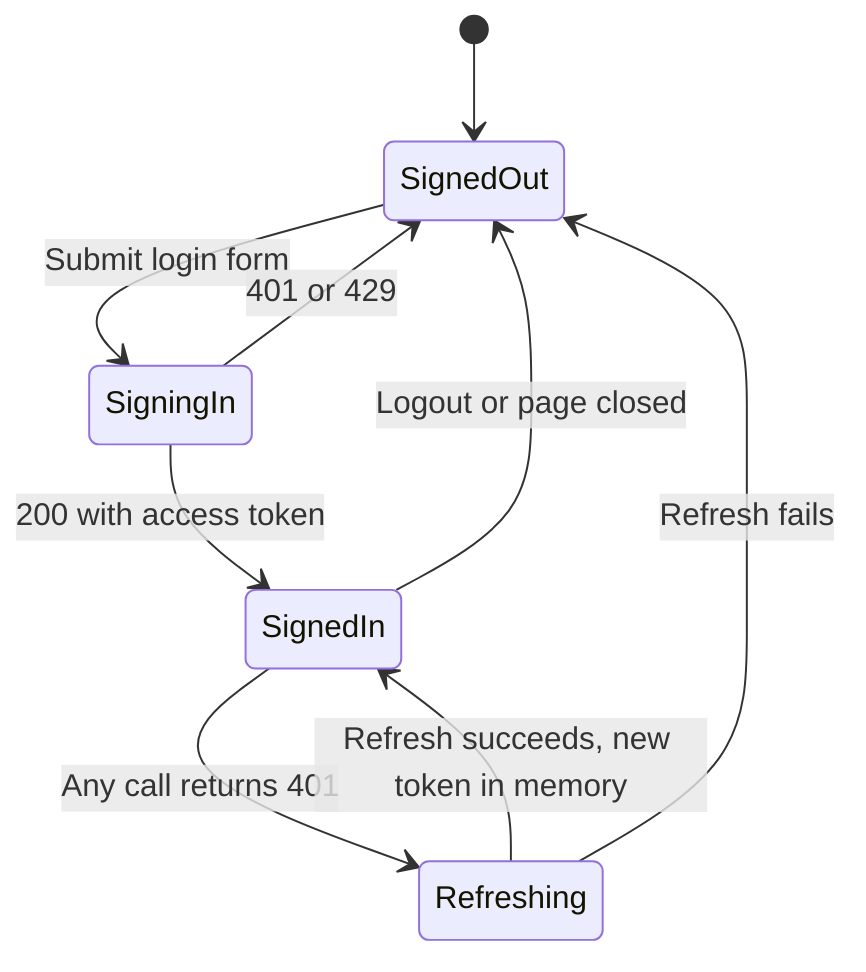

On page reload the in-memory token is gone. The app calls refresh once at start; if the refresh cookie is still valid the user stays signed in (F-01 alternate flow).

## 5. Dispatcher and admin screen flows (`/ops/*`)

### F-01 Staff sign-in and role routing

- **Trigger:** T-01. **Actors:** dispatcher, admin, courier; Identity module (M1).
- **Preconditions:** user has an active account with role DISPATCHER, ADMIN or COURIER.
- **Main flow:**
  1. User opens `/auth/login` and enters email and password.
  2. Screen sends `POST /api/v1/auth/login` \[Repo\].
  3. Backend returns `access_token` (15 minutes), `user.role`, and sets the refresh cookie (HttpOnly, Secure, SameSite=Strict, Path=/api/v1/auth) \[Repo\] ADR-003.
  4. Screen stores the token in memory (AuthContext) only.
  5. Screen sends the user to the start page for the role: DISPATCHER to `/ops/dispatch`, ADMIN to `/ops/dispatch`, COURIER to `/courier/tasks` (Doc 1 D-04).
- **Alternate flows:**
  - A1 Page reload: app calls `POST /api/v1/auth/refresh` at start; success skips the login form.
  - A2 CUSTOMER or MERCHANT signs in on the same screen: sent to `/portal/*` (Member 6). If they type an `/ops/*` address, the route guard shows "Not allowed" and the backend returns 403 to any call (web/README e2e journey 5).
  - A3 Google sign-in: staff use email and password only **\[TBD with M1: may staff use Google?\]**.
- **Failure flows:**
  - E1 Wrong password: 401 `AUTH_INVALID_CREDENTIALS`. Show "Email or password is wrong." Do not say which one.
  - E2 Too many tries: 429. Show the wait message. The limit is 5 per minute per IP, burst 3 \[Repo\] security-notes 3; the repo gateway file lacks it and my proposed file adds it (G-02).
  - E3 Server down: show safe error with "Try again".
- **Postconditions:** token in memory, refresh cookie set, role-based menu shown. Nothing stored in localStorage or sessionStorage (INV-11).
- **Rules:** menu items are hidden by role for usability only (INV-01). Courier token storage differs in ADR-003 **\[TBD U-01\]**; until decided, couriers use the same in-memory rule as staff.

**Figure F-01a Sign-in sequence**

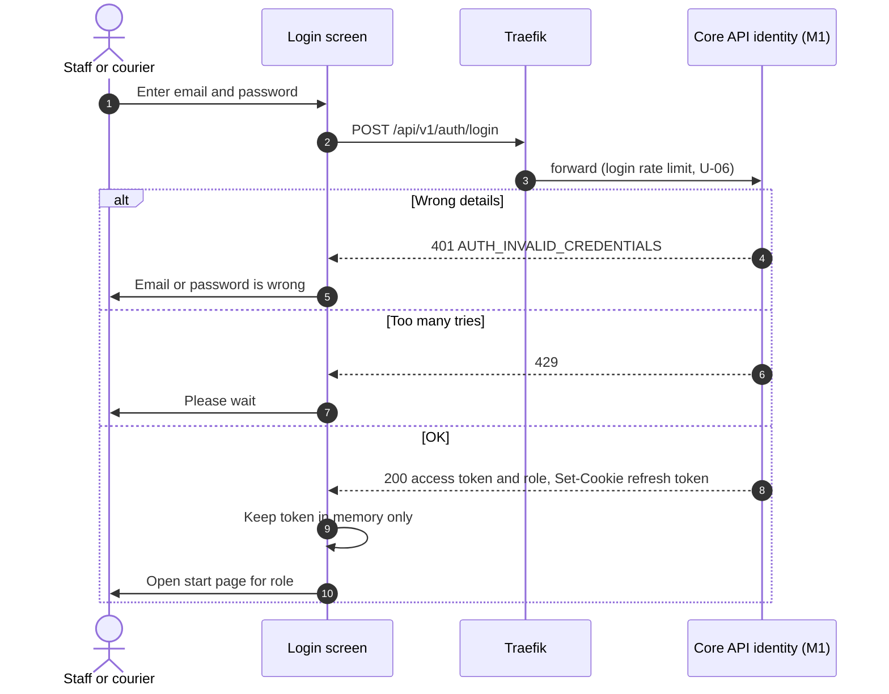


**Figure F-01b Role routing after sign-in**

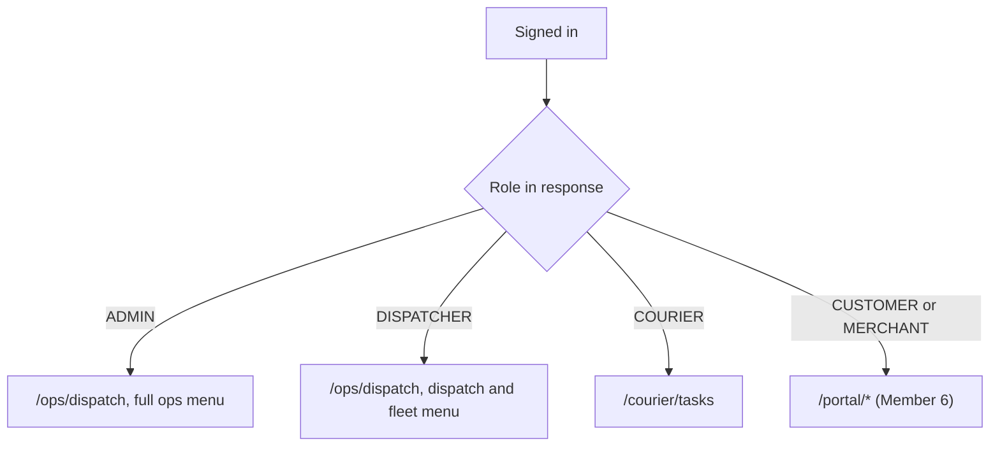


### F-02 Silent token refresh (all screens)

- **Trigger:** any API call returns 401. **Actors:** any signed-in user; Identity module.
- **Preconditions:** a refresh cookie may exist.
- **Main flow:**
  1. Call returns 401.
  2. Client starts **one** refresh: `POST /api/v1/auth/refresh` (cookie sent by browser).
  3. Backend checks the refresh token, marks it used, returns a new access token and sets a new cookie (rotation) \[Repo\] ADR-003 4.2.
  4. Client saves the new token in memory and repeats the failed call **once**.
- **Concurrency rule (important):** if 5 calls get 401 at the same moment, the client must send **only one** refresh request and make the other 4 wait for it. Reason: refresh tokens are single use. If two refresh calls send the same old token, the backend sees "reuse", treats it as theft and logs the user out of every session (ADR-003 4.2, SEC-004).
- **Failure flows:** refresh returns 401 (expired, reused or revoked) then clear memory, go to `/auth/login`, show "Your session has ended. Please sign in again." Any unsaved form text is lost **\[Proposed: keep a draft in memory for the current page only\]**.
- **Postconditions:** new access token in memory, or user signed out.
- **Note:** `/auth/refresh` and `/auth/logout` are in ADR-003 but not in identity API.md yet (Doc 1 section 9).

**Figure F-02a One shared refresh for many 401s**

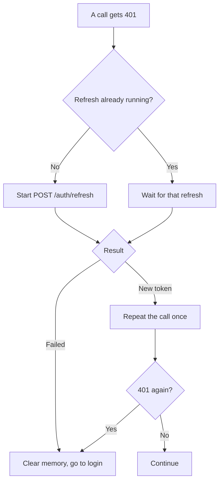


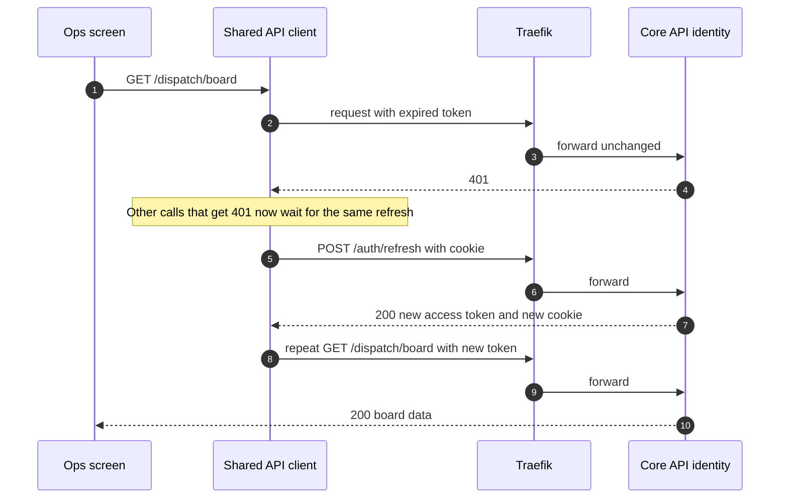

### F-03 Load the dispatch board (M7-UI-01, M7-UI-04)

- **Trigger:** T-02; dispatcher opens `/ops/dispatch` or the 30-second timer fires. **Actors:** dispatcher or admin; Dispatch module (M3).
- **Preconditions:** signed in as DISPATCHER or ADMIN.
- **Main flow:**
  1. Dispatcher picks a zone. The zone picker is **required**, because Member 3's board needs `zone_id` (default: last zone used in this browser tab, else the first enabled zone from `GET /api/v1/admin/zones` or the public `GET /api/v1/zones`).
  2. Screen calls `GET /api/v1/dispatch/board?zone_id=ZONE_COLOMBO_01` (Member 3 Doc 4 3.4).
  3. Screen shows the `summary` line (unassigned parcels, couriers on shift, fleet capacity used) and two panels: **Parcels** (tracking number, weight, city, age, and `attempt_count` for ATTEMPT\_FAILED parcels) and **Couriers** (name, employee code, vehicle, shift status, load bar `active_assignments / max_capacity`).
  4. Couriers with `capacity_available` 0 are shown with the text "Full" and greyed out, but still listed.
- **Alternate flows:**
  - A1 No parcels: empty state "No parcels waiting in this zone."
  - A2 No couriers on shift: empty state "No couriers on shift in this zone." Assign buttons are disabled.
  - A3 Parcels in ATTEMPT\_FAILED: the board returns them too (`status=ATTEMPT_FAILED` filter); they get a "Needs review" badge that opens F-06.
- **Failure flows:** 400 if `zone_id` is missing or unknown (the picker prevents this); 403 for a COURIER who types the address; 500 shows error with "Try again"; the last good data stays on screen with the label "Last updated hh:mm" when a timed refresh fails.
- **Postconditions:** none (read only).
- **Rules:** the screen does not sort couriers by "best choice" or suggest one. That would be a business decision for Member 3. Sorting by name or by load is allowed because it is display only.

**Figure F-03 Loading the board**

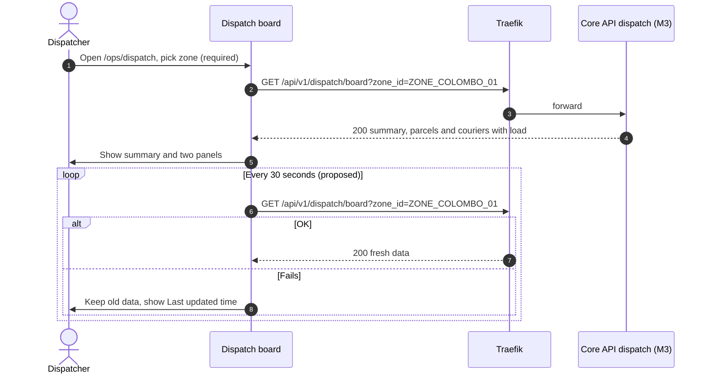


### F-04 Assign a parcel to a courier (M7-UI-02, M7-UI-05)

- **Trigger:** dispatcher picks a parcel and a courier and presses "Assign". **Actors:** dispatcher or admin; Dispatch module (M3); Parcels module (M2).
- **Preconditions:** parcel is shown as CREATED or ATTEMPT\_FAILED; courier is shown as ON\_SHIFT and not full. (The backend checks both again.)
- **Main flow:**
  1. Dispatcher selects a parcel, then a courier. A confirm box shows "Assign SD-20261024-04921 to Bob Miller (3/25)?".
  2. Client creates an Idempotency-Key and sends `POST /api/v1/dispatch/assignments` with `{ "parcel_id", "courier_id" }` (Member 3 Doc 4 3.5).
  3. Backend (M3) checks role, parcel status, courier shift and capacity, then in one transaction creates the assignment, moves the parcel to ASSIGNED (through the Parcel aggregate, M2), writes history and the `parcel.assigned.v1` outbox event.
  4. Backend returns 200 with `assignment_id`, `status: "ASSIGNED"`, `assigned_by`, `assigned_at`.
  5. Screen shows "Assigned", refreshes the board. The parcel leaves the list and the courier load goes up by 1.
- **Alternate flows:**
  - A1 Assign several parcels to one courier: done as separate requests one by one, each with its own key. If one fails, the others are not undone; the screen lists which ones failed (no bulk assign endpoint exists).
- **Failure flows:**

| Response | Meaning | Screen action |
| --- | --- | --- |
| 400 `PARCEL_NOT_ELIGIBLE_FOR_ASSIGNMENT` | Parcel is no longer CREATED or ATTEMPT\_FAILED | "This parcel can no longer be assigned. The board has been refreshed." |
| 400 `COURIER_NOT_ON_SHIFT` | Courier went off shift or on break | "Bob Miller is not on shift." Refresh |
| 409 `COURIER_CAPACITY_EXCEEDED` | Courier is full | "Bob Miller has reached maximum capacity (25)." Refresh |
| 409 `PARCEL_ALREADY_ASSIGNED` | Another dispatcher assigned it first | "Someone else assigned this parcel." Refresh |
| 404 | Parcel or courier no longer exists | "Parcel or courier not found." Refresh |
| 403 | Not allowed | Permission message, no retry |
| Network error or 5xx | Unknown if it worked | "Try again" with the **same key** (Member 3 accepts `Idempotency-Key` here) |

- **Postconditions (success):** parcel ASSIGNED, exactly one active assignment, history row with actor DISPATCHER, outbox event written. **(failure):** nothing changed.
- **Rules:** FR-ADM-002, FR-ADM-003, SRS 5.3. The screen never sends `assigned_by`; the backend takes it from the token.

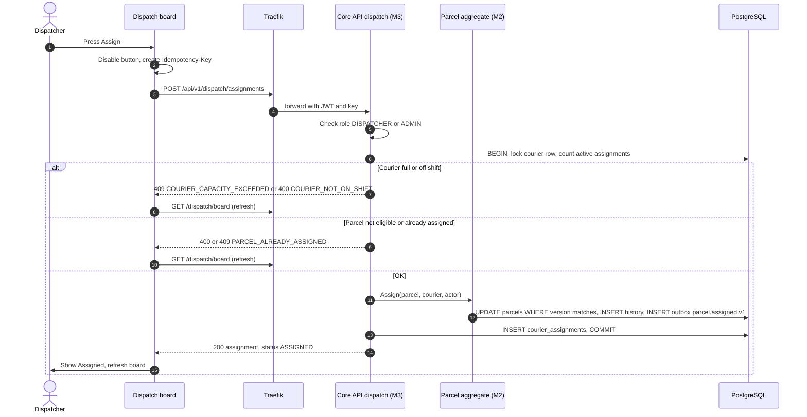

The "lock courier row" step is how Member 3 stops two parallel assignments from both passing the capacity check (Member 3 Doc 3).

**Figure F-04b Assign button on screen**

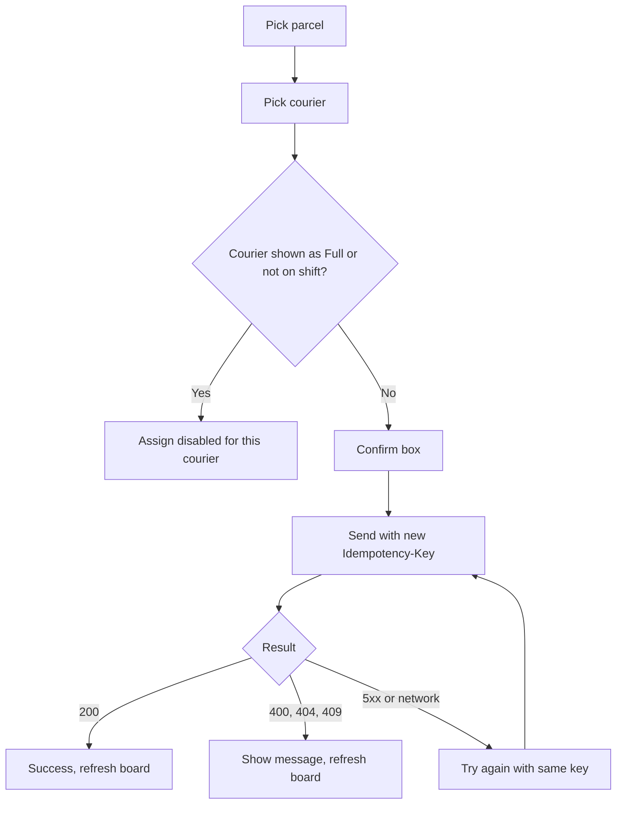


### F-05 Reassign a courier (M7-UI-03)

- **Trigger:** T-03. **Actors:** dispatcher or admin; Dispatch module (M3).
- **Preconditions:** parcel is ASSIGNED (not yet OUT\_FOR\_DELIVERY). There is no separate reassign endpoint: reassignment is **cancel, then assign** (Member 3 BR-DSP-005).
- **Main flow:**
  1. Dispatcher opens the parcel and presses "Reassign".
  2. Picks a new courier and must type a reason (`cancellation_reason`, required).
  3. Client sends `POST /api/v1/dispatch/assignments/{assignment_id}/cancel` with `{ "cancellation_reason" }`.
  4. Backend ends the old assignment (`status: "CANCELLED"`, `ended_at`), the parcel goes back to the board, the old courier's load goes down.
  5. Client then sends `POST /api/v1/dispatch/assignments` for the new courier with a new Idempotency-Key (same as F-04).
  6. Board refreshes.
- **Alternate flow:** A1 "Unassign" only: steps 1 to 4 without choosing a new courier.
- **Failure flows:** 404 `ASSIGNMENT_NOT_FOUND`; 409 `ASSIGNMENT_ALREADY_CLOSED` (the courier already started the run or someone else cancelled) then refresh. If step 3 works and step 5 fails (new courier full), the parcel stays on the board unassigned and the screen says so, so the dispatcher can pick another courier.
- **Postconditions:** old assignment kept as history with the reason; at most one active assignment (SRS 5.3).
- **Edge case:** if the courier starts the run at the same moment, only one request can win. The loser gets 409 and the screen refreshes.

**Figure F-05 Reassign = cancel, then assign**

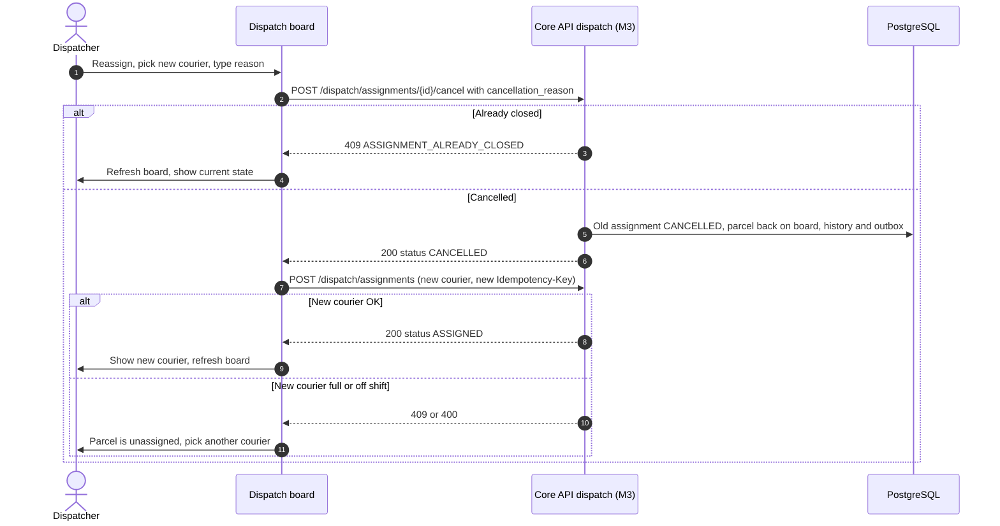


### F-06 Failed-delivery review and reattempt (M7-UI-06)

- **Trigger:** T-04. **Actors:** dispatcher or admin; Dispatch and Delivery (M3).
- **Preconditions:** parcel is ATTEMPT\_FAILED.
- **Main flow:**
  1. Dispatcher opens `/ops/failed-deliveries` (or the "Needs review" badge on the board) and picks a parcel.
  2. Screen loads `GET /api/v1/deliveries/parcels/{id}` (Member 3 Doc 4 3.15). It shows: "Attempt 1 of 3 failed", reason code with a readable label, courier note, time and courier.
  3. Dispatcher presses **Schedule reattempt**, picks the same or a new on-shift courier (`target_courier_id`), a date (`scheduled_date`), a time window (`preferred_time_window`) and may add `dispatch_notes`.
  4. Client sends `POST /api/v1/dispatch/parcels/{id}/reschedule` with an Idempotency-Key.
  5. Backend checks the status and attempt count, moves the parcel to ASSIGNED with the chosen courier, writes history and an event.
  6. Screen shows "Reattempt scheduled for 25 Oct, afternoon" and removes the parcel from the list.
- **Alternate flows:**
  - A1 Parcel already RETURNED (3rd failure or refusal, set automatically by Member 3): read-only view "Returned to sender", no buttons.
  - A2 INVALID\_ADDRESS: the button stays, with the warning "Check the address first" (U-08).
- **Failure flows:** 400 `MAX_ATTEMPTS_EXCEEDED` (should not happen, because the 3rd failure already returns the parcel) then refresh; 409 `INVALID_STATE_FOR_RESCHEDULE` (another dispatcher already scheduled it) then refresh; 400 `COURIER_NOT_ON_SHIFT` or 409 `COURIER_CAPACITY_EXCEEDED` for the chosen courier; 403 if role not allowed.
- **Postconditions:** parcel ASSIGNED to the chosen courier, or unchanged on error. Attempt records are never changed.

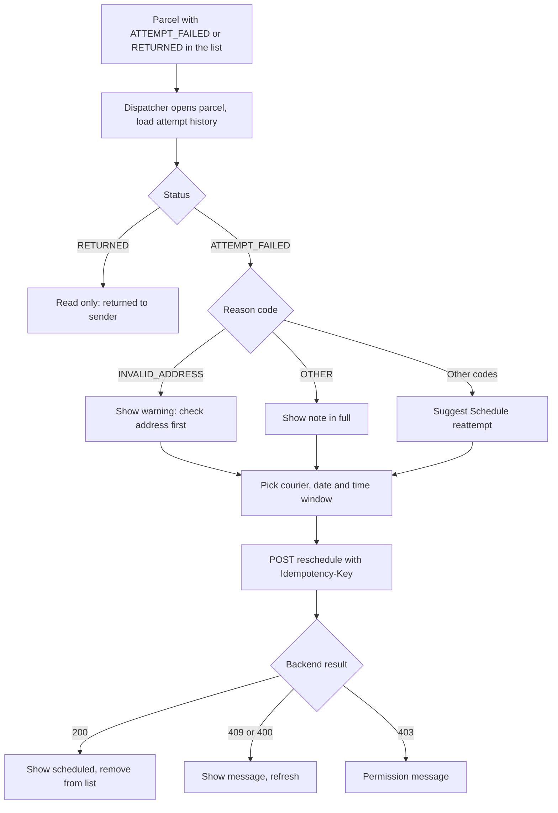

**Figure F-06b Reattempt sequence**

```mermaid
sequenceDiagram
    autonumber
    actor D as Dispatcher
    participant UI as Review screen
    participant GW as Traefik
    participant M3 as Core API dispatch and delivery (M3)
    participant DB as PostgreSQL
    D->>UI: Open parcel in /ops/failed-deliveries
    UI->>GW: GET /api/v1/deliveries/parcels/{id}
    GW->>M3: forward
    M3-->>UI: status ATTEMPT_FAILED, attempt 1 of 3, reason, note
    D->>UI: Schedule reattempt (courier, date, window)
    UI->>GW: POST /api/v1/dispatch/parcels/{id}/reschedule with Idempotency-Key
    GW->>M3: forward
    M3->>DB: BEGIN, check role, status and attempt_count
    alt Allowed
        M3->>DB: UPDATE parcels to ASSIGNED, INSERT assignment, history, outbox, COMMIT
        M3-->>UI: 200 status ASSIGNED, scheduled_date
    else Already scheduled or limit reached
        M3-->>UI: 409 INVALID_STATE_FOR_RESCHEDULE or 400 MAX_ATTEMPTS_EXCEEDED
        UI->>GW: Reload parcel
    end
```


### F-07 Fleet screen (M7-UI-07)

- **Trigger:** T-05. **Actors:** dispatcher, admin; Dispatch module (M3).
- **Preconditions:** signed in as DISPATCHER or ADMIN.
- **Main flow:** open `/ops/couriers`; the screen calls `GET /api/v1/dispatch/couriers` with optional filters `zone_id`, `status` (ON\_SHIFT, OFF\_SHIFT, ON\_BREAK, SUSPENDED) and `vehicle_type`; it lists name, employee code, phone, vehicle, capacity, shift status, zone and load. Clicking a courier opens `GET /api/v1/dispatch/couriers/{id}`.
- **Alternate flow:** A1 "Add courier": a form sends `POST /api/v1/dispatch/couriers` with `user_id`, `employee_code`, `vehicle_type`, `max_capacity`, `current_zone_id` (the user account must already exist with role COURIER, from Member 1). Errors: 400 `INVALID_VEHICLE_TYPE`, 409 `COURIER_PROFILE_EXISTS`.
- **Failure flows:** standard (3.2).
- **Rules:** shift changes are made by the courier (`POST /api/v1/courier/shift`), not by the dispatcher. Member 3 has no dispatcher endpoint to suspend a courier; that is a request to Member 3 if the team wants it.

**Figure F-07 Fleet screen**

```mermaid
sequenceDiagram
    autonumber
    actor D as Dispatcher
    participant UI as Fleet screen
    participant DSP as Core API dispatch (M3)
    D->>UI: Open /ops/couriers, set filters
    UI->>DSP: GET /api/v1/dispatch/couriers?zone_id=&status=&vehicle_type=
    DSP-->>UI: Couriers with shift status, vehicle, zone, load
    D->>UI: Add courier
    UI->>DSP: POST /api/v1/dispatch/couriers
    alt Created
        DSP-->>UI: 201 profile, status OFF_SHIFT
    else Bad vehicle or profile exists
        DSP-->>UI: 400 INVALID_VEHICLE_TYPE or 409 COURIER_PROFILE_EXISTS
    end
    UI->>DSP: Reload list
```


### F-08 Merchant list, detail and status actions (M7-UI-08, M7-AD-05)

- **Trigger:** T-06. **Actors:** admin; admin module (my routes); Merchants module (M4, `merchants.AdminService`).
- **Preconditions:** signed in as ADMIN.
- **Main flow:**
  1. Admin opens `/ops/merchants`. The screen calls `GET /api/v1/admin/merchants?status=PENDING&q=&page=1&per_page=20` and shows a table with business name, contact email, status and `version`.
  2. Admin opens one merchant (`/ops/merchants/:id`, `GET /api/v1/admin/merchants/{id}`) and checks the business details.
  3. The screen shows only the buttons the state machine in 4.5 allows: Approve and Reject for PENDING; Suspend and Disable for APPROVED; Reinstate and Disable for SUSPENDED; none for REJECTED or DISABLED.
  4. Admin presses a button. Reject, Suspend and Disable open a reason box (5 to 500 characters).
  5. Client sends `POST /api/v1/admin/merchants/{id}/{approve|reject|suspend|reinstate|disable}` with `{ "expected_version": 3, "reason": "..." }`.
  6. My admin route checks role ADMIN, validates the body and calls `merchants.AdminService.ChangeStatus` with the actor (user id, role, request id, client IP, user agent). Member 4 checks the move, saves the new status with the version check and writes the `audit_logs` row in the same transaction.
  7. Screen shows the new status and refreshes.
- **Failure flows:** 409 if `expected_version` is stale (another admin acted): reload and show the current status; 422 if the move is not allowed (for example PENDING to SUSPENDED) or the reason is too short; 404 unknown merchant.
- **Postconditions:** new status saved and audited. If APPROVED, the merchant can create orders and API keys; if SUSPENDED or DISABLED, Member 4 rejects their API calls at once (AT-011); DISABLED also revokes keys and webhooks.

```mermaid
sequenceDiagram
    autonumber
    actor A as Admin
    participant UI as Merchant screens
    participant GW as Traefik
    participant ADM as Admin routes (M7)
    participant M4 as merchants.AdminService (M4)
    participant DB as PostgreSQL
    A->>UI: Open /ops/merchants
    UI->>GW: GET /api/v1/admin/merchants?status=PENDING
    GW->>ADM: forward
    ADM->>M4: ListMerchants(filter, page)
    M4-->>UI: data and meta
    A->>UI: Open merchant, press Suspend, type reason
    UI->>GW: POST /api/v1/admin/merchants/{id}/suspend {expected_version, reason}
    GW->>ADM: forward
    ADM->>ADM: Require ADMIN, validate body
    ADM->>M4: ChangeStatus(SUSPEND, version, reason, actor)
    M4->>DB: BEGIN, UPDATE merchants WHERE version matches, INSERT audit_logs, outbox, COMMIT
    alt OK
        M4-->>UI: 200 merchant, status SUSPENDED
    else Stale version or move not allowed
        M4-->>UI: 409 or 422
        UI->>GW: Reload merchant
    end
```

### F-09 User and role management (M7-UI-09)

- **Trigger:** T-07. **Actors:** admin; Identity module (M1).
- **Preconditions:** signed in as ADMIN. Endpoints requested from M1 (Doc 1 section 9, U-66).
- **Main flow:** list users with filters; open one; change role (one of ADMIN, DISPATCHER, COURIER, MERCHANT, CUSTOMER) or disable the account; reason required; backend audits it (FR-IAM-009).
- **Rules (proposed, backend enforces):**
  - An admin cannot disable their own account or remove their own ADMIN role (prevents lock-out). **\[Proposed; M1 to confirm\]**
  - The last active ADMIN cannot be removed. **\[Proposed; M1 to confirm\]**
  - A disabled user's sessions are ended so they cannot keep working with a refresh token. **\[TBD with M1\]**
  - Changing a role takes effect at the user's next token (within 15 minutes) unless M1 revokes sessions. The screen says so. **\[TBD with M1\]**
  - Making a user a COURIER also needs a courier profile (vehicle, capacity): the admin then adds it on the fleet screen with `POST /api/v1/dispatch/couriers` (F-07).
- **Failure flows:** 409 email already used; 422 rule broken (for example self-disable); 403.
- **Postconditions:** role or status changed and audited.

**Figure F-09 Change a role or disable a user**

```mermaid
flowchart TD
    A["Admin opens user"] --> B["Choose new role or Disable"]
    B --> C["Type reason"]
    C --> D["Send to identity module with key [TBD endpoint]"]
    D --> E{"Backend checks (M1)"}
    E -- "Own account" --> X["422 not allowed (proposed)"]
    E -- "Last active admin" --> X
    E -- "OK" --> F["Save, write audit row"]
    F --> G{"Disable?"}
    G -- "Yes" --> H["End user sessions [TBD M1]"]
    G -- "No" --> I["Role used from next token, within 15 min"]
    F --> J{"New role COURIER?"}
    J -- "Yes" --> K["Add courier profile on fleet screen (F-07)"]
```


### F-10 Delivery zone management (M7-UI-10, M7-AD-01)

Screen side of backend flow A-01.

- **Trigger:** T-08. **Actors:** admin; admin module.
- **Preconditions:** signed in as ADMIN.
- **Main flow:**
  1. Admin opens `/ops/zones` and sees the zone list (id, code, name, enabled, number of postal prefixes).
  2. Admin presses "New zone" and fills the zone id (for example `ZONE_GALLE_01`, fixed forever), short code (for example `GLE-01`), name, optional description and postal code prefixes.
  3. Screen does simple form checks only (required fields, id and code format, prefixes are 3 to 5 digits) to help the user. The backend repeats all checks.
  4. Client sends `POST /api/v1/admin/zones` with an Idempotency-Key.
  5. On 201 the list refreshes.
- **Alternate flows:** edit zone (`PATCH /api/v1/admin/zones/{id}` with `version`); enable or disable zone (`PATCH /api/v1/admin/zones/{id}/status` with `version` and `reason`). The id cannot be edited.
- **Failure flows:** postal prefix overlaps another zone: the message names the conflicting zone (from `error.details`); zone id or code taken; stale `version` (someone else saved first).
- **Rules:** there is **no money field** on the zone form. A charge for a zone is set on the pricing screen (F-11) as a Member 2 pricing rule (Doc 1 R-04).

**Figure F-10 Zone form on screen**

```mermaid
flowchart TD
    A["Admin fills zone form: id, code, name, prefixes"] --> B{"Simple checks pass? required, id and code format, 3 to 5 digits"}
    B -- "No" --> C["Show field hint, stay on form"]
    B -- "Yes" --> D["POST /api/v1/admin/zones with key"]
    D --> E{"Result"}
    E -- "201" --> F["Refresh zone list"]
    E -- "409 postal prefix" --> G["Show conflicting zone name, keep input"]
    E -- "409 id or code" --> H["Show id or code already used"]
    E -- "422" --> I["Show field errors"]
```


### F-11 Pricing rule management (M7-UI-11)

- **Trigger:** T-08. **Actors:** admin; Pricing module (M2).
- **Preconditions:** signed in as ADMIN; zones exist.
- **Main flow:** list rules (origin zone, destination zone, service level, weight range, base fee in LKR, effective dates, version, enabled); create or edit; client sends with an Idempotency-Key to the M2 proposed endpoints \[Proposed\]; refresh.
- **Failure flows:** 422 messages from M2 (for example "Minimum weight must be less than maximum weight", "Base fee cannot be negative"); 409 overlap naming the existing rule (if overlaps are forbidden, U-14).
- **Rules:** fees are typed in rupees, converted to integer cents by the shared helper only for sending, never used to compute a price. Effective dates are chosen as Sri Lanka dates and sent as UTC **\[TBD with M2: is effective\_from a date or a timestamp?\]**.
- **Example:** rule "Colombo 01 to Kandy, STANDARD, 0 to 5 kg, base fee LKR 450.00" is sent as `base_fee_cents: 45000`.

**Figure F-11 Save a pricing rule (endpoints proposed by M2)**

```mermaid
sequenceDiagram
    autonumber
    actor A as Admin
    participant UI as Pricing screen
    participant GW as Traefik
    participant PRC as Core API pricing (M2)
    participant DB as PostgreSQL
    A->>UI: Fill rule, base fee LKR 450.00
    UI->>UI: Shared helper turns 450.00 into 45000 cents for sending only
    UI->>GW: POST /api/v1/admin/pricing-rules with Idempotency-Key
    GW->>PRC: forward
    PRC->>PRC: Validate weights, fees, dates
    PRC->>DB: Check overlap with enabled rules
    alt Overlap and overlaps forbidden (U-14)
        PRC-->>UI: 409 naming existing rule
    else Invalid values
        PRC-->>UI: 422 with messages
    else OK
        PRC->>DB: INSERT rule with version 1, COMMIT
        PRC-->>UI: 201 rule
        UI->>A: Show rule, refresh list
    end
```


### F-12 Reports (M7-UI-12, M7-AD-03)

Screen side of A-03.

- **Trigger:** T-09. **Actors:** admin or dispatcher (SRS 6.2: "Admin/authorized dispatcher"); admin module.
- **Main flow:** pick a date range (default last 7 days); call `GET /api/v1/admin/reports/deliveries?from=…&to=…` (SRS 6.2 name, Doc 1 R-16); show deliveries per day, delivered, failed attempts, returned, and the success and failure rate for the period (FR-ADM-008).
- **Rules:** values are shown exactly as returned. The screen does not recompute percentages (INV-02). "97.2%" is shown as "97.2%".
- **Failure flows:** `from` after `to` gives 422; range longer than `reports.max_range_days` (setting, default 92) gives 422; empty period shows zeros with "No parcels in this period".

**Figure F-12 Reports screen**

```mermaid
sequenceDiagram
    autonumber
    actor A as Admin or dispatcher
    participant UI as Reports screen
    participant GW as Traefik
    participant ADM as Core API admin
    A->>UI: Pick dates
    UI->>UI: Block from after to
    UI->>GW: GET /api/v1/admin/reports/deliveries?from&to
    GW->>ADM: forward
    ADM->>ADM: Require ADMIN or DISPATCHER
    ADM-->>UI: 200 numbers per day and totals
    UI->>A: Show numbers exactly as returned
```


### F-13 Audit log explorer (M7-UI-12, M7-AD-04)

- **Trigger:** T-10. **Actors:** admin; admin module (A-04).
- **Main flow:** open `/ops/audit`; filter by date, actor, action, `target_type` and `target_id`; page through results (20 per page, max 100) \[Repo\] api-conventions 2.2; open one entry to see `previous_state`, `new_state`, `reason`, `client_ip` and `request_id`.
- **Rules:** read only. No edit or delete buttons exist anywhere (INV-12). Personal data in `previous_state` and `new_state` is shown only to ADMIN **\[TBD with M1: masking rules for audit views\]**.

**Figure F-13 Audit explorer**

```mermaid
sequenceDiagram
    autonumber
    actor A as Admin
    participant UI as Audit explorer
    participant ADM as Core API admin
    participant DB as PostgreSQL
    A->>UI: Set filters
    UI->>ADM: GET /api/v1/admin/audit-logs?page=1&per_page=20
    ADM->>DB: SELECT from audit_logs, newest first
    ADM-->>UI: 200 data and meta
    A->>UI: Next page or open one entry
    UI->>ADM: GET page=2
    Note over UI,ADM: No edit or delete call exists
```


### F-14 Admin parcel correction (M7-UI-13) \[TBD U-08\]

- **Trigger:** T-11. **Actors:** admin; Parcels module (M2).
- **Main flow (if in my scope):** admin opens a parcel, chooses a correction allowed by M2, must type a reason, confirms; backend applies it through the Parcel aggregate and writes history plus `audit_logs` (FR-ADM-009, FR-LIFE-007).
- **Rules:** never a free status dropdown. Only the corrections Member 2 exposes. Endpoint requested (Doc 1 section 9).

**Figure F-14 Parcel correction (if in scope, U-08)**

```mermaid
sequenceDiagram
    autonumber
    actor A as Admin
    participant UI as Correction screen
    participant PA as Core API parcels (M2)
    participant DB as PostgreSQL
    A->>UI: Open parcel, choose an allowed correction
    UI->>UI: Reason is required before Save
    UI->>PA: Correction [TBD endpoint] with reason and key
    PA->>PA: Check ADMIN and that correction is allowed
    PA->>DB: BEGIN, UPDATE parcels, INSERT history, INSERT audit_logs, INSERT outbox, COMMIT
    PA-->>UI: 200 corrected parcel
```


## 6. Courier mobile flows (`/courier/*`)

Couriers work on phones, often on slow or broken connections. Extra rules:

| ID | Rule |
| --- | --- |
| R-CR-01 | Big buttons, one action per screen, works at 360 px width |
| R-CR-02 | Every action that Member 3 marks idempotent sends an Idempotency-Key and keeps it for retries (3.3) |
| R-CR-03 | There is **no offline queue**. If the network is down, the screen says "No connection. Your update was not sent." and keeps the form so the courier can press "Try again" later (offline mode is not in scope) |
| R-CR-04 | After any 409 the task is reloaded and the courier sees the real status (SRS FR-COU-006) |
| R-CR-05 | A courier only ever sees their own tasks. If they open another courier's parcel, the backend returns 403 `NOT_ASSIGNED_COURIER` and the screen shows "This task is not assigned to you" |
| R-CR-06 | The courier limit of 60 requests per minute per user is enforced by the backend; the gateway only has per-IP limits (Doc 1 R-13) |

### C-01 Courier task list and shift

- **Trigger:** courier opens `/courier/tasks`. **Actors:** courier; Dispatch and Delivery (M3).
- **Main flow:** call `GET /api/v1/courier/parcels` (Member 3 Doc 4 3.9; the server scopes it to the signed-in courier); show the shift status and today's parcels grouped by status, with tracking number, recipient name, phone, street, city, weight and handling notes (FR-COU-001, FR-COU-002). A shift switch sends `POST /api/v1/courier/shift` with `ON_SHIFT`, `ON_BREAK` or `OFF_SHIFT`.
- **Alternate flows:** no parcels shows "No tasks for today"; pull to refresh.
- **Failure flows:** 403 `COURIER_SUSPENDED` on the shift switch shows "Your account is suspended. Contact your dispatcher."; otherwise standard.

**Figure C-01 Courier task list**

```mermaid
sequenceDiagram
    autonumber
    actor C as Courier phone
    participant GW as Traefik
    participant M3 as Core API dispatch and delivery (M3)
    C->>GW: POST /api/v1/courier/shift ON_SHIFT
    GW->>M3: forward with courier JWT
    M3-->>C: 200 status ON_SHIFT
    C->>GW: GET /api/v1/courier/parcels
    GW->>M3: forward with courier JWT
    M3->>M3: Only parcels assigned to this courier
    M3-->>C: 200 shift status and parcels
    C->>C: Group by status, show list
```


### C-02 Collect the parcel (barcode check on the phone)

- **Trigger:** courier collects an ASSIGNED parcel at the depot or sender.
- **Main flow:** courier presses "Scan", scans the label (or types the tracking number; scanning is simulated per web/README); the screen compares the scanned number with the task **only to warn** "This label does not match this task". There is no separate pickup call: collecting and starting the run is one step in Member 3's design (C-03).
- **Rule:** the scan check on the phone is a convenience. The backend's assignment check is the real one.

**Figure C-02 Label check on the phone**

```mermaid
flowchart TD
    A["Courier has parcel, task ASSIGNED"] --> B["Scan label or type number"]
    B --> C{"Matches task?"}
    C -- "No" --> D["Warn: label does not match"] --> B
    C -- "Yes" --> E["Ready to start run (C-03)"]
```


### C-03 Start the delivery run

- **Trigger:** courier leaves with one or more ASSIGNED parcels.
- **Main flow:** for one parcel, the courier presses "Start run" and the client sends `POST /api/v1/courier/parcels/{id}/start-run` with `depot_hub_code` and optional `notes`; for the whole list, "Start run for all" sends `POST /api/v1/courier/runs/start-batch` with `parcel_ids` (Member 3 Doc 4 3.10, 3.11). Each parcel becomes OUT\_FOR\_DELIVERY; event `parcel.out_for_delivery.v1`.
- **Failure flows:** 403 `NOT_ASSIGNED_COURIER` (one of the parcels was reassigned) then reload; 409 `INVALID_STATE_TRANSITION` then reload; 400 `EMPTY_PARCEL_LIST` cannot happen because the button needs at least one parcel.

**Figure C-03 Start the delivery run**

```mermaid
sequenceDiagram
    autonumber
    actor C as Courier phone
    participant GW as Traefik
    participant DSP as Core API dispatch (M3)
    participant PA as Parcel aggregate (M2)
    participant DB as PostgreSQL
    C->>GW: POST /api/v1/courier/runs/start-batch {parcel_ids, depot_hub_code}
    GW->>DSP: forward
    DSP->>DSP: Check every parcel is assigned to this courier and ASSIGNED
    DSP->>PA: Move each parcel to OUT_FOR_DELIVERY
    PA->>DB: UPDATE parcels, INSERT history, INSERT outbox parcel.out_for_delivery.v1, COMMIT
    DSP-->>C: 200 total_started and parcels
```


### C-04 Proof of delivery (M7-CR-02)

- **Trigger:** courier hands the parcel to the recipient.
- **Preconditions:** parcel is OUT\_FOR\_DELIVERY and assigned to this courier.
- **Main flow:**
  1. Courier opens `/courier/tasks/:id/pod`.
  2. Captures a signature on screen and types the name of the person who received it (`received_by_name`), optional photo and note.
  3. If there is a photo above 10 MB it is resized on the phone first (about 1600 px wide, JPEG).
  4. If there is a photo, it is uploaded first: `POST /api/v1/deliveries/{id}/proof-photo`, multipart field `photo` (JPEG, PNG or WebP, maximum 10 MB). The answer holds `proof_attachment_url`.
  5. Client sends `POST /api/v1/deliveries/{id}/complete` with `proof_type`, `signature_data`, `received_by_name`, `notes`, `latitude`, `longitude` and an Idempotency-Key (Member 3 Doc 4 3.13).
  6. Backend checks courier, status and proof; in one transaction writes `delivery_attempts` (SUCCESS), sets DELIVERED, writes history and the `parcel.delivered.v1` event.
  7. Screen shows "Delivered" and goes back to the list.
- **Failure flows:**

| Response | Screen action |
| --- | --- |
| 400 `MISSING_DELIVERY_PROOF` | "Please add a signature or photo." |
| 422 `RECIPIENT_NAME_REQUIRED` | "Please type who received the parcel." |
| 403 `NOT_ASSIGNED_COURIER` | "This task is not assigned to you." Reload list |
| 409 `INVALID_STATE_FOR_DELIVERY` | "This parcel is not out for delivery any more." Reload |
| 400 `INVALID_FILE_TYPE_OR_SIZE` or 413 | "Photo too large or wrong type." Resize and retry |
| Photo uploaded, complete call timed out | "Try again" sends the complete call again with the **same key**. No second photo upload |

- **Postconditions:** parcel DELIVERED (final). Proof stored privately; only a reference in PostgreSQL (FR-COU-007, SEC-012). Public tracking never shows the image (SEC-009).

```mermaid
sequenceDiagram
    autonumber
    actor C as Courier phone
    participant GW as Traefik
    participant DEL as Core API delivery (M3)
    participant PA as Parcel aggregate (M2)
    participant DB as PostgreSQL
    participant TRK as Tracking API (M5)
    C->>C: Capture signature and name, optional photo resized under 10 MB
    opt Photo taken
        C->>GW: POST /api/v1/deliveries/{id}/proof-photo (multipart)
        GW->>DEL: forward (10 MB limit on the upload route)
        DEL-->>C: proof_attachment_url
    end
    C->>GW: POST /api/v1/deliveries/{id}/complete with Idempotency-Key
    GW->>DEL: forward with courier JWT
    DEL->>DB: BEGIN, SELECT parcel FOR UPDATE
    DEL->>DEL: Check assigned courier, status OUT_FOR_DELIVERY, proof present
    DEL->>DB: INSERT delivery_attempts SUCCESS
    DEL->>PA: MarkDelivered
    PA->>DB: UPDATE parcels, INSERT history, INSERT outbox parcel.delivered.v1, COMMIT
    DEL-->>C: 200 DELIVERED
    Note over DB,TRK: Outbox relay publishes the event and Tracking API pushes a masked update to live viewers
```

**Figure C-04b Proof screen on the phone**

```mermaid
flowchart TD
    A["Open POD screen"] --> B["Signature and receiver name, optional photo"]
    B --> P{"Photo taken?"}
    P -- "No" --> H
    P -- "Yes" --> C{"Photo over 10 MB?"}
    C -- "Yes" --> D["Resize on phone"] --> E
    C -- "No" --> E["POST proof-photo"]
    E --> F{"Upload OK?"}
    F -- "No" --> G["Show error, Try again"] --> E
    F -- "Yes" --> H["POST complete with key"]
    H --> I{"Result"}
    I -- "200" --> J["Delivered, back to list"]
    I -- "400 or 422" --> B
    I -- "409 or 403" --> K["Reload task"]
    I -- "Timeout" --> L["Try again with same key, no new upload"] --> H
```


### C-05 Report a failed delivery (M7-CR-03)

- **Trigger:** courier cannot deliver.
- **Preconditions:** parcel OUT\_FOR\_DELIVERY and assigned to this courier.
- **Main flow:**
  1. Courier presses "Delivery failed" (`/courier/tasks/:id/fail`).
  2. Picks one reason from Member 3's list (7 codes, section 4.2). For OTHER, a note of at least 15 characters is required; the counter shows how many are left.
  3. Location is sent if the courier allows it.
  4. Client sends `POST /api/v1/deliveries/{id}/failed` with `{ "reason_code", "notes", "latitude", "longitude" }` (Member 3 Doc 4 3.14).
  5. Backend writes an attempt row (FAILED) and, in the same transaction, sets ATTEMPT\_FAILED, or RETURNED on the 3rd attempt or for REFUSED\_BY\_RECIPIENT; it writes the `parcel.delivery_failed.v1` (or `parcel.returned.v1`) event.
  6. Screen reads `attempt_number`, `max_attempts`, `status` and `next_action` from the answer and shows either "Attempt 1 of 3 recorded. The dispatcher will schedule the next try." or "Parcel will be returned to the sender."
- **Failure flows:** 400 `INVALID_FAILURE_REASON`; 422 `FAILURE_NOTE_TOO_SHORT`; 409 parcel no longer OUT\_FOR\_DELIVERY; network error then "Try again". Member 3 does not list an Idempotency-Key for this call, so a retry after a timeout may answer 409 (the first call worked); the screen then reloads and shows the real status.
- **Postconditions:** one new FAILED attempt row; parcel ATTEMPT\_FAILED or RETURNED. Customer gets a masked message; merchant gets a webhook (ADR-004 section 6).
- **Rule:** the courier cannot reschedule. Only a dispatcher can (F-06; ADR-004 3.1 rule 4).

```mermaid
sequenceDiagram
    autonumber
    actor C as Courier phone
    participant GW as Traefik
    participant DEL as Core API delivery (M3)
    participant PA as Parcel aggregate (M2)
    participant DB as PostgreSQL
    actor D as Dispatcher board
    C->>GW: POST /api/v1/deliveries/{id}/failed {reason_code, notes, latitude, longitude}
    GW->>DEL: forward
    DEL->>DEL: Check courier assigned, reason valid, note 15+ chars if OTHER
    DEL->>DB: BEGIN, INSERT delivery_attempts FAILED
    DEL->>PA: RecordFailedAttempt(reason, courier)
    alt Attempt 3 or REFUSED_BY_RECIPIENT
        PA->>DB: UPDATE parcels RETURNED, INSERT history, INSERT outbox, COMMIT
        DEL-->>C: 200 status RETURNED, next_action RETURN_TO_SENDER
    else Attempts left
        PA->>DB: UPDATE parcels ATTEMPT_FAILED, INSERT history, INSERT outbox, COMMIT
        DEL-->>C: 200 attempt 1 of 3, status ATTEMPT_FAILED
        D->>GW: Board refresh (timer)
        GW-->>D: Parcel now marked Needs review (F-06)
    end
```

**Figure C-05b Failure form on the phone**

```mermaid
flowchart TD
    A["Press Delivery failed"] --> B["Pick reason code"]
    B --> C{"Reason is OTHER?"}
    C -- "Yes" --> D{"Note 15 or more characters?"}
    D -- "No" --> E["Show characters left, block Send"] --> D
    D -- "Yes" --> F["POST /deliveries/{id}/failed"]
    C -- "No" --> F
    F --> G{"Result"}
    G -- "200 ATTEMPT_FAILED" --> H["Show attempt N of 3, dispatcher schedules next"]
    G -- "200 RETURNED" --> H2["Show parcel goes back to sender"]
    G -- "400 or 422" --> B
    G -- "409" --> I["Reload task"]
    G -- "Network error" --> J["Not sent, Try again"] --> F
```


## 7. Admin backend module flows (`core-api/internal/admin/`)

These are the backend flows of the admin module. I write all of its Go code (Doc 1 section 2.3). Every `/admin/*` endpoint requires ADMIN, except the delivery report, which also allows DISPATCHER (Doc 1 R-16). `GET /api/v1/zones` needs no sign-in (R-18).

### A-01 Create or update a delivery zone

- **Trigger:** `POST /api/v1/admin/zones` (create), `PATCH /api/v1/admin/zones/{id}` (edit) or `PATCH /api/v1/admin/zones/{id}/status` (enable or disable).
- **Preconditions:** caller has a valid JWT with role ADMIN.
- **Main flow (create):**
  1. Auth middleware checks the token and role. Not ADMIN gives 403.
  2. Idempotency middleware checks `Idempotency-Key` (scope `USER:<admin id>`, operation `POST /admin/zones`). Replay returns the saved 201 **\[shared idempotency table, U-24, U-39\]**.
  3. Validate input: `id` required, `^ZONE_[A-Z0-9_]{2,27}$` (for example `ZONE_COLOMBO_01`); `code` required, `^[A-Z0-9_-]{2,32}$` (for example `CMB-01`); `name` required, 1 to 120 characters; `description` optional; `boundary_polygon` optional GeoJSON; `postal_code_prefixes` at least one, 3 to 5 digits each, no two in the list overlapping. There is no money field (R-04).
  4. `BEGIN` transaction; take the advisory lock for prefix changes (`pg_advisory_xact_lock`), so two admins cannot add overlapping prefixes at the same moment.
  5. Insert into `delivery_zones` (enabled = true, version = 1).
  6. Check that no new prefix overlaps a prefix of another zone (`a LIKE b || '%' OR b LIKE a || '%'`), then insert each prefix into `zone_postal_codes`.
  7. Insert an `audit_logs` row: `action` `ZONE_CREATED`, `target_type` `DELIVERY_ZONE`, `target_id` the zone id, `new_state`, `actor_id`, `actor_role`, `client_ip`, `user_agent`, `request_id` (R-05).
  8. Save the idempotency record. `COMMIT`.
  9. Return 201 with the zone.
- **Failure flows:**

| Case | Response |
| --- | --- |
| Missing or bad field | 422 `VALIDATION_FAILED` with `details[]` per field |
| Zone id or code already exists | 409 `ZONE_CODE_ALREADY_EXISTS` |
| Postal prefix overlaps another zone | 409 `ZONE_POSTAL_CODE_CONFLICT`, details name the prefix and the other zone id |
| Stale `version` on edit | 409 `CONCURRENT_MODIFICATION` |
| Lock wait over 2 s | 503 `TRY_AGAIN` |
| Same key, different body | 409 `IDEMPOTENCY_KEY_PAYLOAD_MISMATCH` |
| Not ADMIN | 403 `ACCESS_DENIED` |
| Database error | 500 with the request id, transaction rolled back, nothing saved |

- **Postconditions:** zone and all its prefixes saved together, or nothing saved. One audit row.
- **Rules:**
  - The zone `id` never changes, because Members 2 and 3 store it in `pricing_rules` and `couriers` (R-03).
  - A zone is never deleted, only disabled. Disabling a zone does not change parcels already booked; whether new quotes are refused is Member 2's rule.
  - Zone changes are not published as events (I publish nothing, X-08) **\[U-32\]**.
- **Concurrency:** two admins add overlapping prefixes to two zones at the same time. The advisory lock makes the second wait; it then sees the first one's prefix and gets 409. Editing uses the `version` column (`UPDATE … WHERE id = $1 AND version = $2`); a stale edit gets 409 and the screen reloads.

```mermaid
sequenceDiagram
    autonumber
    actor A as Admin
    participant UI as Zones screen
    participant GW as Traefik
    participant ADM as Core API admin
    participant DB as PostgreSQL
    A->>UI: Save new zone ZONE_GALLE_01
    UI->>GW: POST /api/v1/admin/zones with Idempotency-Key
    GW->>ADM: forward (CORS, 1 MB JSON limit)
    ADM->>ADM: Check JWT role ADMIN
    ADM->>DB: Look up idempotency key
    alt Key seen with same body
        ADM-->>UI: 201 saved response, Idempotent-Replay true
    else New key
        ADM->>ADM: Validate id, code, name, prefixes
        ADM->>DB: BEGIN, advisory lock, INSERT delivery_zones
        ADM->>DB: Any overlapping prefix in another zone?
        alt Overlap found
            ADM->>DB: ROLLBACK
            ADM-->>UI: 409 ZONE_POSTAL_CODE_CONFLICT
        else OK
            ADM->>DB: INSERT zone_postal_codes, INSERT audit_logs, INSERT idempotency_keys, COMMIT
            ADM-->>UI: 201 zone
        end
    end
```

**Figure A-01b Zone validation steps in the backend**

```mermaid
flowchart TD
    A["Request in"] --> B{"Role ADMIN?"}
    B -- "No" --> X1["403"]
    B -- "Yes" --> C{"Key seen before?"}
    C -- "Same body" --> R["Return saved response"]
    C -- "Different body" --> X2["409 key mismatch"]
    C -- "New" --> D{"Fields valid? id, code, name, prefixes"}
    D -- "No" --> X3["422 with details"]
    D -- "Yes" --> E["BEGIN, advisory lock"]
    E --> F{"Zone id and code free?"}
    F -- "No" --> X4["ROLLBACK, 409 code exists"]
    F -- "Yes" --> G{"No prefix overlaps another zone?"}
    G -- "No" --> X5["ROLLBACK, 409 postal conflict"]
    G -- "Yes" --> H["Insert zone, prefixes, audit row, key record"]
    H --> I["COMMIT, 201"]
```


### A-02 System settings (`system_settings`)

- **Trigger:** `GET /api/v1/admin/settings` and `PUT /api/v1/admin/settings/{key}` with `{ "value", "version", "reason" }`.
- **Rules:** only allowlisted keys may be set (`reports.max_range_days`, `ops.board_refresh_seconds`, `ops.maintenance_banner`); each value is checked against its rule; each change writes an audit row with `previous_state` and `new_state`; secrets are never stored here (X-10).

**Figure A-02 Change a setting**

```mermaid
sequenceDiagram
    autonumber
    actor A as Admin
    participant ADM as Core API admin
    participant DB as PostgreSQL
    A->>ADM: PUT /api/v1/admin/settings/{key} {value, version, reason}
    ADM->>ADM: Check ADMIN, key in allowlist, value valid
    ADM->>DB: BEGIN, read old value, UPDATE system_settings WHERE version matches
    ADM->>DB: INSERT audit_logs with previous_state and new_state, COMMIT
    ADM-->>A: 200
```


### A-03 Delivery report query

- **Trigger:** `GET /api/v1/admin/reports/deliveries?from=&to=` (SRS 6.2 name, R-16).
- **Main flow:** check ADMIN or DISPATCHER; validate `from` and `to` (dates, `from` not after `to`, range at most `reports.max_range_days`); read counts through read-only Go interfaces of the parcels and delivery modules (the admin module may only read its own tables, domain-boundaries 4.2) **\[TBD: Members 2 and 3 to expose `ReportReader` interfaces\]**; return deliveries per day, delivered, failed attempts, returned, success rate and failure rate (FR-ADM-008).
- **Definitions:**
  - "Day" boundaries: Sri Lanka time (00:00 to 23:59 Asia/Colombo), converted to UTC for the query.
  - Success rate = delivered / parcels that reached DELIVERED or RETURNED in the period. Failure rate = failed attempts / all attempts in the period.
  - Rates are sent as numbers (for example `0.972`); the screen formats them.
- **Failure flows:** 422 bad dates or range too long; 403 for other roles.
- **Idempotency:** read only, safe to repeat.

**Figure A-03 Report query in the backend**

```mermaid
sequenceDiagram
    autonumber
    participant UI as Reports screen
    participant ADM as Core API admin
    participant RD as Read interfaces of parcels and delivery (M2, M3)
    participant DB as PostgreSQL
    UI->>ADM: GET /admin/reports/deliveries?from&to
    ADM->>ADM: Check ADMIN or DISPATCHER, validate dates and range
    ADM->>ADM: Turn Sri Lanka dates into UTC range
    ADM->>RD: Counts per day for range
    RD->>DB: Read-only queries
    RD-->>ADM: Counts
    ADM->>ADM: Work out rates, safe when total is 0
    ADM-->>UI: 200 report
```


### A-04 Audit log query

- **Trigger:** `GET /api/v1/admin/audit-logs` (F-13), ADMIN only.
- **Rules:** `GET` only. No update or delete endpoint exists, the app role `swiftdrop_app` has no UPDATE or DELETE right on `audit_logs` (Member 9 D7), and a trigger blocks both. Results are paginated and sorted newest first. Kept at least 2 years (database-schema retention, U-41).

**Figure A-04 Why audit rows cannot change**

```mermaid
flowchart LR
    A["Admin module code"] -->|"INSERT and SELECT only"| T[("audit_logs")]
    B["Any UPDATE or DELETE"] -.->|"no endpoint, no database right, trigger raises error"| T
```


### A-05 Merchant admin routes (with Member 4)

Merchant status lives in Member 4's `merchants` table. My admin module hosts the HTTP routes `/api/v1/admin/merchants/**` and calls Member 4's Go interface `merchants.AdminService` (not HTTP, domain-boundaries 4.1). Member 4 changes the status and writes the audit row in the same transaction (F-08 diagram; Member 4 Doc 4 section 4, decision U-10).

| My route | Calls |
| --- | --- |
| `GET /api/v1/admin/merchants?status=&q=&page=&per_page=` | `AdminService.ListMerchants(filter, page)` |
| `GET /api/v1/admin/merchants/{id}` | `AdminService.GetMerchant(id)` |
| `POST /api/v1/admin/merchants/{id}/approve` and `/reinstate` | `AdminService.ChangeStatus` with `expected_version` |
| `POST /api/v1/admin/merchants/{id}/reject`, `/suspend`, `/disable` | `AdminService.ChangeStatus` with `expected_version` and `reason` (5 to 500 characters) |

My handler does only: role check (ADMIN), JSON decode with unknown fields refused, the length checks above, building the `Actor` (user id, role, request id, client IP, user agent) from the token and request, and mapping Member 4's errors to HTTP (not found 404, stale version 409, move not allowed 422).

**Figure A-05 Merchant status change**

```mermaid
sequenceDiagram
    autonumber
    participant H as Admin HTTP handler (M7)
    participant MI as merchants.AdminService (M4)
    participant DB as PostgreSQL
    H->>H: Require ADMIN, decode {expected_version, reason}
    H->>MI: ChangeStatus(id, APPROVE, version, reason, actor)
    MI->>DB: BEGIN, UPDATE merchants WHERE version matches
    MI->>DB: INSERT audit_logs MERCHANT_APPROVED, outbox, COMMIT
    MI-->>H: merchant summary
    H-->>H: 200 {data: merchant}
```


### A-06 Public zone list (new, R-18)

- **Trigger:** `GET /api/v1/zones` from Member 6's booking form, or `GET /api/v1/zones?postal_code=00300` to find the zone for an address.
- **Main flow:** no sign-in needed; read enabled zones only and return `id`, `code` and `name` (no prefixes list, no audit data); with `postal_code`, return the one zone whose prefix is the longest match, or 404 `ZONE_NOT_FOUND`. The answer carries `Cache-Control: public, max-age=300`.
- **Rules:** read only; same gateway limits as any `/api/v1` call; the field set is fixed so private data can never leak (SEC-009 style).

```mermaid
sequenceDiagram
    autonumber
    participant B as Booking form (M6)
    participant GW as Traefik
    participant ADM as Core API admin
    participant DB as PostgreSQL
    B->>GW: GET /api/v1/zones?postal_code=00300
    GW->>ADM: forward (no token needed)
    ADM->>DB: SELECT enabled zone with the longest matching prefix
    alt Found
        ADM-->>B: 200 {data: {id, code, name}}
    else None
        ADM-->>B: 404 ZONE_NOT_FOUND
    end
```


## 8. Gateway flows (`deploy/gateway/traefik/`)

### G-01 Route a request

- **Trigger:** any HTTP request (T-13).
- **Main flow:**
  1. Production: Cloudflare receives the request (HTTPS), then sends it to Traefik on 443 using the origin certificate. Local: request hits Traefik on port 80.
  2. Traefik restores the real client IP only when the sender is a trusted proxy (Cloudflare and private ranges) \[Repo\] traefik.yml.
  3. Traefik picks the router. The table is my proposed file (Doc 7 section 14), which replaces the four repo routers:

| Router | Rule | Service | Middlewares |
| --- | --- | --- | --- |
| tracking-stream | `^/api/v1/tracking/public/[^/]+/stream$` or `^/api/v1/tracking/[^/]+/stream$` (priority 100) | tracking-api:8081 | strip identity headers, security headers, CORS, tracking limit, 5 open streams per IP |
| tracking | `/api/v1/tracking` and `/api/v1/tracking/…` | tracking-api:8081 | strip identity headers, security headers, CORS, tracking limit |
| ai-stream | `/api/v1/ai/mcp/sse` | ai-assistant:8000 | strip identity headers, security headers, CORS, 5 open streams per IP (no buffering) |
| ai | `/api/v1/ai` and `/api/v1/ai/…` | ai-assistant:8000 | strip identity headers, security headers, CORS, AI limit, 1 MB body |
| login | `/api/v1/auth/login` | core-api:8080 | strip identity headers, security headers, CORS, login limit, 1 MB body |
| merchant-api | `/api/v1/merchant/…` | core-api:8080 | strip identity headers, security headers, CORS, merchant limit, 1 MB body |
| upload | `^/api/v1/deliveries/[^/]+/proof-photo$` | core-api:8080 | strip identity headers, security headers, CORS, 10 MB body |
| core-api | `/api/v1` | core-api:8080 | strip identity headers, security headers, CORS, 1 MB body |
| api-catchall | `/api` (priority 2) | core-api:8080 (answers 404 JSON) | strip identity headers, security headers, 1 MB body |
| frontend | `/` (priority 1) | web:3000 | security headers, CSP |

  4. Middlewares run in order; if one stops the request (429, 413, CORS preflight) the service is never called.
  5. The service answers. Traefik passes the status code and headers back unchanged, including 401 and 403 (M7-GW-10).
- **Rules:**
  - R-GW-01 The gateway never reads or checks tokens or API keys (D-03, INV-04).
  - R-GW-02 Every public path goes to exactly one service (INV-06).
  - R-GW-03 No retry middleware on any route. A gateway retry could send a change twice.
  - R-GW-04 No Core API path may start with `/api/v1/tracking` or `/api/v1/ai`; the exact-prefix rules above also stop `/api/v1/trackingX` from reaching the tracking service.
  - R-GW-05 The AI route is `/api/v1/ai/*` (Member 10's `/api/v1/ai/chat`). The SRS line `/api/v1/assistant/chat` is to be updated by the Tech Lead (Doc 1 R-17).
- **Edge cases:**
  - `/api/v2/anything` is caught by the `/api` catch-all and gets a 404 JSON from core-api, not the web page.
  - `/health/live`, `/health/ready` and `/metrics` are not under `/api`, so they fall to the web app, never to a backend (INV-05, Member 9 A2). Tested by the gateway checks.
  - The dashboard is only on the internal port 8090 with `insecure: false` (Doc 1 R-10).

```mermaid
flowchart TD
    A["Request arrives"] --> B{"Production?"}
    B -- "Yes" --> C["Cloudflare: DNS, DDoS, HTTPS"] --> D["Traefik websecure :443"]
    B -- "No" --> E["Traefik web :80"]
    D --> F["Restore client IP if sender is trusted"]
    E --> F
    F --> G{"Path"}
    G -- "tracking stream" --> H0["Tracking limit, 5 streams per IP"] --> H2["tracking-api :8081"]
    G -- "/api/v1/tracking" --> H["Tracking limit 30/min burst 10"] --> H2
    G -- "/api/v1/ai" --> I["AI limit 10/min burst 2"] --> I2["ai-assistant :8000"]
    G -- "/api/v1/auth/login" --> L["Login limit 5/min burst 3"] --> J2["core-api :8080"]
    G -- "/api/v1/merchant/" --> M["Merchant limit 120/min burst 20"] --> J2
    G -- "proof-photo upload" --> U["10 MB limit"] --> J2
    G -- "/api/v1 other" --> J["1 MB JSON limit"] --> J2
    G -- "/api other" --> N["core-api answers 404 JSON"]
    G -- "anything else" --> K["web :3000"]
    H -- "limit hit" --> X["429"]
    J -- "body over 1 MB" --> Y["413"]
```

### G-02 Rate limiting

- **Trigger:** a request on a route with a rate limit middleware.
- **Main flow:** Traefik keeps a token bucket per client IP. If a token is free the request passes; if not, 429 with `Retry-After`.
- **Numbers** (security-notes.md section 3, SRS SEC-007, Doc 1 R-13):

| Route | Gateway limit per client IP | Per-user or per-key limit (backend) |
| --- | --- | --- |
| `/api/v1/auth/login` | 5 per minute, burst 3 | none |
| `/api/v1/tracking/…` | 30 per minute, burst 10; 5 open streams | none |
| `/api/v1/merchant/…` | 120 per minute, burst 20 | 120 per minute per API key (Member 4) |
| `/api/v1/ai/…` | 10 per minute, burst 2 | 10 per minute per user (Member 10) |
| `/api/v1/courier/…` | none at the gateway | 60 per minute per user, burst 15 (U-50) |

- **Rules and edge cases:**
  - **Which IP is counted.** Behind Cloudflare the direct sender is a Cloudflare server, so every middleware sets `sourceCriterion.ipStrategy.depth: 1` (the right-most `X-Forwarded-For` entry, which Cloudflare writes). A client cannot reset its bucket by adding fake entries on the left (Doc 7 GS-05b) **\[U-46: depth changes if another proxy is added\]**.
  - **Per pod.** Each Traefik replica has its own bucket. With 3 replicas a client may get up to 3 times the limit (ADR-001 section 3).
  - **Per-user limits** cannot be done at the gateway because it does not read tokens. They live in the backends.
  - Example: a phone network that puts many users behind one public IP (carrier NAT) could share a bucket. Watch 429 counts during testing.

**Figure G-02 Rate limit decision**

```mermaid
flowchart TD
    A["Request on a limited route"] --> B["Client key: right-most X-Forwarded-For entry (depth 1)"]
    B --> C{"Token left in this pod's bucket?"}
    C -- "Yes" --> D["Take one token, pass to service"]
    C -- "No" --> E["429 Too Many Requests with Retry-After"]
    F["Tokens refill at average rate, up to burst"] --> C
```


### G-03 CORS preflight

- **Trigger:** browser sends `OPTIONS` with an `Origin` header from a different site.
- **Main flow:** if the origin is in the allowlist, Traefik answers with the allowed methods and headers and the browser sends the real request; otherwise no CORS headers are sent and the browser blocks it.
- **Rules (security-notes.md section 4, SRS SEC-013):** origins `https://swiftdrop.io`, `https://app.swiftdrop.io`, `https://portal.swiftdrop.io`, `http://localhost:3000`, `http://127.0.0.1:3000`; methods GET, POST, PUT, PATCH, DELETE, OPTIONS; headers `Authorization, Content-Type, X-API-Key, Idempotency-Key, X-Request-ID`; exposed `X-Request-ID, Content-Length`; credentials allowed; max age 86400. `X-Tenant-ID` is not allowed, because the client never sends it (R-15). A wildcard `*` origin is never used. With paths on one domain (A9) the web app is same-origin, so CORS matters only for other origins.

**Figure G-03 CORS preflight**

```mermaid
sequenceDiagram
    autonumber
    participant B as Browser on other origin
    participant GW as Traefik CORS middleware
    participant S as Service
    B->>GW: OPTIONS with Origin and wanted headers
    alt Origin in allowlist
        GW-->>B: 204 with allowed methods, headers, max age 86400
        B->>GW: Real request
        GW->>S: forward
        S-->>B: answer with CORS headers
    else Origin not allowed
        GW-->>B: No CORS headers
        B->>B: Browser blocks the call
    end
```


### G-04 Live tracking stream (SSE) through the gateway

- **Trigger:** a browser opens the tracking stream (Member 6's screen; I own only the route).
- **Main flow:** the request matches the tracking-stream router (`/api/v1/tracking/public/{trackingNumber}/stream`, or `/api/v1/tracking/{trackingNumber}/stream` when signed in); no buffering middleware is on that route, so events flow at once; the Tracking API sends a `:keepalive` comment every 15 seconds so Cloudflare (100 s idle limit) and Traefik do not close an idle connection; the client reconnects automatically if the stream drops.
- **Rules:** limits are 30 lookups per minute (burst 10) and 5 open streams per IP. Traefik's rate limit counts requests, not open connections, so "5 streams per IP" uses the `inFlightReq` middleware. The entry point `writeTimeout` stays 0 so long streams are not cut (Doc 7 GS-19). The AI MCP stream `/api/v1/ai/mcp/sse` gets the same treatment.

**Figure G-04 SSE stream through the gateway**

```mermaid
sequenceDiagram
    autonumber
    participant W as Browser tracking page (M6)
    participant CF as Cloudflare
    participant GW as Traefik
    participant TRK as Tracking API (M5)
    W->>CF: GET /api/v1/tracking/public/SD-20261024-04921/stream
    CF->>GW: forward
    GW->>GW: Stream router, rate limit, 5 streams per IP, no buffering
    GW->>TRK: open stream
    TRK-->>W: 200 text/event-stream, current milestone
    loop Every 15 s
        TRK-->>W: keepalive comment
    end
    TRK-->>W: milestone event when status changes
    Note over W,TRK: If the link drops, the browser reconnects and reloads the current state (FR-TRK-005)
```


### G-05 Upload size limit

- **Trigger:** a request body to a Core API route.
- **Main flow:** the buffering middleware reads the body. On the photo upload route (`/api/v1/deliveries/{id}/proof-photo`, Member 3) the limit is 10 MB; on every other `/api` route it is 1 MB (SEC-006). Above the limit it answers 413 and the Core API is never called.
- **Rules:** the courier screen resizes photos before upload (C-04). Member 3 also checks type and size again (SEC-012). The AI route has the 1 MB limit; the streaming routes have none because they carry no request body.

**Figure G-05 Upload size check**

```mermaid
flowchart TD
    A["Request to /api"] --> B{"Photo upload route?"}
    B -- "Yes" --> C{"Body over 10 MB?"}
    B -- "No" --> D{"Body over 1 MB?"}
    C -- "Yes" --> X["413, Core API never called"]
    D -- "Yes" --> X
    C -- "No" --> E["Forward to core-api"]
    D -- "No" --> E
    E --> F["Backend checks type and fields again"]
```


### G-06 Route-change request (process)

```mermaid
flowchart TD
    A["Teammate needs a new route, limit or setting"] --> B["Sends written request: path, service, port, access level, limits, special needs"]
    B --> C{"Path clashes with an existing prefix? (R-GW-04)"}
    C -- "Yes" --> D["Agree a different path with the teammate"] --> B
    C -- "No" --> E["Update route map document"]
    E --> F["Edit dynamic-routes.yml and, for Kubernetes, ingressroutes.yaml and middlewares.yaml"]
    F --> G["Run gateway smoke tests on Docker Compose (Member 9's file)"]
    G --> H{"All pass?"}
    H -- "No" --> F
    H -- "Yes" --> I["Pull request, reviewed by requester and Member 9"]
    I --> J["Merge, notify requester"]
```

### G-07 Deploy and reload gateway config

- **Docker:** Traefik's file provider watches the folder (`watch: true`), so a saved change is loaded without restart. A YAML mistake can make routes disappear, so every change is checked in CI before merge **\[TBD with M9: config check step in ci.yml\]**.
- **Kubernetes:** `ingressroutes.yaml` and `middlewares.yaml` are applied by the pipeline; Traefik picks up the change from the cluster. Rollback is "apply the previous commit's files" (INV-09).
- **Postcondition:** the smoke test list (route to each service, 429 on tracking, 413 on core, 401 and 403 unchanged, internal paths not reachable) passes after each deploy.

**Figure G-07 Change and deploy gateway config**

```mermaid
flowchart TD
    A["Edit gateway files in a branch"] --> B["CI checks YAML and config [TBD M9]"]
    B --> C{"Check passes?"}
    C -- "No" --> A
    C -- "Yes" --> D["Smoke tests on Docker Compose"]
    D --> E{"Pass?"}
    E -- "No" --> A
    E -- "Yes" --> F["Merge"]
    F --> G["Docker: file watch reloads, Kubernetes: pipeline applies files"]
    G --> H["Smoke tests again"]
    H --> I{"Pass?"}
    I -- "No" --> J["Apply previous commit's files (rollback)"]
    I -- "Yes" --> K["Done"]
```


### G-08 Request ID (`X-Request-ID`)

Decided (Member 9 A10, security-notes.md 4, Doc 1 R-11): the header is `X-Request-ID`. The gateway passes it on unchanged and allows it in CORS. Traefik v3.1 has no built-in middleware that creates one, so when it is missing the first service creates it (core-api's request middleware does). Every service logs it as `request_id`, writes it to `audit_logs.request_id`, returns it in `error.correlation_id` and in the `X-Request-ID` response header, and the outbox copies it to `correlation_id`. The alignment guide's `X-Correlation-ID` is not used.

**Figure G-08 Request ID**

```mermaid
sequenceDiagram
    autonumber
    participant C as Client
    participant GW as Traefik
    participant CORE as Core API
    C->>GW: Request, maybe with X-Request-ID
    GW->>CORE: forward unchanged
    alt Header missing
        CORE->>CORE: Create a new id
    end
    CORE->>CORE: Put id in logs, audit_logs.request_id, outbox correlation_id
    CORE-->>C: Response with X-Request-ID, error.correlation_id = same id
```


## 9. Idempotency, concurrency and duplicate requests (summary)

| Situation | Who protects | Expected behaviour | Status |
| --- | --- | --- | --- |
| Dispatcher double-clicks Assign | Button disable (UI) + Idempotency-Key + parcel status check (M3) | One assignment. Second press gets the saved response | Agreed: Member 3 takes `Idempotency-Key` on assignments |
| Two dispatchers assign the same parcel | Parcel `version` optimistic lock (M2) and unique active assignment (M3) | One wins; other gets 409 PARCEL\_ALREADY\_ASSIGNED; screen refreshes | Member 3 Doc 4 3.5 |
| Two parcels assigned to a courier with 1 slot left | Courier row lock and count check in one transaction (M3) | One wins; other gets 409 COURIER\_CAPACITY\_EXCEEDED | Member 3 |
| Reassign while the courier starts the run | Assignment status check | One wins; loser gets 409 ASSIGNMENT\_ALREADY\_CLOSED or INVALID\_STATE\_TRANSITION | Member 3 |
| Two dispatchers reschedule the same failed parcel | Parcel status check | Second gets 409 INVALID\_STATE\_FOR\_RESCHEDULE | Member 3 Doc 4 3.7 |
| Courier presses Delivered, network drops, presses again | Same Idempotency-Key + status check | One delivery record; second call returns the saved response | Agreed: Member 3 takes `Idempotency-Key` on complete |
| Courier reports a failure twice (retry) | Status check (no key listed by Member 3) | One attempt row; the retry gets 409 and the screen reloads | Member 3 (U-24 for a key) |
| Admin saves a zone twice | Idempotency-Key + unique zone id and code | One zone | Mine, A-01 |
| Two admins add overlapping postal prefixes | Advisory lock + overlap check in the transaction | One commits; other 409 | Mine, A-01 |
| Two admins edit the same zone or setting | `version` column | Second gets 409 and reloads | Mine, A-01, A-02 |
| Two admins act on the same merchant | `expected_version` (M4) | Second gets 409 | Member 4 OpenAPI |
| Many 401s at once | Single shared refresh in API client | One refresh call; no "token reuse" logout | Mine, F-02 |
| Same key reused with different body | Backend | 409 IDEMPOTENCY\_KEY\_PAYLOAD\_MISMATCH | \[Repo\] api-conventions 4 |
| Gateway retry duplicates a POST | No retry middleware on any route | Never happens | Mine, R-GW-03 |
| Event delivered twice to a worker | Member 8 consumers | No double effect | Not my module |
| Report requested many times | Read only | Safe to repeat | Mine |

**Figure 9.1 Two dispatchers assign the same parcel**

```mermaid
sequenceDiagram
    autonumber
    actor D1 as Dispatcher Nimal
    actor D2 as Dispatcher Ayesha
    participant CORE as Core API dispatch and parcels
    participant DB as PostgreSQL
    D1->>CORE: Assign parcel P to Kasun
    D2->>CORE: Assign parcel P to Ruwan
    CORE->>DB: UPDATE parcels WHERE id = P AND version = 3 (for Nimal)
    DB-->>CORE: 1 row, version now 4
    CORE-->>D1: 200 assigned
    CORE->>DB: UPDATE parcels WHERE id = P AND version = 3 (for Ayesha)
    DB-->>CORE: 0 rows
    CORE-->>D2: 409 PARCEL_ALREADY_ASSIGNED
    D2->>CORE: Refresh board, P is gone
```


**Figure 9.2 Courier retry after network drop**

```mermaid
sequenceDiagram
    autonumber
    actor C as Courier phone
    participant CORE as Core API delivery
    participant DB as PostgreSQL
    C->>CORE: POST /deliveries/{id}/complete, key K1
    CORE->>DB: Save delivery and key K1 response, COMMIT
    CORE--xC: Answer lost (network drop)
    C->>CORE: Try again, same key K1
    CORE->>DB: Find K1 with same body
    CORE-->>C: Saved 200, Idempotent-Replay true
    Note over C,DB: One delivery record only
```


## 10. Real examples and edge cases

### 10.1 Worked example: one normal day

1. 08:55 Sri Lanka time. Nimal (dispatcher) signs in and picks ZONE\_COLOMBO\_01. The board shows 12 parcels and 4 couriers on shift. Kasun (courier, motorcycle) is at 8/25.
2. 09:00. Nimal assigns SD-20261024-04921 (2.5 kg, Colombo 03) to Kasun. Board shows Kasun 9/25.
3. 13:40. Kasun scans the label at the depot and presses "Start run for all". His 9 parcels are OUT\_FOR\_DELIVERY.
4. 14:05. Nobody is home. Kasun picks RECIPIENT\_UNAVAILABLE. Phone shows "Attempt 1 of 3 recorded". Customer gets a masked message.
5. 14:06. On the next board refresh the parcel has a "Needs review" badge. Nimal schedules a reattempt for tomorrow afternoon with Kasun. Parcel ASSIGNED again; the attempt row stays as it was.
6. Next day 11:20. Kasun starts the run again; delivery succeeds. He takes a photo (6 MB, resized to about 1 MB), the recipient signs, and he types the recipient's name. Parcel DELIVERED. Public tracking shows "Delivered" without the photo.

**Figure 10.1 The worked example as a timeline**

```mermaid
sequenceDiagram
    autonumber
    actor N as Nimal dispatcher
    actor K as Kasun courier
    participant S as SwiftDrop
    actor R as Recipient
    N->>S: 09:00 Assign SD-20261024-04921 to Kasun
    K->>S: 13:40 Start run for all, OUT_FOR_DELIVERY
    K->>S: 14:05 Failed, RECIPIENT_UNAVAILABLE
    S-->>R: Masked message about failed attempt
    N->>S: 14:06 Reschedule for tomorrow afternoon
    K->>S: Next day start run, photo, signature, name
    S-->>R: Delivered
```


### 10.2 Edge cases

| # | Case | Expected result |
| --- | --- | --- |
| E-01 | Courier at 25/25 is chosen | 409 COURIER\_CAPACITY\_EXCEEDED; screen says so and refreshes |
| E-02 | Parcel cancelled by sender while dispatcher has the board open | Assign returns 400 not eligible; parcel disappears after refresh |
| E-03 | Third failed attempt | Member 3 sets RETURNED at once; the review screen is read only |
| E-04 | OTHER reason with a 10-character note | Phone blocks submit and shows "5 more characters needed"; backend also rejects with 422 FAILURE\_NOTE\_TOO\_SHORT |
| E-05 | Courier opens a task link from a colleague's phone | 403 NOT\_ASSIGNED\_COURIER; "This task is not assigned to you" |
| E-06 | Photo of 14 MB | Phone resizes before upload; if resizing fails, 413 from the gateway and the message to retake |
| E-07 | Access token expires during a long form | Save press gets 401; F-02 refreshes; save is repeated once with the same key; user sees success |
| E-08 | Refresh cookie expired | Sent to login with "Your session has ended" |
| E-09 | Customer types `/ops/dispatch` | Route guard shows "Not allowed"; any API call returns 403 |
| E-10 | Postal prefix 00300 already in ZONE\_COLOMBO\_03 | 409 naming ZONE\_COLOMBO\_03; form keeps the input |
| E-11 | Admin tries to disable their own account | 422 from M1 (proposed rule) |
| E-12 | Report with `from` = 2026-10-31, `to` = 2026-10-01 | 422; screen also prevents choosing it |
| E-13 | Report period with no parcels | Zeros and "No parcels in this period"; rates are 0, never a division error |
| E-14 | 40 users behind one mobile network IP | May share a per-IP limit; seen as 429 "Please wait" (G-02) |
| E-15 | Request to `/api/v2/parcels` | 404 JSON from core-api through the `/api` catch-all (G-01) |
| E-16 | Request to `/metrics` or `/health/ready` from the internet | Never reaches core-api (served by web); smoke test proves it |
| E-17 | Board timer refresh fails (Wi-Fi drop) | Last data stays with "Last updated 09:42"; no error pop-up every 30 s |
| E-18 | Dispatcher opens the same parcel in two browser tabs and acts in both | Second action gets 409 and the tab refreshes |
| E-19 | Merchant suspended while their API client is sending orders | Orders after the commit are rejected by M4 (AT-011); orders already created stay |
| E-20 | Pricing rule edited while a customer holds a 15-minute quote | Quote keeps its old rule version (SRS 5.2); the edit applies to new quotes only (U-14) |
| E-21 | Two admins press Approve on the same merchant | One 200; the other 409 (stale `expected_version`), reload shows APPROVED |
| E-22 | Booking form asks for the zone of postal code 99999 | `GET /api/v1/zones?postal_code=99999` gives 404 ZONE\_NOT\_FOUND; the form says "We do not deliver to this postal code yet" |

## 11. Preconditions, postconditions and invariants (cross-check)

All flows must keep the invariants from Document 1 section 6 (INV-01 to INV-13). The ones most at risk in these flows:

| Invariant | Flows where it matters | How the flow keeps it |
| --- | --- | --- |
| INV-01 Hiding a button is not security | F-01, F-03 to F-14, C-01 to C-05 | Backend 403 is tested for every action with a wrong role |
| INV-02 UI never invents state or prices | F-03, F-06, F-11, F-12 | Refresh after every action; numbers shown as returned |
| INV-03 UI never sends actor or arbitrary status | F-04 to F-14, C-01 to C-05 | Only contract fields sent; no free status field; no `X-Tenant-ID` |
| INV-04 Gateway makes no permission decisions | G-01 to G-05 | No auth middleware in Traefik |
| INV-05 Internal endpoints not public | G-01 | Smoke tests for health, metrics, dashboard |
| INV-07 SSE not buffered or cut | G-04 | No buffering on stream routes; SSE test |
| INV-11 Tokens in memory only | F-01, F-02 | No storage APIs used for tokens |
| INV-12 Audit logs never edited | A-04, F-13 | Read-only endpoints; no UPDATE/DELETE grant; trigger |
| INV-13 Money from integer cents | F-11 | `formatLKR`; no arithmetic on fees; zones carry no money |

Business rules from other modules that these flows rely on (not mine to enforce): one active assignment per parcel, vehicle capacity (25, 60, 120), only on-shift couriers, maximum 3 attempts with automatic return, only the assigned courier records delivery or failure, proof required for DELIVERED, attempt rows immutable, status changes atomic with history and outbox.

## 12. Open questions

Status after the 26 October review (decisions R-01 to R-20 in Doc 1 section 11.4):

| ID | Question | Decide with | Status |
| --- | --- | --- | --- |
| U-18 | Complete-delivery endpoint | Member 3 | **Closed**: `POST /api/v1/deliveries/{id}/complete` (R-01) |
| U-19 | Failed-attempt endpoint and field names | Member 3 | **Closed**: `POST /api/v1/deliveries/{id}/failed` with `reason_code`, `notes` (R-01) |
| U-20 | Reason code list | Members 2, 3 | **Closed**: Member 3's 7 codes, same as ADR-004 |
| U-21 | After the 3rd failure | Members 2, 3 | **Closed**: automatic RETURNED (Member 3 BR-ATM-004) |
| U-22 | Reattempt with a different courier | Members 2, 3 | **Closed**: reschedule with `target_courier_id`, ATTEMPT\_FAILED to ASSIGNED |
| U-23 | Courier status values, workload, accept step | Member 3 | **Closed**: OFF\_SHIFT, ON\_SHIFT, ON\_BREAK, SUSPENDED; `active_assignments`; no accept step |
| U-24 | `Idempotency-Key` on other writes | Members 1 to 4, 8 | Partly closed: Member 3 takes it on assignments and complete. Still open for failed attempt, reschedule, merchant and user actions |
| U-25 | POD photo upload method | Members 3, 9 | **Closed**: multipart `POST /deliveries/{id}/proof-photo`, 10 MB |
| U-26 | Merchant statuses | Member 4 | **Closed**: PENDING, APPROVED, REJECTED, SUSPENDED, DISABLED, with reinstate (R-02) |
| U-27 | Courier status-update endpoint | Members 2, 3 | **Closed**: start-run and start-batch; PICKED\_UP and IN\_TRANSIT depend on the team's state path decision (section 4.1) |
| U-67 | Member 3's API says assignment status `ASSIGNED`, its table says `ACTIVE`. Pick one | Member 3 | New |

Still open from Doc 1: U-01, U-04, U-06, U-08, U-14, U-63 to U-66.

**Figure 12.1 Who must answer the open questions**

```mermaid
flowchart LR
    M3["Member 3"] --- Q1["U-24 U-67"]
    M2["Member 2"] --- Q2["U-04 U-08 U-14 U-65"]
    M1["Member 1"] --- Q3["U-01 U-06 U-64 U-66"]
    M6["Member 6"] --- Q4["U-63"]
    LEAD["Team lead"] --- Q5["U-08 U-64"]
```


## 13. Traceability

| Requirement (SRS IDs) | Flows |
| --- | --- |
| FR-ADM-001, FR-ADM-004 | F-03, F-07 |
| FR-ADM-002, FR-ADM-003 | F-04, F-05, section 9 |
| FR-ADM-005, FR-IAM-009 | F-08, A-05 |
| FR-ADM-006, FR-IAM-007 | F-09 |
| FR-ADM-007 | F-10, F-11, A-01, A-06 |
| FR-ADM-008 | F-12, A-03 |
| FR-ADM-009, FR-LIFE-007 | F-13, F-14, A-04 |
| FR-COU-001 to FR-COU-007 | C-01 to C-05 |
| FR-LIFE-002, FR-LIFE-006 | section 4.1, F-06, C-05 |
| ADR-003 | F-01, F-02 |
| ADR-004 | F-06, C-05, section 4.2 |
| ADR-001, SEC-006, SEC-007, SEC-013, SEC-015, SEC-017 | G-01 to G-08 |
| SRS 5.3, 5.4 | section 4.3, section 9 |
| AT-007, AT-011, AT-013 | section 4.1, F-08, section 9 |

## 14. Sign-off

To be reviewed by Members 1, 2, 3, 4, 5, 6, 8, 9 and 10. Members 2 and 3 are most important for sections 4, 5 and 6; Member 9 for section 8.

| Member | Approved (date) | Notes |
| --- | --- | --- |
| Member 1 |  |  |
| Member 2 |  |  |
| Member 3 |  |  |
| Member 4 |  |  |
| Member 5 |  |  |
| Member 6 |  |  |
| Member 8 |  |  |
| Member 9 |  |  |
| Member 10 |  |  |
