# Document 3 — Internal Architecture & Design Specification

> **Status:** Draft / Proposed (For Review in Meeting 2)  
> **Author:** Member 7 — Dispatcher/Admin UI, Courier Web, Traefik Gateway  
> **Target Module / Location:** `web/src/features/dispatcher-admin/` (ops + courier screens), `core-api/internal/admin/` (admin module), `deploy/gateway/traefik/` (gateway)  
> **Key Upstream Dependencies:** Member 1 (Auth, RBAC, JWT), Member 2 (Parcels, Pricing), Member 3 (Dispatch, Delivery), Member 4 (Merchants), Member 5 (Tracking SSE), Member 8 (Outbox, events), Member 9 (Compose, Kubernetes)  
> **Open Questions / Needs Clarification:** Section 9. Still open: U-28 ESLint boundary rules, U-29 shared Money type, U-31 more depguard rules, U-32 zone events to outbox, U-33 route map location, U-64 audit target_id type, U-67 assignment status name. Closed in the 26 Oct review: U-30 (each module writes its own audit rows), U-34 (version column added)

**Module:** Dispatcher/Admin/Courier Frontend, Admin Backend Module & API Gateway (Member 7) **Project:** SwiftDrop Parcel Delivery & Courier Management System **Based on:** Document 1 v4 (scope), Document 2 v3 (flows), Member 3 Doc 4, Member 4 Doc 4 and OpenAPI, Member 9 team agreements, AGENTS.md, CLAUDE.md, web/CLAUDE.md, .cursor/rules/frontend.mdc, .golangci.yml, Engineering Standards v1.0 sections 2, 4, 10, 11, domain-boundaries.md, database-schema.md, ADR-001 to ADR-004, deploy/gateway/ **Status:** Draft v2 (26 Oct 2026, aligned with the Member 7 alignment guide and the docs audit). Items marked **\[TBD\]** wait for a teammate or a team decision. Open questions reuse U-01 to U-27 from Documents 1 and 2; new ones start at U-28 (section 9). **Date:** 24 October 2026 (revised 26 October 2026)

## 1. How to read this document

This document answers: **how should my module be built inside, and why?**

My module has three separate parts, so each part gets its own design section:

| Part | Where the code lives | Language | Section |
| --- | --- | --- | --- |
| Ops and courier screens | `web/src/features/dispatcher-admin/` | React + TypeScript | 3 |
| Admin backend module | `core-api/internal/admin/` | Go | 4 |
| Gateway configuration | `deploy/gateway/traefik/` | Traefik YAML | 5 |

Section 6 lists every design decision with the other options I looked at. Section 7 covers scaling and speed.

Every picture is shown as an image first. Under each image there is a "Diagram source" box with the Mermaid text, so anyone can edit it later.

Tags used: **\[Repo\]** = already written in the team repository. **\[Proposed\]** = my proposal, not yet agreed. **\[TBD\]** = not decided.

## 2. Big picture: components

The figure shows all parts of my module (green) and what they talk to. Arrows point from the caller to the thing it calls.


<details>
<summary>Diagram source (Mermaid)</summary>

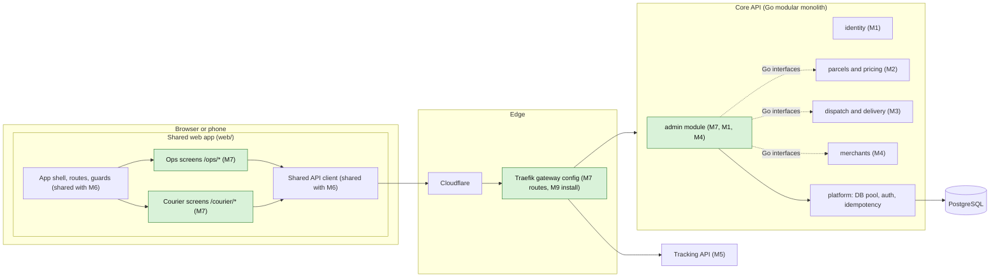

</details>

**Key points**

- The screens never talk to the database or to other services directly. Everything goes through the shared API client, then the gateway, then the Core API (Doc 1 X-05).
- The admin module talks to other Core API modules only through **Go interfaces** in the same process. It never calls them over HTTP or RabbitMQ, and it never reads their tables (domain-boundaries 4.1 and 4.2) \[Repo\].
- The gateway only routes and limits. It never checks tokens (ADR-001) \[Repo\].

## 3. Frontend design (ops and courier screens)

### 3.1 Package structure

The top folders come from web/README \[Repo\]. The sub-folders inside each feature are my proposal \[Proposed\]. Every feature has the same inside layout so any developer knows where to look.

```
web/src/
├── app/                                  # shared with Member 6
│   ├── routes/opsRoutes.tsx              # lazy routes for /ops/* and /courier/* (mine, plugged into shared router)
│   ├── layouts/OpsLayout.tsx             # ops menu by role (usability only)
│   └── guards/RoleGuard.tsx              # shared
├── shared/                               # shared with Member 6
│   ├── api/
│   │   ├── client.ts                     # fetch wrapper: token, refresh, errors, Idempotency-Key
│   │   ├── refreshLock.ts                # single shared refresh (Doc 2 F-02)
│   │   ├── errors.ts                     # ApiError type and error envelope parsing
│   │   └── idempotency.ts                # key creation and reuse rules (Doc 2 3.3)
│   ├── types/                            # ParcelStatus, Role, ApiEnvelope, Cents
│   └── utils/formatLKR.ts, dates.ts      # money and Sri Lanka time display
└── features/dispatcher-admin/            # Member 7 only
    ├── dispatch-board/                   # F-03, F-04, F-05
    │   ├── api/dispatchApi.ts            # typed calls + DTO to view-model mapping
    │   ├── api/queryKeys.ts              # TanStack Query keys for this feature
    │   ├── hooks/useDispatchBoard.ts     # query hook with 30 s refresh
    │   ├── hooks/useAssignParcel.ts      # mutation hook with Idempotency-Key
    │   ├── components/                   # ParcelQueue, CourierRoster, AssignDialog (no API calls inside)
    │   ├── pages/DispatchBoardPage.tsx   # route page: joins hooks and components
    │   ├── schemas/                      # zod schemas for forms
    │   ├── types.ts                      # view models used by components
    │   └── __tests__/                    # Vitest + React Testing Library
    ├── failed-deliveries/                # F-06 /ops/failed-deliveries (Member 3 reschedule)
    ├── fleet/                            # F-07 /ops/couriers (Member 3 /dispatch/couriers)
    ├── merchants/                        # F-08 /ops/merchants list and /ops/merchants/:id actions
    ├── users/                            # F-09 /ops/users (Member 1 endpoints, U-66)
    ├── zones/                            # F-10 /ops/zones
    ├── pricing/                          # F-11 /ops/pricing (Member 2 endpoints, U-65)
    ├── settings/                         # A-02 /ops/settings
    ├── reports/                          # F-12 /ops/reports (ADMIN and DISPATCHER)
    ├── audit/                            # F-13 /ops/audit (ADMIN only)
    ├── corrections/                      # F-14 [TBD U-08]
    ├── courier-mobile/                   # C-01 to C-05 /courier/*
    │   ├── ...same inside layout...
    │   └── utils/resizeImage.ts          # photo resize before upload (Doc 2 C-04)
    └── shared-ops/                       # code used by 2+ of MY features only (status badge text, reason code labels)
```

Folders not in web/README today (`failed-deliveries`, `merchants`, `users`, `pricing`, `settings`, `audit`, `corrections`, `shared-ops`) and the full `/ops/*` route table (Doc 1 section 2.1) must be added to web/README in the same change that creates them (AGENTS.md 6.3, U-63).

### 3.2 What each layer does

| Layer | Files | Does | Must not do |
| --- | --- | --- | --- |
| Route page | `pages/*Page.tsx` | Reads URL params, calls feature hooks, chooses which state to show (loading, empty, error, success), passes data to components | Call `fetch`; hold business rules |
| Presentational components | `components/*` | Draw the screen from props, raise events (onAssign, onSubmit) | Call the API; read tokens; compute prices or valid statuses |
| Feature hooks | `hooks/use*.ts` | Wrap TanStack Query: queries (read) and mutations (write). Make the Idempotency-Key, refresh related queries after success | Build URLs by hand; parse error bodies themselves |
| Feature API module | `api/*Api.ts` | One typed function per endpoint. Turns backend DTOs (snake\_case) into view models (camelCase) and back. Only place that knows URL paths | Hold state; show messages |
| Form schemas | `schemas/*` | zod rules for quick form hints (required, length, format) | Be treated as the real check (backend repeats it) |
| Shared API client | `shared/api/client.ts` | Adds `Authorization`, runs the single shared refresh on 401, sends `Idempotency-Key`, turns error envelopes into `ApiError` | Know any feature; store tokens anywhere but memory |
| Auth context | `app/providers/AuthProvider` | Keeps the access token and user role in memory | Use localStorage or sessionStorage (INV-11) |

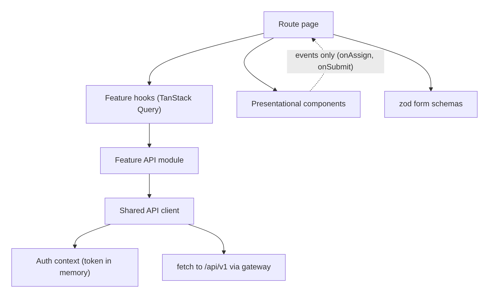

<details>
<summary>Diagram source (Mermaid)</summary>

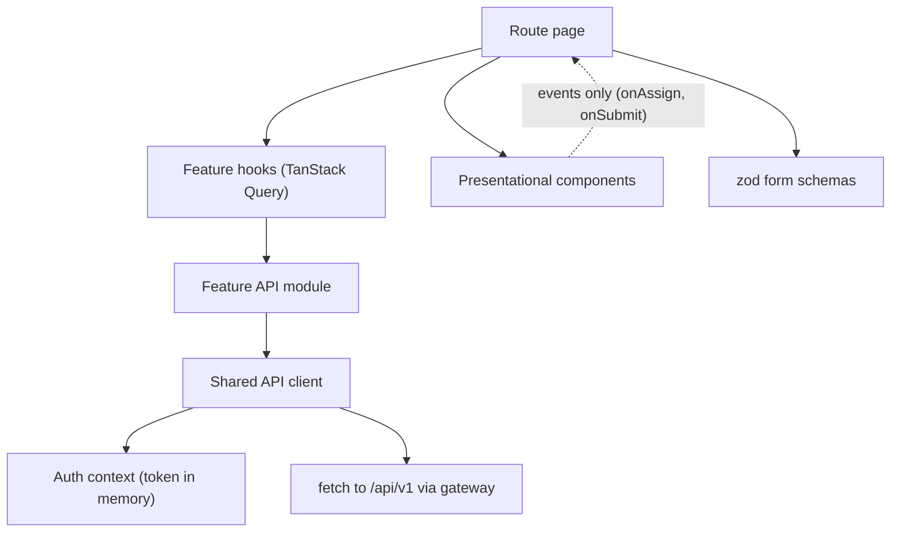

</details>

### 3.3 Allowed imports (dependency direction)

| From | May import | May NOT import |
| --- | --- | --- |
| `features/dispatcher-admin/<feature>/components` | its own `types.ts`, `shared-ops/`, `src/shared/components`, `src/shared/utils` | its own `api/`, any `hooks/` that call the API, other features |
| `features/dispatcher-admin/<feature>/pages` | own `hooks/`, `components/`, `schemas/`, `types.ts`, `shared-ops/`, `src/shared/*` | other features' internals |
| `features/dispatcher-admin/<feature>/hooks` | own `api/`, `src/shared/api`, `src/shared/hooks` | components |
| `features/dispatcher-admin/<feature>/api` | `src/shared/api`, `src/shared/types` | React, components, hooks |
| any `dispatcher-admin` file | `src/shared/*`, `src/app/` route helpers | **anything in `features/customer-merchant/`** \[Repo\] web/CLAUDE.md 2 |
| `src/shared/*` | only `src/shared/*` and libraries | any `features/*` folder |

**How it is enforced \[Proposed\]:** an ESLint `no-restricted-imports` rule (or `eslint-plugin-boundaries`) in `npm run lint`, so a wrong import fails CI. The Go side already does the same with `depguard` \[Repo\] .golangci.yml. Adding the ESLint rule touches the shared lint config, so Member 6 must agree **\[TBD U-28\]**.

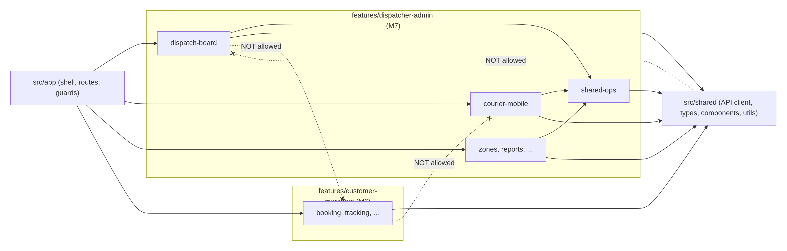

<details>
<summary>Diagram source (Mermaid)</summary>

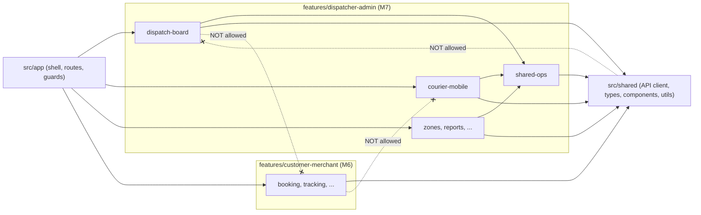

</details>

### 3.4 Key interfaces (TypeScript)

These are the contracts between layers. Names are proposals; field names follow the API contracts in Document 2.

```ts
// src/shared/types/money.ts  — a "branded" number so cents cannot be mixed up with rupees
export type Cents = number & { readonly __brand: 'LKR_CENTS' };

// src/shared/api/errors.ts
export interface ApiError {
  status: number;              // HTTP status, 0 for network error
  code: string;                // e.g. "COURIER_CAPACITY_EXCEEDED"
  message: string;             // safe text from backend
  correlationId?: string;
  fieldErrors: Record<string, string>; // from error.details[]
}

// src/shared/api/client.ts
export interface RequestOptions {
  idempotencyKey?: string;     // required by convention for POST that changes data
  signal?: AbortSignal;
}
export interface ApiClient {
  get<T>(path: string, query?: Record<string, string | number>, opts?: RequestOptions): Promise<T>;
  post<T>(path: string, body: unknown, opts?: RequestOptions): Promise<T>;
  patch<T>(path: string, body: unknown, opts?: RequestOptions): Promise<T>;
}

// features/dispatcher-admin/dispatch-board/types.ts  (view models)
// Field names follow Member 3 Doc 4 3.4 (snake_case on the wire, mapped once in dispatchApi.ts)
export interface BoardParcel { id: string; trackingNumber: string; status: 'CREATED' | 'ATTEMPT_FAILED'; attemptCount: number; weightKg: number; city: string; createdAt: Date; }
export interface BoardCourier { id: string; name: string; employeeCode: string; vehicleType: string; shiftStatus: string; active: number; max: number; isFull: boolean; }
export interface DispatchBoard { zoneId: string; parcels: BoardParcel[]; couriers: BoardCourier[]; }

// features/dispatcher-admin/dispatch-board/api/dispatchApi.ts
export interface DispatchApi {
  getBoard(zoneId: string): Promise<DispatchBoard>;                                     // GET /dispatch/board?zone_id=
  assign(input: { parcelId: string; courierId: string }, idempotencyKey: string): Promise<{ assignmentId: string; status: string }>;
  cancelAssignment(assignmentId: string, cancellationReason: string): Promise<void>;     // POST /dispatch/assignments/{id}/cancel
  reschedule(parcelId: string, input: { targetCourierId: string; scheduledDate: string; preferredTimeWindow: string; dispatchNotes?: string }, idempotencyKey: string): Promise<void>; // POST /dispatch/parcels/{id}/reschedule
}

// features/dispatcher-admin/merchants/api/merchantsApi.ts  (routes hosted by my admin module, logic by Member 4)
export type MerchantAction = 'approve' | 'reject' | 'suspend' | 'reinstate' | 'disable';
export interface MerchantsApi {
  list(f: { status?: string; q?: string; page: number; perPage: number }): Promise<Page<MerchantRow>>; // GET /admin/merchants
  get(id: string): Promise<MerchantDetail>;                                                           // GET /admin/merchants/{id}
  act(id: string, action: MerchantAction, body: { expectedVersion: number; reason?: string }): Promise<MerchantDetail>;
}

// features/dispatcher-admin/dispatch-board/hooks/useAssignParcel.ts
export function useAssignParcel(): {
  assign(parcelId: string, courierId: string): void; // makes or reuses the key (Doc 2 3.3)
  retry(): void;                                     // same input, same key
  isPending: boolean;
  error: ApiError | null;
};
```

`isFull` is display only (`active >= max` from API numbers). It greys out a courier but the backend still decides (INV-01).

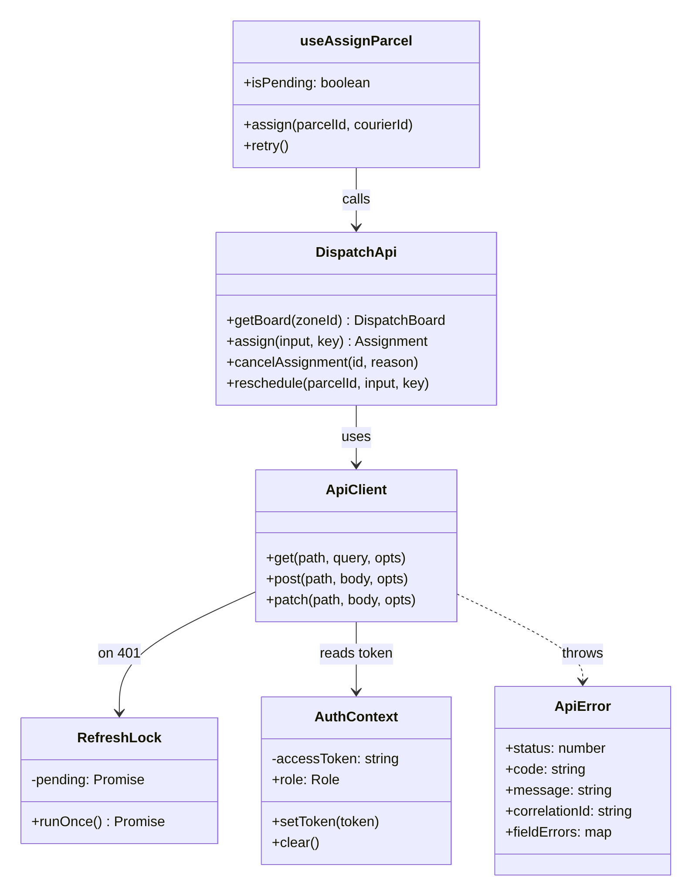

<details>
<summary>Diagram source (Mermaid)</summary>

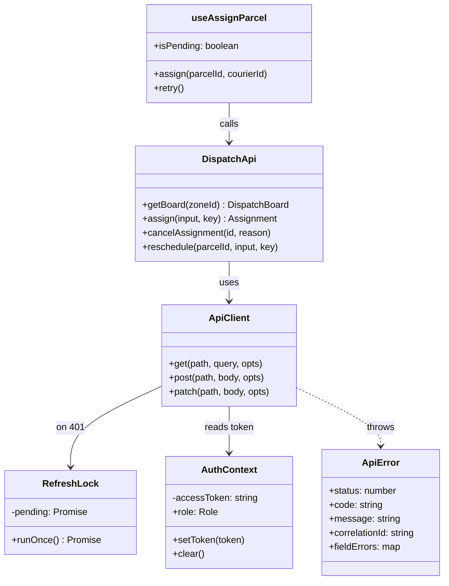

</details>

### 3.5 How one request travels through the frontend

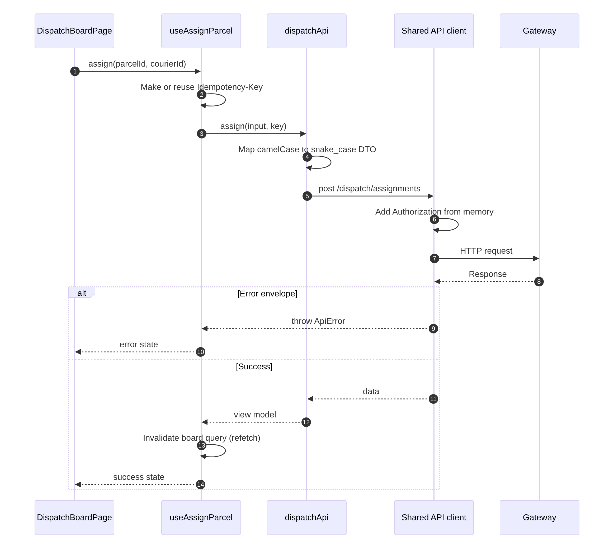

<details>
<summary>Diagram source (Mermaid)</summary>

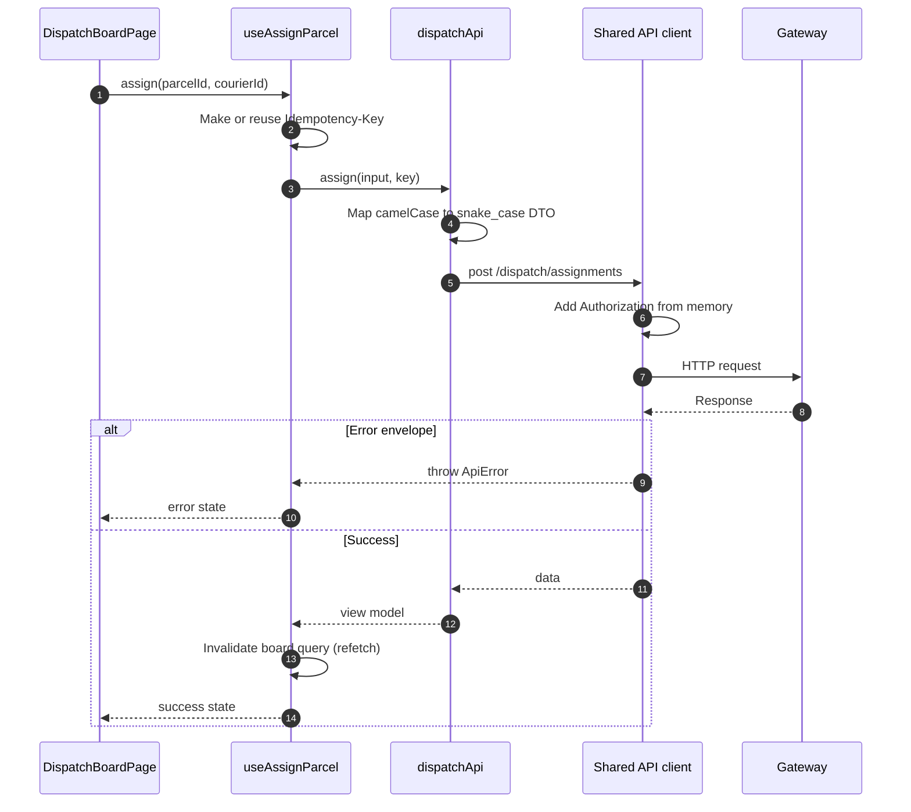

</details>

### 3.6 State management

| Kind of state | Where it lives | Why |
| --- | --- | --- |
| Data from the server (board, lists, reports) | TanStack Query cache \[Repo\] stack | Handles loading, errors, refetch on focus, timed refresh and cache. Server stays the source of truth (Doc 1 section 5) |
| Access token, role | `AuthContext` (memory) \[Repo\] | Required by ADR-003 |
| Form input | `react-hook-form` + zod \[Repo\] frontend.mdc | Quick hints and field errors |
| Screen choices (selected zone, open dialog, filters) | Local component state or URL query string | Filters in the URL can be shared and survive reload; nothing sensitive goes in the URL |
| Idempotency keys | Inside the mutation hook (memory) | Doc 2 3.3 |

There is **no global store** (no Redux, no Zustand). Reason in decision DD-02.

### 3.7 Design patterns used in the frontend

| Pattern | Where | Why |
| --- | --- | --- |
| Feature-sliced folders | `features/dispatcher-admin/<feature>` | Each screen area is self-contained; Member 6 and I do not edit the same files \[Repo\] web/README 1 |
| Container and presentational split | `pages` vs `components` | Components can be tested with plain props, without a server |
| Adapter (DTO mapper) | `api/*Api.ts` | If the backend renames a field (many endpoints are still \[TBD\]), only one file changes |
| Facade | Shared API client | One place for token, refresh, keys and errors; features stay simple |
| Single-flight (mutex) | `refreshLock.ts` | Many 401s cause only one refresh, so rotation does not log the user out (Doc 2 F-02) \[Repo\] web/CLAUDE.md "mutex-locked token refresh" |
| Query key factory | `api/queryKeys.ts` | Correct list refresh after each action; no stale data |
| Error mapping table | `shared/api/errors.ts` + one `ErrorBanner` | Same behaviour for every status code (Doc 2 3.2) |
| Lazy routes (code splitting) | `opsRoutes.tsx` with `React.lazy` | Customers never download ops code; couriers download only courier code \[Repo\] web/README 1 |
| Page Object Model | `web/tests/e2e/pages/DispatchBoardPage.ts`, `CourierTasksPage.ts` | Required by web/CLAUDE.md 5 \[Repo\] |

### 3.8 Courier screens: special design points

- **Separate code chunk.** `/courier/*` is its own lazy chunk with no charts or tables library, so the first load on a slow phone stays small. Target under 200 KB gzipped JavaScript for the courier chunk plus shell **\[Proposed budget\]**.
- **Photo resize before upload.** `resizeImage.ts` uses the browser canvas to shrink a photo to about 1600 px wide JPEG. A 6 MB phone photo becomes about 0.5 to 1 MB. This keeps uploads under the 10 MB gateway limit and makes them faster on 3G.
- **No offline queue.** Retries are manual with the same Idempotency-Key (DD-15).
- **Token storage.** Same in-memory rule as staff until U-01 is decided.

## 4. Admin backend module design (`core-api/internal/admin/`)

I write all of this module (U-10 closed, Doc 1 section 2.3). It owns zones, postal prefixes, settings, the audit table and the audit queries, the delivery report, the public zone list, and the HTTP routes for merchant admin (whose logic stays in Member 4's module).

### 4.1 Package structure

The four layer folders are required by AGENTS.md 4.2 \[Repo\]. File names are \[Proposed\].

```
core-api/internal/admin/
├── README.md, API.md                         # living docs (AGENTS.md 6)
├── domain/                                   # pure Go, no imports of net/http, database/sql, amqp
│   ├── zone.go                               # Zone aggregate root (no money fields, Doc 1 R-04)
│   ├── zone_id.go                            # ZoneID value object: ^ZONE_[A-Z0-9_]{2,27}$, the primary key
│   ├── zone_code.go                          # ZoneCode value object: ^[A-Z0-9_-]{2,32}$
│   ├── postal_prefix.go                      # PostalPrefix value object
│   ├── prefix_policy.go                      # PrefixOverlapPolicy domain service
│   ├── setting.go                            # SystemSetting entity, SettingKey value object
│   ├── report_period.go                      # ReportPeriod value object (from/to, Sri Lanka days)
│   ├── audit_filter.go                       # AuditQueryFilter value object
│   ├── events.go                             # ZoneCreated, ZoneChanged, ZoneStatusChanged, SettingChanged
│   └── errors.go                             # ErrZoneCodeTaken, ErrPrefixConflict, ErrInvalidPrefix, ...
├── application/                              # use cases + interfaces they need ("ports")
│   ├── ports.go                              # ZoneRepository, SettingRepository, ReportReader, AuditReader,
│   │                                         # AuditWriter, TxManager, Clock
│   ├── create_zone.go                        # CreateZone use case
│   ├── update_zone.go                        # UpdateZone use case
│   ├── set_zone_status.go                    # EnableZone / DisableZone
│   ├── update_setting.go                     # UpdateSetting
│   ├── generate_report.go                    # DeliveryReport (query, ADMIN and DISPATCHER)
│   ├── list_public_zones.go                  # PublicZones (query, no sign-in)
│   └── query_audit_log.go                    # QueryAuditLog (query)
├── infrastructure/                           # adapters that implement the ports
│   ├── postgres_zone_repository.go
│   ├── postgres_setting_repository.go
│   ├── postgres_report_reader.go             # read-only SQL or calls into other modules' read interfaces
│   ├── postgres_audit_reader.go
│   └── postgres_audit_writer.go              # shared audit writer; Members 1 and 4 call the same one (U-30)
└── transport/
    ├── routes.go                             # mounts /api/v1/admin/* (ADMIN; reports also DISPATCHER) and /api/v1/zones (public)
    ├── zone_handler.go, report_handler.go, audit_handler.go, setting_handler.go, public_zone_handler.go
    ├── merchant_handler.go                   # /admin/merchants/** -> merchants.AdminService (Member 4), no use case of mine
    ├── dto.go                                # request/response JSON structs (separate from domain types)
    └── errors.go                             # domain error -> HTTP status and error code table
```

Wiring is done in `core-api/internal/app/wiring.go` \[Repo\] AGENTS.md 4.1: it creates the Postgres adapters, passes them into the use cases, and passes the use cases into the handlers.

### 4.2 Responsibilities of each layer

| Layer | Responsibilities | Example in admin |
| --- | --- | --- |
| **Transport (handlers)** | Parse JSON and query strings, check syntax (types, required), read user id and role from the auth middleware context, call one use case, map result or error to HTTP | `POST /admin/zones` handler turns `ZoneCreateRequest` DTO into `CreateZoneCommand` |
| **Application (use cases)** | Own the transaction, load and save aggregates through ports, call domain methods, write audit rows, return results. One file per use case | `CreateZone.Execute(ctx, cmd)` opens a tx, checks prefixes, saves, writes audit |
| **Domain (objects)** | Hold the rules that are true no matter how data is stored: valid id and code format, name length, prefix format, no overlapping prefix inside one zone, enable and disable rules | `domain.NewZone(id, code, name, prefixes)` returns error if a rule fails |
| **Repositories (ports)** | Interfaces declared in `application/ports.go`, written from the use case's point of view | `ZoneRepository.Save(ctx, *Zone)` |
| **Infrastructure (adapters)** | SQL, row mapping, unique-constraint error to domain error, calls into other modules | `postgresZoneRepository` maps `23505 unique_violation` on `zone_postal_codes` to `ErrPrefixConflict` |
| **Platform (shared, not mine)** | DB pool, auth middleware, idempotency middleware, logging, request id | Used by `routes.go` and `wiring.go` |

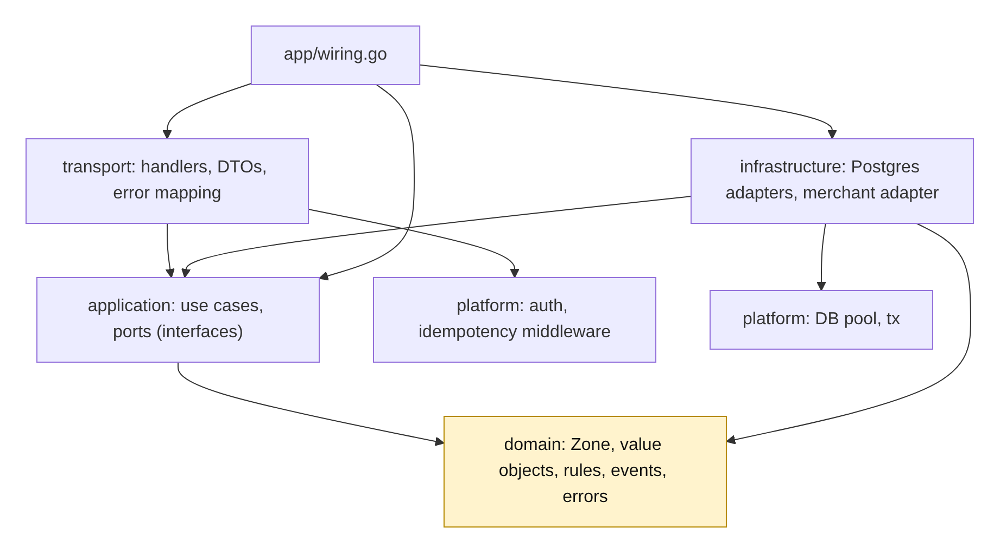

<details>
<summary>Diagram source (Mermaid)</summary>

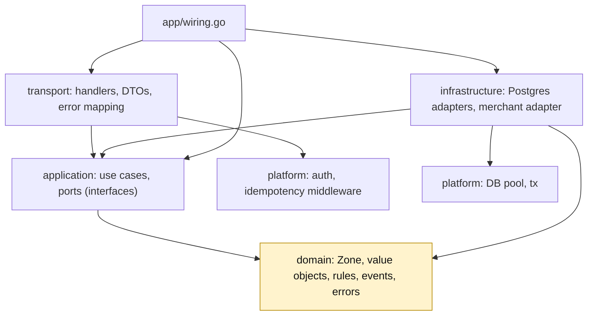

</details>

Arrows show "imports". The domain (yellow) imports nothing from the project. Infrastructure points **up** to application because it **implements** the interfaces the application declares. This is the "dependency inversion" rule of Clean/Hexagonal Architecture \[Repo\] Engineering Standards 2.5.

### 4.3 Allowed imports in Go

| Package | May import | Must NOT import | Checked by |
| --- | --- | --- | --- |
| `admin/domain` | Go standard library (`errors`, `fmt`, `strings`, `time`, `regexp`) | `net/http`, `database/sql`, amqp, any `infrastructure` or `transport` | `depguard` rule `domain_purity` \[Repo\] |
| `admin/application` | `admin/domain`, `context`, other modules' **exported interfaces or types only if needed for a port** | `net/http`, any `transport` | `depguard` rule `application_purity` \[Repo\] |
| `admin/infrastructure` | `admin/application`, `admin/domain`, `platform/db`, pgx | `admin/transport`, other modules' `infrastructure` or tables | review + proposed depguard rule \[U-31\] |
| `admin/transport` | `admin/application`, `admin/domain` (errors only), `platform/http`, `platform/auth`, `net/http`, the root package `internal/merchants` (its facade only: `AdminService` and DTOs) | `admin/infrastructure`, `database/sql`, `merchants/domain` or any other internal merchants package | proposed depguard rule \[U-31\] |
| Other modules | `admin` exported interfaces only, if ever needed | `admin/infrastructure`, admin tables | review |

**Talking to other modules.** Member 4 already publishes the exact interface the admin routes need, `merchants.AdminService` (`ListMerchants`, `GetMerchant`, `ChangeStatus`), in its root package (Member 4 Doc 4 section 4). My merchant handler depends on that interface directly; `wiring.go` passes in Member 4's implementation, and tests pass a fake. Admin never imports the merchants module's `domain` or `infrastructure` and never touches `merchants` tables. For reports, the admin module declares a small `ReportReader` port that Members 2 and 3 implement.

### 4.4 Key Go interfaces

```go
// application/ports.go
package application

type TxManager interface {
    // WithinTx runs fn inside one PostgreSQL transaction. The tx travels in ctx,
    // so every repository call made with that ctx uses the same tx.
    WithinTx(ctx context.Context, fn func(ctx context.Context) error) error
}

type ZoneRepository interface {
    NextID() string
    FindByID(ctx context.Context, id string) (*domain.Zone, error)          // ErrZoneNotFound
    ExistingPrefixes(ctx context.Context, near []domain.PostalPrefix) ([]domain.PrefixOwner, error)
    LockPrefixSpace(ctx context.Context) error                               // see 4.7
    Insert(ctx context.Context, z *domain.Zone) error                         // ErrZoneCodeTaken, ErrPrefixConflict
    Update(ctx context.Context, z *domain.Zone) error                         // ErrConcurrentConflict when version differs
    List(ctx context.Context, f ZoneListFilter, page Page) ([]*domain.Zone, int, error)
}

type SettingRepository interface {
    Get(ctx context.Context, key domain.SettingKey) (*domain.SystemSetting, error)
    Save(ctx context.Context, s *domain.SystemSetting) error
}

type AuditWriter interface {
    Write(ctx context.Context, e AuditEntry) error // INSERT only, same tx as the change
}

type AuditReader interface {
    Query(ctx context.Context, f domain.AuditQueryFilter, page Page) ([]AuditEntry, int, error)
}

type ReportReader interface { // implemented over read-only interfaces of parcels (M2) and delivery (M3)
    Deliveries(ctx context.Context, p domain.ReportPeriod) (DeliveryReport, error) // per day + totals
}

type Clock interface{ Now() time.Time } // makes tests repeatable

// Actor is built from the auth context, never from the body. Field names match the audit_logs columns (Doc 5).
type Actor struct { UserID string; Role string; ClientIP string; UserAgent string; RequestID string }

// AuditEntry maps 1:1 to the shared audit_logs shape (database-schema.md, Doc 1 R-05).
type AuditEntry struct {
    Actor         Actor
    Action        string          // ZONE_CREATED, ZONE_UPDATED, ZONE_DISABLED, SETTING_CHANGED, ...
    TargetType    string          // DELIVERY_ZONE, SYSTEM_SETTING
    TargetID      string          // zone id or setting key (text, U-64)
    PreviousState json.RawMessage // nil on create
    NewState      json.RawMessage
    Reason        string          // required for disable and setting changes
}
```

```go
// domain/zone.go  (shape only)
package domain

type Zone struct {
    id          ZoneID   // e.g. ZONE_COLOMBO_01, never changes (Members 2 and 3 reference it)
    code        ZoneCode // e.g. CMB-01
    name        string   // 1 to 120 characters
    description string
    boundary    []byte   // optional GeoJSON, stored as jsonb
    prefixes    []PostalPrefix
    enabled     bool
    version     int
    events      []Event // recorded, read by the use case for audit
}

// No money here: fees and any per-zone charge are Member 2's pricing rules (Doc 1 R-04).
func NewZone(id ZoneID, code ZoneCode, name, description string, prefixes []PostalPrefix) (*Zone, error)
func (z *Zone) Rename(name string) error
func (z *Zone) ReplacePrefixes(p []PostalPrefix) error // no overlaps inside the zone, at least one
func (z *Zone) Disable() error                          // ErrAlreadyDisabled
func (z *Zone) Enable() error
func (z *Zone) PullEvents() []Event
```

```go
// domain/postal_prefix.go — value object, checks itself on creation
type PostalPrefix struct{ v string }
func NewPostalPrefix(s string) (PostalPrefix, error) // digits only, 3 to 5 chars [Proposed, Sri Lanka codes are 5 digits]
func (p PostalPrefix) Overlaps(o PostalPrefix) bool  // "627" overlaps "62701"
```

### 4.5 DDD concepts used, and why

| Concept | What I use | Why (and why not more) |
| --- | --- | --- |
| **Bounded context** | Admin & Operations (shared with M1, M4) \[Repo\] domain-boundaries 2 | Zones, settings, reports and audit queries are back-office concerns that do not belong to parcels or dispatch |
| **Aggregate root** | `Zone` (owns its list of `PostalPrefix`) | A zone and its prefixes must change together and stay valid together (at least one prefix, no duplicates inside). Kept small, as Engineering Standards 2.3 asks |
| **Entity** | `Zone`, `SystemSetting` | They have an identity and change over time |
| **Value objects** | `ZoneID`, `ZoneCode`, `PostalPrefix`, `ReportPeriod`, `AuditQueryFilter`, `SettingKey` | Checked once when made, cannot be changed afterwards, so bad values cannot travel through the code. There is no `Money` in this module any more, because zones hold no money (R-04) |
| **Domain service** | `PrefixOverlapPolicy` | "Does this new prefix clash with prefixes of **other** zones?" involves more than one aggregate, so it does not fit inside one `Zone`. It is a pure function: given the new prefixes and the existing owners, return the clashes |
| **Domain events** | `ZoneCreated`, `ZoneChanged`, `ZoneStatusChanged`, `SettingChanged` | Recorded by the aggregate and turned into `audit_logs` rows by the use case in the same transaction. **Not** published to RabbitMQ (I publish nothing, Doc 1 X-08). If Member 2's pricing later needs to react, they can be written to the outbox with Member 8's writer **\[TBD U-32\]** |
| **Repositories** | `ZoneRepository`, `SettingRepository` | Hide SQL from use cases; make unit tests possible with in-memory fakes |
| **Read models (no aggregates)** | `ReportReader`, `AuditReader` | Reports and audit search only read. Wrapping them in aggregates adds code with no rule to protect (Engineering Standards 2.8: "do not model every table as an aggregate") |
| **Not used** | Event sourcing, CQRS framework, sagas | Forbidden without approval (AGENTS.md 10) and not needed here |

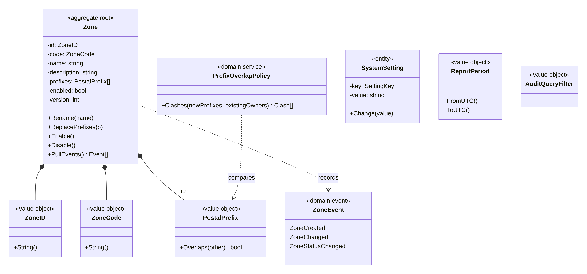

<details>
<summary>Diagram source (Mermaid)</summary>

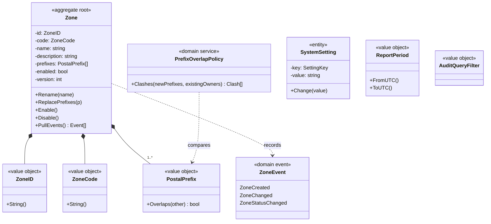

</details>

### 4.6 Ports and adapters view

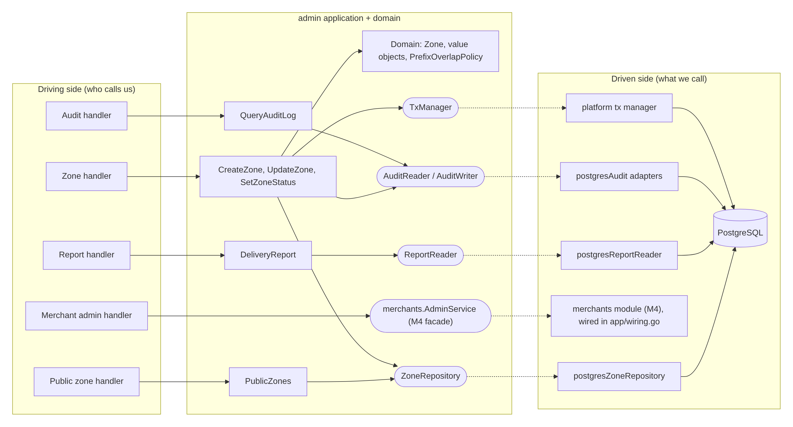

<details>
<summary>Diagram source (Mermaid)</summary>

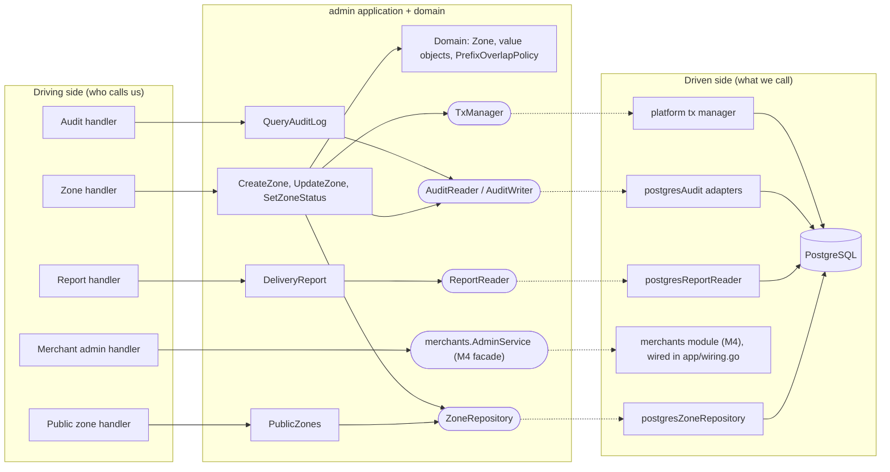

</details>

### 4.7 Transaction boundaries and consistency

**Rule:** one use case = one transaction, opened by the use case with `TxManager.WithinTx` \[Repo\] AGENTS.md 4.3. Handlers never open transactions. Repositories never commit.

| Use case | Inside one transaction | Isolation and locking | Consistency |
| --- | --- | --- | --- |
| CreateZone | idempotency record, prefix-space lock, read clashing prefixes, insert zone, insert prefixes, insert audit row | READ COMMITTED + `pg_advisory_xact_lock(<admin-prefix-key>)` + unique index on `zone_postal_codes.prefix` | Strong: all or nothing |
| UpdateZone (incl. prefixes) | same as above + `UPDATE ... WHERE id = $1 AND version = $2` | as above + optimistic version check | Strong; stale edit gets 409 |
| Enable/DisableZone | update status with version check, audit row | optimistic version check | Strong |
| UpdateSetting | read old value, update, audit row | `SELECT ... FOR UPDATE` on the setting row | Strong |
| Merchant status change | Opened and committed by Member 4's `AdminService.ChangeStatus` (status update + audit row + outbox); my handler opens no transaction | M4's `expected_version` check | Strong, inside Member 4's module |
| DeliveryReport | read-only tx (or none) | READ COMMITTED, `statement_timeout` 5 s | Read can be a few seconds behind writes in progress; acceptable for reports |
| PublicZones | read-only | READ COMMITTED | Same |
| QueryAuditLog | read-only | READ COMMITTED | Same |

**Why the advisory lock?** The unique index stops two zones getting the **exact same** prefix. It cannot stop "627" in one zone and "62701" in another (overlap). Two admins could each check, find no clash, and both commit. A short transaction-level advisory lock makes prefix changes run one after another. Zone edits are rare (a few per week), so waiting is not a problem. Alternative: SERIALIZABLE isolation with retry (DD-07).

**Why audit in the same transaction?** If the change commits, its audit row must exist, and if the change fails, there must be no audit row (SRS SEC-015, INV-12). An async audit through the outbox could lose or delay the record (DD-10).

**Idempotency** is handled by the shared platform middleware using the `idempotency_keys` table (scope `USER:<id>`, operation, request hash, saved response, 24 h) \[Repo\] api-conventions 4, database-schema. The key row is written in the same transaction as the change, so a crash cannot leave "key saved, change lost". Owner of the middleware **\[TBD U-24\]**.

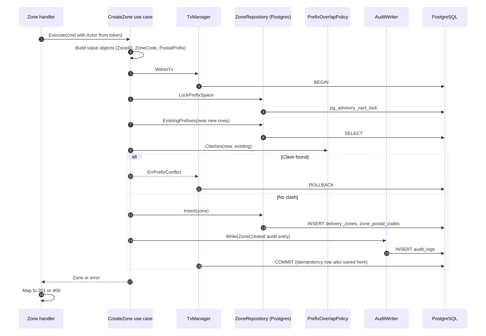

<details>
<summary>Diagram source (Mermaid)</summary>

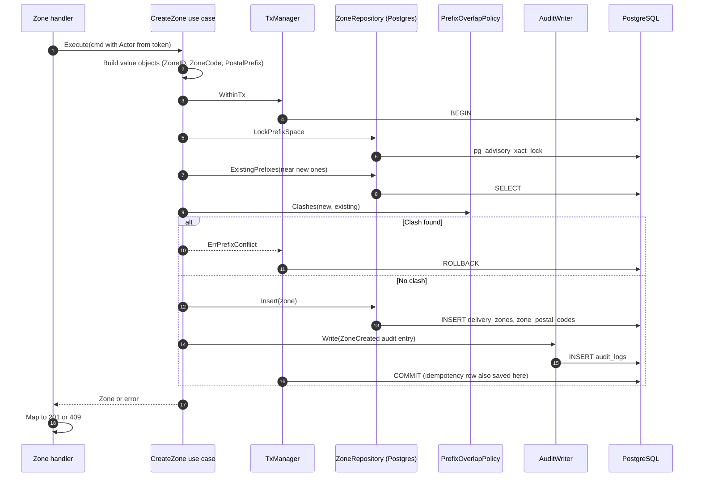

</details>

### 4.8 Error handling design

Domain and application return typed errors. Only `transport/errors.go` knows HTTP.

| Go error | HTTP | Error code (proposed) |
| --- | --- | --- |
| `ErrInvalidZoneID`, `ErrInvalidZoneCode`, `ErrInvalidName`, `ErrInvalidPrefix`, `ErrNoPrefixes`, `ErrDuplicatePrefixInZone` | 422 | `VALIDATION_FAILED` with `details[]` |
| `ErrZoneCodeTaken` | 409 | `ZONE_CODE_ALREADY_EXISTS` |
| `ErrPrefixConflict` | 409 | `ZONE_POSTAL_CODE_CONFLICT` |
| `ErrConcurrentConflict` | 409 | `CONCURRENT_MODIFICATION` |
| `ErrZoneNotFound` | 404 | `ZONE_NOT_FOUND` |
| `ErrBusy` (lock wait over 2 s) | 503 | `TRY_AGAIN` |
| Member 4 errors from `AdminService` | 404, 409, 422 | Member 4's codes passed through unchanged |
| `ErrForbidden` (from auth) | 403 | `ACCESS_DENIED` |
| anything else | 500 | `INTERNAL_ERROR` + correlation id, details only in logs |

Errors are wrapped with context (`fmt.Errorf("create zone: %w", err)`) and checked with `errors.Is` \[Repo\] AGENTS.md 9. No `panic`.

### 4.9 Cross-module call: merchant admin routes

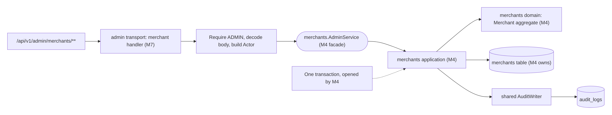

<details>
<summary>Diagram source (Mermaid)</summary>

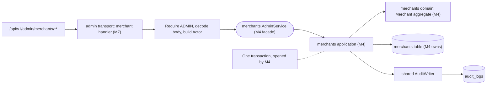

</details>

Member 4 keeps all merchant rules (which status changes are allowed, reason length, version check) and writes the audit row through the shared audit writer. My handler only hosts the route, checks ADMIN, refuses unknown JSON fields and maps errors (Member 4 Doc 4 I-03, Doc 1 R-02).

## 5. Gateway design (`deploy/gateway/traefik/`)

### 5.1 File structure

```
deploy/gateway/
├── README.md                         # living doc (route map lives here or in docs/, U-33)
├── traefik/
│   ├── traefik.yml                   # static config: entrypoints 80/443, dashboard on internal 8090, trusted IPs, logs
│   ├── dynamic-routes.yml            # Docker/file provider: routers, services, middlewares (my hardened version, Doc 7)
│   └── kubernetes/
│       ├── ingressroutes.yaml        # [M7] Kubernetes IngressRoute CRDs, same routes
│       └── middlewares.yaml          # [M7] Kubernetes Middleware CRDs, same limits
└── tests/
    ├── smoke.sh                      # [Proposed] curl checks: route per service, 429, 413, 401/403 unchanged, internal paths blocked
    └── route-parity.sh               # [Proposed] checks Docker and Kubernetes files list the same routes and limits
```

Member 9 owns `values.yaml` (Helm install) and the one Compose file `deploy/docker-compose.yml` (Doc 1 D-11, R-09).

### 5.2 Components inside Traefik

Traefik is built from four kinds of parts. Each request goes left to right.

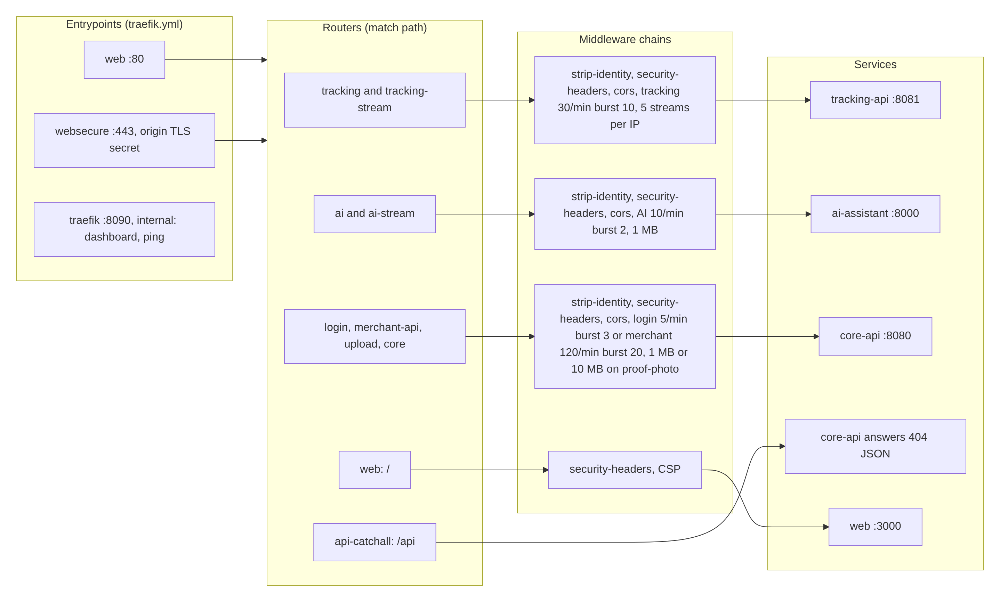

<details>
<summary>Diagram source (Mermaid)</summary>

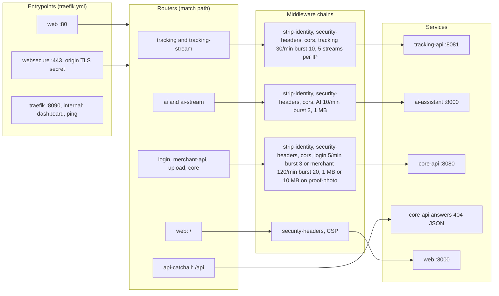

</details>

### 5.3 Router and middleware design

| Router | Rule | Priority | Middlewares (in order) | Service |
| --- | --- | --- | --- | --- |
| `tracking-stream-router` | `^/api/v1/tracking/public/[^/]+/stream$` or `^/api/v1/tracking/[^/]+/stream$` | 100 (explicit) | strip-identity-headers, security-headers, cors, tracking-ratelimit, stream-inflight (5 per IP) | tracking-api |
| `tracking-router` | `/api/v1/tracking` or `/api/v1/tracking/…` | auto (by rule length) | strip-identity-headers, security-headers, cors, tracking-ratelimit (30/min, burst 10) | tracking-api |
| `ai-stream-router` | `/api/v1/ai/mcp/sse` | 100 (explicit) | strip-identity-headers, security-headers, cors, stream-inflight | ai-assistant |
| `ai-router` | `/api/v1/ai` or `/api/v1/ai/…` | auto | strip-identity-headers, security-headers, cors, ai-ratelimit (10/min, burst 2), json-limit (1 MB) | ai-assistant |
| `login-router` | `Path(/api/v1/auth/login)` | auto | strip-identity-headers, security-headers, cors, login-ratelimit (5/min, burst 3), json-limit | core-api |
| `merchant-api-router` | `PathPrefix(/api/v1/merchant/)` | auto | strip-identity-headers, security-headers, cors, merchant-ratelimit (120/min, burst 20), json-limit | core-api |
| `upload-router` | `^/api/v1/deliveries/[^/]+/proof-photo$` | auto | strip-identity-headers, security-headers, cors, upload-limit (10 MB) | core-api |
| `core-api-router` | `PathPrefix(/api/v1)` | auto | strip-identity-headers, security-headers, cors, json-limit (1 MB) | core-api |
| `api-catchall-router` | `PathPrefix(/api)` | 2 | strip-identity-headers, security-headers, json-limit | core-api (answers 404 JSON) |
| `frontend-router` | `PathPrefix(/)` | 1 | security-headers, spa-csp | web |
| `dashboard-router` | `/api` or `/dashboard` on entry point `traefik` (8090) only | auto | none | `api@internal` |

All numbers come from security-notes.md section 3 and CORS from section 4 (Doc 1 R-13, R-14). Traefik ranks routers by the length of the rule text, so the two stream routers need an explicit priority to beat the longer tracking and AI rules.

**Design rules for the files**

- Every rate limit and in-flight middleware sets `sourceCriterion.ipStrategy.depth: 1`, so the **real visitor IP** (the right-most `X-Forwarded-For` entry written by Cloudflare) is counted. Without it, all Cloudflare traffic shares one bucket (Doc 2 G-02, U-46).
- No `retry` middleware on any router (Doc 2 R-GW-03).
- No middleware that reads, checks or changes `Authorization` or `X-API-Key` (INV-04). `X-Tenant-ID`, `X-User-ID`, `X-User-Role`, `X-Merchant-ID` and `X-Forwarded-User` are removed from client requests (R-15).
- The stream routers never get a buffering middleware (INV-07); the buffering middleware also buffers responses.
- `X-Request-ID` is passed through unchanged and allowed in CORS (R-11).
- Names are the same in Docker and Kubernetes files; `gateway_parity.py` fails CI if they drift (DD-12).

Example of the Kubernetes middleware (placeholders only, no secrets):

```yaml
# kubernetes/middlewares.yaml
apiVersion: traefik.io/v1alpha1
kind: Middleware
metadata: { name: tracking-ratelimit, namespace: swiftdrop }
spec:
  rateLimit:
    average: 30
    period: 1m
    burst: 10            # security-notes.md 3 (U-15 closed)
    sourceCriterion:
      ipStrategy: { depth: 1 }
---
apiVersion: traefik.io/v1alpha1
kind: Middleware
metadata: { name: stream-inflight, namespace: swiftdrop }
spec:
  inFlightReq:
    amount: 5            # Member 5: 5 open streams per IP
    sourceCriterion:
      ipStrategy: { depth: 1 }
```

### 5.4 Patterns used in the gateway

| Pattern | Where | Why |
| --- | --- | --- |
| API gateway / edge router | Traefik routers | One front door for all clients (ADR-001) |
| Chain of responsibility | Middleware chains | Each middleware does one job and can stop the request (429, 413) |
| Configuration as code | All files in git | Rebuildable from a clean clone (INV-09) |
| Smoke test as contract | `security_gateway_test.sh` (Doc 7 GS-01 to GS-19) | Proves routes and limits after every change (Doc 2 G-07) |
| Parity check | `gateway_parity.py` | Docker and Kubernetes files cannot drift apart (DD-12) |

## 6. Design decisions, alternatives and trade-offs

| ID | Decision | Options considered | Chosen and why | Trade-off accepted |
| --- | --- | --- | --- | --- |
| DD-01 | Where ops and courier screens live | (a) own separate app, (b) one shared SPA with feature folders | (b) \[Repo\] web/README 1: one login, one design system, one deploy | Must agree shared shell changes with Member 6 |
| DD-02 | How screens hold server data | (a) Redux/Zustand global store, (b) TanStack Query cache + local state | (b): built-in loading, errors, refetch and cache; server stays the truth; less code | Team must learn query keys and invalidation |
| DD-03 | How the dispatch board stays fresh | (a) SSE live stream, (b) WebSocket, (c) polling every 30 s + refetch after actions | (c) \[Proposed\]: no staff stream exists; SSE is only for public tracking (M5); polling is simple and cheap at our size (7.1) | Up to 30 s delay; backend conflict checks cover the gap |
| DD-04 | Token refresh | (a) each call refreshes itself, (b) single shared refresh | (b): refresh tokens are single use; (a) would trigger "token reuse" logout | Small extra code in the shared client |
| DD-05 | Where Idempotency-Keys are made | (a) in the shared client for every POST, (b) in each mutation hook per user action | (b): the hook knows when input changed and when a press is a retry | Each mutation hook must follow the rule (tested) |
| DD-06 | Zone model | (a) Zone and PostalPrefix as two aggregates, (b) Zone aggregate owns its prefixes | (b): they change together and the "at least one prefix" rule needs both | Cross-zone rule still needs a domain service + DB (DD-07) |
| DD-07 | Stopping prefix overlaps between zones | (a) unique index only, (b) SERIALIZABLE isolation with retry, (c) unique index + advisory lock + overlap check | (c): exact duplicates and overlaps both blocked; simple; edits are rare | Prefix edits run one at a time |
| DD-08 | Reports | (a) aggregates, (b) separate reporting service, (c) materialized views, (d) read-only queries behind `ReportReader` | (d): simplest; meets NFR at our data size; can switch to (c) later behind the same port | Heavy ranges may be slow; capped range + timeout (7.2) |
| DD-09 | How admin reaches other modules | (a) read their tables with SQL, (b) HTTP calls, (c) RabbitMQ, (d) in-process Go interfaces | (d) \[Repo\] domain-boundaries 4: no shared-table coupling, no network hop, can share one tx | Other owners must export a small interface |
| DD-10 | Writing audit rows | (a) async through outbox and worker, (b) same transaction as the change | (b): an audit row exists if and only if the change happened | Slightly longer transaction |
| DD-11 | Concurrent edits of zones and settings | (a) last write wins, (b) optimistic `version` column, (c) row locks held while the user edits | (b), same as parcels \[Repo\] database-schema 3.3; `version` is in migration `000002` (alignment guide 6.1) | User must reload on 409 |
| DD-12 | Gateway files for Docker and Kubernetes | (a) plain Kubernetes Ingress + annotations, (b) generate both from one template, (c) two hand-written sets + parity test | (c): Traefik CRDs support all needed middlewares; files stay readable for a student team; parity test stops drift | Two places to edit per change |
| DD-13 | Where rate limits live | (a) only gateway, (b) only backend, (c) gateway per IP + backend per user or key | (c): gateway cannot see users (ADR-001); gateway numbers are security-notes.md section 3 (R-13); backend per-user limits are Members 1, 3, 4, 10's job (U-50) | Per pod, so limits are approximate (7.3) |
| DD-17 | Zone primary key | (a) uuid + unique code, (b) text id chosen by the admin (`ZONE_COLOMBO_01`) + separate short code | (b) (alignment guide 3.1, database-schema.md): Members 2 and 3 already reference text zone ids in their foreign keys and seed data | The id can never be renamed; a typo means a new zone |
| DD-18 | Merchant admin routes | (a) Member 4 hosts `/admin/merchants`, (b) admin module hosts the route and calls `merchants.AdminService` | (b) (Member 4 OpenAPI `x-route-owner: member-7`): all `/admin/*` routes sit behind one ADMIN check in one module | My handler must follow Member 4's DTOs exactly |
| DD-14 | Photo size | (a) send original, (b) resize on the phone | (b): faster on slow networks, stays under 10 MB | Small quality loss; some old phones resize slowly |
| DD-15 | Courier offline mode | (a) offline queue with service worker, (b) manual retry with same key | (b): offline queue is complex (ordering, conflicts, stale tasks) and not required by the SRS | Courier must press "Try again" when back online |
| DD-16 | Admin module layering | (a) one flat package for simple CRUD, (b) four layers | (b) for zones (real rules) and settings; reports and audit stay thin (no domain objects) as the anti-boilerplate rule allows \[Repo\] AGENTS.md 4.2 | Some folders have few files |

## 7. Scaling and performance

### 7.1 Frontend

| Topic | Expected load | Design response |
| --- | --- | --- |
| Dispatch board polling | About 10 dispatchers × 1 call per 30 s = 0.3 calls per second | Negligible. Polling pauses when the browser tab is hidden (TanStack Query default) |
| Board size | Up to a few hundred parcels per zone | `zone_id` is required by Member 3's board, so one call never returns all zones; list uses virtual scrolling above 200 rows |
| Bundle size | Ops chunk includes charts; courier chunk must be small | Lazy routes per feature; charts library only in `reports` chunk; budget checked by `npm run build` output |
| Couriers on slow networks | 3G, high delay | Small courier chunk, resized photos, no polling on courier screens (refresh on open and pull-to-refresh) |
| Stale data | Two people editing | Server is truth; 409 then refetch |

### 7.2 Admin backend module

| Topic | Design response |
| --- | --- |
| Stateless pods | Core API runs 2 to 4 replicas with HPA at 70 % CPU \[Repo\] Engineering Standards 10. Admin keeps nothing in memory between requests |
| Database connections | `replicas_max × pool size ≤ PostgreSQL max_connections`. Member 9's budget (D8): core-api 12 × 4 pods = 48 of 150. Admin uses the shared pool, no own pool |
| Speed target | p95 ≤ 500 ms at 50 concurrent users (NFR-PERF-001). Zone writes are small. Reports are the risk |
| Report queries | Range capped by the setting `reports.max_range_days` (default 92), `statement_timeout` 5 s, indexes on `parcels(created_at)`, `parcel_status_history(to_status, occurred_at)`, `delivery_attempts(attempted_at)` **\[TBD with M2, M3: they own those tables\]**. If still slow: materialized view refreshed by a CronJob (DD-08) |
| Audit search | Paginated (max 100 per page, NFR-PERF-004); indexes on `audit_logs(created_at DESC)`, `(actor_id, created_at DESC)`, `(target_type, target_id)` in migration `000011` |
| Public zone list | Small (tens of rows); `Cache-Control: public, max-age=300` so browsers and Cloudflare cache it |
| Graceful shutdown | Handled by the Core API main: `/health/ready` turns 503, 5 s drain, then up to 20 s for open requests; admin requests are short |
| Metrics | Request count and latency per route; no user or parcel ids as labels \[Repo\] Engineering Standards 11 |

### 7.3 Gateway

| Topic | Design response |
| --- | --- |
| Replicas | Traefik runs as a Deployment that can scale (domain-boundaries 5). Rate limits are **per pod**: with 3 pods a client can get up to 3 × the limit. Set numbers per pod with that in mind (ADR-001 3) |
| Real client IP | `trustedIPs` + `sourceCriterion` so limits and audit logs see the real visitor |
| Memory | About 50 to 80 MB per instance (ADR-001). The 10 MB buffering limit means many big uploads at once use memory; Traefik writes large bodies to disk above its memory threshold **\[to verify in test\]** |
| SSE connections | Long open connections are cheap for Traefik; limited to 5 per IP by `inFlightReq`. The 15-second heartbeat keeps Cloudflare from closing them (R-12) |
| Hot reload | File provider `watch: true` reloads routes without restart (Docker); CRDs reload on apply (Kubernetes) |

### 7.4 Deployment view

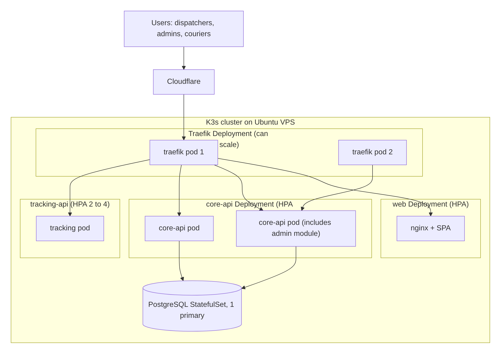

<details>
<summary>Diagram source (Mermaid)</summary>

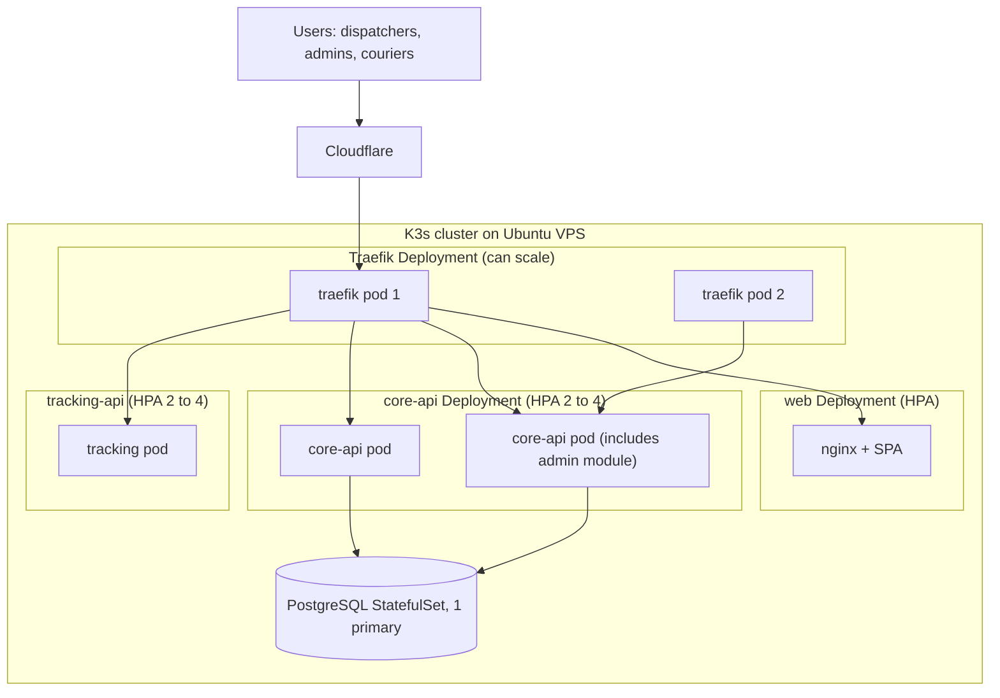

</details>

## 8. How the design supports testing (short)

| Part | Test style | Made possible by |
| --- | --- | --- |
| Frontend components | Vitest + RTL with plain props | Container and presentational split |
| Frontend hooks and API modules | Vitest with a fake `ApiClient` (or MSW) | All calls go through one client interface |
| Shared refresh | Unit test: 5 parallel 401s cause 1 refresh call | `RefreshLock` is its own small module |
| Admin domain | Plain Go unit tests, no database | Pure `domain/` package |
| Admin use cases | Go tests with in-memory fakes of the ports | Interfaces in `application/ports.go` |
| Admin adapters | Integration tests on real PostgreSQL (Testcontainers) for unique index, advisory lock, version check | Infrastructure kept separate |
| Gateway | `security_gateway_test.sh` (real Traefik binary) and `gateway_parity.py` | Config as code |

Full test plans belong in a later document.

## 9. Open questions

Questions closed by the 26 October review (Doc 1 section 11.4): U-10 (I write the admin code), U-13 (zone model), U-26 (merchant statuses), U-34 (`version` column is in migration `000002`). Still open and relevant here: U-01, U-24, U-50.

| ID | Question | Decide with | Status |
| --- | --- | --- | --- |
| U-28 | Add an ESLint import-boundary rule to the shared lint config so cross-feature imports fail CI? | Member 6 | Open |
| U-29 | One shared `Money` value object or one per module? | Members 1, 2 | Open, but no longer affects the admin module (zones hold no money) |
| U-30 | Who owns the audit writer and `audit_logs` indexes? | Member 1 | **Closed**: I create `audit_logs` in `000011` (alignment guide 6.2) and own the shared writer; Members 1 and 4 call it |
| U-31 | Add depguard rules for `transport` and `infrastructure` packages, including "admin transport may import only the merchants facade" | All backend members, Member 9 | Open |
| U-32 | Should zone changes also go to the outbox so pricing or tracking can react? | Members 2, 8 | Open |
| U-33 | Where the route map lives: `deploy/gateway/README.md` or a new file in `docs/` | Member 9 | Open |
| U-34 | `version` column on `delivery_zones` | Members 1, 4 | **Closed**: yes, in `000002` |

## 10. Sign-off

To be reviewed by Members 1, 2, 3, 4, 5, 6, 8, 9 and 10. Members 1 and 4 for section 4 (shared admin module), Member 6 for section 3 (shared app shell and lint), Member 9 for section 5.

| Member | Approved (date) | Notes |
| --- | --- | --- |
| Member 1 |  |  |
| Member 2 |  |  |
| Member 3 |  |  |
| Member 4 |  |  |
| Member 5 |  |  |
| Member 6 |  |  |
| Member 8 |  |  |
| Member 9 |  |  |
| Member 10 |  |  |
