# Document 4 — Interface & Integration Contract

> **Status:** Draft / Proposed (For Review in Meeting 2)  
> **Author:** Member 7 — Dispatcher/Admin UI, Courier Web, Traefik Gateway  
> **Target Module / Location:** `core-api/internal/admin/` (admin module and its HTTP routes), `deploy/gateway/traefik/` (gateway), `web/src/features/dispatcher-admin/` (the screens that call these APIs)  
> **Key Upstream Dependencies:** Member 1 (sign-in, tokens, users), Member 2 (pricing rules, parcel numbers for reports), Member 3 (dispatch, courier and delivery endpoints), Member 4 (`merchants.AdminService`), Member 5 (public tracking and live updates), Member 9 (gateway deployment)  
> **Open Questions / Needs Clarification:** Section 14. New: U-68 one name for the id field in error answers, U-69 one letter style for JSON field names, U-70 what the zone fields in Member 3's board answer mean, U-71 should the public zone list also show postal prefixes. Still open from other documents: U-01, U-04, U-06, U-08, U-14, U-24, U-32, U-39, U-46, U-50, U-63 to U-67

**Module:** Dispatcher/Admin/Courier Frontend, Admin Backend Module & API Gateway (Member 7) **Project:** SwiftDrop Parcel Delivery & Courier Management System **Based on:** My Documents 1 v4, 2 v3, 3 v2, 5 v2, 6 v2, 7 v2 and 8 v2; Member 7 alignment guide section 5; the docs audit of 26 October; Member 1, Member 3 and Member 4 Document 4; `docs/contracts/api-conventions.md`; `docs/security/security-notes.md`; ADR-003 (sign-in) and ADR-004 (failure reasons); SRS sections 6, 8 and 9 **Status:** Draft v1. Every example in sections 4 to 7 is **copied from a real run** of my module (`doc8-local/evidence/10-contract-capture.txt`, captured 26 October 2026). Items marked **\[TBD\]** wait for a teammate or a team decision. **Date:** 26 October 2026

---

## 1. How to read this document

### 1.1 What a "contract" means here

A contract is a promise about one call: **what you send, what you get back, and what can go wrong.** If both sides keep the promise, their code works together even though two different people wrote it.

This document holds four kinds of promise:

| Kind | In plain words | Where |
| --- | --- | --- |
| **The APIs I provide** | Calls other people (and my own screens) may make to my admin module | Sections 4 and 5 |
| **What the gateway does to every call** | The front door: where a request is sent, what is added, what is removed, what is refused | Section 6 |
| **In-process interfaces** | Go code in the same program calling my module, or my module calling someone else's | Section 7 |
| **The APIs I consume** | Calls my screens make to other members' endpoints | Section 8 |

### 1.2 Who should read which part

- **A teammate who calls my API:** sections 3, 4 and 5.
- **A teammate whose API I call:** section 8. Please check that my understanding of your endpoint matches your document.
- **Member 9 (deployment):** section 6.
- **Member 6 (the other frontend):** sections 5.6 (the public zone list) and 6.
- **A reviewer:** section 9 (how a contract may change), section 11 (which requirement each endpoint serves) and section 12 (the proof that it works).

### 1.3 Words used in this document

| Word | Plain meaning |
| --- | --- |
| **Endpoint** | One address you can call, such as `GET /api/v1/admin/zones` |
| **Request** | What the browser sends |
| **Response** | What the server answers |
| **Header** | A short extra line on a request or a response, such as who you are |
| **Body** | The main content, written as JSON |
| **JSON** | A text format for data: `{"name": "Kandy", "enabled": true}` |
| **Token** | The proof of sign-in the browser sends on every call |
| **Role** | ADMIN, DISPATCHER, COURIER, MERCHANT or CUSTOMER |
| **Status code** | A number that says how the call went: 200 good, 403 not allowed, and so on (section 3.5) |
| **Version** | A counter on a record that stops two people overwriting each other (section 5.4) |

### 1.4 Tags and pictures

Tags: **\[Mine\]** = I build it, **\[Agreed\]** = the owner has written it in their Document 4, **\[Requested\]** = I need it and the owner has not written it yet, **\[TBD\]** = not decided.

Every picture is an image first, with the text it was drawn from in a fold-out box underneath, so it can be edited later.

---

## 2. The big picture: who calls whom

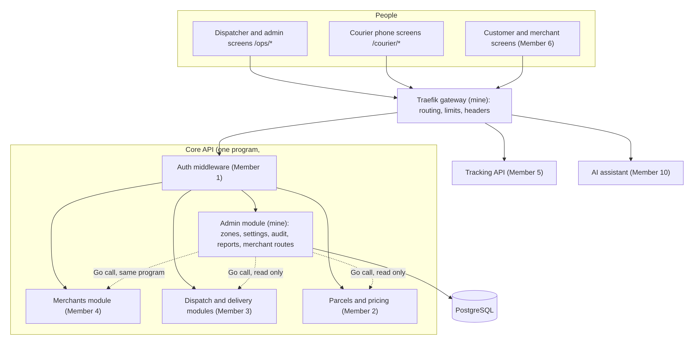

<details>
<summary>Diagram source (Mermaid)</summary>

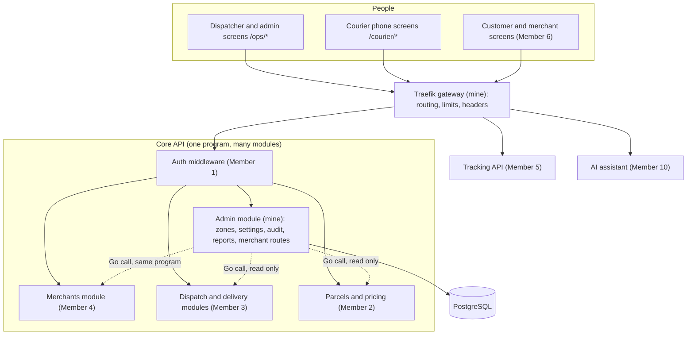

</details>

**Three things are worth noticing.**

1. **Everything from a browser goes through my gateway first.** Nothing reaches a service directly.
2. **My admin module never calls another module over the network.** Core API is one program, so it calls a Go interface instead (section 7). That is faster and cannot half-fail.
3. **The gateway never decides who you are.** It only decides *where* a request goes and *how much* is allowed. The sign-in check is Member 1's middleware, and the role check is in my handlers.

### 2.1 The interface list

| # | Who calls whom | How | What | Owner of the promise | Status |
| --- | --- | --- | --- | --- | --- |
| I-01 | My ops screens → my admin module | HTTPS, JSON | `/api/v1/admin/zones/**`, `/admin/settings/**`, `/admin/audit-logs`, `/admin/reports/deliveries` | Me | **\[Mine\]** |
| I-02 | My ops screens → my admin module → Member 4 | HTTPS, then a Go call | `/api/v1/admin/merchants/**` | Route: me. Rules: Member 4 | **\[Agreed\]** (R-02) |
| I-03 | Member 6's booking form → my admin module | HTTPS, JSON, no sign-in | `GET /api/v1/zones` | Me | **\[Mine\]**, new (R-18) |
| I-04 | My ops and courier screens → Member 3 | HTTPS, JSON | Dispatch, courier and delivery endpoints | Member 3 | **\[Agreed\]** (R-01) |
| I-05 | All my screens → Member 1 | HTTPS, JSON + cookie | `/api/v1/auth/login`, `/refresh`, `/logout`, `/auth/me` | Member 1 | **\[Agreed\]** |
| I-06 | My users screen → Member 1 | HTTPS, JSON | `/api/v1/admin/users`, role change, **disable user**, **end sessions** | Member 1 | List and role change **\[Agreed\]**; the last two **\[Requested\]** (U-66) |
| I-07 | My pricing screen → Member 2 | HTTPS, JSON | `/api/v1/admin/pricing-rules/**` | Member 2 | **\[Requested\]** (U-65) |
| I-08 | My admin module → Member 2 and Member 3 | Go interface, read only | Delivery numbers for the report | Me (the interface), them (the data) | **\[Requested\]** |
| I-09 | Any module → my admin module | Go interface, read only | "Which zone covers this postal code?" | Me | **\[Mine\]**, offered |
| I-10 | Public tracking page → Member 5 | HTTPS + a live stream | `/api/v1/tracking/**` and the `/stream` path | Member 5 | **\[Agreed\]** (R-12) |
| I-11 | My gateway → every service | HTTP routing | Path rules, limits, headers, timeouts | Me (config), Member 9 (deployment) | **\[Mine\]** |
| I-12 | My admin module → RabbitMQ | None today | No events are published yet | Member 8 if it is added | **\[TBD U-32\]** (section 10) |

---

## 3. Rules that apply to every call

These come from `docs/contracts/api-conventions.md` and `security-notes.md`. I follow them; I do not invent my own.

### 3.1 The address

- Everything starts with `/api/v1`. The version number is part of the address, so a future `/api/v2` can exist beside it without breaking old clients.
- Resource names are plural: `zones`, `merchants`, `settings`, `audit-logs`.
- An action that is not a simple create, read or update is a verb at the end: `/merchants/{id}/approve`, `/zones/{id}/status`.

### 3.2 Headers the browser sends

| Header | When | Example | Note |
| --- | --- | --- | --- |
| `Authorization: Bearer <token>` | On every call except the public zone list | `Bearer eyJhbGciOi...` | The only place a role may come from |
| `Content-Type: application/json` | On every call with a body | | Photo uploads use `multipart/form-data` instead |
| `X-Request-ID` | Always, if the client made one | `req_a1b2c3` | Used to find one request in the logs (R-11) |
| `Idempotency-Key` | On the writes whose owner asks for it | a UUID | Lets the same press be retried safely (section 3.6) |

**Headers my screens never send:** `X-Tenant-ID`, `X-User-ID`, `X-User-Role`. The backend reads all of that from the token, and the gateway deletes these headers if anything sends them (R-15). This is checked by gateway check GS-10.

### 3.3 Headers the answer carries

Captured from a real answer (capture 7.6):

```text
X-Request-Id: corr_088926e9750f9b5aab4fe393
X-Content-Type-Options: nosniff
X-Frame-Options: DENY
Referrer-Policy: strict-origin-when-cross-origin
Access-Control-Allow-Credentials: true
Access-Control-Expose-Headers: X-Request-ID,Content-Length
```

A create also returns `Location`, the address of the new record (capture 1.2b):

```text
HTTP/1.1 201 Created
Location: /api/v1/admin/zones/ZONE_TANGALLE_01
```

### 3.4 What the answers look like

**One record** is wrapped in `data`:

```json
{ "data": { "id": "ZONE_MATARA_01", "code": "MTR-01", "name": "Matara City" } }
```

**A list with pages** adds `meta` (capture 4.1):

```json
{
  "data": [ { "id": "..." } ],
  "meta": { "page": 1, "per_page": 2, "total_items": 5, "total_pages": 3 }
}
```

- Page numbers start at 1. `per_page` may be 1 to 100 and is 20 if you leave it out (api-conventions 2.2, NFR-PERF-004).
- Dates and times are UTC and look like `2026-10-26T14:18:32Z`.
- Field names use `lower_snake_case` (`postal_prefixes`, not `postalPrefixes`). Member 1's document uses `camelCase` instead, which has to be settled once for the whole team **\[TBD U-69\]**.
- Money never appears in my endpoints at all: zones hold no fees (R-04). Where other modules return money it is a whole number of cents plus a currency.

**An error** is wrapped in `error` (capture 1.5):

```json
{
  "error": {
    "code": "CONCURRENT_MODIFICATION",
    "message": "Someone else changed this. Reload and try again",
    "correlation_id": "corr_3346c62758d914af0591861d",
    "timestamp": "2026-10-26T14:15:33Z"
  }
}
```

- `code` is for the program: my screens decide what to do by reading this.
- `message` is short, safe English for a person. It never contains a database error, a table name, a file path or a secret.
- `correlation_id` is the same value as the `X-Request-Id` header, so a user can quote it and we can find the request in the logs. Member 3's document calls this field `request_id` in the error body; the team needs one name **\[TBD U-68\]**.

### 3.5 Status codes, in plain words

| Code | Plain meaning | When my endpoints use it |
| --- | --- | --- |
| 200 | "Done" | A read, an update, a status change |
| 201 | "Created" | A new zone. The `Location` header says where it lives |
| 400 | "I cannot read this request" | Broken JSON, or a field I do not accept (such as `created_by` or a money field) |
| 401 | "Sign in first" | No token, an expired token or a tampered token |
| 403 | "Signed in, but not allowed" | A courier or dispatcher on an ADMIN-only endpoint |
| 404 | "No such thing" | Unknown zone, merchant, action or path |
| 409 | "Someone or something is in the way" | Stale `version`, duplicate zone code, overlapping postal prefix |
| 422 | "I understood you, but the values are wrong" | Name too long, missing reason, unknown setting key, range too wide |
| 429 | "Too many calls, slow down" | Added by the gateway, not by my handlers |
| 500 | "Something broke on our side" | Never on purpose; always carries the id to quote |
| 503 | "Busy or not ready, try again" | Database not reachable, or a zone lock held too long |

The difference between **400** and **422** in one line: 400 means the shape of the request is wrong, 422 means the shape is right but a value is not allowed.

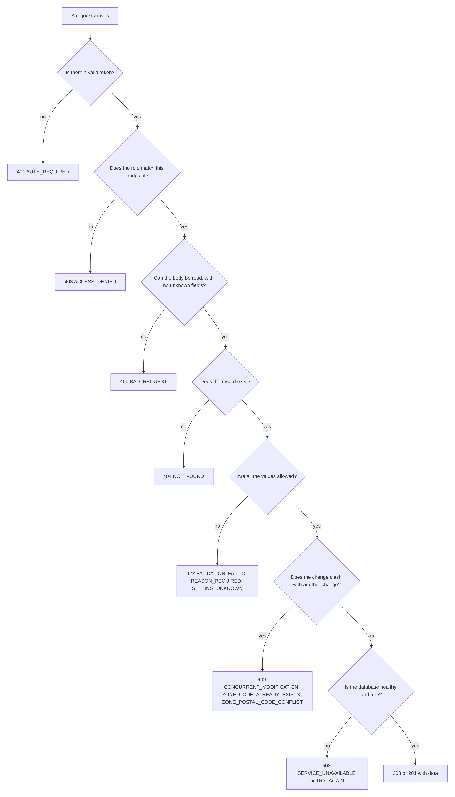

<details>
<summary>Diagram source (Mermaid)</summary>

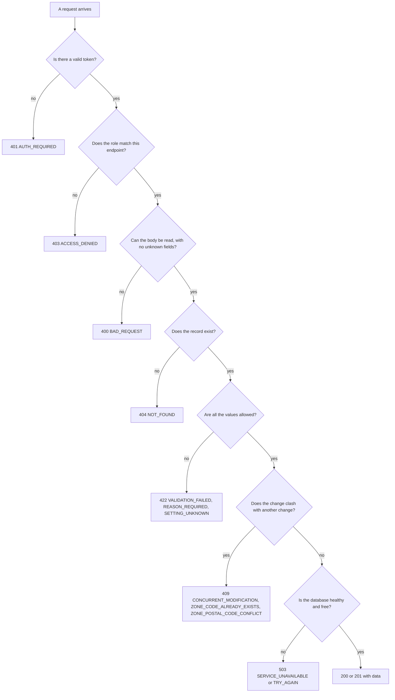

</details>

### 3.6 Repeating a call safely

A courier on a weak phone connection may press "Complete delivery" twice. The rule (api-conventions 4):

1. The screen makes one `Idempotency-Key` (a UUID) when the form is first sent.
2. **Try again reuses the same key.** It never makes a new one.
3. The server stores the key with the answer for 24 hours. The same key with the same body gets the stored answer back, with the header `Idempotent-Replay: true`. The same key with a *different* body gets 409 `IDEMPOTENCY_KEY_PAYLOAD_MISMATCH`.

Member 3's contract asks for this key on assignment, completion and failure calls. My own write endpoints accept the header today but do not yet store keys: the shared `idempotency_keys` table belongs to Member 2 and the platform **\[TBD U-24, U-39\]**. Creating a zone is safe anyway, because the zone id and code must be unique, so the second attempt gets a 409 instead of a second zone.

### 3.7 Who may call what

| Endpoint group | ADMIN | DISPATCHER | COURIER | MERCHANT | CUSTOMER | No token |
| --- | --- | --- | --- | --- | --- | --- |
| `/api/v1/admin/zones/**` | yes | 403 | 403 | 403 | 403 | 401 |
| `/api/v1/admin/merchants/**` | yes | 403 | 403 | 403 | 403 | 401 |
| `/api/v1/admin/settings/**` | yes | 403 | 403 | 403 | 403 | 401 |
| `/api/v1/admin/audit-logs` | yes | 403 | 403 | 403 | 403 | 401 |
| `/api/v1/admin/reports/deliveries` | yes | **yes** (R-16) | 403 | 403 | 403 | 401 |
| `GET /api/v1/zones` (public) | yes | yes | yes | yes | yes | **yes** |

Proven by capture 5.1, 5.2, 6.8, 7.1 and by demo checks DEMO-04, DEMO-05, DEMO-26, DEMO-35 and DEMO-37.

---

## 4. The endpoints I provide: the list

13 endpoints live in my admin module. Eleven need ADMIN, one also allows DISPATCHER, one is public.

| # | Method and path | What it does | Who | Body? |
| --- | --- | --- | --- | --- |
| A-01 | `GET /api/v1/admin/zones` | List every zone, enabled or not | ADMIN | no |
| A-02 | `POST /api/v1/admin/zones` | Create a zone | ADMIN | yes |
| A-03 | `GET /api/v1/admin/zones/{id}` | One zone | ADMIN | no |
| A-04 | `PATCH /api/v1/admin/zones/{id}` | Change code, name, description or postal prefixes | ADMIN | yes |
| A-05 | `PATCH /api/v1/admin/zones/{id}/status` | Turn a zone on or off, with a reason | ADMIN | yes |
| A-06 | `GET /api/v1/zones` | Public list of enabled zones, or the zone of one postal code | anyone | no |
| A-07 | `GET /api/v1/admin/settings` | List the settings an admin may change | ADMIN | no |
| A-08 | `PUT /api/v1/admin/settings/{key}` | Change one setting, with a reason | ADMIN | yes |
| A-09 | `GET /api/v1/admin/audit-logs` | Read the change history, newest first | ADMIN | no |
| A-10 | `GET /api/v1/admin/reports/deliveries` | Deliveries per day over a period | ADMIN, DISPATCHER | no |
| A-11 | `GET /api/v1/admin/merchants` | Merchant list, filtered and paged | ADMIN | no |
| A-12 | `GET /api/v1/admin/merchants/{id}` | One merchant | ADMIN | no |
| A-13 | `POST /api/v1/admin/merchants/{id}/{action}` | approve, reject, suspend, reinstate or disable | ADMIN | yes |

There is **no delete** anywhere. A zone is disabled, never deleted (Doc 5), and audit rows can never be changed or removed, not even by the database user that runs migrations (DEMO-41, DEMO-42).

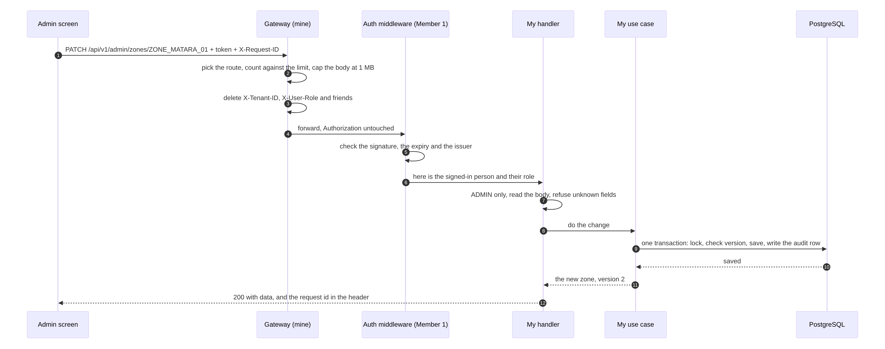

<details>
<summary>Diagram source (Mermaid)</summary>

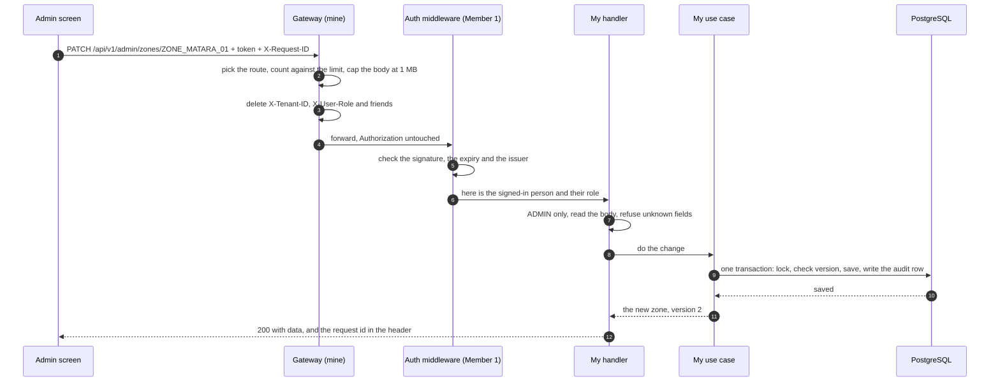

</details>

---

## 5. The endpoints I provide: the detail

Every example below is real output, trimmed only where a list was long. The capture file is `doc8-local/evidence/10-contract-capture.txt`.

### 5.1 The zone record

This is the shape every zone endpoint returns.

| Field | Type | Always there? | Rule in plain words |
| --- | --- | --- | --- |
| `id` | text | yes | The admin chooses it at creation and it never changes. `ZONE_` then capitals, digits or `_`, 2 to 27 more characters, for example `ZONE_COLOMBO_01` |
| `code` | text | yes | A short label for screens and reports, such as `CMB-01`. Capitals, digits, `-` or `_`, 2 to 32 characters. Unique. May be changed later |
| `name` | text | yes | What people read, 1 to 120 characters, no control characters |
| `description` | text | yes (may be empty) | Up to 500 characters |
| `postal_prefixes` | list of text | yes | 3 to 5 digits each, 1 to 200 of them. No prefix may overlap a prefix of another zone |
| `enabled` | true/false | yes | A disabled zone keeps its history but is hidden from booking |
| `version` | number | yes | Goes up by 1 on every saved change. You send it back when you edit (section 5.4) |

**No money.** There is no `base_surcharge_cents`, no `currency` and no fee of any kind. Fees are Member 2's pricing rules (R-04). Sending a money field is refused (capture 1.10):

```text
$ curl -X POST .../api/v1/admin/zones -d '{"id":"ZONE_MONEY_01", ..., "base_surcharge_cents":35000}'
HTTP 400  {"error":{"code":"BAD_REQUEST", ...}}
```

### 5.2 A-01 List zones

`GET /api/v1/admin/zones` — ADMIN. No query parameters today; the list is short (seven zones at the start) and the screen filters in the browser.

```json
{
  "data": [
    {
      "id": "ZONE_COLOMBO_01",
      "code": "CMB-01",
      "name": "Colombo Central",
      "description": "",
      "postal_prefixes": ["00100", "00200", "00300"],
      "enabled": true,
      "version": 1
    }
  ]
}
```

### 5.3 A-02 Create a zone

`POST /api/v1/admin/zones` — ADMIN.

| Field sent | Required | Note |
| --- | --- | --- |
| `id` | yes | The rule in section 5.1 |
| `code` | yes | |
| `name` | yes | |
| `description` | no | Empty if left out |
| `postal_prefixes` | yes | At least one |

Real call and answer (capture 1.2):

```text
$ curl -X POST http://localhost:8088/api/v1/admin/zones \
   -H "Authorization: Bearer $ADMIN" -H "Content-Type: application/json" \
   -d '{"id":"ZONE_MATARA_01","code":"MTR-01","name":"Matara City",
        "description":"Matara town and Nupe","postal_prefixes":["81000","81100"]}'
HTTP 201
{"data":{"id":"ZONE_MATARA_01","code":"MTR-01","name":"Matara City",
 "description":"Matara town and Nupe","postal_prefixes":["81000","81100"],
 "enabled":true,"version":1}}
```

What can go wrong:

| Answer | Code | Why |
| --- | --- | --- |
| 409 | `ZONE_CODE_ALREADY_EXISTS` | That id or that short code is already used (capture 1.8) |
| 409 | `ZONE_POSTAL_CODE_CONFLICT` | A prefix overlaps another zone's prefix: `810` overlaps `81000` (capture 1.9) |
| 422 | `VALIDATION_FAILED` | A value breaks a rule, for example a lower-case id (capture 1.11) |
| 400 | `BAD_REQUEST` | A field I do not accept, including any money field |
| 503 | `TRY_AGAIN` | Another prefix change held the lock for more than 2 seconds |

**Why overlapping prefixes are refused.** Postal prefixes decide which zone an address belongs to. If `810` were in Matara and `81000` in Galle, the same address would be in two zones and nobody could say which fee or which courier applies. So one prefix may not sit inside another zone's prefix.

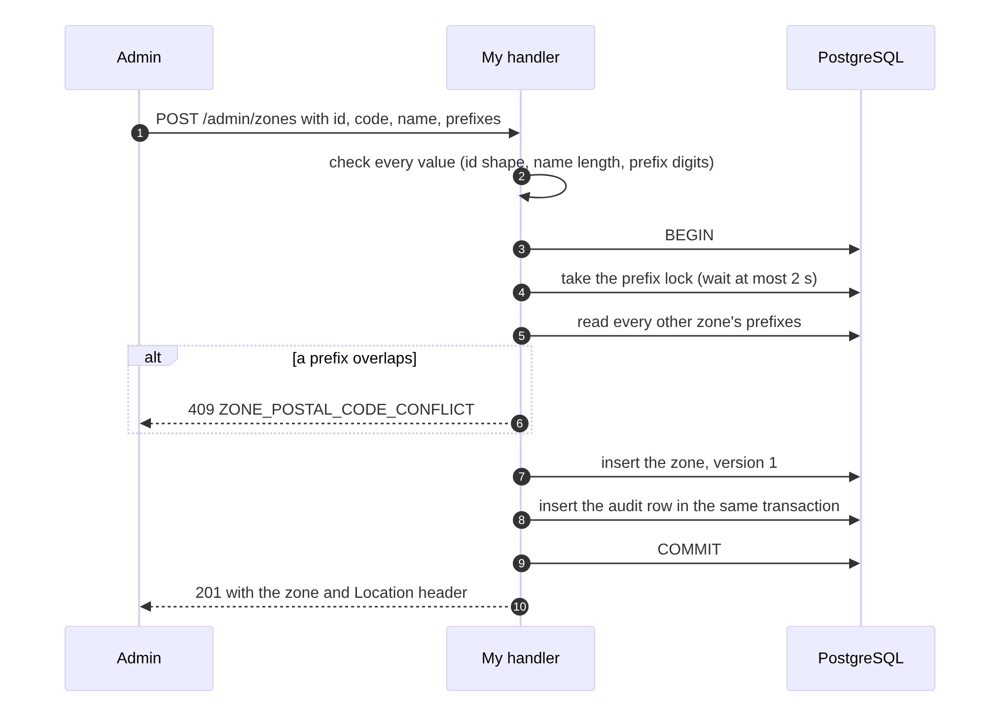

<details>
<summary>Diagram source (Mermaid)</summary>

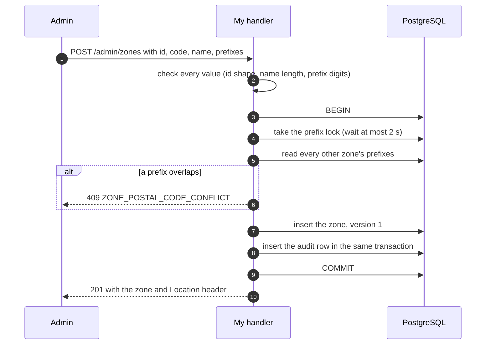

</details>

### 5.4 A-04 Change a zone, and what `version` is for

`PATCH /api/v1/admin/zones/{id}` — ADMIN. Send `version` plus only the fields you want to change.

| Field sent | Required | Note |
| --- | --- | --- |
| `version` | yes | The version you last read |
| `code`, `name`, `description` | no | Any of them |
| `postal_prefixes` | no | Replaces the whole list when given |
| `reason` | no | 10 to 500 characters when given; stored in the audit row |

The version goes up **once per save**, even when several fields change in one call (capture 1.4: version 1 becomes 2 after a name and a code change).

If someone else saved first, your version is out of date and the change is refused (capture 1.5):

```json
{ "error": { "code": "CONCURRENT_MODIFICATION",
             "message": "Someone else changed this. Reload and try again" } }
```

The screen then reloads the zone, keeps what the admin typed and asks them to apply it again. Nothing is overwritten silently.

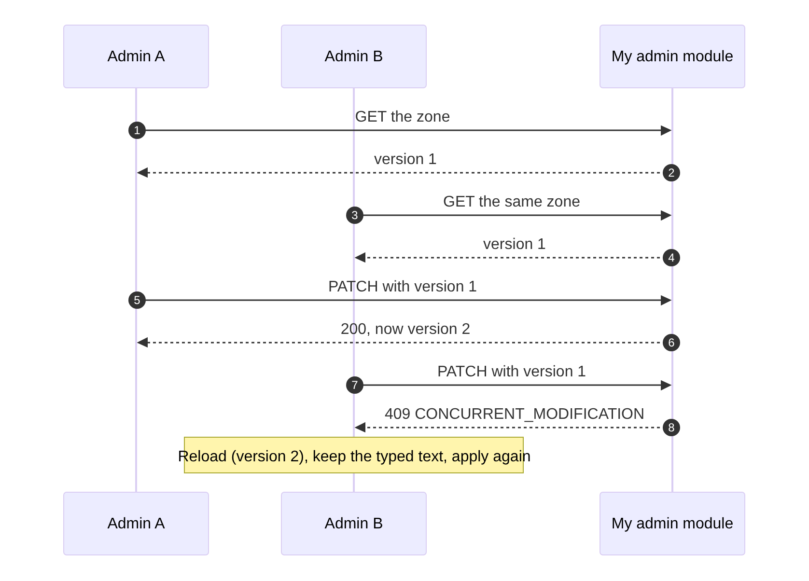

<details>
<summary>Diagram source (Mermaid)</summary>

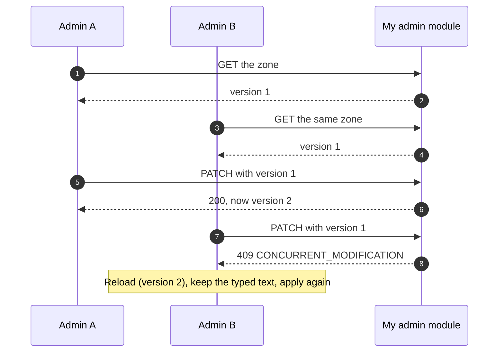

</details>

### 5.5 A-05 Turn a zone on or off

`PATCH /api/v1/admin/zones/{id}/status` — ADMIN.

| Field sent | Required | Note |
| --- | --- | --- |
| `version` | yes | |
| `enabled` | yes | `true` or `false` |
| `reason` | **yes** | 10 to 500 characters. Turning a zone off stops bookings for a whole area, so the reason is kept forever in the audit log |

Without a reason (capture 1.6): `422 REASON_REQUIRED`. With one (capture 1.7): `200`, `enabled` is `false` and the version goes up. The audit row looks like this (capture 4.1):

```json
{
  "action": "ZONE_DISABLED",
  "target_type": "ZONE",
  "target_id": "ZONE_MATARA_01",
  "previous_state": { "enabled": true },
  "new_state": { "enabled": false },
  "reason": "Flooding in Matara; no deliveries this week"
}
```

Turning a zone on uses the same endpoint with `enabled: true`; the action is then `ZONE_ENABLED`. Asking for a state the zone is already in is refused with `422`.

### 5.6 A-06 The public zone list (for Member 6)

`GET /api/v1/zones` — **no sign-in needed.** This is the one open door in my module, added because Member 6's booking form needs to show delivery areas before anyone signs in (R-18, audit row "no zone-list endpoint for customers").

It shows **only enabled zones** and **only three fields**: `id`, `code`, `name`. No postal prefixes, no boundary, nothing about people. The answer may be cached for 5 minutes (capture 2.1):

```text
HTTP/1.1 200 OK
Cache-Control: public, max-age=300

{"data":[{"id":"ZONE_COLOMBO_01","code":"CMB-01","name":"Colombo Central"}, ...]}
```

**Looking up one postal code:** add `?postal_code=` with exactly five digits.

| Case | Answer | Capture |
| --- | --- | --- |
| A covered postal code | 200 with one zone | 2.2 |
| A postal code in a disabled zone, or in no zone | 404 `ZONE_NOT_FOUND` | 2.3 |
| Not five digits | 422 `VALIDATION_FAILED` | 2.4 |

**The longest prefix wins.** If one zone owns `00` and another owns `00300`, then `00300` decides, because it is the more exact match. Proven by the real-database test `TestPublicZonesAndPostalLookup`.

Member 6 has asked whether the public list should also carry the postal prefixes, so a booking form can check an address without a second call. My worry is that the full prefix map tells an outsider exactly where we deliver, so I propose keeping the lookup call instead **\[TBD U-71\]**.

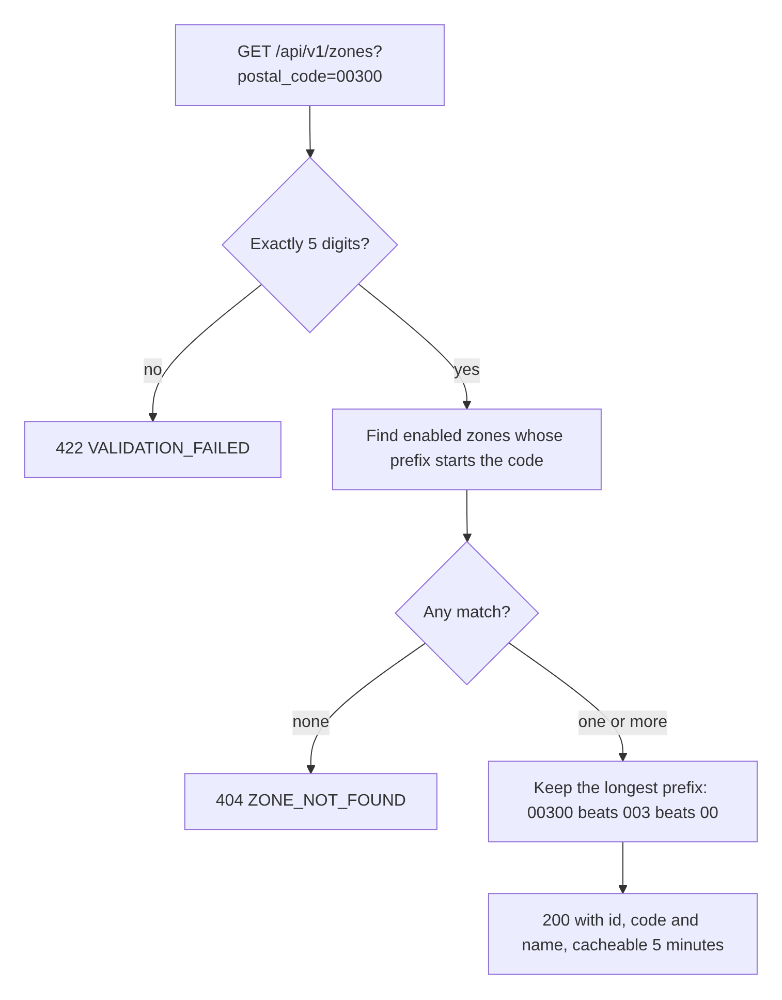

<details>
<summary>Diagram source (Mermaid)</summary>

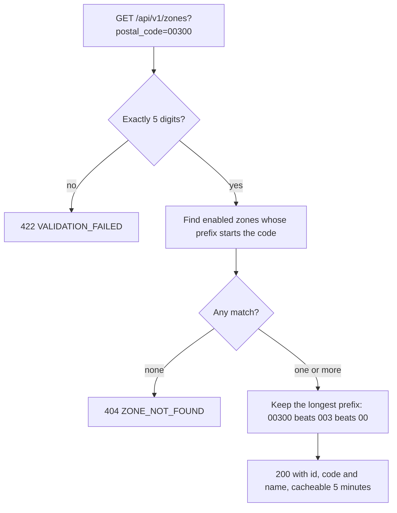

</details>

### 5.7 A-07 and A-08 System settings

Settings are a small, fixed list of numbers and texts that an admin may change without a new release. **Only keys on the allowlist exist**, so nobody can store a secret here (capture 3.1):

| Key | Type | Meaning | Start value |
| --- | --- | --- | --- |
| `ops.board_refresh_seconds` | number | How often the dispatch board reloads | 30 |
| `ops.maintenance_banner` | text | A message shown on the ops screens, empty for none | `""` |
| `reports.max_range_days` | number | The longest period a report may cover | 92 |

`PUT /api/v1/admin/settings/{key}` takes `version`, `value` and a `reason` of 10 to 500 characters, and answers with the new setting (capture 3.2). Any other key is refused, including one that looks like a secret (capture 3.3):

```text
$ curl -X PUT .../api/v1/admin/settings/jwt.private_key -d '{"version":1,"value":"secret", ...}'
HTTP 422  {"error":{"code":"SETTING_UNKNOWN","message":"This setting cannot be changed"}}
```

Adding a new setting is a code change plus a migration row, on purpose: the allowlist is what keeps this endpoint safe.

### 5.8 A-09 The audit log

`GET /api/v1/admin/audit-logs?page=1&per_page=20` — ADMIN only. Newest first, paged like every other list.

| Field | Plain meaning |
| --- | --- |
| `actor_id`, `actor_role` | Who did it, taken from the token, never from the request body |
| `action` | `ZONE_CREATED`, `ZONE_UPDATED`, `ZONE_ENABLED`, `ZONE_DISABLED`, `SETTING_CHANGED`, and Member 4's `MERCHANT_*` actions |
| `target_type`, `target_id` | What was changed (`ZONE` and the zone id, `SETTING` and the key) |
| `previous_state`, `new_state` | The changed fields before and after, with anything secret removed |
| `reason` | The reason, where the action needs one |
| `request_id` | The same id as the `X-Request-Id` header, so a row can be matched to a log line |
| `created_at` | When |

Three promises about this endpoint:

1. **Read only.** There is no endpoint that changes or deletes an audit row, and the database refuses it too.
2. **No change without a row.** The change and its audit row are written in one transaction; if the row cannot be written, the change is rolled back (`TestAuditInSameTransaction`).
3. **No secrets.** Values under names such as `password`, `token` or `api_key` are replaced before the row is written.

The shared `audit_logs` table and the names of its columns belong to the whole team; my module adds the `reason` column and needs `target_id` to be text, since a setting key is not a UUID **\[TBD U-64\]**.

### 5.9 A-10 The delivery report

`GET /api/v1/admin/reports/deliveries?from=2026-10-01&to=2026-10-03` — ADMIN **and DISPATCHER** (R-16, SRS 6.2, FR-ADM-008).

| Field returned | Plain meaning |
| --- | --- |
| `from`, `to` | The period, as Sri Lanka days |
| `days` | One row per day: `date`, `delivered`, `failed`, `returned` |
| `delivered`, `failed` | Totals for the period |
| `success_rate` | Share of successful attempts, or `null` when there were no attempts |
| `source` | Where the numbers came from |

Rules: `from` must not be after `to`, and the period may not be longer than `reports.max_range_days` (92). A longer range is refused with 422 (capture 5.3), which protects the database from one very heavy query.

**Honest note.** Members 2 and 3 own the parcel and delivery data, and their read interfaces do not exist yet, so the endpoint answers with empty days and says so in `source` (capture 5.1):

```json
{ "data": { "from": "2026-10-01", "to": "2026-10-03", "days": [], "delivered": 0,
            "failed": 0, "success_rate": null,
            "source": "stand-in: no parcel data until Members 2 and 3 connect" } }
```

Nobody can mistake these numbers for real ones, and the screen can be built now. When the real interface arrives, only the `source` line changes.

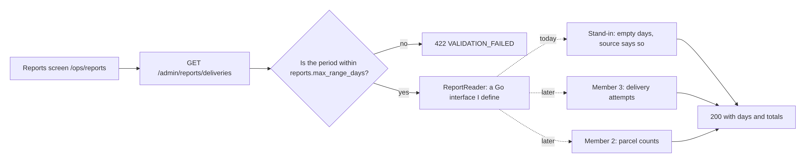

<details>
<summary>Diagram source (Mermaid)</summary>

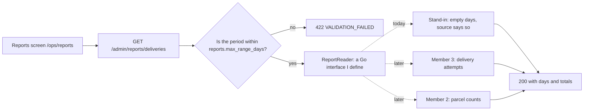

</details>

### 5.10 A-11 to A-13 The merchant routes

These three endpoints are a **shared** contract: I host the address and check the role, **Member 4 owns every rule** behind it (R-02). My code adds nothing of its own, not even an error message: Member 4's codes are passed through unchanged.

**A-11 list** `GET /api/v1/admin/merchants?status=&q=&page=&per_page=`

| Parameter | Rule |
| --- | --- |
| `status` | One of PENDING, APPROVED, REJECTED, SUSPENDED, DISABLED |
| `q` | Free text, up to 100 characters, matched against business name and contact email |
| `page`, `per_page` | As section 3.4 |

Real answer (capture 6.1), trimmed:

```json
{
  "data": [ { "merchant_id": "11111111-1111-4111-8111-111111111111",
              "business_name": "Ceylon Tea Shop", "status": "PENDING",
              "contact_email": "owner@ceylontea.example", "contact_phone": "+94771234567",
              "approved_at": null, "version": 1,
              "created_at": "2026-10-20T04:30:00Z", "updated_at": "2026-10-20T04:30:00Z" } ],
  "meta": { "page": 1, "per_page": 20, "total_items": 1, "total_pages": 1 }
}
```

**A-13 status change** `POST /api/v1/admin/merchants/{id}/{action}` where the action is `approve`, `reject`, `suspend`, `reinstate` or `disable`.

| Field sent | Required | Note |
| --- | --- | --- |
| `expected_version` | yes | Member 4's version check, the same idea as section 5.4 |
| `reason` | for `reject`, `suspend` and `disable` | 5 to 500 characters (Member 4's rule, shorter than mine for zones) |

| Answer | Code | Why | Capture |
| --- | --- | --- | --- |
| 200 | — | Done; `status` and `version` are new | 6.3 |
| 409 | `MERCHANT_VERSION_CONFLICT` | Somebody changed the merchant first | 6.4 |
| 409 | `MERCHANT_INVALID_TRANSITION` | The move is not allowed from that status, such as rejecting an approved merchant | 6.6 |
| 422 | `REASON_REQUIRED` | A reason was needed and was missing | 6.5 |
| 404 | `MERCHANT_NOT_FOUND` or `NOT_FOUND` | No such merchant, or no such action | 6.7 |
| 403 | `ACCESS_DENIED` | Not an ADMIN | 6.8 |

Member 4 writes the audit row inside their own transaction, so approving a merchant is one atomic step even though two members' code is involved.

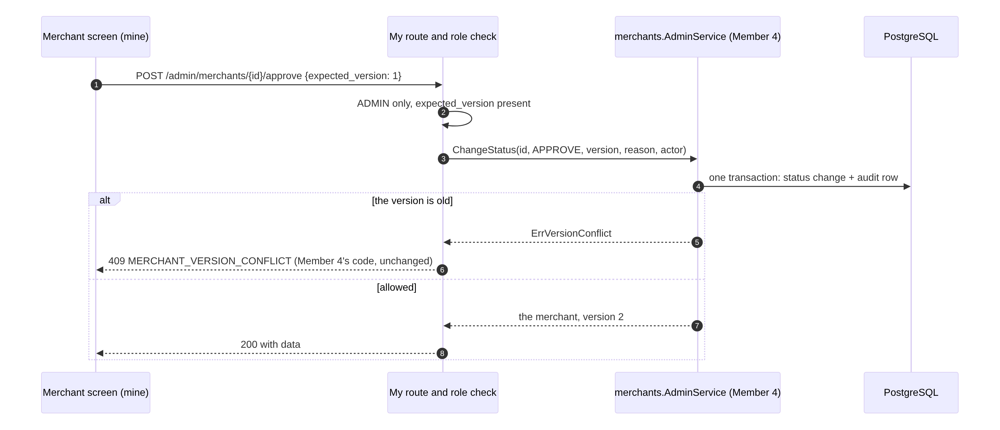

<details>
<summary>Diagram source (Mermaid)</summary>

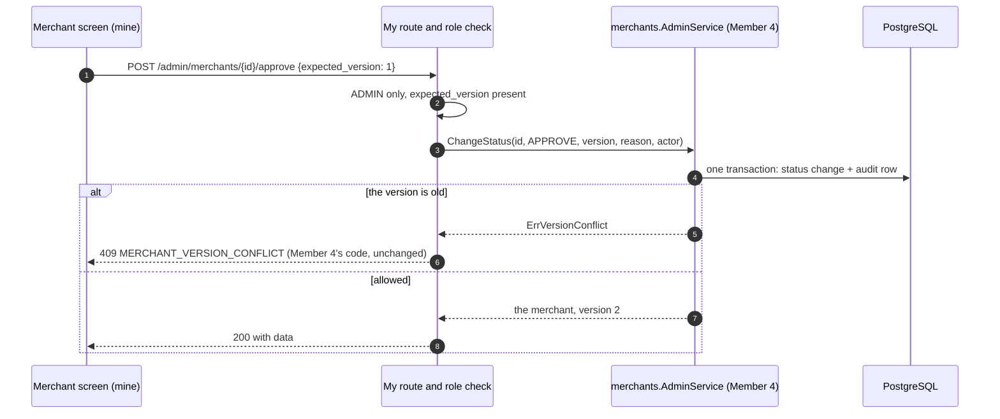

</details>

---

## 6. What the gateway promises

The gateway is the front door for the whole system. Its contract matters to every member, so it is written here as carefully as an API.

### 6.1 Where each address goes

| Address | Goes to | Extra rules |
| --- | --- | --- |
| `/api/v1/tracking` and `/api/v1/tracking/...` | Tracking API (Member 5) | 30 calls a minute per visitor, burst 10 |
| `/api/v1/tracking/{number}/stream` and `/api/v1/tracking/public/{number}/stream` | Tracking API, live stream | Same limit, plus at most 5 open streams per visitor, no buffering |
| `/api/v1/ai` and `/api/v1/ai/...` | AI assistant (Member 10) | 10 calls a minute per visitor, burst 2 |
| `/api/v1/ai/mcp/sse` | AI assistant, live stream | Stream rules as above |
| `/api/v1/auth/login` | Core API | 5 calls a minute per visitor, burst 3, so passwords cannot be guessed |
| `/api/v1/deliveries/{id}/proof-photo` | Core API | Body up to 10 MB (photos) |
| `/api/v1/merchant/...` | Core API | 120 calls a minute per visitor, burst 20 |
| everything else under `/api/v1` | Core API | Body up to 1 MB |
| anything else under `/api` | Core API, which answers a JSON 404 | So a typo such as `/api/v2/zones` never shows the web app (capture 7.3) |
| everything else (`/`, `/ops/...`, `/courier/...`) | The web app | Strict content rules for the page |

**Why the two stream rules carry a priority number.** Traefik normally ranks rules by how long their text is, and the general tracking rule is longer than the stream rule, so without `priority: 100` the stream rule would never be used and the stream limit would quietly do nothing. I found this while testing, and gateway checks GS-09 and GS-09b now prove it.

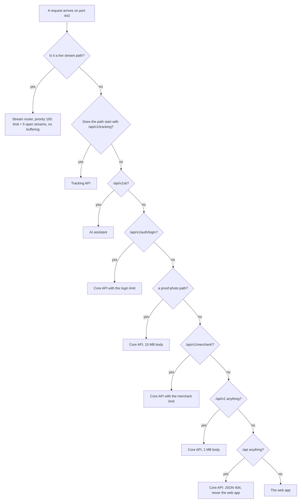

<details>
<summary>Diagram source (Mermaid)</summary>

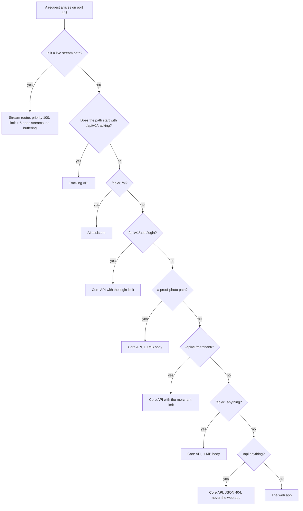

</details>

### 6.2 What the gateway adds, removes and refuses

| Promise | Detail |
| --- | --- |
| **It never reads your token** | Routing and limits only. Sign-in and roles are decided inside Core API |
| **It deletes look-alike identity headers** | `X-User-ID`, `X-User-Role`, `X-Tenant-ID`, `X-Merchant-ID`, `X-Forwarded-User` are removed from every incoming request |
| **It leaves `Authorization` alone** | Proven by check GS-10b |
| **It adds safety headers to answers** | `nosniff`, `frame DENY`, a referrer rule, and a strict content policy on the web app |
| **It hides what we run** | `Server` and `X-Powered-By` are removed |
| **It caps bodies** | 1 MB for JSON, 10 MB only on the proof-photo path. Bigger gets 413 (capture 7.5) |
| **It counts per visitor** | Buckets are per client IP, read from the right-most `X-Forwarded-For` entry that Cloudflare writes. If another proxy is added in front, that depth must change **\[TBD U-46\]** |
| **It never retries a write** | A POST is sent once. If it times out, the screen retries with the same `Idempotency-Key`, so a parcel cannot be delivered twice (check GS-14) |
| **It keeps streams open** | The write timeout stays off, or live tracking would be cut every minute |
| **Health and metrics are not public** | `/health/live`, `/health/ready` and `/metrics` answer on the pod only (DEMO-03) |
| **The dashboard is not public** | Traefik's own dashboard is on internal port 8090 (R-10) |

### 6.3 Which browsers may call the API (CORS)

Exactly as `security-notes.md` section 4 (R-14):

| Setting | Value |
| --- | --- |
| Allowed origins, local | `http://localhost:3000`, `http://127.0.0.1:3000` |
| Allowed origins, production | `https://swiftdrop.io`, `https://app.swiftdrop.io`, `https://portal.swiftdrop.io` (in the Kubernetes file) |
| Allowed methods | GET, POST, PUT, PATCH, DELETE, OPTIONS |
| Allowed headers | `Authorization`, `Content-Type`, `X-API-Key`, `Idempotency-Key`, `X-Request-ID` |
| Headers a script may read | `X-Request-ID`, `Content-Length` |
| Credentials | allowed, and never together with a wildcard origin |

`X-Tenant-ID` is **not** in the allowed list, because no client should ever send it (R-15).

Because only two headers are exposed, a script cannot read `Retry-After` on a cross-origin call. My screens therefore wait a fixed 10 seconds after a 429 instead of reading that header.

### 6.4 How long the gateway waits

| Step | Limit | What the caller sees |
| --- | --- | --- |
| Connect to a service | 5 s | 502 if the service is down (check GS-15) |
| First byte from Core API | 30 s | 504 (check GS-13) |
| First byte from the Tracking API | 10 s, then the stream may stay open | 504, and the browser reconnects by itself |
| First byte from the AI service | 60 s **\[TBD with Member 10\]** | 504 |

My screens give up after 35 seconds, which is deliberately longer than the gateway, so the user always sees the gateway's clear answer rather than a silent hang.

---

## 7. Interfaces inside the program (Go)

Core API is one program with several modules. Inside it, modules call Go interfaces instead of HTTP. An interface is a short list of functions one module promises to provide.

### 7.1 What I consume

```go
// Member 4 provides this; my merchant routes only pass calls along (R-02).
type AdminService interface {
    ListMerchants(ctx context.Context, f ListFilter, p Page) (MerchantPage, error)
    GetMerchant(ctx context.Context, id string) (MerchantSummary, error)
    ChangeStatus(ctx context.Context, cmd ChangeStatusCommand) (MerchantSummary, error)
}

// I define this; Members 2 and 3 fill it with real numbers later.
type ReportReader interface {
    Deliveries(ctx context.Context, from, to time.Time) ([]DeliveryDay, error)
}
```

Rules I follow with other people's interfaces:

1. **I never run SQL on another module's tables.** If I need their data, I ask for a function (Doc 3 DD-09).
2. **I pass their errors through.** `ErrVersionConflict` becomes 409 `MERCHANT_VERSION_CONFLICT`, exactly as Member 4's table says.
3. **A missing implementation is replaced by an honest stand-in**, never by invented numbers (section 5.9).

### 7.2 What I provide to other modules

```go
// Offered to any module that needs the zone of an address, so nobody reads my tables.
type ZoneDirectory interface {
    ZoneForPostalCode(ctx context.Context, postalCode string) (PublicZone, error)
    ListPublicZones(ctx context.Context) ([]PublicZone, error)
}
```

Member 2 needs a zone for pricing and Member 3 needs one for dispatch, so this saves them from copying my prefix rule. It is the same code the public endpoint uses. Nobody has asked for it yet, so it is **offered, not agreed**.

### 7.3 My own layers

My module keeps its own three-layer rule, which is why the HTTP shape can change without touching the business rules:

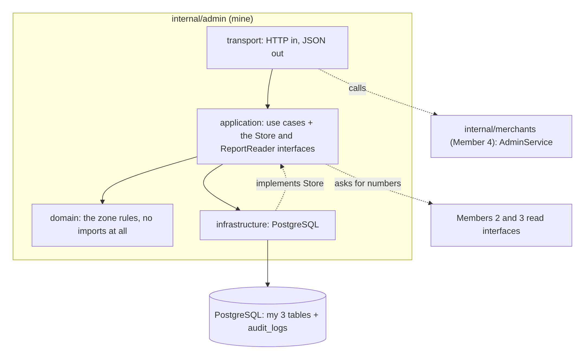

<details>
<summary>Diagram source (Mermaid)</summary>

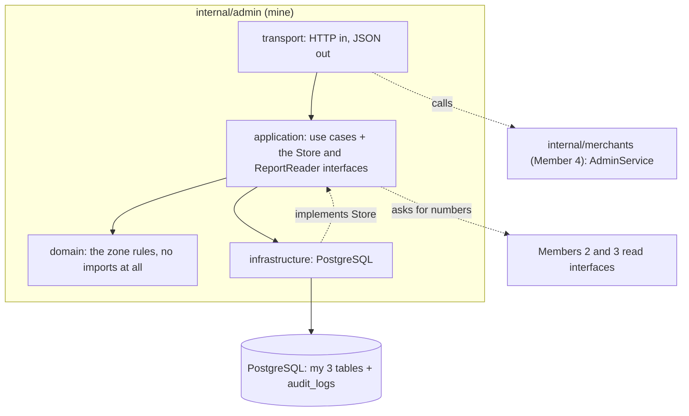

</details>

---

## 8. The endpoints I consume

My screens are only as good as these promises. Each row says where the owner wrote it down. **Please correct anything here that does not match your document.**

### 8.1 From Member 1 — sign-in and users

| Call | What my screens do with it | Status |
| --- | --- | --- |
| `POST /api/v1/auth/login` | Keep the access token in memory only; the refresh token is an HttpOnly cookie the browser holds | **\[Agreed\]** |
| `POST /api/v1/auth/refresh` | On a 401, all waiting calls share **one** refresh, then the original call is retried once | **\[Agreed\]** |
| `POST /api/v1/auth/logout` | Clear memory and go to the sign-in screen | **\[Agreed\]** |
| `GET /api/v1/auth/me` | Read the role to decide the navigation | **\[Agreed\]** |
| `GET /api/v1/admin/users`, `PUT /api/v1/admin/users/{id}/role` | The users and roles screen (FR-ADM-006) | **\[Agreed\]** |
| Disable a user; end all of a user's sessions | Needed when a courier phone is lost (FR-IAM-007) | **\[Requested, U-66\]** |

Two things to settle: Member 1's answers use `camelCase` while the conventions use `snake_case` **\[TBD U-69\]**, and the courier refresh lifetime differs between documents **\[TBD U-01\]**.

### 8.2 From Member 3 — dispatch, couriers and deliveries

| Call | My screen | Note |
| --- | --- | --- |
| `GET /api/v1/dispatch/board?zone_id=` | Dispatch board | `zone_id` is **required**, which is why my board always has a zone picker |
| `GET/POST /api/v1/dispatch/couriers`, `GET /dispatch/couriers/{id}` | Fleet screen | Filters by zone, status and vehicle type |
| `POST /api/v1/dispatch/assignments` | Assign | Sends `Idempotency-Key`; the new assignment is `ASSIGNED` |
| `POST /api/v1/dispatch/assignments/{id}/cancel` | Reassign, step 1 | Needs `cancellation_reason` |
| `POST /api/v1/dispatch/parcels/{id}/reschedule` | Failed-delivery review | `target_courier_id`, `scheduled_date`, `preferred_time_window`, `dispatch_notes` |
| `POST /api/v1/courier/shift` | Courier shift toggle | ON_SHIFT, OFF_SHIFT, ON_BREAK |
| `GET /api/v1/courier/parcels` | Courier task list | The server limits it to the signed-in courier |
| `POST /api/v1/courier/parcels/{id}/start-run`, `/courier/runs/start-batch` | Start the run | |
| `POST /api/v1/deliveries/{id}/proof-photo` | Proof of delivery, step 1 | multipart field `photo`, up to 10 MB |
| `POST /api/v1/deliveries/{id}/complete` | Proof of delivery, step 2 | Sends `Idempotency-Key` |
| `POST /api/v1/deliveries/{id}/failed` | Failed attempt | `reason_code`, `notes`, `latitude`, `longitude` |
| `GET /api/v1/deliveries/parcels/{id}` | Attempt history | |

**Three screen rules that come straight from these contracts.**

1. **There is no "reassign" button in one step.** Reassigning is cancel, then assign, so the reason is always recorded.
2. **There is no "return to merchant" button.** Member 3 moves a parcel to RETURNED by itself after the third failure or a refusal.
3. **The photo goes first.** The upload answers with `proof_attachment_url`; the screen keeps it and sends it with the completion call, so a lost answer never loses the photo.

One thing to clear up: the board answer contains `destination_zone: "ZONE_COLOMBO_METRO"`, which is not one of the zone ids I own, and the endpoint also mentions a legacy `zone_code`. I need to know whether that field is a zone id, a zone name or free text, or my board cannot group parcels by zone **\[TBD U-70\]**.

### 8.3 From Member 4 — merchants

Covered in sections 5.10 and 7.1. Member 4 has offered a helper, `merchants.HTTPError(err)`, so the error table lives in one place; I would like that (their U-26).

### 8.4 From Member 2 — pricing and parcel corrections

| Call | My screen | Status |
| --- | --- | --- |
| `GET/POST /api/v1/admin/pricing-rules`, `PATCH /admin/pricing-rules/{id}` and `/{id}/status` | Pricing screen | **\[Requested, U-65\]** The audit found no pricing endpoints in Member 2's drafts |
| An audited parcel correction | Admin correction screen | **\[Requested, U-08\]** Owner not yet decided |

My screens never calculate a price. They show what Member 2 returns (web/CLAUDE.md).

### 8.5 From Member 5 — public tracking

The public tracking page and its live updates belong to Member 5. My part is only routing them (section 6.1): the stream path, no buffering, a 15-second heartbeat and at most 5 open streams per visitor (R-12, R-13).

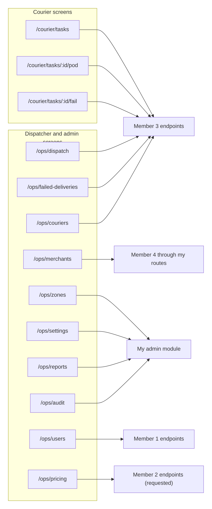

<details>
<summary>Diagram source (Mermaid)</summary>

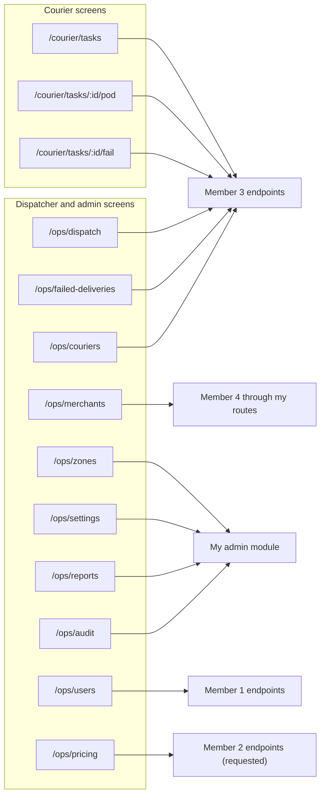

</details>

---

## 9. Events

My module publishes **no events today**. Zones change rarely and every reader asks for the current list when it needs it, so there is nothing to announce.

If the team decides that pricing or tracking should react to a zone change **\[TBD U-32\]**, I will not call RabbitMQ from my handler. I will write a row to the shared `outbox_events` table **in the same transaction as the change**, and Member 8's relay will publish it. That way a published event can never describe a change that was rolled back, and a change can never be lost because the queue was down.

The payload I would propose, following `event-contracts.md`:

```json
{
  "event_id": "018f3c2e-7b1a-7c91-9e12-3456789abcde",
  "event_type": "zone.updated.v1",
  "occurred_at": "2026-10-26T14:18:31Z",
  "actor_id": "00000000-0000-4000-8000-000000000001",
  "request_id": "corr_8cecb6bfdc9007c1c47da0ab",
  "data": {
    "zone_id": "ZONE_MATARA_01",
    "code": "MTR-02",
    "enabled": false,
    "postal_prefixes_added": [],
    "postal_prefixes_removed": ["81100"],
    "version": 3
  }
}
```

Three event names would be enough: `zone.created.v1`, `zone.updated.v1`, `zone.status_changed.v1`. The payload carries no personal data, so it is safe to send to any consumer.

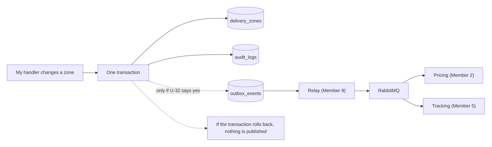

<details>
<summary>Diagram source (Mermaid)</summary>

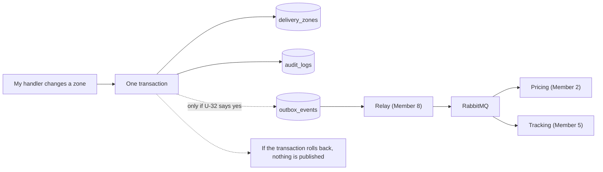

</details>

---

## 10. Changing a contract later

A contract that changes without warning breaks somebody else's screen. The rules I follow:

| Kind of change | Safe? | What I do |
| --- | --- | --- |
| Add a new optional field to an answer | yes | Just do it; readers ignore what they do not know |
| Add a new endpoint | yes | Add it, with its roles, to section 4 and to the module's `API.md` |
| Add a new optional query parameter | yes | Keep the old behaviour when it is left out |
| Make an optional field required | **no** | Needs the caller's agreement and a dated note here |
| Rename or remove a field, or change its type | **no** | Same, and in practice it waits for `/api/v2` |
| Make a rule stricter (a shorter name, a smaller page) | **no** | Agree first: today's callers may already break the new rule |
| Change an error `code` | **no** | Screens act on codes, so a rename is a breaking change |
| Add a new error code for a new case | yes | Screens fall back to showing the message |

Three habits keep this honest:

1. **`API.md` and `README.md` change in the same commit as the code** (AGENTS.md), so the written contract cannot drift.
2. **The gateway's two file sets are compared by a test.** The Docker files and the Kubernetes files must list the same middlewares, or `make gateway-check` fails.
3. **Every contract promise in this document has a check behind it** (section 12), so a breaking change shows up as a failing check rather than as a broken screen.

---

## 11. Which requirement each endpoint serves

| Endpoint or promise | SRS requirement |
| --- | --- |
| A-01 to A-05 zones | FR-ADM-007 |
| A-06 public zone list | FR-ADM-007, and Member 6's booking flow |
| A-07, A-08 settings | FR-ADM-007 |
| A-09 audit log | SEC-015 |
| A-10 delivery report | FR-ADM-008 |
| A-11 to A-13 merchants | FR-ADM-005, FR-IAM-009 |
| Role checks on every endpoint | SEC-004 |
| Validation rules in section 5 | SEC-006 |
| Error answers without internal detail | SEC-006, SEC-008 |
| Page size limited to 100 | NFR-PERF-004 |
| Gateway rate limits | SEC-007 |
| CORS rules | SEC-013 |
| Body caps and the photo path | SEC-006, SEC-012 |
| Token in the header only, tenant from the token | SEC-003, SEC-004 |
| Dispatch and courier calls in section 8.2 | FR-ADM-001 to FR-ADM-004, FR-COU-001 to FR-COU-007, FR-LIFE-002, FR-LIFE-006 |

---

## 12. The proof

Nothing in this document is only a plan. Each promise has a check that fails if the promise breaks.

| Promise | Proof | Where |
| --- | --- | --- |
| Every example answer in sections 3 to 5 | A real run through the gateway, 26 Oct | `doc8-local/evidence/10-contract-capture.txt` |
| 13 endpoints behave as written | **52 demo checks, all passing** | `evidence/02-demo.txt` |
| Zone rules, prefix overlap, version counter | **46 Go tests passing**, including race tests on a real PostgreSQL | `evidence/04-go-tests.txt` |
| Gateway routing, limits, headers, CORS | **25 gateway checks passing** on real Traefik 3.1.7 | `evidence/06-gateway-check.txt` |
| The same checks on today's repository config | 8 pass, 17 fail: the gaps listed in Doc 7 section 14 | `evidence/09-gateway-repo-config.txt` |
| The Docker and Kubernetes gateway files agree | Parity check: 11 middlewares, 3 transports | `evidence/06-gateway-check.txt` |
| Audit rows cannot be changed or deleted | DEMO-41, DEMO-42 on real PostgreSQL | `evidence/02-demo.txt` |
| Member 4's error codes pass through unchanged | DEMO-29, DEMO-30, capture 6.3 to 6.7 | both files |

How to repeat all of it:

```bash
cd doc8-local
make wipe && make up
make demo                 # 52 checks through the gateway
make test-db              # 46 Go tests, including the real-database ones
make gateway-check        # parity, Kubernetes schemas, 25 gateway checks
bash tools/contract_capture.sh    # rebuilds evidence/10-contract-capture.txt
```

---

## 13. Honest limits of this document

1. **Only my own endpoints are proven.** Sections 8.1 to 8.5 are my reading of other members' documents. They are correct only until an owner tells me otherwise.
2. **The merchant rules behind A-11 to A-13 are a stand-in locally.** The routes, roles, codes and version check are real; Member 4's module replaces the rules with no change to my handlers.
3. **The report has no real numbers yet** (section 5.9).
4. **No machine-readable OpenAPI file yet.** Member 4 ships one and it works well for them; I propose that my 13 endpoints are added to one shared OpenAPI file for Core API rather than a file per member, so the gateway, the tests and the screens all read the same source. That needs a team decision and an owner.
5. **The screens are not built yet**, so the contracts in section 8 have been read, not yet exercised.

---

## 14. Open questions

Numbers continue from my other documents, which end at U-67.

| ID | Question | Why it matters | Decide with |
| --- | --- | --- | --- |
| U-68 | In an error answer, is the id field called `correlation_id` (api-conventions) or `request_id` (Member 3 Doc 4)? | My screens show it to the user on a 500 and would have to read both names | Tech Lead, Members 1 to 5 |
| U-69 | Are JSON field names `snake_case` (api-conventions) or `camelCase` (Member 1 Doc 4)? | One API client cannot assume both | Tech Lead, Member 1 |
| U-70 | In Member 3's board answer, what exactly is `destination_zone`, and is `zone_code` still supported? | My board groups parcels by zone and must match the ids I own | Member 3 |
| U-71 | Should `GET /api/v1/zones` also return postal prefixes? | It would save Member 6 a call, but it publishes our full coverage map | Members 6, 1 |

Still open elsewhere and relevant here: U-01 (courier token storage), U-04 (fee endpoint name), U-06 and U-50 (per-user limits), U-08 (parcel correction owner), U-14 (pricing overlap policy), U-24 and U-39 (idempotency storage), U-32 (zone events), U-46 (proxy depth), U-63 (`web/README.md` route table), U-64 (`audit_logs` shape), U-65 (pricing endpoints), U-66 (disable user and end sessions), U-67 (assignment status name).

---

## 15. Sign-off

To be reviewed in Meeting 2. Members 3 and 4 are the main reviewers, because half of this document describes their contracts as I understand them. Member 9 reviews section 6, Member 6 reviews section 5.6, and Member 1 reviews sections 3 and 8.1.

| Member | Approved (date) | Notes |
| --- | --- | --- |
| Member 1 |  |  |
| Member 2 |  |  |
| Member 3 |  |  |
| Member 4 |  |  |
| Member 5 |  |  |
| Member 6 |  |  |
| Member 8 |  |  |
| Member 9 |  |  |
| Member 10 |  |  |
