# Document 5 — Data & Persistence Specification

> **Status:** Draft / Proposed (For Review in Meeting 2)  
> **Author:** Member 7 — Dispatcher/Admin UI, Courier Web, Traefik Gateway  
> **Target Module / Location:** `web/src/features/dispatcher-admin/` (ops + courier screens), `core-api/internal/admin/` (admin module), `deploy/gateway/traefik/` (gateway)  
> **Key Upstream Dependencies:** Member 1 (users table), Member 2 and Member 3 (foreign keys to delivery_zones), Member 8 (outbox), Member 9 (database deployment)  
> **Open Questions / Needs Clarification:** Section 12. Still open: U-35 (add my tables to the system ERD), U-39 (idempotency key), U-41 (audit archive after 2 years), U-64 (audit `target_id` type and `reason` column), U-67 (assignment status name). Closed on 26 Oct: U-36 (14 days), U-37 (VARCHAR id), U-38 (replaced by U-64), U-40 (6-digit numbers)

**Module:** Dispatcher/Admin/Courier Frontend, Admin Backend Module & API Gateway (Member 7) **Project:** SwiftDrop Parcel Delivery & Courier Management System **Based on:** Document 1 v4 (scope), Document 2 v3 (flows), Document 3 v2 (design), Member 7 alignment guide section 6, docs audit (26 Oct), Member 9 team agreements (A2, D4, D6, D7, K6, K9), database-schema.md (system ERD), domain-boundaries.md, admin README.md and API.md, api-conventions.md, security-notes.md, SRS sections 5.4, 7.2, 7.3, docs/operations (local-development, runbook, environment-variables), docs/testing/test-strategy.md **Status:** Draft v2 (26 Oct 2026). v2 applies the alignment guide and the docs audit: zone id is now `VARCHAR(32)` text, money is removed from zones, `audit_logs` uses the shared shape, migrations are `000002` and `000011`, and the database roles and secret names follow Member 9 D6 and K6. Items marked **\[TBD\]** wait for a teammate or a team decision. Open questions reuse U-01 to U-34 from Documents 1 to 3; new ones start at U-35 (section 12). **Date:** 24 October 2026 (revised 26 October 2026)

## 1. How to read this document

This document answers: **what data does my module own, and how is it kept correct?**

The full system diagram of all tables is in `docs/architecture/database-schema.md` section 1 \[Repo\]. I do not copy it. This document covers only:

- the tables my module **owns** or **co-owns**,
- the tables it **uses** but does not own,
- the data that lives **outside** the database (browser memory, gateway memory and logs).

Every picture is an image first, with its Mermaid text in a fold-out box underneath. Tags: **\[Repo\]** = in the repository today, **\[Proposed\]** = my proposal, **\[TBD\]** = not decided.

**Important finding:** `zone_postal_codes` and `system_settings` are owned by the admin module (admin README section 4) but are **missing** from the system ERD and the ownership table in database-schema.md. They must be added there (U-35).

## 2. What data my module owns

| Part of my module | Data it keeps | Where | Lasts |
| --- | --- | --- | --- |
| Admin backend module | `delivery_zones`, `zone_postal_codes`, `system_settings` | PostgreSQL | Kept (soft disable, never deleted) |
| Admin backend module (with Member 1) | `audit_logs` | PostgreSQL | At least 2 years, never edited |
| Admin backend module (uses, shared) | rows in `idempotency_keys` | PostgreSQL | 24 hours |
| Ops and courier screens | Access token, cached API answers, form input, idempotency keys | Browser memory only | Until the tab closes or the user logs out |
| Gateway | Rate-limit counters | Traefik memory (per pod) | Seconds to minutes |
| Gateway | Access logs (errors 400 to 599, JSON) | Container log output (collected by Member 9's tools) | 14 days (agreed with Member 9) |

The screens and the gateway own **no** database tables (Doc 1 X-05, X-06).

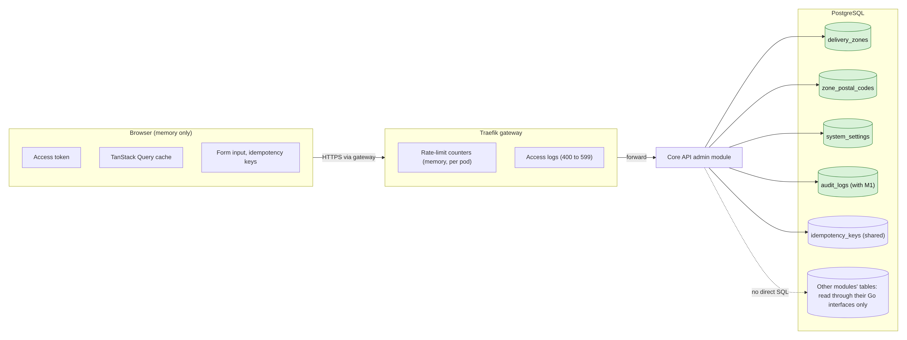

<details>
<summary>Diagram source (Mermaid)</summary>

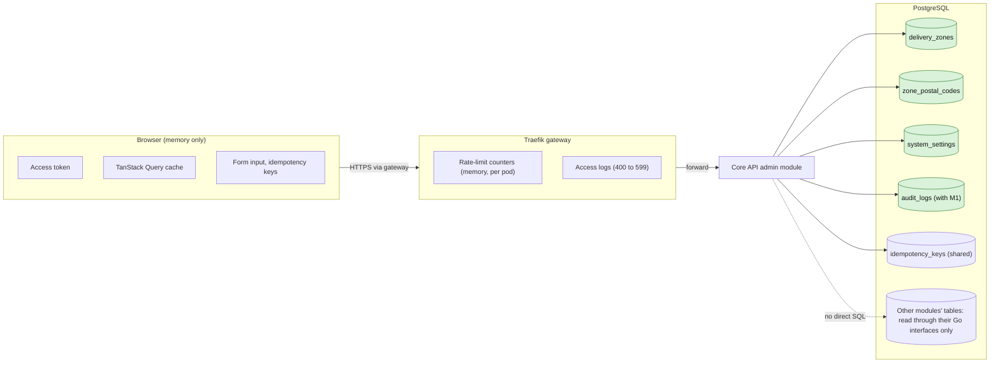

</details>

## 3. Schema diagram (ERD)

My tables are shown with the neighbour tables they connect to. Neighbour tables show only the columns that matter here; their full shape is in the system ERD.

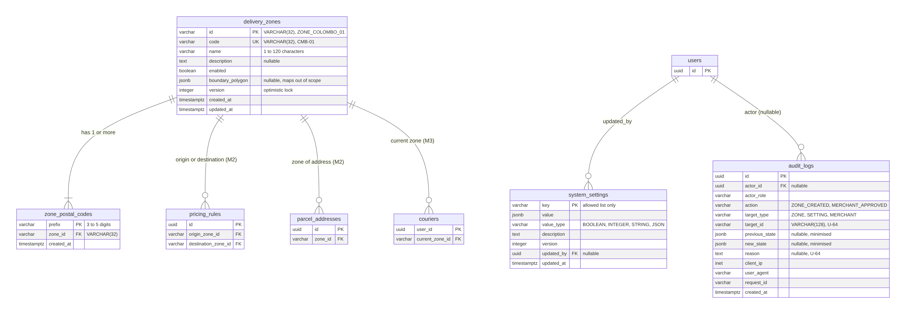

<details>
<summary>Diagram source (Mermaid)</summary>

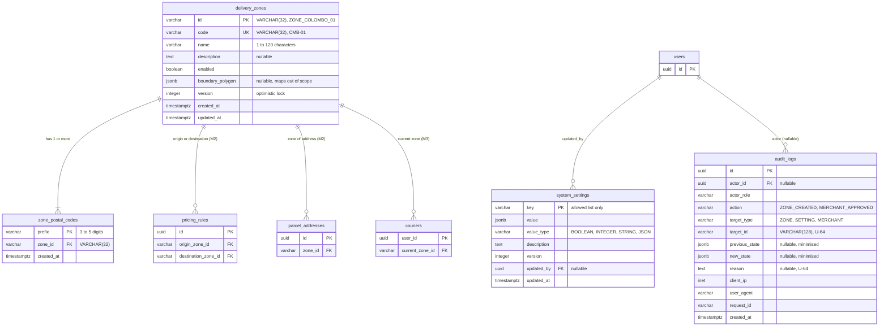

</details>

**What changed in v2 and why**

| Item | v1 of this document | v2 (now) | Why |
| --- | --- | --- | --- |
| `delivery_zones.id` | `uuid` | `VARCHAR(32)` text id such as `ZONE_COLOMBO_01` | Members 2 and 3 already write `VARCHAR(32) REFERENCES delivery_zones(id)` in migrations 000004 and 000006. A uuid would break their foreign keys (alignment guide 3.1, Doc 1 R-03). U-37 closed |
| `code` | the only business code | Separate short code, `VARCHAR(32)` UNIQUE, e.g. `CMB-01` | Guide 6.1 |
| Money | `base_surcharge_cents` and `currency` on zones | **Removed** | Fees belong to Member 2's `pricing_rules`. A zone surcharge is a pricing rule, not a zone column (docs audit, database-schema.md, Doc 1 R-04) |
| `created_by`, `updated_by` on zones and prefixes | added | Removed | Guide 6.1 does not have them; who changed a zone is kept in `audit_logs` |
| `audit_logs` columns | my own list | The shared shape from database-schema.md plus `reason`; `target_id` is `VARCHAR(128)` | One audit table for all modules (docs audit). `reason` and the text `target_id` are U-64 |
| Migration names | timestamps | `000002_create_delivery_zones`, `000011_create_audit_logs` | Reserved numbers in the team plan (guide 6, Member 9 K11). U-40 closed |
| Database roles | `swiftdrop_maintenance` and others | `swiftdrop_migrator`, `swiftdrop_app` (Member 9 D6) | K6 |
| On/off flag | `enabled` | `enabled` | Same as the schema |
| `version` | added | kept | Optimistic locking (Doc 3 DD-11) |
| `zone_postal_codes`, `system_settings` | missing from the system ERD | still missing there | U-35 |

## 4. Data dictionary

Column types are PostgreSQL 16. "Rule" means a database constraint unless marked "app" (checked in Go code).

### 4.1 `delivery_zones` (owner: admin module, Member 7)

One row is one delivery area, for example "Colombo 01". It holds **no money** (Doc 1 R-04).

| Column | Type | Null | Default | Rule | Meaning |
| --- | --- | --- | --- | --- | --- |
| `id` | varchar(32) | no |  | PK; CHECK `id ~ '^ZONE_[A-Z0-9_]{2,27}$'` | Zone id chosen by the admin, e.g. `ZONE_COLOMBO_01`. Other modules' foreign keys point here. It can never be changed |
| `code` | varchar(32) | no |  | UNIQUE; CHECK `code ~ '^[A-Z0-9_-]{2,32}$'` | Short human code, e.g. `CMB-01`. Can be changed |
| `name` | varchar(120) | no |  | CHECK `length(trim(name)) between 1 and 120` | Display name |
| `description` | text | yes |  | app: max 500 characters | Notes for admins |
| `enabled` | boolean | no | true |  | Disabled zones get no new quotes (Member 2 rule) and are not in the public zone list |
| `boundary_polygon` | jsonb | yes |  | app: valid GeoJSON if present | Kept for the future; maps are out of scope (Doc 1 11.5) |
| `version` | integer | no | 1 | CHECK `>= 1` | Goes up by 1 on every change |
| `created_at` | timestamptz | no | `now()` |  | UTC |
| `updated_at` | timestamptz | no | `now()` |  | UTC |

**Indexes:** PK on `id`; unique index on `code` (made by UNIQUE); index on `enabled` (guide 6.1; small, but the public list filters on it).

### 4.2 `zone_postal_codes` (owner: admin module)

One row says "this postal code prefix belongs to this zone". Sri Lanka postal codes have 5 digits (e.g. 00300 for Colombo 3, 20000 for Kandy).

| Column | Type | Null | Default | Rule | Meaning |
| --- | --- | --- | --- | --- | --- |
| `prefix` | varchar(10) | no |  | PK (so one prefix belongs to only one zone); CHECK `prefix ~ '^[0-9]{3,5}$'` | Postal code or its start |
| `zone_id` | varchar(32) | no |  | FK `delivery_zones(id)` ON DELETE CASCADE | Owning zone. CASCADE is allowed for tightly bound child rows (database-schema 3.1); zones are never deleted in practice |
| `created_at` | timestamptz | no | `now()` |  | UTC |

**Indexes:** PK on `prefix`; index on `zone_id` (list a zone's prefixes); `prefix varchar_pattern_ops` index to make "starts with" lookups fast for the overlap check and for the public `?postal_code=` lookup (Doc 1 R-18).

**Overlap rule (app + lock):** "003" and "00300" must not be in different zones. The PK cannot see this, so the use case checks it inside the transaction while holding the advisory lock (section 7.2, Doc 3 DD-07).

**Postal code lookup:** `GET /api/v1/zones?postal_code=00300` returns the zone with the **longest** matching prefix that is enabled, or 404 `ZONE_NOT_FOUND`. Because overlaps are blocked, there is at most one match.

### 4.3 `system_settings` (owner: admin module)

A small key and value store for runtime switches. **No secrets ever** (Doc 1 X-10).

| Column | Type | Null | Default | Rule | Meaning |
| --- | --- | --- | --- | --- | --- |
| `key` | varchar(64) | no |  | PK; CHECK `key ~ '^[a-z][a-z0-9_.]{2,63}$'`; app: must be in the allowed list | e.g. `reports.max_range_days` |
| `value` | jsonb | no |  | app: must match `value_type` | The value |
| `value_type` | varchar(16) | no |  | CHECK `value_type in ('BOOLEAN','INTEGER','STRING','JSON')` | How to read `value` |
| `description` | text | yes |  |  | What the setting does |
| `version` | integer | no | 1 | CHECK `>= 1` | Optimistic lock (my addition to guide 6.1) |
| `updated_by` | uuid | yes |  | FK `users(id)` ON DELETE SET NULL | Null for seed rows |
| `updated_at` | timestamptz | no | `now()` |  | UTC |

The allowed keys are listed in section 10.

### 4.4 `audit_logs` (co-owners: admin module and Member 1)

One row records one sensitive action. Rows are **only ever inserted**. The shape is the **shared** one from database-schema.md, so every module writes the same columns. My two changes are marked U-64.

| Column | Type | Null | Default | Rule | Meaning |
| --- | --- | --- | --- | --- | --- |
| `id` | uuid | no | `gen_random_uuid()` | PK |  |
| `actor_id` | uuid | yes |  | FK `users(id)` ON DELETE SET NULL | Who did it. Null for failed sign-in attempts \[Repo\] |
| `actor_role` | varchar(20) | no |  | CHECK in the 5 roles or `SYSTEM` | Role at the time |
| `action` | varchar(64) | no |  | CHECK `action ~ '^[A-Z_]+$'`; app: from a fixed list | e.g. `ZONE_CREATED`, `ZONE_DISABLED`, `SETTING_CHANGED`, `MERCHANT_APPROVED`, `ROLE_CHANGED` |
| `target_type` | varchar(30) | no |  |  | `ZONE`, `SETTING`, `MERCHANT`, `USER`, `PARCEL` |
| `target_id` | varchar(128) | no |  |  | Target id. The schema says `uuid`, but zone ids (`ZONE_COLOMBO_01`) and setting keys are text, so it must be text **\[U-64\]** |
| `previous_state` | jsonb | yes |  | app: only changed fields, no secrets, personal data masked | Before |
| `new_state` | jsonb | yes |  | same | After |
| `reason` | text | yes |  | app: required for reject, suspend, disable, correction (5 to 500 characters) | Why. Not in the schema yet; FR-ADM-005 and FR-ADM-009 ask for it **\[U-64\]** |
| `client_ip` | inet | yes |  |  | Real visitor IP (from trusted headers) |
| `user_agent` | varchar(300) | yes |  | app: cut to 300 characters |  |
| `request_id` | varchar(100) | yes |  |  | The `X-Request-ID` of the request (Doc 1 R-11) |
| `created_at` | timestamptz | no | `now()` |  | UTC |

**Indexes:** `(created_at DESC)`; `(actor_id, created_at DESC)`; `(target_type, target_id, created_at DESC)`; `(action, created_at DESC)`.

**Append-only protection (two layers):**

1. `swiftdrop_app` gets only `INSERT, SELECT` on `audit_logs`, never `UPDATE` or `DELETE` (Member 9 D7).
2. A trigger raises an error on **any** `UPDATE` or `DELETE`, so even a mistake by a privileged user is blocked (guide 6.2, SRS SEC-015). How old rows are archived after 2 years is still open (U-41); it will need its own reviewed migration.

**Who creates it:** this table is created **once**, by its owners, in `000011_create_audit_logs` (Member 9 D4). Members 1 and 4 write rows into it but do not create their own copy. Test folders may keep a stub `users` table, but never the real migrations folder.

### 4.5 `idempotency_keys` (shared platform table, I only use it)

Shape is in database-schema.md \[Repo\]. Two points matter to my module:

- The repo makes `key` alone the primary key, but lookups use `(key, caller_scope)`. Two different users could, by chance or on purpose, send the same key. **Proposed:** primary key `(caller_scope, operation, key)` **\[U-39, platform owner\]**.
- Admin use cases write the key row in the **same transaction** as the change (Doc 3 4.7).

## 5. Ownership and permission boundaries

### 5.1 Who may read and write which table

| Table | Owner (writes) | My admin module | Other modules | Frontend and gateway |
| --- | --- | --- | --- | --- |
| `delivery_zones` | Admin module | Read and write | Read **through an admin Go interface** (`ZoneLookup`), e.g. pricing (M2) and dispatch (M3) **\[Proposed\]** | Never |
| `zone_postal_codes` | Admin module | Read and write | Read through `ZoneLookup.ZoneForPostalCode(code)` | Never |
| `system_settings` | Admin module | Read and write | Read through `SettingsReader` **\[Proposed\]** | Never |
| `audit_logs` | Admin + Member 1 | Insert and read | Each module inserts its own rows with the shared `AuditWriter`, in its own transaction (U-30 closed) | Never |
| `idempotency_keys` | Platform | Through middleware | Through middleware | Never |
| `parcels`, `parcel_status_history`, `delivery_attempts`, `courier_assignments` | Members 2, 3 | **No SQL.** Report numbers through their read interfaces (Doc 3 DD-08, DD-09) | Owners | Never |
| `merchants` | Member 4 | **No SQL.** List, detail and status change through Member 4's `merchants.AdminService` (Doc 1 R-02); Member 4 writes the merchant audit row | Owner | Never |
| `users`, `user_roles` | Member 1 | Only as FK target; names for display through Member 1's interface | Owner | Never |

**Foreign keys across modules.** Other modules point at `delivery_zones.id` with real foreign keys (`ON DELETE RESTRICT`). That is allowed by database-schema 3.1 and keeps data correct. Because zones are never deleted, RESTRICT never blocks normal work.

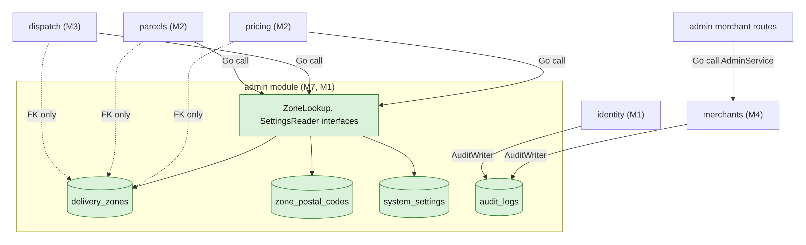

<details>
<summary>Diagram source (Mermaid)</summary>

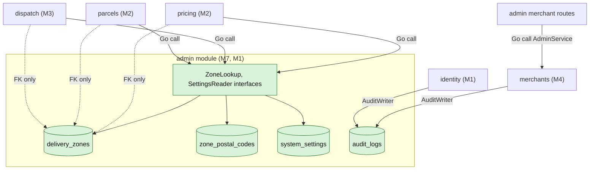

</details>

### 5.2 Database roles

The Core API is one program, so all its modules use one login. The module rule ("only your own tables") is therefore enforced by **code review, depguard and tests**, not by the database. The database still protects what it can. The role names are Member 9's agreement D6; the rights are D7.

| Database role | Used by | Rights |
| --- | --- | --- |
| `swiftdrop_migrator` | Migration Job only | Owns the schema; `CREATE`, `ALTER`, `DROP` |
| `swiftdrop_app` | Core API | `SELECT, INSERT, UPDATE` on new tables by default. `DELETE` only on `zone_postal_codes` (a zone edit removes prefixes). **Only** `INSERT, SELECT` on `audit_logs`. No DDL |
| `swiftdrop_tracking_ro` | Tracking API (Member 5) | Read-only on its views; no access to my tables |
| `swiftdrop_relay`, `swiftdrop_worker` | Members 8 and 4 | No access to my tables |

The roles are made by Member 9's bootstrap SQL **before** the first migration (D6). The database is `swiftdrop_db`. Passwords live only in the Kubernetes Secrets `postgres-secrets` (app login) and `postgres-migrator-secrets` (migrator login) (K6). Inside the cluster the connection uses `sslmode=disable` (guide 3.5).

## 6. Migration strategy and ordering

### 6.1 Tool and rules \[Repo\]

- Tool: **golang-migrate v4.17+**, folder `core-api/migrations/`, run with `make migrate-up` locally and the `core-api-migrate` Job in Kubernetes \[Repo\] local-development.md, deployment-guide.md. The Job logs in as `swiftdrop_migrator`.
- Every change has an `.up.sql` and a `.down.sql` (AGENTS.md 7).
- A merged migration is **never edited**. Fixes go in a new migration.
- No manual changes to the database.

### 6.2 Numbering \[Agreed in the team plan\]

The team uses **6-digit sequence numbers** with reserved slots, so everyone knows the order (guide section 6, Member 9 K11). v1 of this document proposed timestamps; that is dropped (U-40 closed). If the D2 vote ever picks timestamps, only the file names change, not the SQL.

```
core-api/migrations/
├── 000001_create_users_and_roles.up.sql      # Member 1 (must come first)
├── 000002_create_delivery_zones.up.sql       # me: delivery_zones, zone_postal_codes, system_settings
├── 000003 to 000010                          # other modules, e.g. merchants (M4),
│                                             #   000004_create_pricing_rules (M2, needs zones),
│                                             #   000006_create_couriers (M3, needs zones),
│                                             #   idempotency_keys just before 000011
├── 000011_create_audit_logs.up.sql           # me with Member 1: table, trigger, grants
└── ... each with a matching .down.sql
```

### 6.3 Order my migrations must follow

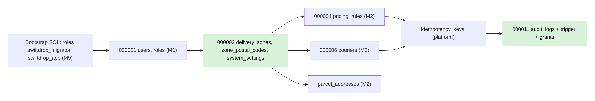

<details>
<summary>Diagram source (Mermaid)</summary>

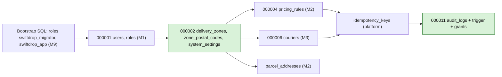

</details>

**Why the order matters:** Members 2 and 3 have foreign keys to `delivery_zones`, so `000002` must exist **before** their `000004` and `000006`. The number is reserved, so they already know it.

### 6.4 Planned migrations (data definition, shape only)

```sql
-- 000002_create_delivery_zones.up.sql   (owner: Member 7)
CREATE TABLE delivery_zones (
    id               varchar(32)  PRIMARY KEY CHECK (id ~ '^ZONE_[A-Z0-9_]{2,27}$'),
    code             varchar(32)  NOT NULL UNIQUE CHECK (code ~ '^[A-Z0-9_-]{2,32}$'),
    name             varchar(120) NOT NULL CHECK (length(trim(name)) BETWEEN 1 AND 120),
    description      text,
    enabled          boolean NOT NULL DEFAULT true,
    boundary_polygon jsonb,
    version          integer NOT NULL DEFAULT 1 CHECK (version >= 1),
    created_at       timestamptz NOT NULL DEFAULT now(),
    updated_at       timestamptz NOT NULL DEFAULT now()
);
CREATE INDEX idx_delivery_zones_enabled ON delivery_zones (enabled);

CREATE TABLE zone_postal_codes (
    prefix     varchar(10) PRIMARY KEY CHECK (prefix ~ '^[0-9]{3,5}$'),
    zone_id    varchar(32) NOT NULL REFERENCES delivery_zones(id) ON DELETE CASCADE,
    created_at timestamptz NOT NULL DEFAULT now()
);
CREATE INDEX idx_zone_postal_codes_zone ON zone_postal_codes (zone_id);
CREATE INDEX idx_zone_postal_codes_prefix_pattern ON zone_postal_codes (prefix varchar_pattern_ops);

CREATE TABLE system_settings (
    key         varchar(64) PRIMARY KEY CHECK (key ~ '^[a-z][a-z0-9_.]{2,63}$'),
    value       jsonb NOT NULL,
    value_type  varchar(16) NOT NULL CHECK (value_type IN ('BOOLEAN','INTEGER','STRING','JSON')),
    description text,
    version     integer NOT NULL DEFAULT 1 CHECK (version >= 1),
    updated_by  uuid REFERENCES users(id) ON DELETE SET NULL,
    updated_at  timestamptz NOT NULL DEFAULT now()
);
GRANT DELETE ON zone_postal_codes TO swiftdrop_app;   -- the only DELETE my module needs (D7)
-- .down.sql: DROP TABLE system_settings, zone_postal_codes, delivery_zones;
--            (only works before 000004 and 000006 add their foreign keys)

-- 000011_create_audit_logs.up.sql   (owners: Member 7 and Member 1)
CREATE TABLE audit_logs (
    id             uuid PRIMARY KEY DEFAULT gen_random_uuid(),
    actor_id       uuid REFERENCES users(id) ON DELETE SET NULL,
    actor_role     varchar(20) NOT NULL CHECK (actor_role IN ('ADMIN','DISPATCHER','COURIER','MERCHANT','CUSTOMER','SYSTEM')),
    action         varchar(64) NOT NULL CHECK (action ~ '^[A-Z_]+$'),
    target_type    varchar(30) NOT NULL,
    target_id      varchar(128) NOT NULL,          -- U-64 (schema says uuid)
    previous_state jsonb,
    new_state      jsonb,
    reason         text,                           -- U-64 (not in schema yet)
    client_ip      inet,
    user_agent     varchar(300),
    request_id     varchar(100),
    created_at     timestamptz NOT NULL DEFAULT now()
);
CREATE INDEX idx_audit_logs_created ON audit_logs (created_at DESC);
CREATE INDEX idx_audit_logs_actor   ON audit_logs (actor_id, created_at DESC);
CREATE INDEX idx_audit_logs_target  ON audit_logs (target_type, target_id, created_at DESC);
CREATE INDEX idx_audit_logs_action  ON audit_logs (action, created_at DESC);

CREATE FUNCTION prevent_audit_log_modification() RETURNS trigger AS $$
BEGIN
    RAISE EXCEPTION 'audit_logs is append-only (SRS SEC-015)';
END $$ LANGUAGE plpgsql;
CREATE TRIGGER trg_audit_logs_immutable
    BEFORE UPDATE OR DELETE ON audit_logs
    FOR EACH ROW EXECUTE FUNCTION prevent_audit_log_modification();
REVOKE UPDATE, DELETE ON audit_logs FROM swiftdrop_app;
```

`gen_random_uuid()` is built into PostgreSQL 13 and newer, so no extension is needed.

### 6.5 Changing a table later (expand and contract)

Core API runs 2 to 4 pods. During a rolling deploy, old and new code run at the same time, so a migration must work with **both**. Every later change follows these steps:

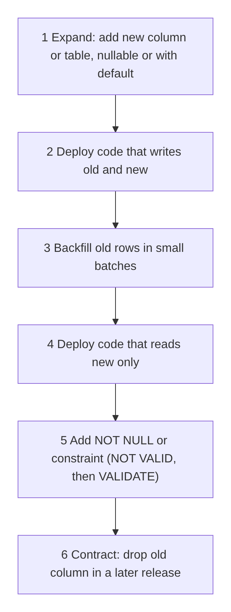

<details>
<summary>Diagram source (Mermaid)</summary>

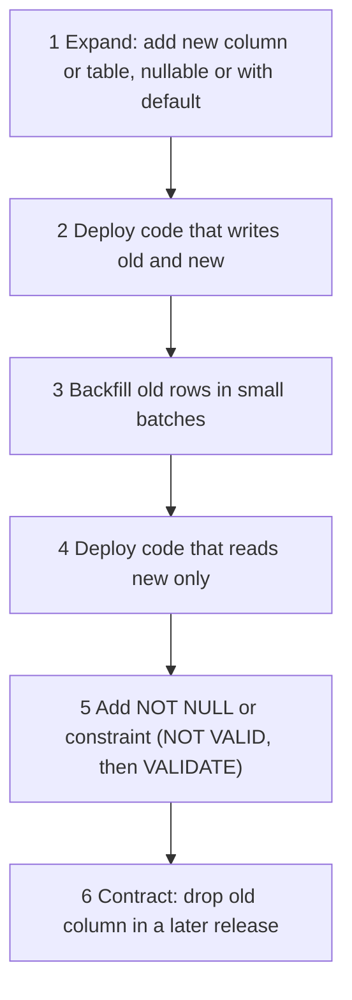

</details>

Rules for later migrations:

- Add indexes on big tables with `CREATE INDEX CONCURRENTLY` in their **own** file (it cannot run inside a transaction). My tables are small, so this mainly matters for `audit_logs`.
- Never rename a column in one step. Add the new one, copy, switch, then drop.
- Every `down.sql` that would lose data says so in a comment at the top.
- Rollback in production uses `migrate down 1` only after the code that needs the change has been rolled back first \[Repo\] runbook 3.3.

## 7. Transactions, isolation and concurrency

Full design is in Doc 3 section 4.7. The data rules are:

### 7.1 What changes together

| Use case | Tables written in one transaction |
| --- | --- |
| Create zone | `delivery_zones`, `zone_postal_codes`, `audit_logs`, `idempotency_keys` |
| Update zone (code, name, description, prefixes) | `delivery_zones` (version + 1), `zone_postal_codes` (delete removed, insert new), `audit_logs`, `idempotency_keys` |
| Enable or disable zone | `delivery_zones`, `audit_logs`, `idempotency_keys` |
| Change setting | `system_settings`, `audit_logs`, `idempotency_keys` |
| Approve, reject, suspend, reinstate or disable merchant | Done by Member 4's `AdminService` in **its** transaction: `merchants` (version check with `expected_version`), `audit_logs`. My handler only calls it |
| Public zone list, reports, audit search | read only |

Removing a prefix from a zone is the **only** real delete on my tables, and it happens inside a zone update. Zones and settings are never deleted.

### 7.2 Isolation level and locks

| Problem | Protection |
| --- | --- |
| Two admins add exactly the same prefix | PK on `zone_postal_codes.prefix`; second insert fails with `23505` and becomes 409 `ZONE_POSTAL_CODE_CONFLICT` |
| Two admins add overlapping prefixes ("003" and "00300") | `pg_advisory_xact_lock(hashtext('admin.zone_prefixes'))` at the start of the transaction, then the overlap query, then the insert. Released at commit or rollback |
| Two admins edit the same zone | `UPDATE delivery_zones ... WHERE id = $1 AND version = $2`; 0 rows means 409 `CONCURRENT_MODIFICATION` |
| Two admins change the same setting | Same version check |
| Report reads while writes happen | READ COMMITTED: each query sees committed data. Numbers in one report may be a few seconds apart; this is fine for reports |
| Long locks blocking others | `SET LOCAL lock_timeout = '3s'` and `statement_timeout = '5s'` in admin transactions **\[Proposed\]** |
| Deadlocks | Always lock in the same order: advisory lock first, then the zone row, then prefixes |

Isolation level for all admin transactions is PostgreSQL's default **READ COMMITTED**. SERIALIZABLE was considered and not chosen (Doc 3 DD-07).

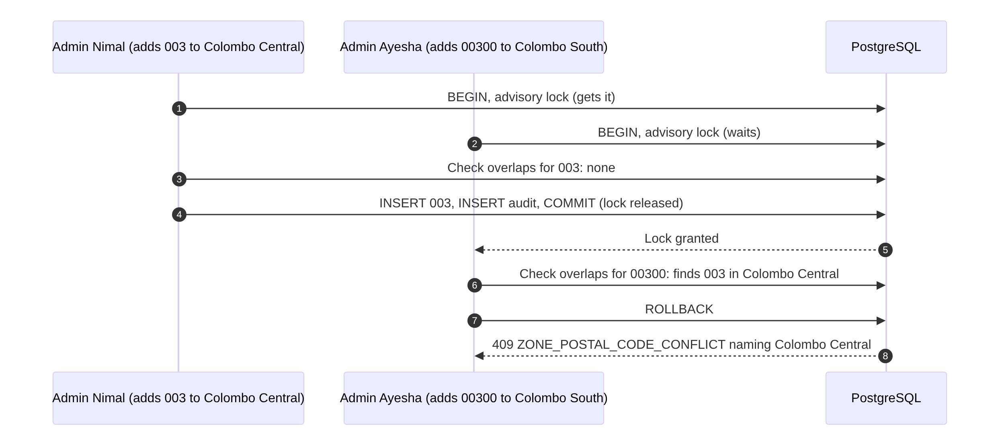

<details>
<summary>Diagram source (Mermaid)</summary>

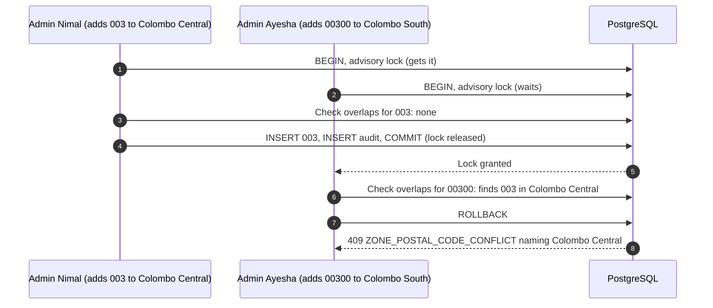

</details>

## 8. Validation, integrity, retention, audit and privacy

### 8.1 Validation layers

| Layer | Checks | Why |
| --- | --- | --- |
| Screen (zod) | Required, length, digits, code format | Fast help for the user. Not trusted |
| Handler (transport) | JSON shape, types, size | Reject garbage early |
| Domain (value objects) | `ZoneID`, `ZoneCode`, `PostalPrefix` rules; no duplicate prefix inside one zone; at least one prefix | Business rules in one place |
| Use case | Prefix overlap with other zones, setting key is allowed | Needs data from the database |
| Database | PK, UNIQUE, CHECK, FK, NOT NULL, trigger | Last line of defence if code has a bug |

The same rule may appear in several layers on purpose. The database rule is the one that cannot be skipped.

### 8.2 Retention and deletion

| Data | Keep for | How it is removed | Source |
| --- | --- | --- | --- |
| `delivery_zones`, `zone_postal_codes` | Forever (zones are disabled, not deleted) | Prefix rows removed only by a zone update, which is audited | database-schema 3.1 soft deletes |
| `system_settings` | Forever | Never deleted; unused keys disabled in code | \[Proposed\] |
| `audit_logs` | **At least 2 years** | Nothing deletes them today: the trigger blocks every delete. Archiving after 2 years needs a reviewed plan **\[U-41\]** | database-schema 5 |
| `idempotency_keys` | 24 hours | Hourly CronJob deletes rows where `expires_at < now()` (platform owner) | api-conventions 4 |
| Browser data | Until logout or tab close | Logout clears the query cache and token; nothing written to storage | ADR-003, INV-11 |
| Gateway rate-limit counters | Seconds | In memory, gone on restart | ADR-001 |
| Gateway access logs | 14 days (agreed with Member 9) | Log tool rotation | SRS 7.3 asks to set it |

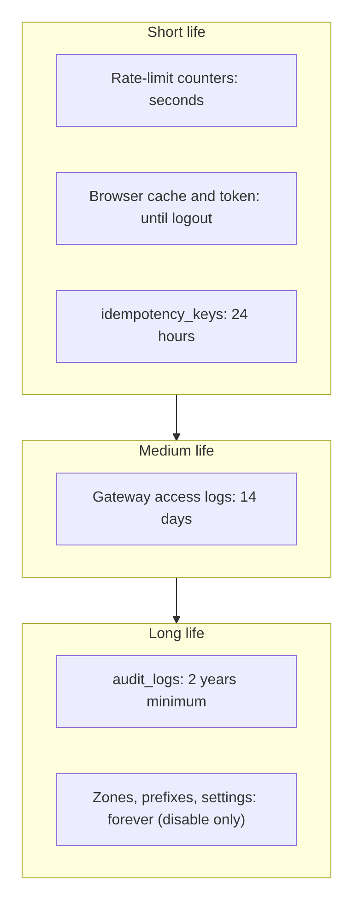

<details>
<summary>Diagram source (Mermaid)</summary>

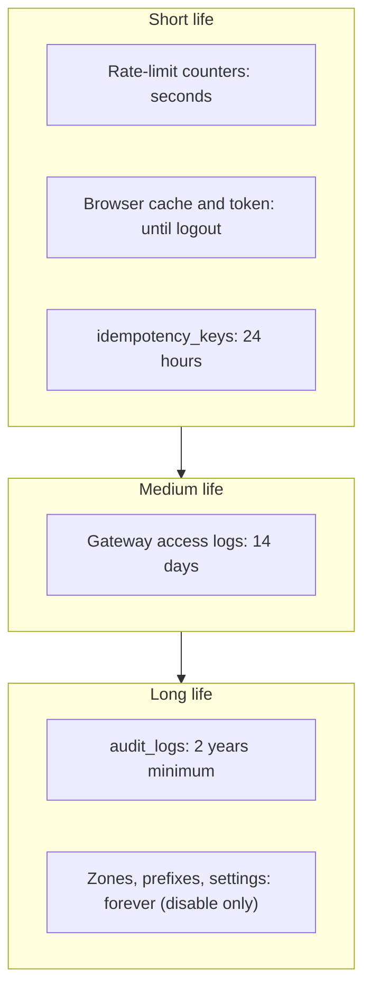

</details>

### 8.3 Audit rules

- Every change to a zone, prefix list, setting, merchant status or user role writes one `audit_logs` row in the **same** transaction (Doc 3 DD-10).
- `previous_state` and `new_state` hold only the **fields that changed**, not whole records.
- Read access to audit logs is ADMIN only (Doc 2 F-13), at `GET /api/v1/admin/audit-logs`.
- Merchant status changes are audited by Member 4 inside its own transaction; my handler does not write a second row.
- Audit rows are never edited. Corrections are new rows.

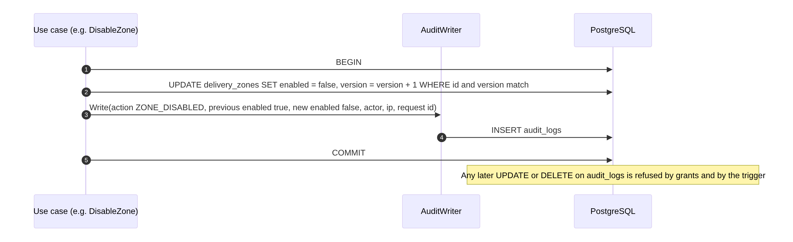

<details>
<summary>Diagram source (Mermaid)</summary>

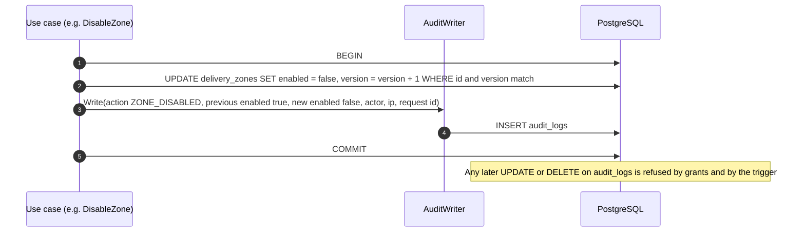

</details>

### 8.4 Privacy

| Rule | How |
| --- | --- |
| Zones and settings hold no personal data | Only codes, names, numbers |
| Audit states hold as little personal data as possible | For user changes store user id and changed role, not email or phone. If a phone must be shown, mask it (`+94 77 *** 4567`) \[Proposed\] |
| A user asks to be removed (anonymised) | Member 1 anonymises `users`. Audit rows keep only the uuid, which no longer points to a name. So audit history stays and the person is no longer identifiable \[Proposed, with M1\] |
| No secrets in tables | `system_settings` must never store keys or passwords; checked by code review and the allowed-key list |
| Logs | Gateway access logs contain IP, path and user agent. Tracking numbers appear in tracking paths, so log access is limited to the team and logs are kept a short time (U-36). Traefik does not log `Authorization` or `X-API-Key` headers by default; we must not turn header logging on |
| Browser | No tokens or personal data in localStorage or sessionStorage. Cache cleared on logout |
| Database dumps | Backups are protected; proof files are not inside the database (SRS 7.3) |

## 9. Caching and freshness

### 9.1 Backend

There is **no server-side cache** for my tables today. Zones and settings are small and read rarely, so reading PostgreSQL each time is fast enough.

If pricing (M2) later caches zones in memory for speed, it must refresh them when a zone changes. Two options: a short time limit (for example 60 seconds) or a zone-changed event through the outbox (U-32). Until that is decided, **no module caches zones**.

### 9.2 Frontend (TanStack Query)

| Data | `staleTime` (proposed) | Refresh when | Notes |
| --- | --- | --- | --- |
| Dispatch board | 0 | Every 30 s, window focus, after any assign or reassign | Doc 2 3.5 |
| Failed-delivery list | 0 | Every 30 s, after a decision |  |
| Fleet list | 30 s | Focus, after a status change |  |
| Zones list | 5 min | After create, edit, enable or disable | Rarely changes |
| Pricing rules | 5 min | After any change |  |
| Merchants, users | 1 min | After any action |  |
| Reports | 1 min | When filters change | Same filters reuse the cache |
| Audit log pages | 0 | On every page open | Must always be current |
| Courier tasks | 0 | Screen open, pull to refresh, after any task action | No timer (saves data on phones) |

**Invalidation rule:** each mutation hook lists the query keys it makes stale (Doc 3 3.7 query key factory). On logout or role change the whole cache is cleared.

### 9.3 Gateway and Cloudflare

| Content | Cache | Rule |
| --- | --- | --- |
| `/api/*` responses | **Never cached** | Core API sends `Cache-Control: no-store` on authenticated responses **\[Proposed with M1\]**; Cloudflare does not cache API paths by default, and no cache rule may be added for them |
| SPA `index.html` | Not cached | \[Repo\] Engineering Standards 10 |
| SPA JS and CSS files (hashed names) | 1 year (`max-age=31536000`, immutable) | \[Repo\] |
| SSE stream | Never cached or buffered | INV-07 |

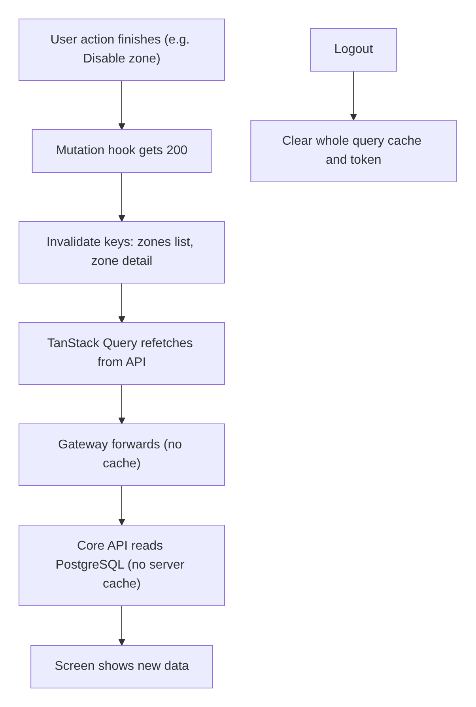

<details>
<summary>Diagram source (Mermaid)</summary>

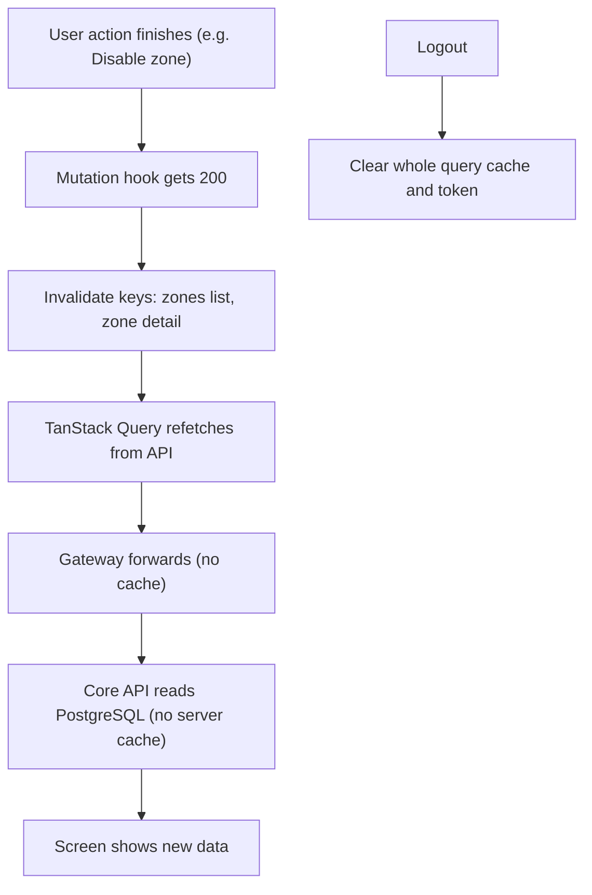

</details>

## 10. Seed data and test data

### 10.1 Seed data (development and demo only)

Seeds are run by `make db-seed` / `go run core-api/cmd/seed/main.go` \[Repo\] local-development.md. Rules **\[Proposed\]**:

- Seeds are **separate from migrations**. Migrations build the structure; seeds add sample rows.
- Seeds can run many times without making duplicates (`INSERT ... ON CONFLICT DO NOTHING`).
- Seeds **never run in production**. The seed program refuses to run when `APP_ENV=production` **\[TBD with M9\]**.
- Seed passwords like `Password123!` (repo) are for local use only.

**My seed rows (proposed, using real Sri Lankan postal codes):**

| Zone id | Code | Name | Prefixes | Enabled |
| --- | --- | --- | --- | --- |
| `ZONE_COLOMBO_01` | `CMB-01` | Colombo Central | 00100, 00200, 00300 | yes |
| `ZONE_COLOMBO_02` | `CMB-02` | Colombo South | 00400, 00500, 00600 | yes |
| `ZONE_COLOMBO_03` | `CMB-03` | Colombo East | 00700, 00800 | yes |
| `ZONE_NEGOMBO_01` | `NEG-01` | Negombo | 11500 | yes |
| `ZONE_KANDY_01` | `KDY-01` | Kandy | 20000 | yes |
| `ZONE_GALLE_01` | `GAL-01` | Galle | 80000 | yes |
| `ZONE_DEMO_DISABLED` | `DEMO-OFF` | Demo Disabled Zone | 99999 | **no** (to test disabled behaviour) |

Zone fees are **not** seeded here. Member 2's pricing seed adds the prices for these zone ids.

| Setting key | Type | Seed value | Purpose |
| --- | --- | --- | --- |
| `reports.max_range_days` | INTEGER | 92 | Longest report period (Doc 3 7.2) |
| `ops.board_refresh_seconds` | INTEGER | 30 | Board polling interval shown to screens **\[Proposed; or keep in frontend config\]** |
| `ops.maintenance_banner` | STRING | "" | Optional message shown on ops screens |

Seed users come from Member 1's seed (admin, dispatcher, courier accounts in local-development.md \[Repo\]).

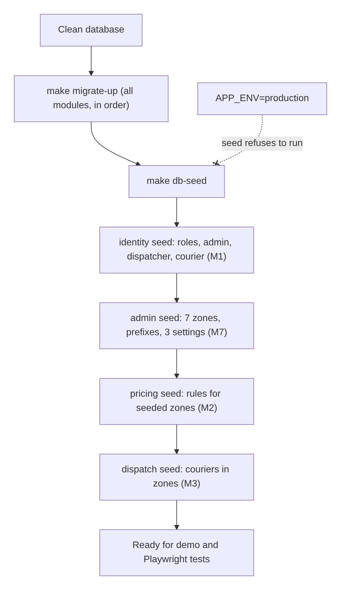

<details>
<summary>Diagram source (Mermaid)</summary>

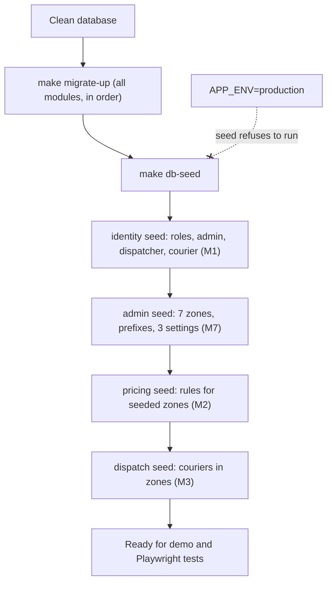

</details>

The seed order matches the migration order (section 6.3), because pricing and courier seeds need the zones.

### 10.2 Test data

| Test level | Data source | Rules |
| --- | --- | --- |
| Go domain unit tests | Built in code with small builder functions (`aZone().WithPrefixes("00300")`) | No database |
| Go use case tests | In-memory fakes of the repositories | Each test sets up only what it needs |
| Go integration tests | Fresh PostgreSQL per test package with Testcontainers \[Repo\] test-strategy; run all migrations, then insert test rows. Until Member 1's real `000001` exists, a stub `users` table lives **only in the test folder** (Member 9 D4) | Each test cleans up (transaction rollback or truncate) |
| Frontend unit tests | Fixture JSON that matches API.md examples (mock service worker or fake `ApiClient`) | Fixtures in `__tests__/fixtures/`; update when API.md changes |
| Playwright E2E | The seed data above plus Member 1's seed accounts | Tests must not depend on row order; create their own parcels where needed |

**Must-have test cases for data rules:**

| # | Case | Expected |
| --- | --- | --- |
| TD-01 | Insert prefix `0030` (4 digits) | Allowed |
| TD-02 | Insert prefix `00A00` | CHECK fails |
| TD-03 | Same prefix in two zones | PK fails, 409 |
| TD-04 | `003` in one zone and `00300` in another, at the same time | Second one gets 409 (advisory lock test) |
| TD-05 | Zone id `zone_colombo` (lower case) | CHECK fails |
| TD-06 | Zone code `cmb 01` (space, lower case) | CHECK fails |
| TD-07 | Update zone with old version | 0 rows, 409 |
| TD-08 | `UPDATE audit_logs` as app role | Permission denied |
| TD-09 | `DELETE FROM audit_logs`, even as the migrator | Trigger error |
| TD-10 | Disabled zone still referenced by old parcels | Allowed (no delete, FK stays) |
| TD-11 | Same Idempotency-Key from two different admins | Two separate results (needs U-39 key fix) |
| TD-13 | `GET /api/v1/zones?postal_code=00305` with prefixes `003` and `00300` in different zones | Blocked earlier by TD-04; with only `003` present, returns that zone |
| TD-14 | Public zone list | Only enabled zones, only `id`, `code`, `name` |
| TD-12 | Every migration runs `up`, then `down`, then `up` again on a clean database | Works (clean rebuild, SRS 7.3) |

## 11. Data lifecycle of a zone

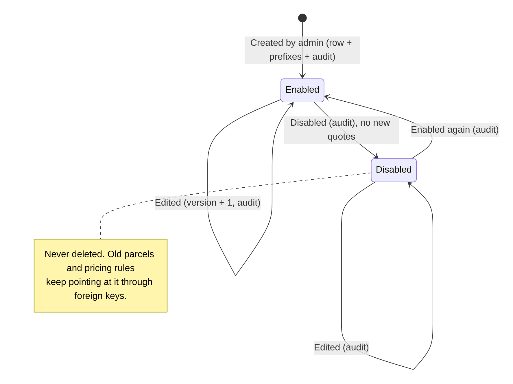

<details>
<summary>Diagram source (Mermaid)</summary>

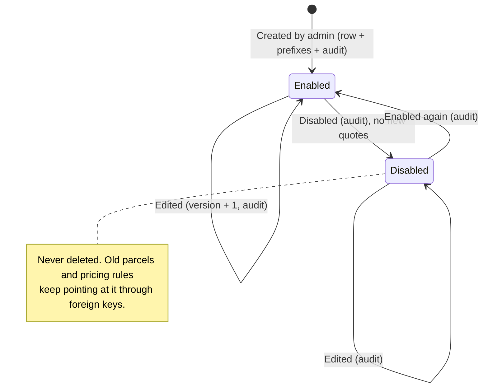

</details>

## 12. Open questions

Status after the 26 October review. Earlier questions still apply, especially U-24 (idempotency on non-booking POSTs) and U-32 (zone events).

| ID | Question | Decide with | Status |
| --- | --- | --- | --- |
| U-35 | Add `zone_postal_codes` and `system_settings` to the system ERD and ownership table in database-schema.md | Members 1, 9 | Open |
| U-36 | How long gateway access logs are kept | Member 9 | **Closed:** 14 days |
| U-37 | `delivery_zones.id` type | Members 1, 2, 3 | **Closed:** `VARCHAR(32)` text id (guide 3.1) |
| U-38 | `audit_logs.target_id` and `reason` | Member 1 | **Replaced by U-64** |
| U-39 | `idempotency_keys` primary key `(caller_scope, operation, key)` instead of `key` alone | Platform owner, Member 1 | Open |
| U-40 | Migration numbering | All backend members, Member 9 | **Closed:** 6-digit, `000002` and `000011` are mine |
| U-41 | After 2 years: how to archive audit rows when the trigger blocks every delete | Members 1, 9 | Open |
| U-64 | database-schema.md must change `audit_logs.target_id` to `varchar(128)` and add a `reason` column | Member 1, Tech Lead | Open (new) |
| U-67 | Member 3 calls the active assignment `ASSIGNED` in the API but `ACTIVE` in its table; one name is needed | Member 3 | Open (new) |

## 13. Sign-off

To be reviewed by Members 1, 2, 3, 4, 5, 6, 8, 9 and 10. Most important: Member 1 (co-owner of admin and audit), Members 2 and 3 (foreign keys to zones), Member 9 (database roles, CronJobs, logs).

| Member | Approved (date) | Notes |
| --- | --- | --- |
| Member 1 |  |  |
| Member 2 |  |  |
| Member 3 |  |  |
| Member 4 |  |  |
| Member 5 |  |  |
| Member 6 |  |  |
| Member 8 |  |  |
| Member 9 |  |  |
| Member 10 |  |  |
