# Document 6 — Testing Strategy & Acceptance Specification

> **Status:** Draft / Proposed (For Review in Meeting 2)  
> **Author:** Member 7 — Dispatcher/Admin UI, Courier Web, Traefik Gateway  
> **Target Module / Location:** `web/src/features/dispatcher-admin/` (ops + courier screens), `core-api/internal/admin/` (admin module), `deploy/gateway/traefik/` (gateway)  
> **Key Upstream Dependencies:** Member 1 to Member 5 (endpoints to test against), Member 10 (team test strategy, E2E)  
> **Open Questions / Needs Clarification:** U-42 to U-45 in section 13 (still open). E2E tests wait for Members 1 to 5 backend endpoints; the endpoint names are now fixed (Doc 1 R-01, R-02)

**Module:** Dispatcher/Admin/Courier Frontend, Admin Backend Module & API Gateway (Member 7) **Project:** SwiftDrop Parcel Delivery & Courier Management System **Based on:** Documents 1 v4, 2 v3, 3 v2, 5 v2 and 8; Member 7 alignment guide; docs audit (26 Oct); Member 3 and Member 4 Doc 4; docs/testing/test-strategy.md (team test strategy, owner Member 10); SRS section 12 (AT-001 to AT-016); Engineering Standards section 12; AGENTS.md section 9; web/CLAUDE.md sections 4 and 5; .github/workflows/ci.yml; scripts/verify.sh **Status:** Draft v2 (26 Oct 2026). v2 uses Member 3's and Member 4's endpoint names, the SRS requirement IDs (my own non-functional test IDs are now `NF-M7-01..04`, so they cannot be mistaken for SRS `NFR-` IDs), the text zone id with no money, and the new gateway checks. Items marked **\[TBD\]** wait for a teammate or a team decision. New open questions start at U-42 (section 13). **Date:** 24 October 2026 (revised 26 October 2026)

## 1. How to read this document

This document answers: **how will we prove my module is correct?**

It has two halves:

1. **The plan** (sections 2 to 10): what kinds of tests, which cases, which tools, what data, how much coverage, and what counts as "done".
2. **The proof so far** (section 11): real automated tests I have already written and **run**, with their results.

**What is already real.** The team repo has no application code yet. So I wrote and ran tests for the parts that do not wait for teammates:

| Starter suite | Tests | Result (re-run 26 Oct 2026) | Files |
| --- | --- | --- | --- |
| Admin domain (Go): Zone, value objects (zone id, short code, prefix), overlap rule | 19 | **19 passed**, 98.1 % statement coverage, `-race` on | `doc6-tests/admin-domain/` |
| Shared API client (TypeScript): refresh, idempotency, errors | 20 | **20 passed**, 98.4 % statement coverage, `tsc` strict clean | `doc6-tests/web-client/` |
| Gateway smoke (real Traefik 3.1.7 with the repo's config) | 25 | **25 passed**, 6 of them confirm known gaps that need fixing (run 24 Oct; the repo config has not changed since) | `doc6-tests/gateway/` |

Since then, Document 8 built the admin module for real and ran more of this matrix: 46 Go tests (including real PostgreSQL race tests), a 51-step demo through the gateway, and 25 gateway security checks on my proposed config (Doc 8 section 9, `doc8-local/evidence/`). Rows proven there are marked "✅ Doc 8". Everything else in the matrix is **planned**, with the blocker named.

Every picture is an image first, with its Mermaid text in a fold-out box underneath. Tags: **\[Repo\]** = in the repository, **\[Proposed\]** = my proposal, **\[TBD\]** = not decided.

## 2. Test levels for my module

The team pyramid is in test-strategy.md section 1 \[Repo\]. This is how it applies to my three parts.

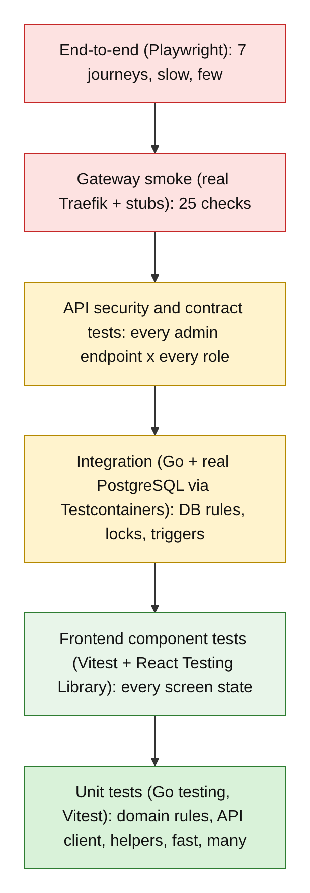

<details>
<summary>Diagram source (Mermaid)</summary>

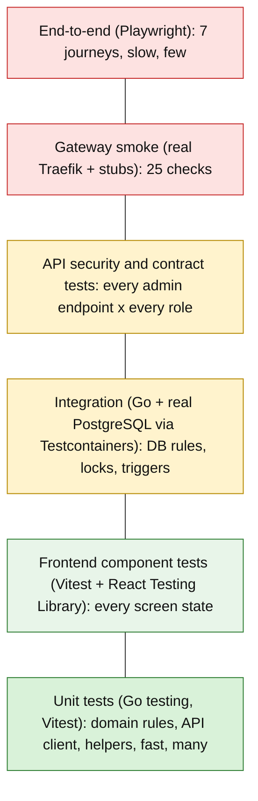

</details>

| Level | Part | Tools \[Repo\] | What it proves | When it runs |
| --- | --- | --- | --- | --- |
| Unit | Admin domain, use cases | Go `testing` (+ `testify` if the team adds it) | Business rules (zone id, short code, prefixes, enable/disable, overlap) | Every push |
| Unit | Screens | Vitest | API client, idempotency keys, error mapping, display helpers, zod schemas | Every push |
| Component | Screens | Vitest + React Testing Library | Loading, empty, validation error, 401, 403, 409, 500 and success states; buttons disabled while sending | Every push |
| Integration | Admin module | Go + `testcontainers-go` + PostgreSQL 16 | Constraints, unique index, advisory lock, version check, audit trigger and grants, migrations up/down | Every pull request |
| Contract | Screens and admin API | JSON fixtures from API.md examples, checked on both sides | Screens and backend agree on field names and error codes | Every pull request |
| Security | Admin API, gateway, screens | Go `httptest`, gateway smoke, Playwright | Role checks (403), no tokens in browser storage, headers pass unchanged, internal paths closed | Every pull request |
| Gateway smoke | Gateway | Real Traefik binary + Python stub backends (`gateway_test.sh`) | Routes, limits, CORS, SSE, 401/403 pass-through | Every pull request touching `deploy/gateway/` |
| End-to-end | All | Playwright with Page Object Models \[Repo\] web/CLAUDE.md 5 | Real user journeys across screens, gateway and backend | Before release and demo |
| Non-functional | Admin API, gateway | Simple load script (proposed k6 or Go), axe-core for accessibility | SRS NFR-PERF-001 (p95 ≤ 500 ms), NFR-PERF-004 (page size cap), accessibility basics | Before release |

## 3. Mocking strategy and test environment

**Rule:** mock only at the **edge of what is being tested**. The domain is never mocked. PostgreSQL is never mocked in integration tests.

| Level | Real | Faked or stubbed | How |
| --- | --- | --- | --- |
| Go domain unit | Everything (pure code) | Nothing | — |
| Go use case unit | Domain | Repositories, `TxManager`, `AuditWriter`, Member 4's `merchants.AdminService`, `Clock` | Hand-written in-memory fakes that implement the ports (Doc 3 4.4). No mocking library needed |
| Go integration | Domain, use cases, Postgres adapters, real PostgreSQL 16, real migrations (`000002`, `000011`) | Other modules' interfaces (merchants, parcels); a stub `users` table **only in the test folder** (Member 9 D4) | Testcontainers starts a fresh database per test package |
| Go handler / security | Router, auth middleware, handlers | Use cases (fakes) and a test JWT signer | `httptest`; test key pair made at test start, never committed |
| Frontend unit | Shared client logic | `fetch` | A fake `fetch` function passed into `ApiClient` (as in the starter suite) |
| Frontend component | Components, hooks, TanStack Query | Network | Mock Service Worker (MSW) with fixtures from API.md **\[Proposed; or fake `ApiClient`\]** |
| Gateway smoke | Real Traefik binary, real repo config (only ports and host names rewritten) | Backends | `stub_backend.py` echoes which service answered |
| End-to-end | Everything (Member 9's `deploy/docker-compose.yml`, `make up`) | External SMS/email providers | Member 8's test doubles |

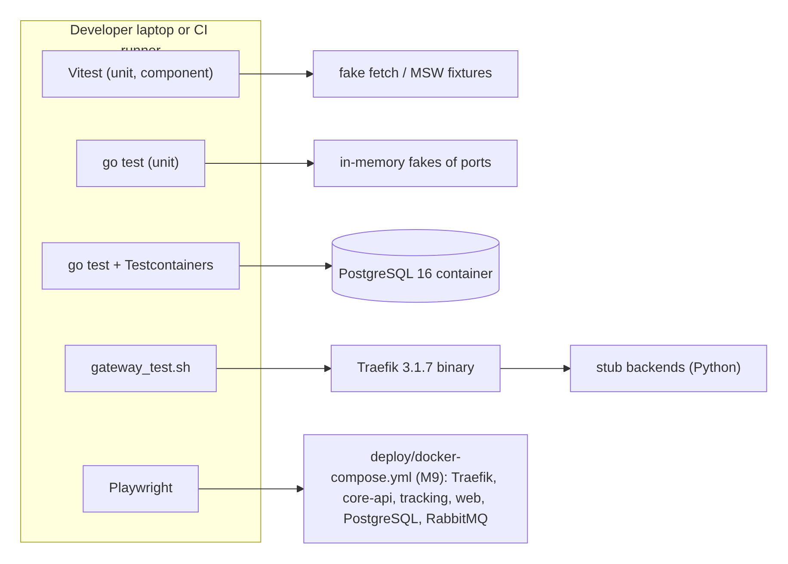

<details>
<summary>Diagram source (Mermaid)</summary>

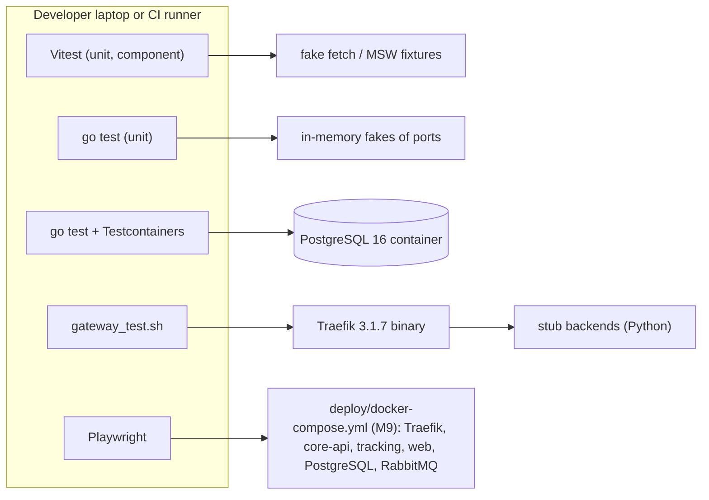

</details>

**Test environment needs**

| Need | Version | Used by | Notes |
| --- | --- | --- | --- |
| Go | 1.22 or newer (CI uses 1.22 \[Repo\]) | Go tests | Starter suite run on 1.24.7 with `go 1.22` in go.mod |
| Node | 20 or newer | Vitest, Playwright | Starter suite run on Node 22 |
| Docker | any recent | Testcontainers, Compose, E2E | Not needed for unit tests or gateway smoke |
| Traefik binary | v3.1.7 (pinned, matches `traefik:v3.1`) | Gateway smoke | Downloaded from the Traefik GitHub release in CI |
| Python 3 | 3.10+ | Gateway stub backends | Standard library only |
| Chromium | Playwright's bundled browser | E2E | `npx playwright install chromium` in CI |

## 4. Test fixtures, seed data and repeatability

| Rule | How |
| --- | --- |
| Same result every run | No real clock in rules (inject `Clock`); no random ids in assertions (inject key and id makers, as `IdempotentAction` does); no `sleep` to wait for things (wait for a condition) |
| Tests do not depend on each other | Go: `-count=1 -shuffle=on`; Vitest: `--sequence.shuffle` in CI **\[Proposed\]**; each test builds its own data |
| Clean database each time | Testcontainers: fresh container per package; each test runs in a transaction that is rolled back, or truncates my tables |
| Fixtures match the contract | Frontend fixtures copied from API.md examples into `__tests__/fixtures/`; a contract test fails if a fixture uses a field the API.md does not list (section 5.6) |
| Seed data for E2E | Doc 5 section 10: 7 Sri Lankan zones with text ids such as `ZONE_COLOMBO_01` (incl. one disabled), 3 settings, Member 1's seed accounts (admin, dispatcher, courier) |
| Builders for Go | `aZone(t)`, `prefixes(t, "00300")` helpers (already in the starter suite) |
| No secrets in fixtures | Test JWT keys made at runtime; fixture tokens are obviously fake strings (`"Bearer abc.def"`) |
| Playwright stability | `getByRole` / `getByTestId` locators only; traces saved on failure; each test creates its own parcels through the API |

## 5. Test-case matrix

**Type key:** H = happy path, V = invalid input, A = authorization failure, R = race condition, D = dependency failure, S = security, C = contract.
**Status key:** ✅ automated and passing now · 🟡 planned, can be written now · ⛔ blocked (reason given).

### 5.1 Admin domain (Go unit) — starter suite exists

| ID | Scenario | Type | Rule / requirement | Status |
| --- | --- | --- | --- | --- |
| UT-AD-01 | Zone id accepts `ZONE_COLOMBO_01`, rejects lower case, missing `ZONE_`, dash, too short, over 32 characters, empty | V | Doc 5 4.1 CHECK, TD-05 | ✅ `TestNewZoneID` |
| UT-AD-02 | Postal prefix accepts 3 to 5 digits, rejects letters, spaces, 2 or 6 digits | V | Doc 5 4.2, TD-01, TD-02 | ✅ `TestNewPostalPrefix` |
| UT-AD-03 | "003" overlaps "00300" both ways; "00300" does not overlap "00400" | H/V | Admin README rule 3 | ✅ `TestPrefixOverlaps` |
| UT-AD-04 | Short code accepts `CMB-01`, `KDY_01`; rejects lower case, spaces, 1 or 33 characters (zones hold no money any more, Doc 1 R-04) | V | Doc 5 4.1, TD-06 | ✅ `TestNewZoneCode` |
| UT-AD-05 | New zone is enabled, version 1, records `ZONE_CREATED` once | H | Doc 3 4.5 | ✅ `TestNewZoneHappyPath` |
| UT-AD-06 | New zone refused with no prefixes, duplicate prefix, blank or 121-character name, 501-character description; 120 characters allowed | V | Doc 2 A-01, Doc 5 4.1 | ✅ `TestNewZoneInvalid` |
| UT-AD-07 | Rename, short-code change and prefix replace in one save raise the version **once** and record old and new values; a bad description changes nothing | H | Doc 5 8.3 audit rules | ✅ `TestZoneChangesBumpVersionAndRecordEvents` |
| UT-AD-08 | Edits that change nothing do not bump version or create audit events | H | Doc 5 8.3 | ✅ `TestNoOpEditsDoNothing` |
| UT-AD-09 | Enable/disable state machine; enabling an enabled zone and disabling a disabled zone are errors | V | Doc 2 4.6 | ✅ `TestEnableDisable` |
| UT-AD-10 | Invalid prefix replace leaves the zone unchanged (no half change) | V | Atomic aggregate | ✅ `TestReplacePrefixesInvalidKeepsOld` |
| UT-AD-11 | Callers cannot change the aggregate through returned slices | S | Aggregate encapsulation | ✅ `TestPrefixesAreCopied` |
| UT-AD-12 | Overlap policy: exact duplicate in another zone clashes, naming that zone | V | Doc 2 A-01 | ✅ `TestPrefixOverlapPolicy/*` (5 sub-tests) |
| UT-AD-13 | Overlap policy: shorter prefix covering another zone clashes | V | Doc 5 4.2 | ✅ |
| UT-AD-14 | Overlap policy: own prefixes never clash; free prefixes pass; all clashes listed | H | | ✅ |
| UT-AD-15 | `SystemSetting`: only allowed keys, value must match type | V | Doc 5 4.3 | ✅ Doc 8 (`settings_rules_test.go`) |
| UT-AD-16 | Report period: from after to refused; range above `reports.max_range_days` refused; Sri Lanka day turned into the right UTC range | V | Doc 2 A-03, E-12 | ✅ Doc 8 demo (DEMO-38); unit test 🟡 |
| UT-AD-17 | `PostalPrefix.Covers`: "003" covers 00300, not 00400 (public lookup) | H/V | Doc 1 R-18 | ✅ `TestPrefixCovers` |
| UT-AD-18 | A zone loaded from storage records no events | H | Doc 3 4.5 | ✅ `TestRestoreRecordsNoEvents` |

### 5.2 Admin use cases (Go unit with fakes)

| ID | Scenario | Type | Rule | Status |
| --- | --- | --- | --- | --- |
| UC-AD-01 | CreateZone saves zone, prefixes and one audit row inside `WithinTx` | H | Doc 3 4.7 | 🟡 |
| UC-AD-02 | CreateZone with a prefix owned by another zone returns `ErrPrefixConflict`, writes nothing, no audit | V | Doc 2 A-01 | 🟡 |
| UC-AD-03 | Audit failure rolls back the zone change (fake `AuditWriter` returns an error) | D | DD-10 | 🟡 |
| UC-AD-04 | UpdateZone with stale version returns `ErrConcurrentConflict` | R | DD-11 | 🟡 |
| UC-AD-05 | Actor is taken from the auth context, never from the request body | S | INV-03 | 🟡 |
| UC-AD-06 | Merchant routes call Member 4's `AdminService.ChangeStatus` with `expected_version`, reason and actor; Member 4's codes (`MERCHANT_VERSION_CONFLICT`, `MERCHANT_INVALID_TRANSITION`) pass through; Member 4 writes the audit row | H/V | Doc 1 R-02, Doc 3 4.9 | ✅ Doc 8 (DEMO-26..34, stand-in for Member 4); real module ⛔ Member 4 |
| UC-AD-07 | UpdateSetting writes old and new value to audit | H | Doc 2 A-02 | ✅ Doc 8 (DEMO-25, DEMO-39) |

### 5.3 Admin database integration (Go + real PostgreSQL)

These are Doc 5's TD cases, run against real migrations.

| ID | Scenario | Type | Rule | Status |
| --- | --- | --- | --- | --- |
| IT-AD-01 | Same prefix in two zones: second insert fails with `23505`, mapped to 409 | V | Doc 5 TD-03 | ✅ Doc 8 (DEMO-16) |
| IT-AD-02 | 20 goroutines add "655", "6550" and "65500" to different zones at the same moment: exactly one commits | R | Doc 5 TD-04, section 7.2 | ✅ Doc 8 `TestOverlappingPrefixRace` |
| IT-AD-03 | Update with old version: 0 rows, 409 | R | TD-07 | ✅ Doc 8 `TestStaleVersionRace` |
| IT-AD-04 | `UPDATE audit_logs` as `swiftdrop_app`: permission denied | S | TD-08, INV-12 | ✅ Doc 8 (DEMO-41) |
| IT-AD-05 | `DELETE FROM audit_logs`, even as `swiftdrop_migrator`: trigger error | S | TD-09 | ✅ Doc 8 (DEMO-42) |
| IT-AD-06 | CHECK constraints: bad zone id, bad short code, bad prefix refused by the database itself | V | Doc 5 4.1 to 4.3 | 🟡 (domain refuses them first: DEMO-17) |
| IT-AD-12 | Public zone list shows enabled zones only; postal code lookup finds the zone, not a disabled one | H | Doc 5 TD-13, TD-14 | ✅ Doc 8 `TestPublicZonesAndPostalLookup` |
| IT-AD-13 | `swiftdrop_app` cannot delete a zone (Member 9 D7) | S | Doc 5 5.2 | ✅ Doc 8 (DEMO-43) |
| IT-AD-07 | Disabled zone still referenced by old rows: no FK error | H | TD-10 | ⛔ M2/M3 tables |
| IT-AD-08 | Every migration: up, down, up again on a clean database | H | TD-12, SRS 7.3 | 🟡 (migrations exist in Doc 8) |
| IT-AD-09 | Lock timeout: a held advisory lock makes a second change fail after 3 s, not hang | D | Doc 5 7.2 | 🟡 |
| IT-AD-10 | Same Idempotency-Key from two admins gives two separate results | S | TD-11, U-39 | ⛔ platform middleware |
| IT-AD-11 | Same key + same body returns saved response with `Idempotent-Replay: true`; same key + different body returns 409 | H/V | api-conventions 4 | ⛔ platform middleware |

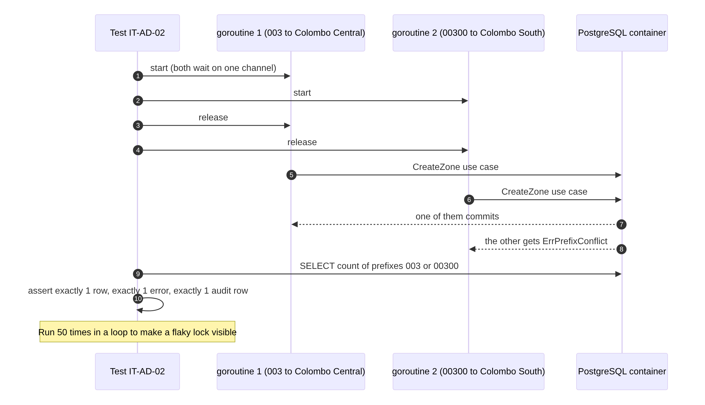

<details>
<summary>Diagram source (Mermaid)</summary>

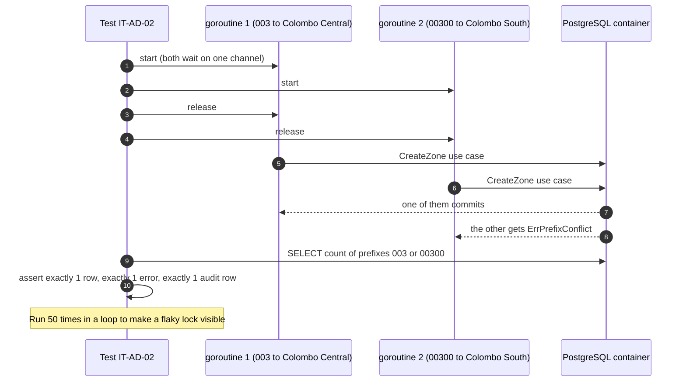

</details>

### 5.4 Admin API security and authorization (Go `httptest`)

| ID | Scenario | Type | Rule | Status |
| --- | --- | --- | --- | --- |
| SEC-AD-01 | Every `/api/v1/admin/*` endpoint × each role (ADMIN, DISPATCHER, COURIER, MERCHANT, CUSTOMER, no token, expired token): only ADMIN passes (reports: ADMIN and DISPATCHER); others get 403 or 401 | A | SRS SEC-004, admin README rule 1, test-strategy "100 % of protected endpoints" | ✅ Doc 8 guard tests + DEMO-04..06, DEMO-26; full table-driven test 🟡 |
| SEC-AD-02 | Reports: ADMIN and DISPATCHER allowed, COURIER refused | A | Doc 1 R-16 (U-02 closed) | ✅ Doc 8 (DEMO-35, DEMO-37) |
| SEC-AD-07 | `GET /api/v1/zones` needs no token and shows only `id`, `code`, `name` of enabled zones | S | Doc 1 R-18 | ✅ Doc 8 (DEMO-08..12) |
| SEC-AD-03 | Body field `actor_id` or `role` sent by client is ignored | S | INV-03 | 🟡 |
| SEC-AD-04 | 500 response contains `correlation_id` but no SQL text or stack trace | S | api-conventions 2.3 | 🟡 |
| SEC-AD-05 | JSON body over 1 MB refused by backend | V | SEC-006 | 🟡 |
| SEC-AD-06 | Audit query never returns rows to non-ADMIN; pagination capped at 100 | A | SRS SEC-015, NFR-PERF-004 | 🟡 |

### 5.5 Frontend unit and component (Vitest + RTL)

| ID | Scenario | Type | Rule | Status |
| --- | --- | --- | --- | --- |
| UT-FE-01..04 | Error envelope mapping: code, message, correlation id, field errors; 5xx server text hidden; safe defaults; network error | V/S/D | Doc 2 3.2, INV-10 | ✅ `errors.test.ts` (4) |
| UT-FE-05..06 | Refresh lock: 5 parallel callers → 1 refresh; later 401 starts a new refresh; failed refresh does not block the next | R/D | Doc 2 F-02 | ✅ `refreshLock.test.ts` (3) |
| UT-FE-07..10 | Idempotency key: same input reuses key, new input new key, cleared after success, UUID v4 format | H/R | Doc 2 3.3 | ✅ `idempotency.test.ts` (4) |
| UT-FE-11..17 | API client: sends token and key; 401 → refresh once → repeat once with same key; 5 parallel 401s → 1 refresh; refresh fails → sign out; no loop on second 401; 403 not retried; network failure → `NETWORK_ERROR` | H/A/R/D | ADR-003, Doc 2 F-02 | ✅ `client.test.ts` (7) |
| UT-FE-18..19 | Courier "Full" display at 25/25; OTHER reason needs 15 characters | V | Doc 2 E-01, E-04 | ✅ `courier.test.ts` (2) |
| UT-FE-20 | `formatLKR(45000)` = "LKR 450.00"; no float maths | H | INV-13 | 🟡 (shared helper, agree with M6) |
| UT-FE-21 | zod schemas for zone form (id, code, name, prefixes; no money), pricing rule form, failure form | V | Doc 2 F-10, F-11, C-05 | 🟡 |
| CT-FE-01 | Every ops screen renders loading, empty, validation error, 403, 409, 500 and success states | H/V/A/D | M7-UI-15, web/CLAUDE.md 4 | 🟡 |
| CT-FE-02 | Assign button disabled from first click until response; double click sends one request | R | Doc 2 3.4 | 🟡 |
| CT-FE-03 | 409 on assign shows the backend message and refetches the board | R | Doc 2 F-04 | 🟡 |
| CT-FE-04 | Board timer refresh failure keeps old data and shows "Last updated" | D | Doc 2 E-17 | 🟡 |
| CT-FE-05 | Reschedule offered only for `ATTEMPT_FAILED`; disabled after the 3rd attempt (`MAX_ATTEMPTS_EXCEEDED`) and never shown for `RETURNED`; OTHER note (15+ characters) shown | V | Doc 2 F-06, Member 3 `POST /dispatch/parcels/{id}/reschedule` | 🟡 |
| CT-FE-06 | Role guard: DISPATCHER does not see admin menu; CUSTOMER sent away from `/ops/*` | A | M7-UI-14 | 🟡 |
| CT-FE-07 | Status badges show text plus colour for all 9 statuses | H | M7-UI-16 | 🟡 |
| CT-FE-08 | Photo over 10 MB is resized before upload; resize failure shows a message | V/D | Doc 2 C-04 | 🟡 |
| CT-FE-09 | Money and dates: cents shown with `formatLKR`, UTC shown in Asia/Colombo | H | R-API-07, R-API-08 | 🟡 |
| CT-FE-10 | Logout clears the token and the whole query cache | S | Doc 5 9.2 | 🟡 |

### 5.6 Contract tests

| ID | Scenario | Type | Status |
| --- | --- | --- | --- |
| CT-API-01 | Each frontend fixture matches the JSON example in the owner's API.md (field names, types, envelope) | C | 🟡 for documented endpoints (board, assignments, zones, reports, login); ⛔ for "Requested" endpoints |
| CT-API-02 | Each error code the screens handle (`COURIER_CAPACITY_EXCEEDED`, `PARCEL_NOT_ELIGIBLE_FOR_ASSIGNMENT`, `ZONE_POSTAL_CODE_CONFLICT`, ...) exists in the owner's API.md | C | 🟡 |
| CT-API-03 | Admin handlers return exactly the shapes in admin API.md (provider side, Go golden-file test) | C | 🟡 after handlers |
| CT-API-04 | Money fields are integer cents in every fixture (pricing rules only; zones have no money, Doc 1 R-04) | C | 🟡 (U-03 closed) |

**How contract tests work \[Proposed, U-42\]:** the JSON examples in each API.md are the contract. A small script extracts them into `contracts/<module>/<endpoint>.json`. The frontend uses them as fixtures; the backend owner's golden-file test checks their handler returns the same shape. If either side changes, CI fails on the side that drifted.

### 5.7 Gateway smoke (real Traefik) — starter suite exists

| ID | Scenario | Type | Rule | Status |
| --- | --- | --- | --- | --- |
| GW-01..05 | Each path prefix reaches the right service (tracking, AI, core, web) | H | INV-06 | ✅ |
| GW-06 | `/api/v1/trackingX` is taken by the tracking router | V | R-GW-04 | ✅ **finding** |
| GW-07 | `/api/v2/parcels` falls through to the web app (200) instead of 404 | V | Doc 2 E-15 | ✅ **finding** |
| GW-08..09 | `/health/live` and `/metrics` do not reach core-api | S | INV-05 | ✅ |
| GW-10 | Dashboard is reachable on :8080 because `api.insecure: true` | S | M7-GW-06 | ✅ **finding** (must be off in production) |
| GW-11..12 | `Authorization` and `X-API-Key` reach the backend unchanged | S | INV-04 | ✅ |
| GW-13..16 | 401 status, `WWW-Authenticate` header and body, and 403 status and body pass through unchanged | A | M7-GW-10 (closes an ADR-001 checklist item) | ✅ |
| GW-17..18 | 9 MB upload passes; 11 MB upload gets 413 | V | M7-GW-03 | ✅ |
| GW-19..20 | CORS preflight from `localhost:3000` allowed; from `evil.example` no allow-origin | S | SRS SEC-013 | ✅ |
| GW-21 | `X-Request-ID` not in allowed CORS headers | C | M7-GW-04 vs security-notes | ✅ **finding** |
| GW-22 | First SSE event arrives before the 3-second stream ends (not buffered) | H | INV-07 | ✅ |
| GW-23 | 60 quick tracking requests: 51 pass, 9 get 429 | V | M7-GW-02 | ✅ |
| GW-24 | A **different** visitor (other `X-Forwarded-For`) also gets 429: all visitors share one bucket | S | Doc 2 G-02 | ✅ **finding** |
| GW-25 | 60 login requests get no 429: login limit missing | S | SRS SEC-007 | ✅ **finding** (fixed in my proposed config: Doc 7 GS-06) |
| GW-26 | Backend down: gateway returns 502/503 quickly, not a hang | D | | 🟡 (stop one stub mid-test) |
| GW-27 | Kubernetes `ingressroutes.yaml`/`middlewares.yaml` give the same results (route parity) | C | Doc 3 DD-12 | ✅ Doc 8 `gateway_parity.py` (11 middlewares, 3 transports) |
| GW-28 | Rate limit counts the real visitor after `sourceCriterion` fix (GW-24 should then fail and be flipped) | S | Doc 3 5.3 | ✅ Doc 7 GS-05, GS-05b on my proposed config |
| GW-29 | Login 5/min burst 3, tracking 30/min burst 10, merchant API 120/min burst 20, AI 10/min burst 2, 5 open streams per IP | S | SRS SEC-007, Doc 1 R-13 | ✅ Doc 7 GS-05, GS-06, GS-09, GS-20, GS-21 |
| GW-30 | CORS origins and headers exactly as security-notes section 4; client `X-Tenant-ID` removed | S | SRS SEC-013, Doc 1 R-14, R-15 | ✅ Doc 7 GS-10, GS-11, GS-11b |
| GW-31 | 10 MB limit only on `/api/v1/deliveries/{id}/proof-photo`; 1 MB elsewhere | V | Doc 1 R-01 | ✅ Doc 7 GS-07, GS-08 |

A "finding" test passes because it **confirms how the config behaves today**. When the config is fixed, its expected value is flipped in the same pull request, so the fix is proven.

### 5.8 End-to-end journeys (Playwright)

| ID | Journey | Requirement | Status |
| --- | --- | --- | --- |
| E2E-01 | Dispatcher signs in, assigns a parcel, board updates (team journey 3 start) | FR-ADM-001, 002, 004 | ⛔ needs backend |
| E2E-02 | Courier on mobile viewport goes on shift, starts the run (`OUT_FOR_DELIVERY`), uploads the proof photo, completes with signature, status becomes `DELIVERED` | FR-COU-001 to 004 | ⛔ needs Member 3 backend (endpoints fixed: Doc 1 R-01) |
| E2E-03 | Courier reports `RECIPIENT_UNAVAILABLE` (`POST /deliveries/{id}/failed`), dispatcher sees "1 of 3" on `/ops/failed-deliveries` and reschedules (team journey 4) | FR-COU-005, FR-LIFE-006, ADR-004 | ⛔ needs Member 3 backend |
| E2E-04 | CUSTOMER opening `/ops/dispatch` or `/ops/zones` is refused (team journey 5) | SEC-004 | 🟡 route guard part now |
| E2E-05 | Admin creates zone with a clashing prefix, sees the other zone's name, fixes it, saves | FR-ADM-007 | 🟡 (API done in Doc 8; screen not built) |
| E2E-08 | Admin approves a PENDING merchant on `/ops/merchants/:id`; a second tab with the old version sees the conflict message | FR-ADM-005 | ⛔ Member 4 backend |
| E2E-06 | After sign-in, `localStorage` and `sessionStorage` contain no token; after logout, memory cleared | ADR-003, INV-11 | 🟡 |
| E2E-07 | Two browser contexts assign the same parcel; one sees the conflict message | FR-ADM-003, AT-013 | ⛔ needs backend |

### 5.9 Non-functional

| ID | Scenario | Target | Status |
| --- | --- | --- | --- |
| NF-M7-01 | Reports endpoint p95 at 50 concurrent users | ≤ 500 ms (SRS NFR-PERF-001) | ⛔ needs real report data |
| NF-M7-02 | Courier chunk + shell JavaScript size | < 200 KB gzipped (Doc 3 3.8) | 🟡 check `npm run build` output |
| NF-M7-03 | Accessibility: no serious axe-core violations on ops and courier screens; keyboard works | SRS 9.4 | 🟡 |
| NF-M7-04 | 5 open SSE streams per IP through the gateway; 6th refused | Doc 1 R-13 | ✅ Doc 7 GS-09, GS-09b |

## 6. Mapping to requirements, business rules and team acceptance tests

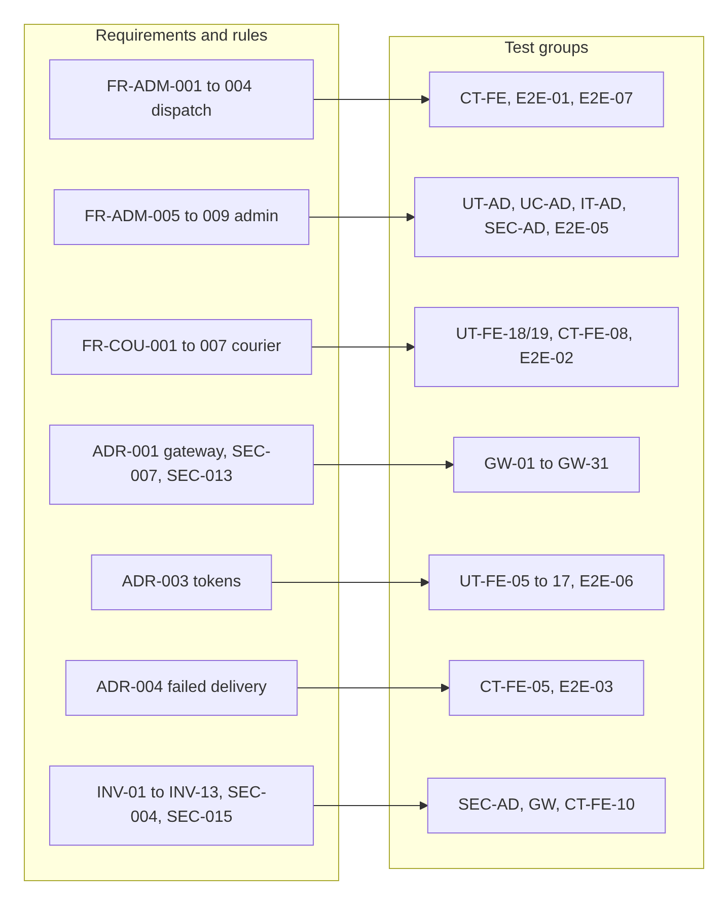

<details>
<summary>Diagram source (Mermaid)</summary>

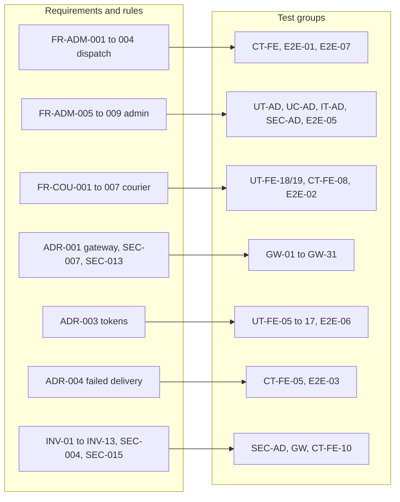

</details>

**Team acceptance tests (SRS 12.2) my module helps prove**

| Team test | My part | My test IDs |
| --- | --- | --- |
| AT-004 IDOR / isolation | Screens show 403 safely; courier cannot open others' tasks | CT-FE-01, E2E-04 |
| AT-006 Courier authorization | Courier screens send only own tasks; show 403 | CT-FE-01, E2E-02 |
| AT-011 Merchant isolation | Merchant list, detail and status screens (Member 4's rules and audit) | UC-AD-06, E2E-08 |
| AT-013 Dispatcher concurrency | Board handles 409 and refreshes | CT-FE-03, E2E-07 |
| AT-016 Deployment and probes | Probes not public through the gateway | GW-08, GW-09 |
| Team RTM row "Edge & Ingress Gateway" | `deploy/tests/gateway_test.sh` | GW-01 to GW-31 |

**Invariants (Doc 1 section 6) and the tests that guard them**

| Invariant | Tests |
| --- | --- |
| INV-01 hiding a button is not security | SEC-AD-01 (backend 403 tested separately from UI) |
| INV-02 no invented state or prices | CT-FE-03, CT-FE-09 |
| INV-03 no actor or arbitrary status from client | SEC-AD-03, UC-AD-05 |
| INV-04 gateway makes no permission decision | GW-11 to GW-16 |
| INV-05 internal endpoints closed | GW-08 to GW-10 |
| INV-06 one route, one service | GW-01 to GW-07, GW-27 |
| INV-07 SSE not buffered | GW-22 |
| INV-08 no secrets committed | CI secret scan (TruffleHog, verify.sh) |
| INV-09 rebuild from git | IT-AD-08, GW-27 on a clean clone |
| INV-10 no tokens or personal data in errors | UT-FE-03, SEC-AD-04 |
| INV-11 tokens in memory only | UT-FE-11..17, E2E-06 |
| INV-12 audit never edited | IT-AD-04, IT-AD-05 |
| INV-13 money from integer cents | UT-FE-20, CT-API-04 (zones hold no money: Doc 5 4.1) |

## 7. Race conditions and dependency failures (summary)

| Risk | Test | Level |
| --- | --- | --- |
| Many 401s at once trigger token-reuse logout | UT-FE-05, UT-FE-13 | ✅ unit |
| Double click sends two assignments | CT-FE-02 | component |
| Two dispatchers assign the same parcel | E2E-07 (+ Member 3's AT-013) | E2E |
| Two admins add overlapping prefixes | IT-AD-02 (50-loop) | integration |
| Two admins edit the same zone | UC-AD-04, IT-AD-03 | unit + integration |
| Retry after a lost response | IT-AD-11, UT-FE-12 (same key on repeat) | integration + ✅ unit |
| Backend down | UT-FE-17 (network), CT-FE-04, GW-26 | ✅ unit + component + gateway |
| Audit write fails | UC-AD-03 | unit |
| Database lock held too long | IT-AD-09 | integration |
| Refresh endpoint down | UT-FE-06, UT-FE-14 | ✅ unit |

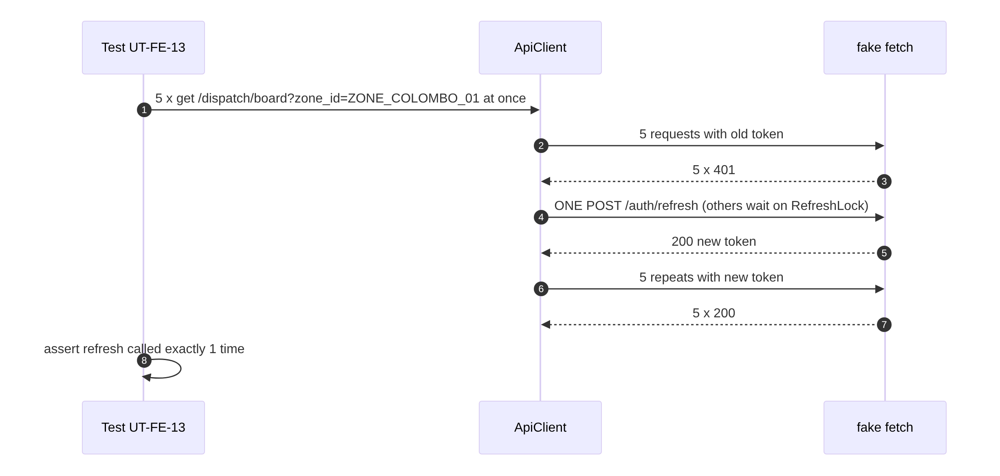

<details>
<summary>Diagram source (Mermaid)</summary>

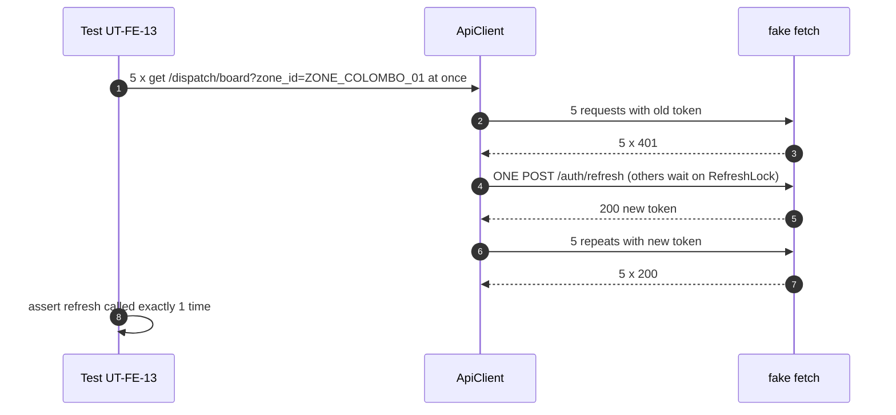

</details>

## 8. Coverage expectations

Coverage is a floor, not the goal. Every critical rule must have a named test (section 5) even if coverage is already high.

| Code | Minimum line coverage | Reason | Now (starter) |
| --- | --- | --- | --- |
| `core-api/internal/admin/domain` | **90 %** | All business rules live here | 98.1 % ✅ |
| `core-api/internal/admin/application` | **80 %** | Transaction and audit paths | — |
| `core-api/internal/admin` overall | **70 %** (team floor, test-strategy 1) | Team rule | — |
| `web/src/shared/api` (client, refresh, idempotency, errors) | **90 %** | Security and retry logic | 98.4 % ✅ |
| `web/src/features/dispatcher-admin` | **70 %** | Screens and hooks | — |
| Gateway | **100 % of routers and middlewares** have at least one smoke check | Config has no "lines" | 4 of 4 routers, 3 of 3 middlewares ✅ |

CI fails if a floor is not met **\[Proposed; Go: `go tool cover` check script; Vitest: `coverage.thresholds` in vitest.config.ts\]**.

## 9. How tests run locally and in CI

### 9.1 Local commands

```bash
# Go admin module (unit + integration; integration needs Docker for Testcontainers)
cd core-api && go test -race -count=1 -shuffle=on -coverprofile=coverage.out ./internal/admin/...
go tool cover -func=coverage.out | tail -1

# Frontend (from web/)
npm run lint                 # tsc + ESLint
npm run test:unit            # Vitest
npm run test:unit:coverage   # with coverage
npm run test:e2e             # Playwright (needs Member 9's stack: make up)

# Gateway smoke (no Docker needed)
curl -sSfL https://github.com/traefik/traefik/releases/download/v3.1.7/traefik_v3.1.7_linux_amd64.tar.gz | tar xz traefik
./deploy/tests/gateway_test.sh deploy/gateway/traefik ./traefik

# Everything the repo checks before a push
./scripts/verify.sh
```

### 9.2 CI pipeline

The repo's CI has a secret scan and Go checks \[Repo\] .github/workflows/ci.yml. It has **no frontend job and no gateway job yet**. Proposal (Member 9 owns `.github/`, U-43):

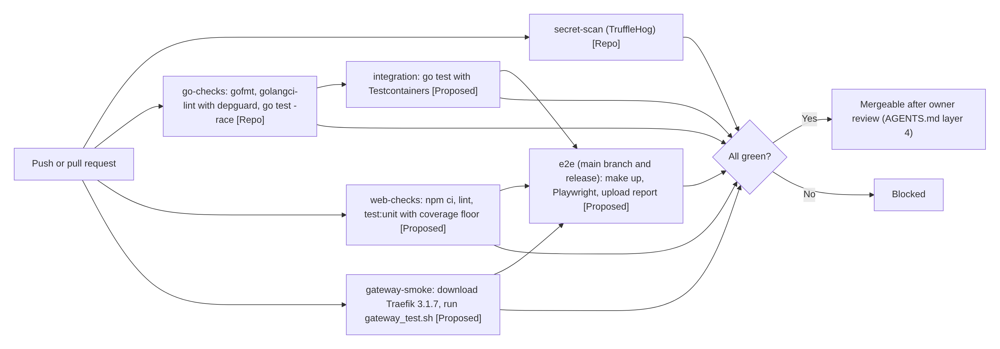

<details>
<summary>Diagram source (Mermaid)</summary>

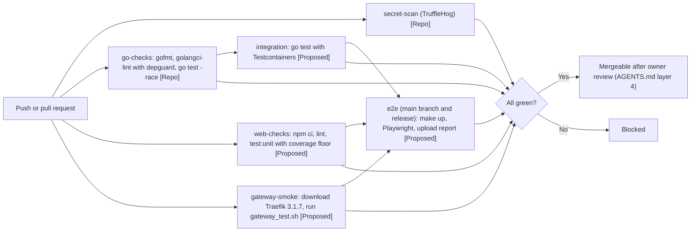

</details>

Proposed CI jobs to add (shape only):

```yaml
  web-checks:
    runs-on: ubuntu-latest
    defaults: { run: { working-directory: web } }
    steps:
      - uses: actions/checkout@v4
      - uses: actions/setup-node@v4
        with: { node-version: '20', cache: npm, cache-dependency-path: web/package-lock.json }
      - run: npm ci
      - run: npm run lint
      - run: npm run test:unit:coverage

  gateway-smoke:
    runs-on: ubuntu-latest
    steps:
      - uses: actions/checkout@v4
      - run: curl -sSfL https://github.com/traefik/traefik/releases/download/v3.1.7/traefik_v3.1.7_linux_amd64.tar.gz | tar xz traefik
      - run: ./deploy/tests/gateway_test.sh deploy/gateway/traefik ./traefik
```

Note: the repo's `go-checks` uses `golangci-lint version: latest` and `trufflehog@main`. Pinning versions would make CI results repeatable **\[TBD U-43\]**.

## 10. Acceptance criteria and evidence required

### 10.1 Definition of done for each part

| Part | Done when | Evidence |
| --- | --- | --- |
| Admin module | All UT-AD, UC-AD, IT-AD and SEC-AD tests pass in CI; coverage floors met; README.md and API.md updated in the same pull request (AGENTS.md 6); owner review approved | CI run link, coverage report, PR link |
| Ops screens | All CT-FE pass for each finished screen; every screen shows the 7 states; E2E-01, E2E-04, E2E-05, E2E-06, E2E-07 pass | Vitest report, Playwright HTML report with traces, screenshots of each state |
| Courier screens | CT-FE-08 and E2E-02, E2E-03 pass on a 360 px mobile viewport | Playwright report (mobile project) |
| Gateway | All GW checks pass on Docker config **and** Kubernetes config (GW-27); every finding fixed and its test flipped; ADR-001 checklist items ticked with links to results | `gateway-test-output.txt` from CI, PR flipping findings |
| Whole module | Every row in section 5 is ✅ or has a written, agreed reason; no ⛔ rows left without an owner | This matrix updated, signed off by owners |

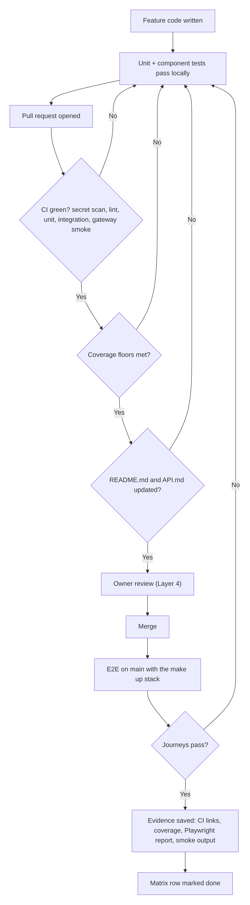

<details>
<summary>Diagram source (Mermaid)</summary>

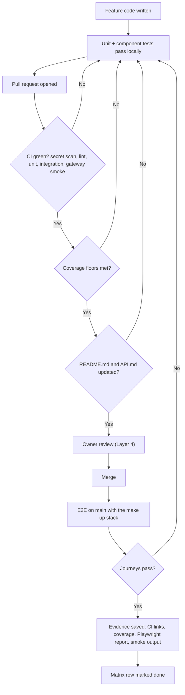

</details>

### 10.2 Evidence pack for the final submission

| Evidence | Where it comes from |
| --- | --- |
| Test command list and versions | Section 9 of this document |
| Test results (pass/fail counts) | CI logs; saved outputs like `go-test-output.txt`, `vitest-output.txt`, `gateway-test-output.txt` |
| Coverage summary | `go tool cover -func`, Vitest `coverage-summary.json` |
| Playwright report and traces | CI artifact |
| Known gaps | Section 5 ⛔ rows and section 11.4 findings, with owners |
| Environment details | Section 3 table |

SRS 12.3 asks for "test commands, reports, coverage summary, known gaps, and environment details". The table above covers each one.

## 11. Test execution results (24 October 2026, admin domain re-run 26 October 2026)

All three starter suites were run in a clean Linux environment. The admin domain suite was re-run on 26 Oct after the zone model change; the other two did not change. Raw output files are saved next to the tests in `doc6-tests/`.

### 11.1 Admin domain (Go)

- Command: `go test -race -count=1 -v -coverprofile=cover.out ./...` in `doc6-tests/admin-domain`
- Environment: Go 1.24.7 linux/amd64, `go 1.22` in go.mod, `gofmt` and `go vet` clean
- Result: **ok, 14 test functions + 5 sub-tests = 19 passed, 0 failed**
- Coverage: **98.1 %** of statements. Not covered: one plain getter and one branch
- Output: `doc6-tests/admin-domain/go-test-output.txt`, `coverage.txt`

### 11.2 Shared API client (TypeScript)

- Commands: `npx tsc --noEmit` (strict) then `npx vitest run --coverage` in `doc6-tests/web-client`
- Environment: Node 22, TypeScript 5.6.3, Vitest 2.1.8, coverage v8
- Result: **5 files, 20 tests passed, 0 failed**; `tsc` no errors
- Coverage: **98.36 %** statements, **98.43 %** branches, **100 %** functions (only the refresh network-error path in `client.ts` lines 75 to 76 uncovered)
- Output: `doc6-tests/web-client/vitest-output.txt`, `tsc-output.txt`

### 11.3 Gateway smoke (real Traefik)

- Command: `./gateway_test.sh <repo>/deploy/gateway/traefik ./traefik`
- Environment: Traefik **3.1.7** binary (same major/minor as `traefik:v3.1`), the repo's `traefik.yml` and `dynamic-routes.yml` from commit `40dc279` with only ports and backend host names rewritten, 4 Python stub backends
- Result: **25 passed, 0 failed**; 6 of the passes confirm known gaps
- Rate-limit detail: 60 quick requests from one visitor → 51 × 200, 9 × 429 (matches burst 50)
- Output: `doc6-tests/gateway/gateway-test-output.txt`

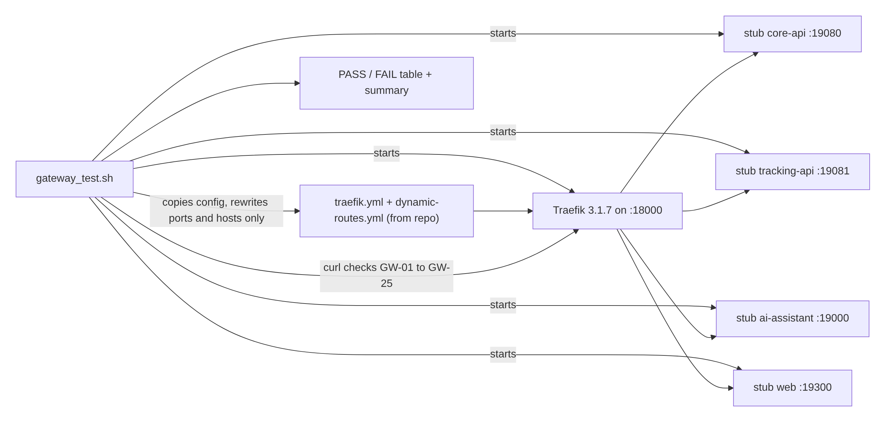

<details>
<summary>Diagram source (Mermaid)</summary>

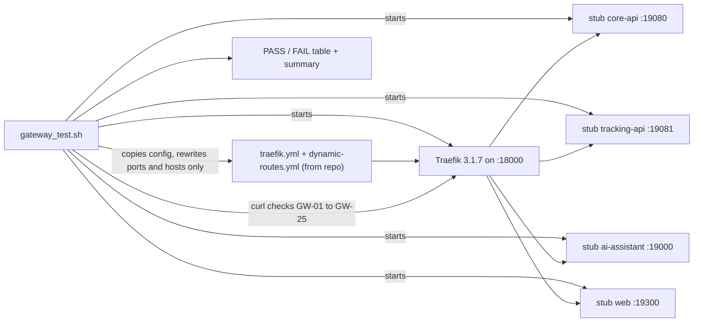

</details>

### 11.4 What the gateway run proved about the current config

| Finding | Test | Action | Owner |
| --- | --- | --- | --- |
| All visitors share one rate-limit bucket (the counter uses the direct sender's address, not the real visitor) | GW-24 | Fixed in my proposed config: `sourceCriterion.ipStrategy.depth: 1` on every limit (Doc 7 GS-05) | Me |
| No login rate limit | GW-25 | Fixed in my proposed config: `login-router` with 5/min burst 3 (Doc 7 GS-06) | Me, with Member 1 |
| Unknown `/api/...` paths return the web page with 200 | GW-07 | Add `/api` 404 router | Me, with Member 9 |
| `/api/v1/trackingX` goes to tracking | GW-06 | Team rule R-GW-04, or change rule to `/api/v1/tracking/` | Me |
| Dashboard open on :8080 (`api.insecure: true`) in the **repo** config | GW-10 | My proposed config has `insecure: false` and the dashboard on internal port 8090 only (Doc 1 R-10) | Me, with Member 9 |
| CORS does not allow `X-Request-ID` | GW-21 | Fixed in my proposed config, exactly as security-notes 4 (Doc 7 GS-11, GS-11b) | Me |

Good news confirmed by the run: routing to all 4 services, 401/403 pass-through unchanged (an unchecked ADR-001 item), auth headers unchanged, 10 MB limit, CORS allowlist, and SSE not buffered all work.

### 11.5 Not run yet, and why

| Suite | Why not yet |
| --- | --- |
| Admin use cases, integration, security | Now run in Doc 8 (`doc8-local/evidence/04-go-tests.txt`); U-37 and U-10 closed |
| Frontend component tests | Screens not built yet (built on mock APIs next) |
| Contract tests | Many endpoints are still "Requested" (Doc 1 section 9) |
| E2E | Needs the backend of Members 1 to 5 and Member 9's `deploy/docker-compose.yml` |
| Kubernetes gateway parity | Done in Doc 8 (`06-gateway-check.txt`) |

## 12. Where the tests will live in the repo

```
core-api/internal/admin/
├── domain/*_test.go                 # UT-AD (starter suite moves here)
├── application/*_test.go            # UC-AD with in-memory fakes
├── infrastructure/*_test.go         # IT-AD with Testcontainers (build tag: integration)
└── transport/*_test.go              # SEC-AD with httptest
web/src/shared/api/__tests__/        # UT-FE-01..17 (starter suite moves here; shared with M6)
web/src/features/dispatcher-admin/<feature>/__tests__/   # CT-FE
web/tests/e2e/pages/DispatchBoardPage.ts, CourierTasksPage.ts, ZonesPage.ts   # Page Objects [Repo pattern]
web/tests/e2e/specs/dispatch-assignment.spec.ts, courier-pod.spec.ts, delivery-failure.spec.ts, ops-rbac.spec.ts, zones.spec.ts
deploy/tests/gateway_test.sh + stub_backend.py   # GW (path from test-strategy RTM)
contracts/<module>/*.json            # CT-API fixtures [Proposed, U-42]
```

## 13. Open questions

Closed on 26 Oct: U-02, U-03, U-10, U-18, U-19, U-21, U-25, U-26, U-27, U-37 (Doc 1 section 11.3). Still blocking a test: U-39 (IT-AD-10).

| ID | Question | Decide with | Status |
| --- | --- | --- | --- |
| U-42 | Use API.md JSON examples as shared contract fixtures (`contracts/` folder) checked by both frontend and backend? (Member 4 already has an OpenAPI file) | Members 1 to 4, Member 10 (test coordinator) | Open |
| U-43 | Add `web-checks`, `gateway-smoke`, integration and E2E jobs to CI, and pin `golangci-lint` and TruffleHog versions | Member 9 | Open |
| U-44 | Who owns the shared API client tests in `web/src/shared/api/` (shared with Member 6) | Member 6 | Open |
| U-45 | Is `testify` allowed (test-strategy lists it) or plain `testing` only (AGENTS.md "no new dependencies")? | Member 10, backend members | Open |

## 14. Sign-off

To be reviewed by Members 1, 2, 3, 4, 5, 6, 8, 9 and 10. Member 10 (cross-workflow quality and test strategy owner) and Member 9 (CI) are the main reviewers.

| Member | Approved (date) | Notes |
| --- | --- | --- |
| Member 1 |  |  |
| Member 2 |  |  |
| Member 3 |  |  |
| Member 4 |  |  |
| Member 5 |  |  |
| Member 6 |  |  |
| Member 8 |  |  |
| Member 9 |  |  |
| Member 10 |  |  |
