# Document 7 — Security, Failure & Recovery Specification

> **Status:** Draft / Proposed (For Review in Meeting 2)  
> **Author:** Member 7 — Dispatcher/Admin UI, Courier Web, Traefik Gateway  
> **Target Module / Location:** `web/src/features/dispatcher-admin/` (ops + courier screens), `core-api/internal/admin/` (admin module), `deploy/gateway/traefik/` (gateway)  
> **Key Upstream Dependencies:** Member 1 (Auth), Member 8 (DLQ, retries), Member 9 (Cloudflare, Kubernetes), shared security-notes.md  
> **Open Questions / Needs Clarification:** Section 15. Still open: U-46 X-Forwarded-For depth and trusted IPs, U-47 DLQ and dedup table names, U-49 courier 403 vs 404, U-50 per-user limits owner, U-51 audit reads, U-52 CSP owner, U-54 1 MB body limit vs bulk create, U-66 end-sessions endpoint (was U-53). Closed by the 26 Oct review: U-48 (dashboard 8090), U-15 (burst 10), U-17 (15 s heartbeat), U-25 (photo upload)

**Module:** Dispatcher/Admin/Courier Frontend, Admin Backend Module & API Gateway (Member 7) **Project:** SwiftDrop Parcel Delivery & Courier Management System **Based on:** Documents 1 v4, 2 v3, 3 v2, 5 v2, 6 v2 and 8; Member 7 alignment guide; docs audit (26 Oct); Member 3 and Member 4 Doc 4; SRS section 8 (SEC-001 to SEC-017); docs/security/security-notes.md (shared security standard, SEC-001 to SEC-017); ADR-003 (authentication); docs/contracts/api-conventions.md; docs/contracts/event-contracts.md; docs/operations/runbook.md; services/messaging/README.md; Engineering Standards sections 4 to 8 and 11; core-api/internal/admin/README.md; deploy/gateway/traefik/ **Status:** Draft v2 (26 Oct 2026). v2 uses the SRS SEC IDs, Member 3's and Member 4's endpoints, zones with no money, the team's rate limits and CORS, `/health/*` paths and the 25 gateway checks. Items marked **\[TBD\]** wait for a teammate or a team decision. New open questions start at U-46 (section 15). **Date:** 24 October 2026 (revised 26 October 2026)

## 1. How to read this document

This document answers three questions for my parts of SwiftDrop:

1. **What can go wrong?** (sections 7 to 9, and the failure-mode matrix in section 13)
2. **How can it be abused?** (sections 3 to 6)
3. **How does it recover?** (section 9)

**This document does not make new security policy.** The team's policy lives in `docs/security/security-notes.md` and ADR-003. Here I only say **how my module follows that policy**, and I add module-level details (exact limits, exact checks). Where my module's files disagree with the policy, I list the gap and the fix. I never change the policy here.

**The two deliverables** are:

- the **module security checklist** (section 12), and
- the **failure-mode matrix** (section 13).

**What is already proven by running code (re-run 26 Oct 2026):**

| Check suite | Result | Files |
| --- | --- | --- |
| Gateway security checks on **today's** repo config (real Traefik 3.1.7) | **8 of 25 pass.** 17 fail: these are real gaps | `doc7-tests/gateway/current-output.txt` |
| The same checks on my **proposed** config | **25 of 25 pass** | `doc7-tests/gateway/proposed-output.txt` |
| Admin request guard, safe errors, settings allowlist, audit redaction (Go) | **17 passed**, 100 % statement coverage, `-race` on | `doc7-tests/admin-security/` |

The repo has no application code yet. The `doc7-tests/admin-security/` Go code is **starter code** that shows the rules work. Doc 8 now has a **real, running admin module** (`doc8-local/`) that proves many of the planned checks with 51 demo checks and real PostgreSQL tests; section 11.2 marks which.

Tags: **\[Repo\]** = in the repository today, **\[Proposed\]** = my proposal, **\[TBD\]** = not decided. Every picture is an image first, with its Mermaid text in a fold-out box underneath.

## 2. What I inherit and what I add

| Topic | Team policy (I follow it, I do not change it) | What this document adds for my module |
| --- | --- | --- |
| Sign-in, tokens, sessions | SEC-002, SEC-003, ADR-003: 15-minute access token in memory, single-use refresh token in an HttpOnly cookie | How my screens handle 401 and refresh (section 3.4); courier session gap U-01 |
| Roles | SEC-004: five roles, checked in Core API handler middleware | The role-by-endpoint table for my endpoints (section 3.1) |
| Tenant isolation | SEC-004: merchant data scoped by `tenant_id` from the token | Staff roles are cross-tenant by design; how that stays safe (section 3.3) |
| Input validation | SEC-006: validator tags; 1 MB JSON, 10 MB photos | Exact field rules for zones, settings, reports (section 6.1) |
| Privacy | SEC-008 (no secrets or personal data in logs), SEC-009 (tracking privacy) | What each of my screens may show (section 4) |
| Audit | SEC-015: `audit_logs` with actor, action, time, IP, reason | Which admin actions are audited and how (section 10) |
| Secrets | SEC-003, SEC-008, Engineering Standards 7 and 11 | No secrets in `system_settings`; redaction before audit (sections 4, 10) |
| CORS | SEC-013, security-notes 4 | Today's gateway file differs from the policy; fix in section 14 |
| Rate limits | SEC-007, security-notes 3 | Which limits the gateway can enforce and which must live in Core API (section 6.2) |
| Uploads | SEC-012 | Gateway body cap only on the proof-photo path (section 6.3); file-type check is Member 3's |
| Containers | SEC-016, SEC-017 | Nothing new; Member 9 owns it |
| Messaging, DLQ | Engineering Standards 8, event-contracts 4 and 5 (Member 8) | My module has no queues of its own; section 9 says what happens if zone events are added (U-32) |

### 2.1 Where my module sits in the trust picture

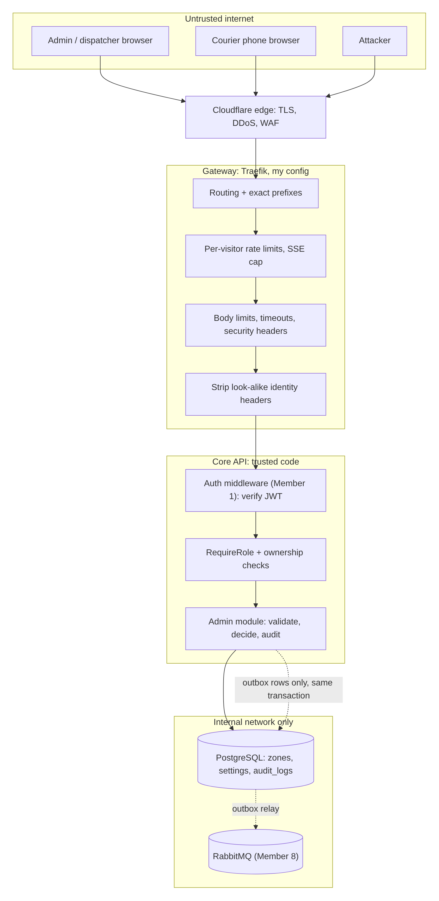

Diagram source (Mermaid)

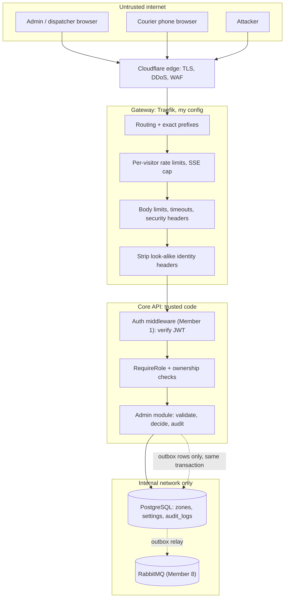

The gateway **never** decides who you are. It only limits **how much** and **where to**. The decision "may this person do this?" is made only in Core API (security-notes rule 2) \[Repo\].

## 3. Authentication, authorization, ownership and tenant isolation

### 3.1 Who may call what (my endpoints)

The role comes **only** from the verified token. Never from a header, a query string or the request body.

| Endpoint (Doc 1 section 9, R-01 to R-18) | ADMIN | DISPATCHER | COURIER | MERCHANT | CUSTOMER | No token | Notes |
| --- | --- | --- | --- | --- | --- | --- | --- |
| `GET/POST /api/v1/admin/zones`, `GET/PATCH /admin/zones/{id}`, `PATCH /admin/zones/{id}/status` | allow | 403 | 403 | 403 | 403 | 401 | Mine. Proven: DEMO-04, DEMO-05 |
| `GET /api/v1/zones` (public, R-18) | allow | allow | allow | allow | allow | **allow** | Mine. Enabled zones only, and only `id`, `code`, `name`. No personal data (DEMO-08) |
| `GET /api/v1/admin/merchants`, `GET /admin/merchants/{id}`, `POST /admin/merchants/{id}/{approve,reject,suspend,reinstate,disable}` | allow | 403 | 403 | 403 | 403 | 401 | I host the routes; Member 4's `merchants.AdminService` does the work (R-02). Proven: DEMO-26 |
| `GET/POST/PATCH /api/v1/admin/pricing-rules...` | allow | 403 | 403 | 403 | 403 | 401 | Member 2 owns the backend; final paths **\[TBD U-65\]** |
| `GET/PUT /api/v1/admin/settings/{key}` | allow | 403 | 403 | 403 | 403 | 401 | Allowlisted keys only (section 6.1) |
| `GET /api/v1/admin/audit-logs` | allow | 403 | 403 | 403 | 403 | 401 | Read only. No update or delete route exists |
| `GET /api/v1/admin/reports/deliveries` (R-16) | allow | **allow** | 403 | 403 | 403 | 401 | SRS 6.2, FR-ADM-008. Proven: DEMO-35, DEMO-37 |
| `GET /api/v1/dispatch/board?zone_id=`, `GET /dispatch/couriers`, `POST /dispatch/assignments`, `POST /dispatch/assignments/{id}/cancel`, `POST /dispatch/parcels/{id}/reschedule` | allow | allow | 403 | 403 | 403 | 401 | Member 3 (R-01) |
| `GET /api/v1/courier/parcels`, `POST /courier/shift`, `POST /courier/parcels/{id}/start-run`, `POST /courier/runs/start-batch` | 403 | 403 | allow, **own only** | 403 | 403 | 401 | Member 3. List is filtered by `courier_id = token.sub` |
| `POST /api/v1/deliveries/{id}/proof-photo`, `/complete`, `/failed` | 403 | 403 | allow, **own only** | 403 | 403 | 401 | Member 3 (R-01) |

**How this is enforced:**

1. **Core API, per route** \[Proposed\]: the router wraps each group with `RequireRole(...)`. It fails closed: no principal gives 401, any other role gives 403. Proven by `TestRequireRole_AdminOnlyMatrix` (8 cases) and `TestRequireRole_DispatchBoard`.
2. **Role names are exact.** `"admin"` in lower case is **not** `ADMIN` (tested). This stops a sloppy token issuer from creating a look-alike role.
3. **Default is deny.** A new route with no `RequireRole` must fail a test. The only route without a token is `GET /api/v1/zones`, and it is listed by name. I propose a router test that walks every registered `/api/v1/admin/*` route and calls it with a COURIER token; every one must answer 403 \[Proposed, SC-A07\].
4. **The frontend route guard is only for comfort.** It hides `/ops/*` from couriers so they do not see a broken page. It is **not** security. Security is item 1 (web/CLAUDE.md, backend enforces security) \[Repo\].

### 3.2 Ownership rules

| Rule | Where it is checked | Answer when broken |
| --- | --- | --- |
| A courier sees and changes **only parcels assigned to them right now** | Delivery and dispatch queries filter by `courier_id = token.sub` (Members 3 and 5) | 403 today (api-conventions 3: "Courier attempting to view another courier's route") \[Repo\]. 404 would hide that the parcel exists **\[TBD U-49\]** |
| A courier cannot act on a parcel after it is reassigned to someone else | Same check runs **inside** the write transaction, not only when the screen loads | 403 or 409 |
| A dispatcher assigns only parcels in an assignable state, and only to an active courier | Dispatch domain rules (Member 3, Doc 2 F-04) | 409 |
| An admin edit never changes `created_by`, `version` or `id` from the body | Request DTOs list allowed fields only. Unknown fields are refused | 400 (`DisallowUnknownFields`). Proven: DEMO-18, DEMO-19 |
| Only the admin module writes `delivery_zones`, `zone_postal_codes`, `system_settings` | Go packages: other modules call read-only interfaces (Doc 3 DD-09, Doc 5 section 5) | Compile-time (depguard, U-31) |

### 3.3 Tenant isolation for staff screens

- ADMIN and DISPATCHER are **staff**. They work across all merchants by design. Their tokens have **no** `tenant_id` (ADR-003 3.2: `tenant_id` is for merchant-scoped actors) \[Repo\].
- So my endpoints never read a tenant from the request. A MERCHANT token calling `/api/v1/admin/*` gets 403 before any query runs.
- **My screens never send `X-Tenant-ID`, `X-User-ID` or `X-User-Role`** (R-15, web/README "Tenant Context").
- **The gateway removes `X-Tenant-ID`, `X-Merchant-ID`, `X-User-ID` and `X-User-Role` if a client sends them** \[Proposed, R-15\]. Core API must ignore them anyway; this is a second safety layer. Today the repo CORS config even **allows** browsers to send `X-Tenant-ID`. Proven: GS-10 and GS-11 fail on today's config and pass on the proposed one.
- When an admin screen shows merchant data (approval list, reports), it shows only the fields that screen needs (section 4).

### 3.4 Sessions in my screens

| Situation | What my screens do | Rule source |
| --- | --- | --- |
| Access token storage | React memory only. Never `localStorage` or `sessionStorage` | ADR-003 4.1 \[Repo\] |
| Courier phone | Same as above **for now**. ADR-003 also allows "encrypted local storage" for couriers, which conflicts with the frontend rule | **\[TBD U-01\]** |
| Access token expired (401) | One refresh call, shared by all waiting requests (single-flight), then replay the request once | Doc 3 DD-04; tested in Doc 6 (`client.test.ts`) |
| Refresh fails | Clear memory, go to sign-in, keep nothing | ADR-003 4.2 |
| Refresh token reused (theft signal) | Backend kills all sessions of that user (Member 1). My screens just see 401 and go to sign-in | ADR-003 4.2 \[Repo\] |
| After sign-in, "go back to" link | Only relative paths that start with `/ops/` or `/courier/` are allowed. Anything else goes to the home screen. Stops open redirects | \[Proposed\] |
| Lost courier phone | An admin must be able to end that courier's sessions. No endpoint exists yet | **\[TBD U-66\]** (was U-53), Member 1 |

### 3.5 Request path through the security checks

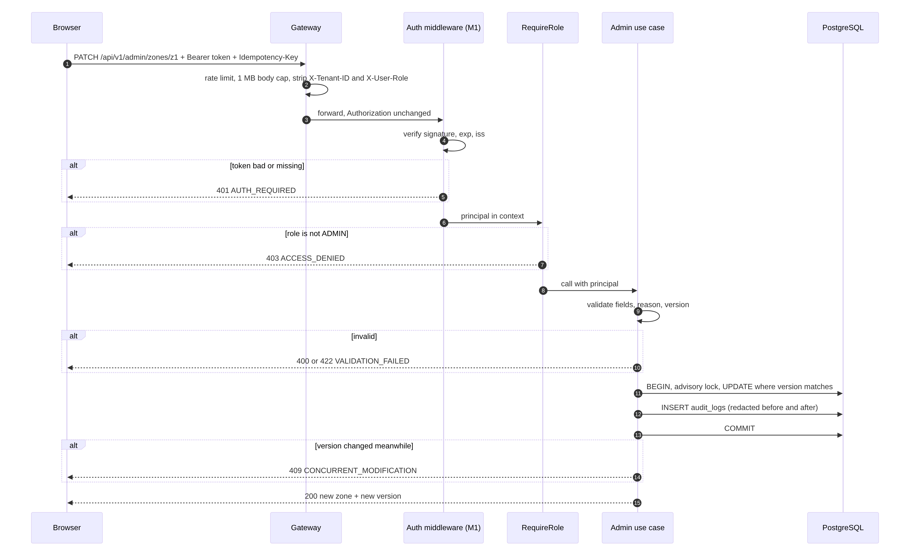

Diagram source (Mermaid)

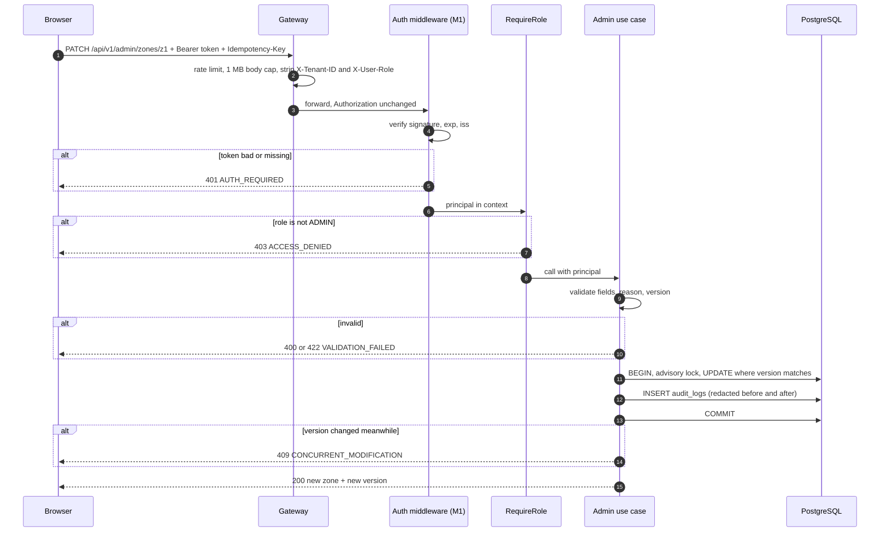

## 4. Sensitive data

### 4.1 What my module touches

| Data | Where it appears in my module | Who may see it | Rules |
| --- | --- | --- | --- |
| Recipient name, phone, full address | Dispatch board, parcel detail, courier task list | Dispatcher, admin; the **assigned** courier while the parcel is active | Never in URLs, page titles, browser storage, analytics, console logs or error reports. Phone shown only while the parcel is active \[Proposed\] |
| Proof-of-delivery photo | Courier upload; parcel detail for staff | Dispatcher, admin, the courier who took it | Uploaded with `POST /deliveries/{id}/proof-photo` (multipart field `photo`, 10 MB). Short-lived pre-signed URL in production (security-notes 7.2). Browser must not cache it: `Cache-Control: no-store` \[Proposed\]. Never shown in public tracking (api-conventions 5) |
| Failure notes, internal notes | Courier fail form; dispatch board | Staff, assigned courier | Shown as plain text only (no HTML). Max 500 characters (section 6.1) |
| Access token | Memory | The signed-in user | Never stored, never logged, never in a URL |
| Refresh token | HttpOnly cookie, path `/api/v1/auth` | Nobody in JavaScript | Set by Member 1 (ADR-003 4.1) |
| Merchant API keys | Merchant list and merchant detail screens (`/ops/merchants`, `/ops/merchants/:id`) | **Nobody** sees the full key after creation | Admin screens show the 8-character prefix only (ADR-003 6.1) |
| Audit log rows (actor, IP, before/after) | Admin audit screen | ADMIN only | Secrets redacted **before** writing (section 10.3). IP addresses are personal data |
| `system_settings` | Admin settings screen | ADMIN only | Allowlisted keys only. **No secrets here, ever.** Secrets live in Kubernetes Secrets (security-notes 5) |
| Gateway access logs | Traefik JSON logs (status 400 to 599) | Member 9, on-call | Contain client IP and path. Paths can contain tracking numbers. Kept **14 days** (U-36 closed) |
| Tracking numbers | Courier and dispatch screens; public tracking paths | Anyone who has the number can see public status | Treat as low-sensitivity identifiers. Public tracking rate limit makes guessing slow |

### 4.2 Never exposed by my module

These must **never** leave the server in an API response, log line, page, or browser storage:

1. Passwords, password hashes, refresh tokens, full API keys, webhook secrets, JWT signing keys.
2. Raw database errors, SQL text, stack traces, internal host names or ports. Proven: `TestWriteError_HidesInternalDetails` sends a fake Postgres error containing a table name and `password=hunter2`; the client gets only `INTERNAL_ERROR` and the request ID.
3. Sender or recipient personal data on any public route.
4. Proof photos on any public route.
5. The Traefik dashboard and API, on any public port. Proven: GS-12 fails today (dashboard answers on port 8080) and passes with the proposed config.
6. `/health/live`, `/health/ready`, `/metrics` on the public entry point (R-07; Doc 6 GW-08, GW-09; DEMO-03).
7. Backend software names: `Server` and `X-Powered-By` headers are removed (GS-17).

**One honest limit found by the starter test:** the server **log** line for a 500 still contains the raw error text, so a secret inside an error message would reach the logs. Rule for code review: **error messages must never contain secrets or personal data**. A log scrubber is optional later \[Proposed\].

## 5. Threats and abuse cases

I use the STRIDE words: **S**poofing, **T**ampering, **R**epudiation (denying you did it), **I**nformation disclosure, **D**enial of service, **E**levation of privilege.

| ID | Abuse case | Type | Control | Proof |
| --- | --- | --- | --- | --- |
| T-01 | Courier opens `/ops/admin/zones` or calls `/api/v1/admin/zones` directly | E | `RequireRole(ADMIN)` in Core API; UI guard is only comfort | SC-A01 to A04 (run) |
| T-02 | Client adds `X-User-Role: ADMIN` or `X-Tenant-ID: other` | S, E | Role and tenant come only from the token; gateway strips these headers | SC-A05 (run), GS-10 (run) |
| T-03 | Courier changes the parcel ID in the URL to act on another courier's parcel (IDOR) | E, I | Ownership check inside the write transaction | SC-O01 (planned, waits for Member 3 and 5 code) |
| T-04 | Stored script in a zone name or failure note runs on the dispatcher board (XSS) | T, E | React escapes text; no `dangerouslySetInnerHTML` (ESLint rule); strict CSP on the SPA | GS-18 (run), SC-X01 (planned) |
| T-05 | Admin screen loaded inside another site's frame to trick clicks (clickjacking) | T | `X-Frame-Options: DENY` and CSP `frame-ancestors 'none'` | GS-16, GS-18 (run) |
| T-06 | Password guessing on `/api/v1/auth/login` | S | 5 per minute per visitor, burst 3, at the gateway (security-notes 3) | GS-06: fails today, passes proposed |
| T-07 | One user's traffic uses up everyone's tracking quota, or attacker shares bucket with victims | D | Per-visitor buckets with `sourceCriterion` | GS-05: fails today, passes proposed |
| T-08 | Attacker adds fake left-hand `X-Forwarded-For` values to get a fresh quota | S, D | Use the **right-most** entry, written by Cloudflare (`depth: 1`) | GS-05b (run) |
| T-09 | Many open SSE streams from one visitor | D | Max 5 open streams per visitor (Member 5 rule) | GS-09: fails today, passes proposed |
| T-10 | Huge JSON body to an admin route | D | 1 MB cap on JSON routes; 10 MB only on photo routes | GS-07, GS-08 |
| T-11 | Very long report date range makes PostgreSQL slow for everyone | D | Range cap (`reports.max_range_days` = 92), `statement_timeout` 5 s, pagination | DEMO-38 (run) |
| T-12 | Admin moves a postal prefix or disables a zone, later says "it was not me" | R | Audit row in the same transaction with actor, IP, request ID, before/after and reason | `TestAuditInSameTransaction`, DEMO-39, DEMO-40 (run) |
| T-13 | Someone edits or deletes audit rows to hide a change | T, R | No update/delete routes; database grants and a trigger block UPDATE and DELETE, even for the migrator role (Doc 5) | DEMO-41, DEMO-42 (run) |
| T-14 | Admin stores a secret in `system_settings`, then it shows on screen and in audit | I | Allowlist of known keys; unknown keys refused; redaction before audit | `TestValidateSetting`, `TestRedactForAudit` (run) |
| T-15 | Sending `version`, `created_by` or `id` in a PATCH body (mass assignment) | T | DTO with allowed fields only; unknown fields refused with 400 | DEMO-19 (run) |
| T-16 | Forged `X-Request-ID` with a line break to fake log lines | T | Only `[A-Za-z0-9_-]{1,64}` is reused; anything else is replaced | `TestCorrelationID`, DEMO-47 (run) |
| T-17 | Traefik dashboard reachable from the internet shows all routes and backends | I | `api.insecure: false`; dashboard only on internal entry point 8090 | GS-12 |
| T-18 | `/api/v1/trackingX` or `/api/v2/...` lands on a service it should not | I | Exact prefixes; `/api` catch-all to Core API 404 | GS-03, GS-04 |
| T-19 | Gateway retries a POST after a timeout and the parcel is delivered twice | T | No retry middleware; client retries with the same Idempotency-Key | GS-14 (run) |
| T-20 | Stolen courier phone keeps a working session | S | Short access token; admin ends sessions **\[TBD U-66\]** | Planned |
| T-21 | Report export opened in Excel runs a formula like `=HYPERLINK(...)` from a merchant name | T | If CSV export is added, prefix cells starting with `= + - @` with `'` \[Proposed\] | SC-X02 (planned) |
| T-22 | Fake image (script or huge file renamed `.jpg`) as proof of delivery | T, D | 10 MB cap at gateway, only on `/deliveries/{id}/proof-photo`; backend accepts JPEG, PNG or WebP and checks the real file type by its first bytes (Member 3, U-25 closed) | GS-08 (size only) |

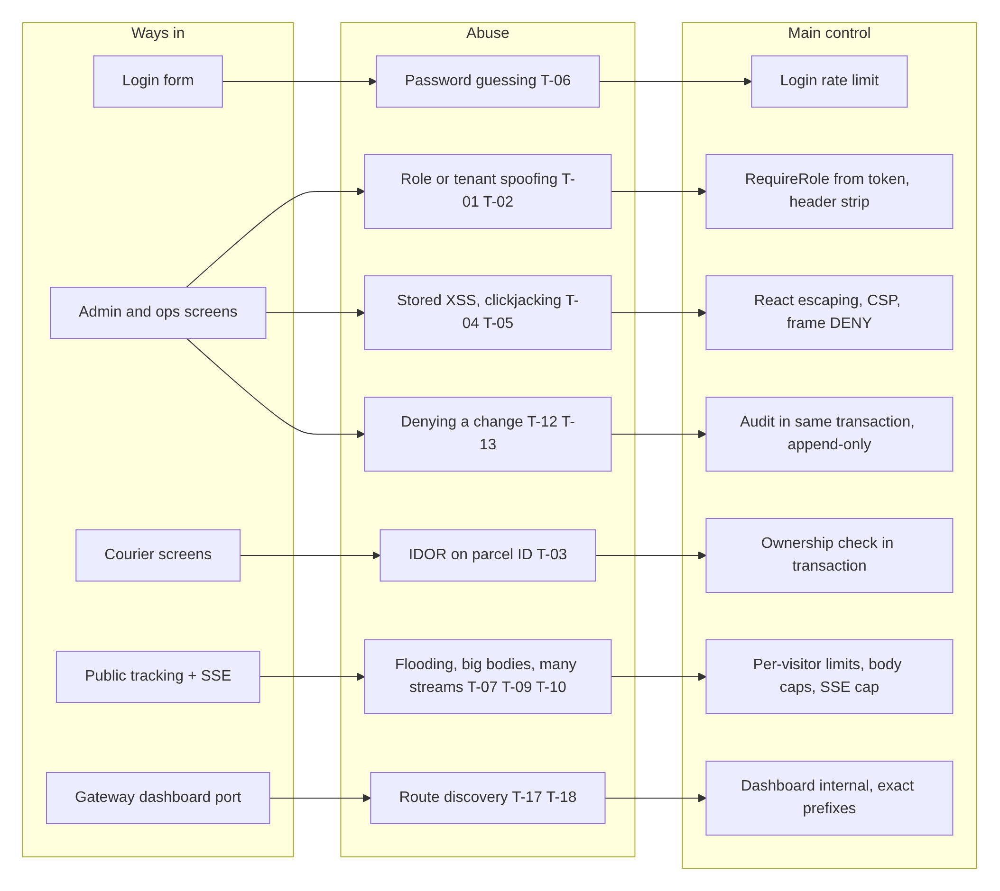

Diagram source (Mermaid)

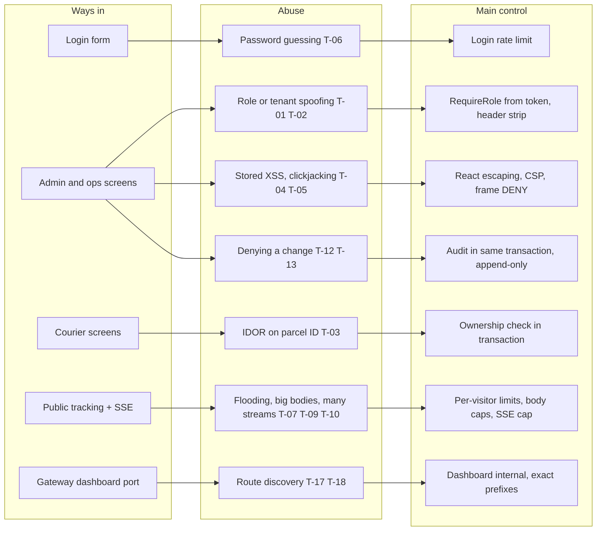

## 6. Validation, rate limiting and resource limits

### 6.1 Input validation (backend is the judge; the frontend repeats it only for fast feedback)

| Field | Rule | Error |
| --- | --- | --- |
| Zone id | `^ZONE_[A-Z0-9_]{2,27}$` (for example `ZONE_COLOMBO_01`), chosen at create, never changes (R-03, Doc 5 4.1) | 422, 409 `ZONE_CODE_ALREADY_EXISTS` |
| Zone code | `^[A-Z0-9_-]{2,32}$` (for example `CMB-01`), unique | 422, 409 `ZONE_CODE_ALREADY_EXISTS` |
| Zone name | 1 to 120 characters after trimming, no control characters (Doc 5 4.1) | 422 |
| Zone description | 0 to 500 characters | 422 |
| Postal prefix | 3 to 5 digits; no overlap with another zone's prefix | 422, 409 `ZONE_POSTAL_CODE_CONFLICT` |
| Prefixes per zone | 1 to 200 \[Proposed\] | 422 |
| Any money field on a zone (`base_surcharge_cents` and the like) | Refused: zones hold no money; fees are Member 2's pricing rules (R-04) | 400 (DEMO-18) |
| `version` on PATCH | Required, must equal the stored value | 409 `CONCURRENT_MODIFICATION` |
| Reason (disable or enable zone, setting change) | 10 to 500 characters after trimming | 422 `REASON_REQUIRED` |
| Reason (reject, suspend, disable merchant) | 5 to 500 characters; checked by Member 4's service (R-02) | 422 |
| `expected_version` (merchant actions) | Required; must equal the merchant's version | 409 (Member 4 code, DEMO-30) |
| Setting key | Must be on the allowlist: the 3 seed keys of Doc 5 10.1 (`reports.max_range_days`, `ops.board_refresh_seconds`, `ops.maintenance_banner`) | 422 `SETTING_UNKNOWN` |
| Setting value | Type and range per key, at most 4 096 bytes | 422 |
| Failure note (courier) | 0 to 500 characters, plain text | 422 |
| Reason code (courier fail) | One of Member 3's codes: RECIPIENT\_UNAVAILABLE, CUSTOMER\_REQUESTED\_RESCHEDULE, ACCESS\_RESTRICTED, INVALID\_ADDRESS, REFUSED\_BY\_RECIPIENT, DAMAGED\_IN\_TRANSIT, OTHER (R-01). OTHER needs a note of at least 15 characters | 422 |
| Public zone lookup `postal_code` | Exactly 5 digits | 422 (DEMO-11) |
| Pagination | `page` at least 1, `per_page` 1 to 100 (api-conventions 2.2, NFR-PERF-004) | 422 |
| Report range | `from` before `to`, at most `reports.max_range_days` (92) | 422 (DEMO-38) |
| Unknown JSON fields | Refused | 400 (DEMO-19) |
| `Idempotency-Key` | UUID v4 (api-conventions 4) | 400 |

### 6.2 Rate limits

All gateway numbers are the team's (security-notes 3, SRS SEC-007, Doc 1 R-13). Every one is in my proposed config.

| Route | Limit | Enforced at | Repo today | Proposed config |
| --- | --- | --- | --- | --- |
| `/api/v1/auth/login` | 5 per minute per visitor, burst 3 | Gateway | **Missing** | GS-06 pass |
| `/api/v1/tracking/public/*` | 30 per minute per visitor, burst 10 | Gateway | **One shared bucket** for all visitors, burst 50 | GS-05 pass |
| SSE streams (`/api/v1/tracking/(public/)?{n}/stream`) | 5 open per visitor | Gateway (`inFlightReq`) | **Missing** | GS-09, GS-09b pass |
| `/api/v1/merchant/*` (merchant API) | 120 per minute per visitor, burst 20 | Gateway | **Missing** | GS-21 pass |
| `/api/v1/ai/*` | 10 per minute per visitor, burst 2 | Gateway | **Missing** | GS-20 pass |
| Courier, AI and merchant-key limits **per user** | Per the owner's spec | Backends: the gateway does not read tokens | — | **\[TBD U-50\]** |
| Admin routes | No special limit; staff only and low volume. Per-IP default could be added later | — | — |

"Per visitor" means the real client IP. Behind Cloudflare that is the **right-most** `X-Forwarded-For` value (`depth: 1`). If another proxy is put between Cloudflare and Traefik, this number must change **\[TBD U-46\]**.

### 6.3 Resource limits

| Resource | Limit | Why |
| --- | --- | --- |
| JSON body | 1 MB (SEC-006) | Stops memory abuse. Merchant bulk import may need more **\[TBD U-54\]** |
| Photo upload body | 10 MB (SEC-006, SEC-012), only on `POST /api/v1/deliveries/{id}/proof-photo` | Path fixed by R-01 (GS-08) |
| Gateway slow-client read | 60 s (`readTimeout`) | Stops "slowloris" style slow uploads |
| Gateway write timeout | 0 (off) | Must stay off, or SSE streams would be cut |
| Report query | `statement_timeout` 5 s, range 92 days | One heavy report must not slow the board |
| Advisory lock wait | `lock_timeout` 2 s \[Proposed\] | A stuck zone edit must not block others forever |
| DB connections | `MaxReplicas x MaxOpenConns <= max_connections` (Engineering Standards 10) | Member 9 sets numbers |
| Board polling | Every 30 s, paused when the tab is hidden (Doc 3 DD-03) | Keeps load predictable |

## 7. Dependency timeouts and retries

### 7.1 Timeout budget

Each layer gives up **before** the layer above it, so the user sees a clear error instead of a hang.

| Caller → callee | Timeout | Automatic retry? | What the user sees on failure |
| --- | --- | --- | --- |
| Browser → gateway (`fetch` with `AbortSignal`) | 35 s \[Proposed\] | GET: up to 2, with backoff (TanStack Query). POST/PATCH: **never** automatic | "Could not reach the server" + Try again |
| Gateway → backend: connect | 5 s (`dialTimeout`) | No | 502 (GS-15: under 2 s when the service is down) |
| Gateway → Core API: first byte | 30 s (`responseHeaderTimeout`) | **No** (no retry middleware) | 504 (GS-13) |
| Gateway → Tracking API: first byte | 10 s; the stream body can stay open | No | 504; EventSource reconnects by itself |
| Gateway → AI service: first byte | 60 s **\[TBD with AI owner\]** | No | 504 |
| Core API → PostgreSQL | `statement_timeout` 3 s default, 5 s for reports \[Proposed\] | No, except a serialization or deadlock error: 1 retry inside the use case | 500 with request ID, or 503 when the pool is empty |
| Core API → other modules (dispatch, merchants) | Same process, same transaction (modular monolith) | No | Same as above |
| Core API → RabbitMQ | **None.** Core API only writes outbox rows (events README rule 2) \[Repo\] | — | Nothing. Events wait in the outbox |
| Outbox relay → RabbitMQ, workers | Member 8: max 5 retries, exponential backoff with jitter, then DLQ | Yes | Nothing direct; delayed notifications |

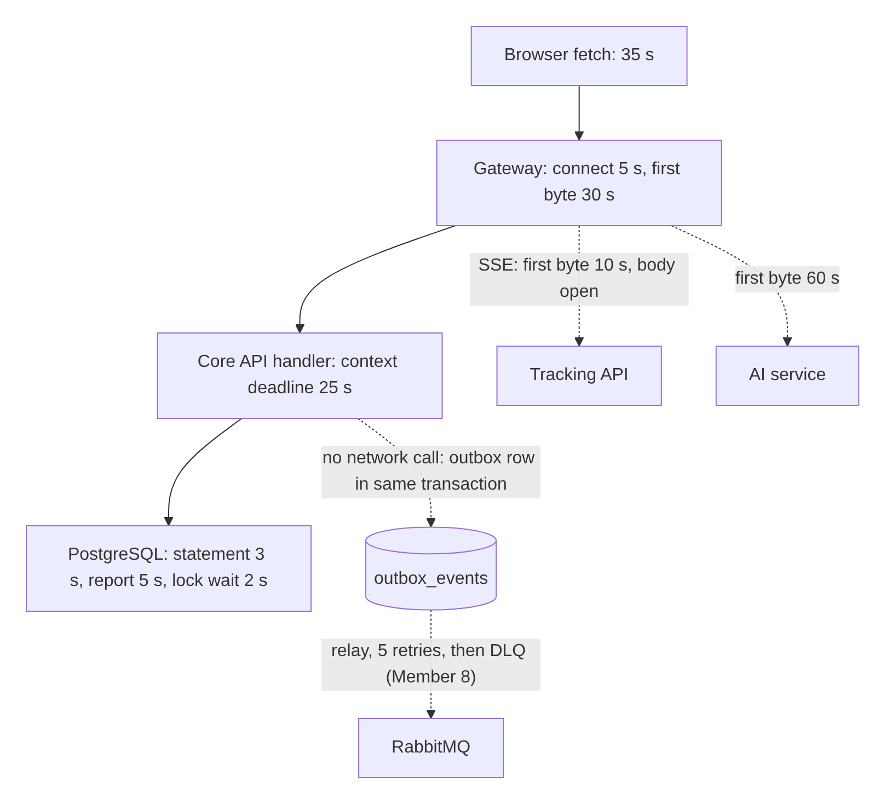

Diagram source (Mermaid)

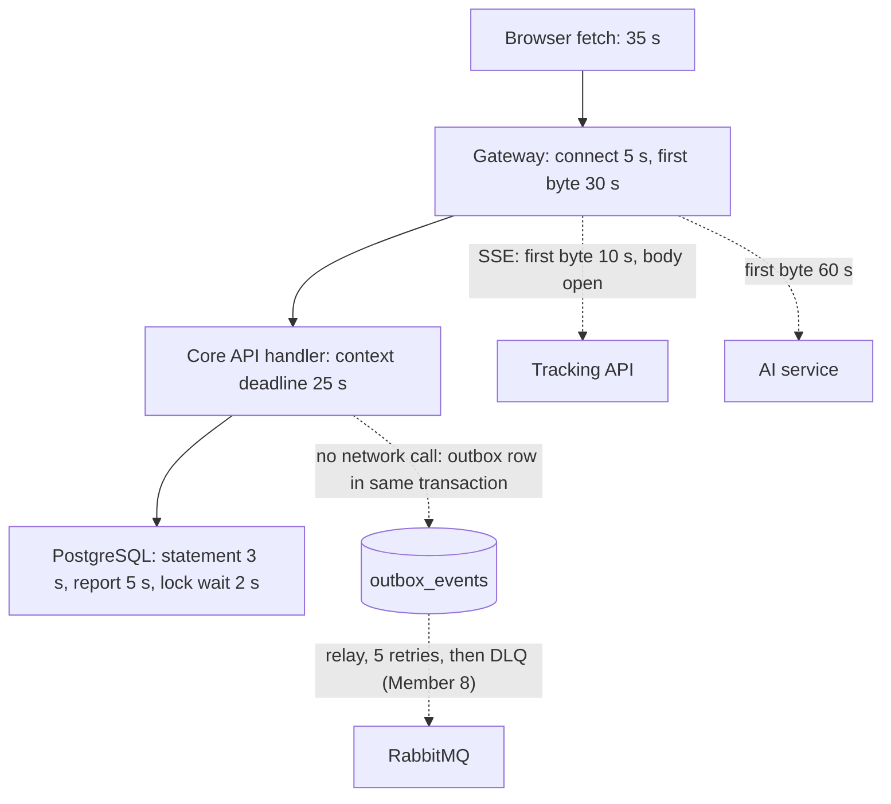

### 7.2 Retry rules for my screens

1. **Reads** (board, lists, reports): TanStack Query retries 2 times with backoff, never on 4xx.
2. **Writes** (assign, cancel, reschedule, complete, failed, merchant action, zone save, setting save): no automatic retry. The **Try again** button sends the **same** Idempotency-Key as the first press (Doc 3 DD-05, tested in Doc 6 `idempotency.test.ts`).
3. **401**: one shared refresh, then the request is replayed once (Doc 6 `client.test.ts`).
4. **429**: wait 10 s with a countdown, then let the user try again. No loop. (security-notes 4 exposes only `X-Request-ID` and `Content-Length`, so the browser cannot read `Retry-After` on cross-origin calls; same-origin calls through the gateway can.)
5. **Board polling after errors**: back off to 60 s, then 120 s; return to 30 s after one success \[Proposed\].
6. **SSE** (if staff screens use it later): the browser's EventSource reconnects; the server's 15 s heartbeat keeps the line open (R-12, U-17 closed).

## 8. Duplicate requests, partial failures and concurrency conflicts

### 8.1 Duplicates

| Case | Protection | Result |
| --- | --- | --- |
| Double-click on "Assign" or "Complete delivery" | Button disabled while pending + Idempotency-Key | One action |
| Courier on bad mobile network presses again after a timeout | Same Idempotency-Key; server returns the stored answer with `Idempotent-Replay: true` (api-conventions 4) | One action, same answer |
| Same key, different body (bug or tampering) | Server compares the request hash | 409 `IDEMPOTENCY_KEY_PAYLOAD_MISMATCH` |
| Gateway sends a POST twice | Not possible: no retry middleware (GS-14 proves one hit after a timeout) | — |
| "Create zone" sent twice without a key | Unique zone code | Second gets 409; screen shows the existing zone |
| Event delivered twice to a consumer | Consumer dedup table (Member 8) | Second is ignored |

Member 3's contract asks for an Idempotency-Key on the assignment, complete and failed calls (Doc 1 section 9). For other writes the key is sent but may be ignored **\[TBD U-24\]**; the key scope is **\[TBD U-39\]**.

### 8.2 Partial failures

| Case | What could break | How it is avoided or repaired |
| --- | --- | --- |
| Request committed, but the answer is lost (timeout, phone signal) | User thinks it failed and presses again | Retry with the same key returns the stored answer. No double action |
| Zone saved but audit row not written | Missing evidence | Not possible: zone change and audit row commit in **one** transaction (Doc 3 DD-10) |
| Zone saved but event not published | Pricing or tracking never hears about it | Outbox row in the same transaction; the relay publishes later (only if U-32 says yes) |
| Merchant approved but status change or audit row failed | Two records disagree | Member 4's `AdminService` does the change and its audit row in **one** transaction (R-02). My handler only passes the call and the answer |
| Proof photo uploaded, then `/complete` fails | Orphan photo, or complete with no photo | Two steps (R-01): `proof-photo` returns `proof_attachment_url`; the screen keeps it and the Idempotency-Key and retries `/complete`. Orphan photos are removed by Member 3's cleanup job after 24 h \[Proposed\] |
| Gateway config file has a mistake | Some routes vanish after deploy | Gateway smoke tests in CI before deploy (Doc 6 U-43); rollback = previous config version |

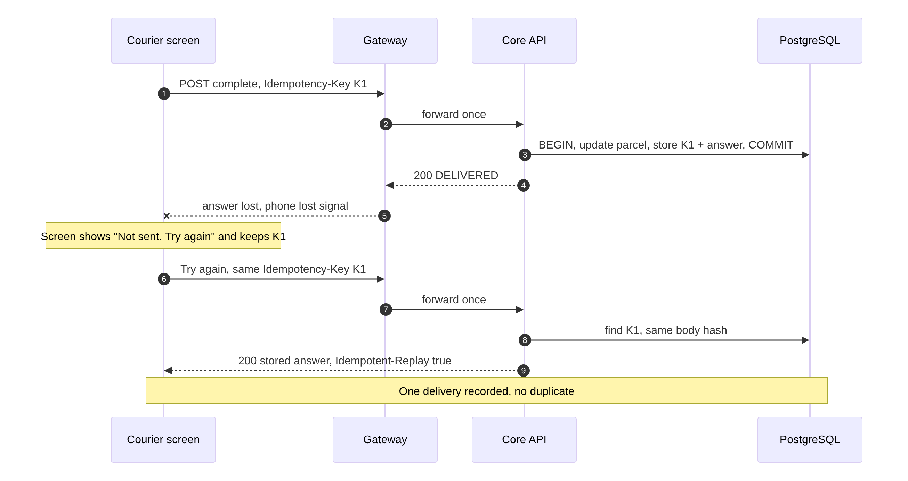

Diagram source (Mermaid)

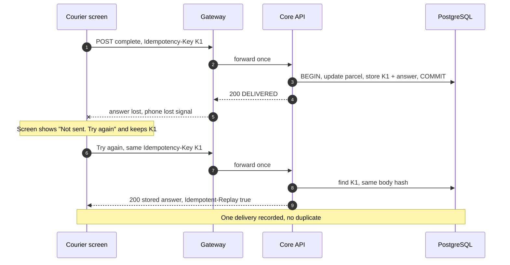

### 8.3 Concurrency conflicts

| Conflict | Control | User sees |
| --- | --- | --- |
| Two admins edit the same zone | `version` column, `UPDATE ... WHERE version = $n` (Doc 3 DD-11, U-34) | Second gets 409 and "Someone else changed this. Reload and try again" (`TestStaleVersionRace`, DEMO-21) |
| Two admins add overlapping prefixes (`627` and `62701`) to two zones at the same moment | Transaction advisory lock + overlap check + unique index (Doc 3 DD-07) | Second gets 409 `ZONE_POSTAL_CODE_CONFLICT` (`TestOverlappingPrefixRace`) |
| Two dispatchers assign the same parcel | Parcel `version` and state machine (Member 3) | Second gets 409; board refreshes |
| Dispatcher cancels the assignment while the courier completes it | State machine inside one transaction | Whoever commits second gets 409 |
| Admin disables a zone while a quote uses it | Quote reads the zone in its own transaction | The quote uses the old or the new state, never half of each |

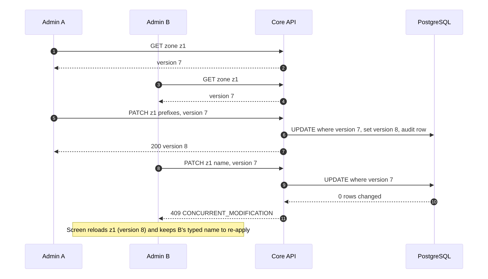

Diagram source (Mermaid)

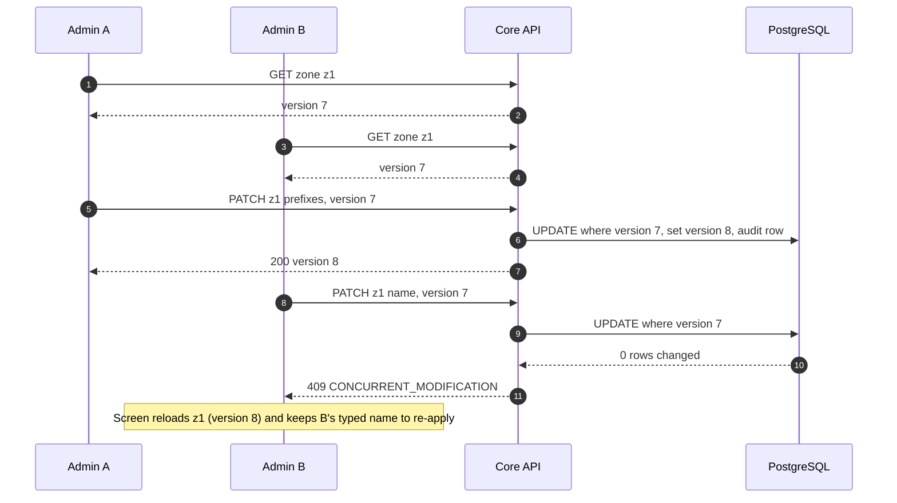

## 9. Recovery, reconciliation, DLQ and compensation

### 9.1 What applies to my module

| Mechanism | Used by my module? | Detail |
| --- | --- | --- |
| Transactional outbox | Only if U-32 says zone changes become events | Then Member 8's relay and its retry policy apply unchanged |
| Retry with backoff, then DLQ | Not directly. My module has no consumers | Member 8 policy: max 5 retries, then DLQ. The DLQ **name** differs between documents: `events.dlq` (runbook 4.2) vs `swiftdrop.dlq` (messaging README, event-contracts 4) **\[TBD U-47\]** |
| Compensation (undo by a new action) | Yes | Wrong zone change: an admin makes a **new** change back, with a reason. Audit keeps both. Nothing is deleted. Zones are disabled, never deleted (Doc 5) |
| Reconciliation job | Yes \[Proposed\] | Nightly CronJob (Engineering Standards 10): checks that no two active zones have overlapping prefixes, that no active pricing rule points at a disabled zone, and that every row in `delivery_zones` changed in the last day has an audit row. Any finding is logged as an alert; it **fixes nothing by itself** |
| Backup and restore | Shared (runbook 3) | After a restore, audit rows newer than the backup are lost. Gateway access logs and Core API logs (with request IDs) are the only trace of that window |

### 9.2 How my screens recover from each error

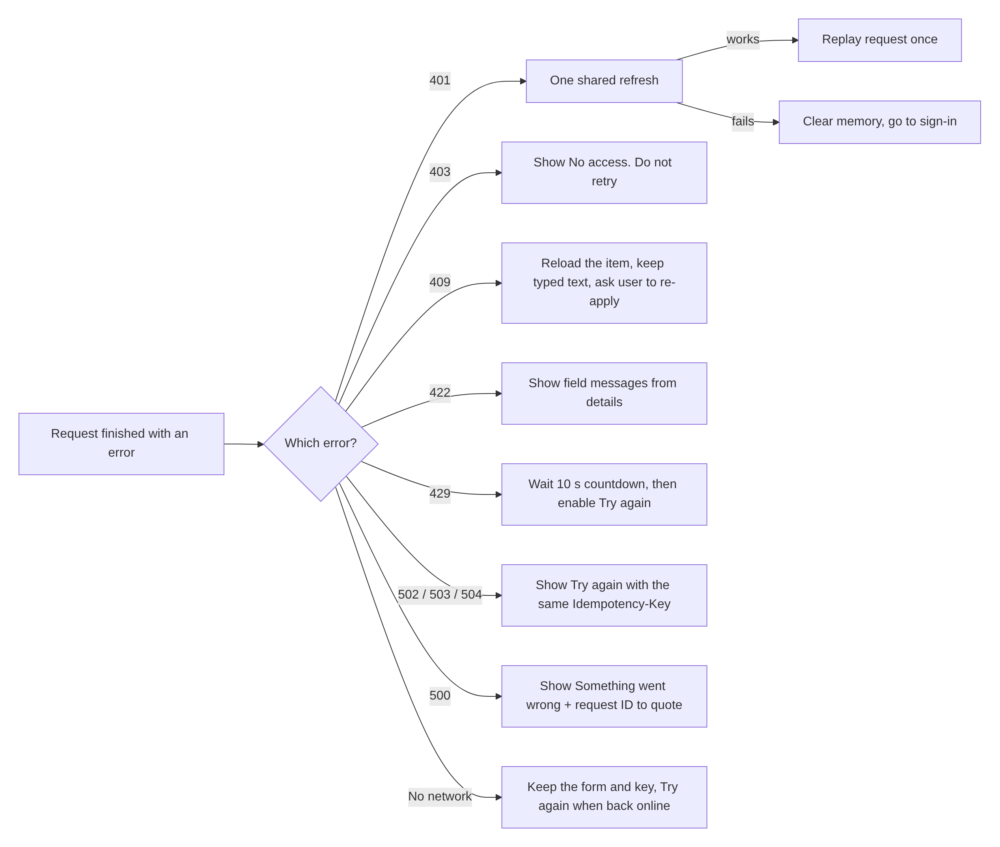

Diagram source (Mermaid)

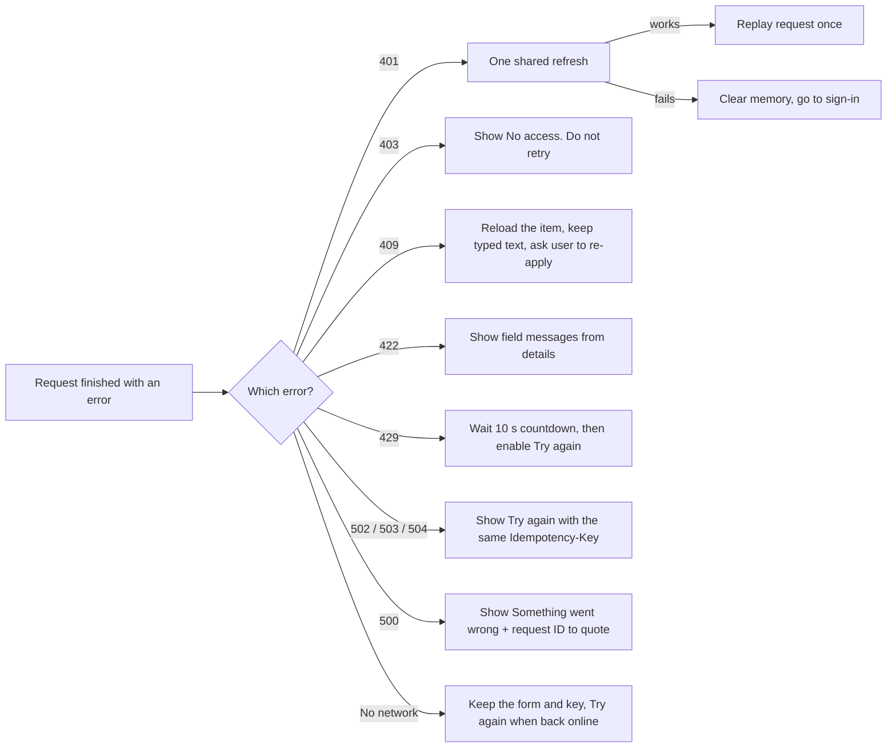

### 9.3 Gateway recovery

| Failure | Detection | Recovery |
| --- | --- | --- |
| Bad config pushed | CI gateway smoke tests (Doc 6, and GS checks here) before deploy | Deploy the previous config; Traefik reloads files without a restart |
| One backend down | Traefik returns 502 for that route only (GS-15: other routes still 200) | Kubernetes restarts the pod (Member 9) |
| Traefik pod down | Health probe on internal `/ping` (port 8090 proposed) | Kubernetes restarts it; Cloudflare shows an error page meanwhile |
| Rate limit too strict for real users | Many 429 in access logs | Raise the number in config; buckets are in memory and reset on restart |

## 10. Audit logging

### 10.1 What is audited

| Action | Audit row | Reason required | Notes |
| --- | --- | --- | --- |
| Create zone | yes | no | after snapshot |
| Update zone code, name, description or prefixes | yes | no | before and after |
| Disable or enable zone | yes | **yes** | |
| Change a system setting | yes | **yes** | `target_id` = setting key; column type and `reason` column need the shared schema change **\[TBD U-64\]** (was U-38) |
| Approve, reject, suspend, reinstate, disable merchant | yes | **yes** for reject, suspend and disable (5 to 500 characters) | Member 4's `AdminService` writes the row (R-02) |
| Create or change pricing rule | yes | **yes** | Member 2 (U-13 closed); paths **\[TBD U-65\]** |
| Export a report or search audit logs | **\[TBD U-51\]** | no | Reading many people's data is worth recording |
| Denied admin request (401, 403) | **No** audit row; a structured **security log** line instead (actor if known, route, IP, request ID) | — | Keeps `audit_logs` for real changes. Many 403 from one user = alert \[Proposed\] |

### 10.2 Audit rules

1. **Same transaction** as the change. If the audit insert fails, the change is rolled back (Doc 3 DD-10).
2. **Append-only.** No API route updates or deletes audit rows. The database role has no UPDATE or DELETE grant, and a trigger refuses them (Doc 5). Proven on real PostgreSQL in Doc 8 (DEMO-41, DEMO-42).
3. **Who**: `actor_id` from the token, never from the body. **Where from**: client IP as restored by the gateway. **Which request**: `request_id` from `X-Request-ID` (R-11).
4. **Secrets never enter** before/after snapshots. `RedactForAudit` replaces values under keys like `password`, `secret`, `token`, `api_key`, `authorization`, `cookie`, `signature`, also inside nested objects and lists (proven by `TestRedactForAudit`).
5. **Only ADMIN reads** audit rows (section 3.1).
6. **Kept 2 years**, then delete or archive **\[TBD U-41\]**.

Diagram source (Mermaid)

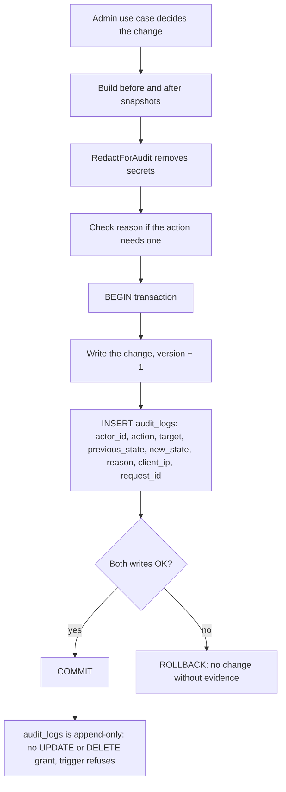

## 11. Security test scenarios

**Run** = executed (last re-run 26 Oct 2026) with results in `doc7-tests/` and `doc8-local/evidence/`. **Planned** = written here, waits for the named code. Doc 6 holds the wider test matrix; IDs here are security-specific.

### 11.1 Run now

| ID | Scenario | Result |
| --- | --- | --- |
| SC-A01 to A04 | No token, empty principal, CUSTOMER, MERCHANT, COURIER, DISPATCHER and lower-case `admin` on an ADMIN route | 401 / 403 as expected; ADMIN gets 200 |
| SC-A05 | COURIER token with `X-User-Role: ADMIN` header | 403 |
| SC-A06 | Dispatch board: DISPATCHER and ADMIN allowed, COURIER and MERCHANT 403 | Pass |
| SC-E01 | Raw Postgres error with table name and a password | Client sees only `INTERNAL_ERROR` + request ID |
| SC-E02 | Wrapped domain errors keep safe status and hide IDs | 409, 409, 422 |
| SC-E03 | Hostile `X-Request-ID` (line break, 65 characters, `<script>`) | Replaced, never echoed |
| SC-V01 to V04 | Settings: unknown key, wrong type, out of range, too big | 422 every time; `jwt.private_key` refused as unknown |
| SC-V05 | Reason: empty, spaces, too long, Sinhala text | Correct accept or refuse |
| SC-D01 | Redaction of nested secrets in audit snapshots | No secret left; normal fields kept; input unchanged |
| GS-01 to GS-21 | Gateway security checks (25 checks), real Traefik 3.1.7 | Today: 8 pass, 17 fail. Proposed: 25 pass |
| SC-V06 | Report range over 92 days refused | DEMO-38 (Doc 8) |
| SC-V07 | PATCH zone with `created_by`, a money field or an unknown field | 400: DEMO-18, DEMO-19 (Doc 8) |
| SC-U01 | Zone change and its audit row commit together | `TestAuditInSameTransaction` (Doc 8, real PostgreSQL) |
| SC-U03 | `UPDATE` / `DELETE` on `audit_logs` fail for the app role and even the migrator | DEMO-41, DEMO-42 (Doc 8) |
| SC-C01 | Parallel overlapping prefix saves: exactly one wins | `TestOverlappingPrefixRace` (Doc 8, `-race`) |

### 11.2 Planned

| ID | Scenario | Waits for |
| --- | --- | --- |
| SC-A07 | Every registered `/api/v1/admin/*` route called with a COURIER token returns 403 (catches a route that forgot `RequireRole`) | Admin router code (U-10) |
| SC-O01 | Courier B calls `/deliveries/{id}/complete` on courier A's parcel | Members 3 and 5 code |
| SC-O02 | Courier acts on a parcel reassigned 1 second ago | Members 3 and 5 code |
| SC-V08 | 92-day delivery report finishes within 5 s on realistic data | Member 3's delivery data (report uses a stand-in today, DEMO-36) |
| SC-U04 | Forced audit failure rolls the change back | Fault-injection test in the admin repository |
| SC-U02 | Audit row has actor from token even when body says otherwise | Admin handlers |
| SC-X01 | Zone name `` shows as text on every screen | Screens (Playwright) |
| SC-X02 | CSV export cell starting with `=` is neutralised | Only if export is built |
| SC-S01 | No token or personal data in `localStorage`, `sessionStorage`, URLs or console after a full dispatcher and courier journey | E2E (Playwright) |
| SC-S02 | Open redirect: `?next=https://evil.example` after login goes to the home screen | Login screen |
| SC-G01 | Repeat GS checks against the deployed staging gateway behind Cloudflare (real `X-Forwarded-For`) | Member 9 staging (U-46) |

## 12. Module security checklist (deliverable)

Tick each item before the module is called done. "Proof" says how a reviewer can check it.

### 12.1 Admin backend (`core-api/internal/admin/`)

| # | Item | Proof |
| --- | --- | --- |
| B-01 | Every `/api/v1/admin/*` route is wrapped with `RequireRole(ADMIN)`; only `/admin/reports/deliveries` also allows DISPATCHER (R-16) | SC-A07 router walk test; DEMO-05, DEMO-35, DEMO-37 |
| B-02 | Role, user and tenant come only from the verified token | SC-A05, SC-U02 |
| B-03 | Request DTOs refuse unknown fields; `id`, `version`, `created_by` cannot be set from the body | SC-V07 |
| B-04 | All field rules in section 6.1 exist in the backend, not only in the UI | Handler unit tests |
| B-05 | Zones hold no money; a money field in a zone body is refused (R-04) | DEMO-13, DEMO-18 |
| B-06 | Settings use the allowlist; no secret lives in `system_settings` | `TestValidateSetting`, review |
| B-07 | Every write has its audit row in the same transaction | SC-U01 |
| B-08 | Audit snapshots are redacted | `TestRedactForAudit` |
| B-09 | Reason is required for zone disable/enable and settings (10 to 500) | `TestValidateReason`, DEMO-22 |
| B-10 | Optimistic `version` check on every update | Doc 6 race tests |
| B-11 | Prefix changes take the advisory lock with a 2 s `lock_timeout` | SC-C01 |
| B-12 | Errors use the standard envelope; unknown errors become generic 500 | SC-E01, SC-E02 |
| B-13 | No secrets or personal data in error messages or logs | Code review + log sample check |
| B-14 | Every DB call has a context deadline; reports have `statement_timeout` 5 s | Code review + SC-V08 |
| B-15 | Denied requests write a security log line with request ID | Log test |
| B-17 | Merchant routes send `expected_version` and pass Member 4's error codes through unchanged | DEMO-29, DEMO-30 |
| B-18 | Public `GET /api/v1/zones` shows only enabled zones and only `id`, `code`, `name` | DEMO-08, DEMO-10 |
| B-16 | API.md lists the role for every endpoint | Doc review |

### 12.2 Frontend (`/ops/*`, `/courier/*`)

| # | Item | Proof |
| --- | --- | --- |
| F-01 | Access token only in memory; nothing in `localStorage` or `sessionStorage` | SC-S01 |
| F-02 | No `dangerouslySetInnerHTML`; ESLint rule on | Lint in CI |
| F-03 | Route guards exist, but no screen relies on them for security | Review + SC-A01 |
| F-04 | Personal data never in URLs, titles, analytics or console | SC-S01 |
| F-05 | Writes never auto-retry; Try again reuses the Idempotency-Key | Doc 6 `idempotency.test.ts` |
| F-06 | One shared refresh on 401 | Doc 6 `client.test.ts` |
| F-07 | Error screens follow section 9.2 and show the request ID on 500 | Component tests |
| F-08 | After-login redirect accepts only `/ops/` and `/courier/` paths | SC-S02 |
| F-09 | Courier sees recipient phone only for active parcels | Component test |
| F-10 | Proof photos not cached (`no-store`) and not kept after sign-out | E2E |
| F-11 | Prices never computed in the browser | Review (web/CLAUDE.md) |
| F-12 | API client never sends `X-Tenant-ID`, `X-User-ID` or `X-User-Role` (R-15) | Unit test on the client |

### 12.3 Gateway (`deploy/gateway/traefik/`)

| # | Item | Proof |
| --- | --- | --- |
| G-01 | Exact prefixes for tracking and AI routes | GS-03 |
| G-02 | `/api` catch-all goes to Core API (404 JSON), not the SPA | GS-04 |
| G-03 | Per-visitor rate limits with `sourceCriterion.ipStrategy.depth` set for the real proxy chain | GS-05, GS-05b, SC-G01 |
| G-04 | Login limit 5 per minute, burst 3; tracking 30/min burst 10; merchant API 120/min burst 20; AI 10/min burst 2 (R-13) | GS-05, GS-06, GS-20, GS-21 |
| G-05 | 1 MB JSON, 10 MB only on `/api/v1/deliveries/{id}/proof-photo` | GS-07, GS-08 |
| G-06 | SSE on both stream paths: max 5 open streams per visitor, still unbuffered | GS-09, GS-09b, GS-19 |
| G-07 | Identity look-alike headers stripped; `Authorization` untouched | GS-10, GS-10b |
| G-08 | CORS matches security-notes 4 exactly (origins `localhost:3000`, `127.0.0.1:3000` locally; production origins in k8s; exposed `X-Request-ID`, `Content-Length`); no wildcard with credentials | GS-11, GS-11b |
| G-09 | Dashboard only on internal entry point; `api.insecure: false` | GS-12 |
| G-10 | Forwarding timeouts set; **no** retry middleware | GS-13, GS-14, GS-15 |
| G-11 | Security headers on API and SPA; CSP on SPA; `Server`/`X-Powered-By` removed | GS-16 to GS-18 |
| G-12 | `writeTimeout` stays 0 so SSE works | GS-19 |
| G-13 | `trustedIPs` lists only Cloudflare ranges and the real internal proxy, not all private ranges | Review **\[TBD U-46\]** |
| G-14 | Gateway checks run in CI for every change to `deploy/gateway/` | Doc 6 U-43 |
| G-15 | Health and metrics paths (`/health/live`, `/health/ready`, `/metrics`) are not public | Doc 6 GW-08, GW-09; DEMO-03 |
| G-16 | AI routes stay under `/api/v1/ai/*`, including `/api/v1/ai/mcp/sse` (R-17) | GS-15, GS-20 |

### 12.4 Operations (with Member 9)

| # | Item | Proof |
| --- | --- | --- |
| O-01 | Host ports 80 and 443 accept traffic from Cloudflare only (Engineering Standards 10) | Firewall rule review |
| O-02 | Port 8090 is never exposed by a Service or Ingress | Manifest review |
| O-03 | Access logs kept 14 days (U-36 closed); readers: Member 9 and on-call | Doc |
| O-04 | Alert on many 401/403 from one IP or user, and on many 429 | Dashboard (Member 9) |
| O-05 | Nightly reconciliation job runs and alerts | Job log |

## 13. Failure-mode matrix (deliverable)

**Detect** = how we notice. **Auto** = what the system does by itself. **Recover** = what a person or job does.

| ID | Part | Failure | Detect | User impact | Auto | Recover | Test |
| --- | --- | --- | --- | --- | --- | --- | --- |
| FM-01 | Gateway | Core API pod down | 502 in access log; readiness probe | Ops and courier screens show Try again | Kubernetes restarts pod; other routes keep working | Check runbook 7 | GS-15 |
| FM-02 | Gateway | Core API slow (> 30 s) | 504 count | Try again with same key | Gateway stops waiting; no retry | Find slow query by request ID | GS-13, GS-14 |
| FM-03 | Gateway | Bad config deployed | CI smoke fails; or routes missing in dashboard | Some pages 404 | Traefik keeps running other routers | Roll back config | Doc 6 gateway suite |
| FM-04 | Gateway | Rate limit hit by a real busy office behind one IP | Many 429 from one IP | Dispatchers wait | Bucket refills | Raise limit or add office IP rule | GS-05 |
| FM-05 | Gateway | Cloudflare adds an extra proxy hop, so `depth: 1` points at the proxy | All users share one bucket again | Many 429 | None | Change `depth` (U-46) | SC-G01 |
| FM-06 | Tracking SSE | Stream drops, or no 15 s heartbeat arrives | EventSource `error` | Live status pauses | Browser reconnects | None | Doc 6 GW-22 |
| FM-07 | Auth | Access token expires during work | 401 | None visible | One shared refresh, replay once | — | Doc 6 `client.test.ts` |
| FM-08 | Auth | Refresh token reused (theft) | Member 1's reuse detection | All sessions end; sign in again | Backend revokes family | Admin reviews security log | Member 1 tests |
| FM-09 | Admin API | Two admins edit one zone | 409 | Second admin reloads | Version check refuses stale write | Re-apply typed change | Doc 6 race test |
| FM-10 | Admin API | Overlapping prefixes saved at once | 409 | Second admin sees which zone owns it | Advisory lock + overlap check | Pick another prefix | SC-C01 |
| FM-11 | Admin API | Advisory lock held too long | `lock_timeout` error after 2 s | Save fails, Try again | Transaction rolls back | Find stuck session (runbook Playbook A) | Planned |
| FM-12 | Admin API | Audit insert fails | Error log + 500 | Save fails | Whole transaction rolls back | Fix DB issue, retry | SC-U01, SC-U04 |
| FM-13 | Admin API | Report query too heavy | `statement_timeout` after 5 s | Report error, other screens fine | Query cancelled | Smaller range; materialized view later (Doc 3 DD-08) | SC-V06, SC-V08 |
| FM-14 | Database | Connection pool exhausted | 503 / 500 with "too many clients" | All writes fail | None | Runbook Playbook A | Member 9 |
| FM-15 | Database | Restore from backup | Planned operation | Recent changes lost | — | Use logs by request ID to redo lost admin changes; note gap in audit | Runbook 3.2 |
| FM-16 | Courier screen | Answer lost after commit | Screen timeout | "Not sent. Try again" | Same key on retry | — | Doc 6 `idempotency.test.ts` |
| FM-17 | Courier screen | Phone offline | `navigator.onLine` false / fetch error | Form kept | No offline queue (Doc 3 DD-15) | Try again when online | Component test |
| FM-18 | Courier screen | `proof-photo` ok, `/complete` fails | Error on second step | Try again | `proof_attachment_url` kept, same key | Member 3's cleanup job removes orphan photos after 24 h | Component test + Member 3 tests |
| FM-19 | Dispatch board | Polling fails repeatedly | Query error state | "Board may be out of date" banner with last update time | Backoff 60 s, 120 s | Returns to 30 s after a success | Component test |
| FM-20 | Events (if U-32) | RabbitMQ down | Outbox backlog grows (runbook 4.1) | None in my screens | Rows wait as PENDING; relay resumes | Runbook Playbook B | Member 8 |
| FM-21 | Events (if U-32) | Poison zone event | Message in DLQ | Pricing may use old zone data | 5 retries, then DLQ | Fix and replay (runbook 4.2) | Member 8 |
| FM-22 | Reconciliation | Overlap or orphan found at night | Job alert | None yet | Nothing auto-fixed | Admin fixes with an audited change | Job test |
| FM-23 | Gateway | Dashboard exposed by mistake | GS-12 in CI; external port scan | Route map visible to attackers | — | Set `insecure: false`, rotate nothing (no secrets there), review logs | GS-12 |

## 14. Gaps in today's repo config, and the fix

Running the 25 checks against `deploy/gateway/traefik/` as it is in the repo (commit 40dc279) gave **8 pass, 17 fail**. The same checks against my proposed files gave **25 pass** (re-run 26 Oct). The proposed files are in `doc7-tests/gateway/` and are **not** in the repo yet. They change only the two files I own (Doc 1), plus `traefik.yml` items that Member 9 should agree to.

| Check | Today | Proposed fix |
| --- | --- | --- |
| GS-03 `/api/v1/trackingX` | goes to tracking-api | `Path(/api/v1/tracking) \|\| PathPrefix(/api/v1/tracking/)` |
| GS-04 `/api/v2/...` | SPA answers 200 | `/api` catch-all router to Core API |
| GS-05 per-visitor bucket | one bucket for everyone | `sourceCriterion.ipStrategy.depth: 1` |
| GS-06 login limit | none | `login-router` with 5/min, burst 3 |
| GS-07 JSON body | 10 MB everywhere | 1 MB on JSON routes, 10 MB on photo routes |
| GS-09, GS-09b SSE cap | none | `inFlightReq` 5 per visitor on one stream router for both stream paths, `priority: 100` |
| GS-20 AI limit | none | `ai-ratelimit` 10/min, burst 2 |
| GS-21 merchant API limit | none | `merchant-ratelimit` 120/min, burst 20 on `/api/v1/merchant/` only (not the `/merchants` web pages) |
| GS-10 identity headers | passed to Core API | `strip-identity-headers` middleware |
| GS-11, GS-11b CORS | missing `X-Request-ID`, allows `X-Tenant-ID`, allows `localhost:5173` | Match security-notes 4: origins `localhost:3000` and `127.0.0.1:3000`; exposed headers exactly `X-Request-ID`, `Content-Length` |
| GS-12 dashboard | open on port 8080 | `insecure: false`, internal entry point 8090 |
| GS-13 slow backend | waits forever (got 200 after 4 s) | `serversTransports` with timeouts |
| GS-16, 17, 18 headers | none | `security-headers` and `spa-csp` middlewares |

**Lesson learned while testing:** my first proposed SSE router never matched, because Traefik ranks routers by the **length of the rule text**, and the general tracking rule was longer. An explicit `priority: 100` fixed it. This is exactly the kind of mistake the CI gateway checks will catch.

**Other conflicts between documents** (no code change by me):

| Topic | Document A | Document B | Question |
| --- | --- | --- | --- |
| DLQ name | runbook: `events.dlq` | messaging README, event-contracts: `swiftdrop.dlq` | U-47 |
| Consumer dedup table | messaging README: `processed_events` | event-contracts: `idempotent_consumers` | U-47 |
| Dashboard port | runbook 6: 9000 | Member 9: 8090; repo today: 8080 | **Closed** (R-10): 8090, internal only; runbook 6 needs updating |
| Trusted proxy IPs | repo trusts all private ranges (10/8, 172.16/12, 192.168/16) | Engineering Standards 10: restore client IP from Cloudflare | U-46 |
| Tracking burst | gateway file: 50 | security-notes: 10 | **Closed** (R-13): 10; proposed config uses 10 |

## 15. Open questions

Earlier questions that affect security. Still open: U-01, U-06 (partly), U-24, U-32, U-39, U-41, U-64 (was U-38), U-65, U-66. Closed by the 26 Oct review: U-02 (R-16), U-12 (R-10), U-15 (R-13), U-25 (R-01), U-30, U-36 (14 days).

| ID | Question | Decide with | Status |
| --- | --- | --- | --- |
| U-46 | How many proxies sit in front of Traefik in production (Cloudflare only, or also a cloud load balancer)? This sets `ipStrategy.depth`. Can `trustedIPs` drop the wide private ranges? | Member 9 | Open |
| U-47 | One DLQ name (`events.dlq` or `swiftdrop.dlq`) and one consumer dedup table name | Member 8, Member 9 (runbook) | Open |
| U-48 | Traefik dashboard port: 9000 (runbook), 8090 (Member 9) or 8080 (today)? | Member 9 | **Closed** (R-10): 8090, internal only |
| U-49 | Courier asking for another courier's parcel: 403 (api-conventions) or 404 (hides that it exists)? | Members 1, 3 | Open |
| U-50 | Who builds the per-user limits (courier, AI, merchant key) inside Core API or the AI service, since the gateway cannot read tokens? | Member 1, AI owner | Open (also U-06) |
| U-51 | Should report exports and audit-log searches be audited too? | Member 1, Member 10 | Open |
| U-52 | Security headers and CSP: at the gateway (my proposal) or in the web server image? Does any screen need outside scripts, fonts or map tiles that the CSP must allow? | Members 6, 9 | Open |
| U-53 | Endpoint for an admin to end all sessions of a user (lost courier phone) | Member 1 | Moved to **U-66** (Doc 1), with the disable-user endpoint |
| U-54 | Is 1 MB enough for merchant bulk create, or does that route need its own limit? | Member 4 | Open |

## 16. Sign-off

To be reviewed by Members 1, 2, 3, 4, 5, 6, 8, 9 and 10. Member 1 (security owner) and Member 9 (gateway deployment) are the main reviewers.

| Member | Approved (date) | Notes |
| --- | --- | --- |
| Member 1 |  |  |
| Member 2 |  |  |
| Member 3 |  |  |
| Member 4 |  |  |
| Member 5 |  |  |
| Member 6 |  |  |
| Member 8 |  |  |
| Member 9 |  |  |
| Member 10 |  |  |
