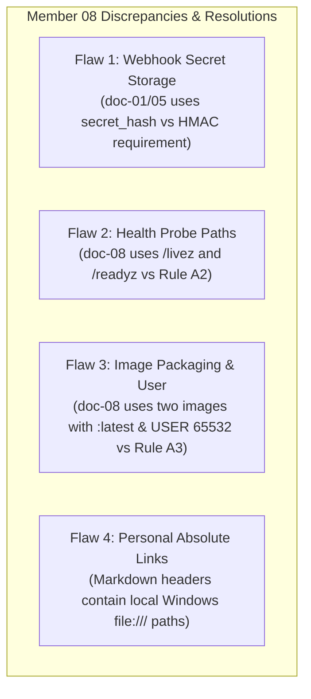

# Member 08 — Event-Driven Backend & Messaging Alignment Guide & Review

> **Author / Domain Owner:** Member 8 — Event-Driven Backend & Integrations (Watti / Kesha)  
> **Target Modules:** `core-api/internal/events/` and `services/messaging/`  
> **Review Status:** Post-Submission Comprehensive Audit (Reviewing Full 8-Document Architecture Suite)  
> **Date:** 25 October 2026 | **Version:** 2.0.0

---

## 1. Domain Overview & Scope of Work

Member 8 owns the asynchronous event-driven nervous system of SwiftDrop: **The Transactional Outbox Engine**, **The RabbitMQ Message Bus Topology**, **The Notification & Webhook Event Worker**, **Dead-Letter Queue (DLQ) Recovery**, and **Periodic Outbox Reconciliation**.

### 1.1 In-Scope Responsibilities
- `core-api/internal/events/`: Transactional outbox repository and event envelope serializers (commits inside Core API transactions).
- `services/messaging/cmd/relay`: Dedicated daemon polling `outbox_events`, publishing to RabbitMQ with publisher confirms, and recording `published_at`.
- `services/messaging/cmd/worker`: Background consumer processing customer notifications (real SMTP email) and merchant webhooks.
- `services/messaging/cmd/reconcile`: Periodic reconciliation utility detecting stuck or unpublished events.
- RabbitMQ topic exchange topology and DLQ routing.
- Idempotent consumer deduplication via `processed_events`.
- Merchant webhook HTTP dispatcher: HMAC-SHA256 signing, exponential backoff retries, and send-time SSRF guards.
- Authoring migrations `000008_create_outbox_events.up.sql` and `000009_create_worker_dedup_and_webhooks.up.sql`.

### 1.2 Out-of-Scope Responsibilities
- Modifying parcel state or authoring parcel business rules (Owned by Members 2 and 3).
- Configuring merchant webhook endpoints in the database (Owned by Member 4).
- RabbitMQ StatefulSet provisioning in Kubernetes (Owned by Member 9).

---

## 2. Review of Submitted Architecture Suite (`doc-01` to `doc-08`)

Member 8 has pushed a complete 8-document specification suite (over 3,200 lines) and harmonized `docs/contracts/event-contracts.md`. 

### 2.1 Commendable Engineering Strengths
1. **Durable Transactional Outbox:** Rigorous polling loop using `FOR UPDATE SKIP LOCKED` batching (50 events/tick) with publisher confirmations before updating `published_at`.
2. **SSRF Hardened Webhook Client:** Custom `SafeDialContext` enforcing single-lookup DNS resolution and strict CIDR blacklist against RFC 1918, loopback (`127.0.0.0/8`), link-local (`169.254.0.0/16`), and IPv6 private spaces.
3. **Real SMTP Protocol Implementation:** Replaced naive mocks with direct `net/smtp` + `crypto/tls` (STARTTLS / TLS) supporting DKIM headers and CRLF injection defenses.
4. **Idempotent Deduplication:** Standardized on `processed_events (consumer_name, event_id, processed_at)` to guarantee zero duplicate delivery side-effects.

---

## 3. Identified Flaws & Contradictions in Submitted Drafts

Detailed review revealed 4 critical discrepancies that must be reconciled:



### 3.1 Flaw 1: Webhook Signing Secret Storage (`secret_hash` vs Decryptable Secret)
- **The Contradiction:** In `doc-01` (line 148) and `doc-05` (lines 38, 235), Member 8 references `webhook_endpoints.secret_hash`. In `doc-05` seed SQL, Member 8 inserts `'whsec_test_secret_key_abcdef1234567890'` into `secret_hash`. Yet in `doc-02`, `doc-04`, and `doc-07`, Member 8 requires the plaintext secret to compute `HMAC-SHA256(payload, secret)`.
- **The Problem:** A cryptographic hash (bcrypt/SHA-256) cannot be decrypted. Putting plaintext secrets into a column named `secret_hash` is both a severe security vulnerability and a schema naming violation.
- **The Fix (Member 4 Alignment):** Align with Member 4's ratified schema (Question U-03). Member 4 stores `secret_ciphertext BYTEA` encrypted symmetrically with AES-256-GCM. Member 8's Webhook Worker reads `merchant_webhook_targets_view` and decrypts the secret using `WEBHOOK_SECRET_ENCRYPTION_KEY` from `integrations-secrets` before computing the HMAC-SHA256 signature.

### 3.2 Flaw 2: Health Probe Endpoints (Rule A2 & Member 9 K17)
- **The Contradiction:** In `doc-08` Section 5 Kubernetes manifests, Member 8 configured:
  ```yaml
  httpGet:
    path: /livez
    port: 8082
  ```
- **The Fix:** Member 9 Agreement A2 and team decision C1 mandate standard paths:
  - Liveness: **`/health/live`**
  - Readiness: **`/health/ready`**
  - Metrics: **`/metrics`**
  *(Flag `/livez`, `/readyz`, `/healthz`, `/health` as non-standard).*

### 3.3 Flaw 3: Image Packaging, Tagging, and Execution User (Rule A3 & Member 9 K18)
- **The Contradiction:** In `doc-08`, Member 8 specifies two separate images tagged `swiftdrop/outbox-relay:latest` and `swiftdrop/event-worker:latest`, running as `USER 65532:65532`.
- **The Fix:** Align with Member 9 Agreement A3:
  1. Build a **single multi-binary image**: `ghcr.io/phantomtroupeead/swiftdrop/messaging:<git-sha>`.
  2. The image provides three binary entrypoints: `/usr/local/bin/relay`, `/usr/local/bin/worker`, and `/usr/local/bin/reconcile`.
  3. Execution user must be **`USER 10001:10001`** (SwiftDrop system standard).
  4. Pinned Git commit SHA tag must be used in CI/CD; never `:latest`.

### 3.4 Flaw 4: Personal Local Links in Markdown Headers
- **The Issue:** The headers of `doc-01` through `doc-08` contain absolute local file links like:
  `file:///c:/Users/kesha/OneDrive/Documents/GitHub/SwiftDrop/docs/contracts/event-contracts.md`.
- **The Fix:** Replace with repository-relative Markdown links: `[event-contracts.md](../../contracts/event-contracts.md)`.

---

## 4. Exact Technical Changes & Code Implementation

### 4.1 AES-256-GCM Secret Decryption in Webhook Worker
In `services/messaging/internal/webhook/decrypt.go`:
```go
package webhook

import (
	"crypto/aes"
	"crypto/cipher"
	"fmt"
)

// DecryptSecret decrypts the AES-256-GCM encrypted secret stored by Member 04.
func DecryptSecret(ciphertext []byte, encryptionKey []byte) (string, error) {
	block, err := aes.NewCipher(encryptionKey)
	if err != nil {
		return "", fmt.Errorf("failed to create cipher: %w", err)
	}

	gcm, err := cipher.NewGCM(block)
	if err != nil {
		return "", fmt.Errorf("failed to create GCM: %w", err)
	}

	nonceSize := gcm.NonceSize()
	if len(ciphertext) < nonceSize {
		return "", fmt.Errorf("ciphertext too short")
	}

	nonce, encryptedData := ciphertext[:nonceSize], ciphertext[nonceSize:]
	plaintext, err := gcm.Open(nil, nonce, encryptedData, nil)
	if err != nil {
		return "", fmt.Errorf("failed to decrypt webhook secret: %w", err)
	}

	return string(plaintext), nil
}
```

### 4.2 Webhook Signature Calculation (`docs/contracts/webhook-security.md`)
```go
func ComputeSignature(timestamp int64, payload []byte, secret string) string {
	mac := hmac.New(sha256.New, []byte(secret))
	mac.Write([]byte(fmt.Sprintf("%d.", timestamp)))
	mac.Write(payload)
	return hex.EncodeToString(mac.Sum(nil))
}
```
Header attached to request:
```http
X-SwiftDrop-Timestamp: 1729850000
X-SwiftDrop-Signature: t=1729850000,v1=a1b2c3d4e5f6...
```

---

## 5. Authoritative Database Migrations (Migrations 8 and 9)

### 5.1 Migration `000008_create_outbox_events.up.sql`
```sql
CREATE TABLE outbox_events (
    id UUID PRIMARY KEY DEFAULT gen_random_uuid(),
    aggregate_type VARCHAR(64) NOT NULL,
    aggregate_id UUID NOT NULL,
    aggregate_version INTEGER DEFAULT 1 NOT NULL,
    event_type VARCHAR(128) NOT NULL,
    schema_version VARCHAR(16) DEFAULT '1.0.0' NOT NULL,
    payload JSONB NOT NULL,
    correlation_id VARCHAR(128) NOT NULL,
    status VARCHAR(32) DEFAULT 'PENDING' NOT NULL 
        CHECK (status IN ('PENDING', 'PUBLISHED', 'FAILED')),
    attempt_count INTEGER DEFAULT 0 NOT NULL,
    next_attempt_at TIMESTAMPTZ NULL,
    last_error TEXT NULL,
    created_at TIMESTAMPTZ DEFAULT CURRENT_TIMESTAMP NOT NULL,
    published_at TIMESTAMPTZ NULL
);

CREATE INDEX idx_outbox_pending 
ON outbox_events(status, created_at ASC) 
WHERE status = 'PENDING';
```

### 5.2 Migration `000009_create_worker_dedup_and_webhooks.up.sql`
```sql
-- 1. Consumer Idempotency Table
CREATE TABLE processed_events (
    consumer_name VARCHAR(64) NOT NULL,
    event_id UUID NOT NULL,
    processed_at TIMESTAMPTZ NOT NULL DEFAULT NOW(),
    PRIMARY KEY (consumer_name, event_id)
);

-- 2. Webhook Deliveries Audit Table
CREATE TABLE webhook_deliveries (
    id UUID PRIMARY KEY DEFAULT gen_random_uuid(),
    endpoint_id UUID NOT NULL REFERENCES webhook_endpoints(id) ON DELETE CASCADE,
    event_id UUID NOT NULL,
    status VARCHAR(32) DEFAULT 'PENDING' NOT NULL 
        CHECK (status IN ('PENDING', 'SUCCESS', 'RETRYING', 'FAILED')),
    attempt_count INTEGER DEFAULT 0 NOT NULL,
    response_status_code INTEGER NULL,
    response_body_snippet VARCHAR(500) NULL,
    error_message TEXT NULL,
    delivered_at TIMESTAMPTZ NOT NULL DEFAULT NOW()
);

CREATE INDEX idx_webhook_deliveries_endpoint ON webhook_deliveries(endpoint_id, delivered_at DESC);
```

---

## 6. Member 9 DevOps & Infrastructure Configuration

| Config Parameter | Required Specification | Alignment Rule |
| :--- | :--- | :--- |
| **Image Definition** | Single image `ghcr.io/phantomtroupeead/swiftdrop/messaging:<git-sha>` with 3 binaries (`relay`, `worker`, `reconcile`) | Agreement A3 |
| **Container User** | `USER 10001:10001` (SwiftDrop non-root standard) | Agreement A3 |
| **Health Ports** | Relay: port `:8082`; Worker: port `:8083` (Internal only, not routed) | Agreement A1 |
| **Health Paths** | `/health/live` & `/health/ready` (checks Postgres and RabbitMQ) | Agreement A2 & K17 |
| **Prometheus Gauge** | `swiftdrop_outbox_pending_events` | Agreement A11 & K19 |
| **Autoscaling** | KEDA ScaledObject scaling `event-worker` on RabbitMQ queue depth | `keda-event-worker.yml` |
| **Database Roles** | Relay: `swiftdrop_relay`; Worker: `swiftdrop_worker` | Agreement D6 |
| **Secrets** | `postgres-secrets`, `rabbitmq-secrets`, `integrations-secrets` | Agreement A5 |
| **Migrations** | `000008_create_outbox_events.up.sql` and `000009_create_worker_dedup_and_webhooks.up.sql` | Agreement D3 (8th & 9th) |

---
*End of Member 08 Specification & Review Guide.*
