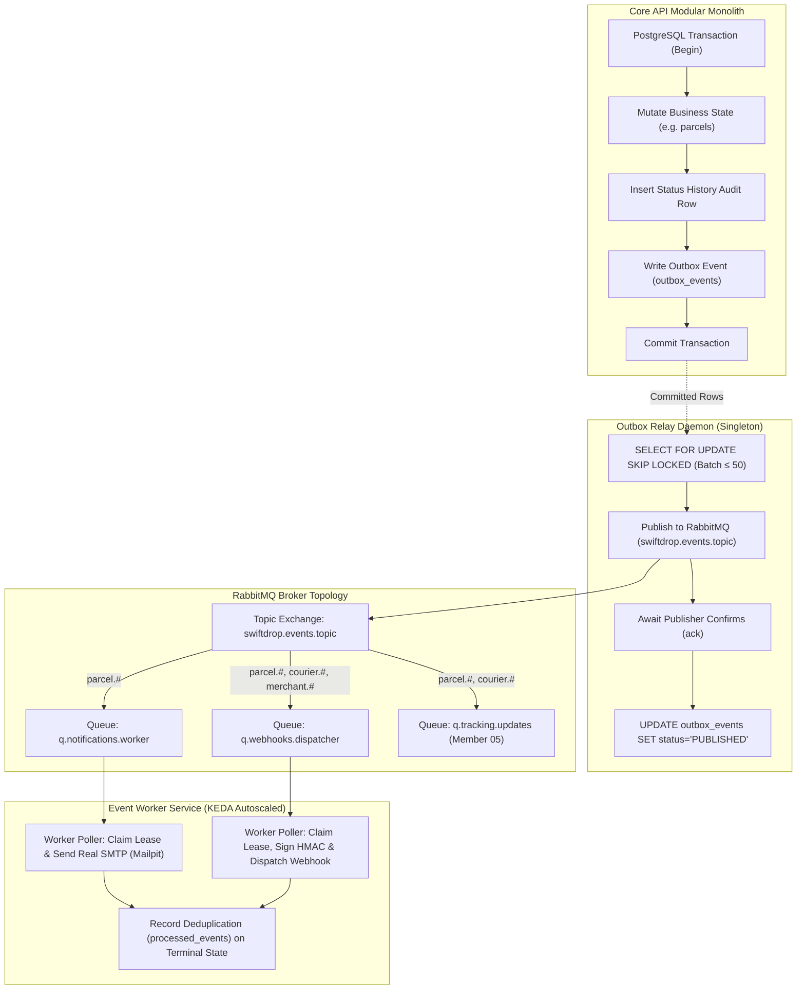

# Member 08 — Event-Driven Backend & Messaging Specifications

> **Domain Capability:** Event-Driven Backend, Outbox Relay, Messaging Broker, Asynchronous Workers, Notification & Webhook Dispatch  
> **Assigned Domain Owner:** Member 08  
> **Architecture Style:** Clean Layered Modular Monolith Support + Standalone Asynchronous Go Daemon Services  
> **Status:** Canonical Specification Complete (Post-Review Revision 2.0)  
> **Order of Precedence:** Adheres strictly to `AGENTS.md`, `SwiftDrop_SRS_v1.0.docx`, and `docs/contracts/`

---

## 1. Module Purpose & Core Scope

Member 08 designs, implements, and maintains the authoritative asynchronous messaging infrastructure and integration event fabric for the **SwiftDrop Parcel Delivery & Courier Management System**. 

The boundary encompasses two primary subsystems:
1. **Core API In-Process Integration Layer (`core-api/internal/events/`):**
   - Provides the transactional `OutboxWriter` interface for domain aggregate roots (`parcels`, `dispatch`, `delivery`, `merchants`).
   - Ensures zero direct broker calls or HTTP side effects inside Core API database transaction boundaries.
   - Guarantees strict transactional atomicity: business state mutations, audit status history, and outbox event envelopes commit within the exact same PostgreSQL ACID transaction.
2. **Dedicated Asynchronous Messaging Services (`services/messaging/`):**
   - **Outbox Relay Daemon (`cmd/relay`):** High-throughput poller claiming pending outbox events using `SELECT ... FOR UPDATE SKIP LOCKED` and publishing them with AMQP publisher confirms to RabbitMQ topic exchange `swiftdrop.events.topic`.
   - **Event Consumer Worker (`cmd/worker`):** Scalable consumer listening on dedicated RabbitMQ queues (`q.notifications.worker`, `q.webhooks.dispatcher`), enforcing lease-based database-driven retries, cryptographic HMAC-SHA256 signatures, and SSRF-hardened webhook delivery.
   - **Outbox Reconciler CronJob (`cmd/reconcile`):** Scheduled background auditor running every 10 minutes (`*/10 * * * *`) to identify stuck pending events, detect publisher confirm timeouts, and export Prometheus health metrics.
   - **Notification & Webhook Dispatchers:** Single-path real SMTP email delivery (Mailpit in local/CI) and SSRF-safe webhook HTTP clients with AES-256-GCM secret decryption.

---

## 2. Master Specification Document Index

All technical specifications, contracts, data schemas, testing suites, and deployment topologies for Member 08 are codified across the following canonical documents:

| Document | Primary Focus & Summary | Key Sections |
| :--- | :--- | :--- |
| [**`doc-01-scope-and-responsibilities.md`**](doc-01-scope-and-responsibilities.md) | Domain boundaries, owned components, out-of-scope boundaries, partner team touchpoints, and service ownership matrix. | §1 Scope, §4 Inter-Service Boundaries, §7 Partner Matrix |
| [**`doc-02-functional-flows-and-business-rules.md`**](doc-02-functional-flows-and-business-rules.md) | End-to-end transactional sequence flows, state machine transitions, retry backoff algorithms, SSRF validation flowchart, and reconciler recovery rules. | §2 Sequence Diagrams, §3 State Machines, §4 SSRF Validation |
| [**`doc-03-internal-architecture-and-design.md`**](doc-03-internal-architecture-and-design.md) | Layered architecture (`domain`, `application`, `infrastructure`, `transport`), Go interface signatures (`EventEnvelope`, `OutboxWriter`), design patterns, and package layout. | §1 Topology, §3 Go Interfaces, §5 Clean Architecture |
| [**`doc-04-interface-and-integration-contract.md`**](doc-04-interface-and-integration-contract.md) | Canonical Event Catalog, OpenAPI 3.1 Webhook Dispatch Specification, RabbitMQ exchange/queue bindings, SMTP dispatch contract, and least-privilege DB RBAC grants. | §3 Event Catalog, §4 OpenAPI 3.1 Webhooks, §5 SMTP Contract, §7 DB RBAC |
| [**`doc-05-data-and-persistence.md`**](doc-05-data-and-persistence.md) | Authoritative PostgreSQL DDL migrations (`000008`, `000009`), Entity-Relationship Diagram, data dictionary, query access patterns, retention policies, and seed data. | §2 ERD & DDL, §3 Migrations 000008/000009, §5 Retention Purge |
| [**`doc-06-testing-strategy-and-acceptance.md`**](doc-06-testing-strategy-and-acceptance.md) | Full 28-item SRS requirement traceability matrix, unit testing suites, integration tests, E2E resilience verifications, and CI/CD quality gates. | §2 SRS RTM Matrix, §3 Test Suites, §4 E2E Scenarios |
| [**`doc-07-security-failure-and-recovery.md`**](doc-07-security-failure-and-recovery.md) | Threat modeling, SSRF attack prevention, AES-256-GCM envelope encryption, FMEA failure matrix, DLQ dead-letter runbook, and audit logging standards. | §1 Security Architecture, §4 FMEA Matrix, §5 DLQ Runbook |
| [**`doc-08-implementation-deployment-and-ops.md`**](doc-08-implementation-deployment-and-ops.md) | Multi-stage Dockerfile, production Kubernetes manifests (Relay, Worker, Reconciler, KEDA ScaledObject), environment variables, and Prometheus metrics dictionary. | §2 Dockerfile, §3 K8s Manifests, §4 Metrics Dictionary |
| [**`MEMBER_08_ALIGNMENT_AND_SPECIFICATION_GUIDE.md`**](MEMBER_08_ALIGNMENT_AND_SPECIFICATION_GUIDE.md) | Consolidated executive implementation guide, Go reference code implementations (`OutboxWriter`, `SSRFSafeClient`, `DecryptSecret`, `SMTPNotifier`), and SRS checklists. | §5 Engineering Decisions, §7 Verified Reference Code |
| [**`REVIEW_FINDINGS.md`**](REVIEW_FINDINGS.md) | Consolidated 4-agent audit findings log, tracking resolution status of 100+ architectural, schema, and security items. | §A Critical, §B High, §C Medium, §D Group Decisions |
| [**`CHANGE_REQUESTS.md`**](CHANGE_REQUESTS.md) | Formal cross-boundary interface change requests and alignment notes for Members 1 through 7, 9, and 10. | §1 Cross-Member Requests, §2 Group Sign-offs |

---

## 3. Strict Domain Invariants & Business Rules

Member 08 enforces the following mandatory architectural and business invariants across all components:



### 3.1 Transactional Atomicity (Zero Out-of-Band State)
- Core API domain use cases must never emit events directly to RabbitMQ, Kafka, or third-party HTTP endpoints.
- Outbox events must be written via `OutboxWriter.Write(ctx, tx, envelopes...)` within the exact same database transaction that updates the aggregate entity.
- If the domain transaction aborts or rolls back, zero outbox records are created, and zero events reach the message broker.

### 3.2 At-Least-Once Delivery & Terminal Idempotency
- All message consumption is treated as **at-least-once**. Downstream workers must tolerate duplicate deliveries.
- Deduplication keys in `processed_events` (`event_id`, `consumer_group`) are persisted **only upon reaching a terminal state** (`SUCCESS` or terminal `FAILED`).
- If an unhandled crash occurs mid-flight, the record is redelivered safely without being prematurely filtered out.

### 3.3 Database-Driven Retries (Zero AMQP Requeue Loops)
- RabbitMQ hot-loop requeuing (`basic.reject(requeue=true)` or `basic.nack(requeue=true)`) is strictly prohibited, as it pins CPU cores and starves consumers.
- Asynchronous retries are governed by persistent PostgreSQL leases on `webhook_deliveries`:
  - **Deterministic Exponential Backoff:** 5 total attempts across ~42.5 minutes:
    - Attempt 1: Immediate (0s delay)
    - Attempt 2: +30s ($\pm 20\%$ jitter)
    - Attempt 3: +2m ($\pm 20\%$ jitter)
    - Attempt 4: +10m ($\pm 20\%$ jitter)
    - Attempt 5: +30m ($\pm 20\%$ jitter)
  - Delivery workers claim due rows using `SELECT ... WHERE status = 'PENDING' AND next_attempt_at <= CURRENT_TIMESTAMP FOR UPDATE SKIP LOCKED`.
  - RabbitMQ messages are acknowledged (`basic.ack`) once the delivery task is persisted.

### 3.4 Webhook Security & SSRF Hardening
- **Pre-Dial IP Resolution & Validation:** The webhook client resolves the target hostname before opening a TCP connection and validates **all returned IP addresses** against an immutable blocklist:
  - Loopback (`127.0.0.0/8`, `::1/128`)
  - IPv4 Zero-net (`0.0.0.0/8`)
  - RFC 1918 Private subnets (`10.0.0.0/8`, `172.16.0.0/12`, `192.168.0.0/16`)
  - Carrier-Grade NAT (`100.64.0.0/10`)
  - Link-local and cloud metadata (`169.254.0.0/16`, `fe80::/10`)
  - Multicast and reserved ranges (`224.0.0.0/4`, `240.0.0.0/4`)
  - IPv6 NAT64 and IPv4-mapped IPv6 ranges (`64:ff9b::/96`, `::ffff:0:0/96`)
- **Zero Redirect Following:** The HTTP client specifies `CheckRedirect: func(...) error { return http.ErrUseLastResponse }`. HTTP 3xx redirects are recorded as terminal `FAILED` responses to prevent SSRF bypass attacks.
- **HMAC-SHA256 Signatures & Rotation:** Every webhook payload is signed using HMAC-SHA256 and transmitted in the header:
  `X-SwiftDrop-Signature: t=<unix_ts>,v1=<hex_hmac>`. During secret rotation, dual signatures (`v1=<new>,v1=<old>`) are provided.
- **AES-256-GCM Secret Decryption:** Merchant webhook secrets stored in the database are decrypted on-demand with Additional Authenticated Data (AAD) cryptographically bound to the merchant's `endpoint_id`.

### 3.5 Single-Path Real SMTP (No Mock Code Paths)
- The notification worker uses a single, robust Go `net/smtp` implementation supporting STARTTLS, implicit TLS (port 465), and unencrypted local connections.
- In Local Development and CI environments, delivery targets a lightweight Mailpit SMTP container (`localhost:1025`) requiring zero external network access.
- This architectural decision eliminates split mock/real bugs in production while remaining 100% self-contained in CI.

---

## 4. Domain Models & Core Data Structures

Member 08 defines pure data structures for message envelopes and persistence entities:

### 4.1 Event Envelope
```go
type EventEnvelope[T any] struct {
    EventID          uuid.UUID       `json:"event_id"`          // Canonical UUIDv7
    EventType        string          `json:"event_type"`        // e.g. "parcel.booked.v1"
    AggregateType    string          `json:"aggregate_type"`    // e.g. "parcel", "courier", "merchant"
    AggregateID      uuid.UUID       `json:"aggregate_id"`      // Authoritative aggregate UUID
    AggregateVersion int             `json:"aggregate_version"` // Monotonic sequence counter
    SchemaVersion    string          `json:"schema_version"`    // Contract SemVer schema version (e.g. "1.0.0")
    OccurredAt       time.Time       `json:"occurred_at"`       // RFC 3339 UTC timestamp
    Producer         string          `json:"producer"`          // Subsystem identifier (e.g. "core-api/parcels")
    CorrelationID    string          `json:"correlation_id"`     // Distributed trace ID (max 128 chars)
    Payload          T               `json:"payload"`           // Type-safe domain event payload
}
```

### 4.2 Persistent Database Entities
1. **`OutboxEvent` (`outbox_events` table):**
   - Stores committed domain events awaiting publication to RabbitMQ.
   - Status transitions: `PENDING` $\to$ `PUBLISHED` (terminal) or `PENDING` $\to$ `FAILED` (terminal, if exceeding retry threshold).
2. **`ProcessedEvent` (`processed_events` table):**
   - Authoritative idempotency registry preventing double-processing of events.
   - Compound primary key: `(event_id, consumer_group)`.
3. **`WebhookDelivery` (`webhook_deliveries` table):**
   - Root task tracking webhook lifecycle to a specific merchant target endpoint.
   - Status transitions: `PENDING` $\to$ `IN_PROGRESS` $\to$ `PENDING` (retry) $\to$ `SUCCESS` or `FAILED` (terminal).
   - Governed by atomic concurrency leases (`next_attempt_at`, `lease_expires_at`).
4. **`WebhookDeliveryAttempt` (`webhook_delivery_attempts` table):**
   - Append-only audit record detailing every HTTP request attempt (`attempt_no`, `response_status_code`, `response_body_snippet`, `execution_duration_ms`, `error_message`, `attempted_at`).

---

## 5. Clean Layer Organization

Member 08 code is partitioned into two distinct codebases following clean architecture principles:

### 5.1 In-Process Integration: `core-api/internal/events/`
```
core-api/internal/events/
├── domain/                      # Zero external dependencies
│   ├── envelope.go              # EventEnvelope generic struct and AnyEnvelope interface
│   └── errors.go                # Domain error definitions (ErrInvalidEnvelope, ErrSerialization)
├── application/                 # Use case orchestration
│   └── outbox_writer.go         # OutboxWriter interface definition
└── infrastructure/              # Concrete persistence drivers
    ├── postgres_writer.go       # SQL implementation of OutboxWriter using *sql.Tx
    └── schema_validator.go      # JSON schema validation against published contracts
```

### 5.2 Standalone Messaging Daemons: `services/messaging/`
```
services/messaging/
├── cmd/
│   ├── relay/main.go            # Outbox Relay entrypoint (singleton poller)
│   ├── worker/main.go           # Event Worker entrypoint (AMQP consumer)
│   └── reconcile/main.go        # Reconciler CLI entrypoint (scheduled audit task)
├── internal/
│   ├── config/                  # Environment variable parsing and validation
│   ├── platform/                # Shared drivers (PostgreSQL pool, RabbitMQ channel manager)
│   ├── relay/                   # Relay polling, publisher confirms, batch commit
│   ├── worker/                  # AMQP consumption, message routing, worker pools
│   ├── webhook/                 # SSRF-safe HTTP client, HMAC-SHA256 signer, AES-GCM decryptor
│   ├── notification/            # SMTP client, MIME multipart email generation, Mailpit adapter
│   └── reconciler/              # Stuck event auditor, alert generation, Prometheus metrics
└── tests/                       # Unit, integration, and E2E simulation suites
```

---

## 6. Authoritative Database Schema & RBAC Grants

Member 08 owns database migrations `000008` and `000009` executed against the authoritative PostgreSQL cluster:

### 6.1 Owned Tables & Views
- **`outbox_events`:** Managed by Relay and Core API. Partial index on `created_at WHERE status = 'PENDING'`.
- **`processed_events`:** Managed by Worker for consumer deduplication.
- **`webhook_deliveries`:** Managed by Worker and Reconciler. Indexed on `(status, next_attempt_at)`.
- **`webhook_delivery_attempts`:** Append-only log foreign-keyed to `webhook_deliveries` (`ON DELETE RESTRICT`).
- **`merchant_webhook_targets` (Read-Only View):** Exposes `endpoint_id`, `merchant_id`, `url`, `secret_ciphertext`, `secret_key_version`, and `subscribed_event_types` owned by Member 04.

### 6.2 Least-Privilege Database Roles
To enforce strict defense-in-depth, zero runtime services connect as the database superuser:
1. **`swiftdrop_relay`:** Granted `SELECT, UPDATE` on `outbox_events` only.
2. **`swiftdrop_worker`:** Granted `SELECT, INSERT, UPDATE` on `processed_events`, `webhook_deliveries`, `webhook_delivery_attempts`, and `SELECT` on `merchant_webhook_targets`.
3. **`swiftdrop_reconciler`:** Granted `SELECT, UPDATE (status, last_error)` on `outbox_events` and `SELECT` on `webhook_deliveries`.

---

## 7. Messaging & AMQP Broker Topology

The RabbitMQ topology guarantees durable, decoupled event distribution:

```
Exchange: swiftdrop.events.topic (Topic Exchange, Durable)
├── Binding: "parcel.#", "courier.#"
│   └── Queue: q.tracking.updates (Durable, Consumer: Member 05 Tracking Service)
├── Binding: "parcel.booked.v1", "parcel.out_for_delivery.v1", "parcel.delivered.v1", "parcel.delivery_failed.v1"
│   └── Queue: q.notifications.worker (Durable, Consumer: Member 08 Notification Dispatcher)
└── Binding: "parcel.#", "courier.#", "merchant.#"
    └── Queue: q.webhooks.dispatcher (Durable, Consumer: Member 08 Webhook Dispatcher)

Dead-Letter Architecture:
Exchange: swiftdrop.dlq.exchange (Fanout Exchange, Durable)
└── Queue: swiftdrop.dlq (Durable, 30-Day Message TTL: x-message-ttl=2592000000)
```

---

## 8. Deployment & Operational Specifications

| Component | Workload Type | Replicas / Bounds | Ingress / Ports | Health & Readiness | Autoscaling Policy |
| :--- | :--- | :--- | :--- | :--- | :--- |
| **Outbox Relay** | Deployment | Exactly 1 (Singleton) | Port 8082 | `/health/live`, `/health/ready`, `/metrics` | None (Enforced Singleton via `replicas: 1`) |
| **Event Worker** | Deployment | 1 to 3 Pods | Port 8083 | `/health/live`, `/health/ready`, `/metrics` | KEDA ScaledObject on RabbitMQ queue depth |
| **Outbox Reconciler** | CronJob | Scheduled Run | None (CLI) | Non-zero exit code on failure | Scheduled: `*/10 * * * *` |
| **Mailpit (Local/CI)** | Container | 1 Instance | Ports 1025 / 8025 | Standard HTTP Health | Local Compose & CI Pipeline Only |

---

## 9. Living Documentation Maintenance & Sync Policy

In compliance with **AGENTS.md Section 6.3 (Zero-Drift Enforcement Policy)**:
- Any modification to Go interfaces, database columns, event catalog entries, or retry policies must be immediately and synchronously reflected across the co-located documentation set.
- All cross-boundary dependency changes must be documented as formal proposals in [**`CHANGE_REQUESTS.md`**](CHANGE_REQUESTS.md) and coordinated with the respective domain owners before code is merged.
