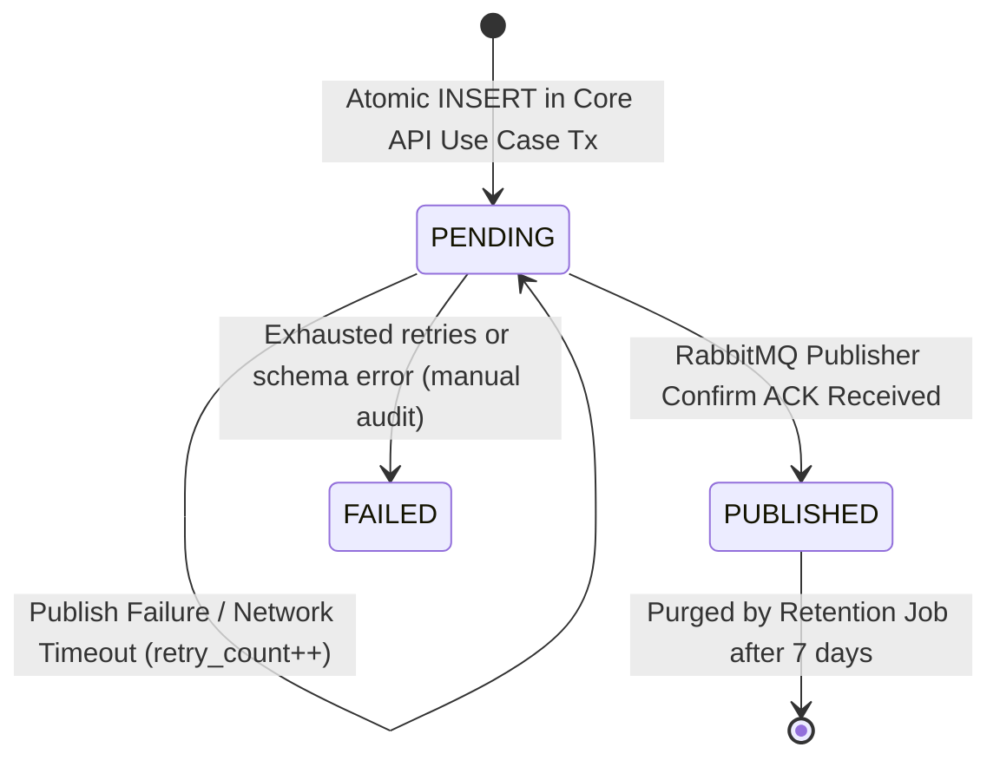
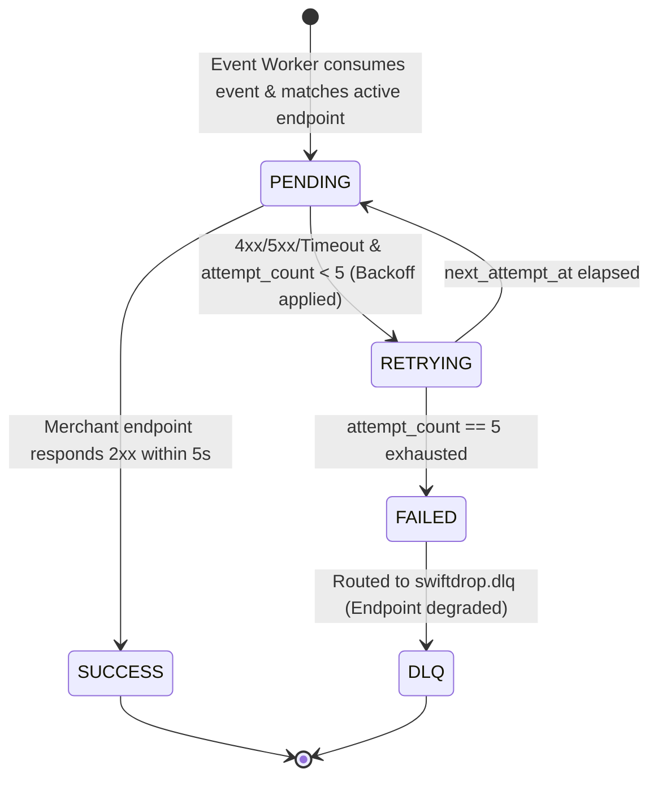
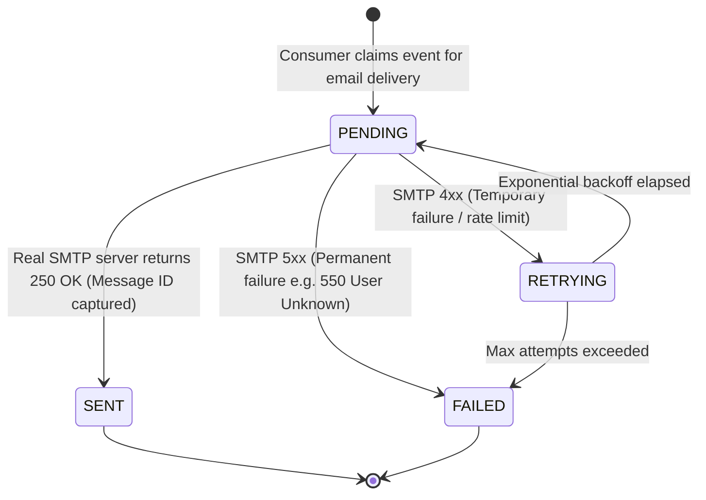
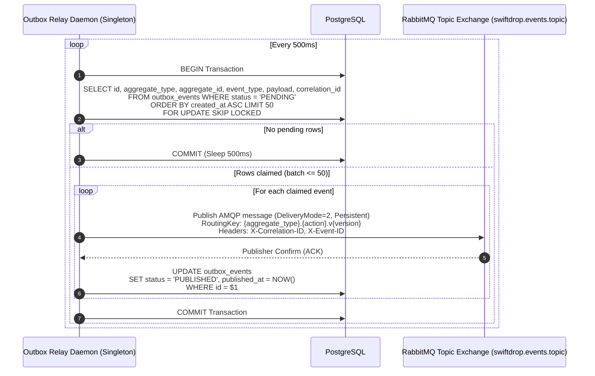
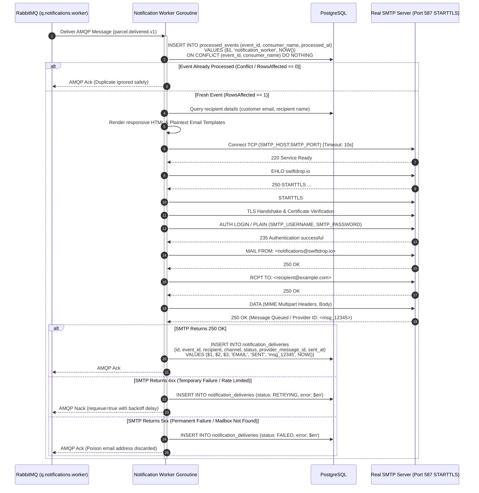
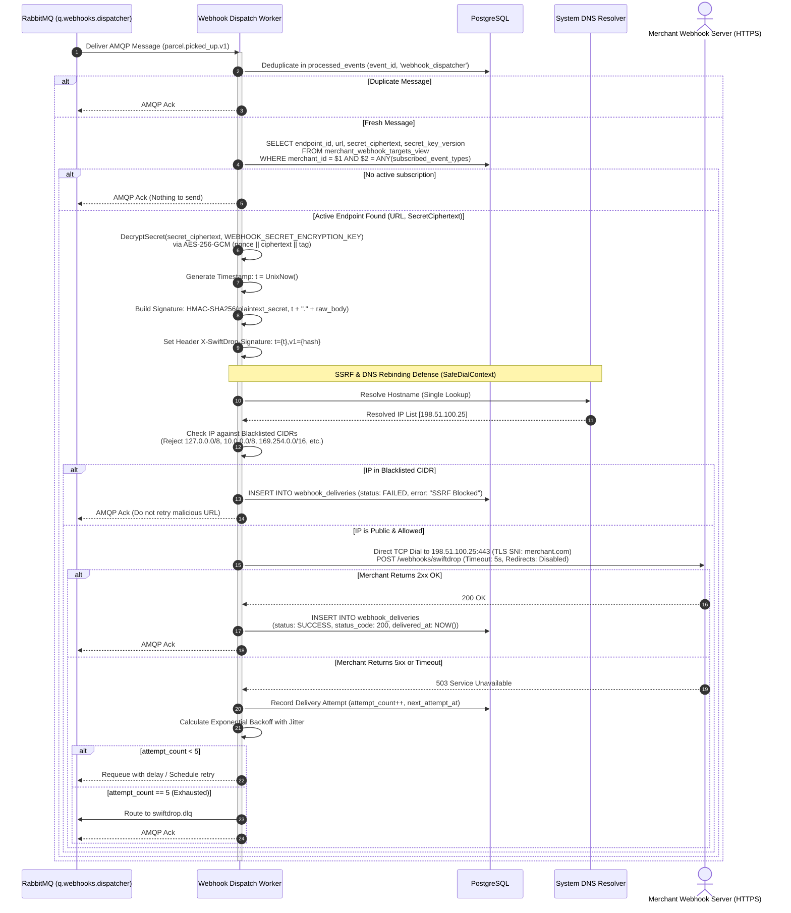
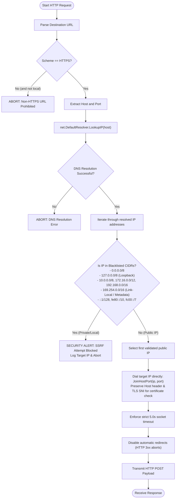
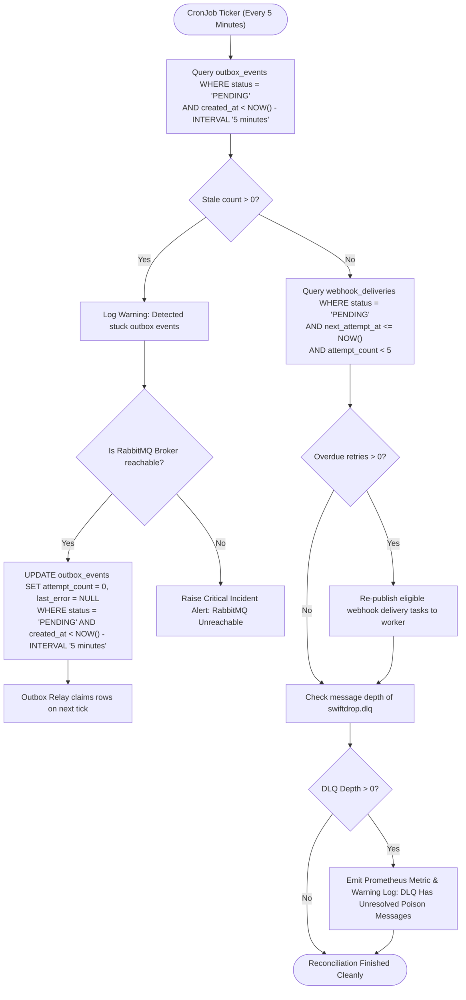

# Document 02 — Functional Flows & Business Rules

> **Module:** Event-Driven Backend & Messaging (`internal/events`, `services/messaging`)  
> **Owning Member:** Member 08 — Event-Driven Backend & Integrations  
> **Status:** Draft Baseline Specification for Review & Implementation  
> **Target Production Locations:**  
> - `core-api/internal/events/` (In-Monolith Outbox Writer & Envelopes)  
> - `services/messaging/` (Outbox Relay Daemon, Real SMTP Worker, Webhook Dispatcher, Reconciler)  
> **Relevant Contracts:** [event-contracts.md](../../contracts/event-contracts.md), [webhook-security.md](../../contracts/webhook-security.md), [database-schema.md](../../architecture/database-schema.md), [sequence-diagrams.md](../../architecture/sequence-diagrams.md)

---

## 1. Actors & Triggering Conditions

The Messaging & Event-Driven subsystem operates as the asynchronous backbone of SwiftDrop. It does not expose direct public end-user HTTP routes; instead, it is activated by internal database transactions, scheduled cron tickers, and incoming AMQP queue messages.

| Actor | Type | Triggering Condition | Role in Subsystem |
| :--- | :--- | :--- | :--- |
| **Core API Domain Use Cases** | Internal Software (Monolith) | Business state mutation occurs (Parcel Booked, Assigned, Picked Up, Delivered, Delivery Failed). | Calls `OutboxWriter.Write` inside the active `*sql.Tx` to durably stage an outbox event. |
| **Outbox Relay Daemon** | Autonomous Background Process | Timer ticker fires every `OUTBOX_POLL_INTERVAL_MS` (default 500ms). | Scans `outbox_events` with `FOR UPDATE SKIP LOCKED`, publishes persistent AMQP messages, and awaits publisher confirms. |
| **RabbitMQ Broker** | Infrastructure Middleware | Message routed to durable queue (`q.notifications.worker`, `q.webhooks.dispatcher`). | Delivers AMQP message payload to connected worker consumer channels. |
| **Notification Worker Consumer** | Background Worker Goroutine | Receives message from `q.notifications.worker`. | Deduplicates via `processed_events`, queries recipient email, connects to **Real SMTP Server**, and records outcome. |
| **Real SMTP Mail Server** | External Network Service | Worker initiates TLS/STARTTLS TCP handshake on port 587/465. | Receives, authenticates, and routes transactional emails to recipient inboxes. |
| **Webhook Dispatcher Consumer** | Background Worker Goroutine | Receives message from `q.webhooks.dispatcher`. | Resolves DNS with SSRF guard, computes HMAC-SHA256 signature, dispatches HTTP POST, and manages retries. |
| **Merchant Webhook Endpoint** | External HTTP Service | Worker sends authenticated HTTPS POST request. | Validates signature and timestamp; returns `2xx OK` or error. |
| **Reconciliation Engine / CronJob** | Scheduled CLI Command | Kubernetes CronJob triggers (every 5m) or manual operator execution. | Detects stale outbox rows (>5m) and overdue webhook retries; repairs state without bypassing relay. |

---

## 2. Core State Machines & Lifecycle Transitions

### 2.1 Outbox Event Lifecycle State Machine (`outbox_events.status`)



- **`PENDING`:** Event successfully committed in the database alongside the domain aggregate change. Eligible for Relay polling.
- **`PUBLISHED`:** Broker explicitly acknowledged durable receipt. Message is now safely inside RabbitMQ.
- **`FAILED`:** Unrecoverable serialization or broker rejection. Flagged for operational triage.

---

### 2.2 Webhook Delivery Attempt Lifecycle (`webhook_deliveries.status`)



---

### 2.3 Notification Delivery Lifecycle (`notification_deliveries.status`)



---

## 3. Detailed Functional Workflows

---

### Flow 1: Outbox Event Generation & Atomic Commit (Within Core API)

This flow guarantees that an event is **never** emitted if the database transaction fails, and the database change **never** commits without its associated outbox event.

#### Preconditions
- The caller is an Application Use Case (e.g. `BookParcelUseCase`, `ConfirmDeliveryUseCase`).
- An active database transaction `tx` (`*sql.Tx`) is open.
- Domain invariants have passed inside the aggregate root.

#### Step-by-Step Execution
1. The domain aggregate mutates state (e.g. `Parcel.Status = DELIVERED`, `Version = Version + 1`).
2. The use case persists aggregate changes (`UPDATE parcels ...`) and writes history (`INSERT INTO parcel_status_history ...`).
3. The use case constructs a typed `EventEnvelope[T]` with:
   - `event_id`: Unique UUIDv7 (time-ordered).
   - `event_type`: Centralized constant (e.g. `parcel.delivered.v1`).
   - `aggregate_type`: `"parcel"`.
   - `aggregate_id`: Parcel UUID.
   - `correlation_id`: Propagated from HTTP request header `X-Request-ID`.
   - `timestamp`: UTC ISO-8601.
   - `payload`: Domain milestone attributes.
4. The use case invokes `OutboxWriter.Write(ctx, tx, envelope)`.
5. The `OutboxWriter` serializes the payload to JSON and executes:
   ```sql
   INSERT INTO outbox_events (
       id, aggregate_type, aggregate_id, event_type, payload, correlation_id, status, created_at
   ) VALUES ($1, $2, $3, $4, $5, $6, 'PENDING', NOW());
   ```
6. The use case executes `tx.Commit()`.

#### Failure Flows
- If any validation, domain error, or database constraint fails prior to commit, `tx.Rollback()` is executed. Both the parcel status change and the `outbox_events` record vanish atomically.

#### Postconditions
- A durable row in `outbox_events` with `status = 'PENDING'` is visible to read-committed transactions.

---

### Flow 2: Outbox Relay Polling & Broker Confirmation

The Outbox Relay process reads committed outbox entries and publishes events to RabbitMQ with publisher confirms.



#### Failure Handling & Resilience Rules
- **Broker Unreachable / Down:** The Relay catches connection failure, does not mark rows as `PUBLISHED`, rolls back the transaction, backs off exponentially (1s, 2s, 4s, max 30s), and reconnects. Pending rows remain safely in PostgreSQL.
- **Publisher Confirm NACK or Timeout (5.0s):** If RabbitMQ rejects a message or fails to confirm within 5 seconds, the relay increments `retry_count`, logs `last_error`, and aborts the batch. Unconfirmed rows are retried on the next iteration.
- **Relay Crash During Batch:** If the relay crashes after publishing to RabbitMQ but before executing `COMMIT` on PostgreSQL, the row remains `PENDING`. Upon restart, the relay will re-publish the message. This guarantees **at-least-once delivery**; downstream consumers are required to be idempotent.

---

### Flow 3: Real SMTP Customer Email Notification Delivery

This flow fulfills the requirement to use a **real SMTP mail server from day one** with no fake, mock, or demo sinks.



#### Real SMTP Technical Specifications
- **Connection Security:** Mandatory TLS v1.2+ or STARTTLS. Plain unencrypted connections are rejected unless `APP_ENV=local`.
- **Dialer Timeout:** Strict 10-second connection timeout, 5-second command timeout.
- **Template Rendering:** Templates use standard Go `html/template` and `text/template` with XSS-safe escaping.

---

### Flow 4: Merchant Webhook Dispatcher & SSRF Defense

Outbound webhooks allow merchant ERPs/e-commerce platforms to receive real-time updates. Because URLs are merchant-configured, this flow enforces cryptographic integrity and rigorous zero-trust networking.



---

## 4. SSRF Defense: `SafeDialContext` Algorithm & Activity Diagram

To satisfy **SRS SEC-010** and mitigate DNS Rebinding (TOCTOU attacks), the worker does NOT use standard `http.DefaultClient`. It uses a custom transport where DNS is resolved once, verified against blacklists, and dialed directly:



---

## 5. Consumer Idempotency & Deduplication Logic

RabbitMQ guarantees **at-least-once** delivery. Network interruptions, worker crashes, or delayed ACKs may cause duplicate message delivery. 

### The Deduplication Table Invariant
All consumers share the authoritative deduplication table:
```sql
CREATE TABLE IF NOT EXISTS processed_events (
    consumer_name VARCHAR(64) NOT NULL,
    event_id UUID NOT NULL,
    processed_at TIMESTAMPTZ DEFAULT CURRENT_TIMESTAMP NOT NULL,
    PRIMARY KEY (consumer_name, event_id)
);
```

### Deduplication Decision Flow
1. Upon message receipt, the worker extracts `envelope.EventID`.
2. The worker attempts an atomic `INSERT`:
   ```sql
   INSERT INTO processed_events (event_id, consumer_name, processed_at)
   VALUES ($1, $2, NOW())
   ON CONFLICT (event_id, consumer_name) DO NOTHING;
   ```
3. **If `RowsAffected == 0` (Duplicate):**
   - The event was already executed by this consumer.
   - Immediately send AMQP `Ack`.
   - Log at `DEBUG` level: `"Duplicate event ignored"`.
   - **Do not** re-send email.
   - **Do not** re-call merchant webhook.
4. **If `RowsAffected == 1` (Fresh):**
   - Execute side effects (SMTP email or webhook).
   - If side effect permanently fails or succeeds, acknowledge AMQP message.
   - If transient failure occurs, delete the row from `processed_events` before NACKing, allowing the retried message to be re-evaluated.

---

## 6. Bounded Exponential Backoff & Retry Formula

For transient external failures (merchant server 500, network reset, SMTP 421 rate limit), the retry scheduler calculates delay using **Exponential Backoff with Full Jitter**:

$$\text{Delay}(n) = \min\left(\text{MaxDelay}, \text{BaseDelay} \times 2^{n-1}\right) \pm \text{Jitter}$$

### Webhook Retry Schedule
| Attempt Number ($n$) | Base Delay | Random Jitter Range | Cumulative Elapsed Window | Action on Failure |
| :--- | :--- | :--- | :--- | :--- |
| **1** | Immediate | $0\text{s}$ | $0\text{s}$ | Initial dispatch attempt |
| **2** | $30\text{s}$ | $\pm 5\text{s}$ | $\sim 30\text{s}$ | First retry |
| **3** | $120\text{s}$ ($2\text{m}$) | $\pm 15\text{s}$ | $\sim 2\text{m } 30\text{s}$ | Second retry |
| **4** | $600\text{s}$ ($10\text{m}$) | $\pm 60\text{s}$ | $\sim 12\text{m } 30\text{s}$ | Third retry |
| **5** | $1800\text{s}$ ($30\text{m}$) | $\pm 180\text{s}$ | $\sim 42\text{m } 30\text{s}$ | Final retry attempt |
| **Exhaustion** | Permanent | N/A | $\sim 45\text{m}$ | Route to `swiftdrop.dlq`; flag endpoint |

---

## 7. Operational Flow: Scheduled Reconciliation & Self-Healing

The reconciliation job runs periodically to ensure no events remain stuck indefinitely due to system reboots, database failovers, or broker outages.



---

## 8. Real Examples & Concrete Edge Cases

### Edge Case 1: Merchant Endpoint Responds with HTTP 302 Redirect to AWS Metadata
- **Scenario:** A malicious merchant registers webhook URL `https://merchant-store.com/webhook`. When the worker dispatches the POST request, the merchant returns `HTTP 302 Found` with `Location: http://169.254.169.254/latest/meta-data/`.
- **System Defense:** The worker's HTTP client has `CheckRedirect` configured to return `http.ErrUseLastResponse`. The redirect is **never followed**. The HTTP response is recorded as a `302`, treated as non-2xx failure, and logged without executing requests to the internal IP.

### Edge Case 2: Slow SMTP Server Causes Worker Goroutine Hang
- **Scenario:** The external SMTP server accepts TCP connections but hangs indefinitely during the `DATA` command.
- **System Defense:** The worker wraps the entire SMTP transaction in a Go `context.WithTimeout(ctx, 15*time.Second)`. When the deadline expires, the socket is abruptly closed by the worker, the attempt is logged as a timeout failure, and the worker goroutine is freed back to the pool.

### Edge Case 3: Outbox Relay Crashes Mid-Batch
- **Scenario:** The Relay reads 50 pending rows. It publishes all 50 to RabbitMQ and receives publisher confirms. Before it can execute `UPDATE outbox_events SET status = 'PUBLISHED'`, the pod is killed by the Kubernetes OOM killer.
- **System Defense:** When a replacement Relay pod boots, the rows in `outbox_events` are still `PENDING`. The new pod claims them and publishes them to RabbitMQ a second time. The downstream `NotificationWorker` and `WebhookWorker` receive the duplicates, but their `processed_events` atomic check absorbs the duplicates with zero duplicate emails or HTTP calls.

### Edge Case 4: Merchant Signature Verification Clock Skew
- **Scenario:** SwiftDrop server time is `12:00:00`. Merchant server clock is slightly ahead at `12:05:30`.
- **System Defense:** Per contract [webhook-security.md §2.3](../../contracts/webhook-security.md), the signature header includes `t={timestamp}`. The receiver verifies $| \text{CurrentTime} - t | \le 300\text{ seconds}$. A 5-minute absolute difference window accommodates acceptable NTP drift while defeating replay attacks.

---

## 9. Summary Checklist of Document 02 Deliverables

- [x] Clear definition of all actors and triggering conditions (Core API, Relay, RabbitMQ, Workers, Real SMTP, Webhook receiver, Reconciler).
- [x] State machines with permitted transitions for Outbox Events, Webhook Deliveries, and Notification Deliveries.
- [x] Detailed step-by-step flows for Atomic Outbox Commit, Relay Publisher Confirms, Real SMTP Email Delivery, and Webhook Dispatch.
- [x] Full real SMTP email protocol dialogue documented with TLS/STARTTLS authentication.
- [x] Activity diagram and algorithm for `SafeDialContext` zero-trust SSRF defense and single-resolution DNS.
- [x] Consumer deduplication logic via `processed_events` with conflict detection.
- [x] Bounded exponential backoff formula with jitter schedule.
- [x] Activity diagram for scheduled reconciliation and self-healing.
- [x] Real-world failure edge cases detailed (redirect SSRF bypass, SMTP timeout hang, mid-batch relay crash, clock skew).
