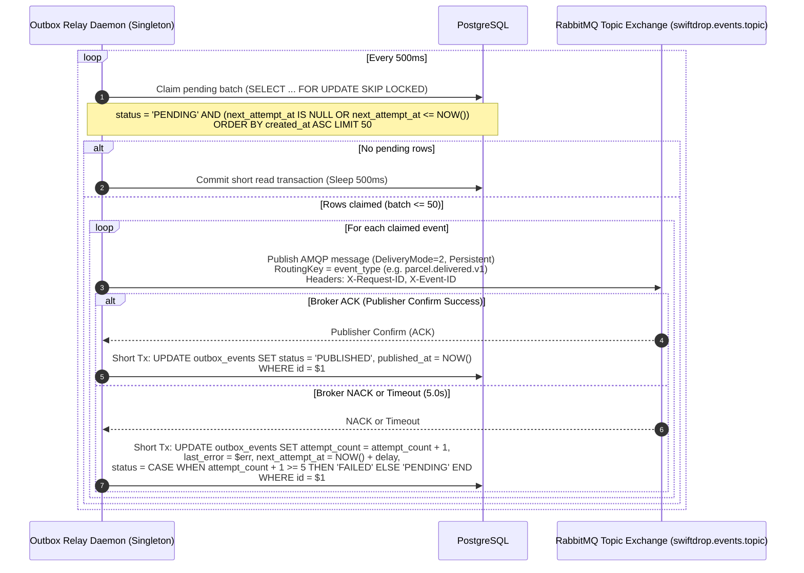
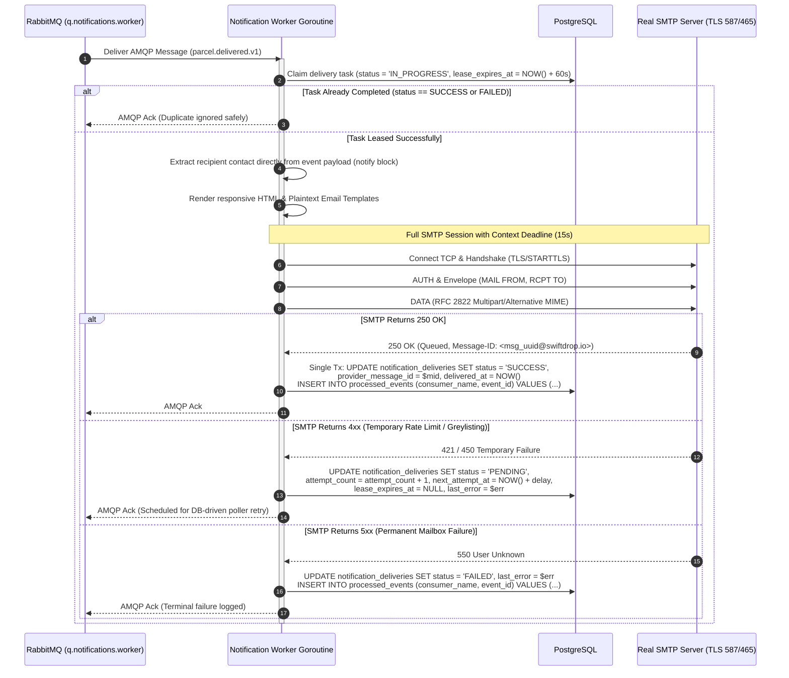
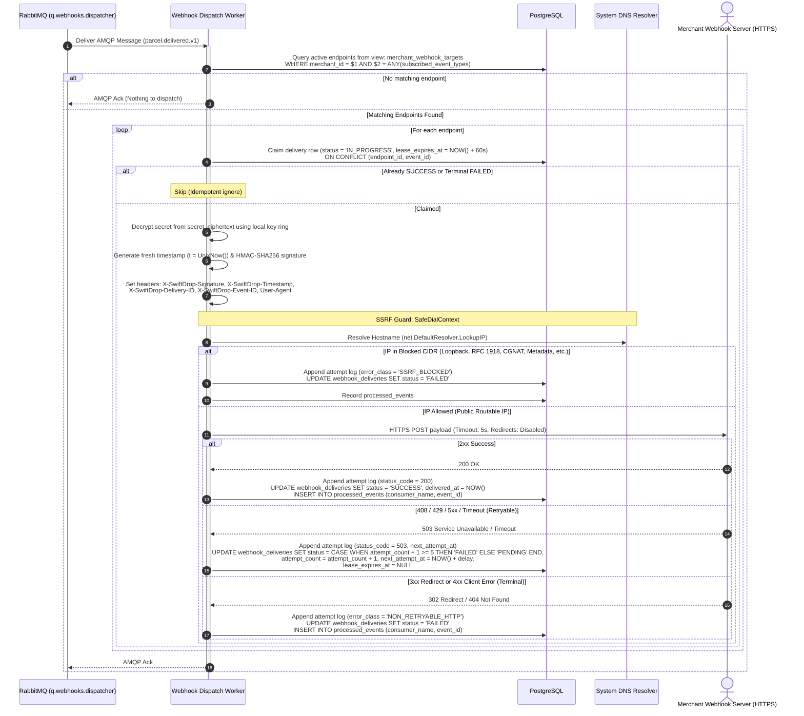
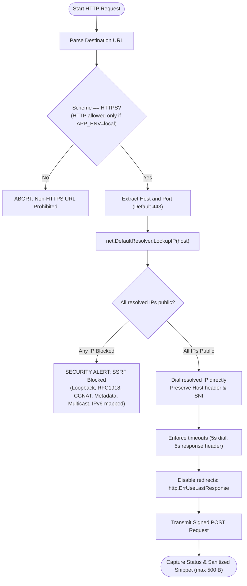
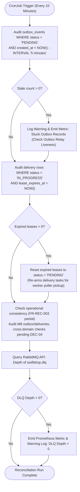

# Document 02 — Functional Flows & Business Rules

> **Module:** Event-Driven Backend & Messaging (`internal/events`, `services/messaging`)  
> **Owning Member:** Member 08 — Event-Driven Backend & Integrations  
> **Status:** Draft Baseline Specification for Review & Implementation  
> **Target Production Locations:**  
> - `core-api/internal/events/` (In-Monolith Outbox Writer & Envelopes)  
> - `services/messaging/` (Outbox Relay Daemon, Real SMTP Worker, Webhook Dispatcher, Reconciler)  
> **Relevant Contracts:** [event-contracts.md](../../contracts/event-contracts.md), [webhook-security.md](../../contracts/webhook-security.md), [database-schema.md](../../architecture/database-schema.md), [sequence-diagrams.md](../../architecture/sequence-diagrams.md)

---

## 1. Actors & Triggering Conditions

The Messaging & Event-Driven subsystem operates as the asynchronous backbone of SwiftDrop. It does not expose direct public end-user HTTP routes; instead, it is activated by internal database transactions, scheduled cron tickers, and incoming AMQP queue messages.

| Actor | Type | Triggering Condition | Role in Subsystem |
| :--- | :--- | :--- | :--- |
| **Core API Domain Use Cases** | Internal Software (Monolith) | Business state mutation occurs (Parcel Booked, Assigned, Picked Up, Delivered, Delivery Failed). | Calls `OutboxWriter.Write` inside the active `*sql.Tx` to durably stage an outbox event. |
| **Outbox Relay Daemon** | Autonomous Background Process | Timer ticker fires every `OUTBOX_POLL_INTERVAL_MS` (default 500ms). | Scans `outbox_events` with `FOR UPDATE SKIP LOCKED`, publishes persistent AMQP messages, and awaits publisher confirms. |
| **RabbitMQ Broker** | Infrastructure Middleware | Message routed to durable queue (`q.notifications.worker`, `q.webhooks.dispatcher`). | Delivers AMQP message payload to connected worker consumer channels. |
| **Notification Worker Consumer** | Background Worker Goroutine | Receives message from `q.notifications.worker`. | Deduplicates via `processed_events`, queries recipient email, connects to **Real SMTP Server**, and records outcome. |
| **Real SMTP Mail Server** | External Network Service | Worker initiates TLS/STARTTLS TCP handshake on port 587/465. | Receives, authenticates, and routes transactional emails to recipient inboxes. |
| **Webhook Dispatcher Consumer** | Background Worker Goroutine | Receives message from `q.webhooks.dispatcher`. | Resolves DNS with SSRF guard, computes HMAC-SHA256 signature, dispatches HTTP POST, and manages retries. |
| **Merchant Webhook Endpoint** | External HTTP Service | Worker sends authenticated HTTPS POST request. | Validates signature and timestamp; returns `2xx OK` or error. |
| **Reconciliation Engine / CronJob** | Scheduled CLI Command | Kubernetes CronJob triggers every 10m (`*/10`) or manual operator execution. | Audits stuck outbox rows (>5m), re-arms expired delivery leases, audits operational data consistency (FR-REC-003), and executes batched retention. Never publishes to broker. |

---

## 2. Core State Machines & Lifecycle Transitions

### 2.1 Outbox Event Lifecycle State Machine (`outbox_events.status`)

```mermaid
stateDiagram-v2
    [*] --> PENDING: Atomic INSERT in Core API Use Case Tx
    
    PENDING --> PENDING: Transient Publish Failure (attempt_count++, next_attempt_at set)
    PENDING --> PUBLISHED: RabbitMQ Publisher Confirm ACK Received (published_at set)
    PENDING --> FAILED: Exhausted retries (attempt_count >= 5; operational alert)
    
    PUBLISHED --> [*]: Purged by Retention Job after 7 days
    FAILED --> PENDING: Operator investigation & manual re-arm
```



- **`PENDING`:** Event committed in PostgreSQL alongside domain aggregate mutation. Poller selects rows where `status = 'PENDING'` and `next_attempt_at <= NOW()`.
- **`PUBLISHED`:** RabbitMQ broker confirmed persistent message receipt. Message safely routed to destination queues.
- **`FAILED`:** Unrecoverable serialization error or broker rejection exceeding 5 attempts. Flagged for operational triage.

---

### 2.2 Webhook Delivery Lifecycle (`webhook_deliveries.status`)

```mermaid
stateDiagram-v2
    [*] --> PENDING: Fan-out creates delivery task for matching endpoint
    
    PENDING --> IN_PROGRESS: Worker/Poller claims task (lease_expires_at = now + 60s)
    IN_PROGRESS --> SUCCESS: 2xx response within 5s (delivered_at set; attempt log appended)
    IN_PROGRESS --> PENDING: Retryable 408/429/5xx/timeout & attempt < 5 (next_attempt_at set; attempt log appended)
    IN_PROGRESS --> FAILED: Non-retryable 4xx/3xx/SSRF blocked OR attempt >= 5 (attempt log appended)
    IN_PROGRESS --> PENDING: Worker crash / lease expired (Reconciler resets lease)
    
    SUCCESS --> [*]: Retention purge after 30 days
    FAILED --> [*]: Retention purge after 30 days
```



- **`PENDING`:** Awaiting dispatch or scheduled retry. Selected by worker poller when `next_attempt_at <= NOW()`.
- **`IN_PROGRESS`:** Leased by active worker goroutine (`lease_expires_at` prevents concurrent dispatch by multiple pods).
- **`SUCCESS`:** Terminal success. HTTP 2xx received from merchant server.
- **`FAILED`:** Terminal failure. Non-retryable error (e.g. 404, 3xx redirect, SSRF blocked) or 5 attempts exhausted.
- **Append-Only Child Record:** Each HTTP attempt creates a row in `webhook_delivery_attempts` (FR-MER-011).

---

### 2.3 Notification Delivery Lifecycle (`notification_deliveries.status`)

```mermaid
stateDiagram-v2
    [*] --> PENDING: Delivery task created for customer email
    
    PENDING --> IN_PROGRESS: Worker claims task (lease_expires_at = now + 60s)
    IN_PROGRESS --> SUCCESS: SMTP 250 OK (provider_message_id set; delivered_at set)
    IN_PROGRESS --> PENDING: SMTP 4xx temporary failure / timeout & attempt < 5 (next_attempt_at set)
    IN_PROGRESS --> FAILED: SMTP 5xx permanent failure OR attempt >= 5
    IN_PROGRESS --> PENDING: Worker crash / lease expired (Reconciler resets lease)
    
    SUCCESS --> [*]: Retention purge after 30 days
    FAILED --> [*]: Retention purge after 30 days
```



---

## 3. Detailed Functional Workflows

---

### Flow 1: Outbox Event Generation & Atomic Commit (Within Core API)

This flow guarantees that an event is **never** emitted if the database transaction fails, and the database change **never** commits without its associated outbox event.

#### Preconditions
- The caller is an Application Use Case (e.g. `BookParcelUseCase`, `ConfirmDeliveryUseCase`).
- An active database transaction `tx` (`*sql.Tx`) is open.
- Domain invariants have passed inside the aggregate root.

#### Step-by-Step Execution
1. The domain aggregate mutates state (e.g. `Parcel.Status = DELIVERED`, `Version = Version + 1`).
2. The use case persists aggregate changes (`UPDATE parcels ...`) and writes history (`INSERT INTO parcel_status_history ...`).
3. The use case constructs a typed `EventEnvelope[T]` with:
   - `event_id`: Unique UUIDv7 (time-ordered).
   - `event_type`: Centralized constant (e.g. `parcel.delivered.v1`).
   - `aggregate_type`: `"parcel"`.
   - `aggregate_id`: Parcel UUID.
   - `correlation_id`: Propagated from HTTP request header `X-Request-ID`.
   - `timestamp`: UTC ISO-8601.
   - `payload`: Domain milestone attributes.
4. The use case invokes `OutboxWriter.Write(ctx, tx, envelope)`.
5. The `OutboxWriter` serializes the payload to JSON and executes:
   ```sql
   INSERT INTO outbox_events (
       id, aggregate_type, aggregate_id, event_type, payload, correlation_id, status, created_at
   ) VALUES ($1, $2, $3, $4, $5, $6, 'PENDING', NOW());
   ```
6. The use case executes `tx.Commit()`.

#### Failure Flows
- If any validation, domain error, or database constraint fails prior to commit, `tx.Rollback()` is executed. Both the parcel status change and the `outbox_events` record vanish atomically.

#### Postconditions
- A durable row in `outbox_events` with `status = 'PENDING'` is visible to read-committed transactions.

---

### Flow 2: Outbox Relay Polling & Broker Confirmation

The Outbox Relay process reads committed outbox entries and publishes events to RabbitMQ with publisher confirms.



#### Failure Handling & Resilience Rules
- **Broker Unreachable / Down:** The Relay catches connection failure, does not mark rows as `PUBLISHED`, backs off exponentially (1s, 2s, 4s, max 30s), and reconnects. Pending rows remain safely in PostgreSQL.
- **Publisher Confirm NACK or Timeout (5.0s):** If RabbitMQ rejects a message or fails to confirm within 5 seconds, the relay increments `attempt_count`, logs `last_error`, and updates `next_attempt_at` in an independent single-row transaction. If `attempt_count >= 5`, the status is transitioned to `FAILED` and an operational alert is emitted.
- **Per-Row Transaction Isolation:** The relay does NOT hold a single database transaction across 50 broker confirms. Each confirmed message commits its `PUBLISHED` status immediately, eliminating batch rollback risks.
- **Relay Crash During Batch:** If the relay crashes after publishing to RabbitMQ but before persisting `PUBLISHED`, the row remains `PENDING`. Upon restart, the relay will re-publish the message. This guarantees **at-least-once delivery with idempotent effects**; downstream consumers are strictly idempotent.

---

### Flow 3: Real SMTP Customer Email Notification Delivery

This flow fulfills the requirement to use a **real SMTP mail server** (with Mailpit in local/CI environments) with zero fake or mock code paths.



#### Real SMTP Technical Specifications
- **Single TLS Policy:** Configured via `SMTP_SECURITY=starttls|tls|none` (`none` permitted strictly when `APP_ENV=local` with Mailpit). Fails closed if encryption cannot be established.
- **Context Deadline:** Entire SMTP session runs under a 15-second transaction context deadline.
- **Message-ID Generation:** SwiftDrop generates an RFC 2822 compliant `Message-ID` (`<uuid@swiftdrop.io>`) and persists it as `provider_message_id`.

---

### Flow 4: Merchant Webhook Dispatcher & SSRF Defense

Outbound webhooks allow merchant systems to receive real-time updates. Because destination URLs are merchant-configured, this flow enforces cryptographic signing and zero-trust SSRF defense.



---

## 4. SSRF Defense: `SafeDialContext` Algorithm & Activity Diagram

To satisfy **SRS SEC-010** and prevent Server-Side Request Forgery and DNS Rebinding:



---

## 5. Consumer Idempotency & Deduplication Logic

RabbitMQ guarantees **at-least-once** delivery. Network interruptions, worker restarts, or delayed acks will produce duplicate deliveries.

### Leased Delivery Claim Flow
Rather than inserting into `processed_events` before executing side effects (which risked losing messages if external calls failed), consumers use **Database-Driven Leased Claims**:
1. Upon receiving an event, the worker checks the delivery table (`webhook_deliveries` or `notification_deliveries`).
2. The worker atomically transitions the row from `PENDING` to `IN_PROGRESS` with a 60-second lease:
   ```sql
   UPDATE webhook_deliveries
   SET status = 'IN_PROGRESS', lease_expires_at = NOW() + INTERVAL '60 seconds'
   WHERE endpoint_id = $1 AND event_id = $2
     AND (status = 'PENDING' OR (status = 'IN_PROGRESS' AND lease_expires_at < NOW()))
   RETURNING id, attempt_count;
   ```
3. If the row is already `SUCCESS` or terminal `FAILED`, the message is an idempotent duplicate; the worker immediately ACKs the AMQP message and returns.
4. If an external failure occurs, `attempt_count` is incremented, `next_attempt_at` is set per the fixed retry schedule, and `status` returns to `PENDING` with `lease_expires_at = NULL`.
5. Only upon **terminal outcome** (`SUCCESS` or terminal `FAILED`) is the deduplication record inserted into `processed_events`:
   ```sql
   INSERT INTO processed_events (consumer_name, event_id, processed_at)
   VALUES ($1, $2, NOW())
   ON CONFLICT (consumer_name, event_id) DO NOTHING;
   ```

---

## 6. Fixed Retry Schedule & Error Classification Matrix

For transient external failures, retries follow a **deterministic 5-attempt schedule** (1 initial attempt + 4 retries) with bounded jitter:

### Webhook & Notification Retry Schedule
| Attempt ($n$) | Base Delay | Random Jitter Range | Cumulative Elapsed Window | Action on Failure |
| :--- | :--- | :--- | :--- | :--- |
| **1** | Immediate | $0\text{s}$ | $0\text{s}$ | Initial dispatch attempt on AMQP message receipt |
| **2** | $30\text{s}$ | $\pm 5\text{s}$ | $\sim 30\text{s}$ | 1st retry (poller claims when `next_attempt_at <= NOW()`) |
| **3** | $120\text{s}$ ($2\text{m}$) | $\pm 15\text{s}$ | $\sim 2\text{m } 30\text{s}$ | 2nd retry |
| **4** | $600\text{s}$ ($10\text{m}$) | $\pm 60\text{s}$ | $\sim 12\text{m } 30\text{s}$ | 3rd retry |
| **5** | $1800\text{s}$ ($30\text{m}$) | $\pm 180\text{s}$ | $\sim 42\text{m } 30\text{s}$ | 4th retry (final attempt) |
| **Exhaustion** | Permanent | N/A | $\sim 42\text{m } 30\text{s}$ | Status transitions to `FAILED`; recorded in attempt log; alert emitted |

### Webhook HTTP Status Code Retry Matrix
| Outcome / Status Code | Classification | Policy | Delivery Status | System Behavior |
| :--- | :--- | :--- | :--- | :--- |
| **200 - 299** | Success | Complete | `SUCCESS` | Persist response code & `delivered_at`; append attempt log; record `processed_events`; AMQP Ack. |
| **408 Request Timeout** | Client Timeout | Retryable | `PENDING` | Increment `attempt_count`; set `next_attempt_at`; append attempt log; AMQP Ack. |
| **429 Too Many Requests**| Rate Limited | Retryable | `PENDING` | Respect backoff; set `next_attempt_at`; append attempt log; AMQP Ack. |
| **500 - 599** | Server Error | Retryable | `PENDING` | Increment `attempt_count`; set `next_attempt_at`; append attempt log; AMQP Ack. |
| **TCP Dial / TLS Timeout**| Network Failure | Retryable | `PENDING` | Increment `attempt_count`; set `next_attempt_at`; append attempt log; AMQP Ack. |
| **301, 302, 307, 308** | HTTP Redirect | Terminal Failure | `FAILED` | Disallowed under SSRF security policy (`http.ErrUseLastResponse`); append attempt log; record `processed_events`; AMQP Ack. |
| **400, 401, 403, 404, 410, 422**| Client Error | Terminal Failure | `FAILED` | Misconfigured URL or revoked auth; no retry; append attempt log; record `processed_events`; AMQP Ack. |
| **SSRF Destination Block**| Security Block | Terminal Failure | `FAILED` | Destination resolves to private or metadata IP; abort immediately; log security alert; record `processed_events`. |

---

## 7. Operational Flow: Scheduled Reconciliation & Self-Healing

The reconciliation command (`cmd/reconcile`) runs every 10 minutes via Kubernetes CronJob `swiftdrop-outbox-reconciler` or manually by operators.



#### Reconciler Operating Rules
1. **Never Publish to RabbitMQ:** In strict adherence to **SRS FR-REC-005**, the reconciliation job re-arms database state only (`status = 'PENDING'`). It never directly publishes events to RabbitMQ.
2. **Never Reset Counters Blindly:** The reconciler never sets `attempt_count = 0` on stale rows. Unbounded counter resets would cause infinite retry loops on poison records.
3. **Batch Bounded Execution:** All audit and update queries are bounded by `--batch-size 100` (FR-REC-004).
4. **Audit Logging:** Every state modification is written to `audit_logs` with `actor_id = 'system/reconciler'`, timestamp, request ID, and reason (SEC-015).
5. **Operator DLQ Replay Mode:** Includes `--replay-dlq` CLI mode to inspect poison messages and safely re-queue them via the outbox ingestion path under operator supervision.

---

## 8. Real Examples & Concrete Edge Cases

### Edge Case 1: Merchant Endpoint Responds with HTTP 302 Redirect to AWS Metadata
- **Scenario:** A malicious merchant registers webhook URL `https://merchant-store.com/webhook`. When the worker dispatches the POST request, the merchant returns `HTTP 302 Found` with `Location: http://169.254.169.254/latest/meta-data/`.
- **System Defense:** The worker's HTTP client has `CheckRedirect` configured to return `http.ErrUseLastResponse`. The redirect is **never followed**. The HTTP response is recorded as a `302`, treated as non-2xx failure, and logged without executing requests to the internal IP.

### Edge Case 2: Slow SMTP Server Causes Worker Goroutine Hang
- **Scenario:** The external SMTP server accepts TCP connections but hangs indefinitely during the `DATA` command.
- **System Defense:** The worker wraps the entire SMTP transaction in a Go `context.WithTimeout(ctx, 15*time.Second)`. When the deadline expires, the socket is abruptly closed by the worker, the attempt is logged as a timeout failure, and the worker goroutine is freed back to the pool.

### Edge Case 3: Outbox Relay Crashes Mid-Batch
- **Scenario:** The Relay reads 50 pending rows. It publishes all 50 to RabbitMQ and receives publisher confirms. Before it can execute `UPDATE outbox_events SET status = 'PUBLISHED'`, the pod is killed by the Kubernetes OOM killer.
- **System Defense:** When a replacement Relay pod boots, the rows in `outbox_events` are still `PENDING`. The new pod claims them and publishes them to RabbitMQ a second time. The downstream `NotificationWorker` and `WebhookWorker` receive the duplicates, but their `processed_events` atomic check absorbs the duplicates with zero duplicate emails or HTTP calls.

### Edge Case 4: Merchant Signature Verification Clock Skew
- **Scenario:** SwiftDrop server time is `12:00:00`. Merchant server clock is slightly ahead at `12:03:30`.
- **System Defense:** Per contract [webhook-security.md §2.3](../../contracts/webhook-security.md), the signature header includes `t={timestamp}`. The receiver verifies $| \text{CurrentTime} - t | \le 300\text{ seconds}$. A drift of $210\text{ seconds}$ is within the 5-minute absolute difference window and is accepted. If drift exceeds $300\text{ seconds}$ (e.g. merchant clock at `12:05:30`, drift $= 330\text{s}$), the request is safely rejected to prevent replay attacks.

---

## 9. Summary Checklist of Document 02 Deliverables

- [x] Clear definition of all actors and triggering conditions (Core API, Relay, RabbitMQ, Workers, Real SMTP, Webhook receiver, Reconciler).
- [x] State machines with permitted transitions for Outbox Events, Webhook Deliveries, and Notification Deliveries.
- [x] Detailed step-by-step flows for Atomic Outbox Commit, Relay Publisher Confirms, Real SMTP Email Delivery, and Webhook Dispatch.
- [x] Full real SMTP email protocol dialogue documented with TLS/STARTTLS authentication.
- [x] Activity diagram and algorithm for `SafeDialContext` zero-trust SSRF defense and single-resolution DNS.
- [x] Consumer deduplication logic via `processed_events` with conflict detection.
- [x] Bounded exponential backoff formula with jitter schedule.
- [x] Activity diagram for scheduled reconciliation and self-healing.
- [x] Real-world failure edge cases detailed (redirect SSRF bypass, SMTP timeout hang, mid-batch relay crash, clock skew).
