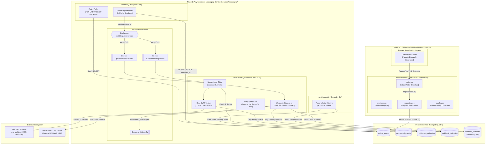

# Document 03 — Internal Architecture & Design Specification

> **Module:** Event-Driven Backend & Messaging (`internal/events`, `services/messaging`)  
> **Owning Member:** Member 08 — Event-Driven Backend & Integrations  
> **Status:** Draft Baseline Specification for Review & Implementation  
> **Target Production Locations:**  
> - `core-api/internal/events/` (In-Monolith Outbox Writer & Envelopes)  
> - `services/messaging/` (Outbox Relay Daemon, Real SMTP Worker, Webhook Dispatcher, Reconciler)  
> **Relevant Contracts:** [event-contracts.md](../../contracts/event-contracts.md), [webhook-security.md](../../contracts/webhook-security.md), [database-schema.md](../../architecture/database-schema.md), [domain-boundaries.md](../../architecture/domain-boundaries.md)

---

## 1. Architectural Philosophy & Dual-Plane Component Topology

The messaging infrastructure of SwiftDrop is split across two architectural planes to preserve the Clean Architecture rules enforced by `.golangci.yml` and `AGENTS.md`:
1. **The In-Monolith Support Plane (`core-api/internal/events/`):** Pure transactional integration plumbing embedded within the Go Modular Monolith. It provides generic event envelope structs and the `OutboxWriter` interface. It has zero network broker dependencies and writes strictly to PostgreSQL.
2. **The Asynchronous Daemon Plane (`services/messaging/`):** Autonomous, deployable Go daemons operating outside the monolith request-response lifecycle. It hosts the Outbox Relay, the Event Worker consumers, the real SMTP email adapter, the hardened merchant webhook dispatcher, and the reconciliation engine.



---

## 2. Component and Package Structure

### 2.1 Monolith Package Structure (`core-api/internal/events/`)
In compliance with Layer 2 clean architecture boundaries:
```
core-api/internal/events/
├── envelope.go        # Canonical generic EventEnvelope[T] struct
├── writer.go          # OutboxWriter interface definition
├── repository.go      # PostgreSQL implementation appending rows to outbox_events
├── catalog.go         # Domain event type string constants (e.g. ParcelBookedV1)
├── errors.go          # Custom domain and infrastructure errors
└── events_test.go     # Unit tests verifying serialization and interface compliance
```

### 2.2 Dedicated Messaging Service Structure (`services/messaging/`)
Separately compiled Go binary targets and internal modules:
```
services/messaging/
├── cmd/
│   ├── relay/
│   │   └── main.go                  # Outbox Relay entrypoint (singleton runner)
│   ├── worker/
│   │   └── main.go                  # Event Worker consumer entrypoint (multithreaded runner)
│   └── reconcile/
│       └── main.go                  # Standalone CLI / Kubernetes CronJob entrypoint
├── internal/
│   ├── config/
│   │   └── config.go                # Strongly typed environment variable parser
│   ├── broker/
│   │   ├── connection.go            # RabbitMQ resilient connection manager (auto-reconnect)
│   │   ├── topology.go              # Exchange, queue, and binding declarations
│   │   ├── publisher.go             # Thread-safe publisher with publisher confirms
│   │   └── consumer.go              # AMQP consumer loop with manual Ack/Nack
│   ├── outbox/
│   │   ├── poller.go                # Polling query using FOR UPDATE SKIP LOCKED
│   │   └── relay.go                 # Relay orchestration (fetch -> publish -> confirm -> ack DB)
│   ├── idempotency/
│   │   └── store.go                 # processed_events repository with conflict detection
│   ├── notifier/
│   │   ├── sender.go                # Real SMTPSender interface & implementation
│   │   ├── templates.go             # Embedded HTML/plain-text transactional email templates
│   │   ├── repository.go            # notification_deliveries table repository
│   │   └── handler.go               # Consumer handler mapping events to email notifications
│   ├── webhook/
│   │   ├── client.go                # Safe HTTP client enforcing SafeDialContext (SSRF guard)
│   │   ├── decrypt.go               # AES-256-GCM secret decryption helper (Member 04 alignment)
│   │   ├── signer.go                # HMAC-SHA256 signature generator
│   │   ├── backoff.go               # Exponential backoff with randomized jitter calculator
│   │   ├── repository.go            # webhook_deliveries repository & endpoint reader
│   │   └── dispatcher.go            # Webhook dispatch worker handler
│   ├── health/
│   │   └── server.go                # Internal HTTP server for /health/live, /health/ready, /metrics (A2)
│   └── reconcile/
│       └── reconciler.go            # Stale outbox row & overdue retry audit logic
├── tests/
│   ├── integration/
│   │   ├── outbox_relay_test.go     # Testcontainers DB -> Relay -> RabbitMQ integration test
│   │   ├── consumer_test.go         # Worker consumption & deduplication test
│   │   └── ssrf_guard_test.go       # Network dialer rejection test for blacklisted CIDRs
│   └── mocks/
│       └── smtp_server_test.go      # Local SMTP listener for end-to-end integration tests
├── go.mod
├── go.sum
└── README.md                        # Authoritative living documentation
```

---

## 3. Layer Responsibilities & Key Go Interfaces

### 3.1 `core-api/internal/events/envelope.go`
Defines the canonical event envelope adhering to [event-contracts.md §1](../../contracts/event-contracts.md):

```go
package events

import "time"

// EventEnvelope provides a strongly-typed wrapper for all domain events.
type EventEnvelope[T any] struct {
    EventID       string    `json:"event_id"`
    EventType     string    `json:"event_type"`
    AggregateType string    `json:"aggregate_type"`
    AggregateID   string    `json:"aggregate_id"`
    Version       int       `json:"version"`
    Timestamp     time.Time `json:"timestamp"`
    CorrelationID string    `json:"correlation_id"`
    Producer      string    `json:"producer"`
    Payload       T         `json:"payload"`
}
```

### 3.2 `core-api/internal/events/writer.go`
Defines the transactional outbox contract:

```go
package events

import (
    "context"
    "database/sql"
)

// OutboxWriter enables application use cases to persist events within an active transaction.
type OutboxWriter interface {
    // Write stages one or more domain event envelopes into outbox_events.
    // The passed tx MUST be the exact transaction used for the aggregate mutation.
    Write(ctx context.Context, tx *sql.Tx, events ...AnyEnvelope) error
}

// AnyEnvelope represents an envelope whose payload has been serialized or erased.
type AnyEnvelope interface {
    GetEventID() string
    GetEventType() string
    GetAggregateType() string
    GetAggregateID() string
    GetCorrelationID() string
    SerializePayload() ([]byte, error)
}
```

### 3.3 `services/messaging/internal/broker/publisher.go`
Publisher interface ensuring publisher confirms:

```go
package broker

import "context"

type PublishMessage struct {
    RoutingKey    string
    EventID       string
    CorrelationID string
    Body          []byte
}

type Publisher interface {
    // PublishPersistent publishes a message and blocks until broker confirmation is received.
    PublishPersistent(ctx context.Context, msg PublishMessage) error
    Close() error
}
```

### 3.4 `services/messaging/internal/notifier/sender.go`
Real SMTP mailer interface:

```go
package notifier

import "context"

type EmailMessage struct {
    To          string
    Subject     string
    HTMLContent string
    TextContent string
}

type SMTPSender interface {
    // Send connects to the configured real SMTP server over TLS/STARTTLS and delivers the message.
    Send(ctx context.Context, msg EmailMessage) (providerMessageID string, err error)
}
```

### 3.5 `services/messaging/internal/webhook/client.go`
Hardened HTTP transport interface:

```go
package webhook

import (
    "context"
    "net/http"
)

type SecureHTTPClient interface {
    // Do executes an outbound HTTP request through a transport enforcing SafeDialContext.
    Do(ctx context.Context, req *http.Request) (*http.Response, error)
}
```

### 3.6 `services/messaging/internal/webhook/decrypt.go`
AES-256-GCM secret decryption adhering to Member 04's storage contract:

```go
package webhook

import (
    "crypto/aes"
    "crypto/cipher"
    "errors"
    "fmt"
)

// DecryptSecret decrypts the AES-256-GCM encrypted secret stored by Member 04 (nonce || ciphertext || tag).
func DecryptSecret(ciphertext []byte, encryptionKey []byte) (string, error) {
    block, err := aes.NewCipher(encryptionKey)
    if err != nil {
        return "", fmt.Errorf("failed to create AES cipher: %w", err)
    }

    gcm, err := cipher.NewGCM(block)
    if err != nil {
        return "", fmt.Errorf("failed to create GCM: %w", err)
    }

    nonceSize := gcm.NonceSize()
    if len(ciphertext) < nonceSize {
        return "", errors.New("ciphertext too short")
    }

    nonce, encryptedData := ciphertext[:nonceSize], ciphertext[nonceSize:]
    plaintext, err := gcm.Open(nil, nonce, encryptedData, nil)
    if err != nil {
        return "", fmt.Errorf("failed to decrypt webhook secret: %w", err)
    }

    return string(plaintext), nil
}
```

### 3.7 `services/messaging/internal/health/server.go`
Internal health and metrics server complying with Member 09 Agreement A2 & K17:

```go
package health

import (
    "context"
    "database/sql"
    "net/http"
    "github.com/prometheus/client_golang/prometheus/promhttp"
)

// StartHealthServer exposes /health/live, /health/ready, and /metrics on internal port.
func StartHealthServer(addr string, db *sql.DB, isReady func() bool) *http.Server {
    mux := http.NewServeMux()

    // Liveness: Process is alive (never checks DB, per Agreement A2)
    mux.HandleFunc("/health/live", func(w http.ResponseWriter, r *http.Request) {
        w.WriteHeader(http.StatusOK)
        w.Write([]byte(`{"status":"UP"}`))
    })

    // Readiness: Checks critical dependencies (PostgreSQL + RabbitMQ connection)
    mux.HandleFunc("/health/ready", func(w http.ResponseWriter, r *http.Request) {
        if db != nil {
            if err := db.PingContext(r.Context()); err != nil {
                http.Error(w, `{"status":"DOWN","reason":"db_unreachable"}`, http.StatusServiceUnavailable)
                return
            }
        }
        if isReady != nil && !isReady() {
            http.Error(w, `{"status":"DOWN","reason":"broker_disconnected"}`, http.StatusServiceUnavailable)
            return
        }
        w.WriteHeader(http.StatusOK)
        w.Write([]byte(`{"status":"READY"}`))
    })

    // Prometheus metrics
    mux.Handle("/metrics", promhttp.Handler())

    srv := &http.Server{Addr: addr, Handler: mux}
    go srv.ListenAndServe()
    return srv
}
```

---

## 4. Domain-Driven Design (DDD) Concepts & Taxonomy

Although messaging is primarily an infrastructure capability, DDD principles govern the models and boundaries:

| DDD Concept | Implementation in Member 08 | Justification |
| :--- | :--- | :--- |
| **Domain Event** | `EventEnvelope[T]` | Represents an immutable, historical business fact (`ParcelBooked`, `CourierAssigned`, `DeliveryConfirmed`). Carries `occurred_at` and `version`. |
| **Aggregate Root (Reference)** | `aggregate_type` + `aggregate_id` | Identifies the consistency boundary in the Core API that generated the event (e.g. `aggregate_type: "parcel"`). |
| **Value Object** | `CorrelationID`, `EventID`, `RoutingKey` | Immutable identity and tracing primitives with strict validation rules (UUIDv7 format, dot-separated namespacing). |
| **Entity** | `WebhookDelivery`, `NotificationDelivery` | State-bearing persistence models possessing distinct lifecycle stages (`PENDING` $\to$ `SENT` / `FAILED`, retry counts). |
| **Domain Service** | `SSRFGuardService`, `SignatureService` | Stateless domain algorithms encapsulating security policy: CIDR blacklist evaluation and HMAC-SHA256 digest creation. |
| **Repository** | `OutboxRepository`, `IdempotencyRepository`, `DeliveryRepository` | Encapsulates SQL persistence and isolation semantics away from business logic. |

---

## 5. Dependency Direction & Import Boundary Rules

To pass `.golangci.yml` `depguard` automated checks:

```
┌─────────────────────────────────────────────────────────────┐
│ Allowed Dependency Flow:                                    │
│ Transport (cmd/*) ──► Application ──► Domain ◄── Adapter     │
└─────────────────────────────────────────────────────────────┘
```

### Prohibited Imports in `core-api/internal/events/`:
- **STRICT PROHIBITION:** Must NOT import `github.com/rabbitmq/amqp091-go` or any network broker library.
- Must NOT import `net/http` for remote dispatch.
- Must NOT import other domain modules (e.g. `internal/parcels`, `internal/dispatch`).

### Allowed Imports in `services/messaging/`:
- `github.com/rabbitmq/amqp091-go` (AMQP 0-9-1 driver)
- `github.com/lib/pq` or `github.com/jackc/pgx/v5` (PostgreSQL driver)
- `net`, `crypto/tls`, `crypto/hmac`, `crypto/sha256`, `net/smtp` (Standard Go networking & cryptography)

---

## 6. Design Patterns & Engineering Justifications

### 1. Transactional Outbox Pattern
- **Problem:** Updating PostgreSQL and publishing to RabbitMQ in separate operations creates distributed partial failures (dual-write hazard).
- **Justification:** Writing outbox rows into PostgreSQL using the caller's active transaction makes event persistence atomic with domain state mutations.

### 2. Unit of Work / Transaction Parameter Injection
- **Problem:** Repositories creating their own database connections cannot participate in a shared atomic transaction.
- **Justification:** `OutboxWriter.Write(ctx, tx, ...)` explicitly accepts the caller's `*sql.Tx`, ensuring enlistment in the caller's transaction boundary without leaking connection management.

### 3. Publisher Confirms (Asynchronous AMQP ACKs)
- **Problem:** Asynchronous network writes to message brokers can be lost if the broker crashes before flushing to disk.
- **Justification:** Enforcing RabbitMQ publisher confirms guarantees that messages are safely on durable disk before the Outbox Relay marks them as `PUBLISHED`.

### 4. Idempotent Consumer Pattern
- **Problem:** RabbitMQ at-least-once delivery may cause duplicate delivery during network reconnects.
- **Justification:** Checking and recording the composite key `(event_id, consumer_name)` in `processed_events` ensures duplicate deliveries are discarded without repeated real-world side effects.

### 5. Custom Transport Decorator (Safe Dialing for SSRF Protection)
- **Problem:** Standard `http.DefaultClient` is vulnerable to DNS rebinding (TOCTOU attacks) and private IP scanning.
- **Justification:** Decorating `http.Transport` with a custom `DialContext` resolves DNS once, checks blacklisted CIDRs, and dials the validated IP directly.

### 6. Strategy / Adapter Pattern (Real SMTP Mailer)
- **Problem:** Couriers and customers need real email notifications, but low-level SMTP protocol code should not clutter consumer handlers.
- **Justification:** Encapsulating the SMTP connection, STARTTLS negotiation, authentication, and MIME formatting behind the `SMTPSender` interface allows robust testing while delivering real emails in production.

---

## 7. Transaction Boundaries & Consistency Requirements

| Component | Database Transaction Scope | Isolation Level | Consistency Guarantee |
| :--- | :--- | :--- | :--- |
| **Monolith Outbox Writer** | Shares active use case transaction (`*sql.Tx`). Encompasses entity mutation + outbox row insertion. | `READ COMMITTED` | **Strong Immediate Consistency:** The outbox row exists if and only if the domain change commits. |
| **Outbox Relay Poller** | Autonomous transaction per batch: `SELECT ... FOR UPDATE SKIP LOCKED` $\to$ publish $\to$ `UPDATE published_at`. | `READ COMMITTED` | **At-Least-Once Delivery:** If Relay crashes mid-batch, rows remain `PENDING` and are re-published upon restart. |
| **Consumer Idempotency** | Atomic single-row `INSERT ... ON CONFLICT DO NOTHING`. | `READ COMMITTED` | **Strict Deduplication:** Primary key conflict guarantees a message is executed at most once per consumer. |
| **External Calls (SMTP / Webhook)** | **ZERO DATABASE TRANSACTION OPEN.** External network calls must occur entirely outside active database transactions. | N/A | **Fault Isolation:** Slow SMTP relays or dead merchant servers cannot hold PostgreSQL locks or exhaust the DB pool. |

---

## 8. Architectural Alternatives Considered & Trade-Offs

### Alternative 1: Direct Network Publication from Core API
- **Description:** Publishing messages to RabbitMQ directly inside Core API HTTP request handlers.
- **Pros:** Lower latency (no polling delay); simpler infrastructure.
- **Cons (Rejected):** Direct dual-write hazard. If RabbitMQ is slow or down, API requests time out. If DB commits but broker publish fails, data is lost permanently.

### Alternative 2: Change Data Capture (CDC) via Debezium / Kafka Connect
- **Description:** Reading the PostgreSQL Write-Ahead Log (WAL) using Debezium and Kafka Connect.
- **Pros:** Zero outbox table polling overhead; zero application outbox code.
- **Cons (Rejected):** Massive operational overhead for a 10-developer modular monolith. Requires Kafka, Zookeeper/KRaft, Debezium JVM daemons, and complex schema registry management. The Go Outbox Relay provides up to 1,000 msg/sec with negligible PostgreSQL CPU.

### Alternative 3: Standard `SELECT ... FOR UPDATE` Polling
- **Description:** Polling `outbox_events` without `SKIP LOCKED`.
- **Pros:** Works on ancient database engines.
- **Cons (Rejected):** If multiple workers or queries run, rows are locked sequentially, causing head-of-line blocking and severe database lock contention. `SKIP LOCKED` allows concurrent batch processing without locking delays.

### Alternative 4: Mock / In-Memory Demo Notification Sink
- **Description:** Printing email contents to stdout or saving to an in-memory slice.
- **Pros:** Zero external dependencies; trivial local setup.
- **Cons (Explicitly Rejected by User):** Masks real-world network failure modes, TLS certificate issues, and SMTP rate-limiting. Using a real SMTP server from day one guarantees production-grade reliability and verifiable email delivery.

---

## 9. Scaling & Performance Considerations

### 9.1 Outbox Relay Scalability
- **Singleton Constraint:** Per [AGENTS.md](../../../AGENTS.md), the Outbox Relay MUST run with `replicas: 1`. Horizontal scaling of the poller without distributed leader election is strictly prohibited.
- **Throughput Profile:** 
  - Batch size: 50 rows.
  - Polling interval: 500ms.
  - Channel buffer: 100 messages.
  - Sustainable throughput: $\sim 100\text{ events/sec}$ per relay pod. For higher workloads, the batch size can be dynamically tuned to 500 without architectural changes.
- **Authoritative Partial Index:**
  ```sql
  CREATE INDEX IF NOT EXISTS idx_outbox_pending 
  ON outbox_events (created_at ASC) 
  WHERE status = 'PENDING';
  ```
  This partial index ensures that even as `outbox_events` grows to tens of millions of rows, polling queries execute via an index scan touching only uncommitted rows ($< 1\text{ ms}$ query latency).

### 9.2 Event Worker Scalability (KEDA Autoscaling)
- **Stateless Consumer:** The Event Worker is completely stateless and scales horizontally from 1 to 5 pods via **KEDA (Kubernetes Event-driven Autoscaling)** based on RabbitMQ queue depth (`q.notifications.worker` and `q.webhooks.dispatcher` backlog > 10).
- **Concurrency per Pod:** Each worker pod runs a configurable pool of goroutines (`WORKER_CONCURRENCY=10` by default).
- **AMQP Prefetch Count:** Workers set `Channel.Qos(prefetchCount = 10, prefetchSize = 0, global = false)` to prevent a single pod from starving others.

### 9.3 Database Connection Pool Management
- Daemons use bounded connection pools to prevent exhausting PostgreSQL `max_connections`:
  - `Relay`: `max_open = 5`, `max_idle = 2`
  - `Worker`: `max_open = 10`, `max_idle = 5`

### 9.4 Container Packaging, Multi-Binary Standard & Security
- **Single Multi-Binary Container:** Per Member 09 Agreement A3, all messaging daemons share a single production container image: `ghcr.io/phantomtroupeead/swiftdrop/messaging:<git-sha>`.
- **Three Binary Entrypoints:** Compiled during multi-stage build into `/usr/local/bin/relay`, `/usr/local/bin/worker`, and `/usr/local/bin/reconcile`.
- **Execution User:** Runs strictly under non-root user `USER 10001:10001` (SwiftDrop cluster security standard).
- **Zero Secrets Baked In:** All credentials (`DATABASE_URL`, `RABBITMQ_URL`, `WEBHOOK_SECRET_ENCRYPTION_KEY`, SMTP credentials) are mounted at runtime from Kubernetes secrets (`postgres-secrets`, `rabbitmq-secrets`, `integrations-secrets`).

---

## 10. Summary Checklist of Document 03 Deliverables

- [x] Clear component topology diagram detailing Core API monolith integration, PostgreSQL tables, RabbitMQ topology, and messaging daemons.
- [x] Complete package structure for both `core-api/internal/events/` and `services/messaging/`.
- [x] Key Go interface definitions (`OutboxWriter`, `Publisher`, `SMTPSender`, `SecureHTTPClient`).
- [x] Mapping of DDD concepts (Domain Events, Aggregates, Value Objects, Domain Services).
- [x] Strict dependency rules adhering to `.golangci.yml` `depguard` (zero broker imports in `core-api`).
- [x] Documented design patterns and justifications (Outbox, Unit of Work, Publisher Confirms, Idempotency, Adapter, SSRF decorator).
- [x] Transaction boundary specifications ensuring non-blocking external calls.
- [x] Documented architectural alternatives and trade-offs (CDC, Direct Publish, Real SMTP vs Mock).
- [x] Scaling and performance analysis covering singleton relay constraints, KEDA autoscaling, partial indexes, and connection pooling.
