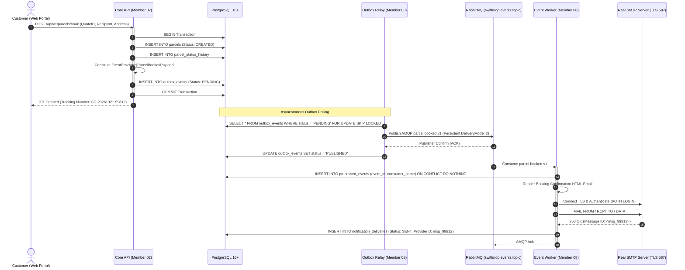
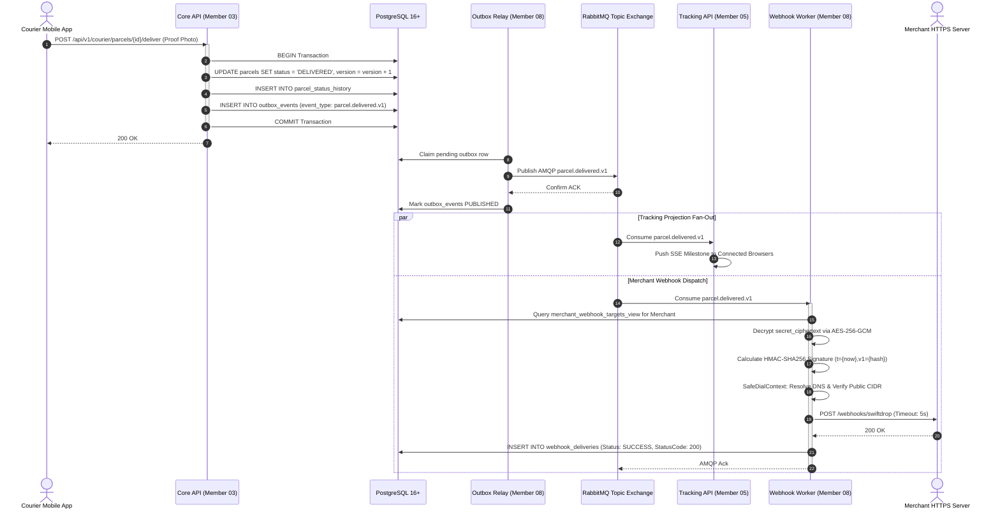

# Document 04 — Interface & Integration Contract

> **Module:** Event-Driven Backend & Messaging (`internal/events`, `services/messaging`)  
> **Owning Member:** Member 08 — Event-Driven Backend & Integrations  
> **Status:** Draft Baseline Specification for Review & Implementation  
> **Target Production Locations:**  
> - `core-api/internal/events/` (In-Monolith Outbox Writer & Envelopes)  
> - `services/messaging/` (Outbox Relay Daemon, Real SMTP Worker, Webhook Dispatcher, Reconciler)  
> **Relevant Contracts:** [event-contracts.md](../../contracts/event-contracts.md), [webhook-security.md](../../contracts/webhook-security.md), [api-conventions.md](../../contracts/api-conventions.md), [database-schema.md](../../architecture/database-schema.md)

---

## 1. Integration Matrix Overview

Member 08 coordinates all asynchronous messaging across the system. This integration matrix defines all communication channels, protocols, directions, and contracts:

| Partner Module / System | Protocol / Mechanism | Direction | Contract / Interface | Invariant / Guarantee |
| :--- | :--- | :--- | :--- | :--- |
| **Member 02 (Parcels & Pricing)** | In-Process Go Method Call | Inbound $\to$ Member 08 | `events.OutboxWriter.Write(ctx, tx, ...)` | Atomic enlistment in `*sql.Tx`; non-blocking. |
| **Member 03 (Dispatch & Delivery)** | In-Process Go Method Call | Inbound $\to$ Member 08 | `events.OutboxWriter.Write(ctx, tx, ...)` | Atomic enlistment in `*sql.Tx`; non-blocking. |
| **Member 04 (Merchants)** | In-Process Go Method Call & DB | Bi-Directional | `OutboxWriter` + Read-only query on `merchant_webhook_targets_view` | Member 04 owns webhook registration & AES-GCM encryption; Member 08 decrypts at send time. |
| **PostgreSQL 16+ Database** | PostgreSQL Wire Protocol (TCP) | Bi-Directional | Tables: `outbox_events`, `processed_events`, `deliveries` | Atomicity, row-level locks via `SKIP LOCKED`. |
| **RabbitMQ 3.12+ Message Broker** | AMQP 0-9-1 (TCP 5672) | Bi-Directional | Exchange: `swiftdrop.events.topic` | Persistent delivery mode 2, Publisher Confirms, Manual Acks. |
| **Member 05 (Tracking API)** | AMQP 0-9-1 (via Broker) | Outbound $\to$ Member 05 | Queue: `q.tracking.updates` | Real-time milestone projection; at-least-once. |
| **Real SMTP Email Server** | SMTP / STARTTLS (TCP 587/465) | Outbound $\to$ Mail Server | RFC 5321 / RFC 3207 SMTP Handshake | Real TLS delivery, 10s connection timeout; no mocks. |
| **Merchant Webhook Endpoints** | HTTPS POST (TCP 443) | Outbound $\to$ Merchant ERP | HMAC-SHA256 Signed JSON Payload | 5s timeout, SSRF SafeDial, anti-replay ($\pm 300\text{s}$). |
| **Member 09 (DevOps / Kubernetes)** | HTTP GET (TCP 8082 / 8083) | Inbound $\to$ Member 08 | `/health/live`, `/health/ready`, `/metrics` | Standard Agreement A2 probes; DB/Broker connectivity readiness. |

---

## 2. In-Monolith Go API Contract (`core-api/internal/events/`)

All domain use cases within the Core API Modular Monolith interact with Member 08 strictly through the `OutboxWriter` interface.

### 2.1 Interface Definition
```go
package events

import (
    "context"
    "database/sql"
)

// OutboxWriter enables application use cases to persist integration events atomically.
type OutboxWriter interface {
    // Write persists one or more event envelopes into outbox_events.
    // The provided tx MUST be the active transaction committing the domain aggregate change.
    Write(ctx context.Context, tx *sql.Tx, envelopes ...AnyEnvelope) error
}

// AnyEnvelope defines the universal metadata interface for an event envelope.
type AnyEnvelope interface {
    GetEventID() string
    GetEventType() string
    GetAggregateType() string
    GetAggregateID() string
    GetCorrelationID() string
    SerializePayload() ([]byte, error)
}
```

### 2.2 Caller Invariants
1. `tx` must **never** be `nil`. Passing a `nil` transaction returns `ErrMissingTransaction`.
2. `Write()` does **not** commit the transaction. The calling usecase retains exclusive ownership over transaction completion (`tx.Commit()` or `tx.Rollback()`).
3. Execution is strictly local and synchronous ($< 5\text{ ms}$). No network calls to RabbitMQ are made during `Write()`.

---

## 3. AMQP 0-9-1 Messaging & Event Schemas

All messages published to the RabbitMQ topic exchange `swiftdrop.events.topic` adhere to the canonical envelope specification.

### 3.1 Canonical Event Envelope Schema (JSON)
```json
{
  "$schema": "https://json-schema.org/draft/2020-12/schema",
  "title": "SwiftDropEventEnvelope",
  "type": "object",
  "required": [
    "event_id",
    "event_type",
    "aggregate_type",
    "aggregate_id",
    "version",
    "timestamp",
    "correlation_id",
    "producer",
    "payload"
  ],
  "properties": {
    "event_id": {
      "type": "string",
      "format": "uuid",
      "description": "Unique UUIDv7 identifier for event deduplication."
    },
    "event_type": {
      "type": "string",
      "pattern": "^[a-z_]+\\.[a-z_]+\\.v[0-9]+$",
      "description": "Dot-separated event type and version (e.g. parcel.delivered.v1)."
    },
    "aggregate_type": {
      "type": "string",
      "enum": ["parcel", "courier", "merchant", "dispatch"]
    },
    "aggregate_id": {
      "type": "string",
      "description": "Primary identifier of the mutated aggregate."
    },
    "version": {
      "type": "integer",
      "minimum": 1,
      "description": "Monotonically increasing aggregate or schema version."
    },
    "timestamp": {
      "type": "string",
      "format": "date-time",
      "description": "UTC ISO-8601 timestamp of event occurrence."
    },
    "correlation_id": {
      "type": "string",
      "description": "Distributed tracing ID propagated from HTTP request."
    },
    "producer": {
      "type": "string",
      "description": "Source module name (e.g. core-api.parcels)."
    },
    "payload": {
      "type": "object",
      "description": "Domain-specific event data."
    }
  }
}
```

---

### 3.2 Canonical Event Catalog & Payload Specifications

#### 1. `parcel.booked.v1`
- **Producer:** `core-api/internal/parcels` (Member 02)
- **Routing Key:** `parcel.booked.v1`
- **Target Queues:** `q.notifications.worker`, `q.webhooks.dispatcher`, `q.tracking.updates`
- **Payload Example:**
```json
{
  "tracking_number": "SD-20261021-99812",
  "sender_id": "usr_01HXYZ1234567890",
  "merchant_id": "mrc_01HABC9876543210",
  "recipient_name": "Kasun Perera",
  "recipient_email": "kasun.perera@example.lk",
  "recipient_phone": "+94771234567",
  "service_level": "EXPRESS",
  "weight_kg": 2.50,
  "fee_cents": 85000,
  "currency": "LKR",
  "created_at": "2026-10-21T10:00:00Z"
}
```

#### 2. `parcel.assigned.v1`
- **Producer:** `core-api/internal/dispatch` (Member 03)
- **Routing Key:** `parcel.assigned.v1`
- **Target Queues:** `q.notifications.worker`, `q.webhooks.dispatcher`, `q.tracking.updates`
- **Payload Example:**
```json
{
  "tracking_number": "SD-20261021-99812",
  "courier_id": "usr_courier_456",
  "courier_name": "Nuwan Silva",
  "courier_phone": "+94719876543",
  "assigned_by": "usr_disp_789",
  "assigned_at": "2026-10-21T10:30:00Z"
}
```

#### 3. `parcel.picked_up.v1`
- **Producer:** `core-api/internal/parcels` (Member 02)
- **Routing Key:** `parcel.picked_up.v1`
- **Target Queues:** `q.notifications.worker`, `q.webhooks.dispatcher`, `q.tracking.updates`
- **Payload Example:**
```json
{
  "tracking_number": "SD-20261021-99812",
  "courier_id": "usr_courier_456",
  "hub_id": "HUB_COLOMBO_SOUTH",
  "picked_up_at": "2026-10-21T11:00:00Z"
}
```

#### 4. `parcel.out_for_delivery.v1`
- **Producer:** `core-api/internal/dispatch` (Member 03)
- **Routing Key:** `parcel.out_for_delivery.v1`
- **Target Queues:** `q.notifications.worker`, `q.webhooks.dispatcher`, `q.tracking.updates`
- **Payload Example:**
```json
{
  "tracking_number": "SD-20261021-99812",
  "courier_id": "usr_courier_456",
  "estimated_delivery_window_start": "2026-10-21T14:00:00Z",
  "estimated_delivery_window_end": "2026-10-21T16:00:00Z"
}
```

#### 5. `parcel.delivered.v1`
- **Producer:** `core-api/internal/parcels` (Member 02)
- **Routing Key:** `parcel.delivered.v1`
- **Target Queues:** `q.notifications.worker`, `q.webhooks.dispatcher`, `q.tracking.updates`
- **Payload Example:**
```json
{
  "tracking_number": "SD-20261021-99812",
  "courier_id": "usr_courier_456",
  "proof_type": "PHOTO",
  "proof_attachment_url": "s3://swiftdrop-pod-attachments/2026/10/21/prf_99812.jpg",
  "delivered_at": "2026-10-21T15:24:10Z"
}
```

#### 6. `parcel.delivery_failed.v1`
- **Producer:** `core-api/internal/delivery` (Member 03)
- **Routing Key:** `parcel.delivery_failed.v1`
- **Target Queues:** `q.notifications.worker`, `q.webhooks.dispatcher`, `q.tracking.updates`
- **Payload Example:**
```json
{
  "tracking_number": "SD-20261021-99812",
  "courier_id": "usr_courier_456",
  "attempt_number": 1,
  "max_attempts": 3,
  "reason_code": "RECIPIENT_UNAVAILABLE",
  "notes": "Doorbell unanswered; recipient phone reached voicemail.",
  "next_reattempt_date": "2026-10-22T09:00:00Z",
  "attempted_at": "2026-10-21T15:45:00Z"
}
```

---

## 4. Outbound Merchant Webhook API Specification (OpenAPI 3.1)

Member 08 dispatches HTTP POST requests to merchant endpoints registered via Member 04. Below is the authoritative OpenAPI contract defining what merchant servers must implement.

```yaml
openapi: 3.1.0
info:
  title: SwiftDrop Merchant Outbound Webhook Specification
  description: >
    Specification for outbound HTTP webhook events dispatched by the SwiftDrop
    Event Worker to registered merchant endpoints.
  version: 1.0.0
paths:
  /{merchant_configured_path}:
    post:
      summary: Receive Parcel Milestone Webhook Event
      description: >
        Receives real-time parcel lifecycle milestone updates. Merchant servers must
        verify the HMAC-SHA256 signature in X-SwiftDrop-Signature and acknowledge
        with HTTP 2xx within 5.0 seconds.
      parameters:
        - name: X-SwiftDrop-Delivery-ID
          in: header
          required: true
          schema:
            type: string
            format: uuid
          description: Unique delivery attempt identifier.
        - name: X-SwiftDrop-Timestamp
          in: header
          required: true
          schema:
            type: integer
          description: Unix epoch timestamp in seconds when the request was sent.
        - name: X-SwiftDrop-Signature
          in: header
          required: true
          schema:
            type: string
          example: t=1729512000,v1=9f86d081884c7d659a2feaa0c55ad015a3bf4f1b2b0b822cd15d6c15b0f00a08
          description: HMAC-SHA256 signature over "timestamp.raw_body".
        - name: User-Agent
          in: header
          required: true
          schema:
            type: string
            example: SwiftDrop-Webhook-Delivery/1.0
      requestBody:
        required: true
        content:
          application/json:
            schema:
              type: object
              required:
                - event_id
                - event_type
                - schema_version
                - occurred_at
                - parcel_id
                - tracking_number
                - parcel_version
                - status
                - payload
              properties:
                event_id:
                  type: string
                  format: uuid
                event_type:
                  type: string
                  example: parcel.delivered.v1
                schema_version:
                  type: string
                  example: "1.0.0"
                occurred_at:
                  type: string
                  format: date-time
                parcel_id:
                  type: string
                  format: uuid
                tracking_number:
                  type: string
                  example: "SD-20261021-99812"
                parcel_version:
                  type: integer
                  example: 4
                status:
                  type: string
                  enum: [CREATED, ASSIGNED, PICKED_UP, IN_TRANSIT, OUT_FOR_DELIVERY, DELIVERED, ATTEMPT_FAILED, RETURNED, CANCELLED]
                payload:
                  type: object
                  description: Sanitized event-specific attributes.
      responses:
        '200':
          description: Webhook acknowledged successfully.
        '204':
          description: Webhook accepted with no body returned.
        '400':
          description: Invalid payload or signature verification failure.
        '500':
          description: Merchant server error. Triggers bounded exponential retry.
```

### 4.1 Cryptographic Signature Verification Algorithm
Merchants authenticate webhooks using the following canonical scheme:
$$\text{SignedString} = \text{X-SwiftDrop-Timestamp} + "." + \text{RawBodyBytes}$$
$$\text{ExpectedHash} = \text{HMAC-SHA256}(\text{MerchantSigningSecret}, \text{SignedString})$$
$$\text{SignatureHeader} = "t=" + \text{X-SwiftDrop-Timestamp} + ",v1=" + \text{hex}(\text{ExpectedHash})$$

---

## 5. Real SMTP Mail Protocol & Delivery Contract

Member 08 delivers transactional emails directly to a configured real SMTP server via RFC 5321 and RFC 3207.

### 5.1 Protocol Dialogue & Network Boundaries
```http
Client (SwiftDrop Worker)                      Server (Real SMTP Host: 587)
----------------------------------------------------------------------------
[TCP Connect to SMTP_HOST:587] ----------->
                                <----------- 220 smtp.provider.com ESMTP Ready
EHLO swiftdrop.io ------------------------>
                                <----------- 250-STARTTLS ...
STARTTLS --------------------------------->
                                <----------- 220 2.0.0 Ready to start TLS
[TLS v1.2+ Handshake & Cert Validation] --->
EHLO swiftdrop.io ------------------------>
                                <----------- 250-AUTH LOGIN PLAIN
AUTH LOGIN ------------------------------->
                                <----------- 334 VXNlcm5hbWU6
[Base64 Username] ------------------------>
                                <----------- 334 UGFzc3dvcmQ6
[Base64 Password] ------------------------>
                                <----------- 235 2.7.0 Authentication successful
MAIL FROM:<notifications@swiftdrop.io> --->
                                <----------- 250 2.1.0 Sender OK
RCPT TO:<recipient@example.com> ---------->
                                <----------- 250 2.1.5 Recipient OK
DATA ------------------------------------->
                                <----------- 354 Start mail input; end with <CRLF>.<CRLF>
From: "SwiftDrop Deliveries" <notifications@swiftdrop.io>
To: recipient@example.com
Subject: SwiftDrop Delivery Update: SD-20261021-99812 DELIVERED
MIME-Version: 1.0
Content-Type: multipart/alternative; boundary="swiftdrop_boundary_xyz"

--swiftdrop_boundary_xyz
Content-Type: text/plain; charset=UTF-8

Your package SD-20261021-99812 has been delivered!
--swiftdrop_boundary_xyz
Content-Type: text/html; charset=UTF-8

<!DOCTYPE html><html>...HTML formatted receipt...</html>
--swiftdrop_boundary_xyz--
. ---------------------------------------->
                                <----------- 250 2.0.0 OK: queued as 01HXYZ998877
QUIT ------------------------------------->
                                <----------- 221 2.0.0 Bye
```

### 5.2 SMTP Failure Response Code Matrix
| SMTP Status Code | Classification | Worker Action | Delivery Record State |
| :--- | :--- | :--- | :--- |
| `250 OK` | Success | Captured message ID, ACK RabbitMQ | `status = 'SENT'` |
| `421 Service not available` | Transient Network/Provider | NACK RabbitMQ with backoff | `status = 'RETRYING'` |
| `450 Mailbox busy` | Transient Recipient State | NACK RabbitMQ with backoff | `status = 'RETRYING'` |
| `452 Too many recipients` | Transient Rate Limit | NACK RabbitMQ with backoff | `status = 'RETRYING'` |
| `550 User unknown / No such user` | Permanent Failure | Log error, ACK RabbitMQ (No retry) | `status = 'FAILED'` |
| `554 Transaction failed` | Permanent Policy Rejection | Log error, ACK RabbitMQ (No retry) | `status = 'FAILED'` |

---

## 6. Health, Liveness & Operational HTTP Endpoints

Both `services/messaging/cmd/relay` and `services/messaging/cmd/worker` expose operational endpoints adhering to Member 09 Agreement A2, K17, and SRS §6.2:

### 6.1 Endpoints Specification

| Path | Method | Daemon | Port | Purpose | Response Schema |
| :--- | :--- | :--- | :--- | :--- | :--- |
| `/health/live` | `GET` | Relay & Worker | `8082` (Relay)<br>`8083` (Worker) | Process Liveness probe (Never checks DB) | `200 OK` `{"status":"UP"}` |
| `/health/ready` | `GET` | Relay & Worker | `8082` (Relay)<br>`8083` (Worker) | Dependency Readiness probe (PostgreSQL & RabbitMQ) | `200 OK` `{"status":"READY","database":"UP","broker":"UP"}`<br>`503 Service Unavailable` if DB or AMQP down. |
| `/metrics` | `GET` | Relay & Worker | `8082` / `8083` | Prometheus metric scrape | Standard Prometheus text exposition format. |

---

## 7. Database Access & Permission Matrix

Member 08 has strict, segregated database permissions across PostgreSQL tables:

| Table Name | Owner Context | Member 08 In-Monolith Repo (`internal/events`) | Member 08 Relay Daemon (`cmd/relay`) | Member 08 Worker Daemon (`cmd/worker`) | Member 08 Reconciler (`cmd/reconcile`) |
| :--- | :--- | :--- | :--- | :--- | :--- |
| `outbox_events` | Member 08 | **INSERT** (via `OutboxWriter`) | **SELECT, UPDATE** (`status, published_at`) | None | **SELECT, UPDATE** (re-arm stale) |
| `processed_events` | Member 08 | None | None | **SELECT, INSERT** (`ON CONFLICT`) | **DELETE** (expired records) |
| `notification_deliveries`| Member 08 | None | None | **INSERT, UPDATE** | **SELECT** (audit) |
| `webhook_deliveries` | Member 08 | None | None | **INSERT, UPDATE** | **SELECT, UPDATE** (schedule retry)|
| `merchant_webhook_targets_view` | Member 04 | None | None | **SELECT ONLY** (`endpoint_id, url, secret_ciphertext`)| None |
| `parcels` | Member 02 | None | None | **SELECT ONLY** (read-only hydration) | None |
| `parcel_addresses` | Member 02 | None | None | **SELECT ONLY** (read-only hydration) | None |

---

## 8. Cross-Module Interaction Sequence Diagrams

### 8.1 Complete Parcel Booking & Notification Dispatch
Demonstrates Member 02 collaborating with Member 08's `OutboxWriter`, Relay, RabbitMQ, and the Real SMTP Mailer:



---

### 8.2 Courier Delivery Milestone, SSE Fan-Out & Merchant Webhook
Demonstrates Member 03 collaborating with Member 08, Member 05 (Tracking API), and an External Merchant:



---

## 9. Compatibility, Versioning & Evolution Policy

1. **Additive Schema Changes:** Adding an optional field to an existing event payload (e.g. adding `recipient_postal_code` to `parcel.booked.v1`) is non-breaking. Consumers must use permissive JSON unmarshaling (`json.Unmarshal` ignores unknown fields).
2. **Breaking Changes & Version Bumping:** Removing a field, changing a field data type, or renaming an enum value requires a new version identifier in both `event_type` and the routing key (e.g., `parcel.delivered.v2`).
3. **Dual-Publishing Window:** When a new event version is introduced, the producer publishes both `v1` and `v2` during a documented transition window until all downstream consumers have upgraded.
4. **Queue Longevity:** Dead-lettered messages in `swiftdrop.dlq` remain preserved for up to 30 days or until investigated and drained by the operational reconciliation runbook.

---

## 10. Summary Checklist of Document 04 Deliverables

- [x] Complete cross-module integration matrix detailing all 8 partner systems.
- [x] Go interface contract for `OutboxWriter` with caller transaction invariants.
- [x] Machine-readable JSON Schema for canonical `EventEnvelope[T]`.
- [x] Full event catalog payload specifications and JSON examples for all 6 parcel lifecycle events.
- [x] Full OpenAPI 3.1 contract for outbound merchant webhook receivers.
- [x] Cryptographic HMAC-SHA256 signature calculation formula and anti-replay window.
- [x] Full RFC 5321/3207 SMTP protocol dialogue and response code error matrix for real SMTP mailer.
- [x] Kubernetes operational HTTP endpoints (`/health/live`, `/health/ready`, `/metrics`).
- [x] Database table permissions matrix defining explicit access per daemon.
- [x] Mermaid sequence diagrams for parcel booking and courier delivery milestone fan-out.
- [x] Evolution and semantic versioning policy for event schemas and topic routing keys.
