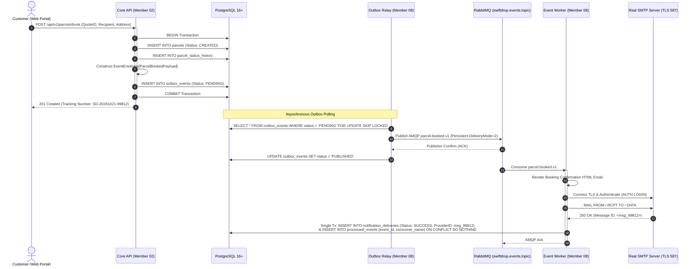

# Document 04 — Interface & Integration Contract

> **Module:** Event-Driven Backend & Messaging (`internal/events`, `services/messaging`)  
> **Owning Member:** Member 08 — Event-Driven Backend & Integrations  
> **Status:** Draft Baseline Specification for Review & Implementation  
> **Target Production Locations:**  
> - `core-api/internal/events/` (In-Monolith Outbox Writer & Envelopes)  
> - `services/messaging/` (Outbox Relay Daemon, Real SMTP Worker, Webhook Dispatcher, Reconciler)  
> **Relevant Contracts:** [event-contracts.md](../../contracts/event-contracts.md), [webhook-security.md](../../contracts/webhook-security.md), [api-conventions.md](../../contracts/api-conventions.md), [database-schema.md](../../architecture/database-schema.md)

---

## 1. Integration Matrix Overview

Member 08 coordinates all asynchronous messaging across the system. This integration matrix defines all communication channels, protocols, directions, and contracts:

| Partner Module / System | Protocol / Mechanism | Direction | Contract / Interface | Invariant / Guarantee |
| :--- | :--- | :--- | :--- | :--- |
| **Member 02 (Parcels & Pricing)** | In-Process Go Method Call | Inbound $\to$ Member 08 | `events.OutboxWriter.Write(ctx, tx, ...)` | Atomic enlistment in `*sql.Tx`; non-blocking. |
| **Member 03 (Dispatch & Delivery)** | In-Process Go Method Call | Inbound $\to$ Member 08 | `events.OutboxWriter.Write(ctx, tx, ...)` | Atomic enlistment in `*sql.Tx`; non-blocking. |
| **Member 04 (Merchants)** | In-Process Go Method Call & DB | Bi-Directional | `OutboxWriter` + Read-only query on `merchant_webhook_targets` | Member 04 owns webhook registration & AES-GCM encryption; Member 08 decrypts at send time. |
| **PostgreSQL 16+ Database** | PostgreSQL Wire Protocol (TCP) | Bi-Directional | Tables: `outbox_events`, `processed_events`, `deliveries` | Atomicity, row-level locks via `SKIP LOCKED`. |
| **RabbitMQ 3.12+ Message Broker** | AMQP 0-9-1 (TCP 5672) | Bi-Directional | Exchange: `swiftdrop.events.topic` | Persistent delivery mode 2, Publisher Confirms, Manual Acks. |
| **Member 05 (Tracking API)** | AMQP 0-9-1 (via Broker) | Outbound $\to$ Member 05 | Queue: `q.tracking.updates` | Real-time milestone projection; at-least-once. |
| **Real SMTP Email Server** | SMTP / STARTTLS (TCP 587/465) | Outbound $\to$ Mail Server | RFC 5321 / RFC 3207 SMTP Handshake | Real TLS delivery, 10s connection timeout; no mocks. |
| **Merchant Webhook Endpoints** | HTTPS POST (TCP 443) | Outbound $\to$ Merchant ERP | HMAC-SHA256 Signed JSON Payload | 5s timeout, SSRF SafeDial, anti-replay ($\pm 300\text{s}$). |
| **Member 09 (DevOps / Kubernetes)** | HTTP GET (TCP 8082 / 8083) | Inbound $\to$ Member 08 | `/health/live`, `/health/ready`, `/metrics` | Standard Agreement A2 probes; DB/Broker connectivity readiness. |

---

## 2. In-Monolith Go API Contract (`core-api/internal/events/`)

All domain use cases within the Core API Modular Monolith interact with Member 08 strictly through the `OutboxWriter` interface.

### 2.1 Interface Definition
```go
package events

import (
    "context"
    "database/sql"
)

// OutboxWriter enables application use cases to persist integration events atomically.
type OutboxWriter interface {
    // Write persists one or more event envelopes into outbox_events.
    // The provided tx MUST be the active transaction committing the domain aggregate change.
    Write(ctx context.Context, tx *sql.Tx, envelopes ...AnyEnvelope) error
}

// AnyEnvelope defines the universal metadata interface for an event envelope.
type AnyEnvelope interface {
    GetEventID() string
    GetEventType() string
    GetAggregateType() string
    GetAggregateID() string
    GetAggregateVersion() int
    GetSchemaVersion() string
    GetOccurredAt() time.Time
    GetProducer() string
    GetCorrelationID() string
    GetPayload() any
    SerializePayload() ([]byte, error)
}
```

### 2.2 Caller Invariants
1. `tx` must **never** be `nil`. Passing a `nil` transaction returns `ErrMissingTransaction`.
2. `Write()` does **not** commit the transaction. The calling usecase retains exclusive ownership over transaction completion (`tx.Commit()` or `tx.Rollback()`).
3. Execution is strictly local and synchronous ($< 5\text{ ms}$). No network calls to RabbitMQ are made during `Write()`.

---

## 3. AMQP 0-9-1 Messaging & Event Schemas

All messages published to the RabbitMQ topic exchange `swiftdrop.events.topic` adhere to the canonical envelope specification.

### 3.1 Canonical Event Envelope Schema (JSON)
```json
{
  "$schema": "https://json-schema.org/draft/2020-12/schema",
  "title": "SwiftDropEventEnvelope",
  "type": "object",
  "required": [
    "event_id",
    "event_type",
    "aggregate_type",
    "aggregate_id",
    "aggregate_version",
    "schema_version",
    "occurred_at",
    "correlation_id",
    "producer",
    "payload"
  ],
  "properties": {
    "event_id": {
      "type": "string",
      "format": "uuid",
      "description": "Unique UUIDv7 identifier for event deduplication."
    },
    "event_type": {
      "type": "string",
      "pattern": "^[a-z_]+\\.[a-z_]+\\.v[0-9]+$",
      "description": "Dot-separated event type and version (e.g. parcel.delivered.v1)."
    },
    "aggregate_type": {
      "type": "string",
      "enum": ["parcel", "courier", "merchant", "dispatch"]
    },
    "aggregate_id": {
      "type": "string",
      "description": "Primary identifier of the mutated aggregate."
    },
    "aggregate_version": {
      "type": "integer",
      "minimum": 1,
      "description": "Monotonically increasing aggregate sequence counter."
    },
    "schema_version": {
      "type": "string",
      "example": "1.0.0",
      "description": "Contract SemVer schema version (e.g. 1.0.0)."
    },
    "occurred_at": {
      "type": "string",
      "format": "date-time",
      "description": "UTC ISO-8601 timestamp of event occurrence."
    },
    "correlation_id": {
      "type": "string",
      "description": "Distributed tracing ID propagated from HTTP request."
    },
    "producer": {
      "type": "string",
      "description": "Source module name (e.g. core-api.parcels)."
    },
    "payload": {
      "type": "object",
      "description": "Domain-specific event data."
    }
  }
}
```

---

### 3.2 Canonical Event Catalog & Payload Specifications

In accordance with [event-contracts.md §2](../../contracts/event-contracts.md) and DDD aggregate ownership:
- **Zero Cross-Module DB Queries:** The Event Worker never queries `parcels` or `parcel_addresses` directly. All data required for notification dispatch (`recipient_name`, `recipient_email`) and webhook routing (`merchant_id`) travels inside the event payload.
- **Privacy & PII Stripping:** The `notify` block contains customer contact info used strictly by `cmd/worker` for email generation. When dispatching external merchant webhooks, the `notify` block is stripped.
- **Sanitized Fields:** Private notes, courier phone numbers, and raw storage URLs (`s3://...`) are never included in event payloads.

---

#### 1. `parcel.booked.v1`
- **Producer:** `core-api/internal/parcels` (Member 02)
- **Routing Key:** `parcel.booked.v1`
- **Target Queues:** `q.notifications.worker`, `q.webhooks.dispatcher`, `q.tracking.updates`
- **Payload Schema & Example:**
```json
{
  "parcel_id": "0192e4a1-0001-7abc-8def-0123456789ab",
  "tracking_number": "SD-20261021-99812",
  "merchant_id": "0192e4a1-5555-7abc-8def-0123456789ab",
  "sender_id": "0192e4a1-1111-7abc-8def-0123456789ab",
  "status": "CREATED",
  "service_level": "EXPRESS",
  "weight_kg": 2.50,
  "fee_cents": 85000,
  "currency": "LKR",
  "notify": {
    "recipient_name": "Kasun Perera",
    "recipient_email": "kasun.perera@example.lk"
  },
  "created_at": "2026-10-21T10:00:00Z"
}
```

---

#### 2. `parcel.assigned.v1`
- **Producer:** `core-api/internal/dispatch` (Member 03)
- **Routing Key:** `parcel.assigned.v1`
- **Target Queues:** `q.notifications.worker` *(skipped/acked — no customer template)*, `q.webhooks.dispatcher`, `q.tracking.updates`
- **Payload Schema & Example:**
```json
{
  "parcel_id": "0192e4a1-0001-7abc-8def-0123456789ab",
  "tracking_number": "SD-20261021-99812",
  "merchant_id": "0192e4a1-5555-7abc-8def-0123456789ab",
  "status": "ASSIGNED",
  "courier_id": "0192e4a1-2222-7abc-8def-0123456789ab",
  "courier_name": "Nuwan Silva",
  "assigned_by": "0192e4a1-3333-7abc-8def-0123456789ab",
  "assigned_at": "2026-10-21T10:30:00Z"
}
```

---

#### 3. `parcel.picked_up.v1`
- **Producer:** `core-api/internal/parcels` (Member 02)
- **Routing Key:** `parcel.picked_up.v1`
- **Target Queues:** `q.notifications.worker` *(skipped/acked — no customer template)*, `q.webhooks.dispatcher`, `q.tracking.updates`
- **Payload Schema & Example:**
```json
{
  "parcel_id": "0192e4a1-0001-7abc-8def-0123456789ab",
  "tracking_number": "SD-20261021-99812",
  "merchant_id": "0192e4a1-5555-7abc-8def-0123456789ab",
  "status": "PICKED_UP",
  "courier_id": "0192e4a1-2222-7abc-8def-0123456789ab",
  "hub_id": "0192e4a1-4444-7abc-8def-0123456789ab",
  "picked_up_at": "2026-10-21T11:00:00Z"
}
```

---

#### 4. `parcel.in_transit.v1`
- **Producer:** `core-api/internal/dispatch` (Member 03)
- **Routing Key:** `parcel.in_transit.v1`
- **Target Queues:** `q.notifications.worker` *(skipped/acked)*, `q.webhooks.dispatcher`, `q.tracking.updates`
- **Payload Schema & Example:**
```json
{
  "parcel_id": "0192e4a1-0001-7abc-8def-0123456789ab",
  "tracking_number": "SD-20261021-99812",
  "merchant_id": "0192e4a1-5555-7abc-8def-0123456789ab",
  "status": "IN_TRANSIT",
  "current_hub_id": "0192e4a1-4444-7abc-8def-0123456789ab",
  "next_hub_id": "0192e4a1-6666-7abc-8def-0123456789ab",
  "departed_at": "2026-10-21T12:00:00Z"
}
```

---

#### 5. `parcel.out_for_delivery.v1`
- **Producer:** `core-api/internal/dispatch` (Member 03)
- **Routing Key:** `parcel.out_for_delivery.v1`
- **Target Queues:** `q.notifications.worker`, `q.webhooks.dispatcher`, `q.tracking.updates`
- **Payload Schema & Example:**
```json
{
  "parcel_id": "0192e4a1-0001-7abc-8def-0123456789ab",
  "tracking_number": "SD-20261021-99812",
  "merchant_id": "0192e4a1-5555-7abc-8def-0123456789ab",
  "status": "OUT_FOR_DELIVERY",
  "courier_id": "0192e4a1-2222-7abc-8def-0123456789ab",
  "courier_name": "Nuwan Silva",
  "estimated_delivery_window_start": "2026-10-21T14:00:00Z",
  "estimated_delivery_window_end": "2026-10-21T16:00:00Z",
  "notify": {
    "recipient_name": "Kasun Perera",
    "recipient_email": "kasun.perera@example.lk"
  }
}
```

---

#### 6. `parcel.delivered.v1`
- **Producer:** `core-api/internal/parcels` (Member 02)
- **Routing Key:** `parcel.delivered.v1`
- **Target Queues:** `q.notifications.worker`, `q.webhooks.dispatcher`, `q.tracking.updates`
- **Payload Schema & Example:**
```json
{
  "parcel_id": "0192e4a1-0001-7abc-8def-0123456789ab",
  "tracking_number": "SD-20261021-99812",
  "merchant_id": "0192e4a1-5555-7abc-8def-0123456789ab",
  "status": "DELIVERED",
  "courier_id": "0192e4a1-2222-7abc-8def-0123456789ab",
  "proof_type": "PHOTO",
  "proof_id": "0192e4a1-7777-7abc-8def-0123456789ab",
  "delivered_at": "2026-10-21T15:24:10Z",
  "notify": {
    "recipient_name": "Kasun Perera",
    "recipient_email": "kasun.perera@example.lk"
  }
}
```

---

#### 7. `parcel.delivery_failed.v1`
- **Producer:** `core-api/internal/delivery` (Member 03)
- **Routing Key:** `parcel.delivery_failed.v1`
- **Target Queues:** `q.notifications.worker`, `q.webhooks.dispatcher`, `q.tracking.updates`
- **Payload Schema & Example:**
```json
{
  "parcel_id": "0192e4a1-0001-7abc-8def-0123456789ab",
  "tracking_number": "SD-20261021-99812",
  "merchant_id": "0192e4a1-5555-7abc-8def-0123456789ab",
  "status": "ATTEMPT_FAILED",
  "courier_id": "0192e4a1-2222-7abc-8def-0123456789ab",
  "attempt_number": 1,
  "max_attempts": 3,
  "reason_code": "RECIPIENT_UNAVAILABLE",
  "attempted_at": "2026-10-21T15:45:00Z",
  "notify": {
    "recipient_name": "Kasun Perera",
    "recipient_email": "kasun.perera@example.lk"
  }
}
```

---

#### 8. `parcel.returned.v1`
- **Producer:** `core-api/internal/parcels` (Member 02)
- **Routing Key:** `parcel.returned.v1`
- **Target Queues:** `q.notifications.worker`, `q.webhooks.dispatcher`, `q.tracking.updates`
- **Payload Schema & Example:**
```json
{
  "parcel_id": "0192e4a1-0001-7abc-8def-0123456789ab",
  "tracking_number": "SD-20261021-99812",
  "merchant_id": "0192e4a1-5555-7abc-8def-0123456789ab",
  "status": "RETURNED",
  "returned_to_hub_id": "0192e4a1-4444-7abc-8def-0123456789ab",
  "return_reason": "MAX_ATTEMPTS_EXCEEDED",
  "returned_at": "2026-10-22T11:00:00Z",
  "notify": {
    "recipient_name": "Kasun Perera",
    "recipient_email": "kasun.perera@example.lk"
  }
}
```

---

#### 9. `parcel.cancelled.v1`
- **Producer:** `core-api/internal/parcels` (Member 02)
- **Routing Key:** `parcel.cancelled.v1`
- **Target Queues:** `q.notifications.worker`, `q.webhooks.dispatcher`, `q.tracking.updates`
- **Payload Schema & Example:**
```json
{
  "parcel_id": "0192e4a1-0001-7abc-8def-0123456789ab",
  "tracking_number": "SD-20261021-99812",
  "merchant_id": "0192e4a1-5555-7abc-8def-0123456789ab",
  "status": "CANCELLED",
  "cancelled_by": "0192e4a1-1111-7abc-8def-0123456789ab",
  "cancellation_reason": "SENDER_REQUEST",
  "cancelled_at": "2026-10-21T10:15:00Z",
  "notify": {
    "recipient_name": "Kasun Perera",
    "recipient_email": "kasun.perera@example.lk"
  }
}
```

---

#### 10. `courier.unassigned.v1`
- **Producer:** `core-api/internal/dispatch` (Member 03)
- **Routing Key:** `courier.unassigned.v1`
- **Target Queues:** `q.webhooks.dispatcher`, `q.tracking.updates`
- **Payload Schema & Example:**
```json
{
  "parcel_id": "0192e4a1-0001-7abc-8def-0123456789ab",
  "tracking_number": "SD-20261021-99812",
  "previous_courier_id": "0192e4a1-2222-7abc-8def-0123456789ab",
  "reason": "COURIER_UNAVAILABLE",
  "unassigned_at": "2026-10-21T11:30:00Z"
}
```

---

#### 11. `merchant.status_changed.v1` / `merchant.approved.v1` *(Pending Owner Approval)*
- **Producer:** `core-api/internal/merchants` (Member 04)
- **Routing Key:** `merchant.status_changed.v1`
- **Target Queues:** `q.webhooks.dispatcher`
- **Payload Schema & Example:**
```json
{
  "merchant_id": "0192e4a1-5555-7abc-8def-0123456789ab",
  "previous_status": "PENDING_VERIFICATION",
  "new_status": "ACTIVE",
  "changed_by": "0192e4a1-8888-7abc-8def-0123456789ab",
  "changed_at": "2026-10-21T09:00:00Z"
}
```

---

### 3.3 Obsolete / Disallowed Event Clarifications
- **`merchant.webhook_dispatch.v1` (REJECTED):** Early architecture notes proposed a separate `merchant.webhook_dispatch.v1` event. This is formally rejected. Member 08 consumes native domain events (`parcel.#`, `courier.#`, `merchant.#`) directly from `swiftdrop.events.topic` via `q.webhooks.dispatcher` and translates them into outbound HTTP requests. Webhook dispatching is an internal transport mechanism of Member 08, not a public domain event.

---

### 3.4 Envelope to Webhook Body Transformation
Before dispatching to a merchant's HTTP endpoint, `cmd/worker` translates the internal AMQP `EventEnvelope[T]` into a standardized, privacy-sanitized merchant webhook payload:

```go
type MerchantWebhookBody struct {
    EventID        string          `json:"event_id"`        // Envelope EventID
    EventType      string          `json:"event_type"`      // e.g. "parcel.delivered.v1"
    SchemaVersion  string          `json:"schema_version"`  // Envelope SchemaVersion (e.g. "1.0.0")
    OccurredAt     time.Time       `json:"occurred_at"`     // Envelope OccurredAt
    ParcelID       string          `json:"parcel_id"`       // Extracted from payload
    TrackingNumber string          `json:"tracking_number"`  // Extracted from payload
    ParcelVersion  int             `json:"parcel_version"`  // Envelope AggregateVersion
    Status         string          `json:"status"`          // Domain status string
    Payload        json.RawMessage `json:"payload"`         // Sanitized payload (PII / notify stripped)
}
```

---

### 3.5 Consumer Queue Bindings & Skip-Ack Semantics

| Queue Name | Routing Key Binding | Consumer Behavior |
| :--- | :--- | :--- |
| `q.notifications.worker` | `parcel.#` | Evaluates if event has customer email template (`booked`, `out_for_delivery`, `delivered`, `delivery_failed`, `returned`, `cancelled`). If template exists, formats and delivers email via real SMTP. If no template exists (`assigned`, `picked_up`, `in_transit`), logs `DEBUG: skipping notification for event_type` and immediately calls `Ack()`. |
| `q.webhooks.dispatcher` | `parcel.#`, `courier.#`, `merchant.#` | Looks up active endpoints for `merchant_id` from `merchant_webhook_targets`. If endpoints exist, stages `webhook_deliveries` and dispatches HTTP POST. If no active endpoints exist, immediately calls `Ack()`. |
| `q.tracking.updates` | `parcel.#`, `courier.#` | Owned by Member 05 (Tracking API). Consumes milestones to project SSE streams for browser clients. |

---

## 4. Outbound Merchant Webhook API Specification (OpenAPI 3.1)

Member 08 dispatches HTTP POST requests to merchant endpoints registered via Member 04. Below is the authoritative OpenAPI contract defining what merchant servers must implement.

```yaml
openapi: 3.1.0
info:
  title: SwiftDrop Merchant Outbound Webhook Specification
  description: >
    Authoritative specification for outbound HTTP POST webhook events dispatched
    by the SwiftDrop Event Worker to registered merchant HTTPS endpoints.
  version: 1.0.0
paths:
  /{merchant_configured_path}:
    post:
      summary: Receive Parcel Lifecycle Milestone Webhook
      description: >
        Receives real-time parcel lifecycle milestone updates. Merchant servers must
        verify the HMAC-SHA256 signature in X-SwiftDrop-Signature and respond with HTTP 2xx
        within 5.0 seconds.
      parameters:
        - name: X-SwiftDrop-Delivery-ID
          in: header
          required: true
          schema:
            type: string
            format: uuid
          description: Unique delivery attempt identifier for merchant idempotency tracking.
        - name: X-SwiftDrop-Event-ID
          in: header
          required: true
          schema:
            type: string
            format: uuid
          description: Authoritative domain event identifier.
        - name: X-SwiftDrop-Signature
          in: header
          required: true
          schema:
            type: string
          example: t=1729512000,v1=9f86d081884c7d659a2feaa0c55ad015a3bf4f1b2b0b822cd15d6c15b0f00a08
          description: >
            HMAC-SHA256 signature containing Unix timestamp and hex hash.
            Supports multi-v1 headers during secret rotation (e.g. t=...,v1=sig1,v1=sig2).
        - name: User-Agent
          in: header
          required: true
          schema:
            type: string
            example: SwiftDrop-Webhook-Delivery/1.0
      requestBody:
        required: true
        content:
          application/json:
            schema:
              type: object
              required:
                - event_id
                - event_type
                - schema_version
                - occurred_at
                - parcel_id
                - tracking_number
                - parcel_version
                - status
                - payload
              properties:
                event_id:
                  type: string
                  format: uuid
                event_type:
                  type: string
                  example: parcel.delivered.v1
                schema_version:
                  type: string
                  example: "1.0.0"
                occurred_at:
                  type: string
                  format: date-time
                parcel_id:
                  type: string
                  format: uuid
                tracking_number:
                  type: string
                  example: "SD-20261021-99812"
                parcel_version:
                  type: integer
                  example: 4
                status:
                  type: string
                  enum: [CREATED, ASSIGNED, PICKED_UP, IN_TRANSIT, OUT_FOR_DELIVERY, DELIVERED, ATTEMPT_FAILED, RETURNED, CANCELLED]
                payload:
                  type: object
                  description: Event-specific domain payload (customer notify PII stripped).
                  oneOf:
                    - $ref: '#/components/schemas/ParcelBookedPayload'
                    - $ref: '#/components/schemas/ParcelDeliveredPayload'
                    - $ref: '#/components/schemas/ParcelDeliveryFailedPayload'
                    - $ref: '#/components/schemas/GenericParcelPayload'
      responses:
        '200':
          description: Webhook acknowledged successfully.
        '201':
          description: Webhook received and resource created by merchant.
        '202':
          description: Webhook accepted for asynchronous merchant processing.
        '204':
          description: Webhook accepted with no body returned.
        '400':
          description: Invalid payload syntax or signature verification failure (terminal failure).
        '408':
          description: Request timeout on merchant gateway (triggers retry).
        '410':
          description: Webhook endpoint deactivated permanently on merchant side (terminal failure).
        '429':
          description: Merchant server rate limit reached (triggers retry with backoff).
        '500':
          description: Merchant internal server error (triggers retry).
        '502':
          description: Bad gateway at merchant reverse proxy (triggers retry).
        '503':
          description: Merchant service temporarily unavailable (triggers retry).
        '504':
          description: Gateway timeout at merchant proxy (triggers retry).
components:
  schemas:
    ParcelBookedPayload:
      type: object
      properties:
        sender_id: { type: string, format: uuid }
        service_level: { type: string, enum: [STANDARD, EXPRESS] }
        weight_kg: { type: number }
        fee_cents: { type: integer }
        currency: { type: string }
    ParcelDeliveredPayload:
      type: object
      properties:
        courier_id: { type: string, format: uuid }
        proof_type: { type: string, enum: [PHOTO, SIGNATURE, OTP] }
        proof_id: { type: string, format: uuid }
        delivered_at: { type: string, format: date-time }
    ParcelDeliveryFailedPayload:
      type: object
      properties:
        courier_id: { type: string, format: uuid }
        attempt_number: { type: integer }
        max_attempts: { type: integer }
        reason_code: { type: string }
        attempted_at: { type: string, format: date-time }
    GenericParcelPayload:
      type: object
      additionalProperties: true
```

### 4.1 Cryptographic Signature Verification Algorithm
Merchants authenticate outbound webhooks using HMAC-SHA256:
$$\text{SignedPayload} = \text{timestamp} + "." + \text{RawRequestBodyBytes}$$
$$\text{ExpectedHash} = \text{HMAC-SHA256}(\text{MerchantSigningSecret}, \text{SignedPayload})$$
$$\text{SignatureHeader} = "t=" + \text{timestamp} + ",v1=" + \text{hex}(\text{ExpectedHash})$$

During signing secret rotation, Member 08 signs with both current and previous active keys, sending multiple `v1=` tokens:
```http
X-SwiftDrop-Signature: t=1729512000,v1=9f86d081884c7d65...,v1=4a5b6c7d8e9f0...
```
Merchants should compute the HMAC with their configured secret and verify that at least one `v1` token matches using constant-time comparison (`crypto/subtle.ConstantTimeCompare`). Merchants must also reject timestamps where $|\text{current\_time} - \text{timestamp}| > 300\text{ seconds}$ to defeat replay attacks.

---

## 5. Real SMTP Mail Protocol & Delivery Contract

Member 08 delivers transactional customer emails directly to a configured real SMTP server via RFC 5321 and RFC 3207.

### 5.1 TLS Negotiation Modes & Port Configurations
The SMTP client supports three distinct cryptographic negotiation modes controlled via `SMTP_SECURITY`:

| Mode (`SMTP_SECURITY`) | Default Port | Protocol Behavior | Environment |
| :--- | :--- | :--- | :--- |
| `starttls` *(default)* | `587` | Connects plain TCP, issues `EHLO`, requests `STARTTLS`, upgrades socket to TLS 1.2+, re-issues `EHLO`, authenticates, and transmits. | Staging, Production |
| `tls` | `465` | Connects directly via implicit TLS (`tls.DialWithDialer`), issues `EHLO`, authenticates, and transmits. | Production alternative |
| `none` | `1025` | Connects plain TCP without TLS handshake or authentication. Transmits directly to local test listener (Mailpit). | `APP_ENV=local`, CI test containers |

### 5.2 Email Envelope & Header Standards
- **Sender Address (`From`):** Formatted as `SMTP_FROM_NAME <SMTP_FROM_EMAIL>` (e.g. `SwiftDrop Deliveries <notifications@swiftdrop.io>`). Addresses are validated via Go `mail.ParseAddress()`; all carriage returns (`\r`) and line feeds (`\n`) are stripped to prevent header injection.
- **Message-ID:** Authoritatively generated by the worker as `<{uuidv7}@{from_domain}>` and recorded in `notification_deliveries.provider_message_id` for end-to-end delivery tracing.
- **Subject Encoding:** Encoded using RFC 2047 Q-encoding if non-ASCII characters are present.
- **Body MIME Format:** All emails are rendered as `multipart/alternative` containing both a human-readable plain text part and an HTML styled receipt part.

### 5.3 Protocol Dialogue & Network Boundaries
```http
Client (SwiftDrop Worker)                      Server (Real SMTP Host: 587)
----------------------------------------------------------------------------
[TCP Connect to SMTP_HOST:587] ----------->
                                <----------- 220 smtp.provider.com ESMTP Ready
EHLO swiftdrop.io ------------------------>
                                <----------- 250-STARTTLS ...
STARTTLS --------------------------------->
                                <----------- 220 2.0.0 Ready to start TLS
[TLS v1.2+ Handshake & Cert Validation] --->
EHLO swiftdrop.io ------------------------>
                                <----------- 250-AUTH LOGIN PLAIN
AUTH LOGIN ------------------------------->
                                <----------- 334 VXNlcm5hbWU6
[Base64 Username] ------------------------>
                                <----------- 334 UGFzc3dvcmQ6
[Base64 Password] ------------------------>
                                <----------- 235 2.7.0 Authentication successful
MAIL FROM:<notifications@swiftdrop.io> --->
                                <----------- 250 2.1.0 Sender OK
RCPT TO:<recipient@example.com> ---------->
                                <----------- 250 2.1.5 Recipient OK
DATA ------------------------------------->
                                <----------- 354 Start mail input; end with <CRLF>.<CRLF>
Message-ID: <0192e4a1-8d2b-7abc-8def-0123456789ab@swiftdrop.io>
From: "SwiftDrop Deliveries" <notifications@swiftdrop.io>
To: recipient@example.com
Subject: SwiftDrop Delivery Update: SD-20261021-99812 DELIVERED
MIME-Version: 1.0
Content-Type: multipart/alternative; boundary="swiftdrop_boundary_xyz"

--swiftdrop_boundary_xyz
Content-Type: text/plain; charset=UTF-8

Your package SD-20261021-99812 has been delivered!
--swiftdrop_boundary_xyz
Content-Type: text/html; charset=UTF-8

<!DOCTYPE html><html>...HTML formatted receipt...</html>
--swiftdrop_boundary_xyz--
. ---------------------------------------->
                                <----------- 250 2.0.0 OK: queued as 01HXYZ998877
QUIT ------------------------------------->
                                <----------- 221 2.0.0 Bye
```

### 5.4 SMTP Response Code Classification Matrix
Worker inspects `*textproto.Error` responses to classify delivery outcomes:

| SMTP Status Code | Classification | Worker Action | `notification_deliveries.status` |
| :--- | :--- | :--- | :--- |
| `250 OK` | Success | Store `provider_message_id`, record terminal success in `processed_events`. | `SUCCESS` |
| `421 Service not available` | Transient Network/Provider | Set `next_attempt_at = NOW() + backoff`, reset lease. Poller retries. | `PENDING` |
| `450 Mailbox busy / graylisted` | Transient Recipient State | Set `next_attempt_at = NOW() + backoff`, reset lease. Poller retries. | `PENDING` |
| `451 Local error in processing` | Transient Provider Issue | Set `next_attempt_at = NOW() + backoff`, reset lease. Poller retries. | `PENDING` |
| `452 Too many recipients` | Transient Rate Limit | Set `next_attempt_at = NOW() + backoff`, reset lease. Poller retries. | `PENDING` |
| `550 User unknown / invalid` | Permanent Address Error | Log warning, abort retries. Mark terminal failure. | `FAILED` |
| `551 User not local` | Permanent Routing Error | Log warning, abort retries. Mark terminal failure. | `FAILED` |
| `552 Storage allocation exceeded`| Permanent Mailbox Full | Log warning, abort retries. Mark terminal failure. | `FAILED` |
| `553 Mailbox name not allowed` | Permanent Syntax Error | Log warning, abort retries. Mark terminal failure. | `FAILED` |
| `530 / 535 / 554 Authentication` | Configuration / Policy Defect | Trigger immediate operator alert (`ERROR`). Abort retries. | `FAILED` |

### 5.5 Documented Architecture Deviation (Real SMTP vs Mock Option)
> [!NOTE]
> **Documented Deviation from SRS FR-EVT-008 & Engineering Standards §8:**  
> **SRS Reference:** FR-EVT-008 states that customer notification emails may support an in-memory/console mock sink.  
> **Adopted Design:** Member 08 enforces a **single, un-mocked delivery path** using Go standard library `net/smtp`. In local development and CI test suites, a real local SMTP container ([Mailpit](https://github.com/axllent/mailpit)) is run, accepting connections on port 1025.  
> **Rationale:** Eliminates behavioral drift and code branch divergence between testing and production environments. Verifies actual RFC 5321 handshake compliance in CI. Filed for formal group sign-off in `CHANGE_REQUESTS.md`.

### 5.6 Non-Fatal Startup Behavior
At daemon boot, `cmd/worker` executes an informational probe against the SMTP host. If the external SMTP provider is temporarily unreachable, the worker logs a warning but **does not exit**. The Kubernetes readiness probe (`/health/ready`) verifies internal infrastructure (PostgreSQL pool and RabbitMQ connection) and does not fail on external mail provider downtime.

---

## 6. Health, Liveness & Operational HTTP Endpoints

Both `services/messaging/cmd/relay` and `services/messaging/cmd/worker` expose operational endpoints adhering to Member 09 Agreement A2, K17, and SRS §6.2:

### 6.1 Endpoints Specification

| Path | Method | Daemon | Port | Purpose | Response Schema |
| :--- | :--- | :--- | :--- | :--- | :--- |
| `/health/live` | `GET` | Relay & Worker | `8082` (Relay)<br>`8083` (Worker) | Process Liveness probe (Never checks DB) | `200 OK` `{"status":"UP"}` |
| `/health/ready` | `GET` | Relay & Worker | `8082` (Relay)<br>`8083` (Worker) | Dependency Readiness probe (PostgreSQL & RabbitMQ) | `200 OK` `{"status":"READY","database":"UP","broker":"UP"}`<br>`503 Service Unavailable` if DB or AMQP down. |
| `/metrics` | `GET` | Relay & Worker | `8082` / `8083` | Prometheus metric scrape | Standard Prometheus text exposition format. |

---

## 7. Database Access & Permission Matrix

Member 08 has strict, segregated database permissions across PostgreSQL tables, enforced through dedicated per-role credentials (`swiftdrop_relay`, `swiftdrop_worker`, `swiftdrop_reconciler`):

| Table / View Name | Owner Context | Member 08 In-Monolith Repo (`internal/events`) | Member 08 Relay Daemon (`swiftdrop_relay`) | Member 08 Worker Daemon (`swiftdrop_worker`) | Member 08 Reconciler (`swiftdrop_reconciler`) |
| :--- | :--- | :--- | :--- | :--- | :--- |
| `outbox_events` | Member 08 | **INSERT** (via `OutboxWriter`) | **SELECT, UPDATE** (`status, published_at, attempt_count, last_error, next_attempt_at`) | None | **SELECT, UPDATE** (re-arm stale), **DELETE** (7d retention) |
| `processed_events` | Member 08 | None | None | **SELECT, INSERT** (`ON CONFLICT`), **DELETE** | **SELECT, DELETE** ($\ge 35$d retention) |
| `notification_deliveries`| Member 08 | None | None | **SELECT, INSERT, UPDATE** | **SELECT, UPDATE** (re-arm expired lease), **DELETE** (30d retention) |
| `webhook_deliveries` | Member 08 | None | None | **SELECT, INSERT, UPDATE** | **SELECT, UPDATE** (re-arm expired lease), **DELETE** (30d retention) |
| `webhook_delivery_attempts`| Member 08 | None | None | **SELECT, INSERT** (append-only attempt log) | **SELECT, DELETE** (30d cascade retention) |
| `merchant_webhook_targets` (View)| Member 04 | None | None | **SELECT ONLY** (`endpoint_id, merchant_id, url, secret_ciphertext, secret_key_version, subscribed_event_types`) | None |
| `parcels` / `parcel_addresses` | Member 02 | None | None | **STRICTLY PROHIBITED** (Zero DB read/write; contact PII travels in event payload) | None |

---

## 8. Cross-Module Interaction Sequence Diagrams

### 8.1 Complete Parcel Booking & Notification Dispatch
Demonstrates Member 02 collaborating with Member 08's `OutboxWriter`, Relay, RabbitMQ, and the Real SMTP Mailer:



---

### 8.2 Courier Delivery Milestone, SSE Fan-Out & Merchant Webhook
Demonstrates Member 03 collaborating with Member 08, Member 05 (Tracking API), and an External Merchant:


---

## 9. Compatibility, Versioning & Evolution Policy

1. **Additive Schema Changes:** Adding an optional field to an existing event payload (e.g. adding `recipient_postal_code` to `parcel.booked.v1`) is non-breaking. Consumers must use permissive JSON unmarshaling (`json.Unmarshal` ignores unknown fields).
2. **Breaking Changes & Version Bumping:** Removing a field, changing a field data type, or renaming an enum value requires a new version identifier in both `event_type` and the routing key (e.g., `parcel.delivered.v2`).
3. **Dual-Publishing Window:** When a new event version is introduced, the producer publishes both `v1` and `v2` during a documented transition window until all downstream consumers have upgraded.
4. **Queue Longevity:** Dead-lettered messages in `swiftdrop.dlq` remain preserved for up to 30 days or until investigated and drained by the operational reconciliation runbook.

---

## 10. Summary Checklist of Document 04 Deliverables

- [x] Complete cross-module integration matrix detailing all 8 partner systems.
- [x] Go interface contract for `OutboxWriter` with caller transaction invariants.
- [x] Machine-readable JSON Schema for canonical `EventEnvelope[T]`.
- [x] Full event catalog payload specifications and JSON examples for all 6 parcel lifecycle events.
- [x] Full OpenAPI 3.1 contract for outbound merchant webhook receivers.
- [x] Cryptographic HMAC-SHA256 signature calculation formula and anti-replay window.
- [x] Full RFC 5321/3207 SMTP protocol dialogue and response code error matrix for real SMTP mailer.
- [x] Kubernetes operational HTTP endpoints (`/health/live`, `/health/ready`, `/metrics`).
- [x] Database table permissions matrix defining explicit access per daemon.
- [x] Mermaid sequence diagrams for parcel booking and courier delivery milestone fan-out.
- [x] Evolution and semantic versioning policy for event schemas and topic routing keys.
