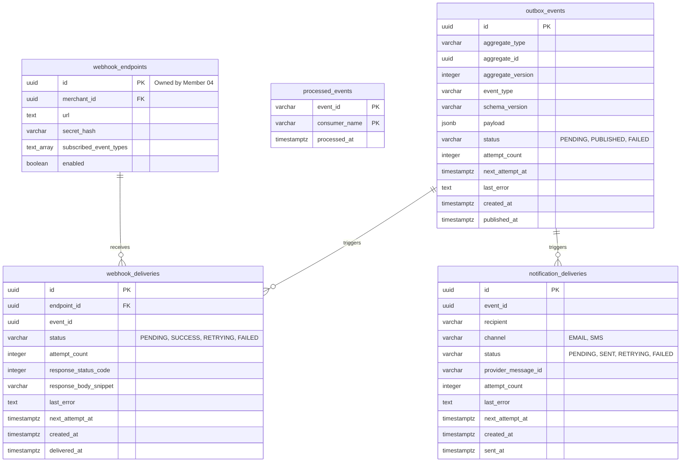

# Document 05 — Data & Persistence Specification

> **Module:** Event-Driven Backend & Messaging (`internal/events`, `services/messaging`)  
> **Owning Member:** Member 08 — Event-Driven Backend & Integrations  
> **Status:** Draft Baseline Specification for Review & Implementation  
> **Target Production Locations:**  
> - `core-api/internal/events/` (In-Monolith Outbox Writer & Envelopes)  
> - `services/messaging/` (Outbox Relay Daemon, Real SMTP Worker, Webhook Dispatcher, Reconciler)  
> **Relevant Contracts:** [database-schema.md](file:///c:/Users/kesha/OneDrive/Documents/GitHub/SwiftDrop/docs/architecture/database-schema.md), [event-contracts.md](file:///c:/Users/kesha/OneDrive/Documents/GitHub/SwiftDrop/docs/contracts/event-contracts.md), [webhook-security.md](file:///c:/Users/kesha/OneDrive/Documents/GitHub/SwiftDrop/docs/contracts/webhook-security.md)

---

## 1. Data Architecture & Relational ER Model

Member 08 owns four authoritative database tables in the PostgreSQL 16+ relational store. These tables form the asynchronous durability engine of SwiftDrop, managing outbox queuing, consumer deduplication, real SMTP email logs, and outbound merchant webhook audit histories.

This specification complements the system-wide ER design in [database-schema.md §1](file:///c:/Users/kesha/OneDrive/Documents/GitHub/SwiftDrop/docs/architecture/database-schema.md).



---

## 2. Authoritative Table Ownership & Data Dictionary

### 2.1 Table: `outbox_events`
- **Owning Capability:** Event & Integration Support Context (Member 08)
- **Primary Purpose:** Stores domain events emitted within Core API transactions awaiting confirmation by the Outbox Relay.
- **Write Permissions:**
  - Insert: Application use cases via `OutboxWriter` inside active domain transaction (`*sql.Tx`).
  - Update: Outbox Relay daemon (`status`, `attempt_count`, `published_at`, `last_error`).
  - Delete: Asynchronous 7-day retention cleanup job.

| Column Name | Data Type | Nullable? | Default | Constraints / Validation | Description |
| :--- | :--- | :--- | :--- | :--- | :--- |
| `id` | `UUID` | No | `gen_random_uuid()` | Primary Key | Unique identifier of the outbox record. |
| `aggregate_type` | `VARCHAR(64)` | No | None | Non-empty | Target aggregate (e.g. `parcel`, `courier`, `merchant`). |
| `aggregate_id` | `UUID` | No | None | Valid UUID | Primary key of the modified domain entity. |
| `aggregate_version`| `INTEGER` | No | `1` | $\ge 1$ | Optimistic concurrency version of the aggregate. |
| `event_type` | `VARCHAR(128)`| No | None | Regex: `^[a-z_]+\.[a-z_]+\.v[0-9]+$` | Standard event name (e.g. `parcel.delivered.v1`). |
| `schema_version` | `VARCHAR(16)` | No | `'1.0.0'`| SemVer format | Payload schema version. |
| `payload` | `JSONB` | No | None | Valid JSON Object | Domain event data serialized to JSON. |
| `correlation_id` | `VARCHAR(128)`| No | None | Non-empty | Distributed tracing correlation ID from HTTP request. |
| `status` | `VARCHAR(32)` | No | `'PENDING'` | `CHECK (status IN ('PENDING', 'PUBLISHED', 'FAILED'))` | Current lifecycle state. |
| `attempt_count` | `INTEGER` | No | `0` | $\ge 0$ | Number of publication attempts to RabbitMQ. |
| `next_attempt_at`| `TIMESTAMPTZ` | Yes | `NULL` | Future timestamp if backoff | Scheduled retry time for publication. |
| `last_error` | `TEXT` | Yes | `NULL` | Truncated to 2KB | Error message from broker or network on failure. |
| `created_at` | `TIMESTAMPTZ` | No | `CURRENT_TIMESTAMP` | UTC | Time the domain event was committed in PostgreSQL. |
| `published_at` | `TIMESTAMPTZ` | Yes | `NULL` | Set only on broker ACK | Time RabbitMQ acknowledged persistent receipt. |

---

### 2.2 Table: `processed_events`
- **Owning Capability:** Event Worker Context (Member 08)
- **Primary Purpose:** Authoritative deduplication ledger ensuring at-least-once AMQP deliveries produce strictly idempotent side effects.
- **Write Permissions:** Event Worker consumer goroutines (`INSERT ON CONFLICT DO NOTHING`).

| Column Name | Data Type | Nullable? | Default | Constraints / Validation | Description |
| :--- | :--- | :--- | :--- | :--- | :--- |
| `event_id` | `VARCHAR(64)` | No | None | PK Component 1 | Unique event ID from `EventEnvelope.EventID`. |
| `consumer_name` | `VARCHAR(64)` | No | None | PK Component 2 | Name of the consumer (e.g. `notification_worker`, `webhook_dispatcher`). |
| `processed_at` | `TIMESTAMPTZ` | No | `CURRENT_TIMESTAMP` | UTC | Timestamp when the event was first claimed and processed. |

---

### 2.3 Table: `notification_deliveries`
- **Owning Capability:** Event Worker Context (Member 08)
- **Primary Purpose:** Authoritative audit log of real SMTP transactional email milestone notifications dispatched to recipients.
- **Write Permissions:** Event Worker Notification consumer.

| Column Name | Data Type | Nullable? | Default | Constraints / Validation | Description |
| :--- | :--- | :--- | :--- | :--- | :--- |
| `id` | `UUID` | No | `gen_random_uuid()` | Primary Key | Unique delivery attempt ID. |
| `event_id` | `UUID` | No | None | Valid UUID | Event that triggered this notification. |
| `recipient` | `VARCHAR(255)`| No | None | Valid email address | Recipient email address. |
| `channel` | `VARCHAR(32)` | No | `'EMAIL'` | `CHECK (channel IN ('EMAIL', 'SMS'))` | Notification transport channel (Real SMTP). |
| `status` | `VARCHAR(32)` | No | `'PENDING'` | `CHECK (status IN ('PENDING', 'SENT', 'RETRYING', 'FAILED'))` | Current delivery status. |
| `provider_message_id`| `VARCHAR(255)`| Yes| `NULL` | Non-empty if SENT | Message ID captured from real SMTP `250 OK` response. |
| `attempt_count` | `INTEGER` | No | `0` | $\ge 0$ | Number of SMTP delivery attempts. |
| `last_error` | `TEXT` | Yes | `NULL` | Truncated to 1KB | SMTP protocol error or connection timeout message. |
| `next_attempt_at`| `TIMESTAMPTZ` | Yes | `NULL` | UTC | Time for next retry if temporary 4xx error. |
| `created_at` | `TIMESTAMPTZ` | No | `CURRENT_TIMESTAMP` | UTC | Record creation timestamp. |
| `sent_at` | `TIMESTAMPTZ` | Yes | `NULL` | UTC | Timestamp when SMTP server returned `250 OK`. |

---

### 2.4 Table: `webhook_deliveries`
- **Owning Capability:** Event Worker Context (Member 08)
- **Primary Purpose:** Detailed delivery audit log of outbound HTTP webhooks sent to external merchant endpoints.
- **Write Permissions:** Event Worker Webhook dispatcher.
- **Read Permissions:** Member 08 (Worker/Reconciler) and Member 04 (Merchant Portal delivery history UI).

| Column Name | Data Type | Nullable? | Default | Constraints / Validation | Description |
| :--- | :--- | :--- | :--- | :--- | :--- |
| `id` | `UUID` | No | `gen_random_uuid()` | Primary Key | Unique webhook delivery attempt ID. |
| `endpoint_id` | `UUID` | No | None | `REFERENCES webhook_endpoints(id) ON DELETE CASCADE` | Foreign Key to merchant endpoint configuration. |
| `event_id` | `UUID` | No | None | Valid UUID | Event that triggered the webhook push. |
| `status` | `VARCHAR(32)` | No | `'PENDING'` | `CHECK (status IN ('PENDING', 'SUCCESS', 'RETRYING', 'FAILED'))` | Delivery status. |
| `attempt_count` | `INTEGER` | No | `0` | Range: $0$ to $5$ | Number of dispatch attempts (max 5 retries). |
| `response_status_code`| `INTEGER` | Yes | `NULL` | HTTP status code | HTTP response code returned by merchant server. |
| `response_body_snippet`| `VARCHAR(500)`| Yes| `NULL` | Truncated to 500 chars | Sanitized preview of merchant server response. |
| `last_error` | `TEXT` | Yes | `NULL` | Truncated to 1KB | Network timeout, SSRF blocked alert, or HTTP error. |
| `next_attempt_at`| `TIMESTAMPTZ` | Yes | `NULL` | UTC | Calculated exponential backoff retry timestamp. |
| `created_at` | `TIMESTAMPTZ` | No | `CURRENT_TIMESTAMP` | UTC | Record creation timestamp. |
| `delivered_at` | `TIMESTAMPTZ` | Yes | `NULL` | UTC | Timestamp of successful 2xx delivery. |

---

## 3. Authoritative Indexing Strategy

To meet **SRS §7.2** and **§9.1** sub-200ms latency targets and support high-throughput relay polling:

| Table | Index Name | Columns / Condition | Index Type | Query Purpose |
| :--- | :--- | :--- | :--- | :--- |
| `outbox_events` | `idx_outbox_pending` | `created_at ASC WHERE status = 'PENDING'` | Partial B-Tree | Ultra-fast polling for Outbox Relay; skips published rows. |
| `outbox_events` | `idx_outbox_aggregate` | `aggregate_type, aggregate_id, created_at ASC` | B-Tree | Reconstructing aggregate event stream timeline. |
| `outbox_events` | `idx_outbox_correlation`| `correlation_id` | B-Tree | Distributed trace correlation and incident triage. |
| `outbox_events` | `idx_outbox_retention` | `published_at ASC WHERE status = 'PUBLISHED'` | Partial B-Tree | Fast lookup for 7-day retention cleanup purge jobs. |
| `processed_events`| `processed_events_pkey` | `event_id, consumer_name` | Composite PK | $O(1)$ unique constraint enforcement for deduplication. |
| `processed_events`| `idx_processed_cleanup`| `processed_at ASC` | B-Tree | Periodic deletion of expired deduplication keys (>14 days).|
| `notification_deliveries`| `idx_notif_recipient`| `recipient, created_at DESC` | B-Tree | Customer notification audit lookup. |
| `notification_deliveries`| `idx_notif_retry` | `status, next_attempt_at ASC WHERE status = 'RETRYING'` | Partial B-Tree | Polling for overdue SMTP retry attempts. |
| `webhook_deliveries` | `idx_webhook_endpoint` | `endpoint_id, created_at DESC` | B-Tree | Merchant dashboard webhook delivery history. |
| `webhook_deliveries` | `idx_webhook_retry_queue`| `status, next_attempt_at ASC WHERE status = 'RETRYING'` | Partial B-Tree | Reconciler and worker retry queue scan. |

---

## 4. Sequential Database Migration Strategy

Database changes are managed sequentially via `golang-migrate` files in `core-api/migrations/`.

### 4.1 Migration File: `000008_create_events_and_messaging_schema.up.sql`
```sql
-- SwiftDrop: Migration 000008 (Member 08 - Events & Messaging)
-- Depends on: 000004_create_merchants_and_webhooks.up.sql (for webhook_endpoints)

BEGIN;

-- 1. Transactional Outbox Table
CREATE TABLE IF NOT EXISTS outbox_events (
    id UUID PRIMARY KEY DEFAULT gen_random_uuid(),
    aggregate_type VARCHAR(64) NOT NULL,
    aggregate_id UUID NOT NULL,
    aggregate_version INTEGER DEFAULT 1 NOT NULL,
    event_type VARCHAR(128) NOT NULL,
    schema_version VARCHAR(16) DEFAULT '1.0.0' NOT NULL,
    payload JSONB NOT NULL,
    correlation_id VARCHAR(128) NOT NULL,
    status VARCHAR(32) DEFAULT 'PENDING' NOT NULL 
        CHECK (status IN ('PENDING', 'PUBLISHED', 'FAILED')),
    attempt_count INTEGER DEFAULT 0 NOT NULL,
    next_attempt_at TIMESTAMPTZ NULL,
    last_error TEXT NULL,
    created_at TIMESTAMPTZ DEFAULT CURRENT_TIMESTAMP NOT NULL,
    published_at TIMESTAMPTZ NULL
);

CREATE INDEX IF NOT EXISTS idx_outbox_pending 
ON outbox_events (created_at ASC) 
WHERE status = 'PENDING';

CREATE INDEX IF NOT EXISTS idx_outbox_aggregate 
ON outbox_events (aggregate_type, aggregate_id, created_at ASC);

CREATE INDEX IF NOT EXISTS idx_outbox_correlation 
ON outbox_events (correlation_id);

CREATE INDEX IF NOT EXISTS idx_outbox_retention 
ON outbox_events (published_at ASC) 
WHERE status = 'PUBLISHED';

-- 2. Consumer Idempotency Ledger
CREATE TABLE IF NOT EXISTS processed_events (
    event_id VARCHAR(64) NOT NULL,
    consumer_name VARCHAR(64) NOT NULL,
    processed_at TIMESTAMPTZ DEFAULT CURRENT_TIMESTAMP NOT NULL,
    PRIMARY KEY (event_id, consumer_name)
);

CREATE INDEX IF NOT EXISTS idx_processed_cleanup 
ON processed_events (processed_at ASC);

-- 3. Notification Deliveries Log (Real SMTP)
CREATE TABLE IF NOT EXISTS notification_deliveries (
    id UUID PRIMARY KEY DEFAULT gen_random_uuid(),
    event_id UUID NOT NULL,
    recipient VARCHAR(255) NOT NULL,
    channel VARCHAR(32) DEFAULT 'EMAIL' NOT NULL 
        CHECK (channel IN ('EMAIL', 'SMS')),
    status VARCHAR(32) DEFAULT 'PENDING' NOT NULL 
        CHECK (status IN ('PENDING', 'SENT', 'RETRYING', 'FAILED')),
    provider_message_id VARCHAR(255) NULL,
    attempt_count INTEGER DEFAULT 0 NOT NULL,
    last_error TEXT NULL,
    next_attempt_at TIMESTAMPTZ NULL,
    created_at TIMESTAMPTZ DEFAULT CURRENT_TIMESTAMP NOT NULL,
    sent_at TIMESTAMPTZ NULL
);

CREATE INDEX IF NOT EXISTS idx_notif_recipient 
ON notification_deliveries (recipient, created_at DESC);

CREATE INDEX IF NOT EXISTS idx_notif_retry 
ON notification_deliveries (status, next_attempt_at ASC) 
WHERE status = 'RETRYING';

-- 4. Webhook Deliveries Audit History
CREATE TABLE IF NOT EXISTS webhook_deliveries (
    id UUID PRIMARY KEY DEFAULT gen_random_uuid(),
    endpoint_id UUID NOT NULL REFERENCES webhook_endpoints(id) ON DELETE CASCADE,
    event_id UUID NOT NULL,
    status VARCHAR(32) DEFAULT 'PENDING' NOT NULL 
        CHECK (status IN ('PENDING', 'SUCCESS', 'RETRYING', 'FAILED')),
    attempt_count INTEGER DEFAULT 0 NOT NULL,
    response_status_code INTEGER NULL,
    response_body_snippet VARCHAR(500) NULL,
    last_error TEXT NULL,
    next_attempt_at TIMESTAMPTZ NULL,
    created_at TIMESTAMPTZ DEFAULT CURRENT_TIMESTAMP NOT NULL,
    delivered_at TIMESTAMPTZ NULL
);

CREATE INDEX IF NOT EXISTS idx_webhook_endpoint 
ON webhook_deliveries (endpoint_id, created_at DESC);

CREATE INDEX IF NOT EXISTS idx_webhook_retry_queue 
ON webhook_deliveries (status, next_attempt_at ASC) 
WHERE status = 'RETRYING';

COMMIT;
```

### 4.2 Rollback Migration File: `000008_create_events_and_messaging_schema.down.sql`
```sql
BEGIN;
DROP TABLE IF EXISTS webhook_deliveries CASCADE;
DROP TABLE IF EXISTS notification_deliveries CASCADE;
DROP TABLE IF EXISTS processed_events CASCADE;
DROP TABLE IF EXISTS outbox_events CASCADE;
COMMIT;
```

---

## 5. Concurrency Control, Locking & Transaction Boundaries

### 5.1 Lock Contention Prevention: `FOR UPDATE SKIP LOCKED`
The Outbox Relay polls pending records concurrently without blocking application inserts:
```sql
SELECT id, aggregate_type, aggregate_id, event_type, payload, correlation_id
FROM outbox_events
WHERE status = 'PENDING'
ORDER BY created_at ASC
LIMIT 50
FOR UPDATE SKIP LOCKED;
```
- **Rationale:** Standard `FOR UPDATE` acquires locks sequentially; if one row is locked by another transaction, all subsequent transactions block. `SKIP LOCKED` instructs the engine to silently skip any rows currently locked by uncommitted use-case transactions and claim only unlocked pending rows, eliminating deadlocks and contention.

### 5.2 Atomic Consumer Deduplication: `ON CONFLICT DO NOTHING`
Consumers avoid double-processing via atomic upsert syntax:
```sql
INSERT INTO processed_events (event_id, consumer_name, processed_at)
VALUES ($1, $2, CURRENT_TIMESTAMP)
ON CONFLICT (event_id, consumer_name) DO NOTHING;
```
- The database engine evaluates uniqueness on the composite primary key `(event_id, consumer_name)`.
- If the row is inserted (`RowsAffected == 1`), the consumer proceeds with side effects.
- If a conflict occurs (`RowsAffected == 0`), the transaction immediately knows this is a duplicate message and exits cleanly.

### 5.3 External I/O Isolation Invariant
**Strict Rule:** No database transaction may be held open while waiting on external network calls.
- The SMTP email handshake and merchant HTTPS POST occur outside any database transaction.
- Outcomes are written back to `notification_deliveries` and `webhook_deliveries` in rapid, dedicated, single-statement transactions ($< 5\text{ ms}$).

---

## 6. Retention, Deletion, Privacy & Audit Policies

In accordance with **SRS §7.3** and **SEC-008**:

| Table | Retention Period | Deletion Mechanism | Privacy & Scrubbing Rules |
| :--- | :--- | :--- | :--- |
| `outbox_events` | 7 Days after publication | Daily PostgreSQL Cron / maintenance query: `DELETE FROM outbox_events WHERE status = 'PUBLISHED' AND published_at < NOW() - INTERVAL '7 days'` | Payloads must NEVER contain raw passwords, session tokens, or payment card numbers. |
| `processed_events` | 14 Days | Daily cleanup query: `DELETE FROM processed_events WHERE processed_at < NOW() - INTERVAL '14 days'` | Contains only opaque UUIDs and consumer names. Zero PII. |
| `notification_deliveries`| 30 Days | Scheduled cleanup query: `DELETE FROM notification_deliveries WHERE created_at < NOW() - INTERVAL '30 days'` | Recipient email addresses are retained strictly for delivery verification and disputes. |
| `webhook_deliveries` | 30 Days | Scheduled cleanup query: `DELETE FROM webhook_deliveries WHERE created_at < NOW() - INTERVAL '30 days'` | Response snippets are capped at 500 characters. Authorization and Set-Cookie headers are strictly stripped before logging. |

---

## 7. Caching Policy & Cache Invalidation

1. **Transactional Outbox Queues (`outbox_events`):** **ZERO CACHING.** The outbox table serves as a durable transactional queue. Any caching layer would introduce stale states, race conditions, and bypass ACID durability.
2. **Merchant Webhook Endpoints (`webhook_endpoints`):**
   - **Local In-Memory Cache (Go `sync.Map` with 30s TTL):** When a burst of events fires for the same merchant, the Webhook Worker caches the endpoint URL, HMAC secret hash, and event subscription list for 30 seconds.
   - **Invalidation:** Cache entries automatically expire after 30 seconds. When Member 04 updates or disables an endpoint, the maximum latency before the worker observes the change is 30 seconds.

---

## 8. Seed Data & Test Data Strategy

For local development and CI test execution, seed scripts populate reproducible fixtures:

### Sample Seed SQL (`core-api/cmd/seed/data/08_messaging_seed.sql`):
```sql
-- Sample Webhook Endpoint for Local Merchant Testing
INSERT INTO webhook_endpoints (
    id, merchant_id, url, secret_hash, subscribed_event_types, enabled, created_at, updated_at
) VALUES (
    'a0eebc99-9c0b-4ef8-bb6d-6bb9bd380a11',
    'mrc_01HABC9876543210',
    'https://merchant-test.local/webhooks/swiftdrop',
    'whsec_test_secret_key_abcdef1234567890',
    ARRAY['parcel.booked.v1', 'parcel.delivered.v1', 'parcel.delivery_failed.v1'],
    true,
    NOW(),
    NOW()
) ON CONFLICT (id) DO NOTHING;

-- Seed Sample Stale Outbox Event (for Testing Reconciliation CLI)
INSERT INTO outbox_events (
    id, aggregate_type, aggregate_id, event_type, schema_version, payload, correlation_id, status, attempt_count, created_at
) VALUES (
    'b1eebc99-9c0b-4ef8-bb6d-6bb9bd380b22',
    'parcel',
    'prcl_01HXYZ1234567890',
    'parcel.delivered.v1',
    '1.0.0',
    '{"tracking_number": "SD-TEST-STALE-01", "delivered_at": "2026-10-21T08:00:00Z"}'::jsonb,
    'corr_test_stale_123',
    'PENDING',
    1,
    NOW() - INTERVAL '10 minutes' -- Over 5 minutes stale
) ON CONFLICT (id) DO NOTHING;
```

---

## 9. Summary Checklist of Document 05 Deliverables

- [x] Complete ERD diagram and mapping of all 4 Member 08 authoritative tables.
- [x] Comprehensive data dictionary detailing data types, nullability, defaults, constraints, and descriptions for every field.
- [x] Strategic indexing plan with partial indexes on `outbox_events` and `webhook_deliveries`.
- [x] Sequential PostgreSQL migration scripts (`000008_create_events_and_messaging_schema.up.sql` and `down.sql`).
- [x] Concurrency and lock mitigation specs (`SKIP LOCKED` and `ON CONFLICT DO NOTHING`).
- [x] Strict non-blocking external I/O transaction boundary invariant.
- [x] Data retention and automated cleanup policy (7 days outbox, 14 days deduplication, 30 days delivery logs).
- [x] Data privacy, payload sanitization, and response snippet truncation rules.
- [x] In-memory caching policy with TTL for merchant webhook endpoints.
- [x] Seed and test fixture SQL for local development and reconciliation testing.
