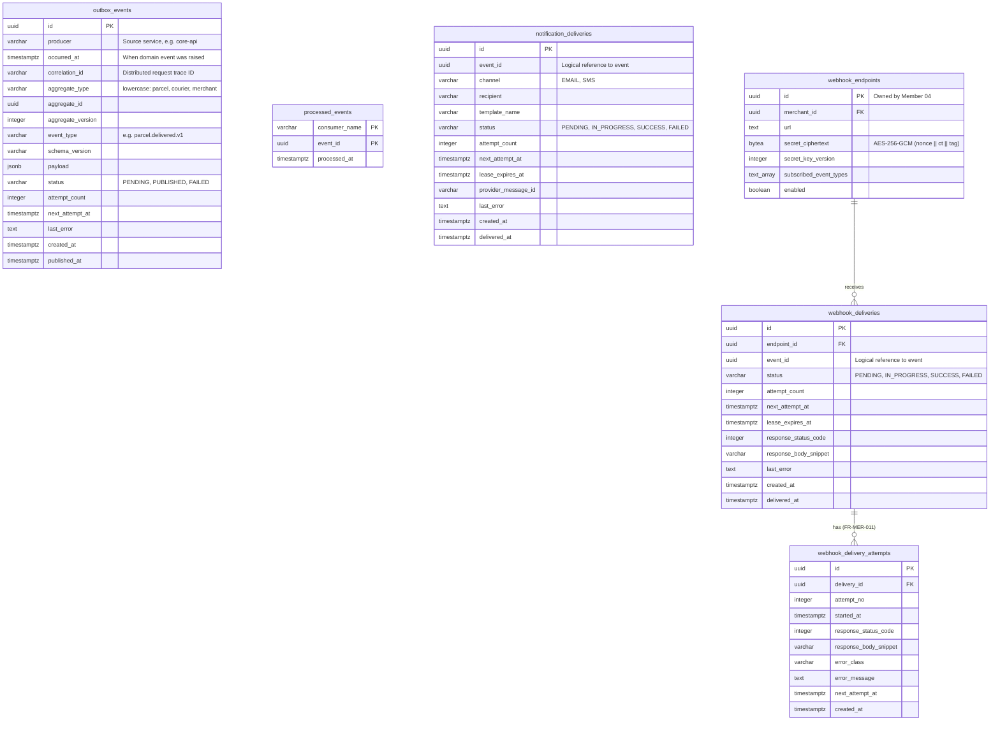

# Document 05 — Data & Persistence Specification

> **Module:** Event-Driven Backend & Messaging (`internal/events`, `services/messaging`)  
> **Owning Member:** Member 08 — Event-Driven Backend & Integrations  
> **Status:** Draft Baseline Specification for Review & Implementation  
> **Target Production Locations:**  
> - `core-api/internal/events/` (In-Monolith Outbox Writer & Envelopes)  
> - `services/messaging/` (Outbox Relay Daemon, Real SMTP Worker, Webhook Dispatcher, Reconciler)  
> **Relevant Contracts:** [database-schema.md](../../architecture/database-schema.md), [event-contracts.md](../../contracts/event-contracts.md), [webhook-security.md](../../contracts/webhook-security.md)

---

## 1. Data Architecture & Relational ER Model

Member 08 owns authoritative database tables in the PostgreSQL 16+ relational store. These tables form the asynchronous durability engine of SwiftDrop, managing outbox queuing, consumer deduplication, real SMTP email logs, outbound merchant webhook delivery state, and append-only attempt logs (FR-MER-011).

This specification complements the system-wide ER design in [database-schema.md §1](../../architecture/database-schema.md).



> **Note on Foreign Key References to `outbox_events`:**  
> Neither `webhook_deliveries` nor `notification_deliveries` defines a PostgreSQL foreign key constraint to `outbox_events.id`. Outbox records are pruned on a fast 7-day retention schedule, whereas delivery audit logs must be retained for at least 30 days. `event_id` is stored as an unconstrained UUID reference for historical lookup.

---

## 2. Authoritative Table Ownership & Data Dictionary

### 2.1 Table: `outbox_events`
- **Owning Capability:** Event & Integration Support Context (Member 08)
- **Primary Purpose:** Stores domain events emitted within Core API transactions awaiting confirmation by the Outbox Relay.
- **Write Permissions:**
  - Insert: Application use cases via `OutboxWriter` inside active domain transaction (`*sql.Tx`).
  - Update: Outbox Relay daemon (`status`, `attempt_count`, `published_at`, `last_error`, `next_attempt_at`).
  - Delete: Asynchronous 7-day retention cleanup job (`retention` command of `cmd/reconcile`).

| Column Name | Data Type | Nullable? | Default | Constraints / Validation | Description |
| :--- | :--- | :--- | :--- | :--- | :--- |
| `id` | `UUID` | No | `gen_random_uuid()` | Primary Key | Unique identifier (UUIDv7 from domain layer or v4 fallback). |
| `producer` | `VARCHAR(64)` | No | `'core-api'` | Non-empty | Originating service or module identifier. |
| `occurred_at` | `TIMESTAMPTZ` | No | `CURRENT_TIMESTAMP` | UTC | Precise timestamp when the domain event occurred. |
| `correlation_id` | `VARCHAR(128)`| No | None | Non-empty | Distributed tracing correlation ID (`X-Request-ID`). |
| `aggregate_type` | `VARCHAR(64)` | No | None | Lowercase string | Target aggregate (e.g. `parcel`, `courier`, `merchant`). |
| `aggregate_id` | `UUID` | No | None | Valid UUID | Primary key of the modified domain aggregate root. |
| `aggregate_version`| `INTEGER` | No | `1` | $\ge 1$ | Optimistic concurrency version of the aggregate. |
| `event_type` | `VARCHAR(128)`| No | None | Regex: `^[a-z_]+\.[a-z_]+\.v[0-9]+$` | Standard routing key and event name (e.g. `parcel.delivered.v1`). |
| `schema_version` | `VARCHAR(16)` | No | `'1.0.0'`| SemVer format | Payload schema version. |
| `payload` | `JSONB` | No | None | Valid JSON Object | Domain event data serialized to JSON. |
| `status` | `VARCHAR(32)` | No | `'PENDING'` | `CHECK (status IN ('PENDING', 'PUBLISHED', 'FAILED'))` | Current lifecycle state. |
| `attempt_count` | `INTEGER` | No | `0` | $\ge 0$ | Number of publication attempts to RabbitMQ. |
| `next_attempt_at`| `TIMESTAMPTZ` | Yes | `NULL` | Future timestamp | Scheduled retry time for publication. |
| `last_error` | `TEXT` | Yes | `NULL` | Truncated to 2KB | Error message from broker or network on failure. |
| `created_at` | `TIMESTAMPTZ` | No | `CURRENT_TIMESTAMP` | UTC | Time the domain event was committed in PostgreSQL. |
| `published_at` | `TIMESTAMPTZ` | Yes | `NULL` | Set only on broker confirm | Time RabbitMQ acknowledged persistent receipt. |

---

### 2.2 Table: `processed_events`
- **Owning Capability:** Event Worker Context (Member 08)
- **Primary Purpose:** Authoritative deduplication ledger ensuring at-least-once AMQP deliveries produce strictly idempotent side effects.
- **Write Permissions:** Event Worker consumer goroutines upon terminal outcome (`SUCCESS` or `FAILED`).

| Column Name | Data Type | Nullable? | Default | Constraints / Validation | Description |
| :--- | :--- | :--- | :--- | :--- | :--- |
| `consumer_name` | `VARCHAR(64)` | No | None | PK Component 1 | Name of consumer (`notification_worker`, `webhook_dispatcher`). |
| `event_id` | `UUID` | No | None | PK Component 2 | UUID event ID from `EventEnvelope.EventID`. |
| `processed_at` | `TIMESTAMPTZ` | No | `CURRENT_TIMESTAMP` | UTC | Timestamp when event processing reached terminal state. |

---

### 2.3 Table: `notification_deliveries`
- **Owning Capability:** Event Worker Context (Member 08)
- **Primary Purpose:** Authoritative audit log of real SMTP transactional email milestone notifications dispatched to recipients.
- **Write Permissions:** Event Worker Notification consumer.

| Column Name | Data Type | Nullable? | Default | Constraints / Validation | Description |
| :--- | :--- | :--- | :--- | :--- | :--- |
| `id` | `UUID` | No | `gen_random_uuid()` | Primary Key | Unique delivery task ID. |
| `event_id` | `UUID` | No | None | Valid UUID | Logical reference to triggering domain event. |
| `channel` | `VARCHAR(32)` | No | `'EMAIL'` | `CHECK (channel IN ('EMAIL', 'SMS'))` | Notification transport channel (Real SMTP). |
| `recipient` | `VARCHAR(255)`| No | None | Valid email address | Recipient email address. |
| `template_name` | `VARCHAR(64)` | No | `'milestone_notice'` | Non-empty | Notification template used for rendering. |
| `status` | `VARCHAR(32)` | No | `'PENDING'` | `CHECK (status IN ('PENDING', 'IN_PROGRESS', 'SUCCESS', 'FAILED'))` | Current delivery status. |
| `attempt_count` | `INTEGER` | No | `0` | $\ge 0$ | Total number of delivery attempts made. |
| `next_attempt_at`| `TIMESTAMPTZ` | Yes | `NULL` | UTC | Scheduled retry time for next attempt. |
| `lease_expires_at`| `TIMESTAMPTZ`| Yes | `NULL` | UTC | Concurrency lease expiration timestamp for active poller claim. |
| `provider_message_id`| `VARCHAR(255)`| Yes| `NULL` | Non-empty if SUCCESS | Generated RFC 2822 Message-ID captured on SMTP `250 OK`. |
| `last_error` | `TEXT` | Yes | `NULL` | Truncated to 1KB | SMTP protocol error or connection timeout message. |
| `created_at` | `TIMESTAMPTZ` | No | `CURRENT_TIMESTAMP` | UTC | Record creation timestamp. |
| `delivered_at` | `TIMESTAMPTZ` | Yes | `NULL` | UTC | Timestamp when SMTP server returned `250 OK`. |

*Constraint:* `UNIQUE (event_id, channel, recipient)` guarantees that an event cannot produce duplicate delivery rows for the same recipient.

---

### 2.4 Table: `webhook_deliveries`
- **Owning Capability:** Event Worker Context (Member 08)
- **Primary Purpose:** Delivery task and state record for outbound HTTP webhooks sent to external merchant endpoints.
- **Write Permissions:** Event Worker Webhook dispatcher.
- **Read Permissions:** Member 08 (Worker/Reconciler) and Member 04 (Merchant Portal delivery history UI).

| Column Name | Data Type | Nullable? | Default | Constraints / Validation | Description |
| :--- | :--- | :--- | :--- | :--- | :--- |
| `id` | `UUID` | No | `gen_random_uuid()` | Primary Key | Unique webhook delivery task ID. |
| `endpoint_id` | `UUID` | No | None | `REFERENCES webhook_endpoints(id) ON DELETE RESTRICT` | Foreign Key to merchant endpoint configuration. |
| `event_id` | `UUID` | No | None | Valid UUID | Logical reference to triggering domain event. |
| `status` | `VARCHAR(32)` | No | `'PENDING'` | `CHECK (status IN ('PENDING', 'IN_PROGRESS', 'SUCCESS', 'FAILED'))` | Delivery status. |
| `attempt_count` | `INTEGER` | No | `0` | Range: $0$ to $5$ | Number of dispatch attempts made (max 5 total). |
| `next_attempt_at`| `TIMESTAMPTZ` | Yes | `NULL` | UTC | Calculated exponential backoff retry timestamp. |
| `lease_expires_at`| `TIMESTAMPTZ`| Yes | `NULL` | UTC | Concurrency lease expiration timestamp for active poller claim. |
| `response_status_code`| `INTEGER` | Yes | `NULL` | HTTP status code | Most recent HTTP response code returned by merchant server. |
| `response_body_snippet`| `VARCHAR(500)`| Yes| `NULL` | Truncated, UTF-8/NUL-sanitized | Preview of merchant server response (max 500 B). |
| `last_error` | `TEXT` | Yes | `NULL` | Truncated to 1KB | Network timeout, SSRF blocked alert, or HTTP error. |
| `created_at` | `TIMESTAMPTZ` | No | `CURRENT_TIMESTAMP` | UTC | Record creation timestamp. |
| `delivered_at` | `TIMESTAMPTZ` | Yes | `NULL` | UTC | Timestamp of successful 2xx delivery. |

*Constraint:* `UNIQUE (endpoint_id, event_id)` guarantees one authoritative delivery state per endpoint and event.

---

### 2.5 Table: `webhook_delivery_attempts`
- **Owning Capability:** Event Worker Context (Member 08)
- **Primary Purpose:** Append-only delivery attempt history satisfying **SRS FR-MER-011** (recording each HTTP outcome, attempt time, next retry time, and sanitized snippet without sensitive data).
- **Write Permissions:** Event Worker Webhook dispatcher (Append-only `INSERT`).

| Column Name | Data Type | Nullable? | Default | Constraints / Validation | Description |
| :--- | :--- | :--- | :--- | :--- | :--- |
| `id` | `UUID` | No | `gen_random_uuid()` | Primary Key | Unique attempt record ID. |
| `delivery_id` | `UUID` | No | None | `REFERENCES webhook_deliveries(id) ON DELETE CASCADE` | Parent delivery record. |
| `attempt_no` | `INTEGER` | No | None | $1 \le \text{attempt} \le 5$ | Sequence number of this attempt (1 through 5). |
| `started_at` | `TIMESTAMPTZ` | No | `CURRENT_TIMESTAMP` | UTC | Timestamp when HTTP dispatch was initiated. |
| `response_status_code`| `INTEGER` | Yes | `NULL` | HTTP status code | HTTP response code returned by merchant server. |
| `response_body_snippet`| `VARCHAR(500)`| Yes| `NULL` | Truncated, UTF-8/NUL-sanitized | Sanitized response preview (headers stripped, NUL characters removed). |
| `error_class` | `VARCHAR(64)` | Yes | `NULL` | Categorized error | Error classification (`NETWORK_TIMEOUT`, `SSRF_BLOCKED`, `HTTP_5XX`, etc.). |
| `error_message` | `TEXT` | Yes | `NULL` | Truncated to 1KB | Descriptive error details. |
| `next_attempt_at`| `TIMESTAMPTZ` | Yes | `NULL` | UTC | Scheduled retry time for next attempt if retryable. |
| `created_at` | `TIMESTAMPTZ` | No | `CURRENT_TIMESTAMP` | UTC | Timestamp record was persisted. |

---

## 3. Authoritative Indexing Strategy

To meet **SRS NFR-PERF-001** ($\le$ 500ms p95), **NFR-PERF-003** ($\le$ 5s publication SLA), and support high-throughput relay polling:

| Table | Index Name | Columns / Condition | Index Type | Query Purpose |
| :--- | :--- | :--- | :--- | :--- |
| `outbox_events` | `idx_outbox_pending` | `(created_at ASC) WHERE status = 'PENDING'` | Partial B-Tree | Ultra-fast polling for Outbox Relay; skips published rows. Filter `next_attempt_at <= now()` applied in query. |
| `outbox_events` | `idx_outbox_aggregate` | `aggregate_type, aggregate_id, created_at ASC` | B-Tree | Reconstructing aggregate event stream timeline. |
| `outbox_events` | `idx_outbox_correlation`| `correlation_id` | B-Tree | Distributed trace correlation (`X-Request-ID`) and triage. |
| `outbox_events` | `idx_outbox_retention` | `(published_at ASC) WHERE status = 'PUBLISHED'` | Partial B-Tree | Fast lookup for 7-day retention cleanup purge jobs. |
| `processed_events`| `processed_events_pkey` | `consumer_name, event_id` | Composite PK | $O(1)$ unique constraint enforcement for deduplication. |
| `processed_events`| `idx_processed_cleanup`| `processed_at ASC` | B-Tree | Periodic deletion of expired deduplication keys ($\ge 35$ days).|
| `notification_deliveries`| `idx_notif_recipient`| `recipient, created_at DESC` | B-Tree | Customer notification audit lookup. |
| `notification_deliveries`| `idx_notif_retry` | `(next_attempt_at ASC) WHERE status IN ('PENDING', 'IN_PROGRESS')` | Partial B-Tree | Polling for pending and retryable SMTP attempts. |
| `webhook_deliveries` | `idx_webhook_endpoint` | `endpoint_id, created_at DESC` | B-Tree | Merchant dashboard webhook delivery history. |
| `webhook_deliveries` | `idx_webhook_retry_queue`| `(next_attempt_at ASC) WHERE status IN ('PENDING', 'IN_PROGRESS')` | Partial B-Tree | Poller and reconciler retry queue scan. |
| `webhook_delivery_attempts`| `idx_webhook_attempts_delivery`| `delivery_id, attempt_no ASC` | B-Tree | Ordered attempt history for merchant portal and triage. |

---

## 4. Sequential Database Migration Strategy

Database changes are managed sequentially via `golang-migrate` files in `core-api/migrations/`, adhering to Member 09 Agreement D3 (Member 8 owns migrations 000008 and 000009 in dependency sequence):

> **Migration Numbering Note:**  
> Member 8 defines sequential migration files `000008_create_outbox_events.up.sql` and `000009_create_worker_dedup_and_webhooks.up.sql`. This aligns with Member 9's authoritative schema dependency graph (Agreement D3 / K11/K12).

### 4.1 Migration File: `000008_create_outbox_events.up.sql`
```sql
-- SwiftDrop: Migration 000008 (Member 08 - Transactional Outbox Engine)
-- Executed inside core-api monolithic schema migrations

BEGIN;

CREATE TABLE IF NOT EXISTS outbox_events (
    id UUID PRIMARY KEY DEFAULT gen_random_uuid(),
    producer VARCHAR(64) DEFAULT 'core-api' NOT NULL,
    occurred_at TIMESTAMPTZ DEFAULT CURRENT_TIMESTAMP NOT NULL,
    correlation_id VARCHAR(128) NOT NULL,
    aggregate_type VARCHAR(64) NOT NULL,
    aggregate_id UUID NOT NULL,
    aggregate_version INTEGER DEFAULT 1 NOT NULL CHECK (aggregate_version >= 1),
    event_type VARCHAR(128) NOT NULL CHECK (event_type ~ '^[a-z_]+\.[a-z_]+\.v[0-9]+$'),
    schema_version VARCHAR(16) DEFAULT '1.0.0' NOT NULL,
    payload JSONB NOT NULL,
    status VARCHAR(32) DEFAULT 'PENDING' NOT NULL 
        CHECK (status IN ('PENDING', 'PUBLISHED', 'FAILED')),
    attempt_count INTEGER DEFAULT 0 NOT NULL CHECK (attempt_count >= 0),
    next_attempt_at TIMESTAMPTZ NULL,
    last_error TEXT NULL,
    created_at TIMESTAMPTZ DEFAULT CURRENT_TIMESTAMP NOT NULL,
    published_at TIMESTAMPTZ NULL
);

-- Partial index for high-throughput pollers skipping published events
-- Note: IMMUTABLE predicate only. Dynamic time filtering (next_attempt_at <= now()) is performed in query.
CREATE INDEX IF NOT EXISTS idx_outbox_pending 
ON outbox_events (created_at ASC) 
WHERE status = 'PENDING';

CREATE INDEX IF NOT EXISTS idx_outbox_aggregate 
ON outbox_events (aggregate_type, aggregate_id, created_at ASC);

CREATE INDEX IF NOT EXISTS idx_outbox_correlation 
ON outbox_events (correlation_id);

CREATE INDEX IF NOT EXISTS idx_outbox_retention 
ON outbox_events (published_at ASC) 
WHERE status = 'PUBLISHED';

COMMIT;
```

### 4.2 Rollback Migration File: `000008_create_outbox_events.down.sql`
```sql
BEGIN;
DROP TABLE IF EXISTS outbox_events CASCADE;
COMMIT;
```

### 4.3 Migration File: `000009_create_worker_dedup_and_webhooks.up.sql`
```sql
-- SwiftDrop: Migration 000009 (Member 08 - Messaging Worker Idempotency, Notifications & Webhooks)
-- Depends on: 000003_create_webhook_endpoints (Member 04)

BEGIN;

-- 1. Consumer Idempotency Ledger (UUID Event ID)
CREATE TABLE IF NOT EXISTS processed_events (
    consumer_name VARCHAR(64) NOT NULL,
    event_id UUID NOT NULL,
    processed_at TIMESTAMPTZ DEFAULT CURRENT_TIMESTAMP NOT NULL,
    PRIMARY KEY (consumer_name, event_id)
);

CREATE INDEX IF NOT EXISTS idx_processed_cleanup 
ON processed_events (processed_at ASC);

-- 2. Notification Deliveries Log (Real SMTP Email & SMS Audit)
-- Logical reference to event_id (outbox purged on 7d schedule vs 30d delivery audit)
CREATE TABLE IF NOT EXISTS notification_deliveries (
    id UUID PRIMARY KEY DEFAULT gen_random_uuid(),
    event_id UUID NOT NULL,
    recipient VARCHAR(255) NOT NULL,
    channel VARCHAR(32) DEFAULT 'EMAIL' NOT NULL 
        CHECK (channel IN ('EMAIL', 'SMS')),
    template_name VARCHAR(64) DEFAULT 'milestone_notice' NOT NULL,
    status VARCHAR(32) DEFAULT 'PENDING' NOT NULL 
        CHECK (status IN ('PENDING', 'IN_PROGRESS', 'SUCCESS', 'FAILED')),
    attempt_count INTEGER DEFAULT 0 NOT NULL CHECK (attempt_count >= 0),
    next_attempt_at TIMESTAMPTZ NULL,
    lease_expires_at TIMESTAMPTZ NULL,
    provider_message_id VARCHAR(255) NULL,
    last_error TEXT NULL,
    created_at TIMESTAMPTZ DEFAULT CURRENT_TIMESTAMP NOT NULL,
    delivered_at TIMESTAMPTZ NULL,
    CONSTRAINT uq_notification_delivery UNIQUE (event_id, channel, recipient)
);

CREATE INDEX IF NOT EXISTS idx_notif_recipient 
ON notification_deliveries (recipient, created_at DESC);

CREATE INDEX IF NOT EXISTS idx_notif_retry 
ON notification_deliveries (next_attempt_at ASC) 
WHERE status IN ('PENDING', 'IN_PROGRESS');

-- 3. Webhook Deliveries State & Parent Record
CREATE TABLE IF NOT EXISTS webhook_deliveries (
    id UUID PRIMARY KEY DEFAULT gen_random_uuid(),
    endpoint_id UUID NOT NULL REFERENCES webhook_endpoints(id) ON DELETE RESTRICT,
    event_id UUID NOT NULL,
    status VARCHAR(32) DEFAULT 'PENDING' NOT NULL 
        CHECK (status IN ('PENDING', 'IN_PROGRESS', 'SUCCESS', 'FAILED')),
    attempt_count INTEGER DEFAULT 0 NOT NULL CHECK (attempt_count >= 0),
    next_attempt_at TIMESTAMPTZ NULL,
    lease_expires_at TIMESTAMPTZ NULL,
    response_status_code INTEGER NULL,
    response_body_snippet VARCHAR(500) NULL,
    last_error TEXT NULL,
    created_at TIMESTAMPTZ DEFAULT CURRENT_TIMESTAMP NOT NULL,
    delivered_at TIMESTAMPTZ NULL,
    CONSTRAINT uq_webhook_delivery UNIQUE (endpoint_id, event_id)
);

CREATE INDEX IF NOT EXISTS idx_webhook_endpoint 
ON webhook_deliveries (endpoint_id, created_at DESC);

CREATE INDEX IF NOT EXISTS idx_webhook_retry_queue 
ON webhook_deliveries (next_attempt_at ASC) 
WHERE status IN ('PENDING', 'IN_PROGRESS');

-- 4. Append-Only Webhook Delivery Attempts History (SRS FR-MER-011)
CREATE TABLE IF NOT EXISTS webhook_delivery_attempts (
    id UUID PRIMARY KEY DEFAULT gen_random_uuid(),
    delivery_id UUID NOT NULL REFERENCES webhook_deliveries(id) ON DELETE CASCADE,
    attempt_no INTEGER NOT NULL CHECK (attempt_no >= 1),
    started_at TIMESTAMPTZ DEFAULT CURRENT_TIMESTAMP NOT NULL,
    response_status_code INTEGER NULL,
    response_body_snippet VARCHAR(500) NULL,
    error_class VARCHAR(64) NULL,
    error_message TEXT NULL,
    next_attempt_at TIMESTAMPTZ NULL,
    created_at TIMESTAMPTZ DEFAULT CURRENT_TIMESTAMP NOT NULL
);

CREATE INDEX IF NOT EXISTS idx_webhook_attempts_delivery 
ON webhook_delivery_attempts (delivery_id, attempt_no ASC);

COMMIT;
```

### 4.4 Rollback Migration File: `000009_create_worker_dedup_and_webhooks.down.sql`
```sql
BEGIN;
DROP TABLE IF EXISTS webhook_delivery_attempts CASCADE;
DROP TABLE IF EXISTS webhook_deliveries CASCADE;
DROP TABLE IF EXISTS notification_deliveries CASCADE;
DROP TABLE IF EXISTS processed_events CASCADE;
COMMIT;
```

---

## 5. Concurrency Control, Locking & Transaction Boundaries

### 5.1 Lock Contention Prevention: `FOR UPDATE SKIP LOCKED`
The Outbox Relay polls pending records concurrently without blocking application inserts:
```sql
SELECT id, producer, occurred_at, aggregate_type, aggregate_id, aggregate_version,
       event_type, schema_version, payload, correlation_id, attempt_count
FROM outbox_events
WHERE status = 'PENDING' 
  AND (next_attempt_at IS NULL OR next_attempt_at <= CURRENT_TIMESTAMP)
ORDER BY created_at ASC
LIMIT 50
FOR UPDATE SKIP LOCKED;
```
- **Rationale:** Standard `FOR UPDATE` acquires locks sequentially; if one row is locked by another transaction, all subsequent transactions block. `SKIP LOCKED` instructs the engine to silently skip any rows currently locked by uncommitted use-case transactions and claim only unlocked pending rows, eliminating deadlocks and contention.
- **Single-Row Updates:** To eliminate batch rollback risks, the relay claims a batch with a short read transaction, publishes messages with publisher confirms, and commits individual row status updates in rapid, dedicated per-row transactions.

### 5.2 Atomic Consumer Deduplication: `ON CONFLICT DO NOTHING`
Consumers avoid double-processing via atomic upsert syntax executed upon reaching terminal status:
```sql
INSERT INTO processed_events (consumer_name, event_id, processed_at)
VALUES ($1, $2, CURRENT_TIMESTAMP)
ON CONFLICT (consumer_name, event_id) DO NOTHING;
```
- The database engine evaluates uniqueness on the composite primary key `(consumer_name, event_id)`.
- If a conflict occurs, the worker recognizes that the event was already handled to completion and cleanly acknowledges the AMQP message.

### 5.3 External I/O Isolation Invariant
**Strict Rule:** No database transaction may be held open while waiting on external network calls.
- The SMTP email handshake and merchant HTTPS POST occur outside any database transaction.
- Outcomes are written back to `notification_deliveries`, `webhook_deliveries`, and `webhook_delivery_attempts` in rapid, dedicated, single-statement transactions ($< 5\text{ ms}$).

---

## 6. Retention, Deletion, Privacy & Audit Policies

In accordance with **SEC-008** (PII scrubbing) and **SEC-015** (audit logging & retention):

| Table | Retention Period | Deletion Mechanism | Privacy & Scrubbing Rules |
| :--- | :--- | :--- | :--- |
| `outbox_events` | 7 Days after publication | Batched delete: `DELETE FROM outbox_events WHERE id IN (SELECT id FROM outbox_events WHERE status = 'PUBLISHED' AND published_at < NOW() - INTERVAL '7 days' LIMIT 500)` | Payloads must NEVER contain raw passwords, session tokens, or payment card numbers. |
| `processed_events` | $\ge 35$ Days (exceeds 30d DLQ TTL) | Batched delete: `DELETE FROM processed_events WHERE (consumer_name, event_id) IN (SELECT consumer_name, event_id FROM processed_events WHERE processed_at < NOW() - INTERVAL '35 days' LIMIT 500)` | Contains only opaque UUIDs and consumer names. Zero PII. |
| `notification_deliveries`| 30 Days | Batched delete: `DELETE FROM notification_deliveries WHERE id IN (SELECT id FROM notification_deliveries WHERE created_at < NOW() - INTERVAL '30 days' LIMIT 500)` | Recipient email addresses are retained strictly for delivery verification and disputes. |
| `webhook_deliveries` & `attempts`| 30 Days | Batched delete: `DELETE FROM webhook_deliveries WHERE id IN (SELECT id FROM webhook_deliveries WHERE created_at < NOW() - INTERVAL '30 days' LIMIT 500)` (Cascades to `webhook_delivery_attempts`) | Response snippets are capped at 500 bytes and sanitized. Authorization and Set-Cookie headers are strictly stripped before logging. |

> **Retention Enforcement:** Retention purges are executed by the dedicated `retention` subcommand of `cmd/reconcile` (scheduled via Kubernetes CronJob `swiftdrop-outbox-reconciler`) using the least-privilege `swiftdrop_reconciler` role. Deletions run in loops capped at 500 rows per batch to guarantee execution finishes well within PostgreSQL `statement_timeout = 5s`.

---

## 7. Caching Policy & Cache Invalidation

1. **Transactional Outbox Queues (`outbox_events`):** **ZERO CACHING.** The outbox table serves as a durable transactional queue. Any caching layer would introduce stale states, race conditions, and bypass ACID durability.
2. **Merchant Webhook Targets View (`merchant_webhook_targets`):**
   - **Local In-Memory Cache ($\le$ 60s TTL):** When a burst of events fires for the same merchant, the Webhook Worker caches endpoint configuration (`endpoint_id, merchant_id, url, secret_ciphertext, secret_key_version, subscribed_event_types`) for up to 60 seconds.
   - **Pre-Attempt Re-Read:** Before every scheduled retry attempt, the worker re-queries the authoritative `merchant_webhook_targets` view to verify that the endpoint is still enabled and has not had its target URL or secrets rotated.
   - **Zero Secret Caching in Plaintext:** Secrets are stored only in encrypted ciphertext form; plaintext HMAC keys exist only in ephemeral stack memory during signature generation and are wiped immediately.

---

## 8. Seed Data & Test Data Strategy

For local development and CI test execution, seed scripts populate reproducible fixtures:

### Sample Seed SQL (`core-api/cmd/seed/data/08_messaging_seed.sql`):
```sql
-- Sample Webhook Endpoint for Local Merchant Testing (Member 04 Contract)
-- Note: In production and integration tests, Member 04 manages webhook_endpoints.
-- secret_ciphertext is a fixture ciphertext encrypted with AES-256-GCM test key (key_version 1).
INSERT INTO webhook_endpoints (
    id, merchant_id, url, secret_ciphertext, secret_key_version, subscribed_event_types, enabled, created_at, updated_at
) VALUES (
    'a0eebc99-9c0b-4ef8-bb6d-6bb9bd380a11',
    'e1eebc99-9c0b-4ef8-bb6d-6bb9bd380e01',
    'https://merchant-test.local/webhooks/swiftdrop',
    decode('4a72d3f9e8a1b2c3d4e5f60718293a4b5c6d7e8f90a1b2c3d4e5f6a1b2c3d4e5', 'hex'),
    1,
    ARRAY['parcel.booked.v1', 'parcel.delivered.v1', 'parcel.delivery_failed.v1'],
    true,
    NOW(),
    NOW()
) ON CONFLICT (id) DO NOTHING;

-- Seed Sample Stale Outbox Event (for Testing Reconciliation CLI)
INSERT INTO outbox_events (
    id, producer, occurred_at, aggregate_type, aggregate_id, aggregate_version,
    event_type, schema_version, payload, correlation_id, status, attempt_count, created_at
) VALUES (
    'b1eebc99-9c0b-4ef8-bb6d-6bb9bd380b22',
    'core-api',
    NOW() - INTERVAL '10 minutes',
    'parcel',
    'c2eebc99-9c0b-4ef8-bb6d-6bb9bd380c33',
    1,
    'parcel.delivered.v1',
    '1.0.0',
    '{"parcel_id": "c2eebc99-9c0b-4ef8-bb6d-6bb9bd380c33", "tracking_number": "SD-TEST-STALE-01", "delivered_at": "2026-10-21T08:00:00Z"}'::jsonb,
    'd3eebc99-9c0b-4ef8-bb6d-6bb9bd380d44',
    'PENDING',
    1,
    NOW() - INTERVAL '10 minutes' -- Over 5 minutes stale
) ON CONFLICT (id) DO NOTHING;
```

---

## 9. Summary Checklist of Document 05 Deliverables

- [x] Complete ERD diagram and mapping of all 5 Member 08 authoritative tables (including append-only `webhook_delivery_attempts` for FR-MER-011).
- [x] Comprehensive data dictionary detailing data types, nullability, defaults, constraints, and descriptions for every field.
- [x] Strategic indexing plan with partial indexes on `outbox_events`, `notification_deliveries`, and `webhook_deliveries` (no non-immutable predicates).
- [x] Sequential PostgreSQL migration scripts (`000008_create_outbox_events.up.sql` and `000009_create_worker_dedup_and_webhooks.up.sql`).
- [x] Concurrency and lock mitigation specs (`SKIP LOCKED` and `ON CONFLICT DO NOTHING`).
- [x] Strict non-blocking external I/O transaction boundary invariant.
- [x] Data retention and automated cleanup policy (7 days outbox, $\ge 35$ days deduplication, 30 days delivery logs) executed via `reconcile retention`.
- [x] Data privacy, payload sanitization, and response snippet truncation rules.
- [x] In-memory caching policy ($\le 60\text{s}$ TTL) with mandatory pre-attempt re-read from `merchant_webhook_targets`.
- [x] Seed and test fixture SQL for local development and reconciliation testing with valid UUIDs.
