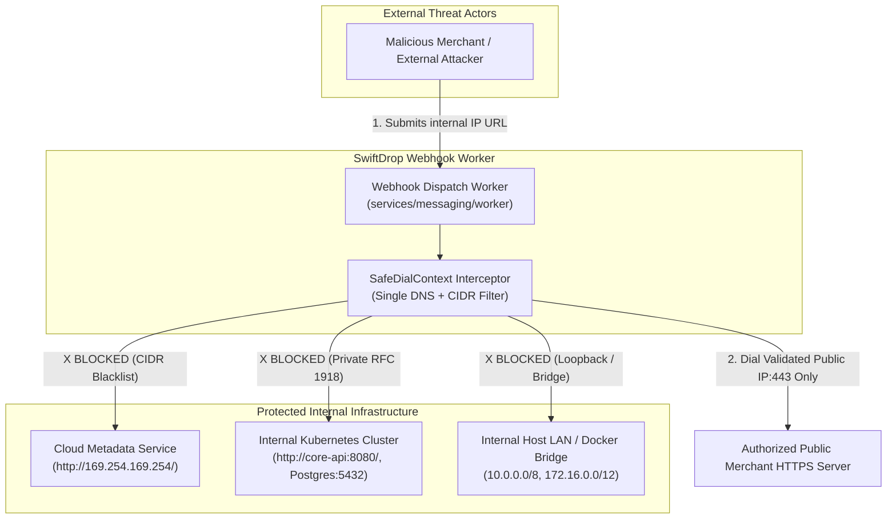
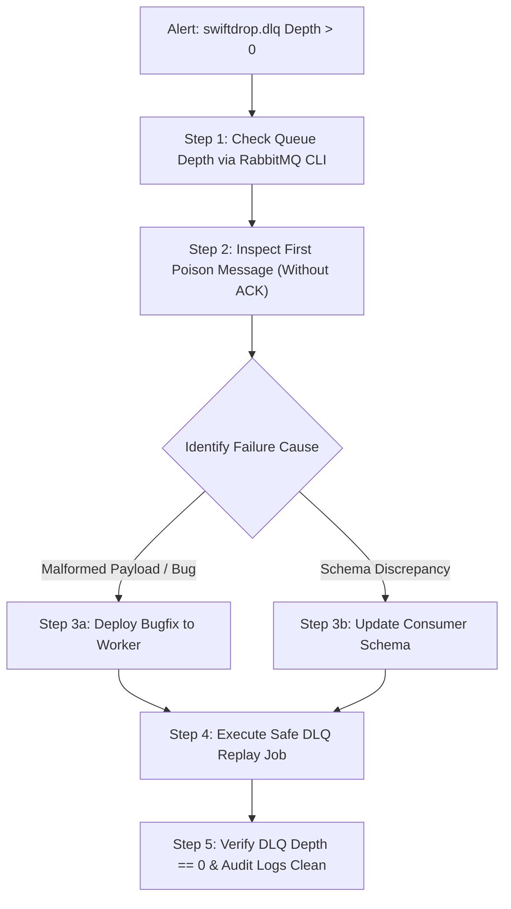

# Document 07 — Security, Failure & Recovery Specification

> **Module:** Event-Driven Backend & Messaging (`internal/events`, `services/messaging`)  
> **Owning Member:** Member 08 — Event-Driven Backend & Integrations  
> **Status:** Draft Baseline Specification for Review & Implementation  
> **Target Production Locations:**  
> - `core-api/internal/events/` (In-Monolith Outbox Writer & Envelopes)  
> - `services/messaging/` (Outbox Relay Daemon, Real SMTP Worker, Webhook Dispatcher, Reconciler)  
> **Relevant Contracts:** [webhook-security.md](../../contracts/webhook-security.md), [event-contracts.md](../../contracts/event-contracts.md), [security-notes.md](../../security/security-notes.md), [runbook.md](../../operations/runbook.md)

---

## 1. Authentication, Authorization & Tenant Isolation Rules

The Messaging & Integrations subsystem operates under a **Zero-Trust Egress & Isolation Model**. Because this module interacts with external merchant infrastructure and public SMTP relays, authorization and tenant scoping must be strictly enforced at every boundary.

### 1.1 Tenant Isolation Invariants
1. **Strict Merchant Scoping:**
   - Outbound webhooks must be delivered **only** to webhook endpoints owned by the authenticated merchant associated with the parcel (`webhook_endpoints.merchant_id = parcel.merchant_id`).
   - Cross-tenant delivery is strictly prevented; a merchant endpoint will never receive event notifications for another merchant's or customer's shipments.
2. **Database Least-Privilege Access:**
   - In production, messaging daemons run under dedicated, least-privilege PostgreSQL roles:
     - `swiftdrop_relay`: `SELECT, UPDATE (status, published_at, attempt_count, last_error, next_attempt_at)` on `outbox_events`.
     - `swiftdrop_worker`: `SELECT` on view `merchant_webhook_targets`; `SELECT, INSERT, UPDATE` on `notification_deliveries` and `webhook_deliveries`; `SELECT, INSERT` on `webhook_delivery_attempts`; `SELECT, INSERT, DELETE` on `processed_events`.
     - `swiftdrop_reconciler`: `SELECT, UPDATE (status, next_attempt_at, last_error, attempt_count), DELETE` on `outbox_events`; `SELECT, UPDATE (status, next_attempt_at, lease_expires_at, last_error), DELETE` on `webhook_deliveries` and `notification_deliveries`; `SELECT, DELETE` on `webhook_delivery_attempts`; `SELECT, DELETE` on `processed_events`.
     - **STRICT PROHIBITION:** Zero read or write access to `parcels`, `couriers`, `users`, `billing`, or any domain tables outside Member 08's bounded context. All recipient contact data and merchant IDs travel strictly inside event payloads.
3. **Per-Role Secrets & Secret Segregation:**
   - Following the Agreement A5 pattern, Kubernetes mounts dedicated secrets per daemon rather than a shared superuser secret:
     - `outbox-relay-secrets`: Contains `DATABASE_URL` for `swiftdrop_relay` and RabbitMQ publisher credentials.
     - `event-worker-secrets`: Contains `DATABASE_URL` for `swiftdrop_worker`, `WEBHOOK_SECRET_ENCRYPTION_KEY` (AES-256-GCM decryptor key, shared secret per A5), SMTP credentials, and RabbitMQ consumer credentials.
     - `outbox-reconciler-secrets`: Contains `DATABASE_URL` for `swiftdrop_reconciler`.
   - Merchant webhook signing secrets are stored encrypted at rest via AES-256-GCM (`secret_ciphertext bytea`) in `webhook_endpoints`. The worker reads `secret_ciphertext` from `merchant_webhook_targets` and decrypts it ephemerally in memory using the corresponding key version from its local key ring.
   - Real SMTP authentication credentials and RabbitMQ credentials are never written to source code, config files, or logs.

#### Bootstrap GRANT Proposal for Member 09
```sql
-- Proposal to Member 09 (DevOps / DBA) for initial cluster provisioning:
-- Roles are created by Member 09's bootstrap SQL before migrations run (Agreement D6);
-- Member 08 only specifies the grants. `swiftdrop_reconciler` is pending Member 09's decision
-- (alternative: the reconciler runs as `swiftdrop_worker`, which then needs the extra grants below).
GRANT CONNECT ON DATABASE swiftdrop_db TO swiftdrop_relay, swiftdrop_worker, swiftdrop_reconciler;
GRANT USAGE ON SCHEMA public TO swiftdrop_relay, swiftdrop_worker, swiftdrop_reconciler;

-- swiftdrop_relay
GRANT SELECT, UPDATE (status, published_at, attempt_count, last_error, next_attempt_at) 
    ON outbox_events TO swiftdrop_relay;

-- swiftdrop_worker
GRANT SELECT ON merchant_webhook_targets TO swiftdrop_worker;
GRANT SELECT, INSERT, UPDATE ON notification_deliveries TO swiftdrop_worker;
GRANT SELECT, INSERT, UPDATE ON webhook_deliveries TO swiftdrop_worker;
GRANT SELECT, INSERT ON webhook_delivery_attempts TO swiftdrop_worker;
GRANT SELECT, INSERT, DELETE ON processed_events TO swiftdrop_worker;

-- swiftdrop_reconciler
GRANT SELECT, UPDATE (status, next_attempt_at, last_error, attempt_count), DELETE ON outbox_events TO swiftdrop_reconciler;
GRANT SELECT, UPDATE (status, next_attempt_at, lease_expires_at, last_error), DELETE ON webhook_deliveries TO swiftdrop_reconciler;
GRANT SELECT, UPDATE (status, next_attempt_at, lease_expires_at, last_error), DELETE ON notification_deliveries TO swiftdrop_reconciler;
GRANT SELECT, DELETE ON webhook_delivery_attempts TO swiftdrop_reconciler;
GRANT SELECT, DELETE ON processed_events TO swiftdrop_reconciler;
```

---

## 2. Sensitive Data Classification & Sanitization

In compliance with **SRS SEC-008** and **Engineering Standards §8**:

| Data Element | Classification | Handled By | Masking / Storage Rule | Logging Policy |
| :--- | :--- | :--- | :--- | :--- |
| **Recipient Email Address** | PII | Real SMTP Worker | Stored in `notification_deliveries` for delivery verification and dispute audits. | Retained in delivery logs; masked in public tracking. |
| **Merchant Webhook Signing Secret** | Secret / Key | Webhook Worker | Stored as AES-256-GCM ciphertext (`secret_ciphertext`). Decrypted ephemerally for HMAC-SHA256; never persisted plaintext. | **STRICTLY PROHIBITED IN LOGS.** Zero-leak policy. |
| **SMTP Server Credentials** | Secret | Real SMTP Worker | Injected via environment variables into `SMTPSender` memory. | **STRICTLY PROHIBITED IN LOGS.** |
| **Webhook Response Headers** | Sensitive | Webhook Worker | Discarded after status code extraction. | Strip `Set-Cookie`, `Authorization`, and `X-Auth-*` before logging. |
| **Webhook Response Body Snippet** | Untrusted / PII | Webhook Worker | Captured for error debugging; truncated to 500 characters. | Truncated to 500 characters; never logged at INFO level. |
| **Customer Passwords & Payment Cards** | Restricted | Prohibited | **NEVER** present in event envelopes or outbox tables. | Any appearance in payloads triggers immediate security abort. |

---

## 3. Threat Modeling & Abuse Scenarios (STRIDE Analysis)



### Threat 1: Server-Side Request Forgery (SSRF)
- **Threat Vector:** An attacker registers a webhook URL pointing to cloud instance metadata (`http://169.254.169.254/latest/meta-data/`) or internal cluster service addresses (`http://core-api:8080/api/v1/admin/users`).
- **Impact:** Theft of cloud IAM credentials, cluster compromise, or internal port scanning.
- **Defensive Countermeasures:**
  1. **CIDR Blocklist:** Intercept socket creation and reject any IP within blacklisted subnets:
     - **IPv4:**
       - `0.0.0.0/8` (Current network / "this host")
       - `10.0.0.0/8`, `172.16.0.0/12`, `192.168.0.0/16` (Private RFC 1918)
       - `100.64.0.0/10` (Carrier-Grade NAT RFC 6598)
       - `127.0.0.0/8` (Loopback)
       - `169.254.0.0/16` (Link-Local & Cloud Metadata RFC 3927)
       - `192.0.0.0/24` (IETF Protocol Assignments RFC 6890)
       - `192.0.2.0/24`, `198.51.100.0/24`, `203.0.113.0/24` (Documentation TEST-NET 1/2/3 RFC 5737)
       - `198.18.0.0/15` (Benchmarking RFC 2544)
       - `224.0.0.0/4` (Multicast RFC 5771)
       - `240.0.0.0/4` (Reserved RFC 1112)
       - `255.255.255.255/32` (Broadcast)
     - **IPv6:**
       - `::/128` (Unspecified)
       - `::1/128` (Loopback)
       - `::ffff:0:0/96` (IPv4-mapped IPv6)
       - `64:ff9b::/96` (IPv4/IPv6 translation RFC 6052)
       - `100::/64` (Discard prefix RFC 6666)
       - `2001:db8::/32` (Documentation RFC 3849)
       - `2002::/16` (6to4 RFC 3056)
       - `fc00::/7` (Unique Local Address RFC 4193)
       - `fe80::/10` (Link-Local unicast RFC 4291)
       - `fec0::/10` (Deprecated site-local RFC 3879)
       - `ff00::/8` (Multicast RFC 4291)
     - **Multi-IP Resolution Rule:** If DNS resolves to multiple A/AAAA records, ALL resolved IPs must be checked. If ANY resolved IP matches a blocked CIDR, the entire dial attempt is rejected (`ErrBlockedDestinationIP`).
  2. **Scheme Enforcement:** Enforce `https://` in production. Disallow non-HTTP protocols (`file://`, `gopher://`, `ftp://`). Scheme `http://` is strictly prohibited except when `APP_ENV=local`.
  3. **Port Enforcement:** Allow only standard HTTPS port `443` (and `80` under `APP_ENV=local`). Block arbitrary ports like `:5432` or `:6379`.
  4. **Disabled Proxies:** HTTP client explicitly sets `Proxy: nil` to prevent proxy hijacking.

### Threat 2: DNS Rebinding Attack (TOCTOU Attack)
- **Threat Vector:** Attacker configures a public DNS domain that resolves to a public IP with a 1-second TTL during registration, but when the worker sends the HTTP request, DNS resolves to `169.254.169.254`.
- **Defensive Countermeasures:**
  - **Single-Resolution Direct Dial:** The custom `SafeDialContext` resolves the hostname once using `net.DefaultResolver.LookupIP`.
  - It validates all resolved IP addresses against the CIDR blocklist.
  - It connects directly to the validated IP address using `net.JoinHostPort(ip, port)`, while setting the HTTP `Host` header and TLS Server Name Indication (SNI) to the original hostname.
  - This eliminates TOCTOU vulnerability completely because the socket connects directly to the IP that was validated.

### Threat 3: Open Redirect SSRF Bypass
- **Threat Vector:** Merchant endpoint points to a public URL (`https://attacker.com/webhook`), but the server returns `HTTP 302 Found` with `Location: http://169.254.169.254/`.
- **Defensive Countermeasures:**
  - The worker's HTTP client explicitly sets `CheckRedirect` to return `http.ErrUseLastResponse`. Redirects are **never followed**. The HTTP response is recorded with its 3xx status code, logged as `SECURITY_REDIRECT_BLOCKED`, and marked as a terminal delivery failure (`status = 'FAILED'`).

### Threat 4: Tampering & Forgery of Webhook Payloads
- **Threat Vector:** An attacker eavesdrops on or spoofs webhook payloads to the merchant's backend to falsely claim a parcel was delivered.
- **Defensive Countermeasures:**
  - Every outbound payload is signed using **HMAC-SHA256** with the merchant's shared secret decrypted at send time from `merchant_webhook_targets`.
  - Header `X-SwiftDrop-Signature` includes timestamp: `t={unix_seconds},v1={hash}`.
  - Multiple signatures (`v1={old_sig},v1={new_sig}`) are sent during secret rotation.
  - Headers `X-SwiftDrop-Delivery-ID` and `X-SwiftDrop-Event-ID` provide idempotency keys. Internal tracing header `X-Correlation-ID` is NOT forwarded to external merchant endpoints.

### Threat 5: SMTP Header Injection (CRLF Injection)
- **Threat Vector:** Malicious user enters recipient name containing `\r\nBcc: victim@spam.org` to convert the SwiftDrop mailer into an open spam relay.
- **Defensive Countermeasures:**
  - The Real SMTP Worker strictly validates addresses via `mail.ParseAddress()` and strips carriage returns (`\r`) and line feeds (`\n`) from all recipient addresses, sender names, and email subject fields before initiating the SMTP `MAIL FROM` and `RCPT TO` dialogue. RFC 2047 Q-encoding is applied to non-ASCII subject headers.

### Threat 6: Slowloris & Resource Exhaustion on Worker
- **Threat Vector:** A malicious merchant endpoint accepts TCP connections but transmits response bytes at 1 byte every 30 seconds, exhausting worker goroutines and socket descriptors.
- **Defensive Countermeasures:**
  - Enforce strict socket timeouts via `http.Client{Timeout: 5 * time.Second}` with `TLSHandshakeTimeout: 3 * time.Second` and `ResponseHeaderTimeout: 4 * time.Second`.
  - Wrap connection dialers in `context.WithTimeout(ctx, 5*time.Second)`.
  - Cap response body reading to 512 bytes via `io.LimitReader(resp.Body, 512)` to prevent out-of-memory crashes from 50MB error dumps. Sanitize response snippets by replacing non-UTF-8 bytes and NUL characters before persistence.

---

## 4. Failure Modes & Effects Analysis (FMEA Matrix)

The following matrix documents all anticipated failure scenarios, automatic mitigations, and recovery paths:

| Failure Mode | Root Cause | System Detection | Automatic Behavior & Mitigation | Recovery Path | Data Loss Risk |
| :--- | :--- | :--- | :--- | :--- | :--- |
| **Core API Transaction Abort** | Domain error or DB constraint violation in `core-api`. | `tx.Rollback()` called. | Outbox row and entity mutation discarded atomically by PostgreSQL. | None required; transaction aborted cleanly. | **Zero** |
| **RabbitMQ Broker Outage** | Broker pod restart, network partition, or OOM. | Relay TCP dial error / channel confirm timeout. | Relay aborts batch, rolls back DB tx, pending rows remain in PostgreSQL, relay enters backoff sleep. | Relay auto-reconnects and publishes rows once broker recovers. | **Zero** |
| **Relay Process Crash Mid-Batch** | Pod OOM-killed after publish but before DB update. | Kubernetes pod restart. | DB transaction aborts; rows remain `PENDING`. | Replacement relay pod re-publishes rows. Downstream workers deduplicate via `processed_events`. | **Zero** (At-least-once) |
| **Real SMTP Provider Timeout / 4xx** | External mail server slow, rate-limiting, or graylisting. | Go `context.DeadlineExceeded` or 4xx SMTP status. | Worker logs attempt in `notification_deliveries`, sets `next_attempt_at = NOW() + backoff` and resets `lease_expires_at = NULL`. AMQP message is ACKed once scheduled. | Retry poller picks up due rows via `FOR UPDATE SKIP LOCKED`. If terminal 5xx returned (e.g. 550 mailbox unavailable), marked `FAILED`. | **Zero** |
| **Merchant Webhook Returns 500 / Timeout** | Merchant server maintenance, crash, or gateway timeout. | HTTP status 408/429/5xx or socket timeout. | Worker appends attempt record to `webhook_delivery_attempts`, sets `webhook_deliveries.status = 'PENDING'`, updates `next_attempt_at` according to 5-attempt retry schedule (0s, 30s, 2m, 10m, 30m). | Leased poller claims due rows. If attempt count reaches 5, status transitions to `FAILED`. | **Zero** (Durable in DB) |
| **Poison Pill Message in AMQP** | Malformed JSON payload or unhandled schema error. | Worker unmarshal error. | Worker catches error, logs correlation ID, rejects message with `Nack(requeue=false)`. | Broker dead-letters message via `swiftdrop.dlq.exchange` to `swiftdrop.dlq` for operator investigation. | **Zero** |
| **Database Pool Exhaustion** | Spike in traffic or long-running queries elsewhere. | `pq: remaining connection slots reserved`. | Daemons use bounded pools (`max_open=5` relay, `10` worker, `2` reconciler). Exponential backoff on pool acquisition. | Pool clears as short-lived queries complete. | **Zero** |
| **Stuck Outbox Row (>5m)** | Unhandled network race condition during broker ACK. | Reconciler scan: `status = 'PENDING' AND created_at < NOW() - 5m`. | Reconciler logs alert, resets `next_attempt_at = NOW()`. | Outbox Relay automatically claims and publishes on next polling tick. | **Zero** |
| **Expired Delivery Lease** | Worker pod crashes or OOMs mid-delivery. | Reconciler scan: `status = 'IN_PROGRESS' AND lease_expires_at < NOW()`. | Reconciler resets `status = 'PENDING'` and `lease_expires_at = NULL`. | Worker retry poller reclaims delivery on next tick. | **Zero** |

---

## 5. Dead-Letter Queue (DLQ) Operational Procedures & Runbook

Messages routed to `swiftdrop.dlq` represent poison-pill payloads (unmarshal errors, corrupt headers, schema violations) rejected by consumer workers.

### 5.1 DLQ Queue Configuration
- **DLQ Exchange:** `swiftdrop.dlq.exchange` (Direct, Durable)
- **DLQ Queue:** `swiftdrop.dlq` (Durable, message TTL = 30 days)
- **Dead-Letter Routing:** Configured via RabbitMQ queue policy `x-dead-letter-exchange: swiftdrop.dlq.exchange`.

### 5.2 Step-by-Step Operator DLQ Triage Runbook



#### Step 1: Check DLQ Queue Depth
```bash
# Check DLQ message count via Kubernetes StatefulSet pod:
kubectl exec -it -n swiftdrop statefulset/rabbitmq -- rabbitmqctl list_queues name messages messages_ready | grep swiftdrop.dlq
```

#### Step 2: Inspect Poison Message
Extract one message without acknowledging to inspect headers and failure cause:
```bash
# Read first message non-destructively:
kubectl exec -it -n swiftdrop statefulset/rabbitmq -- rabbitmqadmin get queue=swiftdrop.dlq requeue=true count=1
```
*Verify headers:* Look for `x-death` count, `x-first-death-reason`, and `correlation_id`.

#### Step 3: Execute Safe DLQ Replay
Once the underlying issue (e.g. worker deserialization bug resolved) is deployed:
```bash
# Run manual replay via the reconciliation CronJob with --replay-dlq flag:
kubectl create job --from=cronjob/swiftdrop-outbox-reconciler dlq-manual-replay-$(date +%s) -n swiftdrop -- /app/reconciler --replay-dlq
```

---

## 6. Audit Logging & Distributed Tracing

In accordance with **SRS SEC-015** and **Engineering Standards §11**:

### 6.1 Structured JSON Log Format
All daemons output structured JSON to `stdout`:
```json
{
  "timestamp": "2026-10-21T15:24:10.512Z",
  "level": "INFO",
  "service": "messaging-worker",
  "component": "webhook_dispatcher",
  "event_id": "0192e4a1-8d2b-7abc-8def-0123456789ab",
  "correlation_id": "c8a9f24e-7b12-4f33-912a-881234567890",
  "merchant_id": "0192e4a1-5555-7abc-8def-0123456789ab",
  "delivery_id": "0192e4a1-9999-7abc-8def-0123456789ab",
  "target_host": "merchant-store.com",
  "resolved_ip": "198.51.100.25",
  "http_status": 200,
  "attempt": 1,
  "duration_ms": 142.3,
  "msg": "Merchant webhook delivered successfully"
}
```

### 6.2 Security Audit Events
The following security-critical events are logged at `WARN` or `ERROR` level and trigger monitoring alerts:
1. `SECURITY_SSRF_BLOCKED`: An outbound webhook destination resolved to a blacklisted IP.
2. `SECURITY_REDIRECT_BLOCKED`: A destination endpoint returned an HTTP redirect (3xx).
3. `SECURITY_POISON_PILL_DLQ`: A message failed schema validation and was dead-lettered to `swiftdrop.dlq`.

---

## 7. Module-Specific Security Verification Checklist

Every pull request or release touching Member 08 must verify:

- [ ] **No Raw Secrets in Repository:** Code contains zero hardcoded SMTP passwords or webhook secrets.
- [ ] **SSRF Filter Coverage:** Unit tests verify rejection of loopback, RFC 1918, link-local metadata, CGNAT, broadcast, and IPv6 blocked CIDRs.
- [ ] **Redirect Interception:** HTTP client's `CheckRedirect` returns `http.ErrUseLastResponse` (3xx marked terminal failure).
- [ ] **Single-Resolution DNS:** DNS is resolved once and connection dials the verified IP directly.
- [ ] **Socket Timeout:** All external HTTP calls enforce a strict 5.0-second socket timeout with TLS/header deadlines.
- [ ] **Response Truncation & Sanitization:** Webhook response snippets are truncated to 512 bytes with non-UTF-8/NUL sanitization before persistence.
- [ ] **Header Stripping:** Sensitive internal headers (`Authorization`, `Cookie`, `X-Correlation-ID`) are stripped before external dispatch.
- [ ] **HMAC Signature:** Outbound webhooks include `X-SwiftDrop-Signature` with timestamp `t=` and HMAC-SHA256 hex digest `v1=`.
- [ ] **CRLF Sanitization:** Real SMTP recipient and subject fields strip `\r` and `\n` to prevent header injection.
- [ ] **Zero Network Calls in DB Transactions:** No database transaction is open during SMTP or webhook calls.
- [ ] **DB-Driven Webhook Retries:** Failed webhooks transition to `FAILED` status in `webhook_deliveries` after 5 attempts; poison AMQP messages dead-letter to `swiftdrop.dlq`.
