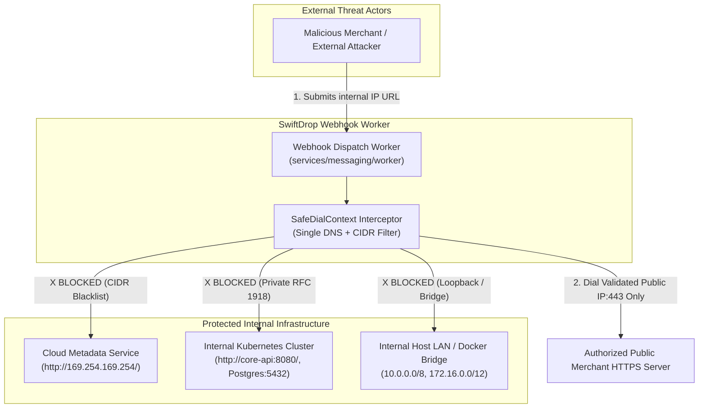
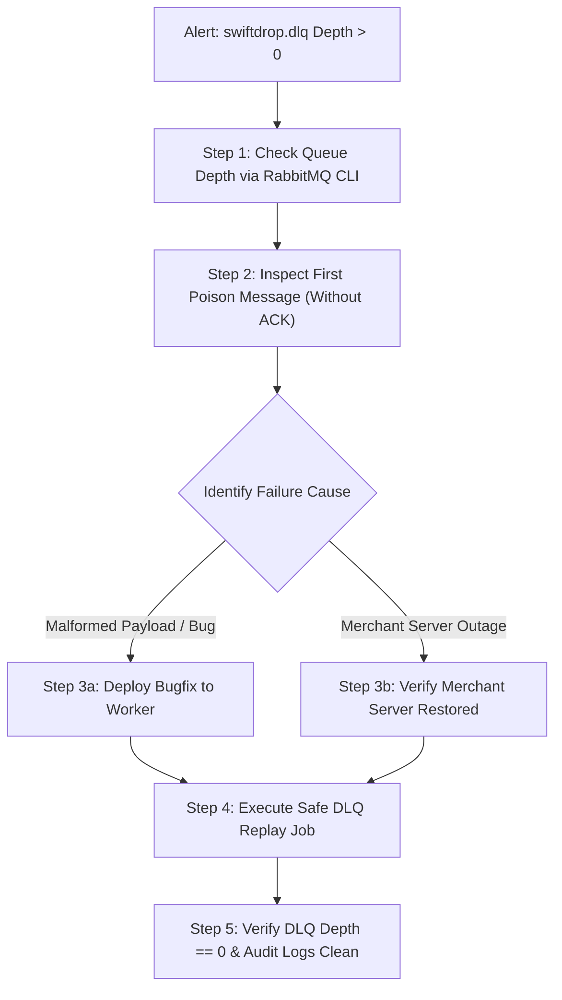

# Document 07 — Security, Failure & Recovery Specification

> **Module:** Event-Driven Backend & Messaging (`internal/events`, `services/messaging`)  
> **Owning Member:** Member 08 — Event-Driven Backend & Integrations  
> **Status:** Draft Baseline Specification for Review & Implementation  
> **Target Production Locations:**  
> - `core-api/internal/events/` (In-Monolith Outbox Writer & Envelopes)  
> - `services/messaging/` (Outbox Relay Daemon, Real SMTP Worker, Webhook Dispatcher, Reconciler)  
> **Relevant Contracts:** [webhook-security.md](../../contracts/webhook-security.md), [event-contracts.md](../../contracts/event-contracts.md), [security-notes.md](../../security/security-notes.md), [runbook.md](../../operations/runbook.md)

---

## 1. Authentication, Authorization & Tenant Isolation Rules

The Messaging & Integrations subsystem operates under a **Zero-Trust Egress & Isolation Model**. Because this module interacts with external merchant infrastructure and public SMTP relays, authorization and tenant scoping must be strictly enforced at every boundary.

### 1.1 Tenant Isolation Invariants
1. **Strict Merchant Scoping:**
   - Outbound webhooks must be delivered **only** to webhook endpoints owned by the authenticated merchant associated with the parcel (`webhook_endpoints.merchant_id = parcel.merchant_id`).
   - Cross-tenant delivery is strictly prevented; a merchant endpoint will never receive event notifications for another merchant's or customer's shipments.
2. **Database Least-Privilege Access (Agreement D6):**
   - In production, daemons run under dedicated PostgreSQL credentials:
     - `swiftdrop_relay`: `SELECT, UPDATE (status, published_at)` on `outbox_events`.
     - `swiftdrop_worker`: `SELECT, INSERT` on `processed_events`; `INSERT, UPDATE` on `notification_deliveries` and `webhook_deliveries`; `SELECT` on `merchant_webhook_targets_view`.
     - **DENIED:** Direct write access to `parcels`, `couriers`, `users`, or `billing` tables.
3. **Secret Protection (Member 04 & 09 Alignment):**
   - Merchant webhook signing secrets are stored encrypted at rest via AES-256-GCM (`secret_ciphertext bytea`) in `webhook_endpoints`.
   - The worker reads `secret_ciphertext` from `merchant_webhook_targets_view` and decrypts it ephemerally in memory using `WEBHOOK_SECRET_ENCRYPTION_KEY` mounted from Kubernetes secret `integrations-secrets`.
   - Real SMTP authentication credentials (`SMTP_USERNAME`, `SMTP_PASSWORD`) and RabbitMQ credentials are loaded strictly via Kubernetes Secrets (`integrations-secrets`, `rabbitmq-secrets`). They are never written to source code, config files, or logs.

---

## 2. Sensitive Data Classification & Sanitization

In compliance with **SRS SEC-008** and **Engineering Standards §8**:

| Data Element | Classification | Handled By | Masking / Storage Rule | Logging Policy |
| :--- | :--- | :--- | :--- | :--- |
| **Recipient Email Address** | PII | Real SMTP Worker | Stored in `notification_deliveries` for delivery verification and dispute audits. | Retained in delivery logs; masked in public tracking. |
| **Merchant Webhook Signing Secret** | Secret / Key | Webhook Worker | Stored as AES-256-GCM ciphertext (`secret_ciphertext`). Decrypted ephemerally for HMAC-SHA256; never persisted plaintext. | **STRICTLY PROHIBITED IN LOGS.** Zero-leak policy. |
| **SMTP Server Credentials** | Secret | Real SMTP Worker | Injected via environment variables into `SMTPSender` memory. | **STRICTLY PROHIBITED IN LOGS.** |
| **Webhook Response Headers** | Sensitive | Webhook Worker | Discarded after status code extraction. | Strip `Set-Cookie`, `Authorization`, and `X-Auth-*` before logging. |
| **Webhook Response Body Snippet** | Untrusted / PII | Webhook Worker | Captured for error debugging; truncated to 500 characters. | Truncated to 500 characters; never logged at INFO level. |
| **Customer Passwords & Payment Cards** | Restricted | Prohibited | **NEVER** present in event envelopes or outbox tables. | Any appearance in payloads triggers immediate security abort. |

---

## 3. Threat Modeling & Abuse Scenarios (STRIDE Analysis)



### Threat 1: Server-Side Request Forgery (SSRF)
- **Threat Vector:** An attacker registers a webhook URL pointing to cloud instance metadata (`http://169.254.169.254/latest/meta-data/`) or internal cluster service addresses (`http://core-api:8080/api/v1/admin/users`).
- **Impact:** Theft of cloud IAM credentials, cluster compromise, or internal port scanning.
- **Defensive Countermeasures:**
  1. **CIDR Blocklist:** Intercept socket creation and reject any IP within blacklisted subnets:
     - `0.0.0.0/8`, `127.0.0.0/8` (Loopback)
     - `10.0.0.0/8`, `172.16.0.0/12`, `192.168.0.0/16` (Private RFC 1918)
     - `169.254.0.0/16` (Link-Local & Cloud Metadata)
     - `::1/128`, `fe80::/10`, `fc00::/7` (IPv6 loopback and unique local)
  2. **Scheme Enforcement:** Enforce `https://` in production. Disallow non-HTTP protocols (`file://`, `gopher://`, `ftp://`).
  3. **Port Enforcement:** Allow only standard HTTPS port `443` (and `80` under `APP_ENV=local`). Block arbitrary ports like `:5432` or `:6379`.

### Threat 2: DNS Rebinding Attack (TOCTOU Attack)
- **Threat Vector:** Attacker configures a public DNS domain that resolves to a public IP with a 1-second TTL during registration, but when the worker sends the HTTP request, DNS resolves to `169.254.169.254`.
- **Defensive Countermeasures:**
  - **Single-Resolution Direct Dial:** The `SafeDialContext` resolves the hostname once using `net.DefaultResolver.LookupIP`.
  - It validates the resolved IP list against the CIDR blocklist.
  - It connects directly to the validated IP address using `net.JoinHostPort(ip, port)`, while setting the HTTP `Host` header and TLS Server Name Indication (SNI) to the original hostname.
  - This eliminates TOCTOU vulnerability completely because the socket connects directly to the IP that was validated.

### Threat 3: Open Redirect SSRF Bypass
- **Threat Vector:** Merchant endpoint points to a public URL (`https://attacker.com/webhook`), but the server returns `HTTP 302 Found` with `Location: http://169.254.169.254/`.
- **Defensive Countermeasures:**
  - The worker's HTTP client explicitly sets `CheckRedirect` to return `http.ErrUseLastResponse`. Redirects are **never followed**. The HTTP response is recorded as a `302`, logged, and marked as a delivery failure.

### Threat 4: Replay & Tampering of Webhook Payloads
- **Threat Vector:** A network eavesdropper intercepts a webhook payload and re-posts it to the merchant's backend to falsely claim a parcel was delivered.
- **Defensive Countermeasures:**
  - Every outbound payload is signed using **HMAC-SHA256** with a shared secret.
  - Header `X-SwiftDrop-Signature` includes timestamp: `t={unix_seconds},v1={hash}`.
  - Merchants verify $| \text{CurrentTime} - t | \le 300\text{ seconds}$ (5-minute window), defeating replay attempts.

### Threat 5: SMTP Header Injection (CRLF Injection)
- **Threat Vector:** Malicious user enters recipient name containing `\r\nBcc: victim@spam.org` to convert the SwiftDrop mailer into an open spam relay.
- **Defensive Countermeasures:**
  - The Real SMTP Worker strictly validates and strips carriage returns (`\r`) and line feeds (`\n`) from all recipient addresses, sender names, and email subject fields before initiating the SMTP `MAIL FROM` and `RCPT TO` dialogue.

### Threat 6: Slowloris & Resource Exhaustion on Worker
- **Threat Vector:** A malicious merchant endpoint accepts TCP connections but transmits response bytes at 1 byte every 30 seconds, exhausting worker goroutines and socket descriptors.
- **Defensive Countermeasures:**
  - Enforce strict socket timeouts via `http.Client{Timeout: 5 * time.Second}`.
  - Wrap connection dialers in `context.WithTimeout(ctx, 5*time.Second)`.
  - Cap response body reading to 512 bytes via `io.LimitReader(resp.Body, 512)` to prevent out-of-memory crashes from 50MB error dumps.

---

## 4. Failure Modes & Effects Analysis (FMEA Matrix)

The following matrix documents all anticipated failure scenarios, automatic mitigations, and recovery paths:

| Failure Mode | Root Cause | System Detection | Automatic Behavior & Mitigation | Recovery Path | Data Loss Risk |
| :--- | :--- | :--- | :--- | :--- | :--- |
| **Core API Transaction Abort** | Domain error or DB constraint violation in `core-api`. | `tx.Rollback()` called. | Outbox row and entity mutation discarded atomically by PostgreSQL. | None required; transaction aborted cleanly. | **Zero** |
| **RabbitMQ Broker Outage** | Broker pod restart, network partition, or OOM. | Relay TCP dial error / channel confirm timeout. | Relay aborts batch, rolls back DB tx, pending rows remain in PostgreSQL, relay enters backoff sleep. | Relay auto-reconnects and publishes rows once broker recovers. | **Zero** |
| **Relay Process Crash Mid-Batch** | Pod OOM-killed after publish but before DB update. | Kubernetes pod restart. | DB transaction aborts; rows remain `PENDING`. | Replacement relay pod re-publishes rows. Downstream workers deduplicate via `processed_events`. | **Zero** (At-least-once) |
| **Real SMTP Provider Timeout** | External mail server slow or rate-limiting. | Go `context.DeadlineExceeded` (10s). | Worker cancels TCP connection, records `status = 'RETRYING'` in `notification_deliveries`, NACKs RabbitMQ. | Retried with exponential backoff; if 5xx returned, discarded as poison address. | **Zero** |
| **Merchant Webhook Returns 500 / Down** | Merchant server maintenance or unhandled crash. | HTTP status 5xx or timeout. | Worker records attempt in `webhook_deliveries`, calculates exponential backoff with jitter ($30\text{s} \to 30\text{m}$). | Retries up to 5 times. If exhausted, routed to `swiftdrop.dlq`. | **Zero** (Durable in DLQ) |
| **Poison Pill Message in AMQP** | Malformed JSON payload or unhandled schema error. | Worker unmarshal error. | Worker catches error, logs correlation ID, rejects message with `Nack(requeue=false)`. | Broker dead-letters message to `swiftdrop.dlq` for operator investigation. | **Zero** |
| **Database Pool Exhaustion** | Spike in traffic or long-running queries elsewhere. | `pq: remaining connection slots reserved`. | Daemons use bounded pools (`max_open=5` relay, `10` worker). Exponential backoff on pool acquisition. | Pool clears as short-lived queries complete. | **Zero** |
| **Stuck Outbox Row (>5m)** | Unhandled network race condition during broker ACK. | Reconciler scan: `status = 'PENDING' AND created_at < NOW() - 5m`. | Reconciler logs alert, resets `attempt_count = 0`. | Outbox Relay automatically claims and publishes on next polling tick. | **Zero** |

---

## 5. Dead-Letter Queue (DLQ) Operational Procedures & Runbook

Messages routed to `swiftdrop.dlq` represent exhausted retries or poison-pill payloads that require operator triage.

### 5.1 DLQ Queue Configuration
- **DLQ Exchange:** `swiftdrop.dlq.exchange` (Direct, Durable)
- **DLQ Queue:** `swiftdrop.dlq` (Durable)
- **Dead-Letter Routing:** Configured via RabbitMQ queue policy `x-dead-letter-exchange: swiftdrop.dlq.exchange`.

### 5.2 Step-by-Step Operator DLQ Triage Runbook



#### Step 1: Check DLQ Queue Depth
```bash
# Check DLQ message count via Kubernetes pod:
kubectl exec -it -n swiftdrop deployment/rabbitmq -- rabbitmqctl list_queues name messages messages_ready | grep swiftdrop.dlq
```

#### Step 2: Inspect Poison Message
Extract one message without acknowledging to inspect headers and failure cause:
```bash
# Read first message non-destructively:
kubectl exec -it -n swiftdrop deployment/rabbitmq -- rabbitmqadmin get queue=swiftdrop.dlq requeue=true count=1
```
*Verify headers:* Look for `x-death` count, `x-first-death-reason`, and `correlation_id`.

#### Step 3: Execute Safe DLQ Replay
Once the underlying issue (e.g. merchant server fixed, or worker bug resolved) is addressed:
```bash
# Run manual replay via the reconciliation CLI:
kubectl create job --from=cronjob/reconciliation-worker dlq-manual-replay-$(date +%s) -n swiftdrop
```

---

## 6. Audit Logging & Distributed Tracing

In accordance with **SRS SEC-015** and **Engineering Standards §11**:

### 6.1 Structured JSON Log Format
All daemons output structured JSON to `stdout`:
```json
{
  "timestamp": "2026-10-21T15:24:10.512Z",
  "level": "INFO",
  "service": "messaging-worker",
  "component": "webhook_dispatcher",
  "event_id": "evt_01HXYZ9876543210ABC",
  "correlation_id": "corr_c8a9f24e-7b12-4f33-912a",
  "merchant_id": "mrc_01HABC9876543210",
  "delivery_id": "whd_01HDEF1234567890",
  "target_host": "merchant-store.com",
  "resolved_ip": "198.51.100.25",
  "http_status": 200,
  "attempt": 1,
  "duration_ms": 142.3,
  "msg": "Merchant webhook delivered successfully"
}
```

### 6.2 Security Audit Events
The following security-critical events are logged at `WARN` or `ERROR` level and trigger monitoring alerts:
1. `SECURITY_SSRF_BLOCKED`: An outbound webhook destination resolved to a blacklisted IP.
2. `SECURITY_REDIRECT_BLOCKED`: A destination endpoint returned an HTTP redirect.
3. `SECURITY_REPLAY_DETECTED`: Timestamp outside the 300-second window.
4. `SECURITY_POISON_PILL_DLQ`: A message exceeded maximum retries and was dead-lettered.

---

## 7. Module-Specific Security Verification Checklist

Every pull request or release touching Member 08 must verify:

- [ ] **No Raw Secrets in Repository:** Code contains zero hardcoded SMTP passwords or webhook secrets.
- [ ] **SSRF Filter Coverage:** Unit tests verify rejection of `127.0.0.1`, `169.254.169.254`, `10.0.0.0/8`, `172.16.0.0/12`, `192.168.0.0/16`, `::1`, and `fe80::/10`.
- [ ] **Redirect Interception:** HTTP client's `CheckRedirect` returns `http.ErrUseLastResponse`.
- [ ] **Single-Resolution DNS:** DNS is resolved once and connection dials the verified IP directly.
- [ ] **Socket Timeout:** All external HTTP calls enforce a strict 5.0-second socket timeout.
- [ ] **Response Truncation:** Webhook error snippets are truncated to 500 characters before persistence.
- [ ] **Header Stripping:** Sensitive headers (`Authorization`, `Set-Cookie`) are stripped before logging.
- [ ] **HMAC Signature & Anti-Replay:** Outbound webhooks include `X-SwiftDrop-Signature` with 5-minute replay window.
- [ ] **CRLF Sanitization:** Real SMTP recipient and subject fields strip `\r` and `\n` to prevent header injection.
- [ ] **Zero Network Calls in DB Transactions:** No database transaction is open during SMTP or webhook calls.
- [ ] **DLQ Routing & Bounds:** Failed webhooks dead-letter cleanly after 5 exponential retries.
