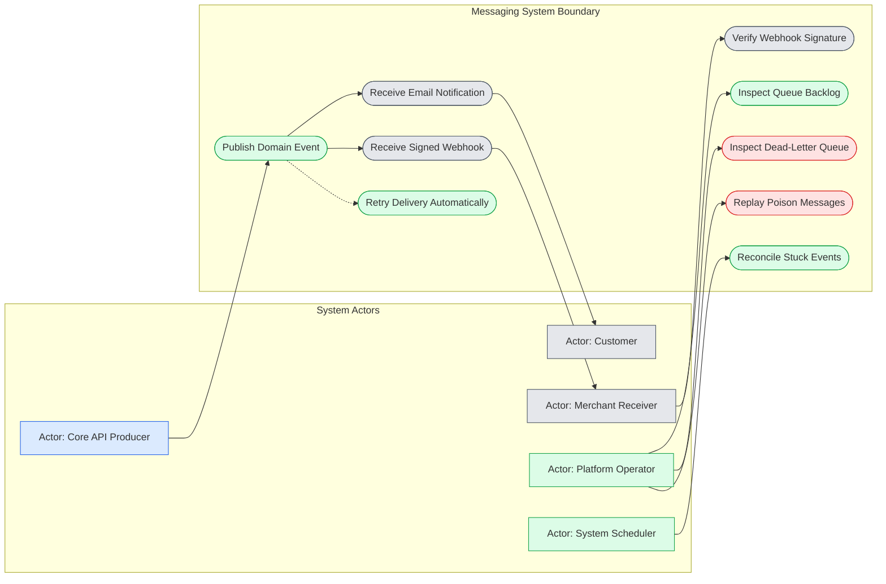
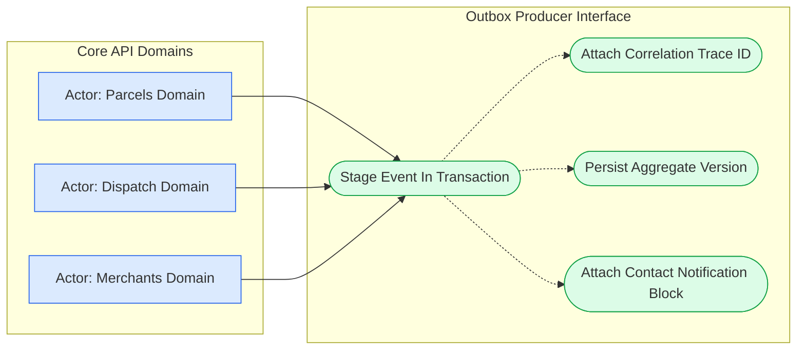
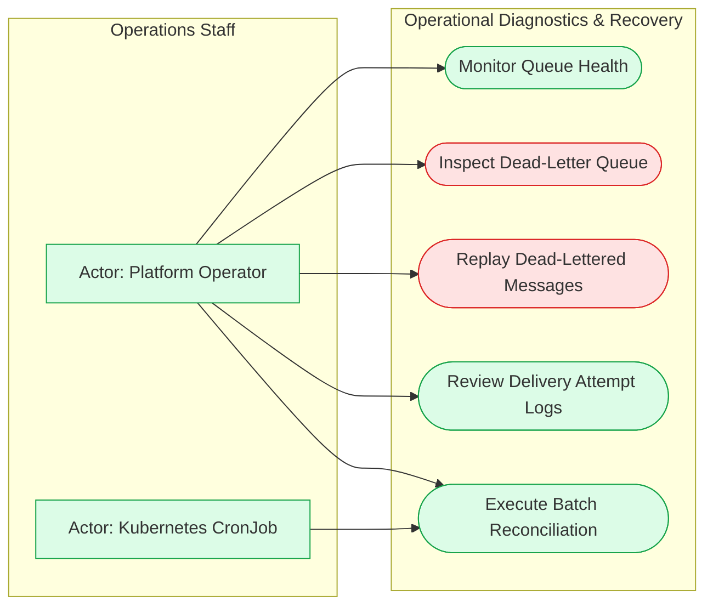

# 1. Messaging & Asynchronous Integration Use Cases

The Member 08 subsystem provides the asynchronous backbone for SwiftDrop, responsible for reliable event propagation, transactional outbox staging, customer email notifications, and cryptographically signed merchant webhooks. By decoupling event ingestion from side-effect execution, this subsystem ensures that Core API business transactions commit with zero external latency while guaranteeing that notifications and webhook dispatches occur reliably even under external network disruptions. The following use case models define how external actors, producing modules, and platform operators interact with this messaging infrastructure.

---

### Figure 1.1 — Overall Messaging System Use Cases
**Purpose:** Illustrates the complete set of business and operational use cases supported by the messaging subsystem across all external and internal actors.

**Key points**
- Core API triggers asynchronous processing by staging events without direct broker network calls.
- Customer notifications and merchant webhooks execute independently with automated retry policies.
- Platform operators and schedulers retain complete visibility into queue health, DLQ state, and event reconciliation.

---

### Figure 1.2 — Core API Producer View
**Purpose:** Depicts how upstream Core API domain aggregates interface with the transactional outbox to publish events without data loss.

**Key points**
- Domain aggregates invoke `OutboxWriter.Write` inside their existing database transactions.
- Event envelopes encapsulate aggregate references, sequence versions, and distributed tracing correlation IDs.
- Payloads carry necessary contact details in a `notify` block to prevent subsequent cross-module database reads.

---

### Figure 1.3 — Platform Operator & Maintenance View
**Purpose:** Highlights the administrative capabilities available to operators for queue diagnostics, dead-letter recovery, and data reconciliation.

**Key points**
- Operators monitor broker queues, outbox publication latency, and delivery success rates via Prometheus metrics.
- Dead-lettered poison messages can be safely inspected via RabbitMQ CLI and replayed via a dedicated Kubernetes Job.
- Scheduled CronJob executions automatically resolve expired worker leases and identify stuck outbox events.

---

## 2. Use Case Descriptions

| Use Case ID | Primary Actor | Trigger Event | Main Success Flow | Failure Flow / Handling | SRS Mapping |
| :--- | :--- | :--- | :--- | :--- | :--- |
| **UC-01** | Core API Domain | Business aggregate mutation committed | Envelope written to `outbox_events` within the same database transaction. | Entire transaction rolls back; no orphan event staged. | `FR-EVT-001`, `FR-EVT-004` |
| **UC-02** | Customer | Parcel status transition (`delivered`, etc.) | Worker renders email template and delivers via SMTP; logs success. | Transient SMTP error triggers exponential backoff retry. | `FR-EVT-005`, `FR-EVT-008` |
| **UC-03** | Merchant System | Parcel status transition for merchant parcel | Worker signs payload with HMAC-SHA256 and POSTs to HTTPS endpoint. | Non-2xx/timeout logs attempt and schedules next retry. | `FR-EVT-005`, `FR-MER-009` |
| **UC-04** | Merchant System | Incoming webhook HTTP POST received | Merchant validates `X-SwiftDrop-Signature` and timestamp within 300s (5m). | Signature mismatch or clock drift rejects request. | `FR-MER-010`, `SEC-011` |
| **UC-05** | System Worker | Transient delivery failure (HTTP 5xx, SMTP 4xx) | Task recalculated for next attempt (0s, 30s, 2m, 10m, 30m with jitter). | Exhaustion after 5 attempts marks delivery `FAILED`. | `FR-EVT-007` |
| **UC-06** | Platform Operator | Scheduled check or threshold alert | Scrapes Prometheus endpoint `/metrics` for queue depth and error rates. | Alertmanager notifies on-call engineer if thresholds exceeded. | `FR-EVT-009` |
| **UC-07** | Platform Operator | Unmarshal error or unroutable poison message | Message routed to `swiftdrop.dlq` without blocking processing pipeline. | Message retained for 30 days for forensic inspection. | `FR-EVT-007`, `FR-EVT-009` |
| **UC-08** | Platform Operator | Dead-lettered payload root cause resolved | Operator triggers DLQ replay Job (`reconcile --replay-dlq`), re-staging event into `outbox_events`. | Malformed payload or DB failure aborts job; poison message stays in DLQ. | `FR-EVT-007`, `FR-REC-005` |
| **UC-09** | System Scheduler | 10-minute timer ticker (`*/10`) | CronJob scans stuck outbox rows and resets expired worker leases. | Query errors log failure alerts; bounded batch limits lock duration. | `FR-REC-001`, `FR-REC-002` |

---

## 3. Requirements Traceability

| Figure | Primary Focus | Related SRS Requirements | Source Document Reference |
| :--- | :--- | :--- | :--- |
| **Figure 1.1** | Global Messaging Use Cases | `FR-EVT-001`, `FR-EVT-005`, `FR-EVT-007`, `FR-EVT-008`, `FR-MER-009`, `FR-REC-001` | `doc-01` §2; `doc-02` §1 |
| **Figure 1.2** | Core API Producer Outbox Flow | `FR-EVT-001`, `FR-EVT-004`, `SEC-015` | `doc-01` §3.1; `doc-02` §3 (Flow 1) |
| **Figure 1.3** | Operator & Maintenance Controls | `FR-EVT-007`, `FR-EVT-009`, `FR-REC-001`, `FR-REC-002`, `FR-REC-004`, `FR-REC-005` | `doc-02` §7; `doc-07` §3 |
