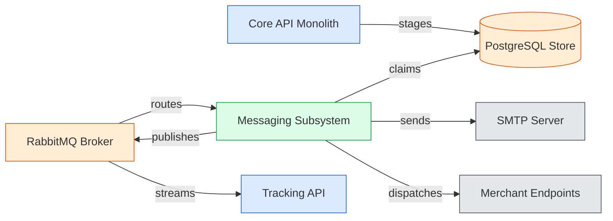
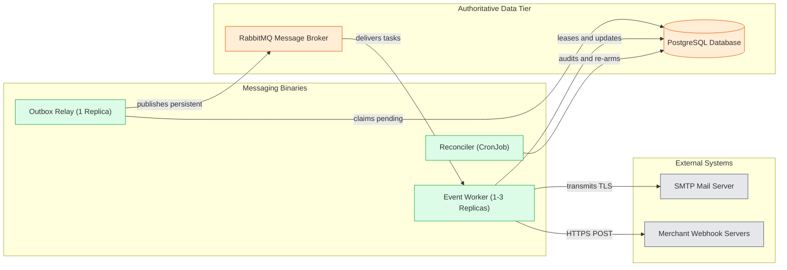
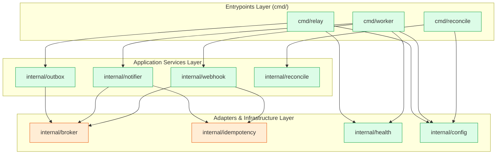
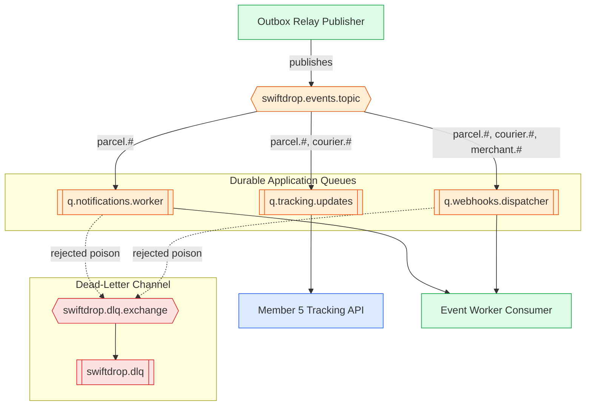
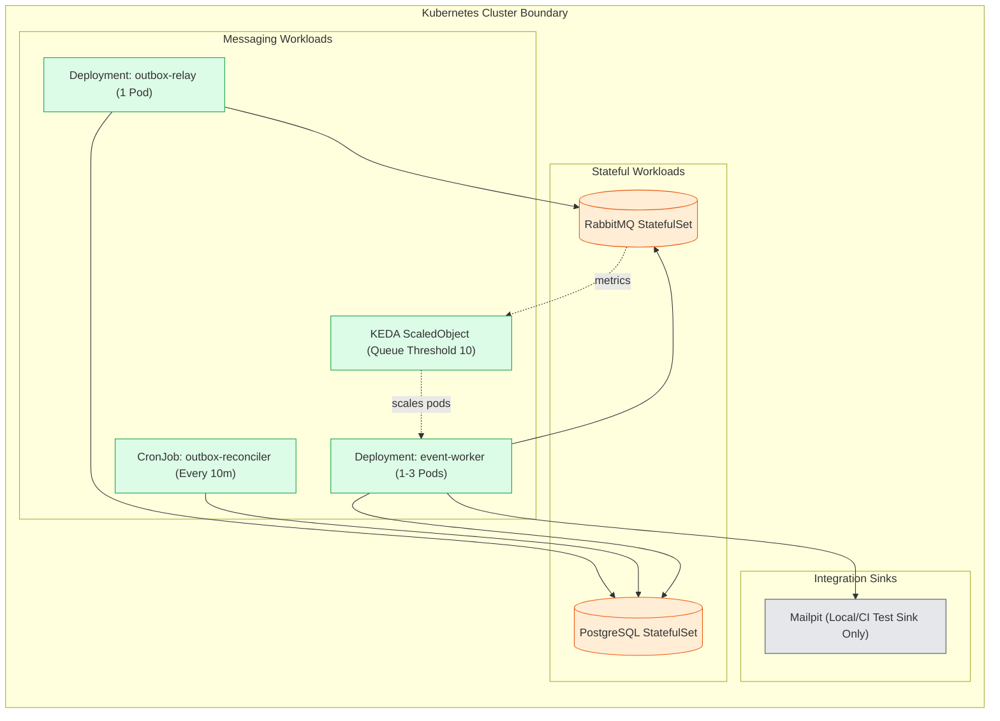

# 2. Architecture & Subsystem Decomposition

The SwiftDrop Messaging Subsystem is designed as an event-driven asynchronous processing pipeline that bridges the synchronous Go Modular Monolith (`core-api`) with external consumers and third-party systems. In accordance with Domain-Driven Design (DDD) principles and the architectural constraints defined in `AGENTS.md`, message publishing is completely decoupled from Core API request-response lifecycles. This architecture isolates external network failures (such as mail server delays or third-party webhook outages) from core parcel transactions, guarantees that all committed business state changes produce corresponding integration events, and provides independent horizontal scalability for intensive I/O operations.

---

### Figure 2.1 — System Context
**Purpose:** Illustrates the boundaries and high-level data flows between the messaging subsystem, platform components, and external services.

**Key points**
- Core API stages outbox records directly into PostgreSQL without touching external networks.
- The messaging subsystem acts as the exclusive publisher to RabbitMQ and external dispatchers.
- Downstream services such as the Tracking API consume events independently from the shared broker.

---

### Figure 2.2 — Container View
**Purpose:** Details the three independently deployable messaging executables and their communication pathways with platform infrastructure.

**Key points**
- The Outbox Relay runs as a strict singleton to preserve sequential batch publication.
- Event Worker instances scale horizontally from 1 to 3 replicas based on queue depth.
- The Reconciler runs periodically to clean stale leases without publishing directly to the broker.

---

### Figure 2.3 — Layered Internal Package Structure
**Purpose:** Shows the architectural layering and internal package responsibilities within the messaging codebase.

**Key points**
- Command entrypoints wire dependencies cleanly and launch isolated background runtimes.
- Application logic packages implement core domain handling without depending on concrete transports.
- Shared infrastructure adapters manage RabbitMQ topology, PostgreSQL connections, and Prometheus metrics.

---

### Figure 2.4 — Messaging Broker Topology
**Purpose:** Details exchange configurations, topic routing keys, queue bindings, and dead-letter channels in a readable vertical layout.

**Key points**
- `swiftdrop.events.topic` distributes events across distinct domain queues using topic pattern matching.
- Queue `q.tracking.updates` is consumed exclusively by Member 05 for SSE public projections.
- Poison messages with unrecoverable formatting errors are rejected directly to `swiftdrop.dlq` without blocking queues.

---

### Figure 2.5 — Kubernetes Deployment View
**Purpose:** Illustrates the orchestration topology, pod replication policies, and scaling mechanisms across the cluster.

**Key points**
- Outbox Relay runs as a fixed 1-pod Deployment to avoid distributed lock contention.
- Event Worker is autoscaled between 1 and 3 replicas by KEDA based on a queue length threshold of 10 messages.
- RabbitMQ runs as a StatefulSet with a Persistent Volume to safeguard queue durability across pod restarts.
- Mailpit runs in local and CI environments as an in-cluster test sink; production routes to an external SMTP provider.

---

## 2. Component Responsibilities & Operational Behaviors

| Component | Primary Architectural Responsibility | Scaling Rule | Failure & Recovery Behavior |
| :--- | :--- | :--- | :--- |
| **Core API `OutboxWriter`** | Commits event envelopes to `outbox_events` within aggregate transactions. | Scales with Core API (horizontal). | Rolls back with business transaction; guarantees zero phantom events. |
| **Outbox Relay Daemon** | Polls pending rows (`FOR UPDATE SKIP LOCKED`), publishes with confirms, updates `PUBLISHED`. | Exactly 1 replica (singleton). | On crash, unconfirmed rows remain `PENDING`; new pod republishes (at-least-once). |
| **RabbitMQ StatefulSet** | Topic exchange routing, persistent disk buffering, consumer work distribution. | Single replica StatefulSet with PV. | Durable queues and persistent delivery mode preserve messages across restarts. |
| **Event Worker Daemon** | Consumes queues, verifies idempotency, dispatches TLS emails and signed webhooks. | 1 to 3 pods (KEDA autoscaled). | On crash, unreleased DB leases expire (60s) and are re-armed by Reconciler. |
| **Reconciler Engine** | Scans stuck outbox records (>5m), resets expired leases, purges aged data. | CronJob (`*/10 * * * *`, `Forbid`). | Idempotent queries bounded by batch limit 50; logs to structured stdout. |

---

## 3. Architecture Justification

The decision to architect Member 08 as a dedicated asynchronous messaging subsystem rather than embedding publishing and delivery logic directly within the `core-api` web monolith rests on three foundational pillars:

1. **Elimination of Dual-Write Latency and Failure Windows:**  
   If Core API HTTP handlers attempted to publish directly to RabbitMQ during user requests, any network jitter or broker outage would either roll back valid business state changes or cause dual-write inconsistency where a database record exists without an emitted event. By writing exclusively to the transactional outbox table in PostgreSQL within the aggregate transaction, commit times remain minimal (local SQL insert latency), zero network hops are incurred during HTTP requests, and atomic consistency is enforced by relational ACID transactions.

2. **Compliance with DDD Modular Monolith Constraints:**  
   As mandated by `AGENTS.md` §4, Core API domain modules must retain strict package boundaries and zero infrastructure dependencies. Separating the asynchronous daemon plane (`services/messaging/`) allows workers to run complex long-polling loops, retry timers, cryptographic signing, and external network I/O without bloating the Core API container or introducing goroutine leaks into the synchronous request pipeline.

3. **Asymmetric Scalability Between Ingestion and Dispatch:**  
   Publishing outbox events to RabbitMQ is an extremely fast, CPU-light database polling operation. Running the Outbox Relay as a strict singleton completely eliminates row lock contention and out-of-order event delivery while easily sustaining estimated throughputs of over 1,000 events per second. Conversely, outbound webhook dispatches and SMTP transmissions involve high-latency third-party network connections (100ms–5000ms). Separating the Event Worker into an independently autoscaled workload (1–3 pods managed by KEDA) ensures external latency spikes do not starve database connections or delay internal outbox publication.

---

## 4. Requirements Traceability

| Figure | Architectural Focus | Related SRS Requirements | Source Document Reference |
| :--- | :--- | :--- | :--- |
| **Figure 2.1** | System Context & Boundaries | `FR-EVT-001`, `FR-EVT-002`, `FR-EVT-005` | `doc-01` §1; `doc-03` §1 |
| **Figure 2.2** | Container Architecture | `FR-EVT-002`, `FR-EVT-005`, `FR-REC-001` | `doc-03` §1; `doc-08` §1 |
| **Figure 2.3** | Internal Package Layering | `FR-EVT-004`, `FR-EVT-006`, `SEC-010` | `doc-03` §2 |
| **Figure 2.4** | Broker Exchange & Queue Topology | `FR-EVT-002`, `FR-EVT-007`, `FR-MER-009` | `doc-04` §3 |
| **Figure 2.5** | Kubernetes Deployment & KEDA Scaling | `FR-EVT-009`, `FR-REC-001`, `SEC-016` | `doc-08` §6 |
