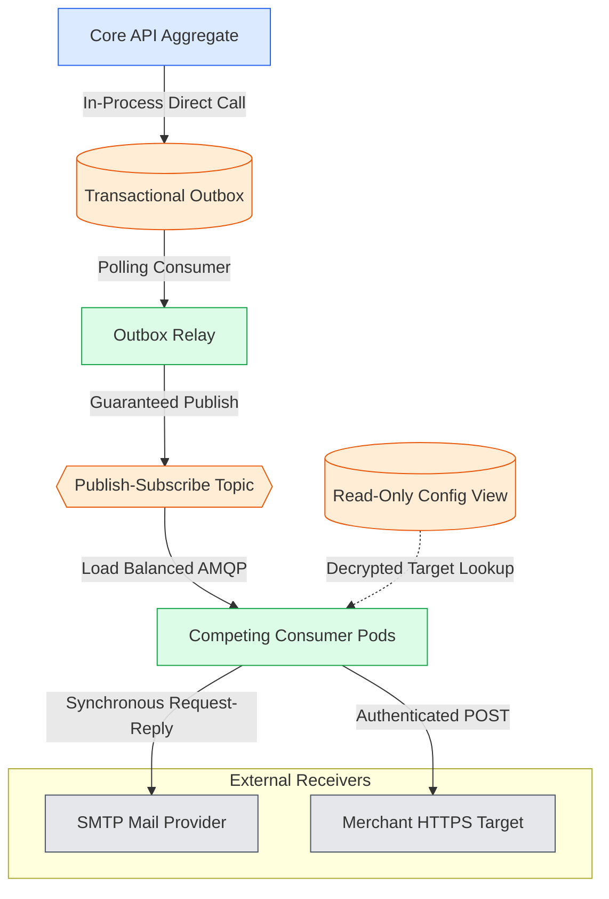
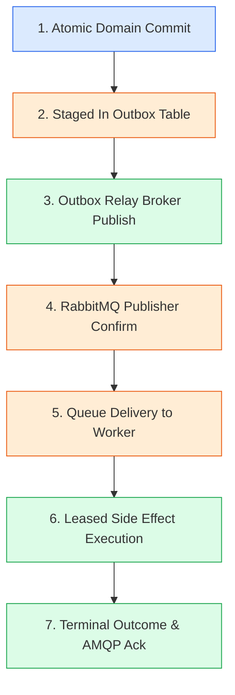

# 3. Integration Design & Architectural Rationale

The integration architecture of SwiftDrop connects decoupled micro-domains within the Go Modular Monolith with distributed infrastructure components, background workers, and external third-party servers. Rather than treating integration as an incidental detail, the system applies formal Enterprise Integration Patterns (EIP)—including the Transactional Outbox, Publish-Subscribe Channels, Competing Consumers, Idempotent Receivers, and Dead Letter Channels. This section details how these patterns interact, evaluates architectural trade-offs against alternative designs, and establishes the technical rationale behind every critical messaging guarantee.

---

### Figure 3.1 — Enterprise Integration Patterns Map
**Purpose:** Details where key enterprise integration patterns are applied across the end-to-end messaging topology in a compact vertical layout.

**Key points**
- In-process repository calls commit outbox records atomically within business aggregate transactions.
- RabbitMQ acts as a durable Publish-Subscribe channel distributing events to decoupled consumer queues.
- Worker pods operate as Competing Consumers, processing tasks concurrently and pulling configuration from a read-only database view.

---

### Figure 3.2 — Delivery Guarantee Chain
**Purpose:** Illustrates the end-to-end lifecycle of an event from database commit through broker confirmation to final consumer acknowledgment in a vertical pipeline.

**Key points**
- Each link in the chain provides a verifiable state transition protected against unexpected node failure.
- Designed to prevent message loss through at-least-once delivery guarantees and transactional staging.
- Final AMQP acknowledgment occurs only after external outcomes are persisted in PostgreSQL.

---

### Delivery Guarantee Chain Failure Recovery Matrix

| Chain Step | Operational Component | Potential Failure Mode | Automated Recovery Mechanism |
| :--- | :--- | :--- | :--- |
| **1. Atomic Commit** | Core API Domain | Database engine failure or transaction abort. | Entire transaction rolls back; no outbox record created; no phantom event emitted. |
| **2. Staged In Outbox** | PostgreSQL Storage | Row committed but Outbox Relay crashes before polling. | Row remains `PENDING`; upon restart, Relay claims row via `FOR UPDATE SKIP LOCKED`. |
| **3. Broker Publish** | Network / RabbitMQ | Network partition or broker connection reset during publish. | Relay catches error, leaves row `PENDING`, increments `attempt_count`, and retries. |
| **4. Publisher Confirm** | Outbox Relay | RabbitMQ crashes or returns NACK within 5-second deadline. | Relay updates `next_attempt_at` with backoff; re-arms for subsequent polling cycle. |
| **5. Queue Delivery** | Event Worker | Worker pod crashes immediately upon receiving AMQP message. | AMQP message unacknowledged; RabbitMQ returns message to queue head for another pod. |
| **6. Leased Side Effect** | Event Worker | Worker crashes while executing HTTP POST or SMTP handshake. | Lease expires after 60s; Reconciler detects expired lease and resets status to `PENDING`. |
| **7. Outcome & Ack** | Event Worker / DB | DB write succeeds but worker crashes before sending AMQP Ack. | RabbitMQ redelivers; new worker detects duplicate via `processed_events` and Acks immediately. |

---

## 2. Pattern Alternatives & Comparison Analysis

| Architectural Pattern | Evaluated Options | Key Advantages | Disadvantages & Trade-offs | Selected Decision |
| :--- | :--- | :--- | :--- | :--- |
| **Event Staging** | Option A: Direct Dual-Write; Option B: Transactional Outbox; Option C: Change Data Capture (CDC / Debezium). | A: Simple, no extra table. B: Atomic, guaranteed durability, zero external dependencies. C: Zero application outbox overhead. | A: High risk of dual-write inconsistency. B: Requires polling daemon and storage. C: Heavy Kafka/Debezium operational burden. | **Selected: Option B (Transactional Outbox).** Guarantees atomicity without introducing complex distributed CDC infrastructure. |
| **Retry Architecture** | Option A: AMQP Requeue Loops (Nack requeue=true); Option B: RabbitMQ Dead-Letter Delay Queues; Option C: Database-Driven Leased Retries. | A: Native broker capability. B: No database polling needed. C: Explicit visibility, persistent leases, zero broker queue head-of-line blocking. | A: Causes immediate spinning and CPU saturation. B: Requires complex queue topologies per delay level. C: Consumes modest DB connection pool budget. | **Selected: Option C (DB-Driven Leases).** Eliminates queue head-of-line blocking and allows explicit audit logging per attempt. |
| **Notification Integration** | Option A: Console / In-Memory Mock Adapter; Option B: External Cloud SaaS (SendGrid/SES); Option C: Single-Path Real SMTP (Mailpit locally/CI). | A: Zero local setup. B: Production deliverability. C: Exact same production code path tested locally and in CI. | A: Hides transport bugs, divergence from production. B: Requires live API keys and internet in CI. C: Requires lightweight Mailpit container. | **Selected: Option C (Single-Path SMTP).** Enforces identical TLS/MIME code paths across all environments without external cloud costs. |

---

## 3. Architectural Rationale for Core Decisions

### 1. Why a Transactional Outbox (Dual-Write Problem)
In distributed systems, updating a database and publishing an event to a message broker in a single operation represents the classic dual-write problem. If the database commit succeeds but the message broker publish fails due to a network blip, downstream consumers never learn of the state change. Conversely, if the message is published before the database transaction commits, a subsequent rollback leaves phantom events in the system. The Transactional Outbox solves this by converting the message publication into a local SQL `INSERT` inside the exact same database transaction that modifies the business aggregate. Network communication with RabbitMQ is deferred to an asynchronous background relay, guaranteeing zero lost events.

### 2. Why At-Least-Once Delivery with Idempotent Effects (SRS FR-EVT-010)
According to distributed systems consensus principles, achieving guaranteed "exactly-once" delivery across distributed database, broker, and external network boundaries is impractical and prohibitively expensive. In strict compliance with **SRS FR-EVT-010**, SwiftDrop explicitly embraces an **at-least-once** delivery model. Transient network failures or pod restarts may cause an event to be published or delivered more than once. To ensure system correctness, consumers are engineered as idempotent receivers using database leases and terminal deduplication tables (`processed_events`), guaranteeing that duplicate deliveries produce zero duplicate side effects.

### 3. Why Retries Live in PostgreSQL Leases, Not Broker Requeues (DEC-02)
Rejecting an AMQP message with `requeue=true` places the failed message back at the head of the queue, causing worker pods to immediately re-consume it in a tight spin loop that wastes CPU cycles and starves other messages. Implementing delayed retries natively in RabbitMQ requires complex dead-letter exchanges paired with per-delay TTL queues. By managing retries directly in PostgreSQL (`next_attempt_at`, `lease_expires_at`), messages can be acknowledged off the broker immediately. A lightweight database poller claims retries only when their scheduled backoff elapses, providing operators with full visibility into retry progress and audit history.

### 4. Why Self-Contained Domain Event Payloads via Event-Carried State Transfer (DEC-03)
If events carried only entity IDs (thin notification events), every worker consumer would be forced to execute synchronous SQL joins back into Core API tables (e.g. `parcels`, `couriers`, `merchants`) to retrieve recipient emails and merchant targets. This would violate Domain-Driven Design module boundaries (`AGENTS.md` §4.2) and create heavy read contention on primary operational tables. In contrast, SwiftDrop adopts **Event-Carried State Transfer (ECST)** by embedding a minimal, sanitized `notify` block and `merchant_id` directly within domain event payloads. This allows workers to process emails and webhooks autonomously without querying upstream domain tables.

### 5. Why One Real SMTP Code Path with Mailpit (DEC-01)
Mock adapters frequently diverge from production behavior, masking bugs related to MIME header encoding, STARTTLS handshakes, and timeout handling. Under Decision **DEC-01**, SwiftDrop implements a single Go `net/smtp` client across all environments. In local development and automated CI pipelines, email traffic routes to an embedded Mailpit container (`port 1025`), providing immediate visual and API verification of rendered HTML emails without incurring third-party delivery costs or leaking test data to real customer inboxes.

### 6. Why Worker Never Publishes Secrets or Private URLs on Broker
RabbitMQ queues and exchange topologies are shared across multiple consumers, including the Tracking API (Member 05) and platform monitoring tools. In accordance with defense-in-depth principles and least-privilege access, the messaging system enforces a zero-trust boundary: webhook endpoint URLs, authentication headers, and signing secrets are never published over RabbitMQ. The Event Worker consumes purely neutral domain events and resolves sensitive target URLs and AES-256-GCM encrypted secrets directly from the secure `merchant_webhook_targets` PostgreSQL view.

---

## 4. Requirements Traceability

| Figure / Section | Integration Focus | Related SRS Requirements | Source Document Reference |
| :--- | :--- | :--- | :--- |
| **Figure 3.1** | Integration Patterns Architecture | `FR-EVT-001`, `FR-EVT-002`, `FR-EVT-005`, `FR-MER-009` | `doc-03` §1; `doc-04` §1 |
| **Figure 3.2** | Delivery Guarantee Lifecycle | `FR-EVT-002`, `FR-EVT-003`, `FR-EVT-010` | `doc-02` §3 (Flow 2); `doc-03` §4 |
| **Section 2** | Pattern Trade-Off Evaluation | `FR-EVT-001`, `FR-EVT-007`, `FR-EVT-008` | `CHANGE_REQUESTS.md` DEC-01, DEC-02 |
| **Section 3** | Architectural Justifications | `FR-EVT-001`, `FR-EVT-008`, `FR-EVT-010`, `SEC-010`, `SEC-011` | `doc-02` §5, §6; `CHANGE_REQUESTS.md` |
