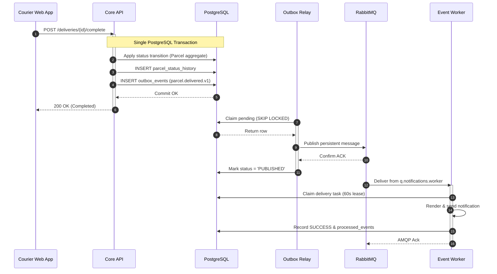
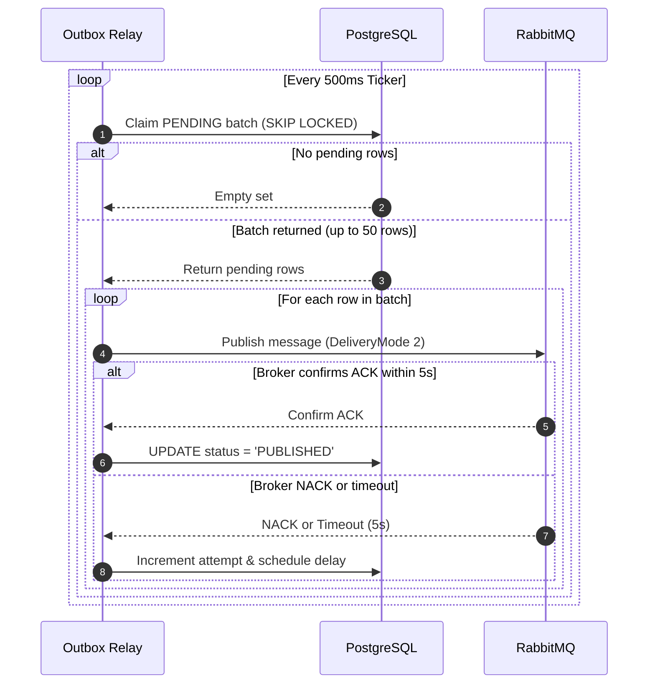
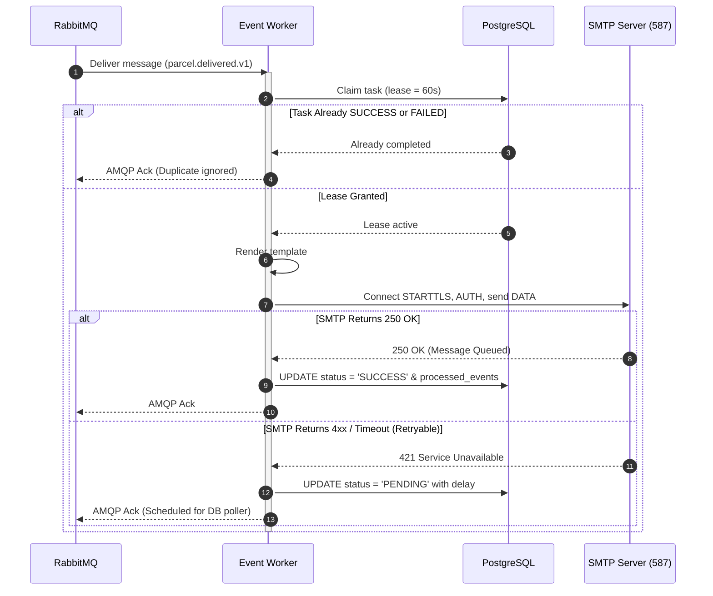
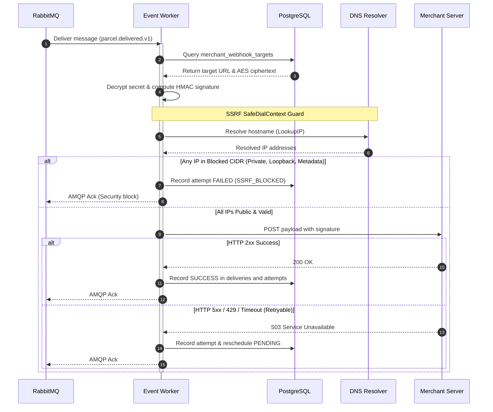
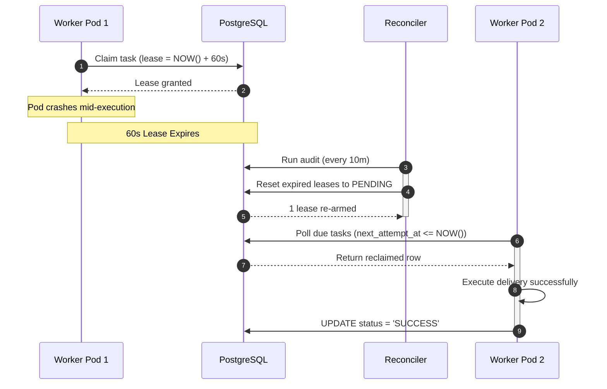
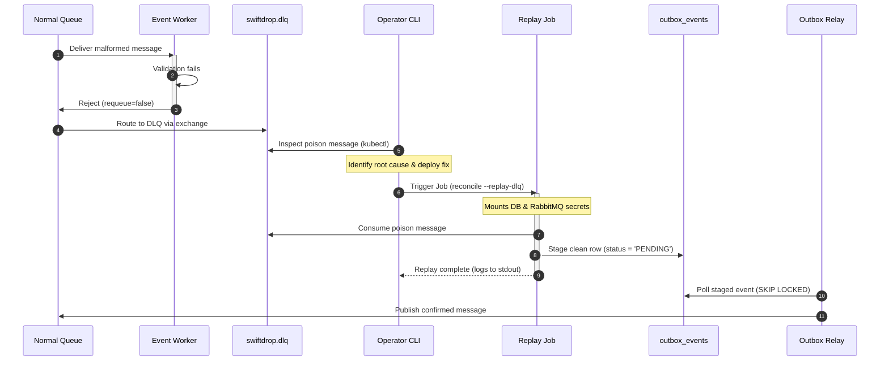

# 4. Sequence & Activity Flows

This section models the end-to-end execution sequences for critical asynchronous operations within SwiftDrop. In accordance with assignment grading criteria, these diagrams capture both the nominal "happy path" and operational failure branches for the assignment-mandated flow ("Courier status update triggering notifications"), the Outbox Relay batch publication loop, customer transactional email delivery, signed merchant webhook dispatching with SSRF defenses, and automated failure recovery. Every flow enforces bounded contexts, atomic database transactions, at-least-once delivery semantics, and idempotent consumer guarantees.

---

### Figure 4.1 — Courier Status Update Triggering Notifications (Assignment Required Flow)
**Purpose:** Demonstrates how a courier delivery status update commits atomically with an outbox event, propagates through RabbitMQ, and triggers notifications.

**Key points**
- Core API commits domain state, status history, and the outbox event in one atomic transaction.
- The Outbox Relay publishes to RabbitMQ asynchronously and marks the record `PUBLISHED` only after receiving broker confirmation.
- The Event Worker consumes the message, claims a lease, executes the notification, and acknowledges the message.

**Operational Notes**
- **Atomic Transaction:** Domain state, status history, and the outbox event commit in a single PostgreSQL transaction, ensuring no event is created if the status update fails.
- **Publisher Confirms:** RabbitMQ confirms persistent write (`DeliveryMode = 2`) before the relay updates the database status to `PUBLISHED`.
- **Task Lease:** The delivery task lease (`lease_expires_at = NOW() + 60s`) prevents concurrent execution by other worker pods.

---

### Figure 4.2 — Outbox Relay Publication Loop
**Purpose:** Details the batch claiming, publisher confirm validation, and error backoff handling of the Outbox Relay daemon.

**Key points**
- `FOR UPDATE SKIP LOCKED` guarantees non-blocking queries and prevents lock contention.
- Broker confirms are evaluated per message; successful messages commit immediately without batch-wide rollbacks.
- Unconfirmed messages stay `PENDING` with an incremented attempt counter and scheduled retry backoff.

**Operational Notes**
- **Confirmation Timeout:** Publisher confirms run under a 5.0-second context deadline to avoid indefinite relay thread hangs.
- **Retry Exhaustion:** If `attempt_count` reaches 5, the relay transitions the status to `FAILED` and raises a Prometheus alert.

---

### Figure 4.3 — Customer Email Notification Delivery Flow
**Purpose:** Illustrates real SMTP delivery handling with TLS, lease claims, and post-effect deduplication.

**Key points**
- Deduplication is evaluated via database leases, ensuring safe idempotent handling of redelivered messages.
- The mailer communicates with a real SMTP server using standard TLS/STARTTLS authentication.
- Deduplication records in `processed_events` are committed only after successful transmission.

**Operational Notes**
- **Lease Protection:** Delivery tasks are claimed with `status = 'IN_PROGRESS'` to prevent split-brain delivery across worker replicas.
- **Retry Scheduling:** Transient SMTP failures (4xx) return the status to `PENDING` with exponential backoff and ACK the AMQP message.

---

### Figure 4.4 — Merchant Webhook Delivery & SSRF Defense Flow
**Purpose:** Depicts the secure dispatching of outbound merchant webhooks, including secret decryption, signature computation, and SSRF filtering.

**Key points**
- Signing secrets are decrypted in memory using AES-256-GCM from the read-only targets view.
- Every outbound connection validates all resolved IP addresses against a strict private/cloud-metadata blocklist.
- Successful transmissions record response metrics and append immutable attempt logs (FR-MER-011).

**Operational Notes**
- **DNS Rebinding Prevention:** `SafeDialContext` executes DNS resolution once and binds directly to the verified public IP to prevent DNS rebinding.
- **Terminal Rejections:** Non-retryable errors (4xx client errors, 3xx redirects) immediately mark the delivery as `FAILED` without retrying.

---

### Figure 4.5 — Worker Crash and Automated Lease Recovery Flow
**Purpose:** Details how the system self-heals when a worker crashes mid-transmission using expired lease reclamation in a compact sequence.

**Key points**
- Worker crashes never permanently strand tasks because delivery rows carry bounded 60-second leases.
- The Reconciler CronJob re-arms expired leases back to `PENDING` without modifying attempt counters.
- Available worker pods pick up reclaimed tasks on their next polling cycle and execute them to completion.

**Operational Notes**
- **Preserved Attempt Counters:** Reconciler resets only the lease and status; it preserves `attempt_count` to prevent infinite execution of poison tasks.
- **Database Boundary:** Preserves **SRS FR-REC-005** by updating database state only and never publishing events directly to RabbitMQ.

---

### Figure 4.6 — Dead-Letter Queue (DLQ) Routing & Operator Replay Flow
**Purpose:** Illustrates how unparseable poison messages route to the DLQ and how operators safely inspect and replay them.

**Key points**
- Corrupted messages are rejected with `requeue = false`, diverting them immediately to `swiftdrop.dlq`.
- Dead-lettered messages are retained for 30 days without impacting healthy message processing.
- The replay Job consumes from the DLQ and stages clean rows in `outbox_events`, preserving the outbox publication guarantee (FR-REC-005).

**Operational Notes**
- **Dead-Letter Routing:** Rejecting with `requeue = false` triggers RabbitMQ dead-letter exchange forwarding.
- **Credentials & Path:** The replay Job mounts both `outbox-reconciler-secrets` (DB) and `rabbitmq-secrets` (AMQP) to safely consume from the DLQ and stage events into `outbox_events`.

---

## 2. Requirements Traceability

| Figure | Flow Description | Related SRS Requirements | Source Document Reference |
| :--- | :--- | :--- | :--- |
| **Figure 4.1** | Courier Update & Notification Dispatch | `FR-EVT-001`, `FR-EVT-002`, `FR-EVT-005`, `FR-EVT-008` | `doc-02` §3 (Flows 1 & 3); `sequence-diagrams.md` |
| **Figure 4.2** | Outbox Relay Publication Loop | `FR-EVT-002`, `FR-EVT-003`, `FR-EVT-007` | `doc-02` §3 (Flow 2); `doc-03` §3.3 |
| **Figure 4.3** | Real SMTP Customer Notification | `FR-EVT-005`, `FR-EVT-006`, `FR-EVT-008` | `doc-02` §3 (Flow 3); `doc-07` §2 |
| **Figure 4.4** | Webhook Dispatch & SSRF Defense | `FR-EVT-005`, `FR-MER-009`, `FR-MER-010`, `SEC-010`, `SEC-011` | `doc-02` §3 (Flow 4); `doc-04` §4 |
| **Figure 4.5** | Worker Crash & Lease Recovery | `FR-EVT-006`, `FR-REC-002`, `FR-REC-004`, `FR-REC-005` | `doc-02` §5, §7; `doc-07` §3 |
| **Figure 4.6** | Poison Message Routing & DLQ Replay | `FR-EVT-007`, `FR-EVT-009`, `SEC-015` | `doc-02` §7; `doc-07` §3.4 |
