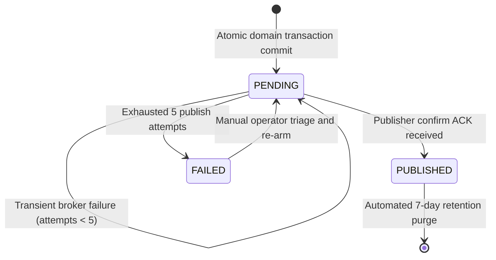
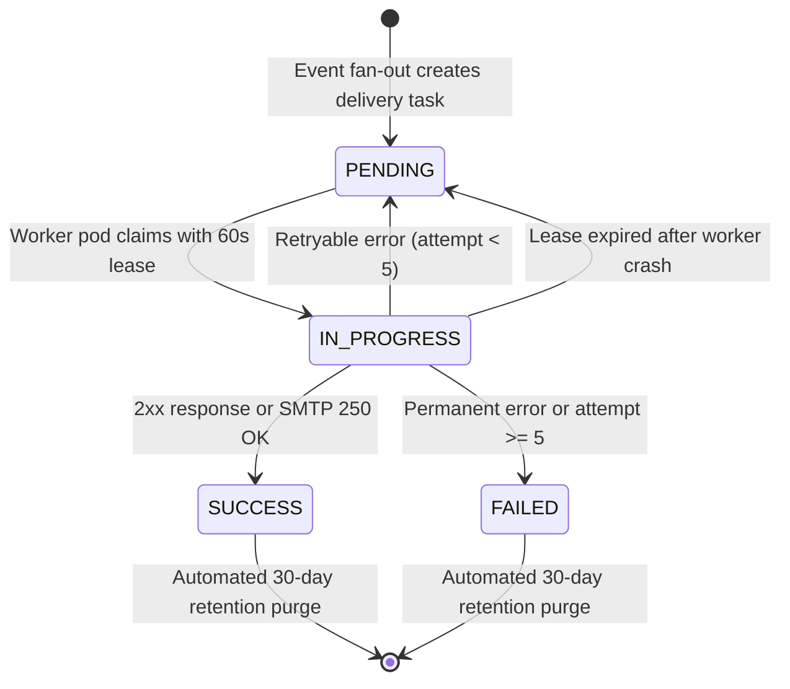
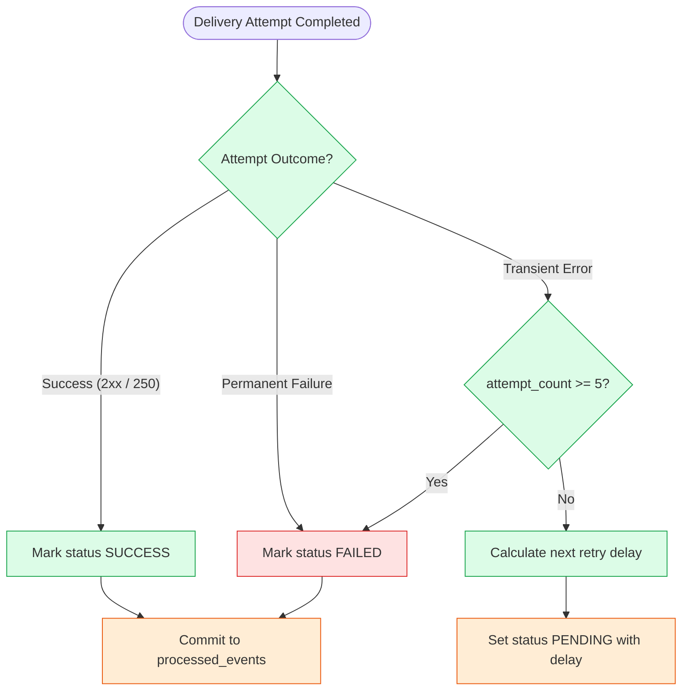
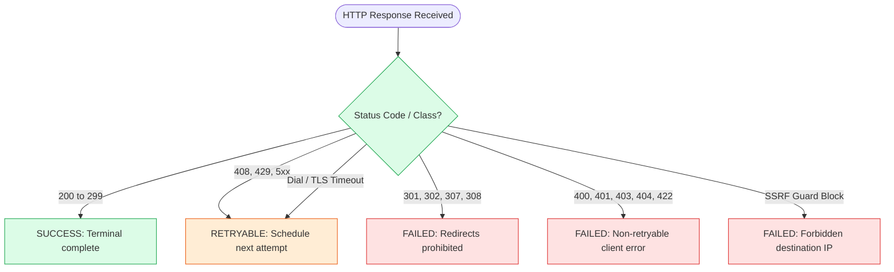
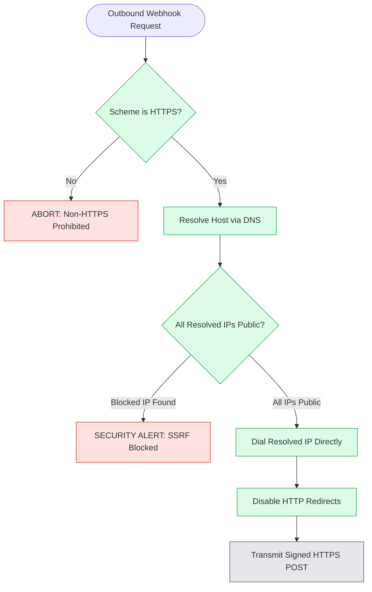
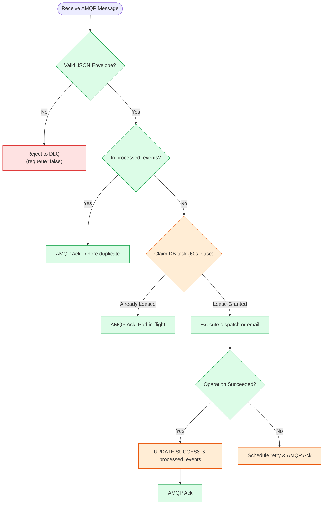
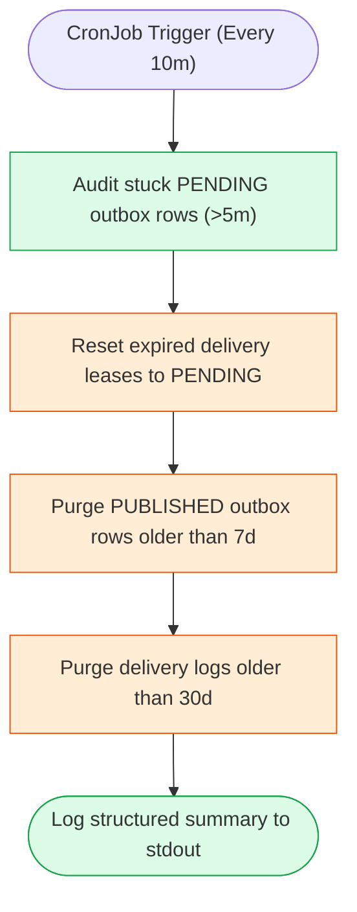

# 5. Flowcharts & State Machines

This section provides authoritative state machine specifications and decision flowcharts governing the lifecycle of outbox records, background deliveries, retry evaluations, SSRF defenses, and operational reconciliation. All decision flows are oriented top-to-bottom (`flowchart TD`), contain ten or fewer decision nodes, and employ concise labels. Accompanying tables detail exact HTTP status codes, backoff schedules, and IP blocklists.

---

### Figure 5.1 — Outbox Event Lifecycle State Machine
**Purpose:** Models the lifecycle states and transition rules for records staged in the `outbox_events` table.

**Key points**
- Records begin in `PENDING` upon commit of the upstream domain transaction in PostgreSQL.
- Transition to `PUBLISHED` occurs strictly upon receiving a RabbitMQ publisher confirm ACK.
- Rows exceeding 5 publish attempts enter `FAILED` for operator investigation; purged after 7 days if `PUBLISHED`.

---

### Figure 5.2 — Delivery Task Lifecycle State Machine
**Purpose:** Defines lifecycle states for customer notification emails and outbound merchant webhooks.

**Key points**
- Tasks transition from `PENDING` to `IN_PROGRESS` via atomic database updates with 60-second leases.
- Transient network or server errors reset the task to `PENDING` with an updated `next_attempt_at`.
- Both terminal states (`SUCCESS` and `FAILED`) are retained for 30 days to satisfy merchant audit compliance.

---

### Figure 5.3 — Delivery Retry Decision Flowchart
**Purpose:** Details how the worker evaluates attempt outcomes against the bounded retry schedule.

**Key points**
- Successful attempts transition to `SUCCESS` and commit terminal deduplication records.
- Permanent errors (e.g. invalid auth, SSRF violation) fail immediately without retrying.
- Transient errors are scheduled across a deterministic 5-attempt schedule with bounded jitter.

#### Bounded Retry Backoff Schedule
| Attempt Number | Base Delay | Random Jitter Range (±20%) | Cumulative Elapsed Window | Action on Failure |
| :--- | :--- | :--- | :--- | :--- |
| **Attempt 1** | Immediate | 0s | 0s | Initial dispatch on AMQP message receipt |
| **Attempt 2** | 30s | ± 6s (24s to 36s) | ~30s | 1st retry; claimed when `next_attempt_at <= NOW()` |
| **Attempt 3** | 120s (2m) | ± 24s (96s to 144s) | ~2m 30s | 2nd retry |
| **Attempt 4** | 600s (10m) | ± 120s (480s to 720s) | ~12m 30s | 3rd retry |
| **Attempt 5** | 1800s (30m) | ± 360s (1440s to 2160s) | ~42m 30s | 4th retry (final attempt) |
| **Exhaustion** | Permanent | N/A | ~42m 30s | Status transitions to `FAILED`; operational alert |

---

### Figure 5.4 — Webhook Response Classification Flowchart
**Purpose:** Maps HTTP response status codes and network errors into retryable versus terminal categories.

**Key points**
- Standard 2xx responses represent terminal success and record response latency.
- Server errors (5xx), rate limits (429), and socket timeouts trigger exponential backoff.
- HTTP redirects (3xx) and client configuration errors (4xx) immediately fail without retrying.

---

### Figure 5.5 — SSRF Defense Flowchart (`SafeDialContext`)
**Purpose:** Enforces zero-trust IP validation and prevents Server-Side Request Forgery before socket dial.

**Key points**
- Non-HTTPS destinations are rejected immediately (HTTP allowed only in `local` test environment).
- All DNS A/AAAA records are inspected against a comprehensive CIDR blocklist prior to connection.
- Outbound requests dial the verified IP directly to prevent Time-of-Check to Time-of-Use DNS rebinding.

#### Enforced Private & Prohibited CIDR Ranges (SRS SEC-010)
| Target IP Range / CIDR | Category / RFC | Security Rationale |
| :--- | :--- | :--- |
| `0.0.0.0/8` | Current network (RFC 1122) | Prohibits local routing ambiguities |
| `127.0.0.0/8` | Loopback addresses (RFC 1122) | Prevents reaching localhost services (Redis, DB) |
| `10.0.0.0/8`, `172.16.0.0/12`, `192.168.0.0/16` | Private networks (RFC 1918) | Prevents scanning internal cluster or VPC networks |
| `169.254.0.0/16` | IPv4 Link-local / Cloud Metadata | Protects cloud metadata instance identity tokens |
| `100.64.0.0/10` | Shared Address Space (RFC 6598) | Prevents reaching internal carrier-grade infrastructure |
| `::1/128`, `fc00::/7`, `fe80::/10` | IPv6 Loopback, ULA, Link-local | Blocks IPv6 internal loopback and VPC addresses |
| `::ffff:0:0/96`, `64:ff9b::/96` | IPv4-mapped, NAT64 translations | Eliminates dual-stack IPv6 bypass attacks |

---

### Figure 5.6 — Worker Message Ingestion Flowchart
**Purpose:** Details message parsing, dead-letter routing, and deduplication logic upon AMQP receipt in a compact decision flow.

**Key points**
- Malformed payloads that cannot be unmarshaled are rejected with `requeue = false` straight to the DLQ.
- Completed events are acknowledged immediately without re-executing external side effects.
- In-flight operations are protected by leases, preventing redundant execution across worker pods.

---

### Figure 5.7 — Reconciler Audit & Maintenance Flowchart
**Purpose:** Illustrates scheduled self-healing operations, expired lease resets, and retention cleanup.

**Key points**
- The reconciler executes in batch sizes bounded by 50 rows (as agreed with Member 09) to limit transaction lock duration.
- Expired leases are reset to `PENDING` so active worker pollers can resume dispatching.
- **Strict Compliance:** In accordance with **FR-REC-005**, the reconciler never connects to RabbitMQ or publishes messages directly.
- **Documented Boundary Limitation:** Cross-module parcel status consistency auditing (**FR-REC-003**) is partially covered; inspecting `parcels` tables is deferred pending a read-only view from Member 02 (DEC-04).

---

### Figure 5.8 — Graceful Startup & Shutdown Flowchart
**Purpose:** Outlines the initialization sequence and graceful drain lifecycle for worker and relay pods.

```mermaid
flowchart TD
    classDef producer fill:#dbeafe,stroke:#2563eb,stroke-width:1px;
    classDef messaging fill:#dcfce7,stroke:#16a34a,stroke-width:1px;
    classDef datastore fill:#ffedd5,stroke:#ea580c,stroke-width:1px;
    classDef external fill:#e5e7eb,stroke:#4b5563,stroke-width:1px;
    classDef failure fill:#fee2e2,stroke:#dc2626,stroke-width:1px;

    subgraph Startup["Startup Sequence"]
        InitHealth["Start HTTP Server (/health/live)"]:::messaging
        ConnectDB["Establish PostgreSQL pgxpool"]:::datastore
        ConnectBroker["Connect RabbitMQ & Declare Topology"]:::datastore
        StartLoops["Start Consumers / Poller Goroutines"]:::messaging
        SetReady["Mark Service /health/ready"]:::messaging
    end

    subgraph Shutdown["Graceful Drain Sequence (SIGTERM)"]
        SigTerm(["Receive SIGTERM Signal"]) --> UnsetReady["Unset /health/ready (503)"]:::failure
        UnsetReady --> StopConsumers["Stop AMQP Channel Consumption"]:::messaging
        StopConsumers --> AwaitInFlight["Wait for active HTTP/SMTP calls (15s)"]:::messaging
        AwaitInFlight --> ReleaseLeases["Release uncompleted leases"]:::datastore
        ReleaseLeases --> CloseConns["Close Broker & DB Connections"]:::datastore
        CloseConns --> ExitClean(["Clean Process Exit 0"]):::messaging
    end

    InitHealth --> ConnectDB --> ConnectBroker --> StartLoops --> SetReady
```

**Key points**
- Liveness probe (`/health/live`) is live immediately; readiness (`/health/ready`) waits for DB and broker connections.
- On SIGTERM, the readiness probe fails immediately to stop Traefik/Kubernetes traffic routing.
- In-flight tasks are afforded up to 15 seconds to finish; uncompleted tasks release their leases before shutdown.

---

## 2. Requirements Traceability

| Figure | Flowchart / State Machine | Related SRS Requirements | Source Document Reference |
| :--- | :--- | :--- | :--- |
| **Figure 5.1** | Outbox Event Lifecycle State Machine | `FR-EVT-001`, `FR-EVT-002`, `FR-EVT-003` | `doc-02` §2.1; `doc-05` §2.1 |
| **Figure 5.2** | Delivery Task Lifecycle State Machine | `FR-EVT-005`, `FR-MER-009`, `FR-MER-011` | `doc-02` §2.2, §2.3 |
| **Figure 5.3** | Delivery Retry Decision Flowchart | `FR-EVT-006`, `FR-EVT-007` | `doc-02` §6 |
| **Figure 5.4** | Webhook Response Classification | `FR-MER-009`, `FR-MER-011`, `SEC-010` | `doc-02` §6 (Table 6.2) |
| **Figure 5.5** | SSRF Defense Flowchart | `SEC-010`, `SEC-011` | `doc-02` §4; `webhook-security.md` |
| **Figure 5.6** | Worker Message Ingestion Flowchart | `FR-EVT-005`, `FR-EVT-006`, `FR-EVT-007` | `doc-02` §5; `doc-03` §1 |
| **Figure 5.7** | Reconciler Audit & Maintenance Flowchart | `FR-REC-001`, `FR-REC-002`, `FR-REC-004`, `FR-REC-005` | `doc-02` §7; `doc-07` §3 |
| **Figure 5.8** | Graceful Startup & Shutdown Sequence | `FR-EVT-009`, `SEC-016` | `doc-08` §3; `team-agreements-with-member-09.md` |
