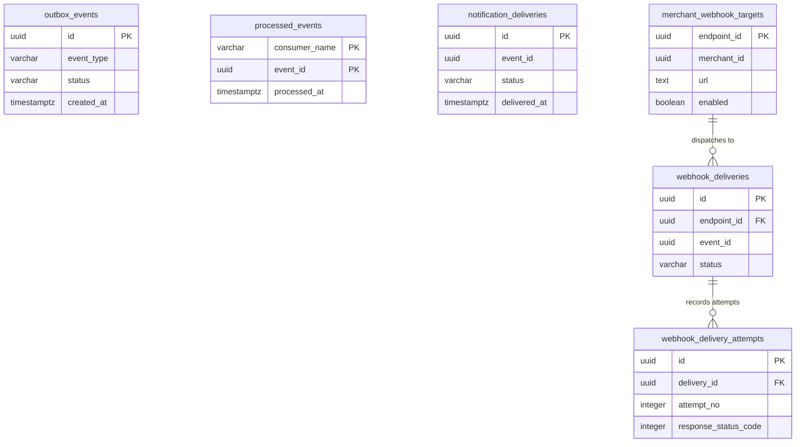

# 6. Data Model & Persistence Specification

Member 08 owns authoritative database structures in PostgreSQL 16+ supporting event publishing, deduplication, notification logging, and merchant webhook audit trails. In strict adherence to clean modular monolith boundaries (`AGENTS.md` §4), the messaging persistence tier avoids direct table foreign keys to upstream domain models (`parcels`, `couriers`, `merchants`). Instead, interactions with upstream domains occur exclusively via typed JSON payloads and read-only PostgreSQL views. Furthermore, delivery audit records omit foreign keys to `outbox_events` to ensure that 7-day outbox retention purges do not cascade into 30-day compliance audit records.

---

### Figure 6.1 — Entity-Relationship Diagram (Messaging Subsystem)
**Purpose:** Illustrates the relational schema, primary/foreign keys, and cardinalities across Member 08 persistence tables and the external merchant targets view.

**Key points**
- `outbox_events` acts as the decoupled staging table between synchronous Core API transactions and RabbitMQ.
- `processed_events` enforces consumer deduplication across all asynchronous worker consumer groups.
- `webhook_deliveries` and `webhook_delivery_attempts` provide immutable per-attempt tracking (FR-MER-011).

---

## 2. Table Specifications & Data Dictionary

### 2.1 Table: `outbox_events`
- **Owning Capability:** Event Staging & Outbox Relay (Member 08)
- **Primary Purpose:** Stores committed domain events awaiting confirmation by RabbitMQ.
- **Retention Schedule:** 7 days. Successfully published rows (`status = 'PUBLISHED'`) are purged asynchronously by the Reconciler retention job.
- **Access Control:** `INSERT` granted to Core API role (`swiftdrop_app`); `SELECT` and `UPDATE` granted to Relay role (`swiftdrop_relay`); `DELETE` granted to Reconciler role (`swiftdrop_reconciler`).

| Column Name | Data Type | Nullable? | Default Value | Constraints / Checks | Description |
| :--- | :--- | :--- | :--- | :--- | :--- |
| `id` | `UUID` | No | `gen_random_uuid()` | Primary Key | Unique event identifier (UUIDv7 from domain layer). |
| `producer` | `VARCHAR(64)` | No | `'core-api'` | Non-empty | Originating module (e.g. `core-api/parcels`). |
| `occurred_at` | `TIMESTAMPTZ` | No | `CURRENT_TIMESTAMP` | UTC | Precise business occurrence timestamp. |
| `correlation_id` | `VARCHAR(128)` | No | None | Non-empty | Distributed trace ID (`X-Request-ID`). |
| `aggregate_type` | `VARCHAR(64)` | No | None | Lowercase | Target entity type (`parcel`, `courier`, `merchant`). |
| `aggregate_id` | `UUID` | No | None | Valid UUID | Unique identifier of the domain aggregate root. |
| `aggregate_version` | `INTEGER` | No | `1` | >= 1 | Optimistic concurrency version of aggregate. |
| `event_type` | `VARCHAR(128)` | No | None | Lowercase routing key | Standard AMQP routing key (e.g. `parcel.delivered.v1`). |
| `schema_version` | `VARCHAR(16)` | No | `'1.0.0'` | SemVer format | Payload schema version string. |
| `payload` | `JSONB` | No | None | Valid JSON Object | Serialized domain event payload data. |
| `status` | `VARCHAR(32)` | No | `'PENDING'` | `CHECK (status IN ('PENDING', 'PUBLISHED', 'FAILED'))` | Current publication lifecycle state. |
| `attempt_count` | `INTEGER` | No | `0` | >= 0 | Number of publication attempts to RabbitMQ. |
| `next_attempt_at` | `TIMESTAMPTZ` | Yes | `NULL` | Future timestamp | Scheduled retry time for publication. |
| `last_error` | `TEXT` | Yes | `NULL` | Truncated to 2KB | Error message from broker or network on failure. |
| `created_at` | `TIMESTAMPTZ` | No | `CURRENT_TIMESTAMP` | UTC | Time event was committed to database. |
| `published_at` | `TIMESTAMPTZ` | Yes | `NULL` | Set on confirm | Time RabbitMQ confirmed persistent receipt. |

---

### 2.2 Table: `processed_events`
- **Owning Capability:** Consumer Idempotency Store (Member 08)
- **Primary Purpose:** Tracks terminal event outcomes to prevent duplicate side effects upon AMQP redelivery.
- **Retention Schedule:** 35 days (retained beyond the 30-day delivery audit window).
- **Access Control:** `SELECT` and `INSERT` granted to Worker role (`swiftdrop_worker`); `DELETE` granted to Reconciler role (`swiftdrop_reconciler`).

| Column Name | Data Type | Nullable? | Default Value | Constraints / Checks | Description |
| :--- | :--- | :--- | :--- | :--- | :--- |
| `consumer_name` | `VARCHAR(64)` | No | None | Primary Key (Col 1) | Unique consumer group name (e.g. `notifier`, `webhook`). |
| `event_id` | `UUID` | No | None | Primary Key (Col 2) | UUID of the processed event. |
| `processed_at` | `TIMESTAMPTZ` | No | `CURRENT_TIMESTAMP` | UTC | Timestamp when side effect was finalized. |

---

### 2.3 Table: `notification_deliveries`
- **Owning Capability:** Customer Notifications (Member 08)
- **Primary Purpose:** Tracks transactional customer emails, SMTP message IDs, and lease state.
- **Retention Schedule:** 30 days.
- **Access Control:** `SELECT`, `INSERT`, `UPDATE` granted to Worker role (`swiftdrop_worker`).

| Column Name | Data Type | Nullable? | Default Value | Constraints / Checks | Description |
| :--- | :--- | :--- | :--- | :--- | :--- |
| `id` | `UUID` | No | `gen_random_uuid()` | Primary Key | Unique delivery task identifier. |
| `event_id` | `UUID` | No | None | Logical reference | UUID of domain event (no FK to outbox). |
| `recipient` | `VARCHAR(255)` | No | None | Valid email | Sanitized recipient destination address. |
| `channel` | `VARCHAR(32)` | No | `'EMAIL'` | `CHECK (channel IN ('EMAIL', 'SMS'))` | Notification delivery channel. |
| `template_name` | `VARCHAR(64)` | No | `'milestone_notice'` | Registered template | Template identifier (e.g. `parcel_delivered`). |
| `status` | `VARCHAR(32)` | No | `'PENDING'` | `CHECK (status IN ('PENDING', 'IN_PROGRESS', 'SUCCESS', 'FAILED'))` | Current delivery lifecycle state. |
| `attempt_count` | `INTEGER` | No | `0` | >= 0 | Number of SMTP delivery attempts made. |
| `next_attempt_at` | `TIMESTAMPTZ` | Yes | `NULL` | Scheduled retry | Next scheduled dispatch time. |
| `lease_expires_at`| `TIMESTAMPTZ` | Yes | `NULL` | In-flight timeout | Prevents concurrent processing by other pods. |
| `provider_message_id`| `VARCHAR(255)`| Yes | `NULL` | Non-empty | RFC 2822 Message-ID returned by mail server. |
| `last_error` | `TEXT` | Yes | `NULL` | Truncated to 2KB | Error message on failure. |
| `created_at` | `TIMESTAMPTZ` | No | `CURRENT_TIMESTAMP` | UTC | Task creation timestamp. |
| `delivered_at` | `TIMESTAMPTZ` | Yes | `NULL` | UTC | Timestamp of successful SMTP 250 response. |

*Unique Constraint:* `CONSTRAINT uq_notification_delivery UNIQUE (event_id, channel, recipient)` guarantees only one notification per recipient per event.

---

### 2.4 Table: `webhook_deliveries`
- **Owning Capability:** Merchant Webhooks Dispatcher (Member 08)
- **Primary Purpose:** Maintains overall dispatch state, backoff schedules, and active leases for merchant endpoints.
- **Retention Schedule:** 30 days.
- **Access Control:** `SELECT`, `INSERT`, `UPDATE` granted to Worker role (`swiftdrop_worker`); read-only access granted to Core API (`swiftdrop_app`) for merchant portal queries.

| Column Name | Data Type | Nullable? | Default Value | Constraints / Checks | Description |
| :--- | :--- | :--- | :--- | :--- | :--- |
| `id` | `UUID` | No | `gen_random_uuid()` | Primary Key | Unique delivery task identifier. |
| `endpoint_id` | `UUID` | No | None | `REFERENCES webhook_endpoints(id) ON DELETE RESTRICT` | Target webhook endpoint foreign key. |
| `event_id` | `UUID` | No | None | Logical reference | UUID of triggering domain event. |
| `status` | `VARCHAR(32)` | No | `'PENDING'` | `CHECK (status IN ('PENDING', 'IN_PROGRESS', 'SUCCESS', 'FAILED'))` | Overall delivery lifecycle state. |
| `attempt_count` | `INTEGER` | No | `0` | 0 to 5 | Total dispatch attempts executed so far. |
| `next_attempt_at` | `TIMESTAMPTZ` | Yes | `NULL` | Scheduled retry | Next scheduled dispatch attempt timestamp. |
| `lease_expires_at`| `TIMESTAMPTZ` | Yes | `NULL` | 60-second lease | Lock expiry preventing duplicate in-flight dispatch. |
| `response_status_code`| `INTEGER` | Yes | `NULL` | 100 to 599 | HTTP status code of the most recent attempt. |
| `response_body_snippet`| `VARCHAR(500)` | Yes | `NULL` | Truncated 500 chars | Sanitized response excerpt for merchant debugging. |
| `last_error` | `TEXT` | Yes | `NULL` | Truncated to 2KB | System or network error description. |
| `created_at` | `TIMESTAMPTZ` | No | `CURRENT_TIMESTAMP` | UTC | Time delivery task was created. |
| `delivered_at` | `TIMESTAMPTZ` | Yes | `NULL` | UTC | Timestamp when merchant server returned 2xx. |

*Unique Constraint:* `CONSTRAINT uq_webhook_delivery UNIQUE (endpoint_id, event_id)` prevents creating redundant delivery tasks for the same endpoint.

---

### 2.5 Table: `webhook_delivery_attempts`
- **Owning Capability:** Merchant Webhook Audit (Member 08)
- **Primary Purpose:** Append-only log recording every individual HTTP attempt for audit and merchant troubleshooting (FR-MER-011).
- **Retention Schedule:** 30 days.
- **Access Control:** `SELECT`, `INSERT` granted to Worker role (`swiftdrop_worker`); read-only access granted to Core API (`swiftdrop_app`).

| Column Name | Data Type | Nullable? | Default Value | Constraints / Checks | Description |
| :--- | :--- | :--- | :--- | :--- | :--- |
| `id` | `UUID` | No | `gen_random_uuid()` | Primary Key | Unique attempt log identifier. |
| `delivery_id` | `UUID` | No | None | `REFERENCES webhook_deliveries(id) ON DELETE CASCADE` | Parent delivery task reference. |
| `attempt_no` | `INTEGER` | No | None | 1 to 5 | Sequence number of this attempt. |
| `started_at` | `TIMESTAMPTZ` | No | `CURRENT_TIMESTAMP` | UTC | Exact timestamp attempt was initiated. |
| `response_status_code`| `INTEGER` | Yes | `NULL` | 100 to 599 | HTTP response code returned by merchant. |
| `response_body_snippet`| `VARCHAR(500)` | Yes | `NULL` | Sanitized | Truncated 500-char preview (UTF-8/NUL-cleaned). |
| `error_class` | `VARCHAR(64)` | Yes | `NULL` | Classified error | Category: `TIMEOUT`, `SSRF_BLOCKED`, `HTTP_5XX`. |
| `error_message` | `TEXT` | Yes | `NULL` | Truncated to 1KB | Detailed error or exception string. |
| `next_attempt_at` | `TIMESTAMPTZ` | Yes | `NULL` | Backoff schedule | When the subsequent retry was scheduled. |
| `created_at` | `TIMESTAMPTZ` | No | `CURRENT_TIMESTAMP` | UTC | Timestamp attempt record was persisted. |

---

## 3. Architectural Note: Retention Decoupling & Foreign Keys

While `webhook_deliveries.endpoint_id` enforces an active foreign key constraint (`REFERENCES webhook_endpoints(id) ON DELETE RESTRICT`) to protect endpoint consistency, neither `webhook_deliveries` nor `notification_deliveries` defines a PostgreSQL foreign key referencing `outbox_events.id`. This is a deliberate architectural decision driven by divergent data retention lifecycles:

1. **Divergent Retention Horizons:**  
   `outbox_events` serves as a short-lived operational staging buffer. Once published to RabbitMQ, outbox records are purged after **7 days** to maintain index performance and minimize disk usage. Conversely, merchant webhook delivery records and attempt histories represent authoritative legal audit logs that must be retained for at least **30 days** to satisfy merchant billing disputes and compliance obligations (FR-MER-011).

2. **Decoupled Garbage Collection:**  
   If a hard database foreign key existed between `webhook_deliveries.event_id` and `outbox_events.id`, deleting aged outbox rows would either fail due to foreign key violations or force cascading deletes that would prematurely destroy 30-day merchant audit records. Storing `event_id` as an unconstrained, indexed UUID reference decouples retention lifecycles while preserving distributed traceability across the entire system.

---

## 4. Requirements Traceability

| Figure / Table | Persistence Focus | Related SRS Requirements | Source Document Reference |
| :--- | :--- | :--- | :--- |
| **Figure 6.1** | Messaging Entity-Relationship Model | `FR-EVT-001`, `FR-EVT-006`, `FR-MER-009`, `FR-MER-011` | `doc-05` §1; `database-schema.md` |
| **Table 2.1** | `outbox_events` Data Dictionary | `FR-EVT-001`, `FR-EVT-002`, `FR-EVT-003`, `FR-EVT-004` | `doc-05` §2.1; `migrations/000008` |
| **Table 2.2** | `processed_events` Deduplication Ledger | `FR-EVT-006`, `FR-EVT-010` | `doc-05` §2.2; `migrations/000009` |
| **Table 2.3** | `notification_deliveries` Log | `FR-EVT-005`, `FR-EVT-008` | `doc-05` §2.3; `migrations/000009` |
| **Table 2.4 & 2.5** | `webhook_deliveries` & Attempts | `FR-MER-009`, `FR-MER-010`, `FR-MER-011`, `SEC-010` | `doc-05` §2.4, §2.5; `migrations/000009` |
| **Section 3** | Foreign Key Retention Isolation Rationale | `FR-EVT-001`, `FR-MER-011` | `doc-05` §1 (Note) |
