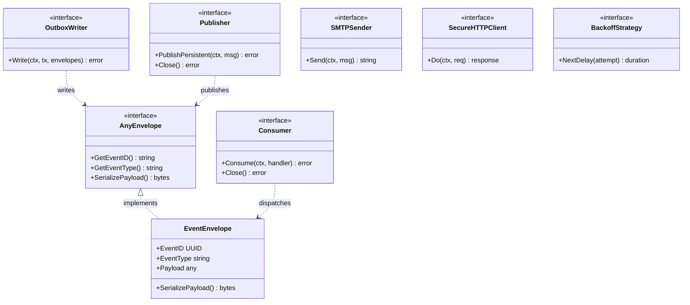

# 7. Design Patterns, Principles & Architectural Trade-offs

The engineering design of the Member 08 messaging subsystem rigorously applies established software design patterns, Clean Architecture conventions, and SOLID object-oriented principles. By encapsulating infrastructure drivers behind cohesive Go interfaces, decoupling transactional boundaries, and enforcing deterministic retry algorithms, the architecture achieves high reliability, modular testability, and operational transparency. This section catalogs the patterns utilized across the subsystem, provides an authoritative class/interface diagram, details key architectural trade-offs, and documents existing operational limitations.

---

## 1. Design Patterns & Principles Catalog

| Pattern / Principle | Subsystem Implementation | Architectural Justification |
| :--- | :--- | :--- |
| **Transactional Outbox** | Embedded in Core API (`internal/events/writer.go`) and PostgreSQL (`outbox_events`). | Eliminates the dual-write problem by persisting domain mutations and events in a single SQL transaction. |
| **Observer / Pub-Sub** | RabbitMQ topic exchange `swiftdrop.events.topic` routing to consumer queues. | Decouples event producers from downstream consumers (workers, Tracking API, third-party targets). |
| **Repository Pattern** | `PostgresOutboxWriter`, `NotificationRepository`, `WebhookRepository`. | Isolates domain and use case logic from low-level SQL queries, transactions, and database dialect specifics. |
| **Strategy Pattern** | Pluggable backoff calculators (`BackoffStrategy`) with randomized jitter. | Encapsulates retry timing algorithms, allowing compressed schedules in CI and exponential curves in production. |
| **Adapter Pattern** | Real `SMTPSender` wrapping Go `net/smtp`; `SecureHTTPClient` wrapping `http.Client`. | Adapts generic business communication contracts to concrete network protocols (TLS/STARTTLS, HTTP/1.1). |
| **Idempotent Receiver** | Leased task claims and terminal deduplication table `processed_events`. | Absorbs inevitable duplicate message redeliveries over the network without producing duplicate side effects. |
| **Competing Consumers** | Autoscaled Event Worker replicas (1–3 pods) pulling from shared AMQP queues. | Balances high-latency external HTTP and SMTP workloads across worker instances without lock contention. |
| **Dead Letter Channel** | RabbitMQ dead-letter exchange `swiftdrop.dlq.exchange` and queue `swiftdrop.dlq`. | Isolates unparseable poison messages from healthy traffic, preventing infinite crash loops. |
| **Single Responsibility** | Split into three distinct binaries: `relay` (publisher), `worker` (consumer), `reconcile` (cleaner). | Ensures each daemon has exactly one operational concern and independent scaling lifecycle. |
| **Dependency Inversion** | Core API aggregates depend on `OutboxWriter` interface; infrastructure provides implementation. | Protects domain layers from direct dependencies on SQL drivers or network brokers (`AGENTS.md` §4.2). |
| **DRY Principle** | Single canonical `EventEnvelope[T]` struct used across all internal modules. | Standardizes metadata headers (event ID, trace correlation, schema version) across all producers. |

---

### Figure 7.1 — Core Interfaces and Class Structure
**Purpose:** Details the key Go interfaces and data abstractions governing outbox publishing, message transport, and external delivery in a vertically clustered layout.

**Key points**
- Core API modules interact exclusively with the `OutboxWriter` interface and typed `EventEnvelope` structs.
- Messaging daemons decouple broker transport through `Publisher` and `Consumer` abstractions.
- External side effects are encapsulated behind testable `SMTPSender` and `SecureHTTPClient` contracts.

---

## 2. Architectural Decisions & Trade-off Matrix

| Decision ID | Selected Architectural Approach | Rejected Alternative | Technical Rationale | Known Limitation & Mitigation |
| :--- | :--- | :--- | :--- | :--- |
| **DEC-01** | Single-Path Real SMTP using Mailpit in local development and CI. | In-memory or console mock email adapter. | Ensures identical TLS/MIME code paths run in development, CI, and production, eliminating mock drift. | Requires running Mailpit container locally and in CI pipeline. |
| **DEC-02** | Lease-based database-driven retries via PostgreSQL. | RabbitMQ `Nack(requeue=true)` loops or broker delay plugins. | Eliminates broker queue spinning and head-of-line blocking; enables explicit audit logging per attempt. | Consumes modest database pool connections during worker polling cycles. |
| **DEC-03** | Self-contained event payloads (`notify` block, `merchant_id`). | Thin events requiring worker to query domain tables. | Enforces strict package isolation (`AGENTS.md` §4.2); eliminates cross-module database read contention. | Payload size increases slightly; recipient email is stored at rest in outbox for 7 days. |
| **DEC-04** | Reconciler scope limited to Member 08 tables pending M2 view. | Direct cross-module SQL joins into `parcels` and history tables. | Prevents architectural boundary violations and illegal coupling to other members' schema tables. | Cross-module parcel consistency auditing (**FR-REC-003**) is currently partial. |
| **DEC-05** | Singleton Outbox Relay deployment (exactly 1 replica). | Multi-replica active-active relay with distributed lock. | Completely eliminates row lock contention and out-of-order publication without complex leader election. | Estimated capacity of ~1,000 events/second based on `doc-03` estimates, sufficient for project scale. |
| **DEC-06** | Pre-dial SSRF IP validation with direct IP socket connection. | Post-dial HTTP response inspection or HTTP forward proxy. | Prevents Time-of-Check to Time-of-Use DNS rebinding and internal network scanning before TCP connect. | Does not support destination webhooks requiring SNI-based CDN virtual hosts over non-standard IPs. |

---

## 3. Operational Risks & Architectural Limitations

1. **At-Least-Once Delivery & Duplicate Message Risk:**  
   Because the system implements at-least-once delivery guarantees (SRS FR-EVT-010), sudden network disconnections or worker pod crashes after side-effect execution may produce duplicate AMQP deliveries. While internal systems are protected by `processed_events`, **external merchant webhook receivers must implement deduplication** by checking the `X-SwiftDrop-Event-ID` header.

2. **Throughput Bounds of the Singleton Outbox Relay:**  
   Operating the Outbox Relay as a single-pod Deployment avoids distributed locking complexity and guarantees in-order event publication. Under current engineering estimates from `doc-03`, a single relay pod can sustain approximately 1,000 events/second. If platform load exceeds this threshold, horizontal scaling would require migrating to aggregate-ID hash partitioning.

3. **Dependency on Upstream Domain Envelopes:**  
   Because the Event Worker never queries Core API domain tables directly, it depends entirely on producing modules (Members 02, 03, 04) to faithfully populate the `notify` contact block and `merchant_id`. If an upstream aggregate omits recipient contact information, the worker cannot route notifications.

4. **Partial Implementation of FR-REC-003:**  
   Requirement **FR-REC-003** mandates detecting operational inconsistencies such as "a parcel missing expected status-history or assignment records". Because Member 08 is strictly prohibited from querying Member 02's `parcels` table directly, this check remains **partial** until Member 02 exposes a read-only database consistency view (DEC-04).

---

## 4. Requirements Traceability

| Section / Figure | Pattern & Principle Focus | Related SRS Requirements | Source Document Reference |
| :--- | :--- | :--- | :--- |
| **Section 1** | Enterprise Integration Patterns Catalog | `FR-EVT-001`, `FR-EVT-002`, `FR-EVT-005`, `FR-EVT-007` | `doc-03` §1, §3; `doc-04` §1 |
| **Figure 7.1** | Core Go Interfaces & Domain Models | `FR-EVT-004`, `FR-EVT-006`, `SEC-010` | `doc-03` §3 |
| **Section 2** | Architectural Decisions Matrix (DEC-01 to 06) | `FR-EVT-008`, `FR-EVT-010`, `FR-REC-003`, `FR-MER-009` | `CHANGE_REQUESTS.md` DEC-01..04 |
| **Section 3** | Risks & Operational Limitations | `FR-EVT-010`, `FR-REC-003`, `SEC-011` | `doc-01` §4; `doc-07` §1 |
