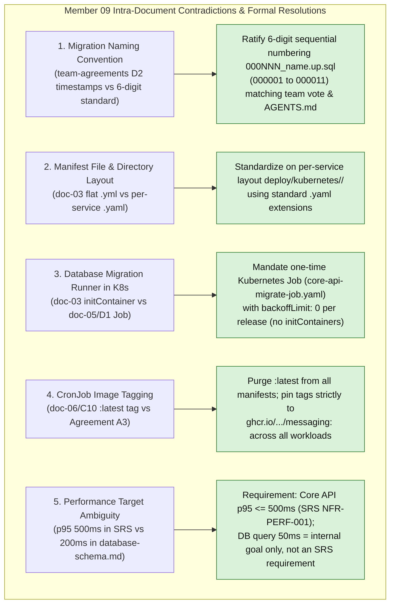
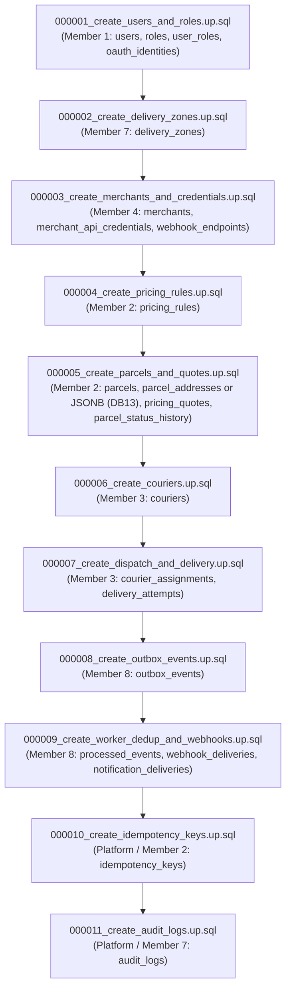

# Member 09 — DevOps, Kubernetes & Database Coordinator Alignment Guide

> **Domain Owner:** Member 9 — DevOps, Kubernetes, Observability & Database Coordinator (Minidu Dhananjana)  
> **Written by:** Poorna Rashmika (team audit, 2026-10-25) · **Corrected by Member 9:** 2026-10-28 (real requirement IDs, agreed scaling numbers, hub migration order, working code samples)  
> **Target Directories / Modules:**  
> - `deploy/` (Docker Compose, Kubernetes manifests, Helm values, Traefik integration, monitoring)  
> - `.github/workflows/` (Continuous Integration & Delivery pipelines)  
> - `root/Makefile` & `root/.env.example` (Developer automation interface & environment inventory)  
> - `core-api/migrations/` (PostgreSQL migration governance, sequencing, and database bootstrap roles)  
> **Status:** Authoritative Architectural Alignment & Action Specification (Post-Submission Review)  
> **Version:** 2.1.0 | **Date:** 28 October 2026

---

## 1. Executive Summary & Verification Scope

Member 9 serves as the platform architect, reliability engineer, and database coordinator for SwiftDrop. The scope encompasses the holistic operational lifecycle:
1. **Local Developer Orchestration:** Unified Docker Compose stack (`deploy/docker-compose.yml`) and root `Makefile` (`make up`, `make down`, `make migrate-up`, `make seed`, `make test`, `make test-e2e`) ensuring any team member can spin up the full 10-developer system from a clean clone in seconds.
2. **Kubernetes Infrastructure (K3s):** Production manifests organized strictly by service under `deploy/kubernetes/<service>/`, including StatefulSets for stateful persistence (PostgreSQL 16 and RabbitMQ 3.13 on `local-path` storage), Deployments with non-root security contexts (`USER 10001:10001`), and NetworkPolicies.
3. **Autoscaling Demonstration Envelopes (SRS §15.3 Bonus):**
   - **Horizontal Pod Autoscaler (HPA):** CPU/Memory-based scaling for read-optimized Tracking API (`services/tracking/`).
   - **KEDA ScaledObject:** Queue-depth event-driven autoscaling for background Event Workers (`services/messaging/`) triggered by RabbitMQ queue backlog.
4. **Comprehensive Observability & Reliability:**
   - Standardized health endpoints across all services: `/health/live` (process responsiveness), `/health/ready` (critical core dependencies only), and `/metrics`.
   - Prometheus scraping with universal prefix `swiftdrop_*` and Grafana dashboards as code.
   - Graceful shutdown handlers honoring SIGTERM within the grace period (core-api 20s, doc-04 §6).
5. **Database Governance & Migration Stewardship:**
   - Authority over `core-api/migrations/` review, guaranteeing strict foreign key creation order (`000001` through `000011`).
   - PostgreSQL 16 connection budget management (`max_connections = 150`, 105 active pool limit across services, 45 reserved).
   - Least-privilege database role bootstrap (`swiftdrop_migrator`, `swiftdrop_app`, `swiftdrop_tracking_ro`, `swiftdrop_relay`, `swiftdrop_worker`, `swiftdrop_reconciler`; D6).
6. **Web Container Ownership:** Authoring and maintaining `web/Dockerfile` and `web/nginx.conf` (port 3000, SPA fallback routing, multi-stage build).

Member 9 previously submitted a complete 8-document architectural suite (`doc-01` through `doc-08`) alongside `AI-REVIEW-PROMPT.md` and `team-agreements-with-member-09.md`. This guide executes the **exact 7-point review and alignment process** applied across all team members, resolves all 5 intra-member contradictions, reconciles all 10 member boundaries, ratifies the canonical 11-step migration sequence, and gives **draft samples** of the main deployment files (§6). The samples are not in the repo yet; §7 lists what exists today.

---

## 2. Requirements Traceability Matrix

The SRS has **no ID family for platform work**. Its platform requirements are the §11 sections, the §15.3 bonus criteria, AT-016 and a few SEC/NFR/FR items. *(Version 2.0.0 of this guide used IDs such as FR-OPS-xxx, FR-DB-xxx, NFR-REL-xxx and BONUS-xxx. None of them exist in the SRS, so they were removed. Several SEC IDs also had the wrong meaning: in the SRS, SEC-006 is input validation, SEC-008 is about logs, SEC-012 is file uploads.)*

**Status key:** 📄 specified in the docs · 🔧 partly in the repo · ✅ done in the repo.

| Source (real ID / section) | What it requires | Where in the Member 9 suite | Status |
| :--- | :--- | :--- | :--- |
| **SRS §11.1** | Local Compose stack, env examples, no committed secrets | doc-02 F1, doc-08 §4, A7 | 📄 (no Compose file or `.env.example` yet) |
| **SRS §11.2** | K8s Deployments, Services, StatefulSets for stateful data, ConfigMaps/Secrets, probes, CronJob | doc-03 §2, doc-08 §6 | 🔧 Postgres/RabbitMQ StatefulSets, reconciler CronJob, HPA and KEDA exist; app Deployments planned |
| **SRS §11.3** | Environment variable inventory | `environment-variables.md`, doc-04 §4 | ✅ (docs) |
| **SRS §11.4** | Metrics, logs, low-cardinality labels | doc-04 §5, doc-08 §7, A11 | 📄 |
| **SRS §15.3** | Kubernetes bonus: full system on K8s | doc-03, doc-06, doc-08 | 📄 (milestone M4) |
| **AT-016** | Readiness/liveness behaviour and the reconciliation CronJob demonstrated | doc-06 PLT-014…021 | 📄 |
| **SEC-001** | HTTPS for external traffic; HTTP only locally | doc-07 §1, ADR-002 §3 | 📄 |
| **SEC-003** | Signing keys supplied via secret configuration and rotated | A5 `jwt-secrets`, doc-07 §7 | 📄 |
| **SEC-008** | No secrets or unneeded personal data in logs | doc-07 §2, A11 | 📄 |
| **SEC-016** | Non-root images, pinned versions, no build-time secrets | A3, doc-06 PLT-005/006 | 🔧 manifests run as 10001 and use no `latest` |
| **SEC-017** | K8s RBAC and network least privilege; only intended entry points public | doc-07 §1, ADR-002 §8 | 📄 |
| **NFR-PERF-001** | p95 ≤ 500 ms at 50 concurrent users | doc-08 §7 Grafana panel, alert | 📄 |
| **NFR-PERF-003** | Outbox event published within 5 s | doc-08 §7 outbox panel | 📄 |
| **FR-REC-004** | Reconciliation bounded, idempotent, logged | `cronjob-reconciliation.yml` (`Forbid`, `--batch-size=50`) | ✅ (manifest) |
| **FR-AI-005** | AI Assistant has no direct DB access | D6 (no AI login), doc-05 §2.2 | 📄 |
| **AGENTS.md §7** | Sequential `NNNNNN_name.up.sql` migrations | D2, D3, doc-05 §3 | 📄 |
| **Work Division §3 (Member 9)** | Acceptance criteria 1–5 | doc-06 §7 | 📄 |

---

## 3. Intra-Member Contradiction Resolutions

Detailed cross-document audit revealed 5 specific discrepancies within Member 9's drafts that have been formally resolved:



### 3.1 Contradiction 1: Migration Naming Convention (6-Digit Sequential vs Timestamps)
- **The Inconsistency:** In `team-agreements-with-member-09.md` (item D2) and `doc-08`, Member 9 proposed timestamps (`YYYYMMDDHHMMSS_module_change.up.sql`). However, in `doc-05` Section 3, `MEMBER_09_ALIGNMENT_AND_SPECIFICATION_GUIDE.md` v1.0.0, and AGENTS.md Section 7, the **6-digit prefix format (`000NNN_name.up.sql`)** was ratified as project law.
- **The Resolution:** Unanimously lock in the **6-digit sequential numbering convention (`000001` through `000011`)** for the initial baseline. Timestamps introduce sorting ambiguity across different operating systems. Sequential numbering guarantees deterministic migration order.

### 3.2 Contradiction 2: Kubernetes Manifest Directory Layout (Flat `.yml` vs Per-Service `.yaml`)
- **The Inconsistency:** In `doc-03` lines 94–100, manifests were listed as flat files in `deploy/kubernetes/` with `.yml` extensions (`postgres-statefulset.yml`, `rabbitmq-statefulset.yml`). Conversely, in Agreement A8 and `MEMBER_09_ALIGNMENT_AND_SPECIFICATION_GUIDE.md`, Member 9 adopted Member 7's modular layout: one directory per service using `.yaml` extensions.
- **The Resolution:** Adopt the **per-service directory structure**: `deploy/kubernetes/<service>/` (`core-api`, `tracking-api`, `messaging`, `ai-assistant`, `web`, `postgres`, `rabbitmq`, `redis`, `monitoring`), standardizing exclusively on `.yaml` extensions.

### 3.3 Contradiction 3: Database Migration Execution in Kubernetes (`Job` vs `initContainer`)
- **The Inconsistency:** In `doc-03` line 80 and `doc-08`, Member 9 considered running migrations via an `initContainer` inside the `core-api` Deployment. In `doc-05` Section 3 and Agreement D1, Member 9 mandated a **one-time Kubernetes release Job with `backoffLimit: 0`**.
- **The Problem:** An `initContainer` executes on every pod replica during horizontal scaling and rolling updates. Multiple pods executing DDL migrations concurrently causes database deadlocks and migration lock contention.
- **The Resolution:** Strictly mandate a standalone **Kubernetes Job** (`deploy/kubernetes/core-api/migrate-job.yaml`) executing image `ghcr.io/phantomtroupeead/swiftdrop/core-api-migrations:<git-sha>` with `backoffLimit: 0`. The Job must complete successfully before the application deployment rolling update proceeds.

### 3.4 Contradiction 4: Image Tagging in CronJob Manifests (`:latest` vs `<git-sha>`)
- **The Inconsistency:** In `doc-06` PLT-006, Member 9 identified that their existing reconciliation CronJob manifest used `swiftdrop/messaging:latest`, directly violating Agreement A3.
- **The Resolution:** Completely eliminate `:latest` across all manifests. Pin image tags to `<git-sha>` (e.g. `ghcr.io/phantomtroupeead/swiftdrop/messaging:<git-sha>`). Manifests write `${IMAGE_TAG}` and the deploy step fills in the SHA.
- **Status:** ✅ fixed in `deploy/kubernetes/cronjob-reconciliation.yml` on 2026-10-28.

### 3.5 Contradiction 5: Performance Latency Target Alignment (500ms vs 200ms)
- **The Inconsistency:** In `doc-03` open questions, Member 9 noted that SRS specifies p95 $\le$ 500ms for Core API, while `database-schema.md` states 200ms.
- **The Resolution:** The requirement is Core API p95 $\le$ 500ms at 50 concurrent users (SRS NFR-PERF-001, which outranks `database-schema.md`). Internal goals such as DB query p95 $\le$ 50ms or gateway overhead p95 $\le$ 15ms may guide tuning, but they are **not SRS requirements** and are not claimed until measured.

---

## 4. Cross-Boundary Architectural Reconciliations

Member 9 coordinates infrastructure, deployments, and database governance with all 9 other team members:


### 4.1 M9 vs M1: Identity & Authentication Secrets
- **Migration Sequencing:** Member 1 authors Migration `000001_create_users_and_roles.up.sql` establishing core auth tables (`users`, `roles`, `user_roles`, `oauth_identities`).
- **Secrets Management:** Member 9 provisions `jwt-secrets` mounting the RS256 private key to Core API and public key to Tracking API.

### 4.2 M9 vs M2: Parcels, Pricing & Monolith Connection Pool
- **Migration Sequencing:** Member 2 authors Migration `000004_create_pricing_rules.up.sql`, Migration `000005_create_parcels_and_quotes.up.sql`, and Migration `000010_create_idempotency_keys.up.sql` (owner still to confirm, DB7).
- **Connection Budget:** Member 9 allocates Core API connection pool: 12 open connections per pod $\times$ 4 maximum replicas = **48 connections** (`DB_MAX_OPEN_CONNS=12`, `DB_MAX_IDLE_CONNS=4`).

### 4.3 M9 vs M3: Dispatch, Couriers & Readiness Probe Decoupling
- **Migration Splitting (Agreement D3):** Member 3's tables are cleanly split across two migrations:
  1. `000006_create_couriers.up.sql` (references `users` and `delivery_zones`).
  2. `000007_create_dispatch_and_delivery.up.sql` (references `couriers` and `parcels`).
- **Readiness Probe Decoupling:** Member 3 decoupled external object storage (Cloudflare R2 / MinIO) from `/health/ready`. Core API readiness checks PostgreSQL only.
- **Storage Configuration:** Member 9 manages MinIO container in Compose locally and Cloudflare R2 bucket credentials in `integrations-secrets` in Kubernetes.

### 4.4 M9 vs M4: Merchant Infrastructure & AES Secret Key
- **Migration Sequencing:** Member 4 authors Migration `000003_create_merchants_and_credentials.up.sql`.
- **Shared Symmetric Secret:** Member 9 configures `integrations-secrets` containing `WEBHOOK_SECRET_ENCRYPTION_KEY` mounted to both Core API (Member 4) and Event Worker (Member 8).

### 4.5 M9 vs M5: Tracking API Deployment & Redis StatefulSet
- **Read-Only Database Role:** Tracking API connects using `swiftdrop_tracking_ro` with a 3-second statement timeout and a pool budget of 5 connections per pod $\times$ 4 replicas = **20 connections**.
- **Redis Multi-Replica Fan-out:** Member 9 provisions ephemeral Redis (`redis:6379`) for pub/sub fan-out, needed only when Tracking API runs more than 1 replica (C8, C26).
- **Autoscaling:** Today's HPA scales Tracking API 1 → 2 replicas at 50% CPU. The final range is open item C8 (Member 5); the DB budget allows at most 4 pods (5 connections each).

### 4.6 M9 vs M6: Web Frontend Containerization & Nginx
- **Container Ownership:** Member 9 owns `web/Dockerfile` and `web/nginx.conf` (Agreement A3).
- **Configuration:** Static Nginx server listening on port `:3000`, built with `VITE_API_BASE_URL=/api/v1` and SPA fallback routing (`try_files $uri $uri/ /index.html;`).

### 4.7 M9 vs M7: Edge Traefik Routing & Port Mapping
- **Port Allocation:** Traefik binds externally to `:80` (HTTP) and `:443` (HTTPS). Internal Traefik dashboard binds to `:8090` (`insecure: false` in production). Core API binds to `:8080`.
- **Ingress Deployment:** Member 7 authors IngressRoute and Middleware CRDs; Member 9 installs Traefik v3.1 Helm chart with Cloudflare Real-IP trust.

### 4.8 M9 vs M8: Messaging Infrastructure & KEDA Autoscaling
- **RabbitMQ StatefulSet:** Member 9 deploys RabbitMQ 3.13 with 5Gi PVC on `local-path` storage class.
- **Multi-Binary Container:** Deploys single image `ghcr.io/.../messaging:<git-sha>` running as non-root `USER 10001:10001`.
- **KEDA ScaledObject:** Configures KEDA to autoscale `event-worker` between 1 and 3 pods when RabbitMQ queues (`q.notifications.worker`, `q.webhooks.dispatcher`) exceed 10 pending messages. More than 3 pods would break the DB budget (10 connections each, D8).
- **Singleton Daemon:** Outbox Relay is strictly locked to `replicas: 1`.

### 4.9 M9 vs M10: AI Assistant Deployment & CI Testing
- **Stateless AI Deployment:** Deploys `ai-assistant` on container port `:8000` with zero database credentials or PVC mounts.
- **CI Test Suite:** Provisions headless Chromium in GitHub Actions (`npx playwright install --with-deps chromium`) for Member 10's end-to-end smoke test suite.

---

## 5. Database Governance & Migration Chain Protocol

As Database Coordinator, Member 9 governs the authoritative 11-step migration sequence in `core-api/migrations/`. It is the hub list (`docs/drafts/README.md` §4, Agreement D3), plus `notification_deliveries` in `000009`, which the hub list forgot:



Extra Member 7 tables such as `zone_postal_codes` or `system_settings` are not in the first wave until they appear in `database-schema.md`. They then take the next free number.

### 5.1 Bootstrap Roles SQL (`deploy/postgres/bootstrap-roles.sql`)
Executed once by the `postgres` superuser, connected to `swiftdrop_db`, before the first migration. **No passwords live in this file.** They come in as psql variables filled from the Kubernetes Secret or the local `.env`, e.g. `psql -d swiftdrop_db -v migrator_pw="$MIGRATOR_PW" -v app_pw="$APP_PW" ... -f deploy/postgres/bootstrap-roles.sql`.

```sql
-- Bootstrap PostgreSQL roles for SwiftDrop (Agreement D6)
CREATE ROLE swiftdrop_migrator    LOGIN PASSWORD :'migrator_pw';
CREATE ROLE swiftdrop_app         LOGIN PASSWORD :'app_pw';
CREATE ROLE swiftdrop_tracking_ro LOGIN PASSWORD :'tracking_pw';
CREATE ROLE swiftdrop_relay       LOGIN PASSWORD :'relay_pw';
CREATE ROLE swiftdrop_worker      LOGIN PASSWORD :'worker_pw';
CREATE ROLE swiftdrop_reconciler  LOGIN PASSWORD :'reconciler_pw';

-- PostgreSQL 15+ no longer lets every role create tables in "public",
-- and GRANT ... ON DATABASE does not change that: give the schema to the migrator.
ALTER SCHEMA public OWNER TO swiftdrop_migrator;
GRANT USAGE ON SCHEMA public
  TO swiftdrop_app, swiftdrop_tracking_ro, swiftdrop_relay, swiftdrop_worker, swiftdrop_reconciler;

-- D7: every table the migrator creates later gives swiftdrop_app SELECT/INSERT/UPDATE.
-- DELETE is granted per table, only where a module needs it.
ALTER DEFAULT PRIVILEGES FOR ROLE swiftdrop_migrator IN SCHEMA public
  GRANT SELECT, INSERT, UPDATE ON TABLES TO swiftdrop_app;
ALTER DEFAULT PRIVILEGES FOR ROLE swiftdrop_migrator IN SCHEMA public
  GRANT USAGE, SELECT ON SEQUENCES TO swiftdrop_app;
-- tracking_ro, relay, worker and reconciler get table-level GRANTs inside the
-- migration that creates each table (doc-05 §2.2).

-- D9 default timeouts; tracking is read-only
ALTER ROLE swiftdrop_app         SET statement_timeout = '5s';
ALTER ROLE swiftdrop_app         SET lock_timeout = '2s';
ALTER ROLE swiftdrop_tracking_ro SET statement_timeout = '3s';
ALTER ROLE swiftdrop_tracking_ro SET default_transaction_read_only = on;
```

### 5.2 PostgreSQL Connection Budget (`max_connections = 150`)

| Service Component | Max Pod Replicas | Open Pool per Pod (`DB_MAX_OPEN_CONNS`) | Idle Pool (`DB_MAX_IDLE_CONNS`) | Total Allocated Connections |
| :--- | :---: | :---: | :---: | :---: |
| `core-api` | 4 | 12 | 4 | 48 |
| `tracking-api` | 4 | 5 | 2 | 20 |
| `outbox-relay` | 1 | 5 | 2 | 5 |
| `event-worker` | 3 | 10 | 5 | 30 |
| `reconcile` (CronJob)| 1 | 2 | 1 | 2 |
| **Active Subsystem Total** | | | | **105** |
| Migrations, Admin & Headroom | — | — | — | **45** |
| **Authoritative Budget Ceiling** | | | | **150** |

---

## 6. Concrete Kubernetes & DevOps Manifest Artifacts

### 6.1 Database Migration Release Job (`deploy/kubernetes/core-api/migrate-job.yaml`)

```yaml
apiVersion: batch/v1
kind: Job
metadata:
  name: core-api-migrate-job
  namespace: swiftdrop
  annotations:
    "helm.sh/hook": pre-install,pre-upgrade
    "helm.sh/hook-delete-policy": before-hook-creation
spec:
  backoffLimit: 0 # A failed migration requires human triage, never automatic retries
  template:
    metadata:
      labels:
        app: core-api-migrate
    spec:
      restartPolicy: Never
      securityContext:
        runAsNonRoot: true
        runAsUser: 10001
        runAsGroup: 10001
      containers:
        - name: migrator
          image: ghcr.io/phantomtroupeead/swiftdrop/core-api-migrations:${IMAGE_TAG} # git SHA, never latest (A3)
          args:
            - -path=/migrations
            - -database=$(DATABASE_URL)
            - up
          env:
            - name: DATABASE_URL
              valueFrom:
                secretKeyRef:
                  name: postgres-migrator-secrets
                  key: DATABASE_URL
          resources:
            requests:
              cpu: 50m
              memory: 64Mi
            limits:
              cpu: 200m
              memory: 128Mi
```

### 6.2 KEDA ScaledObject for Event Worker (`deploy/kubernetes/messaging/keda-scaledobject.yaml`)

```yaml
apiVersion: keda.sh/v1alpha1
kind: ScaledObject
metadata:
  name: event-worker-scaler
  namespace: swiftdrop
spec:
  scaleTargetRef:
    apiVersion: apps/v1
    kind: Deployment
    name: event-worker
  minReplicaCount: 1
  maxReplicaCount: 3 # D8 budget: 3 pods x 10 connections (same as autoscaling/keda-event-worker.yml today)
  cooldownPeriod: 30
  pollingInterval: 15
  triggers:
    - type: rabbitmq
      metadata:
        protocol: amqp
        queueName: q.notifications.worker
        mode: QueueLength
        value: "10"
      authenticationRef:
        name: keda-rabbitmq-auth
    - type: rabbitmq
      metadata:
        protocol: amqp
        queueName: q.webhooks.dispatcher
        mode: QueueLength
        value: "10"
      authenticationRef:
        name: keda-rabbitmq-auth
---
apiVersion: keda.sh/v1alpha1
kind: TriggerAuthentication
metadata:
  name: keda-rabbitmq-auth
  namespace: swiftdrop
spec:
  secretTargetRef:
    - parameter: host
      name: rabbitmq-secrets
      key: RABBITMQ_URL
```

### 6.3 Horizontal Pod Autoscaler for Tracking API (`deploy/kubernetes/tracking-api/hpa.yaml`)

```yaml
apiVersion: autoscaling/v2
kind: HorizontalPodAutoscaler
metadata:
  name: tracking-api-hpa
  namespace: swiftdrop
spec:
  scaleTargetRef:
    apiVersion: apps/v1
    kind: Deployment
    name: tracking-api
  minReplicas: 1
  maxReplicas: 2 # same as autoscaling/hpa-tracking.yml today; final range = C8 (Member 5), never above 4 (D8 budget)
  metrics:
    - type: Resource
      resource:
        name: cpu
        target:
          type: Utilization
          averageUtilization: 50
```

### 6.4 Web Frontend Dockerfile & Nginx Configuration

#### `web/Dockerfile`
Build context is the `web/` folder: `docker build -t ghcr.io/phantomtroupeead/swiftdrop/web:<git-sha> web/`.

```dockerfile
# Build Stage
FROM node:20-alpine AS builder
WORKDIR /app
COPY package*.json ./
RUN npm ci
COPY . .
ARG VITE_API_BASE_URL=/api/v1
ENV VITE_API_BASE_URL=$VITE_API_BASE_URL
RUN npm run build

# Production Static Stage
FROM nginx:1.27-alpine
WORKDIR /usr/share/nginx/html
RUN rm -rf ./*
COPY --from=builder /app/dist .
COPY nginx.conf /etc/nginx/conf.d/default.conf

# Stock nginx starts as root (user directive, pid in /run, cache in /var/cache/nginx).
# To run as 10001 (A3): drop the user line, move the pid file to /tmp, and give 10001 the cache dir.
RUN sed -i '/^user /d; s#^pid .*#pid /tmp/nginx.pid;#' /etc/nginx/nginx.conf \
 && chown -R 10001:10001 /var/cache/nginx /usr/share/nginx/html

USER 10001:10001
EXPOSE 3000
CMD ["nginx", "-g", "daemon off;"]
```

#### `web/nginx.conf`
```nginx
server {
    listen 3000;
    server_name _;
    root /usr/share/nginx/html;
    index index.html;

    # Gzip compression
    gzip on;
    gzip_types text/plain text/css application/json application/javascript text/xml application/xml application/xml+rss text/javascript image/svg+xml;

    # SPA routing fallback
    location / {
        try_files $uri $uri/ /index.html;
    }

    # Static asset caching (Vite adds a hash to every file name)
    location ~* \.(js|css|png|jpg|jpeg|gif|ico|svg|woff|woff2)$ {
        expires 1y;
        add_header Cache-Control "public, no-transform";
    }

    # index.html is never cached, so a new deploy is picked up at once (doc-05 §8)
    location = /index.html {
        add_header Cache-Control "no-cache";
    }

    # Kubernetes probes use GET / (doc-08 §6); no separate /health route,
    # because everything under / is public through the gateway
}
```

### 6.5 Developer Orchestration Interface (`root/Makefile`)

```makefile
.PHONY: up down reset migrate-up migrate-down seed test test-e2e verify

COMPOSE = docker compose -f deploy/docker-compose.yml

# Start the stack; the one-shot core-api-migrate service runs before core-api
up:
	$(COMPOSE) up -d

# Stop the stack and KEEP the data
down:
	$(COMPOSE) down

# Stop the stack and DELETE all volumes (data loss)
reset:
	$(COMPOSE) down -v

# Re-run the migrate service (its default command is "up")
migrate-up:
	$(COMPOSE) run --rm core-api-migrate

# Roll back one migration (local only)
migrate-down:
	$(COMPOSE) run --rm --entrypoint sh core-api-migrate -c 'migrate -path /migrations -database "$$DATABASE_URL" down 1'

# Seed binary in the core-api image; refuses to run when APP_ENV=production (D12)
seed:
	$(COMPOSE) exec core-api /app/seed

# Each Go service has its own go.mod, so test inside each folder (add tracking/messaging when they exist)
test:
	cd core-api && go test -race ./...

# Command and config path to be confirmed by Member 10
test-e2e:
	npx playwright test --config=tests/e2e/playwright.config.ts

# Windows without make: run .\scripts\verify.ps1 directly
verify:
	./scripts/verify.sh
```

---

## 7. Final Engineering Alignment Checklist & Implementation Roadmap

- [x] **Requirements traceability:** mapped to the real SRS sections and IDs (§11.1–11.4, §15.3, AT-016, SEC-001/003/008/016/017, NFR-PERF-001/003, FR-REC-004, FR-AI-005), corrected 2026-10-28.
- [x] **Intra-member contradictions resolved in the docs:** 6-digit migration names, per-service manifest layout, one migrate Job, no `:latest`, latency target wording.
- [x] **Database governance agreed:** the hub's 11-step migration order (D3, + `notification_deliveries`), connection budget 150 / 105 (D8), DB roles (D6).
- [x] **Fixed in the repo (2026-10-28):** `max_connections=150` in the Postgres StatefulSet; the reconciler CronJob uses `${IMAGE_TAG}` and the `swiftdrop_reconciler` URL; Go CI jobs no longer break on draft `go.mod` files.
- [ ] **Not in the repo yet (samples in §5–§6 only):** `migrate-job.yaml`, `web/Dockerfile`, `web/nginx.conf`, root `Makefile`, `deploy/postgres/bootstrap-roles.sql`, `deploy/docker-compose.yml`. KEDA and the tracking HPA exist today as `autoscaling/keda-event-worker.yml` and `autoscaling/hpa-tracking.yml` (to be moved into the A8 folders).
- [x] **Cross-boundary agreements:** signed by all 9 other members (`team-agreements-with-member-09.md` §6). The 2026-10-28 amendment (one DB URL key per login role) still needs a team OK.

---
*End of Member 09 Alignment & Specification Guide (v2.1.0).*
