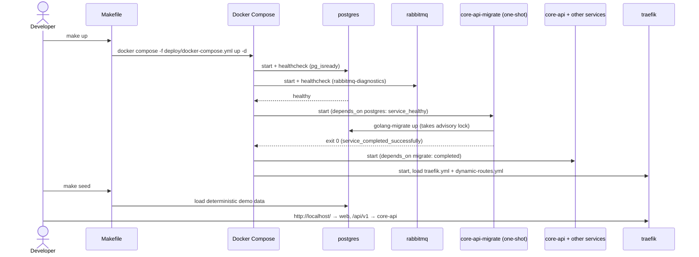
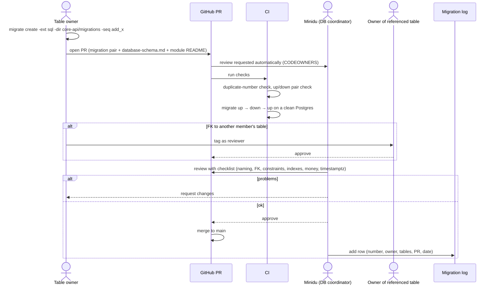
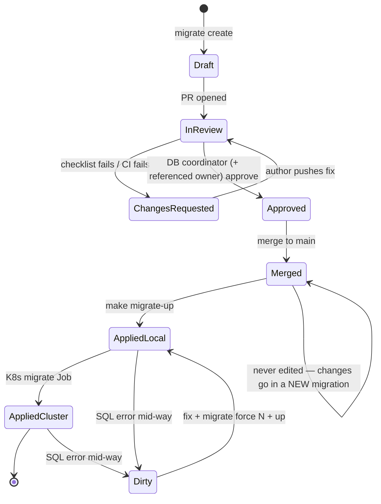
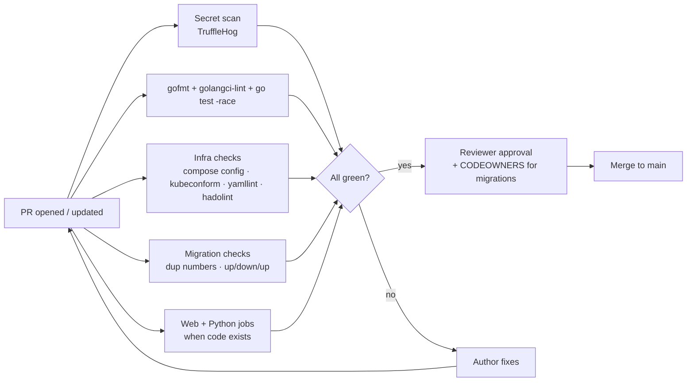
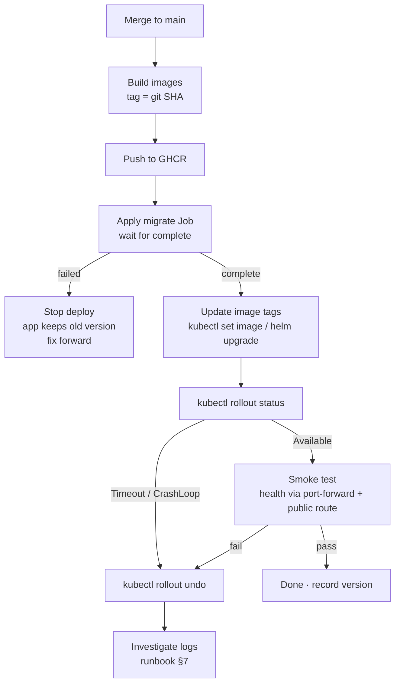
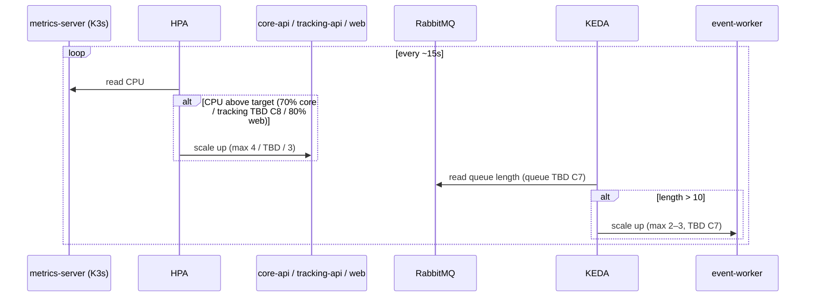

# Document 2 — Functional Flows & Business Rules

> **Status:** Draft / Proposed (For Review in Team Meeting 2)  
> **Author:** Member 9 — DevOps, Kubernetes & Observability + Database Coordinator (Minidu Dhananjana)  
> **Target Module / Location:** `deploy/` (Docker Compose, Kubernetes, Helm, monitoring), `.github/` (CI/CD), root `Makefile`; database coordination of `core-api/migrations/`  
> **Key Upstream Dependencies:** every service owner (Dockerfile, health endpoints, env vars), Member 7 (gateway routes), Member 8 (queues, reconciler), Member 2 (seed, migrations)  
> **Open Questions / Needs Clarification:** Migration numbering rule (next free number, first wave reserved); Kubernetes migrations as one Job per deploy instead of a per-pod initContainer; real queue name for KEDA scaling (Member 8); Tracking API replica range (Member 5).  
> **Answers:** When is the module used, and what happens step by step?  
> Diagrams use Mermaid. They render on GitHub, or in VS Code with a Mermaid preview extension.  

---

## 1. Actors and triggers

| Actor | Who | Triggers |
| :--- | :--- | :--- |
| **Developer** | any of the 10 members | runs `make up`, opens a PR, adds a migration |
| **Service owner** | M1–M8, M10 | adds a service, env var, port or Dockerfile change |
| **DB coordinator** | Minidu (M9) | reviews migration PRs, sets the migration order |
| **Platform owner** | Minidu (M9) | deploys, scales, backs up, rolls back |
| **CI** | GitHub Actions | push or PR to `main`/`develop` (`ci.yml`), merge to `main` (`deploy.yml`, planned) |
| **Kubernetes** | K3s control plane, kubelet, HPA, KEDA | probe results, CPU load, queue length, CronJob schedule |
| **Demo operator** | any member during the demo | shows health, scaling and rollback |

## 2. Flow list

| ID | Flow | When |
| :-: | :--- | :--- |
| F1 | Start the local stack | daily development; clean-clone test |
| F2 | Database migration change (DB coordinator review) | someone adds or changes a table |
| F3 | CI quality gate on a pull request | every PR |
| F4 | Build, deploy and roll back on K3s | merge to `main` (M4 stage onward) |
| F5 | Autoscaling (HPA and KEDA) | load or queue backlog changes |
| F6 | Backup and restore PostgreSQL | scheduled, and in a recovery drill |
| F7 | Onboard a new service | a service owner's first Dockerfile |

---

## F1 — Start the local stack

**Precondition:** Docker Desktop running, `make` installed, `.env` copied from `.env.example`.
**Postcondition:** infra healthy, schema at the latest version, demo data loaded, gateway on `http://localhost`.

| Path | What happens |
| :--- | :--- |
| **Main** | as above, ending with all containers `healthy` or `exited (0)` for the migration |
| **Alt A: no app code yet (Stage 1)** | `traefik/whoami` stubs stand in for core-api, tracking-api, ai-assistant and web, so routing is still testable |
| **Alt B: run a service natively** | the developer stops that container and runs `go run ...`; the infra stays in Compose |
| **Fail 1: port in use** (5432, 5672, 8080) | Compose fails to bind. Change the host port in `.env` (see `local-development.md` §5); 8080 is conflict C16 |
| **Fail 2: migration fails** | the migrate container exits non-zero, so core-api never starts. Read its logs, fix the SQL, and `force` the version if the DB is dirty (Doc 5 §3) |
| **Fail 3: dependency unhealthy** | dependants wait; `docker compose ps` shows which one |

---

## F2 — Database migration change (DB coordinator review)

**Rules (DB coordinator, 2026-10-24):**
- the owner writes the change;
- Minidu reviews it, and is auto-requested through CODEOWNERS;
- the number is the next free one;
- a merged migration is never edited;
- the schema doc is updated in the same PR.

**Migration lifecycle (state machine):**

| Path | What happens |
| :--- | :--- |
| **Alt: number clash** | someone merged the same number first. CI's duplicate check fails, and the author renames to the next free number |
| **Alt: first wave** | numbers 000001–000011 are reserved by foreign-key order (Doc 5 §3) |
| **Fail: schema doc not updated** | review rejected (AGENTS.md §6.3, zero drift) |
| **Fail: breaks the running app** | rejected. Migrations must be **backward compatible** with the previous app version during a rolling update (expand → migrate code → contract; Doc 3 §5) |

---

## F3 — CI quality gate on a pull request

Today `ci.yml` has the secret scan and the Go jobs. The infra, migration, web and Python jobs are **planned** (Stage 1 Step 8; C25).

---

## F4 — Build, deploy and roll back on K3s (from M4)

**Deployment rollout states:** `Progressing` → `Available` (all new pods Ready), or `Progressing` → `ProgressDeadlineExceeded` → *rollback*.
**Pod readiness states:** `Pending` → `Running/NotReady` (startup/readiness probes) → `Ready` ↔ `NotReady` (a dependency goes down) → `Restarting` (liveness probe fails).

---

## F5 — Autoscaling

**Business rules:**
- **never** autoscale `outbox-relay`, `postgres` or `rabbitmq`;
- core-api scale-out must respect the pool budget (C11);
- tracking-api with more than 1 replica needs Redis Pub/Sub (C8, C26);
- worker consumers must be idempotent (M8).

---

## F6 — Backup and restore PostgreSQL

| Step | Backup (scheduled; ADR-002 §9 says every 6h) | Restore (runbook §3.2) |
| :-: | :--- | :--- |
| 1 | `pg_dump -F c` from `postgres-0` | **scale writers to 0** (`core-api`, `outbox-relay`) |
| 2 | encrypt the dump | copy the dump into the pod |
| 3 | copy it to off-site storage (S3/R2, TBD) | `pg_restore -c` |
| 4 | keep the last N copies (TBD) | check `schema_migrations` version = expected |
| 5 | — | scale the writers back (core-api 2, relay **1**) |

**Rule:** a restore always stops the writers first, so no new writes are lost or conflict.

---

## F7 — Onboard a new service

1. The owner fills their block in the service deployment contract (port, start command, health, env vars, dependencies, smoke test).
2. The owner copies the matching Dockerfile template. I review it (non-root, pinned base image, no secrets).
3. I add the service to Compose (replacing its whoami stub) and to `.env.example`.
4. I add the K8s Deployment, Service, ConfigMap, Secret refs, probes, resources and scaling.
5. M7 adds or confirms the route; I check connectivity through Traefik.
6. The smoke test passes locally and on k3d, and the owner signs the contract.

---

## 3. Business rules (platform)

| # | Rule | Source |
| :-: | :--- | :--- |
| BR1 | Migrations run **before** the app starts, and each version is applied exactly once | C22; golang-migrate |
| BR2 | A merged migration is **never edited**; changes go in a new migration | DB coordinator rule |
| BR3 | Every migration PR is approved by the DB coordinator | election 2026-10-24 |
| BR4 | Images are tagged with the **git SHA**; no `latest` | Engineering Standards §10 |
| BR5 | Secrets are injected at runtime only | SRS §11.1–11.2 |
| BR6 | Health and metrics endpoints are never routed publicly | C1; SRS §11.4 |
| BR7 | A restore stops the writers first | runbook §3.2 |
| BR8 | Relay singleton; StatefulSets are never scaled | AGENTS.md §4.4 |

## 4. Idempotency, concurrency and duplicate requests

| Situation | Behaviour |
| :--- | :--- |
| `make up` run twice | Compose converges to the same state; nothing is duplicated |
| `kubectl apply` / `helm upgrade` run twice | declarative, so the same state results |
| Migration run twice | golang-migrate skips versions already in `schema_migrations` |
| Two migration runs at the same time | golang-migrate takes a Postgres **advisory lock**, so the second waits. That's why the K8s plan uses **one Job**, not an initContainer per pod (Doc 3 §6) |
| Two PRs pick the same migration number | the CI duplicate check fails the second; the author renames |
| Two deploys at the same time | proposed: GitHub Actions `concurrency: deploy-main` group, so only one runs at a time |
| CronJob fires while the last run is still going | `concurrencyPolicy: Forbid` skips the new run |
| Worker scaled out by KEDA, so a message is delivered twice | M8's consumers are idempotent (`processed_events`, DB3) |

## 5. Real examples and edge cases

| Example | Expected handling |
| :--- | :--- |
| A developer already runs a local PostgreSQL on 5432 | change the host port mapping to `5433:5432` and update `DATABASE_URL` (`local-development.md` §5) |
| A Windows teammate has no `make` | install it in WSL (`sudo apt install make`) or `choco install make` |
| A migration failed half-way, so `schema_migrations.dirty = true` | fix the SQL, then `migrate ... force <last good version>`, then `up` (`local-development.md` §5) |
| `kubectl get hpa` shows `<unknown>` | metrics-server isn't ready, or the pods have no CPU requests. Check both |
| KEDA never scales | the queue name in the ScaledObject is wrong (`parcel.events` doesn't exist, C7), or the secret key is missing (C6) |
| SSE updates stop after ~100s behind Cloudflare | heartbeats are missing or the response is buffered. Tracking must send `X-Accel-Buffering: no` and 15s pings (ADR-002 §5.2) |
| New core-api pods crash after a deploy | the probe fails, so the rollout stalls. Run `kubectl rollout undo` (runbook §7) |
