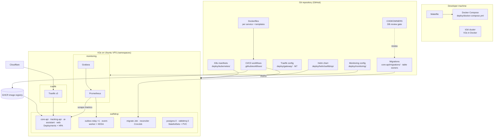

# Document 3 — Internal Architecture & Design Specification

> **Status:** Draft / Proposed (For Review in Team Meeting 2)  
> **Author:** Member 9 — DevOps, Kubernetes & Observability + Database Coordinator (Minidu Dhananjana)  
> **Target Module / Location:** `deploy/` (Docker Compose, Kubernetes, Helm, monitoring), `.github/` (CI/CD), root `Makefile`; database coordination of `core-api/migrations/`  
> **Key Upstream Dependencies:** every service owner (Dockerfile, health endpoints, env vars), Member 7 (gateway routes), Member 8 (queues, reconciler), Member 2 (seed, migrations)  
> **Open Questions / Needs Clarification:** Raw YAML first and Helm later — OK?; monitoring stack size on one server (full kube-prometheus-stack vs plain Prometheus + Grafana); performance target p95 500 ms (SRS) vs 200 ms (database-schema.md). *(Settled: web container port 3000, C15.)*  
> **Answers:** How should the module be implemented internally, and why?  

---

## 1. Component view



## 2. Proposed folder structure

Existing files are marked ✅. Everything else is planned.

```
Makefile                                  # make up · migrate-up · seed · test-e2e (C22)
.env.example                              # placeholders only (SRS §11.1)
web/Dockerfile + web/nginx.conf           # owned by Member 9 (Member 6 decision, 2026-10-25): port 3000, SPA fallback
services/messaging/Dockerfile             # Member 8: ONE image, binaries relay / worker / reconcile
deploy/
├── README.md                             ✅ living doc (update)
├── docker-compose.yml                    # local stack (C3)
├── docker-compose.prod.yml               # VPS Compose override (deployment-guide Path A)
├── docker/templates/
│   ├── Dockerfile.go                     # multi-stage → distroless/alpine, USER 10001
│   ├── Dockerfile.python                 # FastAPI (ai-assistant)
│   ├── Dockerfile.web + nginx.conf       # template for the real web/Dockerfile (port 3000, decided)
│   └── dockerignore.example
├── gateway/                              ✅ (M7 policies, M9 install)
│   ├── README.md                         ✅
│   └── traefik/
│       ├── traefik.yml                   ✅ static config (Docker)
│       ├── dynamic-routes.yml            ✅ routes (Docker, file provider)
│       ├── values.yaml                   # Traefik Helm values (M9)
│       ├── ingressroutes.yaml            # K8s routes (M7)
│       └── middlewares.yaml              # K8s policies (M7)
├── postgres/bootstrap-roles.sql          # D6 roles, run once before migrations; passwords come from Secrets, never from this file
├── kubernetes/                           # A8 target layout (same as deploy/README.md §2).
│   │                                     # ✅ today, still flat: postgres-statefulset.yml, rabbitmq-statefulset.yml,
│   │                                     #    cronjob-reconciliation.yml, autoscaling/hpa-tracking.yml, autoscaling/keda-event-worker.yml
│   ├── namespace.yaml
│   ├── secrets.example.yaml              # placeholder values only (A5 keys)
│   ├── networkpolicies.yaml              # pod isolation (ADR-002 §8)
│   ├── core-api/
│   │   ├── deployment.yaml
│   │   ├── service.yaml
│   │   ├── configmap.yaml
│   │   ├── hpa.yaml                      # 2–4 @ 70% CPU (C9: missing today)
│   │   ├── migrate-job.yaml              # golang-migrate Job, backoffLimit: 0 (D1)
│   │   └── cronjob-merchants-retention.yaml  # daily, Forbid (Member 4)
│   ├── tracking-api/
│   │   ├── deployment.yaml
│   │   ├── service.yaml
│   │   ├── configmap.yaml
│   │   └── hpa.yaml                      # today 1–2 @ 50% CPU; final range open (C8)
│   ├── messaging/
│   │   ├── relay-deployment.yaml         # replicas: 1 (singleton)
│   │   ├── worker-deployment.yaml
│   │   ├── keda-scaledobject.yaml        # two triggers, 1–3 pods, host = RABBITMQ_URL (C7)
│   │   └── cronjob-reconciliation.yaml   # messaging image + /usr/local/bin/reconcile (C10)
│   ├── ai-assistant/
│   │   ├── deployment.yaml
│   │   └── service.yaml
│   ├── web/
│   │   ├── deployment.yaml
│   │   ├── service.yaml
│   │   └── hpa.yaml                      # 2–3 @ 80% CPU (C9: missing today)
│   ├── postgres/
│   │   ├── statefulset.yaml              # 1Gi memory, max_connections=150 (D8)
│   │   └── service.yaml
│   ├── rabbitmq/
│   │   ├── statefulset.yaml
│   │   └── service.yaml
│   ├── redis/                            # only if tracking-api runs > 1 replica (C8, C26)
│   └── tests/probe_test.sh               # AT-016 verification
├── helm/swiftdrop/                       # bonus (SRS §15.3)
│   ├── Chart.yaml
│   ├── values.yaml · values-local.yaml · values-vps.yaml
│   └── templates/
└── monitoring/
    ├── prometheus-values.yaml
    └── dashboards/swiftdrop-overview.json
.github/
├── workflows/
│   ├── ci.yml                            ✅ (extend, C25)
│   └── deploy.yml                        # build → push → migrate → rollout
└── CODEOWNERS                            # DB coordinator review gate
scripts/verify.sh · verify.ps1            ✅ (align, C25)
```

## 3. Responsibilities of each part

The template's layers (handlers, use cases, domain, repositories, adapters) belong to application code. The platform's equivalent layers are:

| Layer | Parts | Responsibility | Must NOT |
| :--- | :--- | :--- | :--- |
| **Build** | Dockerfiles, templates, `.dockerignore` | reproducible, small, non-root images | contain secrets or business config |
| **Local orchestration** | Compose, Makefile, `.env.example` | one-command local stack with the right start order | differ from K8s in ports, names or env var names |
| **Cluster** | manifests / Helm templates | workloads, Services, config, probes, resources, scaling | hold real secrets; scale singletons or StatefulSets |
| **Edge** | Traefik install (M9), routes and policies (M7) | the only public entry, real client IP, TLS | do authentication (the backend does it, ADR-001) |
| **Delivery** | CI and deploy workflows | quality gates, image build and push, ordered rollout, rollback | deploy without passing checks |
| **Observability** | Prometheus, Grafana, alerts | see health, latency, errors, queue and outbox backlog | use high-cardinality labels (tracking numbers, emails) |
| **DB process** | migrate Job and Compose service, CODEOWNERS, CI migration checks, DB roles | ordered, reviewed, repeatable schema changes | write business tables or decide business rules |

## 4. DDD concepts: not used, and why

The platform is a **generic supporting subdomain** (Engineering Standards §2.2–2.3 apply DDD *"selectively… only where business complexity justifies it"*). It has **no business entities, value objects, aggregates, domain services or domain events**, so modelling it with DDD would only add overhead (Engineering Standards §2.8). The one DDD idea it *does* protect is the **bounded-context boundary**: the platform must not leak business logic into manifests (Engineering Standards §2.6), and it enforces table ownership through review.

## 5. Dependency direction and allowed "imports"

```
Service code ──(12-factor: reads env vars)──► nothing platform-specific
Platform     ──(reads)──► service contract (port, health, env names)
Helm values  ──► templates ──► K8s objects            (one direction only)
Migrations   ──► run by the platform, owned by table owners
```

- Services depend **only on env variables and the health/metrics contract**. They never read Compose or K8s files, and never assume a hostname that isn't in an env var.
- Manifests and Helm **never import application code** and never encode business rules (no pricing values or status lists in ConfigMaps unless the owner asks for them as config).
- **Expand → migrate code → contract:** a schema change that removes or renames something is split into 2 releases, so old pods still running during a rolling update keep working.

## 6. Design patterns and why

| Pattern | Where | Why |
| :--- | :--- | :--- |
| **12-factor config** (env vars, ConfigMaps, Secrets) | all services | one image runs in every environment; no secrets in images (SRS §11) |
| **Immutable images tagged by git SHA** | CI, deploy | rollback means pointing back to an old tag; repeatable demos (Engineering Standards §10) |
| **Declarative infrastructure in git** | manifests, Helm, Compose | reviewable, reproducible from version control (Work Division acceptance, M7) |
| **One-shot migration Job / Compose service** | migrations | runs exactly once before the apps, rather than once per pod (C22) |
| **Health probe triad** (startup, readiness, liveness) | every HTTP workload | no traffic before ready; restart on deadlock (SRS §9.2, §11.2) |
| **Singleton workload** | outbox-relay | prevents duplicate publishing and lock contention (ADR-002 §4) |
| **Competing consumers + event-driven autoscaling** | event-worker + KEDA | scales with backlog; safe because consumers are idempotent |
| **StatefulSet + PVC** | Postgres, RabbitMQ | stable identity and storage (SRS §11.2) |
| **Rolling update + rollback** | Deployments | zero-downtime update; `rollout undo` for bad versions |
| **Review gate (CODEOWNERS)** | migrations, schema doc | the DB coordinator sees every change (election 2026-10-24) |

## 7. Transaction boundaries and consistency (platform level)

| Boundary | Rule |
| :--- | :--- |
| **Start order** | Postgres healthy → migrate completes → core-api, tracking, relay, worker start. RabbitMQ healthy before the relay and worker |
| **One migration file** | applied as one version; on failure the DB is marked `dirty` and must be fixed before anything else (Doc 5 §3) |
| **Deploy** | migrate Job first; app rollout only if the Job completed; otherwise stop with the old version still running |
| **Rolling update** | core-api `maxUnavailable: 0`, `maxSurge: 1` (proposed), so capacity never drops during a deploy |
| **Restore** | writers scaled to 0 for the whole restore (runbook §3.2) |
| **Business transactions** | not mine. Parcel + history + outbox in one transaction is owned by M2/M8 (AGENTS.md §4.3) |

## 8. Alternatives considered

| Decision | Chosen | Alternatives | Why / trade-off |
| :--- | :--- | :--- | :--- |
| Kubernetes distribution | **K3s** on a VPS; **k3d** locally | minikube, kind, managed EKS/GKE | ADR-002: light, CNCF certified, `local-path` storage. k3d runs the same K3s locally. Cost: single node is a single point of failure |
| Manifests | **raw YAML first, then Helm** for the bonus | Kustomize; Helm from day one | raw YAML is easier to learn and review in Stage 1; Helm is recommended for the bonus (SRS §11.2) |
| Migrations in K8s | **Job** once per release, `backoffLimit: 0` (D1; an initContainer may only wait for it) | initContainer that migrates in every pod | with 2–4 core-api pods, migrating in every pod is wasteful and noisy, even though golang-migrate's lock keeps it safe |
| Monitoring | **kube-prometheus-stack** via Helm (proposed) | plain Prometheus + Grafana; cloud monitoring | full stack fast, but heavy for one VPS. **Fallback:** plain Prometheus + Grafana if RAM or CPU is tight on the 8 GB server (Azure B2ms has only 2 vCPU) |
| Worker scaling | **KEDA** | HPA on custom metrics | fixed by the SRS (§13.1); simpler RabbitMQ trigger |
| Ingress | own **Traefik v3**, K3s bundled Traefik disabled | bundled Traefik v2; NGINX Ingress | ADR-001 / ADR-002 |
| Compose location | **`deploy/docker-compose.yml` + Makefile** | repo root | C3 decision; the Makefile hides the `-f` flag |
| Registry | **GHCR** (proposed) | Docker Hub | same login as GitHub; free for the org (C24) |

## 9. Scaling and performance

**Single-node resource budget (fill in as owners give estimates).** Values that come from existing manifests are marked ✅.

| Workload | Replicas | CPU request / limit | Memory request / limit |
| :--- | :--- | :--- | :--- |
| postgres | 1 | 100m / 500m ✅ | 256Mi / **1Gi** (raised for `max_connections=150`) |
| rabbitmq | 1 | 100m / 500m ✅ | 256Mi / 512Mi ✅ |
| reconciler (while running) | 0–1 | 50m / 200m ✅ | 64Mi / 128Mi ✅ |
| core-api | 2–4 | TBD | TBD |
| tracking-api | TBD (C8) | TBD | TBD |
| outbox-relay | 1 | TBD | TBD |
| event-worker | 1–3 (KEDA, two queues) | TBD | TBD |
| ai-assistant | 1 | TBD | TBD |
| web | 2–3 | TBD | TBD |
| traefik | 1–2 | TBD (ADR-001: about 50–80 MB RAM) | TBD |
| monitoring | 1 each | TBD | TBD |

- **Rule:** the sum of all *requests* at **max replicas** must fit the VPS (at least 8 GB RAM; provider open, ADR-002 §2), leaving headroom for K3s itself (under 512 MB, ADR-002 §2).
- **DB connections:** the sum of `max replicas × pool size` must stay within `max_connections` = **150** (C11; Doc 5 §5).
- **Performance targets** I must make measurable:
  - NFR-PERF-001: p95 ≤ 500 ms at 50 users. `database-schema.md` §4 says < 200 ms, so the team should pick one.
  - NFR-PERF-003: outbox → RabbitMQ in ≤ 5 s.

  Grafana panels show both (Doc 8 §7).

## 10. Key interfaces (detailed in Doc 4)

1. Health and metrics contract: `/health/live`, `/health/ready`, `/metrics`.
2. Env var and secret contract: names, secret flag, ConfigMap/Secret mapping.
3. Image contract: `ghcr.io/<org>/swiftdrop/<service>:<git-sha>`, non-root, port declared.
4. Make target contract: `make up | migrate-up | seed | test-e2e` (plus optional `down`, `reset`).
5. Migration contract: numbered file pair, review gate, run order.

## 11. Design decisions log

| Date | Decision | Ref |
| :--- | :--- | :--- |
| 2026-10-21 | K3s on Ubuntu VPS, Cloudflare edge, own Traefik | ADR-002 |
| 2026-10-21 | Traefik v3 as ingress/gateway | ADR-001 |
| 2026-10-24 | Health paths per the SRS | C1 |
| 2026-10-24 | Compose at `deploy/docker-compose.yml` | C3 |
| 2026-10-24 | Secret names | C4 |
| 2026-10-24 | M9 owns DB pool and limits | C11 |
| 2026-10-24 | Path-based routing on one domain | C17 |
| 2026-10-24 | golang-migrate one-shot + Job; root Makefile | C22 |
| 2026-10-24 | Minidu is DB coordinator; Watti leads the core-api Dockerfile | group |
| 2026-10-25 | `messaging` image, relay 8082 / worker 8083, two KEDA queues, reconciler command, DLQ | C6, C7, C10, C13 (Member 8) |
| 2026-10-25 | Web Nginx on 3000; M9 owns `web/Dockerfile`; Traefik dashboard 8090 | C15, C16 |
| 2026-10-25 | Postgres `max_connections=150`, memory 1Gi | D8 |
| 2026-10-26 | 6-digit migration names; DB roles; per-service manifest folders; one migrate Job per release with `backoffLimit: 0` (not an initContainer per pod) | D2, D6, A8, D1 |
| 2026-10-28 | Migration order = the hub list (+ `notification_deliveries` in `000009`) | D3 |
| 2026-10-28 *(proposed)* | One DB URL key per login role in `postgres-secrets` | A5 amendment |
| 2026-10-28 | `make test-e2e` = `pytest tests/e2e/ -v` (Member 10's Python suite) | doc-04 §3 |
| *open* | Hosting provider: trying Azure for Students first, Hetzner CX33 as the paid backup | ADR-002 §2 |
| *proposed* | Raw YAML first, Helm for the bonus | this doc §8 |
