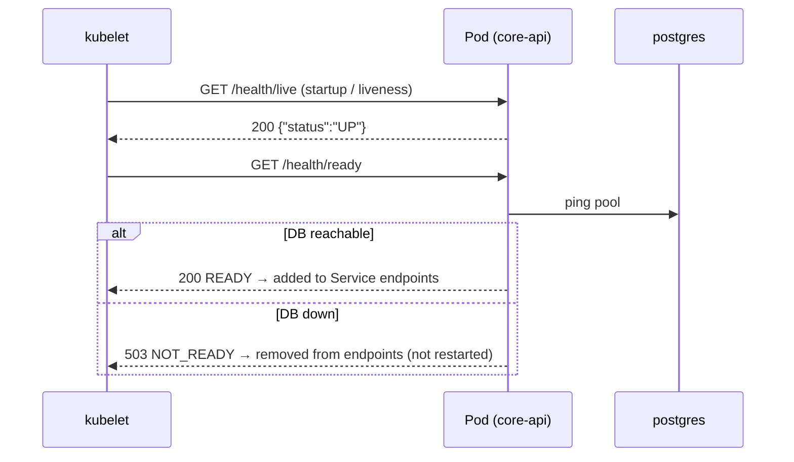
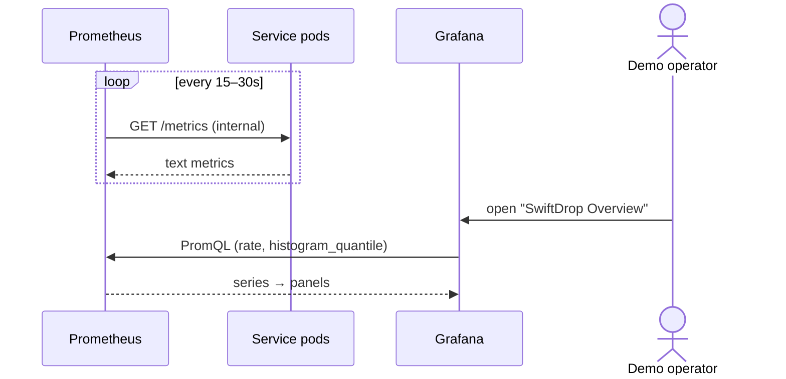

# Document 4 — Interface & Integration Contract

> **Status:** Draft / Proposed (For Review in Team Meeting 2)  
> **Author:** Member 9 — DevOps, Kubernetes & Observability + Database Coordinator (Minidu Dhananjana)  
> **Target Module / Location:** `deploy/` (Docker Compose, Kubernetes, Helm, monitoring), `.github/` (CI/CD), root `Makefile`; database coordination of `core-api/migrations/`  
> **Key Upstream Dependencies:** every service owner (Dockerfile, health endpoints, env vars), Member 7 (gateway routes), Member 8 (queues, reconciler), Member 2 (seed, migrations)  
> **Open Questions / Needs Clarification:** Metric names to confirm with each owner; public tracking and SSE paths (C18, Member 5); rate-limit and CORS values (C19, C20, Member 7); the Google callback path (Member 1); team OK for one DB URL key per login role (A5 amendment). *(Settled: relay 8082 / worker 8083 (Member 8); web variable `VITE_API_BASE_URL` (Member 6).)*  
> **Answers:** Exactly how does this module communicate with other modules?  
> **Note:** the platform exposes **no business API**. Its "interfaces" are the contracts every service must meet to be built, run, probed, scraped and deployed. They are written below as **machine-readable** YAML where possible.  

---

## 1. Interfaces the platform exposes

| # | Interface | Consumers | Form |
| :-: | :--- | :--- | :--- |
| P1 | **Health and metrics contract** | every HTTP service implements it; kubelet, Compose and Prometheus call it | OpenAPI (§2) |
| P2 | **Make targets** | all developers, CI | CLI (§3) |
| P3 | **Env var and secret contract** | every service | YAML schema (§4); full list in `environment-variables.md` |
| P4 | **Metrics naming contract** | every service, Grafana | YAML list (§5) |
| P5 | **Image contract** | every service owner, CI | rules (§6) |
| P6 | **Gateway route table** (with M7) | web, merchant clients | table (§7) |
| P7 | **Migration contract** | every table owner | rules (§8) |
| P8 | **CI status checks** | every PR author | check names (§9) |

## 2. P1 — Health and metrics contract (decided C1)

Every HTTP service (core-api, tracking-api, ai-assistant; outbox-relay on **8082** and event-worker on **8083**, internal only) **must** expose these. They are **internal only**: never routed by Traefik.

```yaml
openapi: 3.0.3
info:
  title: SwiftDrop Platform Health Contract
  version: "1.0"
  description: Required on every SwiftDrop HTTP workload. Internal network only.
paths:
  /health/live:
    get:
      summary: Liveness — process is running and not deadlocked. Must NOT check dependencies.
      security: []
      responses:
        "200":
          description: Alive
          content:
            application/json:
              schema: { $ref: "#/components/schemas/Live" }
              example: { "status": "UP" }
  /health/ready:
    get:
      summary: Readiness — can serve traffic now (DB pool / broker connected as relevant).
      security: []
      responses:
        "200":
          description: Ready
          content:
            application/json:
              schema: { $ref: "#/components/schemas/Ready" }
              example: { "status": "READY", "database": "UP" }
        "503":
          description: Not ready (a required dependency is down) — no traffic is routed
          content:
            application/json:
              example: { "status": "NOT_READY", "database": "DOWN" }
  /metrics:
    get:
      summary: Prometheus metrics in text exposition format.
      security: []
      responses:
        "200":
          description: Metrics
          content:
            text/plain: {}
components:
  schemas:
    Live:
      type: object
      required: [status]
      properties: { status: { type: string, enum: [UP] } }
    Ready:
      type: object
      required: [status]
      properties:
        status: { type: string, enum: [READY, NOT_READY] }
        database: { type: string, enum: [UP, DOWN] }
        broker: { type: string, enum: [UP, DOWN] }
```

The example bodies follow `runbook.md` §1 (`{"status":"UP"}`, `{"status":"READY","database":"UP"}`). Each service lists **only its own** dependencies.

**Probe settings (proposed defaults; owners can tune them):**

| Probe | Path | Initial delay | Period | Timeout | Failure threshold |
| :--- | :--- | :-: | :-: | :-: | :-: |
| startupProbe | `/health/live` | 0s | 5s | 3s | 24 (≈2 min to start) |
| readinessProbe | `/health/ready` | 0s | 10s | 3s | 3 |
| livenessProbe | `/health/live` | 0s | 15s | 3s | 3 |

## 3. P2 — Make target contract (decided C22)

| Target | Does | Owner of the underlying command |
| :--- | :--- | :--- |
| `make up` | `docker compose -f deploy/docker-compose.yml up -d` | M9 |
| `make migrate-up` | run the one-shot golang-migrate container (`up`) | M9 (runner) |
| `make seed` | load deterministic demo data | command from M2 Hansi |
| `make test-e2e` | run the Playwright end-to-end suite | command from M10 / M6 / M7 |
| `make down` / `make reset` *(proposed extras)* | stop the stack / stop it and delete the volumes | M9 |

Targets are **stable names**. If the command behind one changes, the target name stays the same.

## 4. P3 — Env var and secret contract (decided C4)

```yaml
# Contract format: every variable a service reads must appear here and in .env.example
conventions:
  naming: UPPER_SNAKE_CASE
  secrets_never_in: [git, image, logs, committed helm values]
  local_source: .env (from .env.example, gitignored)
  k8s_source:
    non_secret: "<service>-config"        # ConfigMap, one per service
    secret:
      # One key per DB login role (A5 amendment 2026-10-28); each pod maps its key into the env var DATABASE_URL
      postgres-secrets:     [POSTGRES_USER, POSTGRES_PASSWORD, POSTGRES_DB,          # postgres container only
                             DATABASE_URL,                                         # core-api (swiftdrop_app)
                             TRACKING_DATABASE_URL, RELAY_DATABASE_URL,
                             WORKER_DATABASE_URL, RECONCILER_DATABASE_URL]
      postgres-migrator-secrets: [DATABASE_URL]                                    # migrate Job (swiftdrop_migrator)
      rabbitmq-secrets:     [RABBITMQ_DEFAULT_USER, RABBITMQ_DEFAULT_PASS, RABBITMQ_URL]   # C6: KEDA reads RABBITMQ_URL
      jwt-secrets:          [JWT_PRIVATE_KEY_PEM]
      integrations-secrets: [WEBHOOK_SECRET_ENCRYPTION_KEY, MERCHANT_API_KEY_PEPPER, GOOGLE_CLIENT_SECRET, LLM_API_KEY,
                             SMTP_PASSWORD, OBJECT_STORAGE_ACCESS_KEY, OBJECT_STORAGE_SECRET_KEY, AI_SERVICE_ROLE_TOKEN,
                             SENDGRID_API_KEY, TWILIO_ACCOUNT_SID, TWILIO_AUTH_TOKEN]       # last three optional (production providers)
      "<service>-<module>-secrets": [module-specific keys]                         # A5 pattern, e.g. core-api-merchants-secrets
change_policy:
  add: "PR updating environment-variables.md + .env.example + manifests (M9 reviews)"
  rename: "keep old name working for one milestone, then remove"   # avoids breaking teammates
```

The per-service variable list lives in `docs/operations/environment-variables.md` (I own it). Names under discussion are tracked in **C21**.

## 5. P4 — Metrics naming contract (proposed; owners implement)

```yaml
# Prometheus metric names. Rule (A11): every custom metric starts with swiftdrop_.
# Labels must be low-cardinality (SRS §11.4):
# never tracking numbers, user IDs, emails or raw URLs. Use route templates like /api/v1/parcels/{id}.
http:
  - { name: swiftdrop_http_requests_total,  type: counter,   labels: [service, method, route, status] }
  - { name: swiftdrop_http_request_duration_seconds,  type: histogram, labels: [service, method, route] }
database:
  - { name: swiftdrop_db_pool_open_connections,  type: gauge,     labels: [service] }
  - { name: swiftdrop_db_pool_wait_seconds_total,  type: counter,   labels: [service] }
outbox (M8, names agreed 2026-10-25):
  - { name: swiftdrop_outbox_pending_events,           type: gauge }    # K19: not _count (reserved for histograms)
  - { name: swiftdrop_outbox_oldest_pending_age_seconds, type: gauge }  # proposed by M9, not yet confirmed by M8
  - { name: swiftdrop_outbox_publish_failures_total,   type: counter }
worker (M8, names agreed 2026-10-25):
  - { name: swiftdrop_dlq_messages_routed_total,       type: counter }
  - { name: swiftdrop_webhook_delivery_attempts_total, type: counter }
  - { name: swiftdrop_smtp_deliveries_total,           type: counter }
  - rabbitmq_queue_messages{queue="swiftdrop.dlq"}    # DLQ depth from the RabbitMQ plugin
tracking (M5):
  - { name: swiftdrop_sse_active_connections,  type: gauge }
ai (M10):
  - { name: swiftdrop_ai_requests_total,  type: counter,   labels: [outcome] }
  - { name: swiftdrop_ai_tokens_total,  type: counter }
infrastructure (M9 via exporters):
  - rabbitmq queue depth / DLQ depth        # RabbitMQ Prometheus plugin (rabbitmq_prometheus, port 15692)
  - postgres connections / size             # optional postgres_exporter
  - kube pod restarts, CPU, memory          # kube-prometheus-stack
```

These names map to the SRS §11.4 list (request count, latency, errors, DB pool saturation, outbox age and count, relay publish failures, queue backlog, consumer failures, DLQ count, webhook and notification outcomes, SSE connections, AI requests and errors).

## 6. P5 — Image contract

| Rule | Value |
| :--- | :--- |
| Name | `ghcr.io/phantomtroupeead/swiftdrop/<image>:<git-sha>` (A3); manifests write `${IMAGE_TAG}` and the deploy step fills in the git SHA |
| Images | `core-api`, `tracking-api`, **`messaging`** (relay + worker + reconcile, Member 8), `ai-assistant`, `web` (Dockerfile by Member 9), `core-api-migrations` |
| User | non-root `10001:10001` |
| Base | pinned version; distroless/alpine for Go, slim for Python, nginx alpine for web |
| Port | declared with `EXPOSE`, and equal to the contract port (8080 / 8081 / 8082 / 8083 / 8000 / 3000) |
| Secrets | none inside the image |
| Logs | JSON lines to stdout with `request_id` (runbook §2) |
| Shutdown | handle SIGTERM; finish within the grace period (core-api 20s) |

## 7. P6 — Gateway route table (with M7; decided C17)

| Path prefix | Service:port | Middlewares (M7) | Notes |
| :--- | :--- | :--- | :--- |
| `/api/v1/tracking` | `tracking-api:8081` | CORS, rate limit (public lookup only, C19) | SSE path TBD (C18) |
| `/api/v1/ai` | `ai-assistant:8000` | CORS; rate limit *proposed*, not in `dynamic-routes.yml` yet (C19) | |
| `/api/v1` | `core-api:8080` | CORS, 10 MB upload limit | |
| `/` | `web:3000` | none | SPA |
| `/health/*`, `/metrics` | **not routed** | — | internal only (C1) |

## 8. P7 — Migration contract (DB coordinator)

- **Location and name:** `core-api/migrations/NNNNNN_name.up.sql` + `.down.sql` (AGENTS.md §7).
- **Tool:** golang-migrate. **Run:** one-shot Compose service / K8s Job before the apps (C22).
- **Review:** CODEOWNERS makes Minidu a required reviewer; the owners of referenced tables are tagged.
- **Compatibility:** backward compatible with the previous app version (expand → contract).
- **Never edit a merged migration.** Full rules are in Doc 5.

## 9. P8 — CI status checks

| Check | Today | Planned |
| :--- | :-: | :-: |
| Secret & credential scan (TruffleHog) | ✅ | pin the version (C25) |
| Go formatting, golangci-lint, `go test -race` | ✅ | pin golangci-lint (C25) |
| Compose config check (`docker compose config -q`) | | ✅ |
| Manifest schema check (`kubeconform -ignore-missing-schemas`) | | ✅ |
| YAML lint, Dockerfile lint (hadolint) | | ✅ |
| Migration duplicate-number and up/down pair check | | ✅ |
| Migration up → down → up on a clean Postgres | | ✅ |
| Web lint and Vitest, Python pytest | | ✅ (with M6/M7, M10) |
| Image build (and push on `main`) | | ✅ (`deploy.yml`) |

---

## 10. Interfaces the platform consumes

| From | Interface | Used for |
| :--- | :--- | :--- |
| Every service | `/health/live`, `/health/ready`, `/metrics` | probes, Compose healthchecks, Prometheus |
| PostgreSQL | `pg_isready`, SQL (`schema_migrations`), `pg_dump`/`pg_restore` | probes, migrations, backup |
| RabbitMQ | `rabbitmq-diagnostics`, AMQP queue length, Prometheus plugin | probes, KEDA, dashboards |
| K3s | Kubernetes API, metrics-server | deploy, HPA |
| GitHub | Actions, GHCR, branch protection, CODEOWNERS | CI/CD, review gate |
| Cloudflare | DNS, proxy, Origin CA certificate | public access (M4) |

## 11. Authentication and authorization per interface

| Interface | Access rule |
| :--- | :--- |
| Health and metrics | no app auth, but **reachable only inside the cluster or Compose network**; not routed by Traefik |
| Kubernetes API (kubectl) | Minidu (+ a named backup admin, TBD); kubeconfig never committed |
| Traefik dashboard | `api.insecure: false` in K8s; reached only via `kubectl port-forward` (ADR-002 §8) |
| RabbitMQ management UI | internal only; `kubectl port-forward` when needed |
| PostgreSQL | **per-service DB roles** (agreed, D6): `swiftdrop_app` (core-api, read/write), `swiftdrop_tracking_ro` (tracking, **read only**), `swiftdrop_relay`, `swiftdrop_worker`, `swiftdrop_reconciler`, `swiftdrop_migrator` (DDL, only for migrations). Each pod gets its own URL key from `postgres-secrets` (§4). No service uses the superuser |
| GHCR | CI pushes with `GITHUB_TOKEN` (`packages: write` only in `deploy.yml`) |
| GitHub `main` | branch protection: PR, review, required checks, code-owner review for migrations |

## 12. Events produced and consumed

**None.** The platform neither publishes nor consumes domain events. KEDA only **reads queue length** from RabbitMQ (queues `q.notifications.worker` and `q.webhooks.dispatcher`). Event schemas are M8's (`event-contracts.md`).

## 13. Database access and table ownership rules

The platform writes **no business tables**. It runs migrations written by the table owners, and owns `schema_migrations` and the DB roles. The full ownership table is in Doc 5 §2.

## 14. Timeouts, retries, idempotency and failure behaviour

| Interaction | Timeout / retry | On failure |
| :--- | :--- | :--- |
| Probes | see the §2 table | readiness fails, so the pod gets no traffic; liveness fails, so the pod restarts |
| Compose start order | `depends_on: service_healthy` / `service_completed_successfully` | dependants don't start |
| Migrate Job | `backoffLimit: 0` (D1: a failed migration needs a person, not retries); advisory lock | deploy stops; the old app keeps running |
| Reconciler CronJob | `backoffLimit: 0`, `concurrencyPolicy: Forbid` ✅ | the next schedule (10 min later) retries |
| Rollout | `progressDeadlineSeconds: 300` (proposed) | `kubectl rollout undo` |
| Graceful shutdown | `terminationGracePeriodSeconds`: core-api 20s (+ buffer) | SIGKILL after the grace period |
| Image pull | Kubernetes back-off | pod stays `ImagePullBackOff`; check the tag and GHCR access |
| Deploy workflow | GitHub `concurrency: deploy-main` (proposed) | one deploy at a time |

## 15. Sequence diagrams





## 16. Compatibility and versioning policy

| Item | Policy |
| :--- | :--- |
| Health contract | version 1.0. A breaking change needs a group decision and a migration window |
| Images | git-SHA tags; optional semver tags for demo releases |
| Helm chart | semver `version`; `appVersion` = the release tag |
| K8s API versions | stable APIs only (`apps/v1`, `batch/v1`, `autoscaling/v2`); KEDA `keda.sh/v1alpha1` |
| Env vars | add freely; rename = keep the old name for one milestone |
| DB schema | expand → contract; never edit merged migrations |
| Make targets | stable names |

## 17. Integration matrix (who gives what to whom)

| Member | Gives M9 | Gets from M9 |
| :--- | :--- | :--- |
| M1 Umesh | JWT key format, Google redirect URIs, DB security review (DB10) | Secrets (`jwt-secrets`, `integrations-secrets`), DB roles |
| M2 Hansi | seed command, core-api pool size, parcel/pricing migrations | migration review, Job, `make seed`, pool budget |
| M3 Kalani | proof storage choice (C26), migrations | MinIO in Compose (+ K8s plan), review |
| M4 Nagitha | webhook egress needs, migrations | NetworkPolicy egress, review |
| M5 Senuji | SSE paths, Redis need, HPA numbers | Deployment, HPA, Redis, read-only DB role |
| M6 Sajini | ✅ `npm run build` → `dist/`, `VITE_API_BASE_URL=/api/v1` (2026-10-25); build requirements + review | **web Dockerfile + Nginx config (owned by M9)**, Compose service |
| M7 Bagya | routes and policies (CRDs), dashboard port | Traefik install, Ingress connectivity, smoke tests |
| M8 Watti | ✅ queues, reconciler command, ports 8082/8083, metrics, pools (2026-10-25); `messaging` image; core-api Dockerfile lead | RabbitMQ StatefulSet, relay (×1) and worker Deployments, KEDA, CronJob |
| M10 Kakkaya | E2E command, AI health, mock mode | Compose stack as the E2E environment, AI Deployment |
