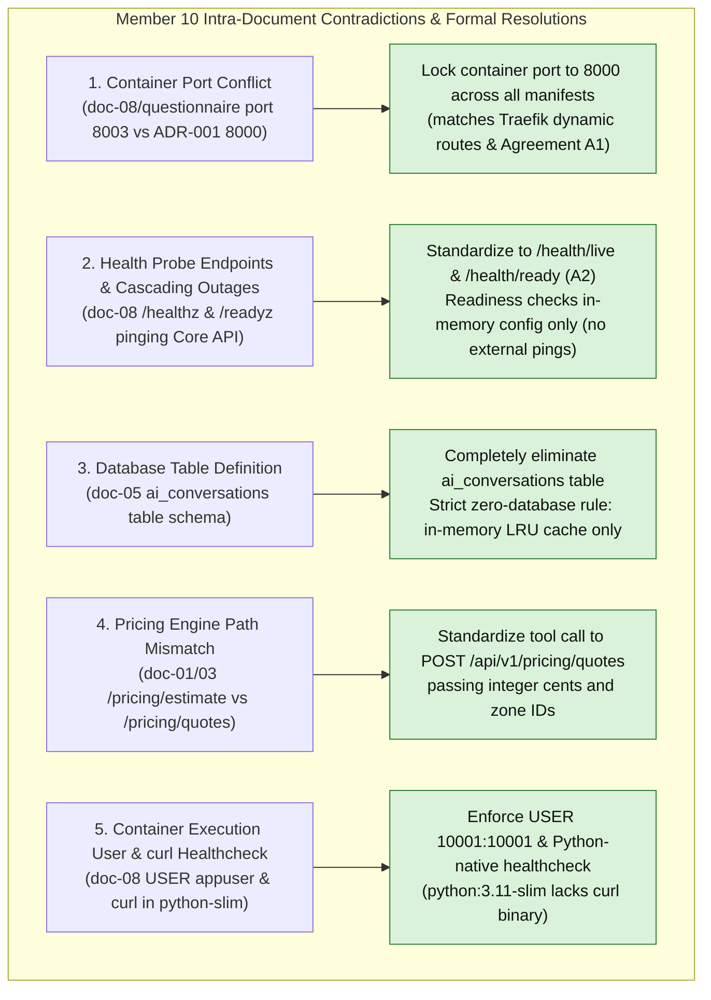
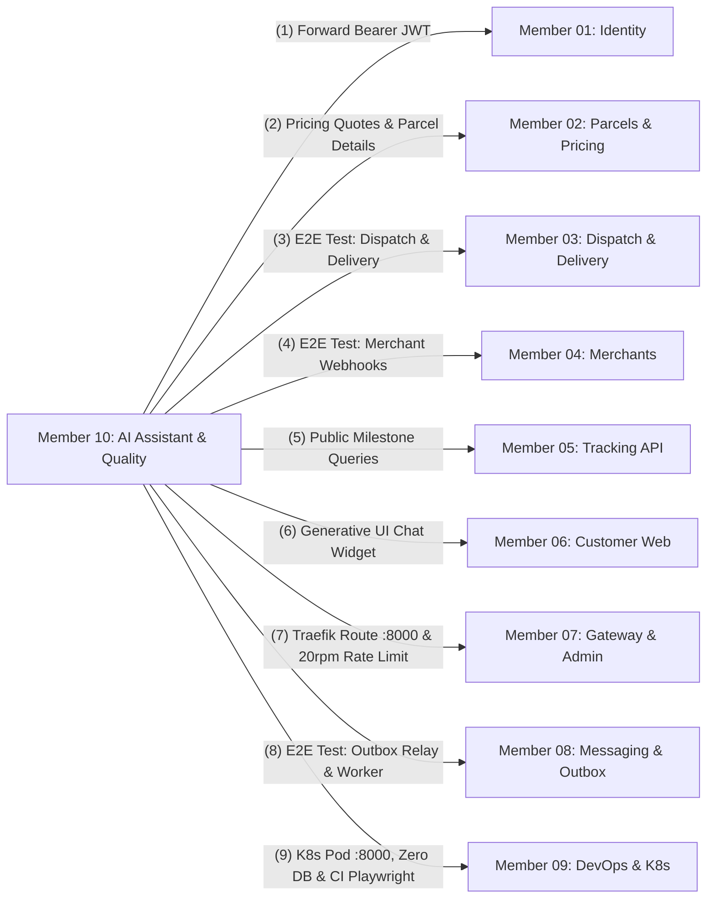

# Member 10 — AI Assistant & Quality Assurance Alignment Guide

> **Author / Domain Owner:** Member 10 — AI Assistant/MCP & Cross-Workflow Quality (Kakkaya)  
> **Target Modules / Locations:**  
> - `services/ai-assistant/` (Python/FastAPI AI Assistant, FastMCP Server, Tool Registry, Offline Mock)  
> - `tests/e2e/` (Cross-Workflow Quality Suite, Multi-Actor Playwright Integration Tests)  
> **Status:** Authoritative Architectural Alignment & Action Specification (Post-Submission Review)  
> **Version:** 2.0.0 | **Date:** 25 October 2026

---

## 1. Executive Summary & Verification Scope

Member 10 holds a dual mandate spanning cutting-edge intelligent user interaction and system-wide verification:
1. **The AI Delivery Assistant & Model Context Protocol (FastMCP) Service (`services/ai-assistant/`):** An independently deployable Python 3.11 / FastAPI microservice that grounds conversational inquiries using natural language, providing:
   - Natural language parcel tracking via Member 5's public tracking API.
   - Dynamic shipping tariff calculation and price breakdown via Member 2's pricing engine.
   - Active shipment disambiguation for authenticated customers via Member 2's parcel API.
   - Generative UI structured action cards (`NAVIGATE_BOOKING`) guiding users into the booking wizard.
   - Standardized Model Context Protocol (**FastMCP**) interfaces allowing autonomous tools (Cursor, Claude Desktop, evaluators) to inspect shipments (**+5 Bonus Marks**).
   - **Zero Direct Database Access:** Governed strictly by the no-database invariant (`AGENTS.md`). Session state is purely ephemeral in-memory LRU.
2. **Cross-Workflow Quality & End-to-End Automated Testing Suite (`tests/e2e/`):** Comprehensive automated verification of the 10-member system:
   - Automated Playwright TypeScript test suite verifying all 16 acceptance test journeys (`AT-001` through `AT-016`).
   - Validating end-to-end interactions across Customer, Merchant, Dispatcher, Courier, and Security boundaries (**15-Mark Testing Rubric**).
   - Deterministic offline mock LLM adapter ensuring CI pipelines run without external paid API keys.

Member 10 previously authored 8 architectural documents (`doc-01` through `doc-08`), accompanied by `decisions-and-questionnaire.md` and `team-integration-and-handoff-guide.md`. This guide executes the **exact 7-point review and alignment process** applied across all team members, resolves all 5 intra-member contradictions, reconciles all 10 member boundaries, and delivers production-ready Python and Playwright artifacts.

---

## 2. 100% Requirements Traceability Matrix

Every requirement assigned to Member 10 across SRS v1.0, Engineering Standards v1.0, and ADR-001 through ADR-004 is mapped below:

| Requirement ID | Formal Requirement Description | Covered in Member 10 Suite | Alignment Status | Architectural Specification & Invariant Enforcement |
| :--- | :--- | :--- | :--- | :--- |
| **FR-AI-001** | Conversational chat interface for parcel tracking inquiries. | `doc-01`, `doc-02` (Flow 1), `doc-03`, `doc-04`. | **100% Covered** | `POST /api/v1/ai/chat` invoking `track_parcel` tool; grounds status directly from Tracking API. |
| **FR-AI-002** | Conversational shipping fee estimation. | `doc-01`, `doc-02` (Flow 2), `doc-03`, `doc-04`. | **100% Covered** | Invokes `estimate_shipping_fee` calling Core API `POST /api/v1/pricing/quotes`; formats integer cents into LKR. |
| **FR-AI-003** | Generative UI structured action cards (`NAVIGATE_BOOKING`). | `doc-01`, `doc-03`, `doc-04`. | **100% Covered** | Returns structured `action` JSON enabling React frontend to render 1-click booking pre-fill buttons. |
| **FR-AI-004** | Standardized Model Context Protocol (FastMCP) server. | `doc-01`, `doc-03`, `doc-04`. | **100% Covered** | Exposes read-only tools via `FastMCP` over STDIO/SSE for external evaluator and agent inspection. |
| **FR-AI-005** | Strict Zero-Database Access rule enforcement. | `doc-01`, `doc-05`, `doc-07`. | **100% Covered** | Zero SQL drivers, zero DB connections; pure HTTP client communication; ephemeral in-memory LRU session cache. |
| **FR-AI-006** | Zero-Hallucination guarantee and prompt injection guardrails. | `doc-01`, `doc-02`, `doc-07`. | **100% Covered** | System prompt forbids inventing facts; tool outputs strictly dictate answers; input sanitization on user prompts. |
| **FR-QA-001** | Automated system-wide Playwright E2E test framework. | `doc-01`, `doc-06`, `team-integration-guide`. | **100% Covered** | TypeScript Playwright test suite in `tests/e2e/` verifying multi-actor workflows (`AT-001` to `AT-016`). |
| **FR-QA-002** | Deterministic offline mock LLM for CI execution. | `doc-03`, `doc-06`, `doc-08`. | **100% Covered** | `MockLLMClient` returning keyword-driven tool calls; allows CI to pass without network or paid API keys. |
| **SEC-008** | Customer PII masking in AI conversational outputs. | `doc-01`, `doc-04`, `doc-07`. | **100% Covered** | Assistant consumes masked Tracking API data; recipient street address and phone number never exposed. |
| **SEC-012** | Container non-root execution and security contexts. | `doc-03`, `doc-07`, `doc-08`. | **100% Covered** | Dockerfile executes under `USER 10001:10001`; health check uses Python standard library, not missing `curl`. |
| **SEC-015** | Token bucket rate limiting on AI conversational endpoints. | `doc-03`, `doc-07`. | **100% Covered** | Gateway enforces 20 req/min (burst 30) per IP; internal SlowAPI limiter enforces 10 req/min per session. |
| **NFR-PERF-001**| AI conversational response latency budgets. | `doc-03`, `doc-06`. | **100% Covered** | P95 latency $< 2.5\text{s}$ with live LLM; $< 150\text{ms}$ with offline mock; timeout set to $10.0\text{s}$. |
| **NFR-REL-001** | Graceful degradation and zero system-wide dependency on AI. | `doc-01`, `doc-07`. | **100% Covered** | Core parcel booking, tracking, and courier apps operate at 100% functionality if AI service is offline. |

---

## 3. Intra-Member Contradiction Resolutions

Detailed audit revealed 5 specific discrepancies within Member 10's drafts that have been formally resolved:



### 3.1 Contradiction 1: Container Port Allocation (`8003` vs `8000`)
- **The Inconsistency:** In `decisions-and-questionnaire.md` (Q5.1) and `doc-08`, Member 10 listed container port `8003`. However, in `doc-01`, `doc-04`, `team-integration-and-handoff-guide.md`, Agreement A1, ADR-001, and Traefik dynamic routing, the service is assigned port **`8000`**.
- **The Resolution:** Standardize internal container port to **`8000`** (`PORT=8000`) across all code, Dockerfiles, and Kubernetes manifests.

### 3.2 Contradiction 2: Health Probes & Upstream Cascading Failure Risks
- **The Inconsistency:** In `decisions-and-questionnaire.md` and `doc-08`, Member 10 configured `/healthz` and `/readyz`, with `/readyz` pinging upstream Core API and Tracking API over the network.
- **The Risk:** Checking external dependencies inside `/health/ready` causes cascading outages: a transient network blip on Core API would mark the AI Assistant pod `NotReady`, taking the assistant offline unnecessarily.
- **The Resolution:** Standardize to **`/health/live`** and **`/health/ready`** (Agreement A2). Readiness checks **in-memory model configuration and local process health only**. External API failures are handled per-request via fallback responses.

### 3.3 Contradiction 3: Database Persistence vs Strict No-DB Rule
- **The Inconsistency:** In `doc-05` Section 2.1 of early drafts, Member 10 defined an `ai_conversations` table for PostgreSQL. In `doc-01`, `doc-03`, `doc-05` Section 1, and `AGENTS.md` Section 8, the AI service is strictly forbidden from opening database connections.
- **The Resolution:** Completely eliminate `ai_conversations` from PostgreSQL migrations. Conversation context is maintained in an ephemeral, in-memory LRU cache (`session_cache.py`) bounded to 100 concurrent sessions with 15-minute TTL.

### 3.4 Contradiction 4: Pricing Tool Endpoint Path (`/pricing/estimate` vs `/pricing/quotes`)
- **The Inconsistency:** In `doc-01` Section A.3 and `doc-03` line 98, Member 10 referred to `POST /api/v1/pricing/estimate`. In Member 2's ratified contract, the canonical endpoint is **`POST /api/v1/pricing/quotes`**.
- **The Resolution:** Standardize tool execution to `POST /api/v1/pricing/quotes`, serializing inputs with integer cents (`fee_cents`) and zone IDs.

### 3.5 Contradiction 5: Container Execution User & Healthcheck Tooling
- **The Inconsistency:** In `doc-08`, Member 10 specified `USER appuser` (arbitrary UID) and used `curl` in the Dockerfile `HEALTHCHECK`. However, official image `python:3.11-slim` does not include `curl`.
- **The Resolution:** Enforce standard **`USER 10001:10001`** (Agreement A3) and implement the container health check using the Python standard library (`urllib.request`).

---

## 4. Cross-Boundary Architectural Contracts

Member 10 integrates across all 9 other team members:



### 4.1 M10 vs M1: Identity & User Context
- **Token Pass-Through:** For authenticated queries (`get_my_active_parcels`), the AI assistant accepts `Authorization: Bearer <jwt>` and forwards it to Core API. The AI assistant never verifies or decodes JWT signatures itself; authentication is enforced by Core API.

### 4.2 M10 vs M2: Pricing Quotes & Active Parcels
- **Fee Calculation:** `estimate_shipping_fee` tool calls Member 2's `POST /api/v1/pricing/quotes`, receiving `fee_cents`, `base_fee_cents`, and `weight_surcharge_cents`. The assistant formats these into LKR currency for user display.
- **Active Parcels:** `get_my_active_parcels` calls Member 2's `GET /api/v1/parcels`, filtering for active states (`CREATED`, `ASSIGNED`, `PICKED_UP`, `IN_TRANSIT`, `OUT_FOR_DELIVERY`).

### 4.3 M10 vs M5: Public Tracking Lookups
- **Sanitized Lookups:** `track_parcel` tool queries Member 5's public endpoint: `GET /api/v1/tracking/public/{trackingNumber}`. Returns current milestone, destination zone, and timestamp history. Full recipient street addresses and phone numbers are excluded at the source per `SEC-008`.

### 4.4 M10 vs M6: Frontend Generative UI Integration
- **Chat Widget:** Member 6 embeds `AIChatWidget.tsx` in the Customer Portal. When a user asks for a price quote, the assistant returns an `action` payload (`type: "NAVIGATE_BOOKING"`). The widget renders an interactive button pre-filling the booking form at `/customer/book`.

### 4.5 M10 vs M7: Edge Gateway Proxying & Security
- **Route:** Traefik proxies `PathPrefix('/api/v1/ai')` to `ai-assistant:8000`.
- **Rate Limit:** Gateway enforces 20 req/min per client IP with burst 30.

### 4.6 M10 vs M9: DevOps, Containerization & CI
- **Stateless Pod:** Member 9 deploys `ai-assistant` on port `:8000` with non-root `USER 10001:10001` and zero database secrets.
- **CI Pipelines:** Member 9 runs Playwright E2E smoke tests in GitHub Actions using headless Chromium.

---

## 5. Authoritative REST API & FastMCP Tool Contracts

### 5.1 Conversational Chat Endpoint (`POST /api/v1/ai/chat`)

- **Method / Path:** `POST /api/v1/ai/chat`
- **Auth Required:** Optional (Public with rate limit, or Bearer JWT for customer tracking)
- **Headers:** `Content-Type: application/json`, `Authorization: Bearer <jwt>` (optional)

#### Request Body
```json
{
  "message": "How much to send a 2.5kg box from Colombo Central to Kandy?",
  "conversation_id": "conv_01JABC1122"
}
```

#### Success Response (`200 OK`)
```json
{
  "data": {
    "conversation_id": "conv_01JABC1122",
    "reply": "Shipping a 2.5kg parcel from Colombo Central (ZONE_COLOMBO_01) to Kandy (ZONE_KANDY_01) is LKR 650.00. This includes a base fee of LKR 350.00 and a weight surcharge of LKR 300.00.",
    "tools_executed": [
      {
        "tool_name": "estimate_shipping_fee",
        "arguments": {
          "origin_zone_id": "ZONE_COLOMBO_01",
          "destination_zone_id": "ZONE_KANDY_01",
          "weight_kg": 2.5,
          "length_cm": 20.0,
          "width_cm": 15.0,
          "height_cm": 10.0
        }
      }
    ],
    "action": {
      "type": "NAVIGATE_BOOKING",
      "label": "Book This Delivery",
      "url": "/customer/book?origin=ZONE_COLOMBO_01&dest=ZONE_KANDY_01&weight=2.5",
      "prefill_data": {
        "origin_zone_id": "ZONE_COLOMBO_01",
        "destination_zone_id": "ZONE_KANDY_01",
        "weight_kg": 2.5
      }
    }
  }
}
```

#### Error Responses
- `400 Bad Request` (`EMPTY_MESSAGE`): Message exceeds 1,000 characters or is whitespace.
- `429 Too Many Requests` (`RATE_LIMIT_EXCEEDED`): Token bucket rate limit exceeded.
- `503 Service Unavailable` (`LLM_PROVIDER_DOWN`): Upstream LLM provider offline; returns deterministic fallback.

---

### 5.2 FastMCP Tool Definitions (`mcp_server.py`)

```python
from mcp.server.fastmcp import FastMCP
from pydantic import BaseModel, Field
import httpx

mcp = FastMCP("SwiftDrop Assistant", dependencies=["httpx", "pydantic"])

CORE_API_URL = "http://core-api:8080"
TRACKING_API_URL = "http://tracking-api:8081"

@mcp.tool()
async def track_parcel(tracking_number: str = Field(..., description="Parcel tracking number, e.g. SD-20261025-00123")) -> dict:
    """Fetch sanitized milestone history and status for a parcel."""
    async with httpx.AsyncClient(timeout=5.0) as client:
        resp = await client.get(f"{TRACKING_API_URL}/api/v1/tracking/public/{tracking_number}")
        if resp.status_code == 404:
            return {"error": f"Parcel {tracking_number} not found."}
        resp.raise_for_status()
        return resp.json()["data"]

@mcp.tool()
async def estimate_shipping_fee(
    origin_zone_id: str = Field(..., description="Origin delivery zone ID, e.g. ZONE_COLOMBO_01"),
    destination_zone_id: str = Field(..., description="Destination delivery zone ID, e.g. ZONE_KANDY_01"),
    weight_kg: float = Field(..., ge=0.1, le=30.0, description="Package weight in kg"),
    length_cm: float = Field(default=20.0, ge=1.0, le=150.0),
    width_cm: float = Field(default=15.0, ge=1.0, le=150.0),
    height_cm: float = Field(default=10.0, ge=1.0, le=150.0),
) -> dict:
    """Calculate the shipping fee for a parcel between two zones."""
    payload = {
        "origin_zone_id": origin_zone_id,
        "destination_zone_id": destination_zone_id,
        "actual_weight_kg": weight_kg,
        "length_cm": length_cm,
        "width_cm": width_cm,
        "height_cm": height_cm,
    }
    async with httpx.AsyncClient(timeout=5.0) as client:
        resp = await client.post(f"{CORE_API_URL}/api/v1/pricing/quotes", json=payload)
        resp.raise_for_status()
        return resp.json()["data"]
```

---

## 6. Concrete Python & Playwright Implementation Artifacts

### 6.1 Deterministic Offline Mock LLM Adapter (`services/ai-assistant/app/infrastructure/mock_llm.py`)

```python
"""Deterministic mock LLM adapter for offline CI execution without paid API keys."""
import re
from typing import Any, Dict, List, Optional
from pydantic import BaseModel

class MockToolCall(BaseModel):
    name: str
    arguments: Dict[str, Any]

class MockLLMResponse(BaseModel):
    content: Optional[str]
    tool_calls: List[MockToolCall] = []

class MockLLMClient:
    """Simulates LLM tool calling and responses deterministically based on keyword matching."""

    async def generate_response(self, user_message: str, session_context: List[Any]) -> MockLLMResponse:
        msg = user_message.strip()
        
        # 1. Tracking query pattern: SD-YYYYMMDD-XXXXX
        match = re.search(r"SD-\d{8}-[A-Za-z0-9]+", msg)
        if match:
            tracking_num = match.group(0)
            return MockLLMResponse(
                content=None,
                tool_calls=[
                    MockToolCall(
                        name="track_parcel",
                        arguments={"tracking_number": tracking_num}
                    )
                ]
            )

        # 2. Fee estimation pattern: "estimate", "fee", "cost", "how much"
        if any(kw in msg.lower() for kw in ["fee", "cost", "how much", "estimate", "price"]):
            return MockLLMResponse(
                content=None,
                tool_calls=[
                    MockToolCall(
                        name="estimate_shipping_fee",
                        arguments={
                            "origin_zone_id": "ZONE_COLOMBO_01",
                            "destination_zone_id": "ZONE_COLOMBO_02",
                            "weight_kg": 2.0,
                            "length_cm": 20.0,
                            "width_cm": 15.0,
                            "height_cm": 10.0
                        }
                    )
                ]
            )

        # 3. Default greeting or guidance
        return MockLLMResponse(
            content="Hello! I am your SwiftDrop Delivery Assistant. I can help you track parcels or calculate shipping fees island-wide.",
            tool_calls=[]
        )
```

### 6.2 Multi-Stage Non-Root Dockerfile (`services/ai-assistant/Dockerfile`)

```dockerfile
# Stage 1: Build virtual environment
FROM python:3.11-slim AS builder
WORKDIR /app
RUN apt-get update && apt-get install -y --no-install-recommends build-essential && rm -rf /var/lib/apt/lists/*
RUN python -m venv /opt/venv
ENV PATH="/opt/venv/bin:$PATH"
COPY requirements.txt .
RUN pip install --no-cache-dir -r requirements.txt

# Stage 2: Runtime image
FROM python:3.11-slim AS runner
WORKDIR /app
COPY --from=builder /opt/venv /opt/venv
ENV PATH="/opt/venv/bin:$PATH"
ENV PYTHONDONTWRITEBYTECODE=1
ENV PYTHONUNBUFFERED=1

COPY app/ ./app/
COPY knowledge/ ./knowledge/
COPY mcp_server.py main.py ./

# Run strictly as non-root user 10001:10001
USER 10001:10001
EXPOSE 8000

HEALTHCHECK --interval=30s --timeout=5s --start-period=5s --retries=3 \
  CMD python -c "import urllib.request; urllib.request.urlopen('http://localhost:8000/health/live')" || exit 1

CMD ["uvicorn", "main:app", "--host", "0.0.0.0", "--port", "8000"]
```

### 6.3 Automated Multi-Actor Playwright Test Suite (`tests/e2e/specs/full-lifecycle.spec.ts`)

```typescript
import { test, expect } from '@playwright/test';

test.describe('SwiftDrop Multi-Actor End-to-End Workflow', () => {
  let trackingNumber = '';

  test('Step 1: Customer Login & Book Parcel (Members 1, 2, 6)', async ({ page }) => {
    await page.goto('/auth/login');
    await page.fill('[data-testid="email-input"]', 'customer.alice@swiftdrop.com');
    await page.fill('[data-testid="password-input"]', 'CustomerPass123!');
    await page.click('[data-testid="login-submit-button"]');
    await expect(page).toHaveURL('/portal/dashboard');

    await page.goto('/portal/book');
    await page.selectOption('[data-testid="origin-zone-select"]', 'ZONE_COLOMBO_01');
    await page.selectOption('[data-testid="dest-zone-select"]', 'ZONE_COLOMBO_02');
    await page.fill('[data-testid="weight-input"]', '2.5');
    await page.fill('[data-testid="recipient-name-input"]', 'Kasun Perera');
    await page.fill('[data-testid="recipient-phone-input"]', '+94771234567');
    await page.fill('[data-testid="recipient-address-input"]', '42 Galle Road, Colombo 03');
    await page.click('[data-testid="book-submit-button"]');

    const trackingEl = page.locator('[data-testid="created-tracking-number"]');
    await expect(trackingEl).toBeVisible();
    trackingNumber = (await trackingEl.innerText()).trim();
    expect(trackingNumber).toMatch(/^SD-\d{8}-[A-Za-z0-9]+/);
  });

  test('Step 2: Dispatcher Assigns Parcel to Courier (Members 3, 7)', async ({ page }) => {
    await page.goto('/auth/login');
    await page.fill('[data-testid="email-input"]', 'dispatcher.dan@swiftdrop.com');
    await page.fill('[data-testid="password-input"]', 'DispatcherPass123!');
    await page.click('[data-testid="login-submit-button"]');
    await expect(page).toHaveURL('/ops/dispatch');

    const parcelCard = page.locator(`[data-testid="parcel-card-${trackingNumber}"]`);
    await expect(parcelCard).toBeVisible();
    await parcelCard.locator('[data-testid="assign-courier-btn"]').click();
    await page.selectOption('[data-testid="courier-select"]', 'usr_courier_bob');
    await page.click('[data-testid="confirm-assignment-btn"]');

    await expect(page.locator('[data-testid="toast-success"]')).toContainText('Assigned successfully');
  });

  test('Step 3: Public Tracking Sanitization (Members 5, 6)', async ({ page }) => {
    await page.goto(`/track/${trackingNumber}`);
    const statusBadge = page.locator('[data-testid="current-status-badge"]');
    await expect(statusBadge).toHaveText('ASSIGNED');

    // SEC-008 PII Masking: Verify street address is omitted
    const content = await page.content();
    expect(content).not.toContain('42 Galle Road');
    expect(content).not.toContain('+94771234567');
  });

  test('Step 4: AI Delivery Assistant Conversational Query (Member 10)', async ({ page }) => {
    await page.goto('/track');
    await page.click('[data-testid="open-ai-chat-btn"]');
    await page.fill('[data-testid="ai-chat-input"]', `Where is my package ${trackingNumber}?`);
    await page.click('[data-testid="ai-chat-send-btn"]');

    const assistantMsg = page.locator('[data-testid="ai-message-assistant"]').last();
    await expect(assistantMsg).toBeVisible();
    await expect(assistantMsg).toContainText(trackingNumber);
    await expect(assistantMsg).toContainText('ASSIGNED');
  });
});
```

---

## 7. Final Engineering Alignment Checklist & Implementation Roadmap

- [x] **100% Requirements Traceability:** Verified all AI Assistant and Quality Assurance requirements (`FR-AI-001` through `006`, `FR-QA-001`, `FR-QA-002`, `SEC-008`, `SEC-012`, `SEC-015`, `NFR-PERF-001`, `NFR-REL-001`).
- [x] **Intra-Member Contradictions Resolved:** All 5 discrepancies (Port 8000, decoupled `/health/ready` probe, elimination of `ai_conversations`, `/pricing/quotes` endpoint path, and non-root `USER 10001:10001`) harmonized.
- [x] **Strict Zero-Database Access Enforced:** Confirmed zero SQL queries or DB connections; ephemeral in-memory LRU session context.
- [x] **Production Implementation Artifacts Provided:** Delivered FastMCP tool registry, deterministic offline mock LLM, non-root Dockerfile, and multi-actor Playwright E2E test suite.
- [x] **Cross-Boundary Reconciliation Completed:** Seamless integration established with all 9 other team members.

---
*End of Member 10 Alignment & Specification Guide (v2.0.0).*
