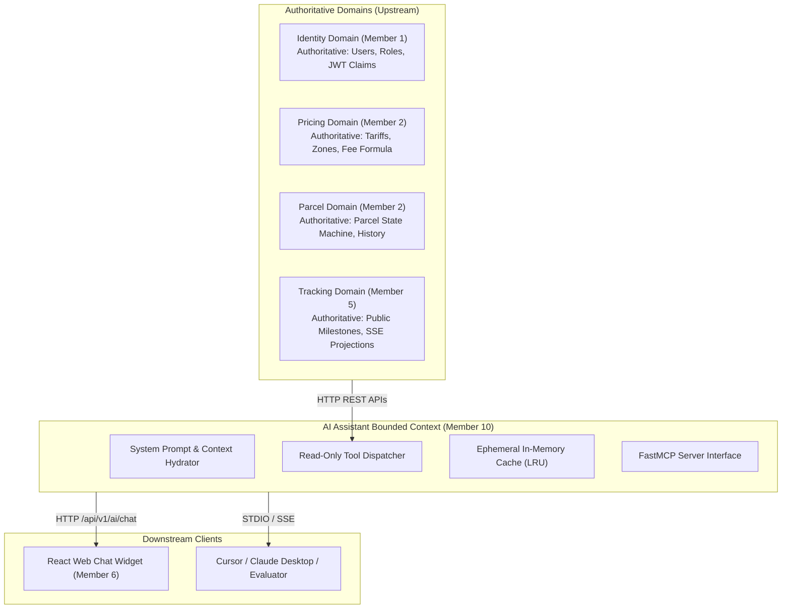

# Document 1 — Module Scope & Responsibility Specification

> **Status:** Draft / Proposed (For Review in Team Meeting 2)  
> **Author:** Member 10 — AI Delivery Assistant (Service & MCP) & Cross-Workflow Quality Coordination  
> **Target Production Locations:** `services/ai-assistant/` (AI Service) & `tests/e2e/` (Cross-Workflow Quality Suite)  
> **Key Upstream Dependencies:** Member 1 (Auth), Member 2 (Pricing/Parcels), Member 5 (Tracking), Member 8 (Messaging), Member 9 (DevOps)  
> **Key Downstream Consumers:** Members 6 & 7 (React Frontend Web UI), External MCP Clients (Cursor, Claude Desktop, Evaluators)

---

## 1. Executive Summary & Purpose

Member 10 holds a dual mandate within the SwiftDrop engineering team:
1. **The AI Delivery Assistant & Model Context Protocol (MCP) Service:** A specialized, independently deployable Python/FastAPI microservice providing natural language parcel tracking, dynamic shipping fee estimation, customer delivery history lookup, and pre-filled booking navigation cards. It exposes these tools over both HTTP REST and standardized Model Context Protocol (MCP) interfaces (**+5 Bonus Marks**).
2. **Cross-Workflow Quality Coordination & End-to-End Testing Suite:** Designing, implementing, and coordinating the end-to-end integration and automated verification framework (`tests/e2e/`) that validates multi-actor workflows across all 10 members (Customer, Merchant, Courier, Dispatcher, and Security Isolation) for the **15-mark Testing & Live Demo rubric**.

This document formally establishes the architectural boundaries, ownership responsibilities, explicit exclusions, domain invariants, and asset ownership for both mandates.

---

## Part A: AI Delivery Assistant & Model Context Protocol (MCP) Service

### A.1 Business Problem & Purpose
Customers tracking shipments often encounter friction with rigid web forms, cryptic status codes, or memorizing alphanumeric tracking numbers. Similarly, customers inquiring about shipping rates between island-wide delivery zones require immediate, conversational answers before initiating a booking.

The **AI Delivery Assistant** solves this by:
- Answering parcel tracking inquiries using natural language, disambiguating active shipments when customers ask *"Where is my parcel?"* without a tracking code.
- Calculating precise shipping fees on demand and explaining the breakdown (base fare, weight surcharge) in friendly language.
- Providing an actionable 1-click bridge from a conversational quote to a pre-filled booking form.
- Exposing tools via the open **Model Context Protocol (MCP)** standard so external developer tools (Cursor, Claude Desktop) and autonomous agents can inspect parcel tracking and estimate tariffs.

---

### A.2 Functional Responsibilities

1. **Conversational API Gateway (`POST /api/v1/ai/chat`):**
   - Ingest customer messages, manage short-lived conversation sessions, and enforce input length hygiene (default max 1,000 characters).
   - Coordinate with any OpenAI-compatible provider (OpenRouter, NVIDIA NIM, OpenAI, Groq, local Ollama) using `AsyncOpenAI`.
   - Maintain an offline mock LLM adapter for deterministic CI testing without paid external API keys.
2. **Standardized Tool Calling & Dispatching (SRS FR-AI-007):**
   - Expose and execute the 4 approved read-only tools:
     - `estimate_shipping_fee(weight_kg, destination_zone_id, dimensions, service_type)`: Authoritative tariff calculation via Member 2's pricing engine.
     - `track_parcel_status(tracking_number)`: Public sanitized milestone delivery status lookup via Member 5 / Member 2.
     - `get_my_active_parcels()`: Retrieves active, in-flight shipments for the authenticated customer.
     - `explain_company_policies(topic_or_query)`: Grounded Q&A over company shipping guidelines and packaging restrictions.
3. **MCP Server Interface (`mcp_server.py`):**
   - Provide an official Model Context Protocol server via `FastMCP` exposing the exact same tools over an HTTP Server-Sent Events (SSE) dual-channel transport (`/api/v1/ai/mcp` + `/api/v1/ai/mcp/messages`) to external clients (Claude Desktop, Cursor).
4. **Structured Generative UI Action Protocol:**
   - Return structured `action` payloads (`NAVIGATE_BOOKING`, URL, `prefill_data`) so the React frontend can render 1-click interactive cards to navigate to `/portal/book` (with `/customer/book` supported as alias).
5. **Knowledge Base Grounding & Dynamic Policy Synchronization:**
   - Ground general company inquiries (prohibited goods, standard SLA transit times, packaging rules) using authoritative markdown policy data (`company_policies.md`).
   - **Dynamic System Configuration Overrides:** The assistant queries Member 7's approved `GET /api/v1/admin/system-configurations` endpoint (cached in-memory with a 5-minute TTL).
   - **Dynamic Precedence Invariant:** Whenever operational thresholds, rates, or limits in `GET /api/v1/admin/system-configurations` conflict with text in `company_policies.md`, the live API configuration takes absolute precedence.

---

### A.3 Explicit Exclusions (What the AI Service Must NEVER Own)

To protect system integrity, the AI Assistant service has strictly enforced non-responsibilities:
- **NO Direct Database Access:** The service possesses **zero SQL drivers, zero PostgreSQL connection strings, and zero direct database queries**. It communicates exclusively via approved HTTP REST endpoints.
- **NO Autonomous Mutation Authority:** The AI service cannot book parcels, change fees, cancel shipments, re-route deliveries, or update courier assignments. It is **100% read-only**.
- **NO Proprietary Pricing Logic:** The AI service does not calculate tariffs internally. All pricing logic belongs exclusively to Member 2's Pricing Engine (`POST /api/v1/pricing/quotes`).
- **NO Public PII Disclosure:** The AI service must never return recipient street addresses, recipient phone numbers, or sender personal details in public tracking queries.
- **NO Direct Persistent User Storage:** The AI service does not maintain a user database or authentication store. User identity is derived strictly from Bearer JWTs validated by Member 1's Identity service.

---

### A.4 Invariants Protected by the AI Service

1. **The Zero-Hallucination Invariant:**
   - The assistant must never invent, estimate, or hallucinate a parcel status, delivery timestamp, courier location, or shipping fee.
   - All factual operational data must originate from a successful, validated upstream tool execution. If a tool fails or returns `404 Not Found`, the assistant must output a deterministic, polite failure message.
2. **The Least-Privilege Execution Invariant:**
   - The LLM has access only to allowlisted read-only tools. Even if a prompt injection attack completely overrides the model's instructions, no write, update, or delete tool exists for the model to invoke.
3. **The Zero-AI Dependency Invariant:**
   - The Core SwiftDrop platform (Customer booking, tracking, dispatch, messaging) must operate with 100% functionality even if the AI Assistant service is completely offline or stopped.

---

### A.5 Bounded Context & Authoritative Data

- **Authoritative Data Owned:**
  - Ephemeral conversation turn cache (in-memory LRU, configurable TTL).
  - Model prompt templates, tool schema definitions, and system instructions.
  - Local static policy baseline (`company_policies.md`).
- **Data Borrowed (Non-Authoritative):**
  - Parcel tracking status (owned by Member 5 / Member 2).
  - Shipping fees and tariff calculations (owned by Member 2).
  - User identity and permissions (owned by Member 1).

---

## Part B: Cross-Workflow Quality & E2E Testing Framework

### B.1 Purpose & Role in Team Architecture
While Members 1 through 9 are each strictly responsible for writing unit and integration tests for their own components, **Member 10 coordinates system-wide verification across all 10 members**.

Member 10 designs, implements, and maintains the automated End-to-End (E2E) testing framework (`tests/e2e/`) to guarantee that all microservices, modular monolith components, message brokers, and frontends operate seamlessly as an integrated system, directly satisfying the **15-mark Testing & Live Demo rubric**.

---

### B.2 Functional Responsibilities of Quality Coordination

1. **Two-Tier E2E Automated Test Suite:**
   - **Tier 1 (Playwright Browser Tests - `tests/e2e/playwright/`):** Full-stack browser automation testing real user journeys in Chromium/WebKit, verifying UI state transitions, responsive behavior, and capturing screenshots/video traces for the final presentation.
   - **Tier 2 (Headless API & Messaging Tests - `tests/e2e/api/`):** Automated Pytest + HTTPX + Pika test suite verifying asynchronous outbox publication, RabbitMQ message consumption, and merchant webhook delivery with retry/DLQ validation.
   - **Tier 3 (Multi-Tenant Webhook Test Artifact - `mock-webhook:9999`):** Containerized mock webhook receiver with multi-tenant endpoints and a real-time visual HTML dashboard (`/dashboard`) for live demonstration evidence and automated Playwright screenshot assertions.
2. **Enforcement of the `data-testid` Frontend Standard:**
   - Maintain and audit the frontend `data-testid` selector contract with Members 6 & 7 to ensure automated browser tests never break due to CSS or Tailwind changes.
3. **Verification of Cross-Cutting Security Invariants:**
   - Automate IDOR tests: Verify Customer A cannot view or tamper with Customer B's shipments.
   - Automate Courier isolation tests: Verify Courier 2 cannot view or deliver parcels assigned to Courier 1.
   - Automate State Machine transition tests: Verify illegal status jumps (e.g., `CREATED` $\to$ `DELIVERED`) are rejected with `409 Conflict` or `422 Unprocessable Entity`.
4. **Presentation & Live Demo Rehearsal Coordination:**
   - Coordinate the live demonstration scripts for the 4 core workflows (Scenario 1A Web Customer, Scenario 2 Merchant Webhook, Scenario 3 Dispatcher/Courier Run, Scenario 4 AI Assistant & MCP) to ensure zero failures during evaluation.

---

### B.3 Explicit Exclusions for Quality Coordination

- **Not the Sole Unit Tester:** Member 10 does **not** write internal unit tests for Member 1's JWT logic, Member 2's tariff mathematics, Member 3's SQL queries, or Member 8's broker connection logic. Each member owns their own unit and integration test suites.
- **No Manual-Only Testing:** All cross-workflow verification must be backed by repeatable, automated scripts in `tests/e2e/`.

---

## 2. Asset & Resource Ownership Matrix

| Resource Category | Member 10 Exclusive Ownership | Shared / Upstream Ownership |
| :--- | :--- | :--- |
| **Source Code Directories** | `services/ai-assistant/` `tests/e2e/` | `core-api/` (Members 1, 2, 3, 4, 7, 8) `services/tracking/` (Member 5) `web/` (Members 6, 7) |
| **HTTP Endpoints (Exposed)** | `POST /api/v1/ai/chat` `GET /api/v1/ai/mcp` `POST /api/v1/ai/mcp/messages` `GET /health/live` `GET /health/ready` `GET /metrics` | `/api/v1/pricing/*` (Member 2) `/api/v1/tracking/*` (Member 5) `/api/v1/parcels/*` (Member 2) `/api/v1/admin/system-configurations` (Member 7) |
| **Protocols & Interfaces** | FastMCP SSE Dual-Channel Protocol (`mcp_server.py`) | Traefik Ingress Gateway routing (Member 7/9) |
| **Database Tables** | **NONE** (Zero database ownership) | PostgreSQL tables owned by Members 1, 2, 3, 4, 8 |
| **Message Queues** | Read-only test listener on `swiftdrop.events.topic` | RabbitMQ broker & Outbox Relay (Member 8) |
| **Configuration Files** | `services/ai-assistant/.env.example` `services/ai-assistant/Dockerfile` | Root `docker-compose.yml` (Member 9) |
| **Test Fixtures & Suites** | `tests/e2e/playwright/` `tests/e2e/api/` `tests/fixtures/` | Unit tests in `core-api/*/tests/` (Members 1–4) |

---

## 3. Assumptions, Dependencies & Open Questions for Meeting 2

### Assumptions
1. All services run locally via `docker-compose up` with consistent network names (`core-api`, `tracking-api`, `rabbitmq`, `ai-assistant`).
2. An OpenAI-compatible API key (OpenRouter, NVIDIA NIM, OpenAI, or local Ollama) is supplied via environment variables for live AI features, while automated CI builds run using the offline mock adapter.
3. The React frontend team (Members 6 & 7) will adopt the standardized `data-testid` attributes specified in `team-integration-and-handoff-guide.md`.

### Open Questions for Team Meeting 2
1. **To Member 2 (Pricing):** Will `POST /api/v1/pricing/quotes` accept zone strings (e.g. `ZONE_COLOMBO_01`) directly, or does it require postal codes?
2. **To Member 5 (Tracking):** Can we confirm that `GET /api/v1/tracking/public/{id}` masks recipient phone numbers and street addresses at the API gateway level before reaching any client?
3. **To Member 7 & 1 (Admin/Core API):** Can Core API provide the lightweight `GET /api/v1/system/operational-rules` endpoint so the AI assistant can dynamically reflect operating hours and attempt limits set by admins?
