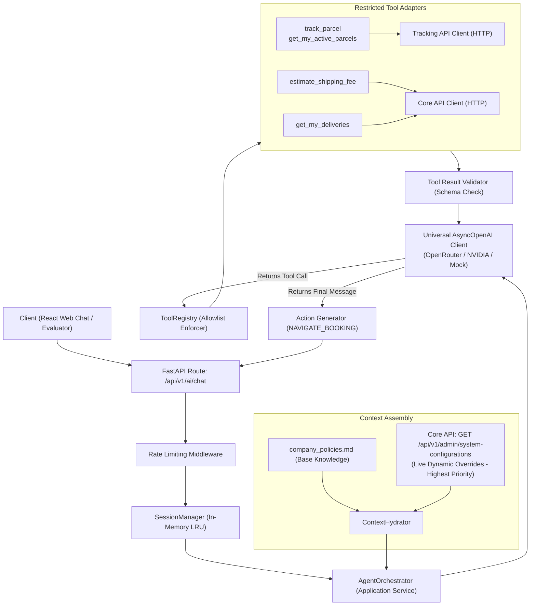
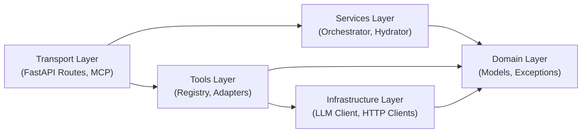
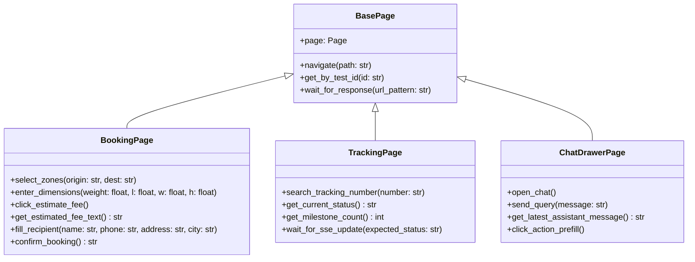
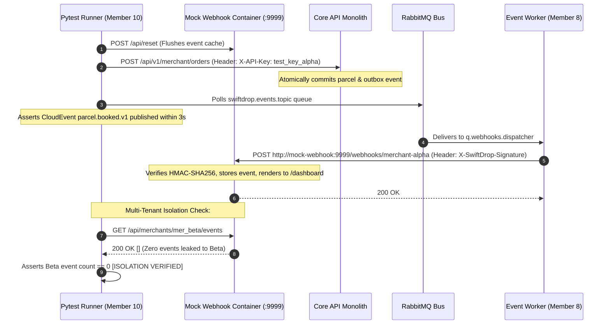

# Document 3 — Internal Architecture & Design Specification

> **Status:** Draft / Proposed (For Review in Team Meeting 2)  
> **Author:** Member 10 — AI Delivery Assistant (Service & MCP) & Cross-Workflow Quality Coordination  
> **Target Production Locations:** `services/ai-assistant/` & `tests/e2e/`  
> **Key Dependencies:** Python 3.11, FastAPI, Pydantic v2, FastMCP, AsyncOpenAI, Playwright, Pytest

---

## 1. Overview & Architectural Principles

This document defines the internal architecture, package structure, Domain-Driven Design (DDD) concepts, dependency rules, design patterns, and scaling strategies for Member 10's two mandates:
- **Part A:** The internal design of the Python/FastAPI **AI Delivery Assistant & FastMCP Server** (`services/ai-assistant/`).
- **Part B:** The internal design of the **Cross-Workflow Quality & Automated E2E Testing Framework** (`tests/e2e/`).

Both designs adhere to clean separation of concerns, zero hardcoded secrets, deterministic offline execution for CI, and high maintainability.

---

## Part A: AI Delivery Assistant & FastMCP Service Architecture

### A.1 Package Structure & Layered Organization

The AI service adopts Clean Architecture principles, isolating pure business domain representations from HTTP transport, external LLM clients, and MCP protocols.

```text
services/ai-assistant/
├── app/
│   ├── __init__.py
│   ├── api/                         # Transport Layer (HTTP / REST)
│   │   ├── __init__.py
│   │   ├── routes_chat.py           # POST /api/v1/ai/chat
│   │   ├── routes_health.py         # GET /health/live, GET /health/ready, GET /metrics
│   │   └── routes_admin.py          # POST /api/v1/ai/admin/refresh-knowledge
│   ├── core/                        # Cross-Cutting Infrastructure
│   │   ├── __init__.py
│   │   ├── config.py                # Pydantic v2 Settings (environment variables)
│   │   ├── logging.py               # Structured JSON logger (PII sanitization)
│   │   └── rate_limiter.py          # In-memory token bucket / SlowAPI limiter
│   ├── domain/                      # Pure Domain Layer (Zero External I/O)
│   │   ├── __init__.py
│   │   ├── models.py                # ChatMessage, UserRole, SessionContext
│   │   ├── tool_contracts.py        # ToolCallRequest, ToolCallResult schemas
│   │   ├── actions.py               # ActionPayload (NAVIGATE_BOOKING, etc.)
│   │   └── exceptions.py            # Domain-specific exceptions
│   ├── services/                    # Application / Use Case Layer
│   │   ├── __init__.py
│   │   ├── agent_orchestrator.py    # Multi-turn prompt execution & tool dispatch
│   │   ├── context_hydrator.py      # Merges static markdown + dynamic DB rules
│   │   └── session_manager.py       # Manages in-memory LRU session window
│   ├── tools/                       # Tool Registry & Execution Adapters
│   │   ├── __init__.py
│   │   ├── registry.py              # Central ToolRegistry (reflection & allowlist)
│   │   ├── tool_tracking.py         # track_parcel & get_my_active_parcels
│   │   ├── tool_pricing.py          # estimate_shipping_fee
│   │   └── tool_history.py          # get_my_deliveries
│   └── infrastructure/              # External Adapters Layer
│       ├── __init__.py
│       ├── llm_client.py            # Universal AsyncOpenAI wrapper (OpenRouter/NVIDIA)
│       ├── mock_llm_client.py       # Offline deterministic LLM mock for CI
│       ├── core_api_client.py       # Async HTTP client for Core Monolith
│       ├── tracking_api_client.py   # Async HTTP client for Tracking Service
│       └── session_cache.py         # Thread-safe in-memory LRU cache
├── knowledge/                       # Static Fallback Knowledge
│   └── company_policies.md          # Version-controlled baseline policy
├── mcp_server.py                    # FastMCP Server (STDIO & SSE interface)
├── main.py                          # FastAPI application factory & lifespan
├── requirements.txt                 # Pinned Python dependencies
└── Dockerfile                       # Multi-stage non-root container
```

---

### A.2 Component Interaction & Data Flow Diagram



---

### A.3 Domain-Driven Design (DDD) Concepts in the AI Service

Even though the AI Assistant is a stateless conversational layer, it rigorously applies DDD patterns:

1. **Aggregate Root — `ConversationSession`:**
   - **Responsibility:** Owns the collection of conversation turns (`ChatMessage`), enforces maximum turn limits (5 turns), tracks token accumulation, and maintains active tool call references.
   - **Invariants Enforced:** A conversation cannot exceed max context limits; turn sequence must maintain strict user-assistant alternation.
2. **Value Objects:**
   - `UserPrompt`: Immutable value object wrapping raw user input, enforcing length caps ($\le 1,000$ characters) and sanitizing non-printable characters.
   - `ToolCallResult`: Strongly typed outcome of a tool execution containing status (`SUCCESS` / `FAILED`), execution timestamp, and sanitized data dictionary.
   - `ActionPayload`: Structured UI navigation instruction (`action_type`, `url`, `prefill_data`).
   - `TariffQuote`: Value object holding base fare, weight surcharge, currency, and zone identifiers.
3. **Domain Service — `ContextHydrator`:**
   - Stateless domain service responsible for synthesizing static markdown policies (`company_policies.md`) with dynamic operational rules fetched from Core API (`GET /api/v1/admin/system-configurations`) into a coherent, delimiter-wrapped system prompt, enforcing the dynamic precedence rule.
4. **Repository / Store Interface — `SessionStore`:**
   - Abstract interface for session persistence. Implemented via `InMemoryLRUSessionStore` with thread-safe locks and background TTL eviction.

---

### A.4 Dependency Direction & Layer Isolation Rules



- **Strict Import Prohibition:**
  - `domain/` must NEVER import `fastapi`, `httpx`, `openai`, `mcp`, or database libraries.
  - `tools/` must NEVER execute SQL queries or connect to internal monolithic Go structs. All communication must pass through `infrastructure/core_api_client.py` over HTTP.
  - `services/` must depend only on abstractions defined in `domain/`.

---

### A.5 Design Patterns Applied & Technical Justification

| Pattern | Location | Architectural Justification |
| :--- | :--- | :--- |
| **Strategy Pattern** | `infrastructure/llm_client.py` | Allows seamless switching between live OpenAI-compatible providers (OpenRouter, NVIDIA NIM, OpenAI, Groq) and the offline `MockLLMClient` for CI builds without modifying application code. |
| **Registry Pattern** | `tools/registry.py` | Decouples tool execution from the agent orchestrator. Tools self-register with schemas, input validation, and execution functions. Used jointly by FastAPI and FastMCP. |
| **Adapter Pattern** | `infrastructure/core_api_client.py` | Converts raw external JSON HTTP responses from Core API and Tracking API into strongly typed domain value objects. |
| **Interceptor / Decorator Pattern** | `core/rate_limiter.py` | Wraps API endpoints and tool executions with automatic rate-limit token consumption, request timing, and error mapping. |

---

### A.6 In-Memory Session Cache & Horizontal Scaling Strategy

1. **Stateless Service Architecture:**
   - The AI Assistant service stores **no authoritative business data**.
   - If a pod crashes or restarts in Kubernetes, no parcel, user, or financial data is lost.
2. **Session Memory Implementation:**
   - Sessions are keyed by `conversation_id` (UUIDv4 generated by the React client).
   - Handled via an in-memory thread-safe LRU cache with:
     - `AI_SESSION_TTL_MINUTES`: Default 15 minutes.
     - `AI_SESSION_MAX_ACTIVE`: Default 50 active sessions per pod.
3. **Horizontal Scaling in Kubernetes:**
   - Multiple replicas can run behind Traefik Gateway without requiring sticky sessions.
   - If a subsequent turn lands on a different pod, the React frontend passes the last 2 conversation turns in the request body, allowing the new pod to seamlessly resume context.

---

## Part B: Cross-Workflow Quality & E2E Test Suite Architecture

### B.1 Framework Architecture & Directory Structure

The E2E test framework (`tests/e2e/`) is written **100% in Python**, utilizing **`pytest-playwright`** for browser UI automation and **`pytest` + `httpx` + `pika`** for headless messaging verification. This unifies all testing under a single language, runtime, and fixture ecosystem:

```text
tests/e2e/
├── ui/                              # Tier 1: Full-Stack Browser UI Suite (Playwright Python)
│   ├── pages/                       # Page Object Model (POM) in Python
│   │   ├── base_page.py             # Shared navigation, wait helpers, get_by_test_id
│   │   ├── login_page.py            # Encapsulates login, Google auth simulation
│   │   ├── booking_page.py          # Encapsulates booking wizard, fee estimation, form entry
│   │   ├── tracking_page.py         # Encapsulates public tracking lookup, SSE milestones
│   │   ├── dispatch_page.py         # Encapsulates unassigned parcel table, courier assign
│   │   ├── courier_page.py          # Encapsulates courier runs, proof photo upload
│   │   └── chat_drawer_page.py      # Encapsulates AI chatbot drawer, action card clicks
│   ├── test_scenario_1a_customer.py # Pure Web Customer (NO AI BOT)
│   ├── test_scenario_3_courier.py   # Dispatch & Courier Proof flow
│   └── test_scenario_4_ai_bot.py    # AI Chatbot & 1-click pre-fill
├── api/                             # Tier 2: Headless Async & Broker Suite
│   ├── __init__.py
│   ├── test_merchant_webhooks.py    # Scenario 2: Merchant API order -> RabbitMQ -> Webhook
│   ├── test_security_idor.py        # Scenario 5: Cross-customer IDOR & Courier isolation
│   └── test_state_machine.py        # State transition invariant verification
├── fixtures/                        # Shared Seed Fixtures (Used by both UI & API tests)
│   ├── test_users.py                # Pre-seeded customer, courier, and dispatcher tokens
│   ├── webhook_receiver.py          # Embedded async HTTP receiver capturing webhook posts
│   └── sample_parcels.py            # Valid/invalid parcel dimensions and zone test data
├── conftest.py                      # Global Pytest fixtures (browser, page, api_client)
├── requirements-test.txt            # pytest, pytest-playwright, httpx, pika
└── pytest.ini                       # Pytest configuration
```

---

### B.2 Playwright Python Page Object Model (POM) Design

To insulate automated UI tests from DOM and styling refactors, every screen is encapsulated in a dedicated Python Page Object class:



- **Selector Rule:** Page Objects query elements using `self.page.get_by_test_id(...)` matching the contracts agreed in `team-integration-and-handoff-guide.md`. Direct XPath or CSS class selectors are strictly forbidden.

---

### B.3 Headless Async Testing Architecture (Scenario 2: Outbox & Webhooks)

Testing asynchronous flows requires verifying that events properly traverse the transactional outbox, RabbitMQ, and the Event Worker, with complete multi-tenant isolation and visual proof:



---

### B.4 FastMCP SSE Transport Dual-Channel Architecture

The FastMCP server (`mcp_server.py`) provides Model Context Protocol capabilities using Anthropic's official dual-channel HTTP/SSE transport pattern:
- **Channel 1 (Downstream):** `GET /api/v1/ai/mcp` establishes a persistent Server-Sent Events stream. The server emits an `endpoint` event containing a dedicated session URL (`/api/v1/ai/mcp/messages?session_id=<uuid>`).
- **Channel 2 (Upstream):** Client sends JSON-RPC tool executions via standard HTTP `POST /api/v1/ai/mcp/messages?session_id=<uuid>`.
- **Result Streaming:** The server executes the tool (via read-only Core API calls) and streams the JSON-RPC response back down Channel 1's open SSE connection.

---

## 2. Alternatives Considered & Architectural Trade-offs

| Decision Area | Selected Approach | Alternative Considered | Trade-off & Justification |
| :--- | :--- | :--- | :--- |
| **LLM Orchestration** | Standard `AsyncOpenAI` SDK with universal base URL | LangChain / LlamaIndex | LangChain introduces massive dependency churn, slow startup times, and complex abstractions for a service with only 4 tools. Direct SDK is fast, stable, and transparent. |
| **Session State** | In-memory LRU with client context fallback | Redis Cluster / PostgreSQL | Redis adds infrastructure overhead and deployment complexity. PostgreSQL violates DDD monolith boundaries. In-memory LRU is stateless, blazing fast, and horizontally scalable. |
| **Browser E2E Testing** | Playwright Python (`pytest-playwright`) | Playwright (TypeScript) / Cypress | Unifying E2E browser tests under Python allows 100% shared fixtures (`conftest.py`) with backend API tests, runs via a single `pytest` command, and eliminates `node_modules` overhead for Member 10 while retaining full Playwright trace/video recording. |
| **Async Broker Testing** | Containerized `mock-webhook:9999` with HTML Dashboard | Ephemeral localhost socket / CLI logs | Standalone container with multi-tenant endpoints and live dashboard visualizes dispatches, HMAC verification, and DLQ retries directly for live demo grading (15-mark rubric). |
| **MCP Protocol Transport** | Dual-Channel SSE + HTTP POST (`FastMCP`) | WebSockets / STDIO only | WebSockets require stateful proxying and protocol upgrade handling in Traefik. SSE + POST works over ordinary HTTP, supports standard `Authorization` headers, and traverses enterprise firewalls with zero friction. |

---

## 3. Review Checklist for Team Meeting 2

- [x] **Member 1 (Auth):** Confirm that the JWT payload contains `sub`, `role`, and `tenant_id` claims matching the Pydantic schemas in `domain/models.py`.
- [x] **Member 2 (Parcels/Pricing):** Review the `infrastructure/core_api_client.py` endpoint mappings for `/api/v1/pricing/quotes` and `/api/v1/parcels`.
- [x] **Members 6 & 7 (Frontend):** Confirm that the Page Object Model selectors in Section B.2 align with the agreed `data-testid` attributes.
- [x] **Member 9 (DevOps):** Confirm that the Dockerfile multi-stage build, non-root `USER 10001:10001`, and port `8000` integrate seamlessly into `docker-compose.yml`.
