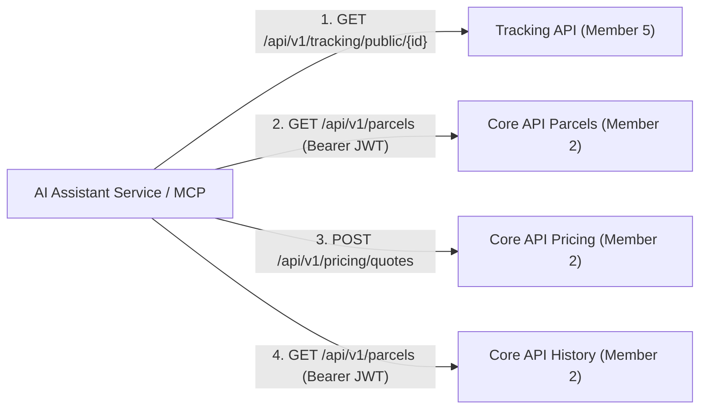
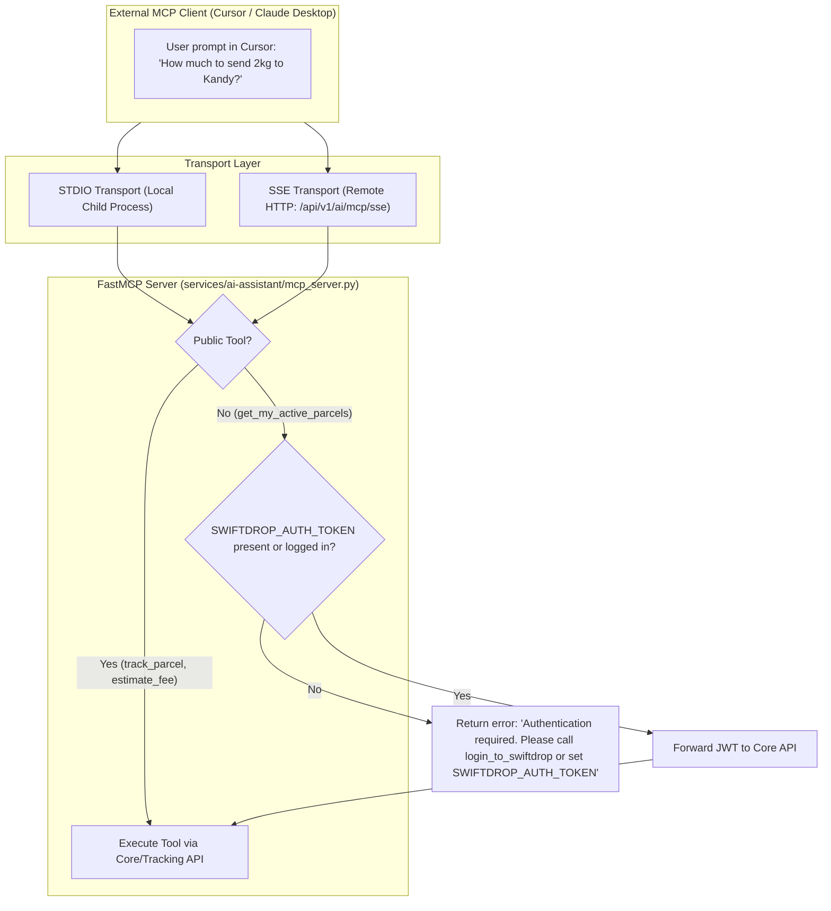

# Document 4 — Interface & Integration Contract: AI Assistant, MCP Tools & Playwright Standards

> **Status:** Draft / Proposed (For Review in Meeting 2)  
> **Author:** Member 10 — AI Assistant & Cross-Workflow Quality  
> **Target Module:** `services/ai-assistant/` & System-Wide E2E Testing (`tests/e2e/`)  
> **Upstream Contracts Consumed:** Member 1 (Auth), Member 2 (Pricing/Parcels), Member 5 (Tracking)  
> **Frontend Consumers:** Member 6 & Member 7 (React Frontend & UI Chatbot)

---

## 1. Overview & Architectural Role

The **AI Delivery Assistant** acts as an intelligent conversational layer and MCP server. It does not own persistent parcel state. Instead, it exposes:
1. **Chatbot HTTP API (`/api/v1/ai/chat`)**: Consumed by the React Web Frontend.
2. **MCP Server (`mcp_server.py`)**: Exposes standardized tools to external MCP clients (Cursor, Claude Desktop, autonomous evaluators).
3. **Upstream Consumed APIs**: Calls authoritative Core API and Tracking API REST endpoints.
4. **Playwright `data-testid` Contract**: Standardized selector contract for cross-workflow UI testing.

---

## 2. Upstream Core APIs Consumed by the AI Assistant & MCP Tools

The AI Assistant and MCP server execute the following HTTP calls against backend services:



---

### Endpoint 1: Public Parcel Tracking
- **Consumed By Tool:** `track_parcel(tracking_number: str)`
- **Owner Service:** Member 5 — Tracking API (`services/tracking`)
- **HTTP Method & Path:** `GET /api/v1/tracking/public/{trackingNumber}`
- **Authentication:** None (Public)
- **Headers:** `Accept: application/json`

#### Expected Request
- Path Parameter: `trackingNumber` (string, e.g., `"SD-20261021-04921"`)

#### Expected Success Response (`200 OK`)
```json
{
  "data": {
    "tracking_number": "SD-20261021-04921",
    "status": "OUT_FOR_DELIVERY",
    "status_description": "Parcel is out for delivery with the local courier.",
    "destination": {
      "city": "Kandy",
      "district": "Central Province"
    },
    "estimated_delivery": "2026-10-22T14:30:00Z",
    "milestones": [
      {
        "status": "CREATED",
        "timestamp": "2026-10-21T08:30:00Z",
        "description": "Parcel booking confirmed"
      },
      {
        "status": "PICKED_UP",
        "timestamp": "2026-10-21T11:00:00Z",
        "description": "Collected from sender"
      },
      {
        "status": "IN_TRANSIT",
        "timestamp": "2026-10-21T15:45:00Z",
        "description": "Processed at Colombo Sorting Facility"
      },
      {
        "status": "OUT_FOR_DELIVERY",
        "timestamp": "2026-10-22T08:15:00Z",
        "description": "Dispatched for final delivery in Kandy"
      }
    ]
  }
}
```

#### Expected Error Responses
- `404 Not Found`: Parcel not found or invalid format.
  ```json
  {
    "error": {
      "code": "PARCEL_NOT_FOUND",
      "message": "No shipment found matching tracking number SD-20261021-04921"
    }
  }
  ```
- `429 Too Many Requests`: Public query rate limit exceeded.

---

### Endpoint 2: Authenticated Active Shipments (Disambiguation)
- **Consumed By Tool:** `get_my_active_parcels()`
- **Owner Service:** Member 2 — Parcel Management (`core-api/internal/parcels`)
- **HTTP Method & Path:** `GET /api/v1/parcels` (with query parameter `status=active` or customer tenant scope)
- **Authentication:** Required (`Authorization: Bearer <customer_jwt>`)
- **Purpose:** Used when a logged-in user asks *"Where is my parcel?"* without specifying a tracking code.

#### Expected Request
- Headers: `Authorization: Bearer <jwt>`, `Accept: application/json`

#### Expected Success Response (`200 OK`)
```json
{
  "data": [
    {
      "id": "prcl_01HXYZ101",
      "tracking_number": "SD-20261021-04921",
      "status": "OUT_FOR_DELIVERY",
      "recipient_name": "Kasun Perera",
      "destination_city": "Kandy",
      "created_at": "2026-10-21T08:30:00Z"
    },
    {
      "id": "prcl_01HXYZ102",
      "tracking_number": "SD-20261022-09112",
      "status": "IN_TRANSIT",
      "recipient_name": "Nimal Silva",
      "destination_city": "Galle",
      "created_at": "2026-10-22T09:15:00Z"
    }
  ]
}
```

#### Expected Error Responses
- `401 Unauthorized`: Token missing or expired.
- `403 Forbidden`: Caller lacks customer role.

---

### Endpoint 3: Delivery Fee Estimation
- **Consumed By Tool:** `estimate_shipping_fee(...)`
- **Owner Service:** Member 2 — Pricing Engine (`core-api/internal/pricing`)
- **HTTP Method & Path:** `POST /api/v1/pricing/quotes`
- **Authentication:** None (Publicly callable for quoting)
- **Headers:** `Content-Type: application/json`, `Accept: application/json`

#### Expected Request Body
```json
{
  "origin_zone_id": "ZONE_COLOMBO_01",
  "destination_zone_id": "ZONE_KANDY_01",
  "actual_weight_kg": 2.5,
  "length_cm": 25.0,
  "width_cm": 15.0,
  "height_cm": 10.0
}
```

#### Expected Success Response (`200 OK`)
```json
{
  "data": {
    "currency": "LKR",
    "fee_cents": 65000,
    "base_fee_cents": 35000,
    "weight_surcharge_cents": 20000,
    "volumetric_surcharge_cents": 10000,
    "origin_zone_id": "ZONE_COLOMBO_01",
    "destination_zone_id": "ZONE_KANDY_01",
    "estimated_transit_days": 1,
    "pricing_version": "v1.0"
  }
}
```

#### Expected Error Responses
- `400 Bad Request`: Negative weight or missing required zones.
- `422 Unprocessable Entity`: Unknown or unsupported zone codes.

---

### Endpoint 4: Authenticated Customer Delivery History
- **Consumed By Tool:** `get_my_deliveries(status_filter: str = None)`
- **Owner Service:** Member 2 — Parcel Management (`core-api/internal/parcels`)
- **HTTP Method & Path:** `GET /api/v1/parcels`
- **Authentication:** Required (`Authorization: Bearer <customer_jwt>`)
- **Query Parameters:** `?status=DELIVERED&page=1&per_page=10`

#### Expected Success Response (`200 OK`)
```json
{
  "data": [
    {
      "id": "prcl_01HXYZ001",
      "tracking_number": "SD-20261015-00129",
      "status": "DELIVERED",
      "delivered_at": "2026-10-16T16:20:00Z",
      "destination_city": "Colombo",
      "fee_paid": "450.00",
      "currency": "LKR"
    }
  ],
  "meta": {
    "page": 1,
    "per_page": 10,
    "total_items": 1
  }
}
```

---

### Endpoint 5: Operational System Configurations & Dynamic Overrides
- **Consumed By:** AI Assistant Service Context Hydrator
- **Owner Service:** Member 7 / Member 1 — Admin Context (`core-api/internal/admin`)
- **HTTP Method & Path:** `GET /api/v1/admin/system-configurations`
- **Authentication:** Required (`Authorization: Bearer <admin_or_service_token>`)
- **Purpose:** Supplies live operational thresholds, weight limits, COD caps, and fuel surcharges to override static text in `company_policies.md`.

#### Expected Success Response (`200 OK`)
```json
{
  "data": {
    "max_parcel_weight_kg": 25.0,
    "max_cod_amount_cents": 3500000,
    "fuel_surcharge_percentage": 4.5,
    "sla_express_hours": 24,
    "same_day_cutoff": "14:00",
    "updated_at": "2026-10-26T10:00:00Z"
  }
}
```

> **Dynamic Precedence Invariant:** Whenever operational quantities, rates, or limits in `GET /api/v1/admin/system-configurations` conflict with text in `company_policies.md`, the live API configuration takes absolute precedence.

---

## 3. Public & Internal APIs Exposed by the AI Assistant

The AI Assistant service exposes two HTTP endpoints:

### 3.1 Conversational Chat Gateway: `POST /api/v1/ai/chat`
- **Purpose:** Processes user queries, manages context, triggers tools, and returns humanized answers with structured UI navigation actions.
- **Authentication:** Optional. If caller is logged in, pass `Authorization: Bearer <jwt>`.
- **Headers:** `Content-Type: application/json`

#### Request Payload Schema
```json
{
  "message": "How much does it cost to send a 2.5 kg box from Colombo to Kandy?",
  "conversation_id": "conv_01HXYZ99"
}
```

#### Success Response Payload (`200 OK`)
```json
{
  "data": {
    "conversation_id": "conv_01HXYZ99",
    "message": "Sending a 2.5 kg package from Colombo to Kandy is estimated at LKR 650.00 (Base fare LKR 350.00 + weight surcharge LKR 300.00). Delivery typically takes 1 business day.\n\nWould you like to book this delivery now?",
    "tools_used": ["estimate_shipping_fee"],
    "action": {
      "type": "NAVIGATE_BOOKING",
      "label": "Book this Delivery",
      "url": "/portal/book?origin=WESTERN_ZONE&dest=CENTRAL_ZONE&weight=2.5&fee=650.00",
      "prefill_data": {
        "origin_zone": "WESTERN_ZONE",
        "destination_zone": "CENTRAL_ZONE",
        "weight_kg": 2.5,
        "estimated_fee": 650.00,
        "currency": "LKR"
      }
    }
  }
}
```

#### Error Envelopes
- `400 Bad Request`: Message empty or exceeds maximum character length (1,000 chars).
- `429 Too Many Requests`: Rate limit exceeded (Default: 20 requests/minute matching Traefik ingress limiter).
- `503 Service Unavailable`: LLM provider unreachable (safe graceful failure envelope).

---

### 3.2 FastMCP Dual-Channel SSE Endpoints
The AI Assistant exposes Anthropic Model Context Protocol (MCP) capabilities via Server-Sent Events (SSE) and HTTP POST:

#### Channel 1 (Downstream): `GET /api/v1/ai/mcp/sse`
- **Purpose:** Opens a persistent Server-Sent Events stream for external MCP clients (Claude Desktop, Cursor).
- **Headers:** `Accept: text/event-stream`, optional `Authorization: Bearer <jwt_or_api_key>`
- **Response Event (`endpoint`):**
  ```http
  event: endpoint
  data: /api/v1/ai/mcp/messages?session_id=7d4e9f1a-b3c2-4a55-9128-48b29f0c1122
  ```

#### Channel 2 (Upstream): `POST /api/v1/ai/mcp/messages?session_id=<uuid>`
- **Purpose:** Receives JSON-RPC 2.0 tool requests (`tools/list`, `tools/call`).
- **Headers:** `Content-Type: application/json`
- **Payload Example:**
  ```json
  {
    "jsonrpc": "2.0",
    "id": 1,
    "method": "tools/call",
    "params": {
      "name": "estimate_shipping_fee",
      "arguments": {
        "weight_kg": 3.0,
        "destination_zone_id": "ZONE_CP_KANDY",
        "dimensions": { "length_cm": 30, "width_cm": 20, "height_cm": 10 },
        "service_type": "STANDARD"
      }
    }
  }
  ```
- **Delivery:** FastMCP executes the read-only Core API tool call and streams the JSON-RPC response back down Channel 1's open SSE connection.

---

### 3.3 Cache Flush / Admin Flush: `POST /api/v1/ai/admin/refresh-knowledge`
- **Purpose:** Optional endpoint for administrators or integration tests to manually flush in-memory policy and configuration caches.
- **Authentication:** Internal Service Token Header (`Authorization: Bearer <AI_SERVICE_ROLE_TOKEN>`)
- **Headers:** `Content-Type: application/json`

#### Success Response (`200 OK`)
```json
{
  "data": {
    "status": "CACHE_INVALIDATED",
    "message": "In-memory knowledge cache cleared. Next query will re-fetch latest policy."
  }
}
```

---

## 4. MCP Server Tool Registry & Client Connection Architecture (`mcp_server.py`)

The Model Context Protocol (MCP) server allows external AI developer tools (Cursor IDE, Claude Desktop, and autonomous agents) to connect directly to SwiftDrop's tools (**+5 Bonus Marks**).

### 4.1 Connection Modes & Authentication Model



#### Authentication Rules:
1. **Public Tools (`track_parcel`, `estimate_shipping_fee`):**
   - **No login or credentials required.**
   - Evaluators can immediately test parcel tracking or tariff estimation in Cursor or Claude Desktop without creating an account.
2. **Authenticated Tools (`get_my_active_parcels`, `get_my_deliveries`):**
   - Require a customer JWT. The MCP client can provide it in two ways:
     - **Option A (Environment Variable):** Set `"SWIFTDROP_AUTH_TOKEN": "jwt_..."` in the MCP client config.
     - **Option B (Conversational Login Tool):** Invoke `login_to_swiftdrop(email, password)` directly inside the chat conversation. The MCP server stores the session token in memory for subsequent tool calls.

---

### 4.2 Client Configuration Snippets

#### 1. Claude Desktop Configuration (`claude_desktop_config.json`):
```json
{
  "mcpServers": {
    "swiftdrop": {
      "command": "python",
      "args": ["E:/Projects/SwiftDrop/services/ai-assistant/mcp_server.py"],
      "env": {
        "CORE_API_URL": "http://localhost:8080",
        "TRACKING_API_URL": "http://localhost:8081",
        "SWIFTDROP_AUTH_TOKEN": ""
      }
    }
  }
}
```

#### 2. Cursor IDE Configuration (`.cursor/mcp.json` or Global Settings):
```json
{
  "mcpServers": {
    "swiftdrop": {
      "command": "python",
      "args": ["services/ai-assistant/mcp_server.py"],
      "env": {
        "CORE_API_URL": "http://localhost:8080",
        "TRACKING_API_URL": "http://localhost:8081"
      }
    }
  }
}
```

---

### 4.3 Exposed Tool Manifests (JSON-RPC Schema)

The FastMCP server exposes the 4 official tools mandated by SRS **FR-AI-007** conforming to the Model Context Protocol schema:

```json
[
  {
    "name": "estimate_shipping_fee",
    "description": "Calculate authoritative delivery fee between zones based on weight, dimensions, and service type. Does not require login.",
    "inputSchema": {
      "type": "object",
      "properties": {
        "weight_kg": {
          "type": "number",
          "description": "Package gross weight in kilograms"
        },
        "destination_zone_id": {
          "type": "string",
          "description": "Destination zone ID (e.g., ZONE_COLOMBO, ZONE_KANDY)"
        },
        "dimensions": {
          "type": "object",
          "properties": {
            "length_cm": { "type": "number" },
            "width_cm": { "type": "number" },
            "height_cm": { "type": "number" }
          }
        },
        "service_type": {
          "type": "string",
          "enum": ["STANDARD", "EXPRESS"],
          "default": "STANDARD"
        }
      },
      "required": ["weight_kg", "destination_zone_id"]
    }
  },
  {
    "name": "track_parcel_status",
    "description": "Look up public, sanitized tracking milestone history for a tracking number. Does not require login.",
    "inputSchema": {
      "type": "object",
      "properties": {
        "tracking_number": {
          "type": "string",
          "description": "Tracking number (e.g. SD-20261026-00001)"
        }
      },
      "required": ["tracking_number"]
    }
  },
  {
    "name": "get_my_active_parcels",
    "description": "Retrieve in-flight active parcels for the authenticated customer or merchant. Requires Bearer JWT or parcels:read scoped API key.",
    "inputSchema": {
      "type": "object",
      "properties": {}
    }
  },
  {
    "name": "explain_company_policies",
    "description": "Query company shipping rules, prohibited goods, packaging guidelines, COD limits, and claims procedures.",
    "inputSchema": {
      "type": "object",
      "properties": {
        "topic_or_query": {
          "type": "string",
          "description": "Policy topic (e.g. 'prohibited items', 'packaging rules', 'cash on delivery limit')"
        }
      },
      "required": ["topic_or_query"]
    }
  }
]
```
```

---

## 5. Frontend Integration Contract: Playwright `data-testid` Standards

To enable full-stack browser E2E testing with **Playwright** without flakiness from CSS/Tailwind changes, **Members 6 and 7 must attach the following standard `data-testid` attributes** to interactive React components:

### 5.1 AI Chatbot Widget Elements (`web/src/features/chat/`)
| Element | `data-testid` | Description |
| :--- | :--- | :--- |
| Chat Toggle Button | `ai-chat-toggle-btn` | Button that opens/closes the floating chat drawer |
| Chat Input Field | `ai-chat-input` | Textarea / input for typing user queries |
| Chat Submit Button | `ai-chat-send-btn` | Button that submits the message |
| Assistant Message Bubble | `ai-chat-message-assistant` | Container element for AI responses |
| Deep-Link Action Button | `ai-chat-action-btn` | Button rendering pre-filled navigation actions |

### 5.2 Customer Booking Wizard (`web/src/features/customer-merchant/`)
| Element | `data-testid` | Description |
| :--- | :--- | :--- |
| Origin Zone Select | `booking-origin-zone-select` | Dropdown for sender origin zone |
| Destination Zone Select | `booking-dest-zone-select` | Dropdown for recipient destination zone |
| Parcel Weight Input | `booking-weight-input` | Number input for weight in kg |
| Estimate Fee Button | `booking-estimate-btn` | Button triggering fee calculation |
| Displayed Estimated Fee | `booking-estimated-fee-display` | Text element displaying the calculated fee |
| Recipient Name Input | `booking-recipient-name-input` | Text input for recipient |
| Recipient Address Input | `booking-recipient-address-input` | Text input for delivery address |
| Confirm Booking Button | `booking-submit-btn` | Button submitting the parcel creation |
| Tracking Number Badge | `booking-success-tracking-number` | Displays generated tracking number |

### 5.3 Public Tracking Page (`web/src/features/tracking/`)
| Element | `data-testid` | Description |
| :--- | :--- | :--- |
| Tracking Input Field | `public-tracking-input` | Input for searching tracking number |
| Search Tracking Button | `public-tracking-search-btn` | Button to execute lookup |
| Parcel Status Badge | `public-tracking-status-badge` | Displays current status (e.g. `OUT_FOR_DELIVERY`) |
| Milestone Timeline List | `public-tracking-timeline` | Container element for status milestones |

### 5.4 Dispatcher & Courier Views (`web/src/features/dispatcher-admin/`)
| Element | `data-testid` | Description |
| :--- | :--- | :--- |
| Unassigned Parcels Table | `dispatch-unassigned-table` | Table listing unassigned shipments |
| Courier Select Dropdown | `dispatch-courier-select` | Courier selector for parcel assignment |
| Assign Parcel Button | `dispatch-assign-btn` | Button confirming courier assignment |
| Courier Daily Route Table | `courier-assignments-table` | Courier view of assigned parcels |
| Status Update Select | `courier-status-select` | Dropdown to advance parcel state |
| Proof File Upload Input | `courier-proof-file-input` | File input for photo of delivery |
| Submit Proof Button | `courier-submit-proof-btn` | Button finalizing delivery with proof |

---

### 5.5 Multi-Tenant Mock Webhook Receiver Endpoints (`mock-webhook:9999`)

The containerized test artifact exposes the following endpoints for automated E2E testing and live demo verification:

| Method | Path | Caller | Description |
| :--- | :--- | :--- | :--- |
| `POST` | `/webhooks/merchant-alpha` | Event Worker | Receives CloudEvents for Merchant Alpha (`whsec_alpha_...`). Responds `200 OK`. |
| `POST` | `/webhooks/merchant-beta` | Event Worker | Receives CloudEvents for Merchant Beta (`whsec_beta_...`). Responds `200 OK`. |
| `POST` | `/webhooks/merchant-chaos` | Event Worker | Injected failure endpoint. Responds `500 Internal Error` to verify worker retry backoff and DLQ routing (`swiftdrop.dlq`). |
| `GET` | `/dashboard` | Browser | Auto-refreshing visual HTML dashboard rendering captured events, HMAC verification badges, and isolation status. |
| `GET` | `/api/events` | Playwright Runner | Returns JSON array of all captured events across all tenants. |
| `GET` | `/api/merchants/{id}/events` | Playwright Runner | Returns JSON array of events scoped to a specific tenant for programmatic isolation assertions. |
| `POST` | `/api/reset` | Test Runner Fixture | Clears captured events and resets counters between test suites. |

---

## 6. Review Checklist & Open Questions

- [x] **Member 2 (Pricing):** Standardized on `POST /api/v1/pricing/quotes` with integer `fee_cents`.
- [x] **Member 4 (Merchants):** Standardized on singular `POST /api/v1/merchant/orders` and `parcels:read` scoped API keys for external MCP clients.
- [x] **Member 5 (Tracking):** Confirmed public endpoint `GET /api/v1/tracking/public/{trackingNumber}` masks PII.
- [x] **Member 7 (Gateway/Admin):** Confirmed Traefik `PathPrefix('/api/v1/ai')` routes REST and MCP SSE; live configurations queried via `GET /api/v1/admin/system-configurations`.
- [x] **Member 8 (Events):** Event names aligned to `parcel.booked.v1`; queue `q.webhooks.dispatcher`; DLQ `swiftdrop.dlq`; compressed retries via `WEBHOOK_RETRY_INTERVALS_MS=500,1000,2000`; SSRF test flags `WEBHOOK_ALLOW_INSECURE_HTTP=true` and `WEBHOOK_ALLOWED_HOSTS=mock-webhook,localhost`.
- [x] **Member 9 (DevOps):** Standalone `mock-webhook:9999` container added to Compose; `make up` and `make seed` standardized.
