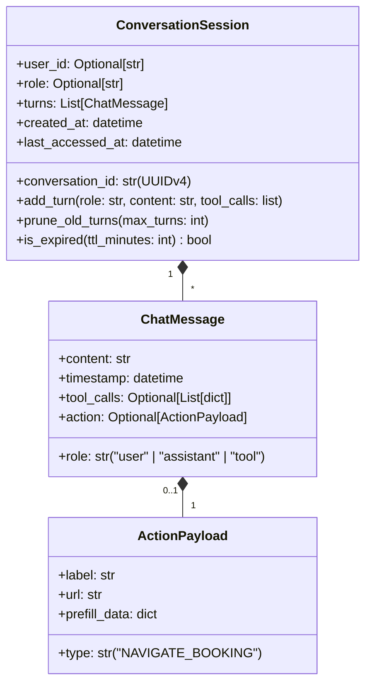

# Document 5 — Data & Persistence Specification

> **Status:** Draft / Proposed (For Review in Team Meeting 2)  
> **Author:** Member 10 — AI Delivery Assistant (Service & MCP) & Cross-Workflow Quality Coordination  
> **Target Production Locations:** `services/ai-assistant/` & `tests/e2e/`  
> **Authoritative Persistence:** PostgreSQL (Core Monolith); In-Memory Ephemeral Cache (AI Service)

---

## 1. Executive Summary & Storage Philosophy

This document defines the data models, persistence boundaries, caching strategies, and data lifecycle for Member 10's two mandates:
- **Part A (AI Delivery Assistant & FastMCP Service):** Governed by the **Zero Direct Database Access Invariant** (`AGENTS.md`). The service owns zero persistent relational tables, maintaining only ephemeral, short-lived session context in memory, with authoritative operational policies fetched over REST from Core API.
- **Part B (Cross-Workflow Quality & E2E Testing Framework):** Defines the database seed data contracts, dynamic test fixture factories, and ephemeral test state management required to run automated Playwright and Pytest verification without polluting production databases.

---

## Part A: AI Assistant Data Models, Caching & Privacy

### A.1 Relational Database Ownership & Boundaries

| Service Tier | PostgreSQL Access Level | Tables Owned | Justification |
| :--- | :--- | :--- | :--- |
| **AI Assistant (`services/ai-assistant/`)** | **NONE (Zero DB Access)** | **None** | Strictly prohibited from opening PostgreSQL connections. Decoupled from database migrations and connection pool limits. |
| **Core Monolith (`core-api/internal/admin`)** | Authoritative Persistence | `system_policies`, `system_configurations` | Admin module stores authoritative policy versions on behalf of the company and AI assistant. |

---

### A.2 Core API Schema Specification for Company Policies

Although the AI Assistant does not own PostgreSQL tables, it requires Member 1 / Member 7 to provide the following migration in `core-api/migrations/` to store dynamic company rules:

#### Table: `system_policies`
```sql
CREATE TABLE IF NOT EXISTS system_policies (
    id VARCHAR(36) PRIMARY KEY,
    version VARCHAR(20) NOT NULL UNIQUE,
    markdown_content TEXT NOT NULL,
    operating_hours VARCHAR(100) NOT NULL DEFAULT 'Monday - Saturday 08:00 - 18:00',
    same_day_cutoff VARCHAR(10) NOT NULL DEFAULT '14:00',
    max_delivery_attempts INT NOT NULL DEFAULT 3,
    is_active BOOLEAN NOT NULL DEFAULT TRUE,
    updated_by VARCHAR(36) REFERENCES users(id),
    created_at TIMESTAMPTZ NOT NULL DEFAULT NOW(),
    updated_at TIMESTAMPTZ NOT NULL DEFAULT NOW()
);

-- Index for instant retrieval of active policy
CREATE INDEX idx_system_policies_active ON system_policies(is_active) WHERE is_active = TRUE;
```

#### Data Dictionary:
- `id`: Unique **UUIDv7** identifier (time-ordered, millisecond-prefixed). Unlike random UUIDv4, UUIDv7 prevents PostgreSQL B-tree index fragmentation and page splits by ensuring chronological sequential inserts.
- `version`: Human-readable version tag (e.g., `"v1.4"`).
- `markdown_content`: Full markdown document containing prohibited items, packing rules, and service guidelines.
- `operating_hours`: Human-readable operating schedule.
- `same_day_cutoff`: 24-hour cutoff time for same-day dispatch.
- `max_delivery_attempts`: Maximum delivery tries before parcel is marked `RETURNED` (default: 3).
- `is_active`: Boolean flag indicating the currently active policy (only one row is `TRUE`).

---

### A.3 In-Memory Ephemeral Session Store (RAM Only)

The AI Assistant maintains multi-turn conversation context in local process memory using a thread-safe Least Recently Used (LRU) cache.



#### Session Eviction & Memory Bounds:
- **Maximum Active Sessions (`AI_SESSION_MAX_ACTIVE`):** Default `50` concurrent sessions per container replica. When the 51st session arrives, the least-recently accessed session is evicted from RAM.
- **Session Time-To-Live (`AI_SESSION_TTL_MINUTES`):** Default `15` minutes. Inactive sessions older than 15 minutes are garbage collected.
- **Turn Cap:** Each session stores at most **5 alternating turns** (10 messages). Older turns are trimmed to prevent prompt token bloat.

---

### A.3.1 Concrete In-Memory Data Scenarios

Below is an exact JSON snapshot of what an active `ConversationSession` holding `ChatMessage` and `ActionPayload` objects looks like in memory during a live 2-turn customer inquiry:

```json
{
  "conversation_id": "0192a6b2-9d3e-7a1b-8541-2c9e8a7b6543",
  "user_id": "usr_cust_001",
  "role": "CUSTOMER",
  "created_at": "2026-10-24T01:00:00Z",
  "last_accessed_at": "2026-10-24T01:02:15Z",
  "turns": [
    {
      "turn_id": 1,
      "role": "user",
      "content": "How much does it cost to send a 2.5 kg box from Colombo to Kandy?",
      "timestamp": "2026-10-24T01:00:00Z",
      "tool_calls": null,
      "action": null
    },
    {
      "turn_id": 2,
      "role": "assistant",
      "content": "Sending a 2.5 kg parcel from Colombo Central (ZONE_COLOMBO_01) to Kandy (ZONE_KANDY_01) is estimated at LKR 650.00 (Base fare LKR 350.00 + weight surcharge LKR 300.00). Delivery takes 1 business day.\n\nWould you like to book this delivery now?",
      "timestamp": "2026-10-24T01:00:02Z",
      "tool_calls": [
        {
          "name": "estimate_shipping_fee",
          "arguments": {
            "origin_zone_id": "ZONE_COLOMBO_01",
            "destination_zone_id": "ZONE_KANDY_01",
            "weight_kg": 2.5
          },
          "result": {
            "currency": "LKR",
            "fee_cents": 65000,
            "base_fee_cents": 35000,
            "weight_surcharge_cents": 30000,
            "estimated_transit_days": 1
          }
        }
      ],
      "action": {
        "type": "NAVIGATE_BOOKING",
        "label": "Proceed to Booking (Pre-filled)",
        "url": "/customer/book?origin=ZONE_COLOMBO_01&dest=ZONE_KANDY_01&weight=2.5&fee_cents=65000",
        "prefill_data": {
          "origin_zone_id": "ZONE_COLOMBO_01",
          "destination_zone_id": "ZONE_KANDY_01",
          "weight_kg": 2.5,
          "estimated_fee_cents": 65000,
          "currency": "LKR"
        }
      }
    },
    {
      "turn_id": 3,
      "role": "user",
      "content": "Can I put perfume or aerosol sprays in this package?",
      "timestamp": "2026-10-24T01:02:10Z",
      "tool_calls": null,
      "action": null
    },
    {
      "turn_id": 4,
      "role": "assistant",
      "content": "No, perfumes and aerosol sprays are strictly prohibited under SwiftDrop's Dangerous Goods & Prohibited Items policy because they contain pressurized, flammable liquids. Please remove these items before scheduling your dispatch.",
      "timestamp": "2026-10-24T01:02:12Z",
      "tool_calls": null,
      "action": null
    }
  ]
}
```

#### Breakdown of In-Memory Properties:
1. **`conversation_id`:** Time-ordered UUIDv7 generated on the first message.
2. **Turn 1 & 2 (Tool Execution + Action Card):**
   - The user query triggers tool execution (`estimate_shipping_fee`).
   - The tool call and its validated output are recorded in `tool_calls`.
   - The assistant emits both human text and the structured `action` object (`NAVIGATE_BOOKING`) with `prefill_data`. The React frontend renders this as a 1-click booking card.
3. **Turn 3 & 4 (Knowledge Base Grounding):**
   - The user asks about policy restrictions.
   - The assistant answers directly using its cached system prompt policy context (`company_policies.md`), without calling any tool, and correctly flags perfume as prohibited.
4. **Memory Pruning:** If the conversation reaches 6 turns, Turn 1 and Turn 2 are automatically evicted to maintain the strict 5-turn cap.

---

### A.4 In-Memory Policy Cache & Invalidation Protocol

To ground responses in real-time company rules without making an HTTP request to Core API on every single chat turn:
1. **Local Memory Storage:**
   - Active policy markdown text, operational constants, and `fetched_at` timestamp are cached in a Python singleton dictionary.
2. **Freshness & Refresh Strategy:**
   - **Background Polling:** Cached content expires after **30 minutes** (`POLICY_CACHE_TTL_MINUTES=30`). The next query asynchronously re-fetches `GET /api/v1/system/policies`.
   - **Instant Push Invalidation:** When an Admin edits or uploads a policy via the Admin Dashboard, Core API calls `POST /api/v1/ai/admin/refresh-knowledge` (secured via `X-Internal-Service-Key`), immediately purging the cache.
3. **Static Disk Fallback:**
   - If Core API is unreachable on container startup, the service loads `services/ai-assistant/knowledge/company_policies.md` from disk as a reliable baseline.

---

### A.5 Data Privacy, PII Redaction & Zero Retention

1. **Zero Database Storage of User Chats:**
   - Conversations are **never persisted to disk or database**. They live strictly in volatile memory.
   - Restarting or scaling down a pod permanently purges all active session memory.
2. **PII Masking at the Ingestion & Output Boundary:**
   - **Public Tracking Inquiries:** Public tracking responses mask recipient phone numbers and street addresses. Only city and milestone timestamps are retained in memory.
   - **Logs Sanitization:** Structured loggers strip JWT authorization headers, API keys, and sensitive user information before emitting stdout JSON logs.

---

## Part B: Cross-Workflow Quality & E2E Test Data Specification

### B.1 Seed Data Requirements (`seeds/dev_seed.sql`)

The automated E2E test suite requires Member 1, Member 2, and Member 3 to seed the following deterministic records in local and CI development databases:

#### 1. Deterministic User Accounts
| Role | Email | User ID | Password | Purpose |
| :--- | :--- | :--- | :--- | :--- |
| `CUSTOMER` | `customer.a@swiftdrop.lk` | `usr_cust_001` | `Password123!` | Primary customer booking & tracking journey |
| `CUSTOMER` | `customer.b@swiftdrop.lk` | `usr_cust_002` | `Password123!` | IDOR cross-tenant security verification |
| `COURIER` | `courier.kandy@swiftdrop.lk`| `usr_cour_001` | `Password123!` | Courier status advancement & proof upload |
| `COURIER` | `courier.colombo@swiftdrop.lk`| `usr_cour_002` | `Password123!` | Courier isolation verification |
| `DISPATCHER` | `dispatcher@swiftdrop.lk` | `usr_disp_001` | `Password123!` | Dispatcher unassigned board & assignment |
| `MERCHANT` | `merchant.store@swiftdrop.lk`| `usr_merch_001`| `Password123!` | B2B API order generation & webhook testing |
| `ADMIN` | `admin@swiftdrop.lk` | `usr_admin_001`| `Password123!` | Policy upload and tariff configuration |

#### 2. Deterministic Delivery Zones & Tariffs
```sql
INSERT INTO delivery_zones (id, code, name, base_surcharge_cents, enabled) VALUES
('ZONE_COLOMBO_01', 'COL_01', 'Colombo Central', 0, true),
('ZONE_KANDY_01', 'KDY_01', 'Kandy Central', 10000, true),
('ZONE_GALLE_01', 'GAL_01', 'Galle Fort', 8000, true)
ON CONFLICT (id) DO NOTHING;
```

---

### B.2 Dynamic Test Parcel Lifecycle & Collision Prevention

To prevent tests from conflicting with each other during concurrent or repeated test runs:
1. **Dynamic Parcel ID Generation:**
   - Every parcel created by a test receives a dynamic tracking code:
     $$\text{tracking\_number} = \text{"SD-TEST-" } + \text{current\_timestamp} + \text{"-" } + \text{random\_hex(4)}$$
     *(Example: `SD-TEST-1730000000-A4B1`)*
2. **Test Isolation:**
   - Tests do not assume hardcoded parcel IDs.
   - Playwright extracts the freshly generated tracking number from the confirmation card (`data-testid="booking-success-tracking-number"`) and passes it into subsequent tracking assertions.

---

### B.3 Ephemeral Webhook Test Receiver (Port 9999)

To test Scenario 2 (Merchant API $\to$ RabbitMQ $\to$ Webhook dispatch) without deploying an external cloud webhook endpoint:
1. The Pytest fixture spins up an embedded lightweight Python HTTP server (`http://localhost:9999/webhook`) during test execution.
2. The merchant test account sets its webhook URL to `http://localhost:9999/webhook`.
3. When the Event Worker dispatches the event, the mock receiver records:
   - Request headers (including `X-SwiftDrop-Signature`).
   - Request JSON body.
   - Arrival timestamp.
4. Pytest asserts that the event was received within 3 seconds and verifies the cryptographic HMAC signature against the merchant's secret key.
5. The mock server shuts down cleanly when the test finishes.

---

## 2. Review Checklist for Team Meeting 2

- [ ] **Member 1 (Auth):** Confirm that `seeds/dev_seed.sql` includes the test accounts in Section B.1 with matching passwords.
- [ ] **Member 2 & 7 (Pricing/Admin):** Confirm the zone IDs (`ZONE_COLOMBO_01`, `ZONE_KANDY_01`, `ZONE_GALLE_01`) in the `delivery_zones` table.
- [ ] **Member 7 & 1 (Admin/Core API):** Confirm that the `system_policies` table schema in Section A.2 will be included in the Core API database migrations.
