# SwiftDrop — Cross-Member Integration & Developer Handoff Guide

> **Author:** Member 10 — AI Delivery Assistant (Service & MCP) & Cross-Workflow Quality Coordination  
> **Target Audience:** All Team Members (Members 1 through 9)  
> **Status:** Action Sheet & Integration Contract for Team Meeting 2  
> **Scope:** Defines every API endpoint, request/response schema, `data-testid` attribute, and test dependency required by Member 10's AI Assistant and the automated End-to-End (E2E) Test Suite.

---

## 1. Purpose of This Document

As Member 10, my dual mission is:
1. **Building the AI Delivery Assistant & MCP Server** (`services/ai-assistant/`) to provide intelligent natural language tracking, fee quotes, and pre-filled booking actions.
2. **Coordinating System-Wide Quality & E2E Testing** (`tests/e2e/`) to automate and verify the 4 core customer, merchant, courier, and dispatcher journeys for the **15-mark Testing & Live Demo rubric**.

To prevent integration friction, this document provides each team member with **the exact inputs, API contracts, JSON formats, and frontend attributes** that Member 10 requires from your module.

---

## 2. Frontend Team Contract: Members 6 & 7 (Customer, Merchant, Courier & Dispatcher UI)

> [!IMPORTANT]
> **Mandatory Playwright Selector Standard (`data-testid`):**  
> Our automated E2E test suite uses **Playwright** to drive real browsers and simulate full customer and courier journeys. To prevent tests from breaking whenever Tailwind CSS or styles change, **you must attach `data-testid` attributes to every interactive and state-display element**. Never rely on CSS class names or raw text for testing selectors.

### 2.1 AI Chatbot Floating Drawer Integration (`web/src/features/chat/`)
The React frontend must include a floating assistant drawer accessible across customer pages.

| Element | Required `data-testid` | Type | Behavior / Role |
| :--- | :--- | :--- | :--- |
| Floating Chat Launcher Button | `ai-chat-toggle-btn` | `<button>` | Opens and closes the floating chat widget. |
| Chat Drawer Container | `ai-chat-drawer` | `<div>` | Container for the chat window. |
| Message History Container | `ai-chat-messages-container` | `<div>` | Scrollable container holding conversation bubbles. |
| User Message Bubble | `ai-chat-message-user` | `<div>` | Bubble displaying user prompt. |
| Assistant Message Bubble | `ai-chat-message-assistant` | `<div>` | Bubble displaying AI response. |
| Chat Input Field | `ai-chat-input` | `<textarea>` / `<input>` | Input field for user typing. |
| Send Message Button | `ai-chat-send-btn` | `<button>` | Sends the query to `POST /api/v1/ai/chat`. |
| Action Button (Pre-filled Navigation) | `ai-chat-action-btn` | `<button>` | Card/button that navigates to booking with prefilled values. |

#### How the Frontend Handles the AI Pre-Fill Action:
When the user asks for a price quote (e.g., *"How much to send 2.5 kg from Colombo to Kandy?"*), the AI Assistant API returns:
```json
{
  "data": {
    "conversation_id": "conv_01HXYZ99",
    "message": "Sending a 2.5 kg box from Colombo to Kandy is estimated at LKR 650.00. Would you like to proceed with booking?",
    "action": {
      "type": "NAVIGATE_BOOKING",
      "label": "Proceed to Booking",
      "url": "/customer/book?origin=ZONE_COLOMBO_01&dest=ZONE_KANDY_01&weight=2.5&fee_cents=65000",
      "prefill_data": {
        "origin_zone_id": "ZONE_COLOMBO_01",
        "destination_zone_id": "ZONE_KANDY_01",
        "weight_kg": 2.5,
        "estimated_fee_cents": 65000,
        "currency": "LKR"
      }
    }
  }
}
```
**Frontend Requirement:** The React chat component must check if `action` exists. If present, render a styled button with `data-testid="ai-chat-action-btn"`. Clicking it must navigate to `/customer/book` and hydrate the booking wizard with `prefill_data`.

---

### 2.2 Customer Booking Wizard (`web/src/features/customer-merchant/`)
Playwright will automate parcel booking from start to finish.

| Element | Required `data-testid` | Element Type | Notes |
| :--- | :--- | :--- | :--- |
| Origin Zone Dropdown | `booking-origin-zone-select` | `<select>` | Options: `ZONE_COLOMBO_01`, `ZONE_KANDY_01`, etc. |
| Destination Zone Dropdown | `booking-dest-zone-select` | `<select>` | Destination delivery zone. |
| Weight Input Field | `booking-weight-input` | `<input type="number">` | Gross weight in kilograms. |
| Length Input Field | `booking-length-input` | `<input type="number">` | Length in cm. |
| Width Input Field | `booking-width-input` | `<input type="number">` | Width in cm. |
| Height Input Field | `booking-height-input` | `<input type="number">` | Height in cm. |
| Estimate Fee Button | `booking-estimate-btn` | `<button>` | Calls `POST /api/v1/pricing/quotes`. |
| Displayed Estimated Fee | `booking-estimated-fee-display` | `<span>` / `<div>` | Must display e.g. `"LKR 650.00"`. |
| Recipient Full Name | `booking-recipient-name-input` | `<input type="text">` | Full name of recipient. |
| Recipient Phone Number | `booking-recipient-phone-input`| `<input type="tel">` | Recipient phone (e.g. `+94771234567`). |
| Recipient Street Address | `booking-recipient-address-input` | `<input type="text">` | Destination delivery address. |
| Recipient City Input | `booking-recipient-city-input` | `<input type="text">` | City (e.g. `"Kandy"`). |
| Confirm Booking Button | `booking-submit-btn` | `<button>` | Submits parcel creation. |
| Success Modal / Confirmation Card | `booking-success-card` | `<div>` | Displayed after creation. |
| Generated Tracking Number Badge | `booking-success-tracking-number` | `<span>` | Displays public tracking code (e.g. `SD-20261021-04921`). |

---

### 2.3 Public & Customer Tracking Page (`web/src/features/tracking/`)
Playwright tests live status updates and real-time SSE streams.

| Element | Required `data-testid` | Element Type | Notes |
| :--- | :--- | :--- | :--- |
| Tracking Number Search Input | `public-tracking-input` | `<input type="text">` | Input to type tracking number. |
| Search Tracking Button | `public-tracking-search-btn` | `<button>` | Triggers tracking query. |
| Current Parcel Status Badge | `public-tracking-status-badge` | `<span>` | Shows status (e.g. `IN_TRANSIT`, `DELIVERED`). |
| Milestone Timeline List | `public-tracking-timeline` | `<ul>` / `<div>` | Container for lifecycle timeline. |
| Individual Milestone Item | `public-tracking-milestone-item` | `<li>` | Repeated for each milestone. |
| Destination City Badge | `public-tracking-destination-city` | `<span>` | Redacted location (City/District only). |

---

### 2.4 Dispatcher Management Board (`web/src/features/dispatcher-admin/`)
Playwright automates dispatchers assigning parcels to couriers.

| Element | Required `data-testid` | Element Type | Notes |
| :--- | :--- | :--- | :--- |
| Unassigned Parcels Table | `dispatch-unassigned-table` | `<table>` | List of unassigned bookings. |
| Unassigned Parcel Row | `dispatch-parcel-row-{trackingNumber}` | `<tr>` | Dynamically keyed row. |
| Courier Select Dropdown | `dispatch-courier-select` | `<select>` | Selects courier for assignment. |
| Confirm Assignment Button | `dispatch-assign-btn` | `<button>` | Submits courier assignment. |
| Courier Workload Counter | `dispatch-courier-workload-{courierId}` | `<span>` | Active parcel count per courier. |

---

### 2.5 Courier Mobile Web Portal (`web/src/features/dispatcher-admin/`)
Playwright automates daily courier runs and Proof of Delivery.

| Element | Required `data-testid` | Element Type | Notes |
| :--- | :--- | :--- | :--- |
| Daily Assigned Deliveries List | `courier-deliveries-list` | `<div>` | List of assigned deliveries. |
| Delivery Item Card | `courier-delivery-card-{trackingNumber}` | `<div>` | Card for specific delivery. |
| Status Update Dropdown | `courier-status-select` | `<select>` | Transitions status (`OUT_FOR_DELIVERY`, etc.). |
| Proof of Delivery Photo Input | `courier-proof-file-input` | `<input type="file">` | Uploads delivery photo. |
| Recipient Signatory Name Input | `courier-recipient-signature-name` | `<input type="text">` | Name of person receiving item. |
| Submit Successful Delivery Button| `courier-submit-proof-btn` | `<button>` | Advances state to `DELIVERED`. |
| Delivery Failure Reason Dropdown | `courier-fail-reason-select` | `<select>` | Options: `RECIPIENT_UNAVAILABLE`, etc. |
| Submit Failed Delivery Button | `courier-submit-fail-btn` | `<button>` | Advances state to `ATTEMPT_FAILED`. |

---

### 2.6 Merchant Portal (`web/src/features/customer-merchant/`)
Playwright automates merchant API key creation and webhook settings.

| Element | Required `data-testid` | Element Type | Notes |
| :--- | :--- | :--- | :--- |
| Generate API Key Button | `merchant-generate-key-btn` | `<button>` | Generates new API key. |
| Displayed API Key Value | `merchant-api-key-display` | `<code>` / `<input>` | Secret key shown once. |
| Webhook URL Input | `merchant-webhook-url-input` | `<input type="url">` | Target endpoint for parcel updates. |
| Save Webhook Config Button | `merchant-save-webhook-btn` | `<button>` | Saves webhook URL and secret. |
| Merchant Orders Table | `merchant-orders-table` | `<table>` | List of merchant shipments. |

---

## 3. Backend Team Contracts: Members 1, 2, 3, 4, 5, 8 & 9

---

### 3.1 Member 1: Identity, Access & Security (`core-api/internal/identity/`)

#### 1. JWT Claims & Auth Header Standard
All protected endpoints consumed by the AI Assistant and E2E tests must accept the standard Bearer header:
```http
Authorization: Bearer <jwt_token>
```
The JWT payload must contain at least:
```json
{
  "sub": "usr_01HABC9876543210",
  "email": "customer@example.com",
  "role": "CUSTOMER",
  "tenant_id": "tnt_01HDEF1234567890",
  "exp": 1730000000
}
```

#### 2. Seed Accounts Required for E2E Automated Tests
In the database seed script (`seeds/dev_seed.sql`), please provide these deterministic test users:
| Role | Email | Password | Purpose in E2E Tests |
| :--- | :--- | :--- | :--- |
| **Customer A** | `customer.a@swiftdrop.lk` | `Password123!` | Customer journey, booking, AI chat history. |
| **Customer B** | `customer.b@swiftdrop.lk` | `Password123!` | IDOR security test (Customer A cannot see B's parcels). |
| **Courier 1** | `courier.kandy@swiftdrop.lk` | `Password123!` | Courier status updates, proof upload. |
| **Courier 2** | `courier.colombo@swiftdrop.lk`| `Password123!` | Courier isolation test (Courier 2 cannot deliver Courier 1's run). |
| **Dispatcher** | `dispatcher@swiftdrop.lk` | `Password123!` | Unassigned parcel pool and assignment. |
| **Merchant** | `merchant.store@swiftdrop.lk` | `Password123!` | API order generation and webhook receipt. |
| **Admin** | `admin@swiftdrop.lk` | `Password123!` | System policies and tariff rules. |

#### 3. Internal Service-to-Service Secret Contract (`INTERNAL_SERVICE_KEY`)
When Core API calls internal webhooks exposed by the AI Assistant (such as invalidating the knowledge base cache on policy changes), it must supply this pre-shared secret in the request header:
```http
POST http://ai-assistant:8000/api/v1/ai/admin/refresh-knowledge
X-Internal-Service-Key: dev-internal-secret-key-123
```
- Injected via environment variable: `INTERNAL_SERVICE_KEY`
- Configured across both `core-api` and `ai-assistant` containers in `docker-compose.yml`.

---

### 3.2 Member 2: Parcel Management & Pricing (`core-api/internal/pricing/` & `parcels/`)

#### 1. Pricing Estimation Endpoint (Consumed by AI Tool `estimate_shipping_fee`)
- **HTTP Method & Path:** `POST /api/v1/pricing/quotes`
- **Auth:** Public / Optional
- **Request Body:**
```json
{
  "origin_zone_id": "ZONE_COLOMBO_01",
  "destination_zone_id": "ZONE_KANDY_01",
  "actual_weight_kg": 2.5,
  "length_cm": 25.0,
  "width_cm": 15.0,
  "height_cm": 10.0
}
```
- **Success Response (`200 OK`):**
```json
{
  "data": {
    "currency": "LKR",
    "fee_cents": 65000,
    "base_fee_cents": 35000,
    "weight_surcharge_cents": 20000,
    "volumetric_surcharge_cents": 10000,
    "origin_zone_id": "ZONE_COLOMBO_01",
    "destination_zone_id": "ZONE_KANDY_01",
    "estimated_transit_days": 1,
    "pricing_version": "v1.0"
  }
}
```

#### 2. Authenticated Active Shipments (Consumed by AI Tool `get_my_active_parcels`)
- **HTTP Method & Path:** `GET /api/v1/parcels` (filtered by active status for authenticated caller)
- **Auth:** Required (`Authorization: Bearer <customer_jwt>`)
- **Success Response (`200 OK`):**
```json
{
  "data": [
    {
      "id": "prcl_01HXYZ101",
      "tracking_number": "SD-20261021-04921",
      "status": "OUT_FOR_DELIVERY",
      "recipient_name": "Kasun Perera",
      "destination_city": "Kandy",
      "created_at": "2026-10-21T08:30:00Z"
    }
  ]
}
```

#### 3. Standard Delivery Zone Identifiers
Please freeze the canonical zone IDs across all backend tables (matching Member 7's `delivery_zones` table):
- `ZONE_COLOMBO_01` (Colombo Central)
- `ZONE_KANDY_01` (Kandy Central)
- `ZONE_GALLE_01` (Galle Fort)
- `ZONE_JAFFNA_01` (Jaffna Peninsula)
- `ZONE_BATTICALOA_01` (Batticaloa Town)

---

### 3.3 Member 3: Dispatch, Couriers & Proof of Delivery (`core-api/internal/dispatch/` & `delivery/`)

#### 1. Courier Delivery Status Update & Proof Upload
- **HTTP Method & Path:** `PATCH /api/v1/courier/deliveries/{parcelId}/status`
- **Auth:** Required (`Authorization: Bearer <courier_jwt>`)
- **Success Case (`DELIVERED`):**
```json
{
  "status": "DELIVERED",
  "proof_type": "PHOTO_AND_SIGNATURE",
  "recipient_name": "Sunil Shantha",
  "proof_file_url": "https://storage.swiftdrop.lk/proofs/proof_01HXYZ.jpg",
  "delivered_at": "2026-10-22T14:15:00Z"
}
```
- **Failure Case (`ATTEMPT_FAILED`):**
```json
{
  "status": "ATTEMPT_FAILED",
  "failure_reason_code": "RECIPIENT_UNAVAILABLE",
  "notes": "Attempted delivery twice. Customer phone unreachable."
}
```
- **Allowed Failure Reason Codes:** `RECIPIENT_UNAVAILABLE`, `INVALID_ADDRESS`, `CUSTOMER_REJECTED`, `PREMISES_CLOSED`.

---

### 3.4 Member 5: Tracking API & Real-Time Updates (`services/tracking/`)

#### 1. Public Tracking Endpoint (Consumed by AI Tool `track_parcel`)
- **HTTP Method & Path:** `GET /api/v1/tracking/public/{trackingNumber}`
- **Auth:** None (Public)
- **Strict Privacy / PII Masking Requirement:**  
  Recipient phone numbers and recipient street addresses **must be completely redacted by the Tracking API**. The response must only return the destination City and District:
```json
{
  "data": {
    "tracking_number": "SD-20261021-04921",
    "status": "OUT_FOR_DELIVERY",
    "status_description": "Parcel is out for delivery with the local courier.",
    "destination": {
      "city": "Kandy",
      "district": "Central Province"
    },
    "estimated_delivery": "2026-10-22T14:30:00Z",
    "milestones": [
      { "status": "CREATED", "timestamp": "2026-10-21T08:30:00Z" },
      { "status": "PICKED_UP", "timestamp": "2026-10-21T11:00:00Z" },
      { "status": "IN_TRANSIT", "timestamp": "2026-10-21T15:45:00Z" },
      { "status": "OUT_FOR_DELIVERY", "timestamp": "2026-10-22T08:15:00Z" }
    ]
  }
}
```

---

### 3.5 Member 8: Event-Driven Backend & Messaging (`services/messaging/`)

#### 1. Outbox Guarantee & RabbitMQ Event Schemas
E2E tests will inspect RabbitMQ event queues to verify the asynchronous integration flow:
- **Exchange:** `swiftdrop.events.topic` (Topic Exchange)
- **Routing Keys:**
  - `parcel.created`
  - `parcel.assigned`
  - `parcel.status_changed`
  - `parcel.delivered`
- **Standard CloudEvents JSON Envelope:**
```json
{
  "specversion": "1.0",
  "id": "evt_01HXYZ123456",
  "type": "com.swiftdrop.parcel.status_changed",
  "source": "/core-api/parcels",
  "time": "2026-10-22T14:15:00Z",
  "datacontenttype": "application/json",
  "data": {
    "parcel_id": "prcl_01HXYZ101",
    "tracking_number": "SD-20261021-04921",
    "old_status": "OUT_FOR_DELIVERY",
    "new_status": "DELIVERED",
    "updated_by": "usr_courier_01"
  }
}
```

#### 2. Merchant Webhook Dispatch & Retry Verification
- Webhook events must carry the header `X-SwiftDrop-Signature: sha256=<hmac>` computed with the merchant's secret key.
- E2E tests include a simulated failing webhook receiver to verify that failed webhooks retry 3 times with exponential backoff and finally publish to `swiftdrop.webhooks.dlq`.

---

### 3.6 Member 9: DevOps, Kubernetes & Traefik Routing (`deploy/`)

#### 1. AI Assistant Container Specifications
- **Port:** Internal HTTP port `8000`.
- **Traefik Gateway Route:**
  - Rule: `PathPrefix(`/api/v1/ai`)`
  - Target Service: `http://ai-assistant:8000`
  - Stripped Prefix: None (service handles `/api/v1/ai/chat` directly).
- **Probes:**
  - Liveness: `GET /health/live` (200 OK)
  - Readiness: `GET /health/ready` (Verifies local model and in-memory cache, strictly decoupled from external APIs)
  - Metrics: `GET /metrics` (Prometheus metrics)
- **Required Environment Variables:**
```env
LLM_BASE_URL=https://openrouter.ai/api/v1
LLM_API_KEY=sk-or-v1-xxx
LLM_MODEL=meta-llama/llama-3.1-70b-instruct
CORE_API_URL=http://core-api:8080
TRACKING_API_URL=http://tracking-api:8081
AI_RATE_LIMIT_ANONYMOUS_RPM=10
AI_RATE_LIMIT_AUTHENTICATED_RPM=30
AI_SESSION_TTL_MINUTES=15
AI_SESSION_MAX_ACTIVE=50
```

---

## 4. The Core & Bonus Live Demo Scenarios Coordinated by Member 10

> [!IMPORTANT]
> **Cardinal Architectural Invariant: Zero AI Dependency for Core Features**  
> The core SwiftDrop platform (Customer booking, pricing, dispatch, tracking, and webhooks) **must function 100% independently without the AI Assistant service running**. The AI assistant is strictly an optional conversational enhancement (Bonus +5 marks). Therefore, **Scenario 1A is the primary, pure-web customer demonstration that does not touch the AI bot at all**.

```mermaid
flowchart TD
    subgraph Flow1A["Demo Scenario 1A: Pure Web Customer Journey (CORE - NO AI BOT)"]
        A1["1. Customer Login (or Google OAuth)"] --> A2["2. Open Web Booking Wizard"]
        A2 --> A3["3. Select Origin & Destination Zones + Weight"]
        A3 --> A4["4. Click 'Estimate Fee' Button (Web Pricing API)"]
        A4 --> A5["5. Fill Recipient & Submit Booking"]
        A5 --> A6["6. Receive Tracking # (e.g., SD-20261021-04921)"]
        A6 --> A7["7. View Real-Time SSE Live Tracking Page"]
    end

    subgraph Flow2["Demo Scenario 2: Merchant Automated Flow (CORE)"]
        M1["Merchant API Key Auth"] --> M2["Bulk Order Submission"]
        M2 --> M3["Status Advances to IN_TRANSIT"]
        M3 --> M4["RabbitMQ Event Dispatched"]
        M4 --> M5["Merchant Webhook Received & Signature Verified"]
    end

    subgraph Flow3["Demo Scenario 3: Dispatch & Courier Execution (CORE)"]
        D1["Dispatcher Views Unassigned Pool"] --> D2["Assigns Courier"]
        D2 --> D3["Courier Mobile View Shows Run"]
        D3 --> D4["Courier Advances to OUT_FOR_DELIVERY"]
        D4 --> D5["Uploads Photo Proof & Finalizes DELIVERED"]
    end

    subgraph Flow1B["Demo Scenario 4: AI Delivery Assistant & MCP (BONUS +5 MARKS)"]
        B1["Customer Opens Floating Chatbot"] --> B2["Asks 'Where is my parcel?' (Disambiguation)"]
        B2 --> B3["Asks 'How much to send 2.5 kg to Kandy?'"]
        B3 --> B4["AI Invokes Tools & Formats Human Response"]
        B4 --> B5["Customer Clicks 1-Click Action to Pre-fill Booking"]
        B5 --> B6["External MCP Client (Cursor/Claude) Queries Tools via FastMCP"]
    end

    subgraph Flow4["Demo Scenario 5: Security & Isolation Verification (CORE)"]
        SEC1["Customer A attempts to read Customer B's parcel -> 403 Forbidden"]
        SEC2["Courier 2 attempts to deliver Courier 1's parcel -> 403 Forbidden"]
        SEC3["Adversarial Prompt Injection ('Change fee to 0') -> Rejected by backend"]
    end
```



### Detailed Breakdown of Scenario 1A vs. Scenario 4:

#### Scenario 1A: Pure Customer Web Journey (Core Rubric — No AI Bot)
- **Goal:** Fulfill the assignment's core customer requirement completely through the React UI without invoking any LLM or AI endpoint.
- **Step 1:** Customer logs in via web portal (local credentials or Google OIDC).
- **Step 2:** Customer navigates to `/customer/book` and enters origin, destination, parcel weight, and dimensions.
- **Step 3:** Customer clicks `[Estimate Fee]` button. The UI directly queries `POST /api/v1/pricing/quotes` and displays `"Estimated Fee: LKR 650.00"`.
- **Step 4:** Customer enters recipient details and clicks `[Confirm Booking]`. The UI directly calls `POST /api/v1/parcels`.
- **Step 5:** UI renders confirmation modal with tracking number `SD-20261021-04921`.
- **Step 6:** Customer navigates to `/tracking/SD-20261021-04921` to view milestone progression and establishes an SSE stream for live updates.

#### Scenario 4: AI Delivery Assistant & MCP Server (Bonus +5 Marks)
- **Goal:** Demonstrate conversational capabilities, tool execution, and MCP interoperability.
- **Step 1:** In the chat drawer, an authenticated user asks *"Where is my parcel?"*. The assistant invokes `get_my_active_parcels` and lists active deliveries.
- **Step 2:** User asks *"How much to send 2.5 kg from Colombo to Kandy?"*. Assistant invokes `estimate_shipping_fee` and returns a humanized response plus an interactive action button.
- **Step 3:** User clicks the action button $\to$ navigates to booking wizard with form fields pre-populated.
- **Step 4:** Evaluator runs an external MCP client query (via Cursor/Claude Desktop) calling the same tools over STDIO/SSE.

---

## 5. Review Checklist for Team Meeting 2

Please review your respective section before Meeting 2:
- [ ] **Members 6 & 7 (Frontend):** Confirm acceptance of Section 2 `data-testid` attributes and chat action card integration.
- [ ] **Member 1 (Auth):** Confirm JWT claim structure and inclusion of test seed accounts in `seeds/dev_seed.sql`.
- [ ] **Member 2 (Pricing/Parcels):** Confirm `POST /api/v1/pricing/quotes` and `GET /api/v1/parcels` schemas.
- [ ] **Member 3 (Dispatch):** Confirm courier proof upload format and status transition enum.
- [ ] **Member 5 (Tracking):** Confirm PII masking on `GET /api/v1/tracking/public/{trackingNumber}`.
- [ ] **Member 8 (Messaging):** Confirm CloudEvents JSON envelope and webhook HMAC header.
- [ ] **Member 9 (DevOps):** Confirm port `8000`, Traefik path `/api/v1/ai`, and probe paths (`/health/live`, `/health/ready`).
