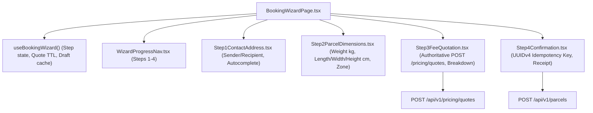
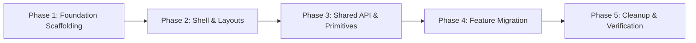

# SwiftDrop Frontend Architecture & Refactoring Guide

> **Target:** `web/` Unified Single-Page Application (React 18 + Vite + TypeScript + Tailwind CSS)  
> **Visual Archetype:** Apple Human Interface Guidelines (Cupertino Precision), Zero-Elevation Borders, 3% Color Budget  
> **Governance:** Layer 2 Architecture Contract (`AGENTS.md`, `web/design.md`)  
> **Domain Ownership:** Member 6 (Customer, Merchant, Public Tracking) & Member 7 (Dispatcher, Courier, Admin, Gateway)  

---

## 1. Architectural Blueprint & Invariants

SwiftDrop unifies 6 frontends into a single modular React Single-Page Application (SPA) served via Nginx behind the Traefik API Gateway.

### Core Architectural Invariants
1. **Frozen Substrate (`@/shared/components/ui/`):** Base primitives (`Button`, `Card`, `Dialog`, `Input`, `Table`) are pre-installed shadcn/ui components rethemed to Apple HIG. Feature code **must never** import `@radix-ui/*` directly or write raw `<button>` / `<input>` substitutes.
2. **Mandatory `[data-role]` Scoping:** Every user surface mounts inside a layout shell that sets its respective `[data-role="..."]` attribute. Role-based primary colors, tints, and focus rings cascade automatically:
   - `[data-role="PUBLIC"]`: Apple Blue (`#0071e3`)
   - `[data-role="CUSTOMER"]`: Apple Blue (`#0071e3`)
   - `[data-role="MERCHANT"]`: Swift Teal (`#0b5955`)
   - `[data-role="DISPATCHER"]`: Oxford Navy (`#1e40af`)
   - `[data-role="COURIER"]`: Amber Bronze (`#b45309`)
   - `[data-role="ADMIN"]`: Monochrome Charcoal (`#18181b`)
3. **Dual-Token Storage Invariant:** Short-lived JWT access tokens are stored **strictly in-memory** (`AuthContext`). Refresh tokens are stored in `HttpOnly, SameSite=Strict` browser cookies. No tokens in `localStorage`.
4. **Zero Client-Side Calculation:** Delivery fees and valid status transitions are determined strictly by Core API backend endpoints. Quotes require `POST /api/v1/pricing/quotes` and pass the returned `quote_id` when booking.
5. **Feature-Sliced Isolation:** Code is isolated into dedicated feature directories. Domain features do not directly import from other domain features; shared logic lives exclusively in `src/shared/`.

---

## 2. Integrated Component-Based Folder Structure

```text
web/
├── API.md                                  # Consumed API contracts & endpoint specifications
├── README.md                               # Living frontend documentation & runbook
├── design.md                               # Canonical Apple HIG UI design system & token contract
├── test-ids.md                             # E2E test selector registry (Playwright test IDs)
├── components.json                         # shadcn/ui configuration (FROZEN)
├── package.json                            # Dependencies & build scripts
├── tsconfig.json                           # Strict TypeScript compiler options & aliases
├── vite.config.ts                          # Vite bundling, aliases (@/* -> src/*), proxy setup
├── tailwind.config.js                      # Apple HIG tokens, semantic colors, role accents
├── index.html                              # SPA HTML entry point
│
├── public/                                 # Static public assets
│   ├── favicon.ico
│   ├── logo.svg                            # SwiftDrop monochrome brand mark
│   └── scratch-apple.html                  # Frozen Apple HIG design visual benchmark
│
└── src/
    ├── main.tsx                            # React root mount (StrictMode, Providers)
    ├── App.tsx                             # Top-level router host & error fallback
    ├── index.css                           # Tailwind directives, CSS variables & role palettes
    │
    ├── app/                                # =========================================
    │   │                                   # 1. CORE APPLICATION SHELL & ORCHESTRATION
    │   │                                   # =========================================
    │   ├── guards/                         # Route navigation barriers
    │   │   ├── AuthGuard.tsx               # Redirects unauthenticated sessions to /auth/login
    │   │   ├── RoleGuard.tsx               # Verifies user.role matches allowed role matrix
    │   │   └── GuestOnlyGuard.tsx          # Prevents authenticated users from viewing /auth/*
    │   │
    │   ├── providers/                      # Application-wide React context providers
    │   │   ├── AuthContext.tsx             # In-memory JWT access token & user session state
    │   │   ├── QueryClientProvider.tsx     # TanStack Query client & cache policies
    │   │   └── ToastProvider.tsx           # Sonner toast provider for tactile notifications
    │   │
    │   ├── routes/                         # Centralized route registry (Code-split with React.lazy)
    │   │   ├── index.tsx                   # Master BrowserRouter route tree
    │   │   ├── publicRoutes.tsx            # /track, /track/:trackingNumber, /auth/*
    │   │   ├── customerRoutes.tsx          # /portal/book, /portal/dashboard, /portal/shipments
    │   │   ├── merchantRoutes.tsx          # /portal/merchants/* (orders, csv, keys, webhooks)
    │   │   ├── dispatcherRoutes.tsx        # /ops/dispatch, /ops/couriers, /ops/failed-deliveries
    │   │   ├── courierRoutes.tsx           # /courier/tasks, /courier/tasks/:id/pod, /courier/fail
    │   │   └── adminRoutes.tsx             # /ops/merchants, /ops/users, /ops/zones, /ops/pricing, /ops/audit
    │   │
    │   └── layouts/                        # Role layout shells enforcing [data-role="..."]
    │       ├── PublicLayout.tsx            # [data-role="PUBLIC"] — Centered view, clean header
    │       ├── CustomerLayout.tsx          # [data-role="CUSTOMER"] — Blue accent, customer sidebar
    │       ├── MerchantLayout.tsx          # [data-role="MERCHANT"] — Teal accent, merchant sidebar
    │       ├── DispatcherLayout.tsx        # [data-role="DISPATCHER"] — Oxford Navy, top zone bar & stats
    │       ├── CourierLayout.tsx           # [data-role="COURIER"] — Amber accent, mobile sticky nav
    │       ├── AdminLayout.tsx             # [data-role="ADMIN"] — Monochrome, full backoffice sidebar
    │       └── components/                 # Layout navigation subcomponents
    │           ├── Topbar.tsx              # Universal header with user profile menu
    │           ├── Sidebar.tsx             # Collapsible desktop role navigation bar
    │           └── MobileBottomNav.tsx     # Courier mobile sticky 44px tap navigation
    │
    ├── shared/                             # =========================================
    │   │                                   # 2. CROSS-CUTTING DESIGN SYSTEM SUBSTRATE
    │   │                                   # =========================================
    │   ├── api/                            # Shared networking & HTTP infrastructure
    │   │   ├── client.ts                   # Axios/Fetch client (base URL, timeout, 401 token refresh)
    │   │   ├── interceptors.ts             # Injects Bearer <JWT> & Idempotency-Key: <UUID>
    │   │   └── errorHandler.ts             # Normalizes backend error envelopes into UI alerts
    │   │
    │   ├── components/
    │   │   ├── ui/                         # Rethemed shadcn primitives (FROZEN SUBSTRATE)
    │   │   │   ├── accordion.tsx
    │   │   │   ├── avatar.tsx
    │   │   │   ├── badge.tsx
    │   │   │   ├── button.tsx
    │   │   │   ├── card.tsx
    │   │   │   ├── checkbox.tsx
    │   │   │   ├── dialog.tsx
    │   │   │   ├── dropdown-menu.tsx
    │   │   │   ├── input.tsx
    │   │   │   ├── label.tsx
    │   │   │   ├── popover.tsx
    │   │   │   ├── scroll-area.tsx
    │   │   │   ├── select.tsx
    │   │   │   ├── separator.tsx
    │   │   │   ├── skeleton.tsx
    │   │   │   ├── sonner.tsx
    │   │   │   ├── switch.tsx
    │   │   │   ├── table.tsx
    │   │   │   ├── tabs.tsx
    │   │   │   ├── textarea.tsx
    │   │   │   └── tooltip.tsx
    │   │   ├── feedback/                   # Reusable feedback & state views
    │   │   │   ├── EmptyState.tsx          # Zero-data state with illustration & action button
    │   │   │   ├── ErrorBoundary.tsx       # Component failure catcher
    │   │   │   └── ConfirmDialog.tsx       # Destructive action prompt modal
    │   │   └── display/                    # High-precision display primitives
    │   │       ├── StatusBadge.tsx         # Domain lifecycle badge with 6px circular dot
    │   │       ├── CurrencyDisplay.tsx     # Sri Lankan Rupee formatting (cents -> LKR X.XX)
    │   │       ├── TabularText.tsx         # Font-mono tabular numerals for IDs & timestamps
    │   │       └── SlaCountdownBadge.tsx   # Urgent countdown chip for SLA expirations
    │   │
    │   ├── hooks/                          # Cross-cutting state & DOM hooks
    │   │   ├── useAuth.ts                  # Accesses authenticated user and role session
    │   │   ├── useSSE.ts                   # Generic resilient Server-Sent Events subscriber
    │   │   ├── useDebounce.ts              # Search query debounce helper
    │   │   ├── useMediaQuery.ts            # Viewport breakpoint detection (Desktop vs Mobile)
    │   │   └── useClipboard.ts             # Transient copy-to-clipboard hook with toast
    │   │
    │   ├── types/                          # System-wide domain types & API contracts
    │   │   ├── auth.ts                     # User, Role, JWTPayload, LoginCredentials
    │   │   ├── parcel.ts                   # Parcel, ParcelStatus, Dimensions, Address
    │   │   ├── pricing.ts                  # PricingQuote, FeeBreakdown, Surcharge
    │   │   ├── dispatch.ts                 # Courier, Zone, Assignment, Workload
    │   │   └── api.ts                      # ApiEnvelope<T>, PaginatedResponse<T>, ApiError
    │   │
    │   └── utils/                          # Pure business formatting & sanitization helpers
    │       ├── currency.ts                 # formatLKR(cents: number): string
    │       ├── date.ts                     # formatTimestamp(isoString: string): string
    │       ├── idGenerator.ts              # generateUUID(): string (for Idempotency-Key)
    │       └── validators.ts               # Universal regex rules (phone, postal codes, email)
    │
    └── features/                           # =========================================
        │                                   # 3. 6 FEATURE DOMAINS (FRONTENDS) + AUTH
        │                                   # =========================================
        ├── auth/                           # Shared Authentication Feature
        │   ├── api/authApi.ts              # POST /api/v1/auth/login, /register, /refresh, /logout
        │   ├── components/
        │   │   ├── LoginForm.tsx           # Email/password form with validation
        │   │   ├── GoogleSsoButton.tsx     # Initiates Google OIDC flow
        │   │   └── RegisterForm.tsx        # Customer self-registration form
        │   ├── pages/
        │   │   ├── LoginPage.tsx           # Route: /auth/login
        │   │   └── RegisterPage.tsx        # Route: /auth/register
        │   └── schemas/authSchema.ts       # Zod schemas for login and registration
        │
        ├── public/                         # [FRONTEND 1] PUBLIC VISITOR
        │   ├── api/publicTrackingApi.ts    # GET /api/v1/tracking/public/{trackingNumber}
        │   ├── hooks/
        │   │   └── usePublicSSETracking.ts # Live SSE updates with 30s polling fallback
        │   ├── components/
        │   │   ├── PublicTrackingSearch.tsx# Primary tracking input on public page
        │   │   ├── SanitizedTimeline.tsx   # Redacted timeline (SEC-016: city/province only)
        │   │   ├── PublicMilestoneCard.tsx # Visual milestone cards (Created, Transit, Delivered)
        │   │   └── ZoneLookupModal.tsx     # Public postal code zone finder
        │   ├── pages/
        │   │   ├── PublicTrackingPage.tsx  # Route: /track, /track/:trackingNumber
        │   │   └── PublicLandingPage.tsx   # Route: /
        │   └── schemas/trackingSchema.ts   # Tracking number format validator
        │
        ├── customer/                       # [FRONTEND 2] CUSTOMER PORTAL
        │   ├── api/
        │   │   ├── customerParcelApi.ts    # POST /api/v1/parcels, GET /api/v1/parcels
        │   │   └── pricingQuoteApi.ts      # POST /api/v1/pricing/quotes
        │   ├── hooks/
        │   │   ├── useBookingWizard.ts     # Multi-step state machine & quote TTL countdown
        │   │   └── useCustomerShipments.ts # Customer shipment query with search & pagination
        │   ├── components/
        │   │   ├── booking-wizard/
        │   │   │   ├── Step1ContactAddress.tsx   # Sender prefill & recipient input
        │   │   │   ├── Step2ParcelDimensions.tsx # Weight (kg), dimensions (cm), zone picker
        │   │   │   ├── Step3FeeQuotation.tsx     # Authoritative price breakdown & quote_id cache
        │   │   │   ├── Step4Confirmation.tsx     # Idempotent submit & generated tracking number
        │   │   │   └── WizardProgressNav.tsx     # 4-step progress header
        │   │   ├── CustomerShipmentCard.tsx      # Active shipment item with live tracking link
        │   │   └── MerchantApplyBanner.tsx       # Onboarding prompt for commercial senders
        │   ├── pages/
        │   │   ├── CustomerDashboardPage.tsx     # Route: /portal/dashboard
        │   │   ├── BookingWizardPage.tsx         # Route: /portal/book
        │   │   ├── CustomerShipmentsPage.tsx     # Route: /portal/shipments
        │   │   └── MerchantApplyPage.tsx         # Route: /portal/merchants/apply
        │   └── schemas/bookingSchema.ts          # Zod validation for 4-step booking flow
        │
        ├── merchant/                       # [FRONTEND 3] MERCHANT PORTAL
        │   ├── api/
        │   │   ├── merchantOrdersApi.ts    # GET /api/v1/merchants/orders, bulk dispatch
        │   │   ├── apiKeyApi.ts            # GET/POST/DELETE /api/v1/merchants/api-keys
        │   │   └── webhookApi.ts           # GET/POST/DELETE /api/v1/merchants/webhooks
        │   ├── hooks/
        │   │   ├── useMerchantOrders.ts    # Server-side pagination, status filters & search
        │   │   └── useCsvBatchParser.ts    # In-browser CSV validation & retry mapper
        │   ├── components/
        │   │   ├── orders/
        │   │   │   ├── MerchantOrdersTable.tsx   # High-density order table with tracking links
        │   │   │   ├── OrderFilterBar.tsx        # Filter pills (PENDING, IN_TRANSIT, DELIVERED)
        │   │   │   └── BulkLabelActionModal.tsx  # Batch PDF label generation
        │   │   ├── batch-upload/
        │   │   │   ├── CsvDropzone.tsx           # Drag-and-drop CSV parser
        │   │   │   └── CsvValidationPreview.tsx  # Row errors, missing fields & correction table
        │   │   └── credentials/
        │   │       ├── ApiKeyTable.tsx           # Active sd_live_* keys & revocation trigger
        │   │       ├── OneTimeKeyModal.tsx       # Transient copy dialog (never re-displayed)
        │   │       ├── WebhookTable.tsx          # Subscribed endpoints and active events
        │   │       └── WebhookSecretModal.tsx    # One-time whsec_* secret display dialog
        │   ├── pages/
        │   │   ├── MerchantDashboardPage.tsx     # Route: /portal/merchants/dashboard
        │   │   ├── MerchantOrdersPage.tsx        # Route: /portal/merchants/orders
        │   │   ├── ApiKeyManagementPage.tsx      # Route: /portal/merchants/api-keys
        │   │   └── WebhookManagementPage.tsx     # Route: /portal/merchants/webhooks
        │   └── schemas/csvImportSchema.ts        # Client-side CSV column structure rules
        │
        ├── dispatcher/                     # [FRONTEND 4] CENTRAL DISPATCHER CONSOLE
        │   ├── api/
        │   │   ├── dispatchBoardApi.ts     # GET /api/v1/dispatch/zones/{zoneId}/board
        │   │   ├── assignmentApi.ts        # POST /api/v1/dispatch/assignments, /cancel, /reschedule
        │   │   └── courierFleetApi.ts      # GET /api/v1/dispatch/couriers (Loads & shifts)
        │   ├── hooks/
        │   │   ├── useDispatchBoard.ts     # 30-second polling & manual sync trigger
        │   │   └── useCourierCapacity.ts   # Detects capacity limits (409) & workload alerts
        │   ├── components/
        │   │   ├── GlobalZoneSelector.tsx  # Topbar zone picker (persistent across console)
        │   │   ├── UnassignedParcelList.tsx# SLA countdown timers & priority sorting
        │   │   ├── CourierWorkloadCard.tsx # Capacity gauge (e.g. 18/25) & shift indicator
        │   │   ├── AssignCourierDialog.tsx # Courier matching modal with live capacity checks
        │   │   ├── ReassignParcelModal.tsx # Reason input (5-500 chars) & courier replacement
        │   │   └── FailedDeliveryList.tsx  # Review 1st/2nd attempts & reschedule reattempts
        │   ├── pages/
        │   │   ├── DispatchBoardPage.tsx   # Route: /ops/dispatch
        │   │   ├── CourierFleetPage.tsx    # Route: /ops/couriers
        │   │   └── FailedDeliveriesPage.tsx# Route: /ops/failed-deliveries
        │   └── types/dispatchBoardTypes.ts # Queue structures, CourierCapacity, AssignmentDTO
        │
        ├── courier/                        # [FRONTEND 5] COURIER MOBILE WEB
        │   ├── api/
        │   │   ├── courierTaskApi.ts       # GET /api/v1/courier/parcels, POST /courier/shift
        │   │   └── deliveryProofApi.ts     # POST /deliveries/{id}/proof-photo, /complete, /failed
        │   ├── hooks/
        │   │   ├── useCourierTasks.ts      # Task queue with offline optimistic state
        │   │   └── useGeolocation.ts       # GPS capture for delivery completion/failure
        │   ├── components/
        │   │   ├── CourierShiftToggle.tsx  # Shift status toggle switch (On-Duty / Off-Duty)
        │   │   ├── MobileTaskCard.tsx      # Min 44px tap target card with call & map shortcuts
        │   │   ├── BatchRunActionBar.tsx   # Sticky bottom button: "Start Run (N Parcels)"
        │   │   ├── pod/
        │   │   │   ├── SignatureCanvas.tsx # Touch signature capture pad
        │   │   │   ├── ProofPhotoUpload.tsx# Camera capture with client 10MB file limit
        │   │   │   └── RecipientForm.tsx   # Recipient name input & relationship
        │   │   └── failure/
        │   │       ├── FailureReasonSelect.tsx# Reason dropdown (RECIPIENT_UNAVAILABLE, etc.)
        │   │       └── FailureNotesInput.tsx# Min 15-character required explanation field
        │   ├── pages/
        │   │   ├── CourierTaskQueuePage.tsx# Route: /courier/tasks
        │   │   ├── CourierTaskDetailPage.tsx# Route: /courier/tasks/:id
        │   │   ├── ProofOfDeliveryPage.tsx # Route: /courier/tasks/:id/pod
        │   │   └── DeliveryFailurePage.tsx # Route: /courier/tasks/:id/fail
        │   └── schemas/podSchema.ts        # Zod validation for signature, photo & failure codes
        │
        └── admin/                          # [FRONTEND 6] ADMIN BACKOFFICE
            ├── api/
            │   ├── adminMerchantApi.ts     # POST /admin/merchants/{id}/(approve|reject|suspend)
            │   ├── adminUserApi.ts         # GET/POST /api/v1/admin/users (RBAC)
            │   ├── adminZoneApi.ts         # GET/POST /api/v1/admin/zones (Text ID, boundaries)
            │   ├── adminPricingApi.ts      # GET/POST /api/v1/admin/pricing-rules (Tariffs)
            │   ├── adminAuditApi.ts        # GET /api/v1/admin/audit-logs
            │   └── adminReportsApi.ts      # GET /api/v1/admin/reports/deliveries
            ├── hooks/
            │   ├── useMerchantReview.ts    # Versioned approval mutation with reason prompt
            │   └── useAuditLogSearch.ts    # Multi-field log search by actor, action & entity
            ├── components/
            │   ├── merchants/
            │   │   ├── MerchantReviewTable.tsx  # Pending applications with expected_version
            │   │   └── MerchantReviewModal.tsx  # Action dialog (5-500 char mandatory reason)
            │   ├── zones/
            │   │   ├── ZoneFormModal.tsx        # Zone ID (e.g. ZONE_COLOMBO_01), postal prefixes
            │   │   └── ZoneTable.tsx            # Zone list with status toggle
            │   ├── pricing/
            │   │   └── TariffRuleMatrix.tsx     # Base tariffs, weight slabs, effective dates
            │   ├── audit/
            │   │   └── AuditLogViewer.tsx       # Read-only timeline with payload JSON viewer
            │   └── reports/
            │       └── DeliverySlaChart.tsx     # Deliveries per day, success/failure rate charts
            ├── pages/
            │   ├── AdminDashboardPage.tsx       # Route: /admin/dashboard
            │   ├── MerchantReviewPage.tsx       # Route: /ops/merchants, /ops/merchants/:id
            │   ├── UserManagementPage.tsx       # Route: /ops/users
            │   ├── ZoneManagementPage.tsx       # Route: /ops/zones
            │   ├── PricingRulesPage.tsx         # Route: /ops/pricing
            │   ├── AuditLogsPage.tsx            # Route: /ops/audit
            │   └── DeliveryReportsPage.tsx      # Route: /ops/reports
            └── types/adminTypes.ts              # AuditLogEntry, DeliverySlaMetrics, TariffRule
```

---

## 3. Comprehensive File-by-File Refactoring Plan

This matrix covers all 27 distinct files and directories currently present in `web/src/`.

| Current File / Directory | Action | Target Location | Refactoring Specification |
| :--- | :---: | :--- | :--- |
| **`src/main.tsx`** | Retain | `src/main.tsx` | Retain as the DOM mounting entrypoint. Ensure it provides `<QueryClientProvider>` and `<ToastProvider>` above `<App />`. |
| **`src/App.tsx`** | Refactor | `src/App.tsx` | Extract the inline `ProtectedRoute` into `src/app/guards/AuthGuard.tsx` and `RoleGuard.tsx`. Extract `RoleRedirector` into `src/app/guards/RoleRedirector.tsx`. Move routes into `src/app/routes/`. |
| **`src/index.css`** | Retain | `src/index.css` | **Frozen Foundation:** Contains Apple HIG design tokens, hairline border definitions, and all 6 `[data-role]` accent palettes. Do not alter. |
| **`src/app/providers/AuthContext.tsx`** | Retain | `src/app/providers/AuthContext.tsx` | Maintain dual-token storage invariant (in-memory access token, HttpOnly refresh cookie). Retain `useAuth()` hook. |
| **`src/features/auth/LoginPage.tsx`** | Split & Refactor | `src/features/auth/` | **Decompose 541-line monolith:**<br>1. Extract email/password inputs to `components/LoginForm.tsx`.<br>2. Extract Google modal to `components/GoogleSsoButton.tsx`.<br>3. Extract quick-login accounts to `components/DevAccountPicker.tsx`.<br>4. Thin page delegates to `PublicLayout`. |
| **`src/features/auth/RegisterPage.tsx`** | Consolidate | `src/features/auth/pages/RegisterPage.tsx` | Consolidate customer self-registration here. Add Zod schema validation for full name, email, password, and phone. |
| **`src/features/customer-merchant/portal/api.ts`** | Elevate to Shared | `src/shared/api/client.ts` & `src/shared/api/errorHandler.ts` | Elevate `portalRequest` and `PortalError` to the universal API client. Add automatic Bearer token injection and `Idempotency-Key` headers for all mutations. |
| **`src/features/customer-merchant/portal/BookingPage.tsx`** | Decompose | `src/features/customer/` | **Decompose 260-line monolith:**<br>1. Extract state and 15-min countdown into `hooks/useBookingWizard.ts`.<br>2. Split steps into `components/booking-wizard/Step1ContactAddress.tsx`, `Step2ParcelDimensions.tsx`, `Step3FeeQuotation.tsx`, and `Step4Confirmation.tsx`.<br>3. Create clean `pages/BookingWizardPage.tsx`. |
| **`src/features/customer-merchant/portal/MerchantOrderImport.tsx`** | Relocate & Refactor | `src/features/merchant/components/batch-upload/CsvDropzone.tsx` | Move to merchant components. Replace raw `<button>` elements with `@/shared/components/ui/button`. |
| **`src/features/customer-merchant/portal/MerchantPage.tsx`** | Split & Decompose | `src/features/merchant/` & `src/features/customer/` | **Decompose 309-line monolith:**<br>1. Extract orders to `features/merchant/pages/MerchantOrdersPage.tsx`.<br>2. Extract API keys to `features/merchant/pages/ApiKeyManagementPage.tsx`.<br>3. Extract webhooks to `features/merchant/pages/WebhookManagementPage.tsx`.<br>4. Move `MerchantApplication` form to `features/customer/pages/MerchantApplyPage.tsx`.<br>5. Refactor `OneTimeSecret` dialog to use `@/shared/components/ui/dialog`. |
| **`src/features/customer-merchant/portal/portal.css`** | Retire | *Delete* | Custom `.m6-*` CSS is deprecated. All styling must consume semantic Tailwind tokens inside `CustomerLayout` and `MerchantLayout`. |
| **`src/features/customer-merchant/portal/PortalLayout.tsx`** | Split & Refactor | `src/app/layouts/CustomerLayout.tsx` & `MerchantLayout.tsx` | Split into two explicit layouts setting `data-role="CUSTOMER"` and `data-role="MERCHANT"`. Replace ad-hoc headers with standard navigation bars. |
| **`src/features/customer-merchant/portal/RegisterPage.tsx`** | Retire (Merged) | *Delete* | Redundant registration file; merge into `src/features/auth/pages/RegisterPage.tsx`. |
| **`src/features/customer-merchant/portal/TrackingPage.tsx`** | Split & Relocate | `src/features/public/` & `src/features/customer/` | **Decompose 133-line file:**<br>1. Public view (`/track/:trackingNumber`) moves to `features/public/pages/PublicTrackingPage.tsx` using `SanitizedTimeline.tsx`.<br>2. Extract SSE logic to `features/public/hooks/usePublicSSETracking.ts`.<br>3. Authenticated customer view moves to `features/customer/pages/CustomerShipmentsPage.tsx`. |
| **`src/features/customer-merchant/preview/DesignPreviewPage.tsx`** | Relocate | `src/features/preview/DesignPreviewPage.tsx` | Visual evaluation studio; gate out of production builds. |
| **`src/features/customer-merchant/preview/swift-signature.css`** | Retire | *Delete* | Deprecated prototype CSS; replaced by Apple HIG tokens in `src/index.css`. |
| **`src/features/customer-merchant/preview/SwiftSignatureTheme.tsx`** | Relocate | `src/features/preview/SwiftSignatureTheme.tsx` | Retain inside isolated preview directory. |
| **`src/features/dashboards/DashboardLayout.tsx`** | Retire | *Delete* | Deprecated dark-slate prototype layout. Replaced by the 6 standard HIG layouts in `src/app/layouts/`. |
| **`src/features/dashboards/CustomerDashboard.tsx`** | Refactor | `src/features/customer/pages/CustomerDashboardPage.tsx` | Connect to live customer parcel APIs; wrap in `CustomerLayout`. |
| **`src/features/dashboards/MerchantDashboard.tsx`** | Refactor | `src/features/merchant/pages/MerchantDashboardPage.tsx` | Connect to live merchant order metrics; wrap in `MerchantLayout`. |
| **`src/features/dashboards/DispatcherDashboard.tsx`** | Refactor | `src/features/dispatcher/pages/DispatchBoardPage.tsx` | Connect to `useDispatchBoard` hook, zone dropdown, and live capacity meters. |
| **`src/features/dashboards/CourierDashboard.tsx`** | Refactor | `src/features/courier/pages/CourierTaskQueuePage.tsx` | Implement mobile-first card list, shift toggle, and 44px tap targets. |
| **`src/features/dashboards/AdminDashboard.tsx`** | Refactor | `src/features/admin/pages/AdminDashboardPage.tsx` | Connect to merchant approval counts and SLA metrics; wrap in `AdminLayout`. |
| **`src/features/design-system/DesignSystemPage.tsx`** | Relocate | `src/features/preview/DesignSystemPage.tsx` | Retain as dev-only verification studio. |
| **`src/shared/components/ui/*` (21 files)** | **Keep Frozen** | `src/shared/components/ui/*` | **Mandatory:** Frozen shadcn UI substrate. Must never be altered or polluted with domain logic. |
| **`src/shared/lib/utils.ts`** | Retain | `src/shared/lib/utils.ts` | Retain `cn()` utility. |
| **`src/shared/types/auth.ts`** | Retain & Extend | `src/shared/types/auth.ts` | Retain user and role declarations. |

---

## 4. In-Depth Component Decomposition Blueprints

### 4.1 Customer Booking Wizard (`BookingPage.tsx` &rarr; `src/features/customer/`)



* **`Step1ContactAddress.tsx`:** Handles pickup (sender prefilled from `user` in `AuthContext`) and dropoff (recipient name, phone, street address, city, postal code).
* **`Step2ParcelDimensions.tsx`:** Collects physical package attributes. Validates positive numeric values (`weight_kg <= 30kg`, max dimensions `<= 150cm`).
* **`Step3FeeQuotation.tsx`:** Invocates Member 2's pricing endpoint. Formats integer cents to LKR using `formatLKR()`. Enforces 15-minute expiration countdown.
* **`Step4Confirmation.tsx`:** Generates UUIDv4 idempotency key. Submits payload with `{ quote_id }`. Upon `201 Created`, displays generated tracking number (`SD-YYYYMMDD-XXXXX`).

---

### 4.2 Merchant Operations (`MerchantPage.tsx` &rarr; `src/features/merchant/`)

1. **`MerchantOrdersPage.tsx`:** 
   - Uses `MerchantOrdersTable.tsx` for high-density listing.
   - Embeds `CsvDropzone.tsx` for client-side batch CSV parsing.
   - Embeds `OrderFilterBar.tsx` for filtering by status (`CREATED`, `IN_TRANSIT`, `DELIVERED`).
2. **`ApiKeyManagementPage.tsx`:**
   - Displays active `sd_live_*` API keys in `ApiKeyTable.tsx`.
   - On creation, opens `OneTimeKeyModal.tsx` (built on `@/shared/components/ui/dialog`). The key is held strictly in component memory and permanently cleared when dismissed.
3. **`WebhookManagementPage.tsx`:**
   - Displays registered URLs and event subscriptions in `WebhookTable.tsx`.
   - On creation/rotation, opens `WebhookSecretModal.tsx` to display `whsec_*` once.
4. **`MerchantApplyPage.tsx` (Moved to Customer Domain):**
   - Resides in `src/features/customer/pages/MerchantApplyPage.tsx`. Allows authenticated customers to submit business registration details (`POST /api/v1/merchants/applications`).

---

### 4.3 Public Tracking (`TrackingPage.tsx` &rarr; `src/features/public/`)

* **Hook (`src/features/public/hooks/usePublicSSETracking.ts`):**
  - Connects to `/api/v1/tracking/public/{trackingNumber}/stream`.
  - Manages `EventSource` connection, event deduplication, automatic reconnect, and transparent fallback to 30-second REST polling if the stream disconnects.
* **Component (`src/features/public/components/SanitizedTimeline.tsx`):**
  - Strictly enforces privacy masking (**SEC-016**): displays milestone status, timestamp, and destination city/province only.
  - Zero street addresses, zero phone numbers, and zero proof attachments.

---

### 4.4 Dispatcher Console (`src/features/dispatcher/`)

* **Zone Scope (`GlobalZoneSelector.tsx`):**
  - Dropdown in the header displaying current active zone (e.g. `ZONE_COLOMBO_01`).
  - Changing the zone immediately refreshes the active operational queue.
* **Unassigned Queue (`UnassignedParcelList.tsx`):**
  - Displays unassigned parcels with color-coded SLA countdown badges.
* **Workload Meters (`CourierWorkloadCard.tsx`):**
  - Displays assigned load vs. maximum capacity (e.g., `18/25`).
  - Detects 409 capacity limit errors from backend assignments.
* **Modals (`AssignCourierDialog.tsx` & `ReassignParcelModal.tsx`):**
  - Manual assignment with courier selection. Reassignment enforces mandatory reason entry (5–500 characters).

---

### 4.5 Courier Mobile Web (`src/features/courier/`)

* **Mobile Viewport Invariant:**
  - Designed for mobile phone viewports (`<= 440px`).
  - Every interactive touch target has a minimum height of **`44px`** (`min-h-[44px]`).
* **Proof of Delivery (`ProofOfDeliveryPage.tsx`):**
  - `SignatureCanvas.tsx`: Touch-friendly HTML5 signature pad exporting base64 vector data.
  - `ProofPhotoUpload.tsx`: Direct camera photo attachment with client-side 10MB file limit check.
* **Delivery Failure (`DeliveryFailurePage.tsx`):**
  - Standardized reason codes (`RECIPIENT_UNAVAILABLE`, `CUSTOMER_REQUESTED_RESCHEDULE`, `ACCESS_RESTRICTED`, `INVALID_ADDRESS`, `REFUSED_BY_RECIPIENT`, `DAMAGED_IN_TRANSIT`, `OTHER`).
  - Enforces minimum 15-character note requirement when selecting `OTHER`.
  - Automatically captures GPS coordinates via `useGeolocation()`.

---

### 4.6 Admin Backoffice (`src/features/admin/`)

* **Merchant Verification (`MerchantReviewPage.tsx`):**
  - Displays pending commercial merchant applications.
  - Actions (Approve, Reject, Suspend, Reinstate) send `expected_version` for optimistic locking and prompt for mandatory audit justification notes.
* **Delivery Zone Management (`ZoneManagementPage.tsx`):**
  - Manages zone identifiers, postal code prefix lists, and active status toggles.
* **Pricing Rule Matrix (`PricingRulesPage.tsx`):**
  - Displays base tariffs, weight slab surcharges, and effective date ranges.

---

## 5. Migration Execution Checklist



1. **Phase 1: Foundation Scaffolding**
   - Create directories: `src/app/routes/`, `src/app/layouts/`, `src/app/guards/`, `src/features/{public,customer,merchant,dispatcher,courier,admin}/`.
   - Add `.gitkeep` files where appropriate.
2. **Phase 2: Shell & Layouts**
   - Create 6 role layouts in `src/app/layouts/` setting `[data-role="..."]`.
   - Implement `AuthGuard.tsx` and `RoleGuard.tsx` in `src/app/guards/`.
   - Setup modular route registries in `src/app/routes/` with `React.lazy()`.
3. **Phase 3: Shared API & Primitives**
   - Establish `src/shared/api/client.ts` with transparent 401 refresh and idempotency headers.
   - Establish `src/shared/utils/currency.ts` (`formatLKR`) and `date.ts`.
4. **Phase 4: Feature Migration**
   - Decompose `BookingPage.tsx` into `features/customer/`.
   - Decompose `MerchantPage.tsx` into `features/merchant/` and `features/customer/`.
   - Move public tracking into `features/public/`.
   - Migrate dashboards from `features/dashboards/` to their respective feature folders.
5. **Phase 5: Cleanup & Verification**
   - Delete `DashboardLayout.tsx`, `PortalLayout.tsx`, `portal.css`, `swift-signature.css`, and `features/dashboards/`.
   - Run `npm run build` (`tsc && vite build`) to verify zero type or bundle errors.
   - Run `npm run lint:ui` to ensure 100% compliance with Apple HIG and zero raw element substitutions.
