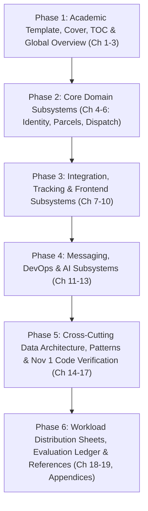

# SwiftDrop System Architecture & Software Design Specification
## Comprehensive Academic Report Blueprint & Master Plan (Module-by-Module Architecture)

> **Document Type:** Formal Academic System Architecture & Software Design Specification (Software Engineering / Enterprise Application Development)  
> **Coursework Module:** Enterprise Application Development (EAD)  
> **Weightage:** 20 Marks (Design Documentation) + 50 Marks (Implementation Foundation)  
> **Project Title:** SwiftDrop — Next-Generation Distributed Parcel Delivery & Courier Management Platform  
> **Team Structure:** 10 Members (Objective System Subsystems + Dedicated Workload Division Section)  
> **Target Tooling:** Wordcraft CLI Document Generation  
> **Standard:** IEEE Std 1016-2009 (Software Design Descriptions), ISO/IEC/IEEE 42010, & Unified Process / RUP Architectural Blueprints

---

## 1. Architectural Philosophy: Decoupling System Design from Project Governance

In high-standard academic and industrial software architecture, a system must be described **objectively by its functional and technical subsystems**, rather than organized as a personal diary of individual workloads. 

This restructured blueprint establishes a clean, professional separation of concerns:
1. **Part I: Global System Context & Enterprise Architecture:** Establishes the organizational challenge, enterprise requirements, and system-wide architectural topology.
2. **Part II: Deep-Dive Subsystem Specifications (Modules 1 through 10):** Every system capability is analyzed as an authoritative software subsystem. Each module chapter exhaustively covers:
   * **Domain Scope & Responsibilities:** Functional boundaries and capabilities.
   * **Architectural Design & Internal Decomposition:** Package layouts, Domain-Driven Design (DDD) layers, and interfaces.
   * **Dynamic Execution Flows & Diagrams:** Detailed UML sequence diagrams, state machines, and activity flowcharts.
   * **Input & Output Data Contracts:** Complete request/response payloads, field validations, and event schemas.
   * **Data Persistence & Database Model:** Tables, primary/foreign keys, constraints, and indexes.
   * **Technical Justifications & Trade-offs:** In-depth comparative analysis defending technology and design choices.
   * **Security, Invariants & Failure Handling:** State machine guards, authorization, idempotency, and error handling.
   * **Comprehensive Testing & Verification Strategy:** Unit tests, integration test fixtures, and acceptance criteria.
3. **Part III: Cross-Cutting Engineering, Data Architecture & Design Patterns:** System-wide relational data model (14-table ERD), design patterns (SOLID, GoF, Enterprise), and STRIDE threat modeling.
4. **Part IV: Initial Codebase Verification & Authentication Milestone:** Verifiable empirical proof of the working authentication codebase for the Nov 1 milestone.
5. **Part V: Team Workload Allocation, Deliverables & Individual Accountability:** A dedicated, transparent chapter mapping the 10 subsystems to the 10 team members, detailing each member's required inputs, exact deliverables, and evaluation sign-off sheets.

---

## 2. Master Document Structure & Table of Contents

```
Front Matter
├── Title & University Standard Cover Page
├── Declaration of Academic Integrity & Originality
├── Executive Summary / Abstract
├── Acknowledgements
├── Master Table of Contents (Automated)
├── List of Figures (Automated, ~35 Figures)
├── List of Tables (Automated, ~25 Tables)
└── List of Acronyms, Standards & Notation

PART I: EXECUTIVE CONTEXT, REQUIREMENTS & GLOBAL ARCHITECTURE
├── Chapter 1: Introduction, Problem Domain & System Scope
│   ├── 1.1 Organizational Context & Nationwide Logistics Challenges
│   ├── 1.2 SwiftDrop Modernization Objectives & Business Value
│   ├── 1.3 Enterprise Stakeholder Taxonomy & Actor Responsibilities
│   └── 1.4 Business Requirements Traceability Matrix (RTM)
├── Chapter 2: Global Requirements Engineering & Master Use Case Model
│   ├── 2.1 Functional Requirements Hierarchy (FR-01 to FR-28)
│   ├── 2.2 Non-Functional Requirements (FURPS+ Model Analysis)
│   ├── 2.3 Master Enterprise System Use Case Diagram (Figure 2.1)
│   └── 2.4 Inter-Actor Operational Interaction Matrix
└── Chapter 3: Global System Architecture Proposal & Fundamental Trade-Offs
    ├── 3.1 Architectural Philosophy: The Case for a Modular Monolith with Specialized Services
    ├── 3.2 High-Level System Topology & Tier Decomposition (Figure 3.1)
    ├── 3.3 Comparative Architecture Trade-Off Analysis (Modular Monolith vs. Microservices vs. Layered)
    ├── 3.4 Summary of Architectural Decision Records (ADR-001 through ADR-004)
    ├── 3.5 Authoritative Relational Persistence Philosophy (PostgreSQL ACID vs. NoSQL)
    └── 3.6 High-Precision Financial Computation Strategy (Integer Minor Units in LKR Cents)

PART II: COMPREHENSIVE SUBSYSTEM SPECIFICATIONS (MODULE-BY-MODULE)
├── Chapter 4: Identity, Access Control & Security Subsystem
│   ├── 4.1 Subsystem Scope, Domain Boundaries & Security Mandate
│   ├── 4.2 Architectural Design & Clean DDD Layering (`core-api/internal/identity/`)
│   ├── 4.3 Dynamic Execution Flows & Drawn Sequence Diagrams
│   │   ├── 4.3.1 Password Authentication & JWT Issuance Flow (Figure 4.1)
│   │   └── 4.3.2 Federated Google OAuth 2.0 / OpenID Connect (OIDC) Flow (Figure 4.2)
│   ├── 4.4 Input & Output Data Contracts (REST API Schemas & DTOs)
│   ├── 4.5 Data Modeling & Persistence Schema (`users`, `roles`, `user_roles`, `oauth_identities`)
│   ├── 4.6 Technical Justifications: Argon2id vs. bcrypt, Dual-Token (JWT + HttpOnly Cookie)
│   ├── 4.7 Security Invariants, Brute-Force Defense & Token Invalidation
│   └── 4.8 Testing Strategy, Authentication Test Matrix & Acceptance Criteria
├── Chapter 5: Parcel Lifecycle Management & Dynamic Pricing Subsystem
│   ├── 5.1 Subsystem Scope: Booking Lifecycle, Quotes & Physical Boundary Invariants
│   ├── 5.2 Architectural Design: Parcel Aggregate Root & Encapsulation (`core-api/internal/parcels/`)
│   ├── 5.3 Dynamic Execution Flows & Drawn Sequence Diagrams
│   │   ├── 5.3.1 Dynamic Tariff Calculation & 15-Minute Guaranteed Quote Flow (Figure 5.1)
│   │   └── 5.3.2 Atomic Parcel Booking & Status History Commit Flow (Figure 5.2)
│   ├── 5.4 Input & Output Data Contracts (Pricing DTOs, Booking Payloads, Tracking Number Format)
│   ├── 5.5 Data Modeling & Persistence Schema (`parcels`, `parcel_addresses`, `pricing_quotes`, `pricing_rules`)
│   ├── 5.6 Technical Justifications: State Machine Invariant Protection, Strategy Pattern for Tariffs
│   ├── 5.7 Invariant Guardrails: Finite State Machine (FSM) & Prohibited Transitions
│   └── 5.8 Testing Strategy: Dimension Boundary Tests, Pricing Precision Tests & Acceptance Criteria
├── Chapter 6: Dispatch, Fleet Management & Proof-of-Delivery Subsystem
│   ├── 6.1 Subsystem Scope: Courier Rostering, Zone Optimization & Proof Records
│   ├── 6.2 Architectural Design: Dispatch & Delivery Contexts (`internal/dispatch/`, `internal/delivery/`)
│   ├── 6.3 Dynamic Execution Flows & Drawn Sequence Diagrams
│   │   ├── 6.3.1 Dispatcher Parcel Assignment & Courier Capacity Check Flow (Figure 6.1)
│   │   ├── 6.3.2 Courier Pickup Scan & Milestone Progression Flow (Figure 6.2)
│   │   └── 6.3.3 Proof-of-Delivery (Photo/Signature) & Failed Attempt Handling (Figure 6.3 / `ADR-004`)
│   ├── 6.4 Input & Output Data Contracts (Assignment Requests, Milestone Updates, POD Schemas)
│   ├── 6.5 Data Modeling & Persistence Schema (`couriers`, `courier_assignments`, `delivery_attempts`)
│   ├── 6.6 Technical Justifications: Advisory Locking on Assignments, Pre-Signed Object Storage URLs
│   ├── 6.7 Concurrency Control, Lock Contention & Failed Delivery Invariants
│   └── 6.8 Testing Strategy: Race Condition Tests, Photo Validation Tests & Acceptance Criteria
├── Chapter 7: Merchant B2B Integration & Webhook Subsystem
│   ├── 7.1 Subsystem Scope: Merchant Tenant Management, Onboarding & High-Volume Ingestion
│   ├── 7.2 Architectural Design: B2B Merchant Context (`core-api/internal/merchants/`)
│   ├── 7.3 Dynamic Execution Flows & Drawn Sequence Diagrams
│   │   ├── 7.3.1 Merchant Registration & Administrative Approval Flow (Figure 7.1)
│   │   ├── 7.3.2 Automated High-Volume Order Ingestion via API Key (Figure 7.2)
│   │   └── 7.3.3 Outbound Webhook Delivery & Exponential Backoff Retry Flow (Figure 7.3)
│   ├── 7.4 Input & Output Data Contracts (Bulk Order JSON Schemas, Webhook Event Payloads)
│   ├── 7.5 Data Modeling & Persistence Schema (`merchants`, `merchant_api_credentials`, `webhook_endpoints`)
│   ├── 7.6 Technical Justifications: SHA-256 API Key Storage, HMAC-SHA256 Signatures, Multi-Tenant Isolation
│   ├── 7.7 Defensive Security: Tenant Boundaries, Rate Limiting & Webhook SSRF Mitigation
│   └── 7.8 Testing Strategy: Tenant Cross-Contamination Tests, Signature Verification Tests
├── Chapter 8: Real-Time Tracking & Live Projection Subsystem
│   ├── 8.1 Subsystem Scope: Read-Heavy Tracking Queries & Real-Time Event Projections
│   ├── 8.2 Architectural Design: Standalone Microservice Architecture (`services/tracking/`)
│   ├── 8.3 Dynamic Execution Flows & Drawn Sequence Diagrams
│   │   ├── 8.3.1 Server-Sent Events (SSE) Client Streaming Lifecycle Flow (Figure 8.1)
│   │   └── 8.3.2 Public Tracking Query & Sensitive PII Masking Pipeline (Figure 8.2)
│   ├── 8.4 Input & Output Data Contracts (Public Tracking DTOs, SSE Event Formats)
│   ├── 8.5 Data Modeling, Read-Replica Views & Redis Caching Fan-Out Strategy
│   ├── 8.6 Technical Justifications: Server-Sent Events vs. WebSockets, Read/Write Segregation
│   ├── 8.7 Privacy & Regulatory Safeguards: Public Tracking Redaction Rules
│   └── 8.8 Testing Strategy: High-Concurrency SSE Connection Benchmark & Masking Audit
├── Chapter 9: Frontend User Experience & Client Application Subsystem
│   ├── 9.1 Subsystem Scope: React/TypeScript Single Page Application (SPA) Portals
│   ├── 9.2 UI/UX Architectural Design: Feature Slicing, Design Tokens & State Management
│   ├── 9.3 Dynamic User Journeys & Wireframe Flowcharts
│   │   ├── 9.3.1 Customer Booking Wizard Journey (Figure 9.1)
│   │   ├── 9.3.2 Public Real-Time Tracking View Journey (Figure 9.2)
│   │   ├── 9.3.3 Courier Mobile-Responsive Delivery Manifest Journey (Figure 9.3)
│   │   └── 9.3.4 Central Dispatcher Fleet Cockpit Journey (Figure 9.4)
│   ├── 9.4 Input & Output Data Contracts (API Client Services, Form Validation Schemas)
│   ├── 9.5 Technical Justifications: Client-Side Schema Validation (Zod), Web Accessibility, Token Storage
│   ├── 9.6 Security & Resilience: Zero Business Logic in UI, Token Refresh Interceptors, Error Boundaries
│   └── 9.7 Testing Strategy: Vitest Component Tests, Mock Service Worker (MSW), Cypress E2E Tests
├── Chapter 10: Edge Ingress, API Gateway & Traffic Routing Subsystem
│   ├── 10.1 Subsystem Scope: Unified Edge Routing, TLS Termination & Traffic Control
│   ├── 10.2 Architectural Design: Traefik Ingress Gateway Architecture (`ADR-001`)
│   ├── 10.3 Dynamic Execution Flows & Drawn Routing Diagrams
│   │   ├── 10.3.1 External Client Ingress & Path-Based Micro-Routing Flow (Figure 10.1)
│   │   └── 10.3.2 Dynamic Rate Limiting & Denial-of-Service Defense Flow (Figure 10.2)
│   ├── 10.4 Gateway Configuration Contracts (Traefik Dynamic YAML, Middleware Rules, CORS)
│   ├── 10.5 Technical Justifications: Traefik vs. NGINX vs. Kong, Dynamic Service Discovery
│   ├── 10.6 Security Enforcement: Edge Token Pass-Through, Strip-Prefix Middlewares, Security Headers
│   └── 10.7 Testing Strategy: Gateway Routing Verification, Rate Limiting Penetration Tests
├── Chapter 11: Asynchronous Event-Driven Messaging & Transactional Outbox Subsystem
│   ├── 11.1 Subsystem Scope: Reliable Event Bus, Asynchronous Decoupling & Guaranteed Delivery
│   ├── 11.2 Architectural Design: Outbox Relay Daemon & Background Event Worker (`core-api/internal/events/`)
│   ├── 11.3 Dynamic Execution Flows & Drawn Sequence Diagrams
│   │   ├── 11.3.1 Transactional Outbox Persistence & Polling Relay Loop Flow (Figure 11.1)
│   │   ├── 11.3.2 RabbitMQ Topic Exchange Distribution Flow (Figure 11.2)
│   │   └── 11.3.3 Event Worker Consumer, Retry & Dead Letter Queue (DLQ) Flow (Figure 11.3)
│   ├── 11.4 Input & Output Event Contracts (Canonical CloudEvents Envelope, Event Payloads)
│   ├── 11.5 Data Modeling & Persistence Schema (`outbox_events`, `processed_events`, `webhook_deliveries`)
│   ├── 11.6 Technical Justifications: Dual-Write Elimination, RabbitMQ vs. Apache Kafka
│   ├── 11.7 Reliability Guarantees: At-Least-Once Delivery, Deduplication Table, Idempotent Consumers
│   └── 11.8 Testing Strategy: Message Broker Network Partition Tests, Poison Pill Recovery Tests
├── Chapter 12: DevOps, Containerization & Cloud Infrastructure Platform
│   ├── 12.1 Platform Scope: Infrastructure as Code, Container Orchestration & CI/CD
│   ├── 12.2 Multi-Stage Docker Container Architecture (Go Distroless, Node Alpine, Python Slim)
│   ├── 12.3 Local Orchestration Platform: Docker Compose Network & Service Topology (Figure 12.1)
│   ├── 12.4 Cloud-Native Kubernetes Infrastructure Platform (`ADR-002`)
│   │   ├── 12.4.1 K3s/Kubernetes Cluster Topology & Namespace Architecture (Figure 12.2)
│   │   ├── 12.4.2 Pod Specifications, Horizontal Pod Autoscalers (HPA) & Probes
│   │   └── 12.4.3 Configuration Management: ConfigMaps & Encrypted K8s Secrets
│   ├── 12.5 Observability & Telemetry Infrastructure: Prometheus Metrics, Grafana & Health Probes
│   ├── 12.6 Technical Justifications: Lightweight K3s for Production, Distroless Containers for Security
│   └── 12.7 Infrastructure Testing: Automated Verification Script (`verify.sh`) & CI Automation
└── Chapter 13: Generative AI Delivery Assistant & Cross-Workflow Subsystem
    ├── 13.1 Subsystem Scope: Conversational AI Engine, Tool Calling Architecture & System Quality
    ├── 13.2 Architectural Design: Python/FastAPI Microservice & Model Context Protocol (MCP) Integration
    ├── 13.3 Dynamic Execution Flows & Drawn Flowcharts
    │   ├── 13.3.1 User Conversational Intent Parsing & Function Calling Flow (Figure 13.1)
    │   └── 13.3.2 Tool Sandbox Execution & Grounded Response Synthesis Flow (Figure 13.2)
    ├── 13.4 Tool Specifications & Contracts (`get_parcel_status`, `estimate_delivery_fee`)
    ├── 13.5 Technical Justifications: Read-Only Tool Sandboxing, Zero Direct DB Access, Python Fast-Ecosystem
    ├── 13.6 Defensive Safeguards: Prompt Injection Defenses, Hallucination Prevention, Rate Limiting
    └── 13.7 Subsystem Testing: Tool Execution Mock Tests, LLM Output Assertion Matrix

PART III: CROSS-CUTTING ENGINEERING, DATA & SECURITY DESIGN
├── Chapter 14: Comprehensive Enterprise Data Architecture & Canonical Schemas
│   ├── 14.1 Master Entity Relationship Diagram (ERD) — Complete 14-Table Relational Schema (Figure 14.1)
│   ├── 14.2 Database Normalization Analysis (3NF Compliance & Integrity Proof)
│   ├── 14.3 Full Table Data Dictionary, Primary Keys, Foreign Keys & Indices
│   └── 14.4 Canonical 11-Step Sequential Database Migration Plan (`000001` through `000011`)
├── Chapter 15: Software Design Patterns & Engineering Principles
│   ├── 15.1 SOLID Principles Applied in Go Backend & TypeScript Frontend
│   ├── 15.2 Gang of Four (GoF) Structural & Behavioral Patterns: Repository, Strategy, Observer, Factory
│   └── 15.3 Enterprise Application Patterns: Transactional Outbox, Idempotency Keys, Circuit Breaker
└── Chapter 16: System-Wide Security Architecture, Threat Modeling & Privacy
    ├── 16.1 STRIDE Threat Modeling Analysis Matrix
    ├── 16.2 Centralized Role-Based Access Control (RBAC) Permission Matrix
    ├── 16.3 Tenant Isolation & Cross-Account Object Protection (IDOR Prevention)
    └── 16.4 Data Protection & PII Compliance (Data-at-Rest & In-Transit Encryption)

PART IV: INITIAL CODEBASE VERIFICATION & AUTHENTICATION MILESTONE
├── Chapter 17: Initial Codebase Verification & Authentication Implementation
│   ├── 17.1 Milestone Status Overview: Monolith Baseline & Working Authentication
│   ├── 17.2 Backend Identity Module Architecture & Code Artifacts
│   │   ├── 17.2.1 Database Schema Migration: `000001_create_users_and_roles.up.sql`
│   │   ├── 17.2.2 Password Security & Argon2id Hashing Implementation
│   │   ├── 17.2.3 Token Generation & Verification: JWT Access Token & Refresh Cookies
│   │   └── 17.2.4 Reusable RBAC Authorization Middleware in Go
│   ├── 17.3 Frontend Authentication Experience (React + TypeScript)
│   │   ├── 17.3.1 Login & Registration Forms with Client Validation
│   │   ├── 17.3.2 "Sign in with Google" OIDC Integration Flow
│   │   └── 17.3.3 Role-Based Redirection Matrix (Customer, Merchant, Courier, Admin)
│   ├── 17.4 Pre-Configured Test Accounts & Demo Scenario Runbook
│   └── 17.5 Automated Verification Results: Unit Tests, Integration Tests & Linters

PART V: PROJECT MANAGEMENT, WORKLOAD ALLOCATION & ACCOUNTABILITY
├── Chapter 18: Workload Allocation, Member Deliverables & Contribution Sheets
│   ├── 18.1 10-Member Capability-Based Division Philosophy
│   ├── 18.2 Master Workload Allocation & Dependency Mapping Matrix
│   │   ├── Member 1: Identity, Access & Security Primitives (Subsystem 4)
│   │   ├── Member 2: Parcel Management & Dynamic Pricing (Subsystem 5)
│   │   ├── Member 3: Dispatch, Fleet & Delivery Records (Subsystem 6)
│   │   ├── Member 4: Merchant B2B Integration & Webhooks (Subsystem 7)
│   │   ├── Member 5: Tracking API & Real-Time SSE Streams (Subsystem 8)
│   │   ├── Member 6: Customer & Merchant React Frontend (Subsystem 9)
│   │   ├── Member 7: Dispatcher/Admin Frontend & Edge Gateway (Subsystem 9/10)
│   │   ├── Member 8: Event-Driven Infrastructure & Outbox Relay (Subsystem 11)
│   │   ├── Member 9: DevOps, Containerization & Kubernetes Platform (Subsystem 12)
│   │   └── Member 10: AI Delivery Assistant & Quality Assurance (Subsystem 13)
│   ├── 18.3 Detailed Individual Contribution Sheets (Inputs, Deliverables, Tests, Demo Roles)
│   └── 18.4 Team Collaboration Cadence, Git Flow & Architecture Sign-Off
├── Chapter 19: Architectural Evaluation, Risk Register & Future Roadmap
│   ├── 19.1 Milestone Reflection & Architectural Invariants Preserved
│   ├── 19.2 Risk Register & Technical Debt Ledger
│   └── 19.3 Phase 2 Roadmap: Core Parcel Booking, Live Tracking & Outbox Relay
├── References (IEEE Format)
└── Appendices
    ├── Appendix A: Full REST API Endpoint Contracts (Identity & Pricing)
    ├── Appendix B: Canonical Database SQL Schema DDL Scripts
    └── Appendix C: Deployment & Local Execution Runbook
```

---

## 3. Standardized Subsystem Deep-Dive Template (Chapters 4–13)

To ensure academic and technical consistency, every single module in Part II adheres to this exact 8-part engineering specification:

```
Chapter X: [Subsystem Name]
├── X.1 Subsystem Scope & Functional Boundaries
│   └── Definition of business capabilities, boundaries, explicit exclusions, and owned tables/APIs.
├── X.2 Architectural Design & Internal Component Decomposition
│   └── Clean Architecture package layout, domain entities, value objects, domain errors, and interfaces.
├── X.3 Dynamic Execution Flows & Drawn Sequence Diagrams
│   └── Formal numbered UML sequence diagrams showing client calls, internal layers, database transactions, error branches, and responses.
├── X.4 Input & Output Data Contracts
│   └── Concrete JSON request/response DTO schemas, query parameters, header requirements, and event payload structures.
├── X.5 Data Modeling & Persistence Schema
│   └── Owned PostgreSQL tables, column definitions, data types (BIGINT cents), constraints, foreign keys, and indexes.
├── X.6 Technical Justifications & Architectural Trade-offs
│   └── Rigorous comparative analysis defending the chosen pattern/technology over industry alternatives.
├── X.7 Security Invariants, Guardrails & Failure Modes
│   └── State machine guards, authorization enforcement, PII protection, transaction boundaries, and idempotency guarantees.
└── X.8 Comprehensive Testing Strategy & Acceptance Criteria
    └── Unit test matrix, integration test fixtures, mock boundaries, edge case coverage, and verified acceptance criteria.
```

---

## 4. Master Visual Figures & Diagrams Inventory (~35 Visual Assets)

All 35 diagrams are mapped directly to existing technical specifications in the repository:

| Figure # | Chapter | Diagram Type | Subject / System Component | Pre-Existing Source in Repo |
| :---: | :---: | :---: | :--- | :--- |
| **Figure 1.1** | Ch 1 | Flowchart | Business Context: Manual vs. Automated Island-Wide Logistics | `docs/intial/Group_Assignment.md` |
| **Figure 2.1** | Ch 2 | UML Use Case | Master System Use Case Diagram (4 Human Actors, 2 Automated Systems) | `docs/drafts/member-XX/` |
| **Figure 3.1** | Ch 3 | Topology | SwiftDrop Component Topology & Tier Decomposition | `docs/intial/Swiftdrop.png` & `domain-boundaries.md` |
| **Figure 3.2** | Ch 3 | Layer Diagram | Core API Modular Monolith Concentric Clean Architecture | `docs/drafts/MASTER_SYSTEM_AUDIT_AND_ALIGNMENT.md` |
| **Figure 4.1** | Ch 4 | UML Sequence | Argon2id Password Authentication & JWT Issuance Flow | `docs/architecture/sequence-diagrams.md` |
| **Figure 4.2** | Ch 4 | UML Sequence | Federated Google OAuth 2.0 / OIDC Authorization Flow | `docs/architecture/sequence-diagrams.md` (§4) |
| **Figure 5.1** | Ch 5 | UML Sequence | Dynamic Tariff Calculation & 15-Minute Guaranteed Quote Flow | `docs/architecture/sequence-diagrams.md` (§1) |
| **Figure 5.2** | Ch 5 | UML Sequence | Atomic Parcel Booking & Status History Commit Flow | `docs/architecture/sequence-diagrams.md` (§1) |
| **Figure 5.3** | Ch 5 | State Machine | Parcel Lifecycle State Machine & Invariant Guardrails | `docs/architecture/adr-004-failed-delivery-semantics.md` |
| **Figure 6.1** | Ch 6 | UML Sequence | Dispatcher Parcel Assignment & Courier Capacity Check Flow | `docs/drafts/member-03-dispatch-delivery/` |
| **Figure 6.2** | Ch 6 | UML Sequence | Courier Pickup Scan & Milestone Progression Flow | `docs/drafts/member-03-dispatch-delivery/` |
| **Figure 6.3** | Ch 6 | UML Sequence | Courier Proof-of-Delivery Attachment & Real-Time Fan-Out | `docs/architecture/sequence-diagrams.md` (§3) |
| **Figure 6.4** | Ch 6 | Flowchart | Failed Delivery Attempt & Reattempt Decision Flow (`ADR-004`) | `docs/architecture/adr-004-failed-delivery-semantics.md` |
| **Figure 7.1** | Ch 7 | Flowchart | Merchant Registration & Administrative Approval Lifecycle | `docs/drafts/member-04-merchants/` |
| **Figure 7.2** | Ch 7 | UML Sequence | B2B Merchant Automated Order Creation via Secured API | `docs/architecture/sequence-diagrams.md` (§2) |
| **Figure 7.3** | Ch 7 | UML Sequence | Outbound Webhook Delivery & Exponential Backoff Retry Flow | `docs/architecture/sequence-diagrams.md` (§2) |
| **Figure 8.1** | Ch 8 | UML Sequence | Tracking API Real-Time SSE Stream Fan-Out Flow | `docs/architecture/sequence-diagrams.md` (§3) |
| **Figure 8.2** | Ch 8 | Flowchart | Public Tracking Query & Sensitive PII Masking Pipeline | `docs/contracts/api-conventions.md` |
| **Figure 9.1** | Ch 9 | Wireframe Flow | Customer 4-Step Parcel Booking Wizard UX Flow | `docs/drafts/member-06-customer-merchant-web/` |
| **Figure 9.2** | Ch 9 | Component | Customer & Merchant Frontend Component Hierarchy | `web/README.md` |
| **Figure 9.3** | Ch 9 | Wireframe Flow | Courier Mobile Delivery Manifest & Status Update UX Flow | `docs/drafts/member-07-dispatcher-admin-web-gateway/` |
| **Figure 9.4** | Ch 9 | Wireframe Flow | Dispatcher Board Fleet Workload & Assignment UX Flow | `docs/drafts/member-07-dispatcher-admin-web-gateway/` |
| **Figure 10.1**| Ch 10 | Architecture | Traefik Ingress Dynamic Path Routing to Internal Services | `docs/architecture/adr-001-traefik-ingress.md` |
| **Figure 10.2**| Ch 10 | Flowchart | Edge Rate Limiting & Denial-of-Service Defense Flow | `deploy/gateway/README.md` |
| **Figure 11.1**| Ch 11 | UML Sequence | Transactional Outbox Persistence & Polling Relay Loop | `docs/architecture/sequence-diagrams.md` (§5) |
| **Figure 11.2**| Ch 11 | Architecture | RabbitMQ AMQP Topology (Exchanges, Queues, DLQ) | `docs/contracts/event-contracts.md` |
| **Figure 11.3**| Ch 11 | Flowchart | Event Worker Consumer Retry & Dead Letter Queue (DLQ) Pipeline | `docs/drafts/member-08-events-messaging/` |
| **Figure 12.1**| Ch 12 | Deployment | Docker Compose Multi-Container Orchestration Topology | `deploy/docker-compose.yml` |
| **Figure 12.2**| Ch 12 | Architecture | Kubernetes Cluster Architecture, Services & Ingress (`ADR-002`) | `docs/architecture/adr-002-kubernetes-hosting.md` |
| **Figure 13.1**| Ch 13 | Flowchart | AI Assistant Model Context Protocol (MCP) Tool Calling Flow | `docs/drafts/member-10-ai-assistant-quality/` |
| **Figure 13.2**| Ch 13 | UML Sequence | Conversational Tool Execution & Grounded Response Flow | `services/ai-assistant/README.md` |
| **Figure 14.1**| Ch 14 | ER Diagram | Master Relational Entity-Relationship Diagram (14 Tables) | `docs/architecture/database-schema.md` |
| **Figure 16.1**| Ch 16 | Security Flow| Dual-Token JWT Access + HttpOnly Refresh Cookie Lifecycle | `docs/architecture/adr-003-authentication-strategy.md` |
| **Figure 17.1**| Ch 17 | UI Mockup | Working Frontend Login Screen & Role Navigation Matrix | `web/` |

---

## 5. Workload Allocation & Individual Accountability Plan (Chapter 18)

Chapter 18 links every subsystem back to its designated team owner, providing the evaluators with complete individual grading visibility:

| Member | Subsystem Responsibility | Primary Codebase Path | Key Deliverables & Artifacts | Evaluation & Demo Role |
| :---: | :--- | :--- | :--- | :--- |
| **Member 1** | Identity, Access Control & Security (Ch 4) | `core-api/internal/identity/` | Argon2id auth, JWT engine, Google OIDC flow, RBAC middleware. | Login demo, Google OAuth, role denial checks. |
| **Member 2** | Parcel Lifecycle & Pricing Engine (Ch 5) | `core-api/internal/parcels/`<br>`core-api/internal/pricing/` | Parcel aggregate root, FSM state machine, dynamic tariff calculator. | Fee quote calculation, booking transaction demo. |
| **Member 3** | Dispatch, Fleet & Delivery Records (Ch 6) | `core-api/internal/dispatch/`<br>`core-api/internal/delivery/` | Dispatcher assignment, courier manifest, proof attachment (`ADR-004`). | Dispatch board demo, courier mobile POD upload. |
| **Member 4** | Merchant B2B Integration & Webhooks (Ch 7) | `core-api/internal/merchants/` | Merchant onboarding, API key issuance, outbound webhook dispatcher. | Merchant API order ingestion, webhook delivery. |
| **Member 5** | Tracking API & Real-Time Projections (Ch 8) | `services/tracking/` | Standalone SSE tracking microservice, public PII masking pipeline. | Live SSE tracking stream, public tracking demo. |
| **Member 6** | Customer & Merchant Frontend Portals (Ch 9) | `web/src/features/customer-merchant/` | React booking wizard, tracking widget, merchant order dashboard. | Customer booking journey, merchant UI demo. |
| **Member 7** | Dispatcher/Admin Frontend & Gateway (Ch 9/10) | `web/src/features/dispatcher-admin/`<br>`deploy/gateway/traefik/` | Dispatcher board UI, courier web, Traefik edge routing (`ADR-001`). | Dispatcher UI demo, gateway routing demo. |
| **Member 8** | Event-Driven Messaging & Outbox Relay (Ch 11) | `core-api/internal/events/`<br>`services/messaging/` | Outbox Relay daemon, RabbitMQ broker setup, Event Worker, DLQ. | Outbox commit, RabbitMQ publish & retry demo. |
| **Member 9** | DevOps, Containers & Kubernetes (Ch 12) | `deploy/`, `.github/workflows/` | Docker Compose, Kubernetes manifests (`ADR-002`), CI/CD (`verify.sh`). | Docker run demo, K8s pod health & CI pipeline. |
| **Member 10** | AI Assistant & Quality Assurance (Ch 13) | `services/ai-assistant/` | Python/FastAPI assistant, MCP tool calling, Master RTM. | AI chatbot demo, automated test suite verification. |

---

## 6. Execution & Compilation Plan Using Wordcraft CLI

We will compile this document in Wordcraft through 6 systematic phases:


