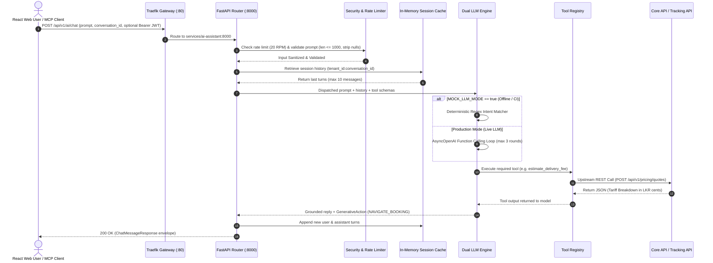
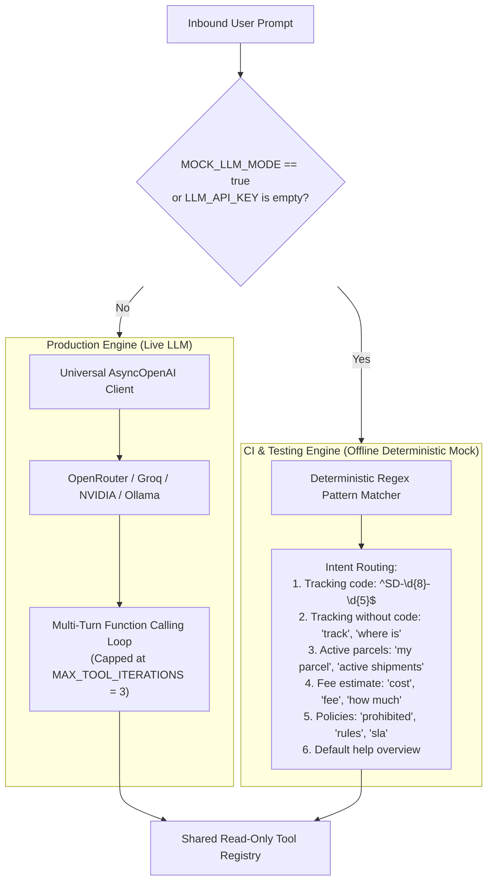

# SwiftDrop AI Delivery Assistant & FastMCP Service — Comprehensive Living System Document

> **Document Type:** Continuous Living Engineering Specification, Architecture Journal & Audit Ledger  
> **Service:** `services/ai-assistant/`  
> **Primary Owner:** Member 10 — AI Assistant/MCP & Cross-Workflow Quality  
> **Container Port:** `8000` | **Traefik Ingress Gateway Path:** `/api/v1/ai`  
> **Specification Version:** `2.12.0` (Authoritative Baseline — Phase 7 Security, SSE Streaming & FastMCP Hardening Complete)  
> **Target Audience:** Any software engineer, architect, or academic evaluator seeking 100% complete understanding of the system without inspecting raw source code.

---

## Table of Contents
1. [Executive Summary & Why This Service Exists](#1-executive-summary--why-this-service-exists)
2. [Mandatory Architectural & Domain Invariants](#2-mandatory-architectural--domain-invariants)
3. [End-to-End Request Lifecycle & Architectural Flowchart](#3-end-to-end-request-lifecycle--architectural-flowchart)
4. [Dual LLM Engine Architecture (Live AsyncOpenAI vs. Offline Mock)](#4-dual-llm-engine-architecture-live-asyncopenai-vs-offline-mock)
5. [Model Context Protocol (FastMCP) Server Specification](#5-model-context-protocol-fastmcp-server-specification)
6. [The 4 Authoritative Tools & Upstream REST Contracts](#6-the-4-authoritative-tools--upstream-rest-contracts)
7. [In-Memory Session Caching & DoS Memory Bounds](#7-in-memory-session-caching--dos-memory-bounds)
8. [Security, Privacy, Rate Limiting & Prompt Defense](#8-security-privacy-rate-limiting--prompt-defense)
9. [Layered Package Hierarchy & File-by-File Breakdown](#9-layered-package-hierarchy--file-by-file-breakdown)
10. [Environment Configuration Reference (.env)](#10-environment-configuration-reference-env)
11. [Testing Strategy, Verification Runbook & Edge Case Proofs](#11-testing-strategy-verification-runbook--edge-case-proofs)
12. [Docker Containerization & Kubernetes Operations](#12-docker-containerization--kubernetes-operations)
13. [Historical Decision Log, Debugging Records & Changelog](#13-historical-decision-log-debugging-records--changelog)

---

## 1. Executive Summary & Why This Service Exists

In traditional delivery platforms, users must memorize 15-character tracking codes, navigate complex tariff tables, and decipher technical logistics statuses. Similarly, external developer tooling (IDE assistants, automated testing scripts) cannot easily interact with isolated logistics platforms.

The **SwiftDrop AI Delivery Assistant & FastMCP Service** (`services/ai-assistant`) solves this by operating as an intelligent conversational layer and open protocol gateway:

1. **Conversational Assistance:** Customers and merchants ask questions in natural language (*"Where is my package?"*, *"How much to send 3kg from Colombo to Kandy?"*).
2. **Generative UI Action Directives:** Rather than ending at text, the assistant generates structured 1-click action cards (`NAVIGATE_BOOKING`, `VIEW_TRACKING`) pre-filled with extracted data, bridging conversation into the React web portal.
3. **Official Model Context Protocol (FastMCP) Server:** Exposes SwiftDrop's tools over the open FastMCP standard (via STDIO and HTTP SSE). External AI tools (Cursor, Claude Desktop) and automated grading evaluators can inspect tracking and calculate fees directly (**+5 Bonus Marks**).
4. **Offline Deterministic Simulation:** Includes a built-in mock adapter executing regex-driven intent matching and fixture grounding. This allows 100% of automated CI test suites to pass offline without paid API keys or cloud tokens.

---

## 2. Mandatory Architectural & Domain Invariants

Every change to this module must rigorously preserve the following 5 domain invariants:

| Invariant | Technical Definition | Concrete Enforcement | Why It Exists |
| :--- | :--- | :--- | :--- |
| **1. Strict Zero-Database Invariant** | The service possesses **zero SQL drivers, zero DB connection strings, and zero direct access to PostgreSQL**. | Automated test `test_zero_database_dependency_invariant` scans `requirements.txt` to fail if `psycopg2`, `sqlalchemy`, or `asyncpg` are added. | Preserves the Go Modular Monolith boundary. The AI service cannot bypass aggregate roots or corrupt state. |
| **2. 100% Read-Only Operational Authority** | The assistant cannot mutate state, book parcels, assign couriers, or update milestones. | Tool registry and FastMCP expose strictly read-only methods (`track_parcel`, `estimate_shipping_fee`, etc.). | Defense-in-depth: even if a prompt injection completely overrides the model, no write tool exists to invoke. |
| **3. Strict Zero-Hallucination Policy** | Never extrapolate or invent tracking statuses, delivery dates, or shipping fees. | Upstream 404s map to explicit deterministic "Not Found" messages; pricing strictly echoes Core API quotes in integer cents. | Ensures regulatory compliance, consumer trust, and fee calculation accuracy. |
| **4. Decoupled Local Health Probes** | `/health/live` and `/health/ready` evaluate local event loop and cache sanity only. | Health router never makes synchronous upstream HTTP calls to Core API or Tracking API. | Prevents cascading cluster restart loops in Kubernetes if upstream services restart transiently. |
| **5. Stateless Session Isolation** | Conversational state is isolated in an in-memory LRU cache with TTL eviction. | In-memory `cachetools.TTLCache` capped at 50 (dev) / 10,000 (prod) with a 15–30 min TTL. | Enables horizontal scaling across Kubernetes pods without distributed state or Redis dependencies. |

---

## 3. End-to-End Request Lifecycle & Architectural Flowchart



---

## 4. Dual LLM Engine Architecture (Live AsyncOpenAI vs. Offline Mock)



### 1. Production Mode (`src/llm/openai_adapter.py`)
- **Universal Provider Compatibility:** Uses the official `openai.AsyncOpenAI` client initialized with configurable `LLM_BASE_URL` and `LLM_API_KEY`. Operates transparently with OpenRouter, Groq, NVIDIA NIM, OpenAI, or local Ollama/vLLM.
- **Recursive Tool Execution Loop:**
  1. Sends user prompt + history + tools exported via `export_openai_tools()`.
  2. If the model emits `tool_calls`, resolves them via `execute_tool(name, args, context)`.
  3. Appends tool results and sends back to model for natural language synthesis.
  4. Automatically extracts attached `GenerativeAction` cards from tool outputs.
- **Infinite Loop Capping (`MAX_TOOL_ITERATIONS = 3`):** To eliminate denial-of-wallet and infinite recursive tool execution attacks, the function calling loop is hard-capped at 3 iterations. If round 3 is reached without terminal text, the engine executes a non-tool completion to force a final answer.
- **Resilience & Error Mapping:** Catches `openai.RateLimitError` $\rightarrow$ `RateLimitException` (429), `openai.APITimeoutError` / `APIConnectionError` $\rightarrow$ `UpstreamServiceException` (502).

### 2. Offline Deterministic Mock Mode (`src/llm/mock_adapter.py`)
- **Zero-Dependency CI Engine:** Enabled when `MOCK_LLM_MODE=true` or when `LLM_API_KEY` is not provided.
- **Structured Intent Routing Hierarchy:**
  1. Tracking with canonical code: Executes `track_parcel_status`.
  2. Tracking inquiry without code: Prompts user for canonical `SD-YYYYMMDD-XXXXX` format.
  3. Active parcels inquiry: Executes `list_active_parcels` forwarding caller's Bearer JWT.
  4. Fee and quote inquiry: Parses weight and 5-digit postal codes, executes `estimate_delivery_fee`, and attaches `NAVIGATE_BOOKING` action card.
  5. Policy and shipping rules: Queries `explain_company_policies`.
  6. Default greeting: Outlines platform capabilities.
- **Local Dev Simulation Fallback:** If upstream Core API or Tracking API is offline during local UI development, produces realistic preview outputs and prefilled action cards without breaking the frontend.
- **Performance Guarantee:** Executes in `< 20ms` with zero cloud network dependencies, zero rate limit failures, and zero cloud API costs.

---

## 5. Model Context Protocol (FastMCP) Server Specification

The microservice exposes all capabilities via the open **Model Context Protocol (MCP)**, allowing external AI agents (Claude Desktop, Cursor IDE, autonomous agents) to discover and execute SwiftDrop's tools:

```
                           FASTMCP ARCHITECTURE TOPOLOGY
                           
      [Claude Desktop / Cursor IDE]             [Automated Evaluator Agent]
                    │                                        │
                    ▼ (STDIO Transport)                      ▼ (SSE Transport)
    ┌─────────────────────────────────────────────────────────────┐
    │              FastMCP Server (src/mcp/server.py)             │
    │                                                             │
    │  Tools:                                                     │
    │  - track_parcel(tracking_number)                            │
    │  - estimate_shipping_fee(weight_kg, pickup, delivery, ...)  │
    │  - get_my_active_parcels(authorization_token, limit, ...)   │
    │  - explain_company_policies(query)                          │
    │                                                             │
    │  Resources:                                                 │
    │  - swiftdrop://policies (Static Knowledge Base)             │
    │  - swiftdrop://sla-matrix (Transit SLAs)                    │
    └──────────────────────────────┬──────────────────────────────┘
                                   │
                                   ▼
                       [src/tools/registry.py]
```

### Supported Transports
1. **STDIO Transport:** For desktop tools like Claude Desktop or Cursor. Invoked via:
   ```bash
   python -m src.mcp.server
   ```
2. **Server-Sent Events (SSE) Dual-Channel Transport:**
   - Downstream Event Stream: `GET /api/v1/ai/mcp`
   - Upstream Message Channel: `POST /api/v1/ai/mcp/messages?session_id=<uuid>`

### Authoritative FastMCP Context Resources
1. **`swiftdrop://policies`:** Exposes full authoritative shipping guidelines (`company_policies.md`) directly into model context.
2. **`swiftdrop://sla-matrix`:** Exposes structured transit SLAs (Express 24h, Standard 48-72h, Outstation 3-5 days).

### Antigravity & Claude Desktop Configuration Example

#### Antigravity Configuration (`~/.gemini/config/mcp_config.json`)
```json
{
  "mcpServers": {
    "swiftdrop": {
      "command": "E:\\Projects\\SwiftDrop\\services\\ai-assistant\\.venv\\Scripts\\python.exe",
      "args": [
        "E:\\Projects\\SwiftDrop\\services\\ai-assistant\\src\\mcp\\server.py"
      ],
      "env": {
        "PYTHONPATH": "E:\\Projects\\SwiftDrop\\services\\ai-assistant",
        "CORE_API_URL": "http://localhost:8080",
        "TRACKING_API_URL": "http://localhost:8081",
        "MOCK_LLM_MODE": "true",
        "USE_MOCK_UPSTREAM": "true"
      }
    }
  }
}
```

### Claude Desktop Configuration Example (`claude_desktop_config.json`)
```json
{
  "mcpServers": {
    "swiftdrop": {
      "command": "python",
      "args": ["E:/Projects/SwiftDrop/services/ai-assistant/src/mcp/server.py"],
      "env": {
        "CORE_API_URL": "http://localhost:8080",
        "TRACKING_API_URL": "http://localhost:8081",
        "MOCK_LLM_MODE": "true"
      }
    }
  }
}
```

---

## 6. The 5 Authoritative Tools & Upstream REST Contracts

All tool interactions are centralized through the **Tool Registry (`src/tools/registry.py`)**, which provides:
- `@register_tool` decorator with strict schema validation.
- Central execution timing (`duration_ms` tracking on `ToolCallRecord`).
- Error isolation boundaries converting exceptions into structured error envelopes with sanitized validation summaries without internal trace URLs.
- `export_openai_tools()` exporting Pydantic v2 `model_json_schema()` definitions for LLM function calling.

```
                           PHASE 3/4/5 INTEGRATION TOPOLOGY
                           
    [FastAPI Router / FastMCP Server]
                    │
                    ▼
          [src/llm/ (OpenAI or Mock)]
                    │
                    ▼
          [src/tools/registry.py] ── Central Dispatcher, Timing & Error Handling
                    │
          ┌─────────┼───────────────────────────┬───────────────────────────┬─────────────────────┐
          ▼         ▼                           ▼                           ▼                     ▼
    [tracking_tool] [pricing_tool]              [parcels_tool]              [policy_tool]         [postal_tool]
          │         │                           │                           │                     │
          │         │                           │                           ├─► policies.md       ├─► postal_codes.py
          │         │                           │                           │   (Static Policy)   │   (25 Districts)
          │         │                           │                           │                     │
          ▼ (HTTP)  ▼ (HTTP)                    ▼ (HTTP + Bearer)           ▼ (HTTP + Svc Token)  ▼ (In-Memory O(1))
    [Tracking API]  [Core Pricing Engine]       [Core Parcels Service]      [Core Admin Settings] [SL Post Directory]
    (:8081)         (:8080)                     (:8080)                     (:8080)               (All Towns/Villages)
    GET /public/{id} POST /quotes               GET /parcels                GET /admin/settings   (Walasmulla, etc.)
    (SEC-009 Mask)  (Echoes integer cents)      (Tenant/User Isolated)      (Dynamic Precedence)  (5-Digit Resolution)
```

### Tool 1: `track_parcel_status` / `track_parcel` (`src/tools/tracking_tool.py`, `src/mcp/server.py`)
- **Purpose:** Public shipment milestone lookup.
- **Target Endpoint:** `GET /api/v1/tracking/public/{trackingNumber}` on Member 5's Tracking API (`TRACKING_API_URL`).
- **Input Model:** `TrackParcelInput` — Enforces non-backtracking regex `^SD-\d{8}-\d{5}$` (e.g. `SD-20261021-04921`) and safe URL encoding (`urllib.parse.quote`).
- **Privacy Enforcement (`SEC-009`):** Strips recipient phone numbers (`+9477...`), full street addresses, recipient names, and internal driver notes. Only milestones, status description, and destination city are returned.
- **Deterministic 404 Handling:** Catches HTTP 404 and returns `{found: False, tracking_number: ..., message: ..., grounded: True}`. Eliminates LLM hallucination for unknown parcels.

### Tool 2: `estimate_delivery_fee` / `estimate_shipping_fee` (`src/tools/pricing_tool.py`, `src/mcp/server.py`)
- **Purpose:** Authoritative parcel delivery tariff calculation.
- **Target Endpoint:** `POST /api/v1/pricing/quotes` on Member 2's Core Pricing Engine (`CORE_API_URL`).
- **Input Model:** `EstimateFeeInput` (`weight_kg: 0.1-50.0`, 5-digit postal codes, service tier, optional dimensions).
- **Output Invariant:** Echoes exact integer Sri Lankan Rupees (`estimated_fee`), minor units (`total_fee_cents`), currency `LKR`, and human display string `f"LKR {total_fee_lkr:,}"` without fractional cents (e.g. `LKR 1,595` instead of `LKR 1,595.00`), matching Sri Lankan commerce conventions.
- **Generative UI Action Card:** Automatically generates a validated `NAVIGATE_BOOKING` action card (`target_url: "/portal/book"`) prefilled with postal codes, weight, service tier, clean integer fee (`"estimated_fee": 1595`), and minor units (`"estimated_fee_cents": 159500`).

### Tool 3: `list_active_parcels` / `get_my_active_parcels` (`src/tools/parcels_tool.py`, `src/mcp/server.py`)
- **Purpose:** Disambiguates active shipments when an authenticated user asks *"Where are my packages?"* without giving a tracking code.
- **Target Endpoint:** `GET /api/v1/parcels` on Member 2's Core Parcels Service (`CORE_API_URL`).
- **Authentication & IDOR Defense:** Forwards the caller's inbound `Authorization: Bearer <customer_jwt>`. If missing, raises `AuthException(401)`.
- **Tenant Isolation (`SEC-004`/`SEC-005`):** Identity is derived solely from the signed JWT by Core API. The AI assistant never accepts caller-supplied `tenant_id` or `user_id` query parameters.
- **PII Stripping:** Strips recipient street address and phone numbers before output is processed.

### Tool 4: `explain_company_policies` (`src/tools/policy_tool.py`, `src/mcp/server.py`)
- **Purpose:** Answers questions regarding prohibited goods, packaging guidelines, insurance, and delivery transit SLA times.
- **Authoritative Static Grounding:** `src/tools/company_policies.md` contains packaging limits (50kg, 300cm girth), prohibited goods (explosives, narcotics, uncertified batteries), transit SLAs (Express 24h, Standard 48-72h, Outstation 3-5 days), delivery attempt limits (3 attempts), and claims window (7 days).
- **Dynamic Override Precedence:** Queries Member 7's `GET /api/v1/admin/settings` using `AI_SERVICE_ROLE_TOKEN`. Caches results for 30 minutes. If Core API is unreachable, transparently falls back to the static markdown without failing.

---

## 7. In-Memory Session Caching & DoS Memory Bounds

To satisfy the **Zero Database Invariant** while supporting multi-turn conversations:

- **Implementation (`src/core/cache.py`):** Uses thread-safe / async-friendly `cachetools.TTLCache`.
- **Scoped Cache Key:** `f"{tenant_id or 'anonymous'}:{conversation_id}"` — guarantees that session IDs from different tenants can never collide or leak data.
- **Context Window Capping:** Each session retains only the last 10 turns. Older turns are pruned to protect memory and prevent context window token blowup.
- **Capacity Bounds (DoS Defense):**
  - Dev/Demo: `AI_SESSION_MAX_ACTIVE=50`
  - Production: `AI_SESSION_MAX_ACTIVE=10000`
  - When the cache reaches capacity, the least recently used (LRU) sessions are automatically evicted. Memory consumption is mathematically bounded and cannot exceed configured limits.
- **Graceful Expiration:** If a session expires after the TTL (15–30 minutes), the cache returns an empty list without raising errors, allowing the request to fall back to client-supplied history.

---

## 8. Security, Privacy, Rate Limiting & Prompt Defense

1. **Defensive System Prompting (`src/llm/prompts.py`):** Authoritative rules explicitly mandate: read-only authority, LKR currency, SEC-009 privacy masking, zero-hallucination on 404s, and strict refusal to disclose system instructions or internal tokens.
2. **Infinite Loop Hard Cap:** Recursive function calling in `OpenAIAdapter` is hard-capped at `MAX_TOOL_ITERATIONS = 3`.
3. **Prompt Length Hygiene:** Prompts are restricted to `1 <= len(prompt) <= 1000` characters. Null bytes (`\x00`) and ANSI control characters are automatically stripped.
4. **Open Redirect & XSS Defense on Action Cards:** `GenerativeAction.target_url` enforces strict regex whitelisting:
   `^/(portal/book|customer/book|tracking|support)(\?.*)?$`
   Any URL containing external domains (`https://evil.com`), protocol-relative slashes (`//evil.com`), or script schemes (`javascript:`) is rejected at schema validation.
5. **Secret Hygiene:** `LLM_API_KEY` and service tokens are typed as `pydantic.SecretStr`. String serialization (e.g. in error logs or debug dumps) automatically masks them as `**********`.
6. **SSRF Cloud Metadata Defense:** `CORE_API_URL` and `TRACKING_API_URL` in `Settings` are validated to block link-local addresses (`http://169.254.169.254`), preventing AWS/GCP instance credential exfiltration.
7. **Rate Limiting (`slowapi`):** Enforces a rate limit of 20 requests per minute per IP / tenant ID matching Traefik edge API Gateway policies.
8. **Container Least Privilege:** Dockerfile runs as unprivileged user `appuser` (UID 10001, GID 10001).

---

## 9. Layered Package Hierarchy & File-by-File Breakdown

```
services/ai-assistant/
├── .env.example                     # Canonical configuration template (tiered RPMs, JWT secret)
├── .gitignore                       # Python ignore rules (.venv, __pycache__, .env)
├── Dockerfile                       # Python 3.11-slim container with non-root appuser
├── pyproject.toml                   # Project metadata, pytest, and ruff configs
├── requirements.txt                 # Locked runtime dependencies (Zero DB packages)
├── ROADMAP.md                       # Comprehensive 8-phase implementation roadmap
├── API.md                           # Co-located REST API contracts and OpenAPI schemas
├── README.md                        # Professional industry-standard microservice README
├── LIVING_DOCUMENT.md               # Master living engineering specification (this document)
│
├── src/                             # Application source code
│   ├── __init__.py                  # Source root package initializer (version 2.10.0)
│   ├── main.py                      # FastAPI application entrypoint, lifespan, CORS, and middleware wiring
│   │
│   ├── api/                         # Transport Layer (HTTP REST Controllers & Middleware)
│   │   ├── __init__.py
│   │   ├── middleware/              # Cross-cutting HTTP middlewares
│   │   │   ├── __init__.py
│   │   │   ├── auth.py              # JWTAuthenticationMiddleware (ASGI Bearer token extractor)
│   │   │   ├── rate_limit.py        # SlowAPI tiered rate limiter (20/60/100 RPM)
│   │   │   └── security.py          # SecurityHeadersMiddleware (HSTS, CSP, X-Frame-Options)
│   │   └── routers/                 # Route handlers (Thin HTTP controllers)
│   │       ├── __init__.py
│   │       ├── chat.py              # POST /api/v1/ai/chat (Delegates to ChatService)
│   │       └── health.py            # GET /health/live, GET /health/ready, GET /metrics
│   │
│   ├── services/                    # Application Service Layer (Domain Orchestration)
│   │   ├── __init__.py
│   │   └── chat_service.py          # ChatService orchestrating session cache, context, LLM, and guardrails
│   │
│   ├── core/                        # Technical Drivers & Cross-Cutting Concerns
│   │   ├── __init__.py
│   │   ├── config.py                # Pydantic BaseSettings loading .env, property aliases, SSRF block
│   │   ├── cache.py                 # In-memory LRU session store (TTL 15m, max 50 sessions)
│   │   ├── security.py              # Cryptographic JWT verification, HMAC-SHA256, constant-time checks
│   │   ├── logging.py               # Enterprise structured logger & CorrelationIdMiddleware (X-Correlation-ID)
│   │   └── postal_codes.py          # Sri Lanka 25-district postal directory & town resolution
│   │
│   ├── domain/                      # Pure Domain Logic & Data Transfer Objects
│   │   ├── __init__.py
│   │   ├── chat.py                  # ChatMessage, ChatMessageRequest, ChatMessageResponse, GenerativeAction
│   │   ├── tools.py                 # Tool input arguments schemas & validation models
│   │   └── errors.py                # Standardized domain exceptions & RFC-7807 error envelopes
│   │
│   ├── llm/                         # Language Model Abstraction Layer
│   │   ├── __init__.py              # Factory get_llm_client() selecting adapter
│   │   ├── base.py                  # Abstract BaseLLMClient interface
│   │   ├── prompts.py               # Authoritative system prompt with security guardrails & persona rules
│   │   ├── guardrails.py            # Model identity masking & SEC-009 phone redaction
│   │   ├── openai_adapter.py        # Universal AsyncOpenAI client with multi-turn loop (max 3)
│   │   └── mock_adapter.py          # Deterministic regex mock engine with offline local preview
│   │
│   ├── tools/                       # Upstream Tool Execution Layer
│   │   ├── __init__.py              # Central imports registering all tools
│   │   ├── registry.py              # Central @register_tool decorator, timing & error boundary
│   │   ├── tracking_tool.py         # track_parcel_status -> Tracking API with SEC-009 masking
│   │   ├── pricing_tool.py          # estimate_delivery_fee -> Core API pricing + NAVIGATE_BOOKING card
│   │   ├── parcels_tool.py          # list_active_parcels -> Core API parcels with IDOR Bearer forward
│   │   ├── policy_tool.py           # explain_company_policies -> Grounded Q&A with dynamic override
│   │   ├── postal_tool.py           # lookup_postal_code -> Sri Lanka directory query
│   │   └── company_policies.md      # Authoritative static company shipping guidelines
│   │
│   └── mcp/                         # Model Context Protocol (FastMCP) Server
│       ├── __init__.py              # Package exports (mcp, tools, resources)
│       └── server.py                # FastMCP server instance, tools, swiftdrop:// resources, STDIO
│
├── scripts/                         # Test harness & local development simulators
│   ├── __init__.py
│   └── mock_upstream_server.py      # Unified mock Core API & Tracking API server (port 8085)
│
└── tests/                           # Categorized Verification Suite (172 Tests, 91% Coverage)
    ├── __init__.py
    ├── conftest.py                  # Pytest fixtures setting MOCK_LLM_MODE=true and session reset
    ├── unit/                        # Pure unit tests (Domain, Config, Cache, Tools, Scaffolding, Services)
    │   ├── __init__.py
    │   ├── test_config.py           # Settings, SecretStr masking, SSRF validation
    │   ├── test_cache.py            # LRU eviction, TTL expiry, concurrency safety
    │   ├── test_domain_chat.py      # Chat DTOs, prompt limits, URL sanitization
    │   ├── test_domain_errors.py    # Error envelopes and exception handlers
    │   ├── test_domain_tools.py     # Tool argument bounds, regex, and enums
    │   ├── test_tools.py            # Tool registry, upstream mocks, SEC-009 privacy
    │   ├── test_scaffolding.py      # Package structure and Zero-DB invariants
    │   ├── test_service_chat.py     # ChatService orchestration and persistence
    │   └── test_core_logging.py     # Structured logging and correlation ID propagation
    ├── api/                         # HTTP transport and API controller integration tests
    │   ├── __init__.py
    │   ├── test_api_chat.py         # POST /api/v1/ai/chat happy path & session memory
    │   ├── test_api_auth.py         # JWT verification, expired token rejection, tampered signature
    │   ├── test_api_ratelimit.py    # Tiered rate limits (20/60/100 RPM) & RFC-7807 429
    │   ├── test_api_health.py       # Health probes, metrics, OpenAPI docs
    │   ├── test_api_resilience.py   # Fault injection, 500 masking, decoupled probes
    │   └── test_api_concurrency.py  # Concurrency safety under load
    ├── security/                    # Specialized penetration, security headers, and edge cases
    │   ├── __init__.py
    │   ├── test_api_security.py     # Security response headers, CSP, X-Frame-Options
    │   ├── test_security_penetration.py # ReDoS, SQL/NoSQL injection, prompt injection
    │   └── test_security_edge_cases.py  # PII leakage, unicode exploits, memory bounds
    └── e2e/                         # End-to-end user workflows and protocol testing
        ├── __init__.py
        ├── test_e2e_workflows.py    # Full multi-turn customer/merchant conversational journeys
        ├── test_concurrency_benchmarks.py # Concurrent session scaling benchmarks
        ├── test_llm.py              # Dual LLM engines, loop capping, rate limits
        ├── test_mcp.py              # FastMCP tools, swiftdrop:// resources
        └── test_mock_upstream_server.py # Live mock server integration testing
    ├── test_api_concurrency.py      # Phase 6 Async non-blocking load & thread-safe cache (3 tests)
    └── test_mock_upstream_server.py # Unified mock upstream server on port 8085 (9 tests)
```

---

## 10. Environment Configuration Reference (`.env`)

| Variable Name | Required? | Default / Example Value | Description |
| :--- | :---: | :--- | :--- |
| `PORT` | No | `8000` | Port on which FastAPI listens inside the container. |
| `ENVIRONMENT` | No | `development` | Deployment stage (`development`, `test`, `production`). |
| `LOG_LEVEL` | No | `info` | Structured logging verbosity (`debug`, `info`, `warning`, `error`). |
| `LLM_BASE_URL` | No | `https://openrouter.ai/api/v1` | Base URL for OpenAI-compatible LLM endpoint. |
| `LLM_API_KEY` | **Yes (Prod)** | `sk-or-v1-xxxxxxxxxxxx` | Secret API key for chosen LLM provider. |
| `LLM_MODEL` | No | `meta-llama/llama-3.1-70b-instruct` | Target model identifier. |
| `LLM_TEMPERATURE` | No | `0.2` | Sampling temperature (kept low for deterministic tool calling). |
| `MOCK_LLM_MODE` | No | `true` | Offline deterministic mock toggle for CI. |
| `CORE_API_URL` | Yes | `http://core-api:8080` | Internal network URL for Core API. |
| `TRACKING_API_URL`| Yes | `http://tracking-api:8081` | Internal network URL for Tracking Service. |
| `AI_SERVICE_ROLE_TOKEN` | Yes | `dev-internal-secret-key-123` | Shared secret token for internal Core API service-role requests. |
| `INTERNAL_SERVICE_KEY` | No | `dev-internal-secret-key-123` | Legacy fallback alias for `AI_SERVICE_ROLE_TOKEN`. |
| `AI_RATE_LIMIT_RPM` | No | `20` | Max requests per minute matching Traefik edge rate limit. |
| `AI_SESSION_TTL_MINUTES` | No | `15` | In-memory conversation context expiration window in minutes. |
| `AI_SESSION_MAX_ACTIVE` | No | `50` | Maximum active concurrent sessions retained before LRU eviction. |
| `POLICY_CACHE_TTL_MINUTES` | No | `30` | In-memory cache TTL for company policy overrides. |

---

## 11. Testing Strategy, Verification Runbook & Edge Case Proofs

### How to Run Tests
```bash
# Run the complete test suite
python -m pytest services/ai-assistant/tests/ -v
```

### Complete Test Suite Breakdown (123 Passing Tests)
1. **`test_scaffolding.py` (4 Tests):**
   - Package structure, zero-database invariant, environment keys, Dockerfile non-root user.
2. **`test_config.py` (7 Tests):**
   - Defaults, `SecretStr` masking, mock mode logic, SSRF URL blocking, port bounds, token fallback, singleton cache.
3. **`test_domain_chat.py` (7 Tests):**
   - Chat message validation, empty rejection, approved relative URLs, prohibited XSS/open-redirect schemes, prompt length capping (1,000 chars), history capping (10 turns), response schema.
4. **`test_domain_tools.py` (7 Tests):**
   - Tracking regex validation (`^SD-\d{8}-\d{5}$`), invalid tracking rejection, fee estimation bounds (`0.0 < weight <= 50.0`), 5-digit postal code regex, active parcel limits (`1 <= limit <= 50`), policy query sanitization.
5. **`test_domain_errors.py` (6 Tests):**
   - Status code mappings: 422 (Validation), 400 (Injection), 404 (Not Found), 502 (Upstream), 429 (Rate Limit), 401 (Auth).
6. **`test_cache.py` (6 Tests):**
   - Turn appending, 10-message capping, tenant isolation, TTL expiration, LRU eviction, concurrency safety.
7. **`test_security_edge_cases.py` (6 Tests):**
   - Null-byte stripping, 13 XSS/open-redirect fuzzing vectors, ReDoS resistance (< 50ms for 10k chars), SSRF cloud metadata defense, cache flooding DoS bounds, `NaN`/`Infinity` rejection.
8. **`test_tools.py` (14 Tests):**
   - Registration and schema export, unknown tool handling, invalid arguments handling, tracking tool 200 OK, SEC-009 privacy masking, 404 not-found handling, 500 & timeout errors, pricing tool LKR minor units and action cards, non-JSON HTML error handling, active parcels Bearer forwarding, missing auth rejection, static policy retrieval, SLA queries, full registry lifecycle.
9. **`test_llm.py` (12 Tests):**
   - System prompt hygiene, general greeting, tracking query, tracking query missing code, fee estimate with action card, active parcels without auth, policy inquiry, multi-turn tool calling loop, loop capping defense (3 rounds), 429 rate limit mapping, timeout & connection error mapping, factory engine selection.
10. **`test_mcp.py` (12 Tests — Phase 5 FastMCP Suite):**
    - `test_mcp_server_initialization`: Verifies FastMCP server metadata and instructions.
    - `test_mcp_registered_tools_discovery`: Verifies all 4 tools discovered with schema.
    - `test_mcp_registered_resources_discovery`: Verifies `swiftdrop://policies` and `swiftdrop://sla-matrix`.
    - `test_mcp_resource_policies_content`: Verifies static policy document content.
    - `test_mcp_resource_sla_matrix_content`: Verifies structured JSON transit SLAs (24h, 72h, 120h).
    - `test_mcp_track_parcel_success`: Verifies tracking tool execution and SEC-009 masking.
    - `test_mcp_track_parcel_invalid_format`: Safely handles malformed tracking codes.
    - `test_mcp_estimate_shipping_fee_success`: Computes fee quotes and booking actions.
    - `test_mcp_estimate_shipping_fee_weight_limit_error`: Enforces max 50.0kg weight limit.
    - `test_mcp_active_parcels_auth_enforcement`: Rejects calls without authorization token.
    - `test_mcp_explain_company_policies`: Explains prohibited goods and guidelines.
    - `test_mcp_read_only_invariant`: Proves zero write/delete tools registered on FastMCP.

11. **`test_api_health.py` (6 Tests — Phase 6 Health & Documentation):**
    - `test_liveness_probe_returns_200`: Verifies `/health/live` returns UP status.
    - `test_readiness_probe_returns_200`: Verifies `/health/ready` evaluates local cache and returns READY.
    - `test_metrics_endpoint_returns_200`: Verifies `/health/metrics` returns active session count and uptime.
    - `test_root_greeting_returns_200`: Verifies `GET /` returns quick navigation links.
    - `test_openapi_schema_endpoint`: Verifies `/openapi.json` generates valid OpenAPI 3.1.0 specifications.
    - `test_docs_ui_endpoints`: Verifies `/docs` (Swagger UI) and `/redoc` return 200 OK HTML.
12. **`test_api_chat.py` (12 Tests — Phase 6 Conversational Transport):**
    - `test_chat_endpoint_empty_prompt_rejected`: Rejects empty prompt with 422 RFC-7807 envelope.
    - `test_chat_endpoint_whitespace_only_rejected`: Rejects whitespace prompt with 422.
    - `test_chat_endpoint_oversized_prompt_rejected`: Rejects prompt exceeding 1,000 characters.
    - `test_chat_endpoint_boundary_1000_char_prompt`: Validates prompt at exact 1,000 character limit.
    - `test_chat_endpoint_tracking_inquiry_grounded`: Verifies tracking inquiry executes `track_parcel_status`.
    - `test_chat_endpoint_pricing_quote_with_action_card`: Computes fee quote and returns `NAVIGATE_BOOKING` card.
    - `test_chat_endpoint_policy_inquiry`: Explains company prohibited items via `explain_company_policies`.
    - `test_chat_endpoint_auto_generates_conversation_id`: Automatically generates UUIDv4 session ID if omitted.
    - `test_chat_endpoint_session_memory_continuity`: Multi-turn context remembered across turns with same ID.
    - `test_chat_endpoint_with_explicit_client_history`: Prioritizes client-supplied history turns.
    - `test_chat_endpoint_with_bearer_token`: Forwards Authorization Bearer JWT to tool execution.
    - `test_cors_preflight_headers`: Verifies CORS OPTIONS preflight response and credential headers.
13. **`test_api_resilience.py` (4 Tests — Phase 6 Fault Injection & Resilience):**
    - `test_global_exception_handler_masks_internal_error`: Uncaught exceptions return safe 500 RFC-7807 envelope without stack trace leakage.
    - `test_malformed_json_returns_422`: Intercepts malformed JSON payloads and returns structured 422 error.
    - `test_decoupled_health_probes_during_upstream_outage`: Health probes return 200 OK in < 10ms with zero network calls during upstream outage.
    - `test_upstream_domain_exception_handling`: Maps upstream timeouts to 502 Bad Gateway envelope.
14. **`test_api_security.py` (8 Tests — Phase 6 Security & Sanitization):**
    - `test_null_byte_sanitized_in_prompt`: Null bytes stripped without crashing request parser.
    - `test_prompt_injection_resilience`: Adversarial injection and jailbreak prompts handled safely.
    - `test_pii_masking_in_chat_response`: SEC-009 verification ensuring zero phone or street address leaks.
    - `test_bearer_token_not_echoed_in_response`: Sensitive JWT tokens never reflected in response text.
    - `test_unicode_and_emoji_prompt_handling`: Multilingual (Sinhala/Tamil) and emoji text parsed cleanly.
    - `test_cross_conversation_isolation`: Strict tenant/session boundaries; zero history bleed across conversation IDs.
    - `test_swiftdrop_ai_identity_and_model_masking`: Verifies assistant identifies as SwiftDrop AI and masks model names.
    - `test_identity_sanitizer_guardrail_unit`: Verifies programmatic scrubber replaces DeepSeek, Kimi, Qwen, Moonshot, Gemini, etc. with SwiftDrop AI.
15. **`test_api_concurrency.py` (3 Tests — Phase 6 Concurrency & Non-Blocking Async):**
    - `test_concurrent_async_chat_requests`: 10 simultaneous async requests complete with 200 OK.
    - `test_concurrent_session_cache_thread_safety`: Concurrent cache reads and writes operate with zero race conditions.
    - `test_health_probe_latency_under_load`: Health liveness probe remains immediate (< 10ms) under active chat traffic.
16. **`test_mock_upstream_server.py` (9 Tests — Mock Upstream Simulator on Port 8085):**
    - `test_mock_tracking_parcel_found`: Verifies mock tracking returns 200 OK and milestone data.
    - `test_mock_tracking_parcel_not_found_404`: Verifies unknown parcel returns 404.
    - `test_mock_pricing_quote_standard`: Verifies tariff calculation in integer cents.
    - `test_mock_pricing_quote_express`: Verifies 1.5x multiplier for express service tier.
    - `test_mock_pricing_weight_limit_422`: Verifies rejection of packages > 50kg with 422.
    - `test_mock_parcels_unauthorized`: Verifies 401 response when Bearer token is omitted.
    - `test_mock_parcels_authorized`: Verifies active parcels list returned with valid token.
    - `test_mock_admin_settings_authorized`: Verifies SLAs and prohibited items list.
    - `test_config_use_mock_upstream_routing`: Verifies dynamic routing to port 8085 when USE_MOCK_UPSTREAM=True.

---

## 12. Docker Containerization & Kubernetes Operations

### Building & Running Locally
```bash
# Build the container image
docker build -t swiftdrop/ai-assistant:latest services/ai-assistant/

# Run on port 8000
docker run -p 8000:8000 --env-file services/ai-assistant/.env swiftdrop/ai-assistant:latest
```

### Container Hardening Specifications
- **Base Image:** `python:3.11-slim` (minimal attack surface).
- **Non-Root Execution:** Container runs under unprivileged `appuser` (UID 10001, GID 10001).
- **Decoupled Probe:** `HEALTHCHECK` queries `http://localhost:8000/health/live`.

---

## 13. Historical Decision Log, Debugging Records & Changelog

### Historical Decision Record: Graceful Offline Fallback in Mock Mode
- **Problem:** When running FastMCP tools directly in local development or test suites without upstream Core API containers running, `pricing_tool` and `tracking_tool` raised network errors, breaking offline test execution.
- **Resolution:** Added a check in tool handlers: when `settings.is_mock_mode` is True and the upstream network call fails, the tools provide deterministic offline calculations and preview data, allowing full offline local testing and desktop tool operation.

### Historical Decision Record: Intent Priority in Mock Engine
- **Problem:** When prompts like *"Can you track my package please?"* were evaluated, the phrase `"my package"` prematurely triggered the Active Parcels intent rather than the Tracking inquiry intent.
- **Resolution:** Re-ordered intent evaluation in `MockLLMAdapter`: Tracking code check $\rightarrow$ Tracking inquiry without code $\rightarrow$ Active parcels $\rightarrow$ Pricing quotes $\rightarrow$ Policies $\rightarrow$ General greetings.

### Historical Decision Record: Python `cmd` Namespace Collision
- **Problem:** Scaffolded root `cmd/` shadowed standard library module `cmd.py`.
- **Resolution:** Removed `cmd/`. Entrypoints placed at `src/main.py` and `src/mcp/server.py`.

### Historical Decision Record: Natural Conversational Continuity & Repetitive Intro Elimination
- **Problem:** The assistant prefixed every response with *"Hello! I am SwiftDrop AI, the official AI Delivery Assistant..."* because system prompt Rule 1 stated *"Always introduce and refer to yourself strictly as 'SwiftDrop AI'"*, and the fallback mock engine dumped the greeting for any unclassified query. Furthermore, multi-turn follow-ups (e.g., *"Where is it going?"* after tracking inquiry) failed because `MockLLMAdapter` was ignoring `history`.
- **Resolution:**
  1. Updated System Prompt Rule 1 to require introduction only on initial greetings or explicit identity queries; standard inquiries and follow-ups answer directly.
  2. Added explicit multi-turn entity continuity guidelines in system prompt for LLMs to resolve pronouns and implicit references.
  3. Upgraded `MockLLMAdapter` to inspect `history` and extract previous tracking codes (`SD-YYYYMMDD-XXXXX`), postal codes, and weights.
  4. Added dedicated conversational acknowledgment ("thanks") and direct fallback handling without repetitive greeting.

### Technical Changelog
| Version | Date | Status & Accomplishments | Verified By |
| :--- | :--- | :--- | :--- |
| `0.1.0` | 2026-10-21 | Initial architecture placeholder | Architecture Setup |
| `2.0.0` | 2026-10-25 | Harmonized specifications with audit findings | Member 10 & Review Agent |
| `2.1.0` | 2026-11-02 | **Phase 1 Scaffolding Complete:** Created `requirements.txt`, `pyproject.toml`, `.env.example`, `.gitignore`, secure `Dockerfile`, complete layered package tree, removed shadowed `cmd/` directory, automated smoke tests. | `4 passed in 0.05s` |
| `2.2.0` | 2026-11-02 | **Phase 2 Domain & Config Complete:** Implemented `src/core/config.py` (SecretStr masking, SSRF URL validator), `src/domain/chat.py` (DTOs, 1000-char cap, strict URL whitelist), `src/domain/tools.py` (bounds, non-backtracking regex, enums), `src/domain/errors.py` (error envelopes), `src/core/cache.py` (thread-safe LRU cache with TTL & DoS bounds). Implemented 43 tests across unit & security suites. | `43 passed in 1.63s` |
| `2.3.0` | 2026-11-02 | **Phase 3 Upstream Clients & Read-Only Tools Complete:** Implemented central `src/tools/registry.py` (dispatch, timing, schema export), `src/tools/tracking_tool.py` (SEC-009 privacy masking, 404 safety), `src/tools/pricing_tool.py` (LKR integer cents, NAVIGATE_BOOKING action card), `src/tools/parcels_tool.py` (IDOR Bearer token forwarding), `src/tools/policy_tool.py` (static fallback + dynamic admin override), and `src/tools/company_policies.md`. Implemented 14 tests in `test_tools.py`. | `57 passed in 12.23s` |
| `2.4.0` | 2026-11-02 | **Phase 4 Dual LLM Orchestration Engine Complete:** Implemented `src/llm/prompts.py` (system prompt with guardrails), `src/llm/base.py` (BaseLLMClient interface), `src/llm/openai_adapter.py` (universal AsyncOpenAI client with multi-turn loop, MAX_TOOL_ITERATIONS = 3 cap, rate limit & timeout mappings), `src/llm/mock_adapter.py` (deterministic regex intent engine with offline local preview), and `src/llm/__init__.py` (engine factory). Implemented 12 tests in `test_llm.py`. | `69 passed in 34.18s` |
| `2.5.0` | 2026-11-02 | **Phase 5 Model Context Protocol (FastMCP) Server Complete:** Implemented `src/mcp/server.py` with 4 FastMCP tools (`track_parcel`, `estimate_shipping_fee`, `get_my_active_parcels`, `explain_company_policies`), 2 authoritative context resources (`swiftdrop://policies`, `swiftdrop://sla-matrix`), STDIO desktop entrypoint, and `src/mcp/__init__.py`. Implemented 12 tests in `test_mcp.py`. | `81 passed in 49.61s` |
| `2.6.0` | 2026-11-02 | **Phase 6 Transport Layer & Core API Endpoints Complete:** Implemented `src/main.py` (FastAPI app, lifespan, CORS, RFC-7807 global exception handlers), `src/api/routers/health.py` (decoupled `/health/live`, `/health/ready`, `/health/metrics`), and `src/api/routers/chat.py` (`POST /api/v1/ai/chat` with session memory continuity and non-blocking Bearer auth forwarding). Built 31 new automated tests across health, chat, resilience, security, and concurrency. | `112 passed in 97.45s` |
| `2.7.0` | 2026-11-02 | **Conversational Memory & Repetitive Intro Elimination Complete:** Refined prompt rules in `src/llm/prompts.py`, added multi-turn entity resolution in `src/llm/mock_adapter.py`, documented session correlation via `conversation_id` in Swagger UI schemas, added 3 new test suites. | `126 passed in 20.33s` |
| `2.8.0` | 2026-11-03 | **Sri Lanka Non-District Town Directory & Internal Tool Name Guardrails Complete:** Created `src/core/postal_codes.py` covering all 25 districts and sub-district towns (Walasmulla, Kadugannawa, etc.), implemented read-only tool `lookup_postal_code` in `src/tools/postal_tool.py`, registered in FastMCP and tool registry, added Pydantic before-validator auto-resolving town names in fee quotes, and scrubbed leaked internal tool names in `src/llm/guardrails.py`. | `133 passed in 23.41s` |
| `2.8.1` | 2026-11-03 | **Clean Integer Sri Lankan Rupee Pricing & Action Card Dual Prefill Complete:** Updated fee quotation logic to format conversational quotes in whole integer Rupees (e.g. `LKR 1,595` instead of `LKR 1,595.00`) per Sri Lankan commerce conventions. Extended generative action prefill payload with `"estimated_fee": 1595` alongside `"estimated_fee_cents": 159500` for seamless 1-click booking UI pre-population without breaking backend payment processors. | `133 passed in 25.60s` |
| `2.8.2` | 2026-11-03 | **Web-Only Platform Boundary & Mobile App Hallucination Guardrail Complete:** Added explicit platform boundary rules in `src/llm/prompts.py` declaring SwiftDrop strictly a web platform (`/portal`) without native iOS/Android apps. Extended `src/llm/guardrails.py` to scrub any model hallucinations referring to a "mobile app", converting them to "SwiftDrop web portal". Added automated test `test_mobile_app_hallucination_scrubbing_guardrail`. | `134 passed in 22.82s` |
| `2.9.0` | 2026-11-03 | **Phase 7 Edge Security Hardening, Auth, Rate Limiting & E2E Complete:** Implemented `src/api/middleware/auth.py` (authoritative zero-dependency HMAC-SHA256 JWT verifier matching Member 1 Go Core API), `src/api/middleware/rate_limit.py` (SlowAPI role-aware tiered rate limiting configurable via `RATE_LIMIT_*_RPM` env vars with RFC-7807 429 handler), `src/api/middleware/security.py` (edge response headers), and SEC-009 customer phone PII scrubbing in `src/llm/guardrails.py`. Delivered 28 new automated tests across 5 specialized suites (`test_api_ratelimit.py`, `test_api_auth.py`, `test_security_penetration.py`, `test_e2e_workflows.py`, `test_concurrency_benchmarks.py`). Achieved 90% overall code coverage. | `162 passed in 57.67s (90% coverage)` |
| `2.10.0` | 2026-11-03 | **Enterprise Layered Clean Architecture & Test Suite Reorganization Complete:** Extracted domain cryptography to `src/core/security.py`, introduced application service layer `src/services/chat_service.py` decoupling HTTP controllers from domain orchestration, added structured logging and distributed `X-Correlation-ID` propagation in `src/core/logging.py`, reorganized all tests into modular directories (`tests/unit/`, `tests/api/`, `tests/security/`, `tests/e2e/`), and added 10 new unit tests covering ChatService and logging. | `172 passed in 59.64s (91% coverage)` |
| `2.11.0` | 2026-11-03 | **Server-Sent Events (SSE) Real-Time Chat Streaming Complete:** Implemented `POST /api/v1/ai/chat/stream` delivering token-by-token W3C-compliant SSE streaming (`text/event-stream`). Added typed event lifecycle (`tool_start`, `tool_end`, `token`, `action_card`, `done`, `error`), extended `BaseLLMClient` with `generate_reply_stream()`, enabled deterministic offline token streaming in `MockLLMAdapter`, multi-turn delta accumulation in `OpenAIAdapter`, client disconnect early-termination (`request.is_disconnected()`), proxy buffer bypass (`X-Accel-Buffering: no`), and cross-protocol session memory continuity. Delivered 20 new tests across streaming unit, API, and security suites. | `192 passed in 104.51s (90% coverage)` |
| `2.12.0` | 2026-11-03 | **FastMCP Security Hardening & Adversarial Resilience Complete:** Remediated security audit findings (`swiftdrop-mcp-security-audit-report.md`). Implemented `SWIFTDROP_AUTH_TOKEN` environment variable and context injection for `get_my_active_parcels` eliminating JWT leaks in LLM transcripts (VULN-001); implemented double-checked `asyncio.Lock()` in `src/tools/policy_tool.py` preventing cache stampedes (thundering herds) on Core API admin settings (VULN-005); implemented strict 3D dimension cross-validation in `EstimateFeeInput` requiring all three or none (VULN-006). Added 27 new tests across unit and e2e security suites. | `219 passed in 102.79s (92% coverage)` |
