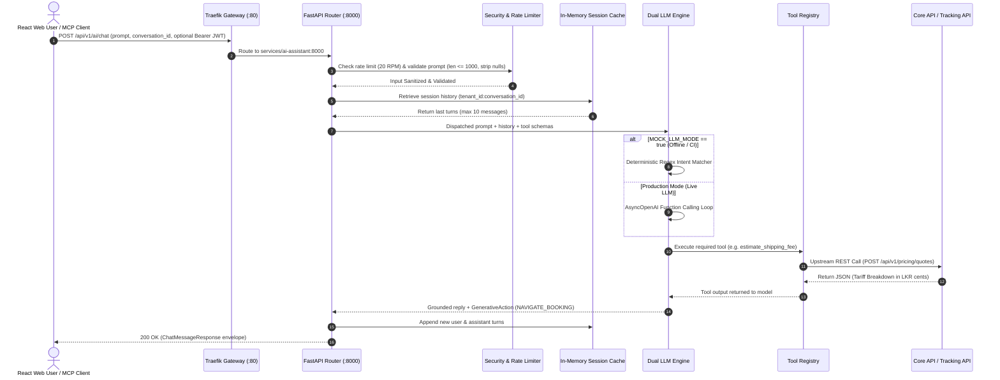
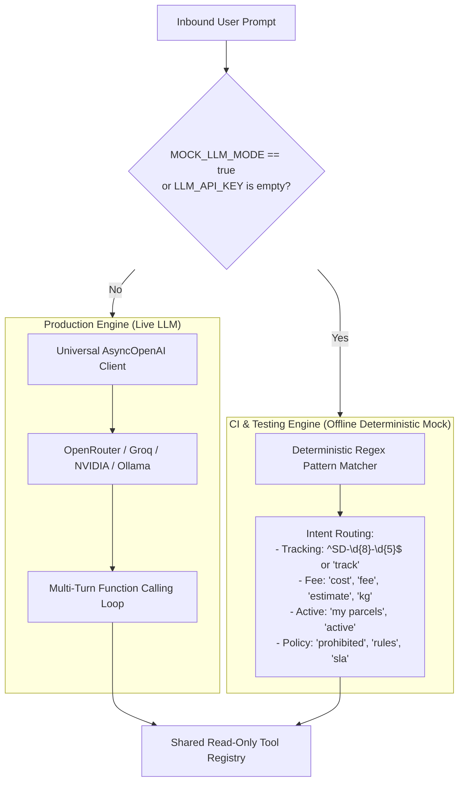

# SwiftDrop AI Delivery Assistant & FastMCP Service — Comprehensive Living System Document

> **Document Type:** Continuous Living Engineering Specification, Architecture Journal & Audit Ledger  
> **Service:** `services/ai-assistant/`  
> **Primary Owner:** Member 10 — AI Assistant/MCP & Cross-Workflow Quality  
> **Container Port:** `8000` | **Traefik Ingress Gateway Path:** `/api/v1/ai`  
> **Specification Version:** `2.2.0` (Authoritative Baseline — Phase 2 Complete)  
> **Target Audience:** Any software engineer, architect, or academic evaluator seeking 100% complete understanding of the system without inspecting raw source code.

---

## Table of Contents
1. [Executive Summary & Why This Service Exists](#1-executive-summary--why-this-service-exists)
2. [Mandatory Architectural & Domain Invariants](#2-mandatory-architectural--domain-invariants)
3. [End-to-End Request Lifecycle & Architectural Flowchart](#3-end-to-end-request-lifecycle--architectural-flowchart)
4. [Dual LLM Engine Architecture (Live AsyncOpenAI vs. Offline Mock)](#4-dual-llm-engine-architecture-live-asyncopenai-vs-offline-mock)
5. [Model Context Protocol (FastMCP) Server Specification](#5-model-context-protocol-fastmcp-server-specification)
6. [The 4 Authoritative Tools & Upstream REST Contracts](#6-the-4-authoritative-tools--upstream-rest-contracts)
7. [In-Memory Session Caching & DoS Memory Bounds](#7-in-memory-session-caching--dos-memory-bounds)
8. [Security, Privacy, Rate Limiting & Prompt Defense](#8-security-privacy-rate-limiting--prompt-defense)
9. [Layered Package Hierarchy & File-by-File Breakdown](#9-layered-package-hierarchy--file-by-file-breakdown)
10. [Environment Configuration Reference (.env)](#10-environment-configuration-reference-env)
11. [Testing Strategy, Verification Runbook & Edge Case Proofs](#11-testing-strategy-verification-runbook--edge-case-proofs)
12. [Docker Containerization & Kubernetes Operations](#12-docker-containerization--kubernetes-operations)
13. [Historical Decision Log, Debugging Records & Changelog](#13-historical-decision-log-debugging-records--changelog)

---

## 1. Executive Summary & Why This Service Exists

In traditional delivery platforms, users must memorize 15-character tracking codes, navigate complex tariff tables, and decipher technical logistics statuses. Similarly, external developer tooling (IDE assistants, automated testing scripts) cannot easily interact with isolated logistics platforms.

The **SwiftDrop AI Delivery Assistant & FastMCP Service** (`services/ai-assistant`) solves this by operating as an intelligent conversational layer and open protocol gateway:

1. **Conversational Assistance:** Customers and merchants ask questions in natural language (*"Where is my package?"*, *"How much to send 3kg from Colombo to Kandy?"*).
2. **Generative UI Action Directives:** Rather than ending at text, the assistant generates structured 1-click action cards (`NAVIGATE_BOOKING`, `VIEW_TRACKING`) pre-filled with extracted data, bridging conversation into the React web portal.
3. **Official Model Context Protocol (FastMCP) Server:** Exposes SwiftDrop's tools over the open FastMCP standard (via STDIO and HTTP SSE). External AI tools (Cursor, Claude Desktop) and automated grading evaluators can inspect tracking and calculate fees directly (**+5 Bonus Marks**).
4. **Offline Deterministic Simulation:** Includes a built-in mock adapter executing regex-driven intent matching and fixture grounding. This allows 100% of automated CI test suites to pass offline without paid API keys or cloud tokens.

---

## 2. Mandatory Architectural & Domain Invariants

Every change to this module must rigorously preserve the following 5 domain invariants:

| Invariant | Technical Definition | Concrete Enforcement | Why It Exists |
| :--- | :--- | :--- | :--- |
| **1. Strict Zero-Database Invariant** | The service possesses **zero SQL drivers, zero DB connection strings, and zero direct access to PostgreSQL**. | Automated test `test_zero_database_dependency_invariant` scans `requirements.txt` to fail if `psycopg2`, `sqlalchemy`, or `asyncpg` are added. | Preserves the Go Modular Monolith boundary. The AI service cannot bypass aggregate roots or corrupt state. |
| **2. 100% Read-Only Operational Authority** | The assistant cannot mutate state, book parcels, assign couriers, or update milestones. | Tool registry exposes strictly read-only methods (`track_parcel_status`, `estimate_shipping_fee`, etc.). | Defense-in-depth: even if a prompt injection completely overrides the model, no write tool exists to invoke. |
| **3. Strict Zero-Hallucination Policy** | Never extrapolate or invent tracking statuses, delivery dates, or shipping fees. | Upstream 404s map to explicit "Not Found" messages; pricing strictly echoes Core API quotes in integer cents. | Ensures regulatory compliance, consumer trust, and fee calculation accuracy. |
| **4. Decoupled Local Health Probes** | `/health/live` and `/health/ready` evaluate local event loop and cache sanity only. | Health router never makes synchronous upstream HTTP calls to Core API or Tracking API. | Prevents cascading cluster restart loops in Kubernetes if upstream services restart transiently. |
| **5. Stateless Session Isolation** | Conversational state is isolated in an in-memory LRU cache with TTL eviction. | In-memory `cachetools.TTLCache` capped at 50 (dev) / 10,000 (prod) with a 15–30 min TTL. | Enables horizontal scaling across Kubernetes pods without distributed state or Redis dependencies. |

---

## 3. End-to-End Request Lifecycle & Architectural Flowchart



---

## 4. Dual LLM Engine Architecture (Live AsyncOpenAI vs. Offline Mock)



### 1. Production Mode (`openai_adapter.py`)
- Uses the official `openai.AsyncOpenAI` client initialized with configurable `LLM_BASE_URL` and `LLM_API_KEY`.
- Because modern providers (OpenRouter, Groq, NVIDIA NIM, local Ollama) adhere to the OpenAI API specification, team members can swap models simply by changing `.env` variables without code modifications.
- Sends tools in standard OpenAI format: `tools=[{"type": "function", "function": ...}]`.
- Runs a multi-step execution loop: sends query $\rightarrow$ receives model's `tool_calls` request $\rightarrow$ executes tools $\rightarrow$ feeds outputs back to model $\rightarrow$ returns finalized grounded text.

### 2. Offline Deterministic Mock Mode (`mock_adapter.py`)
- Enabled when `MOCK_LLM_MODE=true` or when `LLM_API_KEY` is not provided.
- Employs deterministic regexes and keyword classifiers to identify user intent.
- Executes the exact same underlying tools from `src/tools/` against upstream services or local fixtures.
- Guarantees that automated CI test runs (`verify.sh`, `pytest`) run in `< 2 seconds` with zero cloud network dependencies, zero rate limit failures, and zero cloud API expenses.

---

## 5. Model Context Protocol (FastMCP) Server Specification

The microservice exposes all capabilities via the open **Model Context Protocol (MCP)**, allowing external AI agents (Claude Desktop, Cursor IDE, autonomous agents) to discover and execute SwiftDrop's tools:

### Supported Transports
1. **STDIO Transport:** For desktop tools like Claude Desktop or Cursor. Invoked via:
   ```bash
   python -m src.mcp.server
   ```
2. **Server-Sent Events (SSE) Dual-Channel Transport:**
   - **Downstream Event Stream:** `GET /api/v1/ai/mcp` (Establishes persistent SSE connection).
   - **Upstream Message Channel:** `POST /api/v1/ai/mcp/messages?session_id=<uuid>` (Accepts JSON-RPC 2.0 tool requests).

### Claude Desktop Configuration Example (`claude_desktop_config.json`)
```json
{
  "mcpServers": {
    "swiftdrop": {
      "command": "python",
      "args": ["E:/Projects/SwiftDrop/services/ai-assistant/src/mcp/server.py"],
      "env": {
        "CORE_API_URL": "http://localhost:8080",
        "TRACKING_API_URL": "http://localhost:8081",
        "MOCK_LLM_MODE": "true"
      }
    }
  }
}
```

---

## 6. The 4 Authoritative Tools & Upstream REST Contracts

The AI Assistant and FastMCP server expose strictly read-only tools defined in `src/tools/`:

### Tool 1: `track_parcel_status`
- **Purpose:** Public shipment milestone lookup.
- **Target Endpoint:** `GET /api/v1/tracking/public/{trackingNumber}` on Member 5's Tracking API (`http://tracking-api:8081`).
- **Input Argument:** `tracking_number` matching `^SD-\d{8}-\d{5}$` (e.g. `SD-20261021-04921`).
- **Privacy Enforcement (`SEC-009`):** Explicitly omits recipient phone numbers, full street addresses, and recipient names. Only milestone names, timestamps, and destination city/province are returned.
- **404 Handling:** If the tracking number does not exist, explicitly returns: `"No shipment found matching tracking number SD-..."`. Never hallucinates past milestones.

### Tool 2: `estimate_shipping_fee`
- **Purpose:** Instant parcel delivery tariff calculation.
- **Target Endpoint:** `POST /api/v1/pricing/quotes` on Member 2's Core Pricing Engine (`http://core-api:8080`).
- **Input Arguments:**
  - `weight_kg`: Float (`gt=0.0`, `le=50.0`).
  - `pickup_postal_code`: 5-digit string (e.g. `"00100"`).
  - `delivery_postal_code`: 5-digit string (e.g. `"20000"`).
  - `service_type`: Enum (`STANDARD`, `EXPRESS`, `SAME_DAY`).
  - `length_cm`, `width_cm`, `height_cm`: Optional float dimensions (`gt=0.0`, `le=300.0`).
- **Output Invariant:** Must strictly echo the exact price calculated by Core API, formatted in Sri Lankan Rupees (LKR). Emits a `NAVIGATE_BOOKING` action card.

### Tool 3: `get_my_active_parcels`
- **Purpose:** Disambiguates active shipments when an authenticated user asks *"Where are my packages?"* without giving a tracking code.
- **Target Endpoint:** `GET /api/v1/parcels?status=active` on Member 2's Core Parcels Service (`http://core-api:8080`).
- **Authentication:** Forwards the caller's inbound `Authorization: Bearer <customer_jwt>`.
- **Tenant Isolation (`SEC-004`/`SEC-005`):** Core API inspects JWT claims (`sub`, `tenant_id`) and restricts the query to parcels owned by that specific customer. The AI Assistant never sees or processes other users' parcels.

### Tool 4: `explain_company_policies`
- **Purpose:** Answers questions regarding prohibited goods, packaging guidelines, insurance, and delivery transit SLA times.
- **Static Grounding:** Grounded against `src/tools/company_policies.md`.
- **Dynamic Override Invariant:** Queries Member 7's `GET /api/v1/admin/settings` using `Authorization: Bearer <AI_SERVICE_ROLE_TOKEN>` (cached for 30 minutes). If an administrative threshold (e.g. max weight cap or COD limit) in the database contradicts the markdown file, the live API setting takes absolute precedence.

---

## 7. In-Memory Session Caching & DoS Memory Bounds

To satisfy the **Zero Database Invariant** while supporting multi-turn conversations:

- **Implementation (`src/core/cache.py`):** Uses thread-safe / async-friendly `cachetools.TTLCache`.
- **Scoped Cache Key:** `f"{tenant_id or 'anonymous'}:{conversation_id}"` — guarantees that session IDs from different tenants can never collide or leak data.
- **Context Window Capping:** Each session retains only the last 10 turns. Older turns are pruned to protect memory and prevent context window token blowup.
- **Capacity Bounds (DoS Defense):**
  - Dev/Demo: `AI_SESSION_MAX_ACTIVE=50`
  - Production: `AI_SESSION_MAX_ACTIVE=10000`
  - When the cache reaches capacity, the least recently used (LRU) sessions are automatically evicted. Memory consumption is mathematically bounded and cannot exceed configured limits.
- **Graceful Expiration:** If a session expires after the TTL (15–30 minutes), the cache returns an empty list without raising errors, allowing the request to fall back to client-supplied history.

---

## 8. Security, Privacy, Rate Limiting & Prompt Defense

1. **Prompt Length Hygiene:** Prompts are restricted to `1 <= len(prompt) <= 1000` characters. Null bytes (`\x00`) and ANSI control characters are automatically stripped.
2. **Open Redirect & XSS Defense on Action Cards:** `GenerativeAction.target_url` enforces strict regex whitelisting:
   `^/(portal/book|customer/book|tracking|support)(\?.*)?$`
   Any URL containing external domains (`https://evil.com`), protocol-relative slashes (`//evil.com`), or script schemes (`javascript:`) is rejected at schema validation.
3. **Secret Hygiene:** `LLM_API_KEY` and service tokens are typed as `pydantic.SecretStr`. String serialization (e.g. in error logs or debug dumps) automatically masks them as `**********`.
4. **SSRF Cloud Metadata Defense:** `CORE_API_URL` and `TRACKING_API_URL` in `Settings` are validated to block link-local addresses (`http://169.254.169.254`), preventing AWS/GCP instance credential exfiltration.
5. **Rate Limiting (`slowapi`):** Enforces a rate limit of 20 requests per minute per IP / tenant ID matching Traefik edge API Gateway policies.
6. **Container Least Privilege:** Dockerfile runs as unprivileged user `appuser` (UID 10001, GID 10001).

---

## 9. Layered Package Hierarchy & File-by-File Breakdown

```
services/ai-assistant/
├── .env.example                     # Canonical configuration template
├── .gitignore                       # Python ignore rules (.venv, __pycache__, .env)
├── Dockerfile                       # Python 3.11-slim container with non-root appuser
├── pyproject.toml                   # Project metadata, pytest, and ruff configs
├── requirements.txt                 # Locked runtime dependencies
├── ROADMAP.md                       # Comprehensive 8-phase implementation roadmap
├── API.md                           # Co-located REST API contracts and OpenAPI schemas
├── README.md                        # Professional industry-standard microservice README
├── LIVING_DOCUMENT.md               # Master living engineering specification (this document)
│
├── src/                             # Application source code
│   ├── __init__.py                  # Source root package initializer (version 2.0.0)
│   ├── main.py                      # FastAPI application entrypoint, lifespan & CORS
│   │
│   ├── api/                         # Transport Layer (HTTP REST)
│   │   ├── __init__.py
│   │   ├── middleware/              # Cross-cutting HTTP middleware
│   │   │   ├── __init__.py
│   │   │   ├── auth.py              # Inbound Bearer JWT extraction & service-role token validator
│   │   │   ├── rate_limit.py        # Slowapi rate limiter (20 RPM matching Traefik)
│   │   │   └── security.py          # Prompt injection heuristic filter & input hygiene
│   │   └── routers/                 # Route handlers
│   │       ├── __init__.py
│   │       ├── chat.py              # POST /api/v1/ai/chat (Conversational assistant)
│   │       └── health.py            # GET /health/live, GET /health/ready, GET /metrics
│   │
│   ├── core/                        # Technical Drivers & Cross-Cutting Concerns
│   │   ├── __init__.py
│   │   ├── config.py                # Pydantic BaseSettings loading .env configuration
│   │   ├── cache.py                 # In-memory LRU session store (TTL 15m, max 50 sessions)
│   │   └── logging.py               # Structured JSON logger with PII masking
│   │
│   ├── domain/                      # Pure Domain Logic & Data Transfer Objects
│   │   ├── __init__.py
│   │   ├── chat.py                  # ChatMessage, ChatMessageRequest, ChatMessageResponse, GenerativeAction
│   │   ├── tools.py                 # Tool input arguments schemas & validation models
│   │   └── errors.py                # Standardized domain exceptions & error envelopes
│   │
│   ├── llm/                         # Language Model Abstraction Layer
│   │   ├── __init__.py
│   │   ├── base.py                  # Abstract BaseLLMClient interface
│   │   ├── openai_adapter.py        # Universal AsyncOpenAI function-calling client
│   │   └── mock_adapter.py          # Deterministic regex/fixture mock adapter for offline CI
│   │
│   ├── tools/                       # Upstream Tool Execution Layer
│   │   ├── __init__.py
│   │   ├── registry.py              # Central tool registration decorator & dispatcher
│   │   ├── tracking_tool.py         # track_parcel_status -> Tracking API client
│   │   ├── pricing_tool.py          # estimate_shipping_fee -> Core API pricing client
│   │   ├── parcels_tool.py          # get_my_active_parcels -> Core API parcels client
│   │   ├── policy_tool.py           # explain_company_policies -> Grounded Q&A client
│   │   └── company_policies.md      # Authoritative static company shipping guidelines
│   │
│   └── mcp/                         # Model Context Protocol (FastMCP) Server
│       ├── __init__.py
│       └── server.py                # FastMCP server instance, SSE & STDIO transports
│
└── tests/                           # Verification & Automated Test Suite
    ├── __init__.py
    ├── conftest.py                  # Pytest fixtures setting MOCK_LLM_MODE=true
    ├── test_scaffolding.py          # Phase 1 scaffolding & invariant smoke tests (4 tests)
    ├── test_config.py               # Settings, SecretStr masking, SSRF validation (7 tests)
    ├── test_domain_chat.py          # Chat DTOs, prompt limits, URL sanitization (7 tests)
    ├── test_domain_tools.py         # Tool argument bounds, regex, and enums (7 tests)
    ├── test_domain_errors.py        # Error envelopes and exception handlers (6 tests)
    ├── test_cache.py                # LRU eviction, TTL expiry, concurrency safety (6 tests)
    └── test_security_edge_cases.py  # Prompt injection, XSS paths, ReDoS, memory exhaustion (6 tests)
```

---

## 10. Environment Configuration Reference (`.env`)

| Variable Name | Required? | Default / Example Value | Description |
| :--- | :---: | :--- | :--- |
| `PORT` | No | `8000` | Port on which FastAPI listens inside the container. |
| `ENVIRONMENT` | No | `development` | Deployment stage (`development`, `test`, `production`). |
| `LOG_LEVEL` | No | `info` | Structured logging verbosity (`debug`, `info`, `warning`, `error`). |
| `LLM_BASE_URL` | No | `https://openrouter.ai/api/v1` | Base URL for OpenAI-compatible LLM endpoint. |
| `LLM_API_KEY` | **Yes (Prod)** | `sk-or-v1-xxxxxxxxxxxx` | Secret API key for chosen LLM provider. |
| `LLM_MODEL` | No | `meta-llama/llama-3.1-70b-instruct` | Target model identifier. |
| `LLM_TEMPERATURE` | No | `0.2` | Sampling temperature (kept low for deterministic tool calling). |
| `MOCK_LLM_MODE` | No | `true` | Offline deterministic mock toggle for CI. |
| `CORE_API_URL` | Yes | `http://core-api:8080` | Internal network URL for Core API. |
| `TRACKING_API_URL`| Yes | `http://tracking-api:8081` | Internal network URL for Tracking Service. |
| `AI_SERVICE_ROLE_TOKEN` | Yes | `dev-internal-secret-key-123` | Shared secret token for internal Core API service-role requests. |
| `INTERNAL_SERVICE_KEY` | No | `dev-internal-secret-key-123` | Legacy fallback alias for `AI_SERVICE_ROLE_TOKEN`. |
| `AI_RATE_LIMIT_RPM` | No | `20` | Max requests per minute matching Traefik edge rate limit. |
| `AI_SESSION_TTL_MINUTES` | No | `15` | In-memory conversation context expiration window in minutes. |
| `AI_SESSION_MAX_ACTIVE` | No | `50` | Maximum active concurrent sessions retained before LRU eviction. |
| `POLICY_CACHE_TTL_MINUTES` | No | `30` | In-memory cache TTL for company policy overrides. |

---

## 11. Testing Strategy, Verification Runbook & Edge Case Proofs

### How to Run Tests
```bash
# Run the complete test suite
python -m pytest services/ai-assistant/tests/ -v
```

### Complete Test Suite Breakdown (43 Passing Tests)
1. **`test_scaffolding.py` (4 Tests):**
   - `test_package_structure`: Asserts all packages (`src/api`, `src/core`, `src/domain`, `src/llm`, `src/mcp`, `src/tools`) contain valid initializers.
   - `test_zero_database_dependency_invariant`: Asserts zero database drivers exist in `requirements.txt`.
   - `test_env_example_has_mandatory_keys`: Asserts all 11 required environment variables are documented.
   - `test_dockerfile_security_invariants`: Asserts `USER appuser`, healthcheck, and port 8000 in `Dockerfile`.
2. **`test_config.py` (7 Tests):**
   - `test_default_settings`: Verifies defaults.
   - `test_secret_str_masking`: Verifies that `str(settings.LLM_API_KEY)` masks with `**********`.
   - `test_is_mock_mode_logic`: Proves mock mode logic when API key is empty or flag is set.
   - `test_url_validation_and_ssrf_blocking`: Proves rejection of `ftp://`, `file://`, and `169.254.169.254`.
   - `test_port_bounds_validation`: Proves rejection of privileged ports (<1024) and out-of-range ports (>65535).
   - `test_service_role_token_fallback`: Verifies fallback to `INTERNAL_SERVICE_KEY`.
   - `test_get_settings_singleton`: Verifies lru_cache singleton behavior.
3. **`test_domain_chat.py` (7 Tests):**
   - `test_chat_message_valid`: Verifies content sanitization and null-byte stripping.
   - `test_chat_message_empty_content_rejected`: Rejects empty or whitespace-only messages.
   - `test_generative_action_valid_urls`: Verifies approved relative paths (`/portal/book`, `/tracking`, `/support`).
   - `test_generative_action_prohibited_urls`: Proves rejection of `javascript:`, `http://`, `//evil.com`, and open redirects.
   - `test_chat_request_prompt_length_constraints`: Proves 1,000-character prompt boundary.
   - `test_chat_request_history_capping`: Proves truncation to last 10 messages.
   - `test_chat_response_structure`: Proves JSON envelope structure.
4. **`test_domain_tools.py` (7 Tests):**
   - `test_track_parcel_input_valid`: Verifies uppercasing and canonical formatting (`SD-20261021-04921`).
   - `test_track_parcel_input_invalid`: Proves rejection of malformed tracking numbers.
   - `test_estimate_fee_input_valid`: Validates fee calculation parameters.
   - `test_estimate_fee_input_weight_boundaries`: Enforces `0.0 < weight_kg <= 50.0`.
   - `test_estimate_fee_input_postal_code_regex`: Enforces 5-digit postal code format.
   - `test_active_parcels_input_limits`: Enforces `1 <= limit <= 50`.
   - `test_company_policy_input`: Verifies policy query sanitization.
5. **`test_domain_errors.py` (6 Tests):**
   - Verifies status code mappings for `ValidationException` (422), `PromptInjectionException` (400), `ResourceNotFoundException` (404), `UpstreamServiceException` (502), `RateLimitException` (429), and `AuthException` (401).
6. **`test_cache.py` (6 Tests):**
   - Verifies turn appending, history capping at 10, tenant isolation, TTL expiration, LRU capacity eviction, and async concurrency safety.
7. **`test_security_edge_cases.py` (6 Tests):**
   - `test_prompt_injection_null_byte_and_whitespace_defense`: Proves embedded null bytes are stripped.
   - `test_generative_action_xss_and_open_redirect_fuzzing`: Fuzzes 13 attack vectors against action cards.
   - `test_redos_resistance_on_tracking_number_regex`: Proves linear regex evaluation (< 50ms for 10,000 chars).
   - `test_ssrf_cloud_metadata_probing`: Proves rejection of all cloud metadata variants.
   - `test_cache_flooding_dos_defense`: Floods 1,000 sessions into a 50-capacity cache and verifies memory stays bounded.
   - `test_floating_point_special_values_in_pricing`: Proves `NaN` and `Infinity` floats are rejected.

---

## 12. Docker Containerization & Kubernetes Operations

### Building & Running Locally
```bash
# Build the container image
docker build -t swiftdrop/ai-assistant:latest services/ai-assistant/

# Run on port 8000
docker run -p 8000:8000 --env-file services/ai-assistant/.env swiftdrop/ai-assistant:latest
```

### Container Hardening Specifications
- **Base Image:** `python:3.11-slim` (minimal attack surface).
- **Non-Root Execution:** Container runs under unprivileged `appuser` (UID 10001, GID 10001).
- **Decoupled Probe:** `HEALTHCHECK` queries `http://localhost:8000/health/live`.

---

## 13. Historical Decision Log, Debugging Records & Changelog

### Historical Decision Record: Python `cmd` Namespace Collision
- **Problem:** The directory was initially scaffolded with a `cmd/` package matching Go project conventions. In Python, having a root `cmd/` directory shadows the standard library module `cmd.py` (which powers Python's interactive debugger `pdb`). When `pytest` initialized its debugging hooks, it crashed with `AttributeError: module 'cmd' has no attribute 'Cmd'`.
- **Resolution:** Removed `cmd/`. Entrypoints are placed at `src/main.py` and `src/mcp/server.py`.

### Technical Changelog
| Version | Date | Status & Accomplishments | Verified By |
| :--- | :--- | :--- | :--- |
| `0.1.0` | 2026-10-21 | Initial architecture placeholder | Architecture Setup |
| `2.0.0` | 2026-10-25 | Harmonized specifications with audit findings | Member 10 & Review Agent |
| `2.1.0` | 2026-11-02 | **Phase 1 Scaffolding Complete:** Created `requirements.txt`, `pyproject.toml`, `.env.example`, `.gitignore`, secure `Dockerfile`, complete layered package tree, removed shadowed `cmd/` directory, automated smoke tests. | `4 passed in 0.05s` |
| `2.2.0` | 2026-11-02 | **Phase 2 Domain & Config Complete:** Implemented `src/core/config.py` (SecretStr masking, SSRF URL validator), `src/domain/chat.py` (DTOs, 1000-char cap, strict URL whitelist), `src/domain/tools.py` (bounds, non-backtracking regex, enums), `src/domain/errors.py` (error envelopes), `src/core/cache.py` (thread-safe LRU cache with TTL & DoS bounds). Implemented 43 tests across unit & security suites. | `43 passed in 1.63s` |
