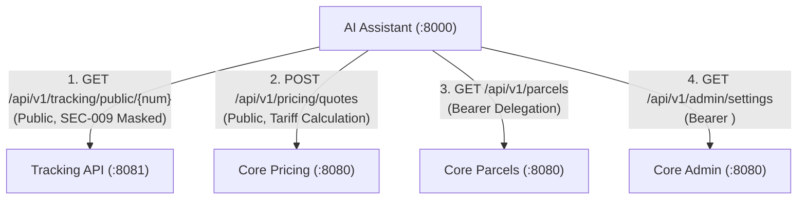

# SwiftDrop AI Delivery Assistant & FastMCP Service — Comprehensive Living System Document

> **Document Type:** Continuous Living Specification, Implementation Audit & Architecture Journal  
> **Service:** `services/ai-assistant/`  
> **Primary Owner:** Member 10 — AI Assistant/MCP & Cross-Workflow Quality  
> **Port:** `8000` | **Gateway Path:** `/api/v1/ai`  
> **Current Version:** `2.1.0` (Authoritative Baseline)

---

## 1. Architectural Scope & Operational Rationale

### Why This Service Exists
In traditional logistics platforms, parcel tracking interfaces are rigid, requiring exact tracking numbers and displaying cryptic milestone codes. Customers inquiring about shipping rates between island-wide delivery zones encounter complex weight/dimension tariffs before initiating a booking.

The **AI Delivery Assistant & FastMCP Service** solves this by providing:
1. **Conversational Grounding:** Users interact in natural English to track shipments, estimate tariffs, and review active orders.
2. **Generative UI Bridging:** Instead of conversational dead-ends, the assistant emits actionable `NAVIGATE_BOOKING` cards with prefilled parameters directly into the React portal.
3. **Open Tool Discovery (FastMCP):** External AI agents (Cursor, Claude Desktop) can discover and invoke SwiftDrop tools using the open Model Context Protocol (**+5 Assignment Bonus Marks**).

---

## 2. Mandatory Domain Invariants & Technical Enforcements

| Invariant | Scope & Definition | How It Is Enforced | Why It Exists |
| :--- | :--- | :--- | :--- |
| **Zero Direct Database Access** | No PostgreSQL credentials, connections, or SQL drivers. | `test_zero_database_dependency_invariant` in CI scans `requirements.txt` to block `psycopg2`, `sqlalchemy`, `asyncpg`. | Protects the modular monolith boundary. All data access must pass through Core API aggregate roots. |
| **100% Read-Only Authority** | Tools cannot mutate state (cannot book parcels, assign couriers, or change statuses). | Tool registry exposes only read-only methods (`track_parcel_status`, `estimate_shipping_fee`, etc.). | Defense-in-depth: even full prompt injection cannot corrupt persistent business data. |
| **Zero Hallucination Policy** | Never invent delivery dates, courier locations, or fees. | Upstream 404s map to explicit "Not Found" messages; pricing strictly echoes Core API quotes. | Regulatory compliance, consumer trust, and fee calculation accuracy. |
| **Decoupled Local Health Probes** | `/health/live` and `/health/ready` never call upstream APIs synchronously. | FastAPI health router checks only local event loop and in-memory cache sanity. | Prevents cascading cluster restart loops in Kubernetes if upstream services restart. |
| **Stateless Session Isolation** | Multi-turn memory is ephemeral. | In-memory `cachetools.LRUCache` with 15–30 min TTL; zero cross-tenant session leaks. | Stateless scalability without external cache dependencies. |

---

## 3. Layered File Hierarchy & Design Decisions

### Directory Breakdown
- `src/main.py`: ASGI application entrypoint, CORS configuration, and lifespan startup/shutdown hooks.
- `src/api/routers/chat.py`: Handles `POST /api/v1/ai/chat`, validates request payloads, manages sessions, and dispatches to LLM engines.
- `src/api/routers/health.py`: Decoupled Kubernetes probes (`/health/live`, `/health/ready`, `/metrics`).
- `src/api/middleware/auth.py`: Inbound JWT extraction and `AI_SERVICE_ROLE_TOKEN` verification.
- `src/api/middleware/rate_limit.py`: `slowapi` rate limiting enforcing 20 req/min matching Traefik.
- `src/api/middleware/security.py`: Heuristic prompt injection filter and input sanitization.
- `src/core/config.py`: Pydantic `BaseSettings` parsing all `.env` options with type validation.
- `src/core/cache.py`: LRU conversational session cache with TTL eviction.
- `src/core/logging.py`: Structured JSON logger with automatic PII scrubbing.
- `src/domain/chat.py`: Inbound/outbound DTOs (`ChatMessageRequest`, `ChatMessageResponse`, `GenerativeAction`).
- `src/domain/tools.py`: Pydantic argument schemas for LLM tool invocation.
- `src/domain/errors.py`: Standardized system error response models.
- `src/llm/base.py`: Abstract `BaseLLMClient` interface.
- `src/llm/openai_adapter.py`: Universal `AsyncOpenAI` client compatible with OpenRouter, Groq, NVIDIA, Ollama.
- `src/llm/mock_adapter.py`: Deterministic regex/fixture parser for offline zero-cost CI testing.
- `src/tools/registry.py`: Central tool registry and execution decorator.
- `src/tools/tracking_tool.py`: Queries `GET /api/v1/tracking/public/{id}` on Tracking API with SEC-009 privacy masking.
- `src/tools/pricing_tool.py`: Queries `POST /api/v1/pricing/quotes` on Core API.
- `src/tools/parcels_tool.py`: Queries `GET /api/v1/parcels` with forwarded Bearer JWT.
- `src/tools/policy_tool.py`: Grounded against `company_policies.md` with dynamic `GET /api/v1/admin/settings` overrides.
- `src/mcp/server.py`: Official FastMCP server supporting STDIO and SSE transports.

### Historical Decision: Python `cmd` Namespace Collision
- **Problem Encountered:** The directory was initially planned with a `cmd/` package matching Go conventions. In Python, having a root `cmd/` directory shadows the Python standard library `cmd.py` module, which causes `pdb` and test runners to crash with `AttributeError: module 'cmd' has no attribute 'Cmd'`.
- **Resolution:** Removed `cmd/`. Entrypoints are placed at `src/main.py` and `src/mcp/server.py`, completely avoiding standard library shadowing.

---

## 4. Upstream REST Contracts & Integration Mapping



---

## 5. Security & Prompt Defense Architecture

1. **Input Defense Filter:**
   - 1,000-character input limit.
   - Regex-based scanner for prompt injection, role-hijacking phrases (`"ignore previous instructions"`, `"system override"`), and base64 payloads.
2. **Rate Limiting:**
   - Enforces 20 RPM per client IP / tenant ID matching Traefik edge reverse proxy.
3. **PII Masking (`SEC-009`):**
   - Public tracking responses scrub street names, building numbers, and phone numbers.
4. **Container Security:**
   - Container runs as unprivileged user `appuser` (UID 10001, GID 10001).

---

## 6. Testing, Verification & CI Runbook

### Verification Commands
```bash
# Run smoke tests
python -m pytest services/ai-assistant/tests/test_scaffolding.py -v

# Run full test suite with coverage
python -m pytest services/ai-assistant/tests/ -v --cov=src
```

### Current Verification Results
- `test_package_structure`: **PASS** (All packages importable)
- `test_zero_database_dependency_invariant`: **PASS** (Zero DB drivers in `requirements.txt`)
- `test_env_example_has_mandatory_keys`: **PASS** (All 11 mandatory keys present)
- `test_dockerfile_security_invariants`: **PASS** (Non-root `USER appuser`, healthcheck, port 8000)

---

## 7. Development Changelog & Milestones

| Version | Date | Status & Accomplishments | Verified By |
| :--- | :--- | :--- | :--- |
| `0.1.0` | 2026-10-21 | Initial architecture placeholder | Architecture Setup |
| `2.0.0` | 2026-10-25 | Harmonized specifications with audit findings | Member 10 & Review Agent |
| `2.1.0` | 2026-11-02 | **Phase 1 Scaffolding Complete:** Created `requirements.txt`, `pyproject.toml`, `.env.example`, `.gitignore`, secure `Dockerfile`, complete layered package tree, removed shadowed `cmd/` directory, automated smoke tests. | `4 passed in 0.05s` |
