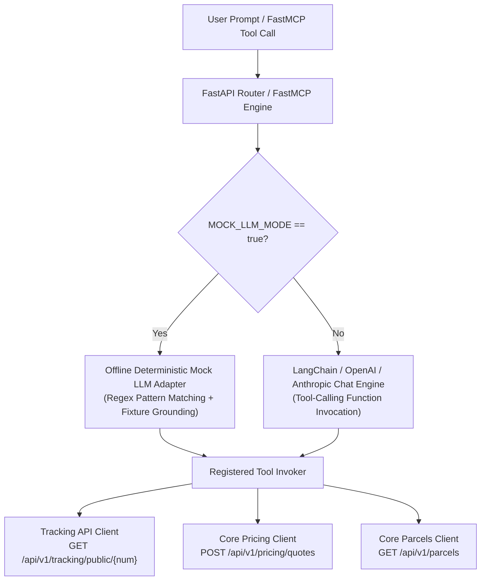

# AI Assistant & FastMCP Service (`services/ai-assistant`)

> **Service:** Independent Python 3.11 / FastAPI AI Assistant & Model Context Protocol (FastMCP) Server  
> **Primary Owner:** Member 10 — AI Assistant/MCP & Cross-Workflow Quality  
> **Assigned Port:** `8000` (Docker Container / Kubernetes Service)  
> **Specification Version:** `2.0.0` (Authoritative System-Wide Baseline)

---

## 1. Module Purpose & Owner

The `services/ai-assistant` service provides natural language customer and merchant assistant workflows for parcel tracking, instant shipping fee estimation, active delivery status overviews, and contextual booking navigation. It also operates as an MCP (Model Context Protocol) server via FastMCP, allowing AI agents (Claude Desktop, Antigravity, Cursor, etc.) to discover and execute controlled operational tools against the SwiftDrop system.

- **Primary Domain Capability:** AI Natural Language Agent, FastMCP Tool Execution, Offline Deterministic Simulation, and Generative UI Navigation Directives.
- **Assigned Owner:** Member 10 (`Member 10 — AI Assistant/MCP & Cross-Workflow Quality`).
- **Secondary Mandate:** System-wide Cross-Workflow Quality Assurance and multi-actor Playwright E2E acceptance test matrix (`tests/e2e/`).

---

## 2. Business Invariants & Operational Rules

1. **Strict Zero-Database Access Invariant:**
   - The AI Assistant service possesses **zero** direct database credentials and **zero** direct SQL connections to PostgreSQL.
   - All persistence is external. The service interacts exclusively with the public Tracking API (`http://tracking-api:8001`) and Core API (`http://core-api:8080`) over authenticated HTTP/REST.
   - Any historical proposal for an `ai_conversations` table in PostgreSQL is permanently eliminated.
2. **Read-Only Operational Guardrails:**
   - Tools exposed to LLM callers (`track_parcel`, `estimate_shipping_fee`, `get_my_active_parcels`) are strictly non-mutating and read-only.
   - The assistant **cannot** book parcels, accept payments, update shipment milestones, or modify dispatch records directly.
   - When users express intent to book or modify shipments, the assistant generates structured UI action directives (`NAVIGATE_BOOKING`, `VIEW_TRACKING`) containing pre-filled parameters for client-side execution in the React web portal.
3. **Strict Truthfulness & No-Hallucination Policy:**
   - If an underlying API returns HTTP `404 Not Found` for a tracking number, the assistant must explicitly declare that the parcel was not found. It must **never** extrapolate, invent milestone events, or fabricate delivery ETA dates.
   - Shipping fee quotations returned by the assistant must strictly echo values computed by Core API's pricing engine (`POST /api/v1/pricing/quotes`), expressed in integer minor units (Sri Lankan Rupee cents, LKR).
4. **Decoupled Local Health Probes:**
   - `/health/live` returns HTTP 200 indicating the FastAPI event loop is responsive.
   - `/health/ready` evaluates only local configuration and in-memory cache status. It **never** invokes upstream Core API or Tracking API endpoints synchronously, preventing cascading cluster-wide pod restart failures if upstream dependencies experience transient restarts.
5. **Session Isolation & Rate Limiting:**
   - Multi-turn conversation sessions are isolated in-memory using an LRU cache keyed by `(tenant_id, conversation_id)` with a strict 30-minute time-to-live (TTL).
   - Rate limiting is enforced via client IP / tenant ID to prevent LLM quota exhaustion.

---

## 3. Domain Models & Service Architecture

### 3.1 Pydantic Domain Schemas
- `ChatMessageRequest`: Validates inbound user prompt, conversation UUID, client locale, and optional bearer context.
- `ChatMessageResponse`: Standard output envelope encapsulating grounded LLM text, array of executed tool names, execution latency (ms), structured UI navigation actions, and citations.
- `TrackParcelToolInput`: Validates tracking number format (`^SD-\d{8}-\d{5}$`).
- `EstimateFeeToolInput`: Validates dimensional inputs (`weight_kg > 0`, `dimensions > 0`), pickup/delivery postal codes, and service level (`STANDARD`, `EXPRESS`, `SAME_DAY`).
- `ActiveParcelsToolInput`: Authenticated customer parcel summary request.

### 3.2 Dual LLM Engine Architecture


- **Production Mode:** Dispatches prompts to OpenAI GPT-4o / Anthropic Claude 3.5 Sonnet with function-calling capabilities.
- **Offline / CI Mock Mode (`MOCK_LLM_MODE=true`):** Zero external API token required. Deterministically parses intent using regular expressions and keywords, executes tool calls against Core API / Tracking API, and returns formatted markdown answers. Enables 100% automated CI validation without incurring cloud API costs or network flakiness.

---

## 4. Internal Layer Organization

```
services/ai-assistant/
├── cmd/                         # Entrypoint scripts (stdio server, web server)
├── src/
│   ├── api/                     # Transport layer (FastAPI routers, lifespan handlers)
│   │   ├── routers/
│   │   │   ├── chat.py          # POST /api/v1/ai/chat
│   │   │   └── health.py        # GET /health/live, GET /health/ready, GET /metrics
│   │   └── middleware/          # Security, auth context extraction, and rate limiting
│   ├── core/                    # Core configuration and service settings
│   │   ├── config.py            # Pydantic BaseSettings (PORT=8000, MOCK_LLM_MODE, timeouts)
│   │   └── cache.py             # In-memory LRU session store (TTL 30m, maxsize 10,000)
│   ├── domain/                  # Pure domain entities, value objects, and Pydantic schemas
│   │   ├── chat.py              # ChatMessageRequest, ChatMessageResponse, GenerativeAction
│   │   └── errors.py            # Domain-specific exceptions and error envelopes
│   ├── llm/                     # Language model abstraction layer
│   │   ├── base.py              # LLMProvider abstract interface
│   │   ├── openai_adapter.py    # OpenAI function-calling client
│   │   └── mock_adapter.py      # Offline deterministic regex/fixture mock adapter
│   ├── tools/                   # Approved tool definitions (FastMCP & LangChain compatible)
│   │   ├── registry.py          # Central tool registration and invocation decorator
│   │   ├── tracking_tool.py     # track_parcel -> Tracking API client
│   │   ├── pricing_tool.py      # estimate_shipping_fee -> Core API /pricing/quotes client
│   │   └── parcels_tool.py      # get_my_active_parcels -> Core API /parcels client
│   └── mcp/                     # FastMCP Protocol Server
│       └── server.py            # FastMCP STDIO and SSE server implementation
├── tests/                       # Unit and integration test suite
│   ├── test_chat_router.py      # FastAPI chat endpoint validation
│   ├── test_mock_llm.py         # Deterministic mock adapter test
│   ├── test_tools.py            # Tool execution and error handling tests
│   └── test_health.py           # Decoupled health probe verification
├── Dockerfile                   # Multi-stage secure Dockerfile (USER 10001:10001)
├── pyproject.toml               # Poetry / Pip dependencies and tool configuration
├── API.md                       # Co-located API specification
└── README.md                    # Co-located module living documentation
```

---

## 5. Event & Messaging Interactions

- **Outbox Interactions:** **None.** The AI Assistant service does not produce outbox events or write to `outbox_events`.
- **Message Bus Consumption:** **None.** The AI Assistant is entirely request/reply driven. It does not subscribe to RabbitMQ queues.
- **REST Integrations:**
  1. `Tracking API` (`GET /api/v1/tracking/public/{tracking_number}`): Sanitized milestone timeline and current status.
  2. `Core API Pricing` (`POST /api/v1/pricing/quotes`): Weight and dimension calculation returning integer cents fee breakdown.
  3. `Core API Parcels` (`GET /api/v1/parcels`): Active parcels listing scoped by authenticated customer JWT.

---

## 6. Data Ownership & Storage Architecture

- **PostgreSQL Database Ownership:** **None (Zero Tables).**
- **Table Removals:** The previously contemplated `ai_conversations` table is explicitly purged from the database schema migrations.
- **Transient Memory Storage:** Ephemeral conversation context is retained in an in-memory `cachetools.TTLCache` (max items: 10,000; TTL: 1,800 seconds). No conversational PII is persisted across service restarts.

---

## 7. Implementation Status & Changelog

| Version | Date | Changes & Milestones | Author / Reviewer |
| :--- | :--- | :--- | :--- |
| `0.1.0` | 2026-10-21 | Initial placeholder README and basic route baseline | Architecture Setup |
| `2.0.0` | 2026-10-25 | Complete v2.0.0 rewrite: FastMCP integration, offline mock LLM, zero-DB enforcement, port 8000 lock, decoupled probes, generative UI action directives, and multi-actor Playwright test alignment | Member 10 & Review Agent |
