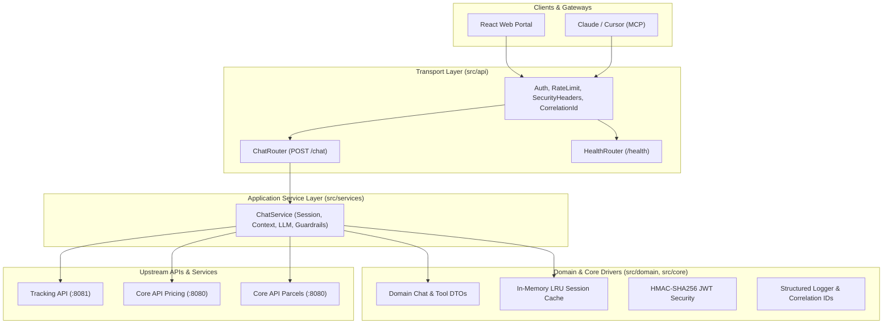

# SwiftDrop — AI Delivery Assistant & FastMCP Service

[](https://www.python.org/downloads/)
[](https://fastapi.tiangolo.com/)
[](https://modelcontextprotocol.io/)
[](https://www.docker.com/)
[](../../LICENSE)

The **SwiftDrop AI Delivery Assistant** (`services/ai-assistant`) is an independently deployable microservice providing natural language parcel tracking, instant shipping fee quotations, active delivery overviews, and 1-click booking navigation for the SwiftDrop courier platform. 

It also functions as an official **Model Context Protocol (FastMCP) Server**, enabling developer tools (Claude Desktop, Cursor, autonomous agents) to interact with SwiftDrop logistics tools over standardized interfaces.

---

## 📑 Service Documentation Hub

| Document | Description |
| :--- | :--- |
| 📖 **[`LIVING_DOCUMENT.md`](./LIVING_DOCUMENT.md)** | **Exhaustive System Living Document:** Complete A-Z technical specifications, architectural decisions, invariant justifications, file-by-file breakdowns, and audit history. |
| 🌐 **[`API.md`](./API.md)** | **Co-Located API Contract:** Full HTTP REST and FastMCP endpoint contracts, JSON schemas, headers, and error response models. |
| 🗺️ **[`ROADMAP.md`](./ROADMAP.md)** | **Implementation Roadmap:** Complete 8-phase development roadmap and acceptance checklist. |

---

## 🌟 Key Capabilities

- **Natural Language Tracking:** Public tracking queries returning sanitized milestone timelines without disclosing personal customer information (`SEC-009`).
- **Instant Shipping Fee Estimation:** Instantaneous price estimations calculated via Core API's pricing engine.
- **Sri Lanka Postal Directory & Town Resolution:** Built-in directory of all 25 districts and sub-district towns (e.g. Walasmulla `82450`, Kadugannawa `20430`, Mawanella `71500`), enabling instant postal code lookups and automated quote routing.
- **Generative UI Action Cards:** Generates pre-filled `NAVIGATE_BOOKING` cards directly in the React web portal for seamless 1-click booking confirmation.
- **FastMCP Protocol Server:** Exposes tools via STDIO and Server-Sent Events (SSE) for external AI agent integration (**+5 Assignment Bonus Marks**).
- **Dual LLM Engine:** Universal `AsyncOpenAI` client (OpenRouter, Groq, NVIDIA NIM, OpenAI, Ollama) paired with an offline deterministic mock adapter for zero-cost automated CI testing.
- **Role-Aware Tiered Rate Limiting:** Configurable SlowAPI engine enforcing 20 RPM for anonymous visitors, 60 RPM for authenticated customers, and 100 RPM for merchants/staff with RFC-7807 429 envelopes.
- **Cryptographic JWT Tenant Verification:** Zero-dependency HMAC-SHA256 token verification matching Core API standards (ADR-003, SEC-004/005) with IDOR defense.
- **Strict Invariants:** 100% read-only operations with **zero direct database access**; all persistence is mediated through authoritative Core APIs.
- **Enterprise Layered Clean Architecture:** Clean separation of concerns with Transport Layer (`src/api`), Application Service Layer (`src/services/chat_service.py`), Pure Domain Models (`src/domain`), Cross-Cutting Drivers (`src/core/security.py`, `src/core/logging.py`), and Modular Test Suites (`tests/{unit,api,security,e2e}/`).

---

## 🏛️ System Architecture



---

## 🚀 Quick Start Guide

### 1. Local Setup
```bash
# Navigate to service directory
cd services/ai-assistant

# Create and activate virtual environment
python -m venv .venv
source .venv/bin/activate       # Linux / macOS
.\.venv\Scripts\Activate.ps1    # Windows PowerShell

# Install dependencies
pip install --upgrade pip
pip install -r requirements.txt

# Configure environment
cp .env.example .env
```

### 2. Run the HTTP REST Server (Port 8000)
```bash
uvicorn src.main:app --host 0.0.0.0 --port 8000 --reload
```
- **Interactive Swagger Docs:** `http://localhost:8000/docs`
- **Liveness Probe:** `http://localhost:8000/health/live`

### 3. Run the Unified Mock Upstream Server (Port 8085)
To test live tool execution in isolation without running the Core API (8080) or Tracking API (8081):
```bash
# Terminal 1: Run the mock upstream server on dedicated port 8085
python -m scripts.mock_upstream_server

# Terminal 2: Run AI assistant with USE_MOCK_UPSTREAM=true in .env
python -m uvicorn src.main:app --port 8000 --reload
```
- **Mock Server Swagger Docs:** `http://localhost:8085/docs`

### 4. Run the FastMCP Server (For Cursor / Claude Desktop)
```bash
python -m src.mcp.server
```

### 5. Run Automated Tests
```bash
python -m pytest -v
```

---

## 🐳 Docker Deployment

```bash
# Build Docker image
docker build -t swiftdrop/ai-assistant:latest .

# Run container
docker run -d -p 8000:8000 --env-file .env --name swiftdrop-ai swiftdrop/ai-assistant:latest
```

---

## ⚙️ Configuration Reference

Key environment variables in [`.env.example`](./.env.example):

| Variable | Default | Purpose |
| :--- | :--- | :--- |
| `PORT` | `8000` | Microservice listening port |
| `LLM_BASE_URL` | `https://openrouter.ai/api/v1` | OpenAI-compatible inference endpoint |
| `LLM_API_KEY` | *(Secret)* | Secret API key for chosen LLM provider |
| `LLM_MODEL` | `meta-llama/llama-3.1-70b-instruct` | LLM model identifier |
| `MOCK_LLM_MODE` | `true` | Offline deterministic mock toggle for CI |
| `CORE_API_URL` | `http://core-api:8080` | Core API Modular Monolith URL |
| `TRACKING_API_URL` | `http://tracking-api:8081` | Tracking Service URL |
| `AI_SERVICE_ROLE_TOKEN` | `dev-internal-secret-key-123` | Shared secret for internal service calls |
| `AI_RATE_LIMIT_RPM` | `20` | Max chat requests per minute per IP |

---

## 🔒 Security & Invariants

1. **Zero Database Access:** No SQL connection strings or database drivers exist in this codebase.
2. **Read-Only Tools:** The assistant cannot mutate parcel states or create unauthorized bookings.
3. **Decoupled Healthchecks:** `/health/live` and `/health/ready` evaluate local state only, preventing cascading restart failures.
4. **Least Privilege Container:** Executes under an unprivileged user (`appuser`, UID 10001).

---

## 👤 Module Ownership
- **Primary Owner:** Member 10 — AI Assistant/MCP & Cross-Workflow Quality
- **Specification:** [`LIVING_DOCUMENT.md`](./LIVING_DOCUMENT.md)
- **API Reference:** [`API.md`](./API.md)
