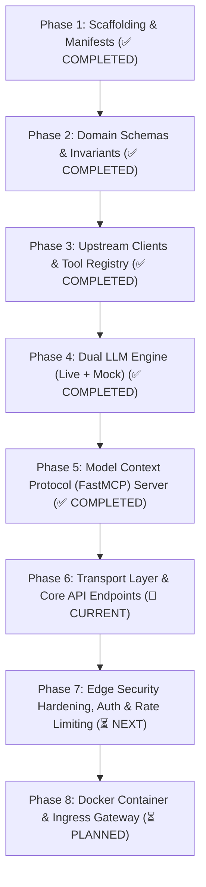

# SwiftDrop AI Delivery Assistant & FastMCP Service — Implementation Roadmap

> **Service:** `services/ai-assistant/`  
> **Primary Owner:** Member 10 — AI Assistant/MCP & Cross-Workflow Quality  
> **Specification Version:** `2.5.1` (Focused Transport Alignment)  
> **Runtime / Stack:** Python 3.11+, FastAPI, Pydantic v2, AsyncOpenAI, FastMCP (`mcp[cli]`), HTTPX  
> **Assigned Port:** `8000` | **Gateway Route:** `/api/v1/ai`

---

## 1. Executive Summary & Architecture Blueprint

The **AI Delivery Assistant & FastMCP Service** fulfills two major objectives:
1. **Conversational Customer/Merchant Assistant:** Provides grounded natural language parcel tracking, instant shipping fee quotations, active shipment summaries, and 1-click booking navigation cards (`NAVIGATE_BOOKING`) for the React web portal via `POST /api/v1/ai/chat` and interactive Swagger UI (`/docs`).
2. **Standardized Model Context Protocol (MCP) Server:** Exposes the exact same operational capabilities and authoritative resources (`swiftdrop://policies`, `swiftdrop://sla-matrix`) to external developer tools (Cursor, Claude Desktop, autonomous evaluators) via FastMCP (**+5 Bonus Marks**).

```
System Context Topology:
React Web Portal (Members 6 & 7) ────[ POST /api/v1/ai/chat ]───┐
Swagger UI / Postman (Devs) ─────────[ /docs & /health/* ]──────┼─► [services/ai-assistant:8000]
External MCP Clients (Cursor/Claude) ─[ SSE / STDIO: FastMCP ]──┤       │ (Read-Only HTTP)
                                                                │       ├─► Tracking API (Member 5): GET /api/v1/tracking/public/{num}
                                                                │       ├─► Core Pricing (Member 2): POST /api/v1/pricing/quotes
                                                                │       ├─► Core Parcels (Member 2): GET /api/v1/parcels
                                                                │       └─► Admin Settings (Member 7): GET /api/v1/admin/settings
                                                                ▼
                                                        [Zero Direct DB Access]
```

### Core Business Invariants & Operational Guardrails
- **Strict Zero-Database Invariant:** Zero SQL drivers, zero connection strings, and zero direct access to PostgreSQL. All persistence is upstream via authenticated REST. (Guarded by automated AST/requirements test).
- **Strict Read-Only Authority:** Tools are non-mutating (`track_parcel_status`, `estimate_shipping_fee`, `get_my_active_parcels`, `explain_company_policies`). It cannot book or alter parcels.
- **Strict Zero-Hallucination Policy:** All factual claims must be strictly grounded in tool outputs. If upstream returns `404`, the assistant explicitly declares the item not found.
- **Dual LLM Engine:** Universal `AsyncOpenAI` client (OpenRouter, Groq, NVIDIA, Ollama) for production, paired with an offline deterministic mock adapter (`MOCK_LLM_MODE=true`) for 100% reproducible CI and local testing without cloud API keys.
- **Decoupled Health Probes:** `/health/live` and `/health/ready` never make synchronous upstream network calls, preventing cascading pod failures in Kubernetes.
- **Integrated Security & TDD:** Guardrails, prompt validation, SSRF filtering, and comprehensive test suites are delivered and verified synchronously in every single phase.

---

## 2. Refined 8-Phase Implementation Roadmap



---

### ✅ Phase 1: Service Scaffolding & Environment Setup
**Objective:** Establish reproducible Python virtual environment, project structure, container definition, and configuration templates.

- [x] **1.1 Directory Structure:** Scaffold `src/`, `src/api/`, `src/core/`, `src/domain/`, `src/llm/`, `src/tools/`, `src/mcp/`, and `tests/`.
- [x] **1.2 Dependencies:** Create locked `requirements.txt` (`fastapi`, `uvicorn[standard]`, `pydantic`, `pydantic-settings`, `httpx`, `openai`, `mcp[cli]`, `slowapi`, `cachetools`, `pytest`, `pytest-asyncio`, `pytest-cov`).
- [x] **1.3 Configuration Template:** Create `.env.example` documenting all configuration keys.
- [x] **1.4 Virtual Environment & Dockerfile:** Verify local venv setup, `.dockerignore`, and least-privilege Dockerfile (`appuser`, UID 10001).
- [x] **1.5 Living Docs Initialized:** Co-located `README.md`, `API.md`, and `LIVING_DOCUMENT.md` created.

---

### ✅ Phase 2: Domain Schemas, Configuration & Invariants
**Objective:** Codify domain boundaries, Pydantic DTOs, and session state caching.

- [x] **2.1 `src/core/config.py`:** Pydantic `BaseSettings` reading `LLM_BASE_URL`, `LLM_API_KEY`, `LLM_MODEL`, `MOCK_LLM_MODE`, `LLM_MAX_TOKENS`, `CORE_API_URL`, `TRACKING_API_URL`, with SSRF regex protection and SecretStr masking.
- [x] **2.2 `src/domain/chat.py`:** Pydantic DTOs for `ChatMessageRequest` (1,000 char cap), `ChatMessageResponse`, `GenerativeAction` (`NAVIGATE_BOOKING`, `VIEW_TRACKING` with strict relative URL whitelist), and `ToolCallRecord`.
- [x] **2.3 `src/domain/tools.py`:** Validated tool schemas with non-backtracking tracking number regex (`^SD-\d{8}-\d{5}$`).
- [x] **2.4 `src/domain/errors.py`:** Standardized RFC-7807 compliant error envelopes (`AppError`, `ValidationAppError`, `UpstreamServiceError`).
- [x] **2.5 `src/core/cache.py`:** Thread-safe `TTLCache` with configurable TTL (15–30 min) and LRU maxsize bounds (50 in dev, 10,000 in prod).
- [x] **2.6 Unit Tests:** `tests/test_config.py`, `tests/test_domain_chat.py`, `tests/test_cache.py` (All passing).

---

### ✅ Phase 3: Upstream REST Clients & Tool Registry
**Objective:** Connect the AI service to authoritative Core and Tracking APIs.

- [x] **3.1 `src/tools/registry.py`:** Central `@register_tool` decorator with execution timing, OpenAPI schema generation, and error isolation.
- [x] **3.2 `src/tools/tracking_tool.py`:** Public tracking lookup (`GET /api/v1/tracking/public/{trackingNumber}`) with SEC-009 PII masking and deterministic 404 handling.
- [x] **3.3 `src/tools/pricing_tool.py`:** Fee estimation calling Member 2's `POST /api/v1/pricing/quotes` with integer cents precision and `NAVIGATE_BOOKING` generative card generation.
- [x] **3.4 `src/tools/parcels_tool.py`:** Active shipments query (`GET /api/v1/parcels`) with customer Bearer JWT forwarding.
- [x] **3.5 `src/tools/policy_tool.py`:** Company policies knowledge base (`company_policies.md`) with dynamic admin settings override (`GET /api/v1/admin/settings`).
- [x] **3.6 Unit & Mock Tests:** Comprehensive test coverage in `tests/test_tools.py` with mock HTTPX transport.

---

### ✅ Phase 4: Dual LLM Engine (Live OpenAI-Compatible + Deterministic Mock)
**Objective:** Build multi-turn function calling engine supporting production LLMs and offline CI tests.

- [x] **4.1 `src/llm/prompts.py`:** Authoritative system prompt with strict zero-hallucination rules, prompt injection defense, and tool-calling guidance.
- [x] **4.2 `src/llm/base.py`:** Abstract base class `BaseLLMClient` defining standardized `chat()` interface.
- [x] **4.3 `src/llm/mock_adapter.py`:** Deterministic offline regex parser generating instant grounded answers with zero token cost for CI.
- [x] **4.4 `src/llm/openai_adapter.py`:** Universal `AsyncOpenAI` client with automated multi-turn function-calling loop (capped at 3 iterations) and `max_tokens` token budgeting.
- [x] **4.5 `src/llm/__init__.py`:** Factory function `get_llm_client()` dynamically choosing live or mock adapter based on configuration.
- [x] **4.6 Unit & Live Verification:** Tested with mock engine and verified live with OpenRouter model `particle-ai/particle-1`.

---

### ✅ Phase 5: Model Context Protocol (FastMCP) Server & Resources
**Objective:** Expose tools and authoritative resources to external agents (Cursor, Claude Desktop) and test harnesses.

- [x] **5.1 `src/mcp/server.py`:** Official FastMCP protocol server with dual `mcp 1.x` and `mcp 2.x` compatibility.
- [x] **5.2 Authoritative FastMCP Tools:** Exposes `track_parcel`, `estimate_shipping_fee`, `get_my_active_parcels`, and `explain_company_policies`.
- [x] **5.3 FastMCP Resources:** Exposes live read-only contextual resources: `swiftdrop://policies` and `swiftdrop://sla-matrix`.
- [x] **5.4 STDIO & CLI Entrypoint:** `python -m src.mcp.server` execution support with lazy import resolution.
- [x] **5.5 Unit & Protocol Tests:** `tests/test_mcp.py` verifying tool discovery, resource reads, and schema compliance (81 total tests passing).

---

### ✅ Phase 6: Transport Layer & Core API Endpoints *(COMPLETED)*
**Objective:** Deliver REST API endpoints, interactive Swagger UI (`/docs`), seamless session history handling, and decoupled health probes.

- [x] **6.1 `src/main.py`:** FastAPI application entrypoint with `lifespan` initialization, CORS configuration, RFC-7807 global exception handlers, and custom Swagger UI metadata.
- [x] **6.2 `src/api/routers/health.py`:** Fast, decoupled health endpoints:
  - `GET /health/live` (200 OK liveness check)
  - `GET /health/ready` (session cache & engine readiness check)
  - `GET /metrics` (basic runtime counter / uptime metrics)
- [x] **6.3 `src/api/routers/chat.py`:** Primary endpoint `POST /api/v1/ai/chat`:
  - Request parsing & validation using `ChatMessageRequest`
  - Contextual token extraction from `Authorization: Bearer <jwt>` if provided
  - In-memory session context retrieval and persistence via `session_cache`
  - Integration with `get_llm_client().generate_reply(...)`
  - Return fully populated `ChatMessageResponse` envelope
- [x] **6.4 Transport API Test Suite:** Unit, integration, resilience, security, and concurrency tests (31 new tests, 112 total).
- [x] **6.5 Interactive Verification:** Verified local execution with interactive Swagger UI at `/docs` and ReDoc at `/redoc`.

---

### ⏳ Phase 7: Edge Security Hardening, Auth & Rate Limiting *(NEXT)*
**Objective:** Layer on edge defense, SlowAPI rate limiting, strict JWT tenant verification, and end-to-end security penetration tests.

- [ ] **7.1 Rate Limiting Middleware:** `slowapi` rate limiter enforcing 20 req/min per IP/tenant ID with RFC-7807 `429 Too Many Requests` envelope.
- [ ] **7.2 Auth Middleware & Security Filters:** Strict JWT Bearer validation, tenant extraction, and header sanitization.
- [ ] **7.3 Penetration Testing Suite:** Prompt injection, system prompt extraction, SSRF boundary bypass, and cross-tenant IDOR tests.
- [ ] **7.4 Cross-Module E2E Workflow Tests:** End-to-end tests between AI Assistant, Core API, Tracking API, and React frontend contracts.
- [ ] **7.5 Performance & Concurrency:** Async benchmarks under concurrent chat load with $\ge 85\%$ test coverage.

---

### ⏳ Phase 8: Containerization & Ingress Gateway Integration *(PLANNED)*
**Objective:** Finalize production containerization, Traefik ingress routing, and Kubernetes deployment manifests.

- [ ] **8.1 Multi-Stage Dockerfile Verification:** Build and verify `docker build -t swiftdrop/ai-assistant:latest .` locally.
- [ ] **8.2 Docker Compose Integration:** Verify service networking and environment resolution in root `docker-compose.yml`.
- [ ] **8.3 Traefik Edge Ingress:** Verify reverse proxy routing rules for `PathPrefix(/api/v1/ai)`.
- [ ] **8.4 Kubernetes Manifests:** Deployment, Service, ConfigMap, and Secret manifests for Member 9 integration.

---

## 3. Definition of Done (DoD) Checklist

| Requirement | Acceptance Criteria | Verified |
| :--- | :--- | :---: |
| **Zero Database Invariant** | No PostgreSQL driver installed; zero direct SQL queries (verified by automated AST test) | [x] |
| **Read-Only Invariant** | Assistant cannot create, edit, or delete parcels directly | [x] |
| **Offline CI Execution** | `pytest` runs in `< 5s` with `MOCK_LLM_MODE=true` without internet or API keys | [x] |
| **FastMCP Compliance** | Tools discoverable and executable via `mcp dev` and Cursor/Claude Desktop | [x] |
| **Live LLM Integration** | Verified live with OpenRouter (`particle-ai/particle-1`) with token budgeting | [x] |
| **REST API & Swagger UI** | `POST /api/v1/ai/chat` and `/docs` interactive testing operational | [x] |
| **Generative UI Card** | `POST /api/v1/ai/chat` emits `NAVIGATE_BOOKING` action for fee quotes | [x] |
| **Zero PII Leakage** | Public tracking returns milestone status and city only; zero phone/street numbers | [x] |
| **Decoupled Health Probes** | Decoupled `/health/live` and `/health/ready` respond `200 OK` independently | [x] |
| **Living Documentation** | `README.md`, `API.md`, and `LIVING_DOCUMENT.md` updated synchronously with zero drift | [x] |
