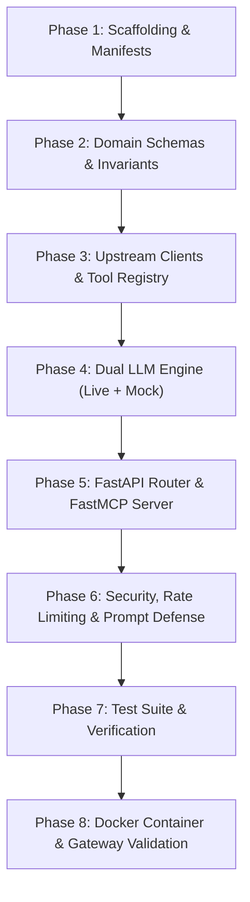

# SwiftDrop AI Delivery Assistant & FastMCP Service — Implementation Roadmap

> **Service:** `services/ai-assistant/`  
> **Primary Owner:** Member 10 — AI Assistant/MCP & Cross-Workflow Quality  
> **Specification Version:** `2.0.0` (Authoritative Baseline)  
> **Runtime / Stack:** Python 3.11-slim, FastAPI, Pydantic v2, AsyncOpenAI, FastMCP (`mcp[cli]`), HTTPX  
> **Assigned Port:** `8000` | **Gateway Route:** `/api/v1/ai`

---

## 1. Executive Summary & Architecture Blueprint

The **AI Delivery Assistant & FastMCP Service** fulfills two major objectives:
1. **Conversational Customer/Merchant Assistant:** Provides grounded natural language parcel tracking, instant shipping fee quotations, active shipment summaries, and 1-click booking navigation cards for the React web portal.
2. **Standardized Model Context Protocol (MCP) Server:** Exposes the exact same operational capabilities as tools to external developer tools (Cursor, Claude Desktop, autonomous evaluators) via FastMCP (**+5 Bonus Marks**).

```
System Context Topology:
React Web Portal (Members 6 & 7) ────[ POST /api/v1/ai/chat ]───┐
External MCP Clients (Cursor/Claude) ─[ SSE / STDIO: FastMCP ]──┼─► [services/ai-assistant:8000]
                                                                │       │ (Read-Only HTTP)
                                                                │       ├─► Tracking API (Member 5): GET /api/v1/tracking/public/{num}
                                                                │       ├─► Core Pricing (Member 2): POST /api/v1/pricing/quotes
                                                                │       ├─► Core Parcels (Member 2): GET /api/v1/parcels
                                                                │       └─► Admin Settings (Member 7): GET /api/v1/admin/settings
                                                                ▼
                                                        [Zero Direct DB Access]
```

### Core Business Invariants & Operational Guardrails
- **Strict Zero-Database Invariant:** Zero SQL drivers, zero connection strings, and zero direct access to PostgreSQL. All persistence is upstream via authenticated REST.
- **Strict Read-Only Authority:** Tools are non-mutating (`track_parcel_status`, `estimate_shipping_fee`, `get_my_active_parcels`, `explain_company_policies`). It cannot book or alter parcels.
- **Zero Hallucination Invariant:** All factual claims must be strictly grounded in tool outputs. If upstream returns `404`, the assistant explicitly declares the item not found.
- **Dual LLM Engine:** Universal `AsyncOpenAI` client (OpenRouter, Groq, NVIDIA, Ollama) for production, paired with an offline deterministic mock adapter (`MOCK_LLM_MODE=true`) for 100% reproducible CI and local testing without cloud API keys.
- **Decoupled Health Probes:** `/health/live` and `/health/ready` never make synchronous upstream network calls, preventing cascading pod failures in Kubernetes.

---

## 2. Phased Implementation Roadmap



---

### Phase 1: Service Scaffolding & Environment Setup
**Objective:** Establish reproducible Python 3.11 virtual environment, project structure, and configuration templates.

- [ ] **1.1 Directory Structure Creation:**
  ```
  services/ai-assistant/
  ├── cmd/
  │   └── run_mcp.py              # Dedicated CLI entrypoint for FastMCP STDIO mode
  ├── src/
  │   ├── __init__.py
  │   ├── api/                    # Transport layer (FastAPI routers, lifespan, middleware)
  │   │   ├── __init__.py
  │   │   ├── routers/
  │   │   │   ├── __init__.py
  │   │   │   ├── chat.py         # POST /api/v1/ai/chat
  │   │   │   └── health.py       # GET /health/live, GET /health/ready, GET /metrics
  │   │   └── middleware/
  │   │       ├── __init__.py
  │   │       ├── auth.py         # Bearer token extractor & service-role validator
  │   │       ├── rate_limit.py   # Slowapi IP/tenant rate limiter
  │   │       └── security.py     # Prompt injection filter & input sanitization
  │   ├── core/                   # Configuration, caching, and constants
  │   │   ├── __init__.py
  │   │   ├── config.py           # Pydantic BaseSettings
  │   │   ├── cache.py            # In-memory LRU session context store
  │   │   └── logging.py          # Structured JSON logging (zero PII leakage)
  │   ├── domain/                 # Domain entities, DTOs, and error types
  │   │   ├── __init__.py
  │   │   ├── chat.py             # ChatMessageRequest, ChatMessageResponse, GenerativeAction
  │   │   ├── tools.py            # Tool schemas & argument DTOs
  │   │   └── errors.py           # Domain exceptions & error response envelopes
  │   ├── llm/                    # Dual LLM engine abstraction
  │   │   ├── __init__.py
  │   │   ├── base.py             # Abstract BaseLLMClient interface
  │   │   ├── openai_adapter.py   # AsyncOpenAI function-calling client
  │   │   └── mock_adapter.py     # Deterministic regex/fixture mock adapter
  │   ├── tools/                  # Read-only tool implementations
  │   │   ├── __init__.py
  │   │   ├── registry.py         # Tool registry decorator & dispatcher
  │   │   ├── tracking_tool.py    # Public tracking client
  │   │   ├── pricing_tool.py     # Pricing quote calculation client
  │   │   ├── parcels_tool.py     # Authenticated active parcels client
  │   │   ├── policy_tool.py      # Company policies with admin settings override
  │   │   └── company_policies.md # Authoritative static policy grounding
  │   └── mcp/                    # Model Context Protocol server
  │       ├── __init__.py
  │       └── server.py           # FastMCP server instance & tool registrations
  ├── tests/                      # Pytest suite
  │   ├── __init__.py
  │   ├── conftest.py             # Shared fixtures & test client
  │   ├── test_health.py          # Liveness & readiness probe tests
  │   ├── test_mock_llm.py        # Deterministic mock adapter tests
  │   ├── test_tools.py           # Tool execution & error handling tests
  │   ├── test_chat_api.py        # HTTP chat router tests
  │   ├── test_mcp_server.py      # FastMCP tool inspection tests
  │   └── test_security.py        # Prompt injection & input validation tests
  ├── .env.example                # Documented configuration template
  ├── .gitignore                  # Python ignore rules (.venv, __pycache__, etc.)
  ├── Dockerfile                  # Production container definition (python:3.11-slim)
  ├── requirements.txt            # Locked runtime dependencies
  └── pyproject.toml              # Project metadata & tool configurations
  ```
- [ ] **1.2 Create `requirements.txt`:** Include strictly scoped dependencies (`fastapi`, `uvicorn[standard]`, `pydantic`, `pydantic-settings`, `httpx`, `openai`, `mcp[cli]`, `slowapi`, `cachetools`, `pytest`, `pytest-asyncio`).
- [ ] **1.3 Create `.env.example`:** Document all runtime variables (`LLM_BASE_URL`, `LLM_API_KEY`, `LLM_MODEL`, `MOCK_LLM_MODE`, `CORE_API_URL`, `TRACKING_API_URL`, `AI_SERVICE_ROLE_TOKEN`, `PORT=8000`).

---

### Phase 2: Domain Schemas, Configuration & Invariants
**Objective:** Codify domain boundaries, Pydantic DTOs, and session state caching.

- [ ] **2.1 `src/core/config.py`:**
  - Build `Settings(BaseSettings)` with environment prefixes and default fallbacks.
  - Implement boolean property `is_mock_mode` (activates if `MOCK_LLM_MODE=true` or if `LLM_API_KEY` is empty).
- [ ] **2.2 `src/domain/chat.py`:**
  - `ChatMessage`: `role` (`user`, `assistant`, `system`), `content`, `timestamp`.
  - `GenerativeAction`: `action_type` (`NAVIGATE_BOOKING`, `VIEW_TRACKING`, `CONTACT_SUPPORT`), `label`, `target_url`, `prefill_data` (JSON dict).
  - `ChatMessageRequest`: `prompt` (max 1,000 chars), `conversation_id` (UUID), `locale`, `history` (optional list of past turns).
  - `ChatMessageResponse`: `conversation_id`, `reply`, `actions` (list of `GenerativeAction`), `tools_called` (list of tool names), `latency_ms`, `grounded` (boolean).
- [ ] **2.3 `src/core/cache.py`:**
  - In-memory `LRUCache` storing active multi-turn histories keyed by `conversation_id`.
  - Configurable TTL (default 15–30 minutes) and max active sessions (default 10,000) to protect memory.
- [ ] **2.4 `src/domain/errors.py`:**
  - Standardized JSON error envelope matching SwiftDrop system error standards: `{"error": {"code": "...", "message": "...", "details": [...]}}`.

---

### Phase 3: Upstream REST Clients & Tool Registry
**Objective:** Connect the AI service to authoritative Core and Tracking APIs.

- [ ] **3.1 `src/tools/registry.py`:**
  - Build a lightweight `@register_tool` decorator that provides both JSON-schema tool definitions for the LLM function-calling engine and registers tools with the `FastMCP` instance.
- [ ] **3.2 `src/tools/tracking_tool.py`:**
  - Function: `track_parcel_status(tracking_number: str)`
  - Endpoint: `GET /api/v1/tracking/public/{trackingNumber}` on Member 5 Tracking API.
  - Validation: Regex check `^SD-\d{8}-\d{5}$`.
  - Sanitization: Returns sanitized milestone list, current status, and city/province. Never leaks recipient street or phone (SEC-009).
- [ ] **3.3 `src/tools/pricing_tool.py`:**
  - Function: `estimate_shipping_fee(weight_kg, pickup_postal_code, delivery_postal_code, service_type, length_cm, width_cm, height_cm)`
  - Endpoint: `POST /api/v1/pricing/quotes` on Member 2 Pricing Engine.
  - Invariant: Strictly echoes integer minor units (LKR cents) and tariff breakdown computed by Core API.
- [ ] **3.4 `src/tools/parcels_tool.py`:**
  - Function: `get_my_active_parcels()`
  - Endpoint: `GET /api/v1/parcels` on Member 2 Parcel service with customer Bearer JWT.
  - Purpose: Disambiguates active shipments when customer asks *"Where are my packages?"*.
- [ ] **3.5 `src/tools/policy_tool.py`:**
  - Function: `explain_company_policies(topic: str)`
  - Source: Grounded against `company_policies.md` (packaging guidelines, prohibited goods, SLA transit times).
  - Dynamic Override Rule: Queries Member 7 `GET /api/v1/admin/settings` (cached 5 min). Admin settings override static markdown if thresholds conflict.

---

### Phase 4: Dual LLM Engine (Live OpenAI-Compatible + Deterministic Mock)
**Objective:** Provide robust conversational capabilities in production while ensuring automated CI builds pass offline.

- [ ] **4.1 `src/llm/base.py`:**
  - Define `BaseLLMClient(ABC)` with async method:
    `generate_reply(prompt: str, history: list, tools: list, auth_context: dict) -> ChatMessageResponse`
- [ ] **4.2 `src/llm/mock_adapter.py` (Offline Deterministic Engine):**
  - Uses regex intent classification to detect:
    1. Tracking inquiry (`SD-\d{8}-\d{5}` or "track") $\rightarrow$ executes `track_parcel_status`.
    2. Fee estimation ("cost", "estimate", "fee", "kg") $\rightarrow$ executes `estimate_shipping_fee` with default/extracted weights and returns `NAVIGATE_BOOKING` action.
    3. Active shipments ("my parcels", "active deliveries") $\rightarrow$ executes `get_my_active_parcels`.
    4. Policy questions ("prohibited", "rules", "packaging") $\rightarrow$ executes `explain_company_policies`.
  - Returns structured, deterministic responses instantly with zero network or token costs.
- [ ] **4.3 `src/llm/openai_adapter.py` (Universal Live Client):**
  - Initializes `AsyncOpenAI(base_url=settings.LLM_BASE_URL, api_key=settings.LLM_API_KEY)`.
  - Sends tool definitions in standard OpenAI tool-calling schema.
  - Executes tool loop: sends prompt $\rightarrow$ receives `tool_calls` $\rightarrow$ invokes tools from registry $\rightarrow$ submits tool outputs $\rightarrow$ returns finalized grounded response.

---

### Phase 5: FastAPI Transport & FastMCP Server
**Objective:** Expose both HTTP REST for the web frontend and FastMCP for external AI tools.

- [ ] **5.1 `src/api/routers/health.py`:**
  - `GET /health/live`: Returns `{"status": "ok"}` (200 OK).
  - `GET /health/ready`: Checks configuration and in-memory cache sanity. Decoupled from upstream DB/APIs.
  - `GET /metrics`: Prometheus performance metrics for Kubernetes scraping.
- [ ] **5.2 `src/api/routers/chat.py`:**
  - Route: `POST /api/v1/ai/chat`
  - Validates request body with `ChatMessageRequest`.
  - Extracts customer JWT or uses anonymous session.
  - Dispatches to active LLM engine (live or mock).
  - Emits `GenerativeAction` cards (`NAVIGATE_BOOKING` with prefilled destination/weight).
- [ ] **5.3 `mcp_server.py` & `src/mcp/server.py`:**
  - Implements official FastMCP instance: `mcp = FastMCP("SwiftDrop Delivery Assistant")`.
  - Mounts FastMCP tools: `@mcp.tool()` wrappers around the shared tool registry.
  - Supports dual execution:
    - STDIO mode: for CLI and Claude Desktop (`python -m src.mcp.server`).
    - SSE mode: mounted at `/api/v1/ai/mcp` and `/api/v1/ai/mcp/messages` inside FastAPI.

---

### Phase 6: Security, Rate Limiting & Prompt Defense
**Objective:** Protect against prompt injection attacks, quota exhaustion, and data leakage.

- [ ] **6.1 Input Hygiene & Prompt Injection Filter:**
  - Enforce max prompt length of 1,000 characters.
  - Filter system delimiter manipulation, role hijacking phrases (`"ignore all previous instructions"`, `"you are now in developer mode"`), and base64 payloads.
- [ ] **6.2 Rate Limiting (`src/api/middleware/rate_limit.py`):**
  - Integrate `slowapi` to enforce 20 requests per minute per IP / tenant ID matching Traefik edge gateway policies.
- [ ] **6.3 Public Tracking Masking (SEC-009):**
  - Automated scrubber ensuring no street addresses or phone numbers appear in assistant replies for tracking queries.

---

### Phase 7: Verification, Test Suites & Living Documentation
**Objective:** Achieve $\ge 80\%$ test coverage and ensure zero drift in co-located documentation.

- [ ] **7.1 Unit & Integration Tests:**
  - `test_health.py`: Liveness and readiness endpoints.
  - `test_mock_llm.py`: Validate all 4 tool intent pathways in mock mode.
  - `test_tools.py`: Upstream mock responses, 404 handling, and error transformations.
  - `test_chat_api.py`: Full REST API request/response cycle, action generation, and validation errors.
  - `test_security.py`: Prompt injection rejection, rate limit triggers, and PII masking.
  - `test_mcp_server.py`: FastMCP tool schema generation and tool execution.
- [ ] **7.2 Synchronous Documentation Updates (Living Docs):**
  - Update `services/ai-assistant/README.md` with implementation status, architecture, and verification instructions.
  - Update `services/ai-assistant/API.md` with finalized request/response examples and error schemas.
- [ ] **7.3 Local Verification Script:**
  - Ensure `scripts/verify.ps1` and `scripts/verify.sh` pass cleanly with zero linting or formatting warnings.

---

### Phase 8: Containerization & Deployment Integration
**Objective:** Package the service for Docker Compose and Kubernetes deployment.

- [ ] **8.1 `Dockerfile`:**
  - Multi-stage or optimized `python:3.11-slim` image.
  - Non-root user execution (`USER appuser`).
  - Container health check: `curl -f http://localhost:8000/health/live || exit 1`.
- [ ] **8.2 Docker Compose Integration:**
  - Service definition in `docker-compose.yml` on port `8000:8000`.
  - Environment variables wired to internal container URLs (`http://core-api:8080`, `http://tracking-api:8081`).
- [ ] **8.3 Ingress Routing:**
  - Verify Traefik routing `/api/v1/ai` $\rightarrow$ `services/ai-assistant:8000`.

---

## 3. Definition of Done (DoD) Checklist

| Requirement | Acceptance Criteria | Verified |
| :--- | :--- | :---: |
| **Zero Database Invariant** | No PostgreSQL driver installed; zero SQL queries in codebase | [ ] |
| **Read-Only Invariant** | Assistant cannot create, edit, or delete parcels directly | [ ] |
| **Offline CI Execution** | `pytest` runs in `< 5s` with `MOCK_LLM_MODE=true` without internet or API keys | [ ] |
| **FastMCP Compliance** | Tools discoverable and executable via `mcp dev` and Cursor/Claude Desktop | [ ] |
| **Generative UI Card** | `POST /api/v1/ai/chat` emits `NAVIGATE_BOOKING` action for fee quotes | [ ] |
| **Zero PII Leakage** | Public tracking returns milestone status and city only; zero phone/street numbers | [ ] |
| **Health Probes** | Decoupled `/health/live` and `/health/ready` respond `200 OK` independently | [ ] |
| **Living Documentation** | `README.md` and `API.md` updated synchronously with zero drift | [ ] |
