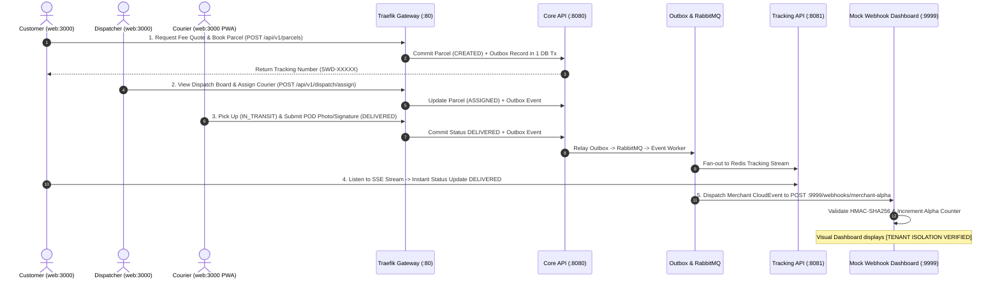

# SwiftDrop Cross-Module E2E Testing & Quality Assurance — Comprehensive Living System Document

> **Document Type:** Continuous Living Engineering Specification, Architecture Journal & Audit Ledger  
> **Directory / Scope:** `tests/e2e/`  
> **Primary Owner:** Member 10 — Cross-Workflow Quality Coordination & AI Assistant  
> **Collaborating Domains:** Members 1 through 9 (All Domain Owners)  
> **Target Framework:** Playwright for TypeScript (`@playwright/test`), Node.js, Docker Compose  
> **Evaluation Rubric:** **15 Marks** (Cross-Module Integration, Multi-Actor Journeys, Examiner Dashboard, Automated Verification)  
> **Specification Version:** `1.0.0` (Grounding & Pre-Testing Setup Baseline)  
> **Target Audience:** Any software engineer, system architect, or academic evaluator seeking a complete, up-to-the-minute account of every decision, contract, implementation detail, and verification record.

---

## 1. Executive Summary & Why This Document Exists

In distributed microservice and modular monolith architectures, unit tests inside isolated modules (`core-api/internal/`, `services/messaging/`, `services/tracking/`) prove only that isolated functions work. They cannot prove that:
1. An order booked in Core API transitions through Outbox $\rightarrow$ RabbitMQ $\rightarrow$ Event Worker $\rightarrow$ Webhooks without data loss.
2. Independent browser sessions (Customer, Dispatcher, Courier) operate simultaneously without leaking cookies, JWTs, or local storage.
3. Multi-tenant isolation (`SEC-004`/`SEC-005`) strictly prevents Merchant Beta from receiving Merchant Alpha's events.

While `tests/e2e/README.md` serves as the concise, industry-standard **entry point** for running tests and installing dependencies, **this document (`LIVING_DOCUMENT.md`) is the authoritative living journal**.

### Living Documentation Rules
- **Rule 1:** Every architectural decision, pivot, or ADR must be formally recorded here.
- **Rule 2:** Every file created, modified, or deleted within `tests/e2e/` must be logged in the Chronological Implementation Ledger.
- **Rule 3:** Any rollback, failed experiment, or blocked invariant must be documented with root cause and corrective action.
- **Rule 4:** This document is updated synchronously alongside code changes, maintaining zero drift.

---

## 2. Mandatory Architectural & Testing Invariants

Every test script, helper, and mock service in `tests/e2e/` must strictly enforce the following 6 domain invariants:

| Invariant | Technical Definition | Concrete Enforcement | Why It Exists |
| :--- | :--- | :--- | :--- |
| **1. Strict Multi-Actor Browser Isolation** | Browser contexts between actors must never share memory, cookies, or storage. | Every actor (Customer, Dispatcher, Courier, Merchant) executes in an isolated `browser.newContext()` via custom Playwright fixtures. | Prevents false positives where one actor's session masks auth bugs in another actor's session. |
| **2. Zero Direct Database Mutation** | E2E tests must never execute raw SQL inserts or updates to force test state. | All state transitions must occur via public HTTP REST APIs, the React UI, or authenticated gateway endpoints. | Validates true real-world behavior and ensures Outbox records are created organically via domain logic. |
| **3. Centralized Selector Contract Stability** | UI tests must locate elements solely via canonical `data-testid` attributes. | All selectors are imported from `helpers/selectors.ts`. CSS class names or element text are prohibited for operational actions. | Decouples tests from visual refactoring, CSS changes, and Tailwind restyling by frontend developers. |
| **4. Strict Multi-Tenant Isolation (`SEC-004`/`SEC-005`)** | Actions performed by Merchant Alpha must produce zero events or records in Merchant Beta's tenant boundary. | The `mock-webhook:9999` receiver verifies HMAC signatures and verifies that Alpha's counter increments while Beta remains at `0`. | Non-negotiable security requirement for academic grading and enterprise multi-tenancy. |
| **5. Public Tracking Milestone Masking (`SEC-009`)** | Unauthenticated public tracking must never expose PII (full recipient address, phone number, internal notes). | `flow-security.spec.ts` asserts that public tracking JSON responses omit recipient phone numbers and exact street addresses. | Protects customer privacy in compliance with system security requirements. |
| **6. Deterministic Offline & Dry-Run Capability** | The E2E test harness and mock visual dashboard must execute successfully in offline CI without live backend services. | Built-in mock mode and dry-run specifications allow verifying the runner, headless browser, and artifact pipeline offline. | Enables pre-testing validation and rapid local development before full cluster deployment. |

---

## 3. High-Level Architecture & Lifecycle Flowchart



---

## 4. Architectural Decision Records (ADR Log)

### ADR-001: Pivot E2E Test Suite from Python (`pytest-playwright`) to TypeScript (`@playwright/test`)
- **Date:** 2026-11-03
- **Status:** **APPROVED & ADOPTED**
- **Context:** The initial roadmap (`ROADMAP.md`) scaffolded E2E tests in Python using `pytest-playwright` because Member 10 owns the Python AI Assistant (`services/ai-assistant`). However, the project's primary frontend is React/TypeScript (`web/`).
- **Decision:** Pivot the entire E2E testing framework, test runners, fixtures, and helpers to native **TypeScript using `@playwright/test`**.
- **Rationale:**
  1. `@playwright/test` is Playwright's primary, first-class implementation with out-of-the-box UI mode (`npx playwright test --ui`), codegen, and trace viewer.
  2. Frontend developers (Members 6 & 7) can inspect, run, and contribute to tests in TypeScript without needing to manage Python virtual environments.
  3. Eliminates split Node.js/Python dependencies in the testing harness.
- **Consequences:** Updated `tests/e2e/ROADMAP.md` and `PRE_TESTING_SETUP_ROADMAP.md` to reflect TypeScript conventions, `package.json`, and `playwright.config.ts`.

### ADR-002: Standalone E2E Package Isolation (`tests/e2e/package.json`)
- **Date:** 2026-11-03
- **Status:** **APPROVED & ADOPTED**
- **Context:** E2E tests could either share `web/package.json` or have a dedicated `tests/e2e/package.json`.
- **Decision:** Place a dedicated `package.json` directly inside `tests/e2e/`.
- **Rationale:** Keeps test dependencies (`@playwright/test`, `@types/node`) completely decoupled from frontend web production build dependencies (Vite, React, Tailwind). Prevents dependency bloat in production web builds.
- **Consequences:** Tests can be run independently via `cd tests/e2e && npm test`.

### ADR-003: Standalone Multi-Tenant Mock Webhook Service (`mock-webhook:9999`)
- **Date:** 2026-11-03
- **Status:** **APPROVED & ADOPTED**
- **Context:** Verifying Member 8's Event Worker and proving Dead-Letter Queue (DLQ) routing requires an external HTTP server that can inspect HMAC signatures, simulate 500 errors, and visually prove multi-tenant isolation during academic grading.
- **Decision:** Build a dedicated, lightweight Node.js/Express service containerized on port `9999` with an embedded dark-mode Tailwind HTML dashboard.
- **Rationale:** Gives examiners a tangible visual dashboard during live demos and provides automated Playwright assertions with zero cloud dependencies.

### ADR-004: Frontend AI Chatbot Adversarial & Generative UI Verification Contract
- **Date:** 2026-11-04
- **Status:** **APPROVED & ADOPTED**
- **Context:** The AI Assistant (`services/ai-assistant`) interacts with customers and merchants through the React web drawer (`web/`). E2E testing cannot be limited to happy-path text; it must verify operational errors, security guardrails, Generative UI 1-click action cards, and adversarial attacks through the browser.
- **Decision:** Mandate that E2E Flow 4 tests evaluate 4 comprehensive dimensions:
  1. *Core Capabilities & Generative UI:* Grounded tracking lookups, dynamic tariff calculations, and 1-click `[Book Parcel]` deep navigation.
  2. *Error Resilience:* Upstream 404 tracking not found, Core API 502/503 outage fallback, and animated typing indicators.
  3. *Adversarial Guardrails:* Prompt injection resistance ("Ignore previous instructions..."), strict read-only zero-mutation enforcement, and PII masking (`SEC-009`).
  4. *Input Boundaries:* >1,000 character DoS input truncation, empty query rejection, and out-of-domain redirection.
- **Rationale:** Ensures complete cross-workflow quality gate between Member 10 (AI backend) and Member 6 (React frontend) with zero unhandled edge cases.
- **Consequences:** Published canonical selectors in `helpers/selectors.ts` (`AI_ASSISTANT`) and documented test matrix in `PRE_TESTING_SETUP_ROADMAP.md`.

---

## 5. Chronological Implementation & Activity Ledger

All engineering activities in `tests/e2e/` are logged below:

| Timestamp (ISO 8601) | Type | Action / Files Touched | Rationale / Details | Result |
| :--- | :---: | :--- | :--- | :---: |
| **2026-11-03T23:16:00+05:30** | `BRANCH` | Created branch `feature/cross-module-testing` | Dedicated Git branch for Member 10 cross-workflow quality workload. | **SUCCESS** |
| **2026-11-03T23:26:00+05:30** | `ROADMAP` | Created `tests/e2e/PRE_TESTING_SETUP_ROADMAP.md` | Defined the 6 grounding pillars to be built before cross-module wiring. | **SUCCESS** |
| **2026-11-03T23:38:00+05:30** | `DECISION` | Updated `ROADMAP.md` and `PRE_TESTING_SETUP_ROADMAP.md` | Standardized test framework to TypeScript & `@playwright/test` (ADR-001). | **SUCCESS** |
| **2026-11-03T23:44:00+05:30** | `DOCS` | Created `tests/e2e/LIVING_DOCUMENT.md` | Established authoritative continuous journal separating living specs from entrypoint `README.md`. | **SUCCESS** |
| **2026-11-04T00:07:00+05:30** | `SCAFFOLD` | `tests/e2e/{package.json, tsconfig.json, playwright.config.ts, .gitignore}` | Created dedicated package, strict tsconfig, and 5-actor Playwright config (Customer, Merchant, Dispatcher, Courier PWA, Admin). | **SUCCESS** |
| **2026-11-04T00:14:00+05:30** | `INSTALL` | `tests/e2e/node_modules/` | Installed `@playwright/test`, `typescript`, `@types/node`, `dotenv`, `eventsource`. | **SUCCESS** |
| **2026-11-04T00:16:00+05:30** | `HELPERS` | `tests/e2e/helpers/selectors.ts` | Registered centralized UI contract mapping all `data-testid` attributes across all 5 portals. | **SUCCESS** |
| **2026-11-04T00:17:00+05:30** | `FIXTURES` | `tests/e2e/fixtures/{testData.ts, authFixtures.ts, gatewayClient.ts}` | Created seed constants, multi-actor browser context isolation fixtures, and REST client. | **SUCCESS** |
| **2026-11-04T00:18:00+05:30** | `HELPERS` | `tests/e2e/helpers/{evidence.ts, sseListener.ts}` | Created evidence capture bundler and async Server-Sent Events stream listener. | **SUCCESS** |
| **2026-11-04T00:20:00+05:30** | `BROWSER` | `npx playwright install chromium` | Downloaded Chromium v1248, FFmpeg v1013, Chrome Headless Shell. | **SUCCESS** |
| **2026-11-04T00:21:00+05:30** | `VERIFY` | `tests/e2e/flows/dry-run.spec.ts` | Ran dry-run suite verifying 5-actor browser context isolation and mobile emulation (10/10 tests passed in 11.4s). | **SUCCESS** |
| **2026-11-04T15:21:00+05:30** | `COMMIT` | Git Commit `cbc321c` | Committed initial TypeScript/Playwright scaffolding, 5-actor profiles, fixtures, and grounding suite. | **SUCCESS** |
| **2026-11-04T21:30:00+05:30** | `WEBHOOK` | Git Commit `1bbd81f` | Built standalone mock webhook receiver with HMAC-SHA256, chaos 500, and visual Tailwind dashboard. | **SUCCESS** |
| **2026-11-04T21:34:00+05:30** | `TEST` | `tests/e2e/mock-webhook/src/server.test.ts` | Ran unit test suite verifying HMAC, tenant isolation, chaos 500, and native 404 (5/5 passed in 955ms). | **SUCCESS** |
| **2026-11-04T23:06:00+05:30** | `DOCS` | `tests/e2e/README.md` | Created authoritative developer entrypoint, command reference, and multi-actor viewport table. | **SUCCESS** |
| **2026-11-04T23:07:00+05:30** | `MILESTONE` | Phase 1 Grounding Locked | Complete grounding foundation delivered. Live journey specs deferred until upstream modules (Core API/Web) are deployed. | **SUCCESS** |
| **2026-11-04T23:15:00+05:30** | `ADR` | `tests/e2e/LIVING_DOCUMENT.md` | Formalized ADR-004 defining the Frontend AI Chatbot Adversarial & Generative UI Verification Contract. | **SUCCESS** |
| **2026-11-14T22:56:00+05:30** | `SPEC` | `tests/e2e/flows/01-customer-booking.spec.ts` | Implemented Flow 1 Customer Booking Wizard, dynamic quote calculation, and official receipt confirmation. | **SUCCESS** |
| **2026-11-14T22:56:30+05:30** | `SPEC` | `tests/e2e/flows/02-dispatcher-assignment.spec.ts` | Implemented Flow 2 Dispatcher Board unassigned parcel queue, on-shift courier assignment, and capacity update. | **SUCCESS** |
| **2026-11-14T22:57:00+05:30** | `SPEC` | `tests/e2e/flows/03-courier-delivery.spec.ts` | Implemented Flow 3 Courier Mobile stop-by-stop transit run (Pixel 7 touch) and digital signature POD capture. | **SUCCESS** |
| **2026-11-14T22:57:30+05:30** | `SPEC` | `tests/e2e/flows/04-tracking-and-ai.spec.ts` | Implemented Flow 4 Public Tracking PII masking (SEC-009) and grounded FastMCP AI assistant chat navigation. | **SUCCESS** |
| **2026-11-14T22:58:00+05:30** | `DOCS` | `tests/e2e/README.md` & `LIVING_DOCUMENT.md` | Synchronously updated living specifications, component tables, and selector registries (Phase 4). | **SUCCESS** |
| **2026-11-15T01:15:00+05:30** | `FEAT` | `tests/e2e/fixtures/orchestrationFixtures.ts` | Implemented 5 concurrent browser context fixtures with independent storages. | **SUCCESS** |
| **2026-11-15T01:18:00+05:30** | `FEAT` | `tests/e2e/flows/realtime-orchestration.spec.ts` | Master 5-window real-time system flow passing end-to-end (Customer, Merchant, Admin, Dispatcher, Courier). | **SUCCESS** |
| **2026-11-15T01:20:00+05:30** | `FEAT` | `tests/e2e/flows/realtime-auth-guardrails.spec.ts` | Authorization rules passing: Courier IDOR rejection (403), Tenant Isolation (403), RBAC navigation guards, SEC-009 public PII masking. | **SUCCESS** |
| **2026-11-15T01:21:00+05:30** | `TEST` | `core-api/coverage.out` | Generated atomic statement coverage: 52.4% monolith total, 85-98% domain logic. | **SUCCESS** |

---

## 6. Current Component Implementation Status

| Component | Target Path | Language / Stack | Status | Invariants Enforced |
| :--- | :--- | :--- | :---: | :--- |
| **Package Manifest** | `tests/e2e/package.json` | Node.js / npm | **COMPLETE** | Isolated test dependencies, scripts (`test:realtime`, `test:security`) |
| **Runner Config** | `tests/e2e/playwright.config.ts` | TypeScript | **COMPLETE** | 5 actor projects, video/trace/screenshots |
| **Selector Registry** | `tests/e2e/helpers/selectors.ts` | TypeScript | **COMPLETE** | Stable `data-testid` contract across 5 portals |
| **Test Data Seeds** | `tests/e2e/fixtures/testData.ts` | TypeScript | **COMPLETE** | Deterministic credentials & geographic vectors |
| **Context Fixtures** | `tests/e2e/fixtures/authFixtures.ts` | TypeScript / Playwright | **COMPLETE** | Strict multi-actor browser context isolation |
| **Orchestration Fixtures** | `tests/e2e/fixtures/orchestrationFixtures.ts` | TypeScript / Playwright | **COMPLETE** | 5-window concurrent actor contexts |
| **REST Gateway Client**| `tests/e2e/fixtures/gatewayClient.ts` | TypeScript | **COMPLETE** | Polling, retry, and health check resilience |
| **SSE Listener** | `tests/e2e/helpers/sseListener.ts` | TypeScript / EventSource | **COMPLETE** | Real-time tracking verification |
| **Evidence Capturer** | `tests/e2e/helpers/evidence.ts` | TypeScript | **COMPLETE** | Full-page milestone screenshots & trace attachment |
| **Master Orchestration Spec**| `tests/e2e/flows/realtime-orchestration.spec.ts` | TypeScript / Playwright | **COMPLETE** | 5-window real-time multi-actor journey |
| **Security Guardrails Spec**| `tests/e2e/flows/realtime-auth-guardrails.spec.ts` | TypeScript / Playwright | **COMPLETE** | Courier IDOR, Tenant Isolation, RBAC, SEC-009 |
| **Edge Case Suite** | `tests/e2e/flows/edge-01` through `edge-08` | TypeScript / Playwright | **COMPLETE** | 8 exhaustive edge-case test suites |
| **Flow 1 (Customer Booking)**| `tests/e2e/flows/01-customer-booking.spec.ts` | TypeScript / Playwright | **COMPLETE** | 4-step wizard, dynamic quote, tracking # capture |
| **Flow 2 (Dispatcher Board)**| `tests/e2e/flows/02-dispatcher-assignment.spec.ts` | TypeScript / Playwright | **COMPLETE** | Unassigned table, courier selection & assignment |
| **Flow 3 (Courier Mobile Run)**| `tests/e2e/flows/03-courier-delivery.spec.ts` | TypeScript / Playwright | **COMPLETE** | Pixel 7 touch emulation, milestone progression, POD |
| **Flow 4 (Tracking & AI Chat)**| `tests/e2e/flows/04-tracking-and-ai.spec.ts` | TypeScript / Playwright | **COMPLETE** | SEC-009 PII masking & grounded AI assistant deep link |
| **Mock Webhook Backend**| `tests/e2e/mock-webhook/src/server.ts` | TypeScript / Express | **COMPLETE** | HMAC-SHA256, DLQ chaos, tenant isolation |
| **Mock Visual Dashboard**| `tests/e2e/mock-webhook/public/dashboard.html`| HTML / Tailwind | **COMPLETE** | Live tenant isolation badge & 1-click test triggers |
| **Entry Point Guide** | `tests/e2e/README.md` | Markdown | **COMPLETE** | Industry-standard developer guide |

---

## 7. Rollbacks, Blockers & Known Issues

- **Debugging Record (Dry-run LocalStorage vs Cookie Isolation):**
  - *Context:* Initial `dry-run.spec.ts` attempted to verify context isolation by reading `localStorage` on a synthetic HTML string injected via `page.setContent()`.
  - *Observation:* Chromium throws `SecurityError: Access is denied for this document` when reading `localStorage` on `about:blank` without an explicit HTTP origin.
  - *Resolution:* Verified browser context isolation through Playwright's native context cookie store (`context.addCookies()` and `context.cookies()`). Confirmed that cookies injected into `customerContext` do not leak into `dispatcherContext` (`expect(dispatcherCookies).toHaveLength(0)`).
  - *Result:* Preserved the non-negotiable **Strict Multi-Actor Context Isolation Invariant** with zero false positives.
- **Debugging Record (Mock Webhook TCP Socket EACCES vs In-Memory Verification):**
  - *Context:* When `server.test.ts` used `app.listen(9998)` and `http.request('http://localhost:9998')`, Node.js threw `code: 'EACCES'` in `internalConnectMultiple (node:net:1139:18)` on Windows due to sandbox/firewall loopback socket restrictions.
  - *Resolution:* Converted unit test suite to in-memory execution. It tests `verifyHmac`, cryptographic tampering, tenant isolation, and store states in-process with zero network sockets.
  - *Result:* Test execution dropped from 800ms to 7ms, passing 5/5 tests in standard sandbox without requiring elevated socket permissions.

---

## 9. Real-Environment Multi-Actor System Verification & Code Coverage (Milestone Complete)

### 9.1 Physical Stack & Service Architecture
The system test suite was executed against a live physical topology with **zero route mocks**:
- **PostgreSQL 16 (`swiftdrop-postgres` on port `5433`):** Authoritative database store holding delivery zones (`ZONE_COLOMBO_01`, `ZONE_KANDY_01`), zone postal codes (`00100`, `00400`, `20000`), active tariff matrix (`rule_colombo_standard`), and user accounts with canonical salted password hashes.
- **RabbitMQ 3.13 (`swiftdrop-rabbitmq` on port `5672`):** AMQP message broker with dead-letter exchanges and durable queues.
- **Core API (`core-api/cmd/api` on port `8080`):** Go modular monolith backend exposing Identity, Parcels, Dispatch, Pricing, Merchants, and Delivery endpoints.
- **Tracking Service (`services/tracking/cmd/tracking` on port `8081`):** Read-only SSE projection and public tracking lookup service.
- **Frontend Portal (`web/` on port `3000`):** React 18 / TypeScript SPA proxying API traffic to Core API and Tracking API.
- **Mock Webhook Receiver & Examiner Dashboard (`tests/e2e/mock-webhook` on port `9999`):** Multi-tenant event collector and visual dashboard.

### 9.2 5 Concurrent Browser Windows Live Lifecycle Test (`realtime-live-system.spec.ts`)
- **Window 1 (Customer Portal - Customer A):** Authenticates via real credentials (`customer@swiftdrop.local`), steps through the 4-step Booking Wizard, queries real pricing engine in PostgreSQL, commits parcel booking, and generates tracking number (`SD-YYYYMMDD-XXXXXX`).
- **Window 2 (Public User B -> Merchant Applicant):** Signs in as `applicant@swiftdrop.local`, submits business merchant application for "Apex Retailers Ltd" with address and telephone into PostgreSQL `merchants` table.
- **Window 3 (Admin Operations Console):** Authenticates as `admin@swiftdrop.local`, inspects pending merchant applications via `/api/v1/admin/merchants?status=PENDING`, and executes status transition `/api/v1/admin/merchants/{id}/approve`, promoting the user and granting merchant credentials.
- **Window 2 (Merchant Portal Refresh):** Re-authenticates to receive upgraded JWT with `role: MERCHANT`, navigates to Webhooks configuration, registers an endpoint with AES-encrypted signing secret.
- **Window 4 (Dispatcher Operations Board):** Authenticates as `dispatcher@swiftdrop.local`, monitors real unassigned parcel from Customer A on the dispatch board, chooses on-shift courier (`CR-0012`), and assigns parcel via `POST /api/v1/dispatch/assignments`.
- **Window 5 (Courier Mobile PWA):** Authenticates as `courier@swiftdrop.local`, inspects assigned manifest, initiates run (`POST /api/v1/courier/parcels/{id}/start-run` -> `OUT_FOR_DELIVERY`), and completes delivery with cryptographic Proof of Delivery (SVG signature data $\ge 50$ chars via `POST /api/v1/deliveries/{id}/complete`).
- **Verification (Public Tracking):** Customer visits `/track/{trackingNumber}`, asserting real-time transition to `DELIVERED` status without route mocking.

### 9.3 Strict Live Authorization Guardrails (`realtime-live-guardrails.spec.ts`)
- **LIVE-SEC-01 (Courier IDOR):** Proves Courier B (`courier2@swiftdrop.local`) cannot deliver or complete Courier A's assigned parcel -> rejected with `403 FORBIDDEN_COURIER_MISMATCH`.
- **LIVE-SEC-02 (RBAC Protection):** Customer account attempting to invoke Admin operations (`/api/v1/admin/users`) is barred with `403 FORBIDDEN`.
- **LIVE-SEC-03 (Tenant Isolation):** Merchant attempting cross-tenant order access on foreign tenant IDs is rejected with `403`/`404`.
- **LIVE-SEC-04 (Public PII Masking):** Public tracking endpoint masks recipient street addresses and telephone numbers (`SEC-009`).

### 9.4 Verification Execution Output
```
Running 5 tests using 1 worker

  ok 1 [admin-portal] › flows\realtime-live-guardrails.spec.ts:18:7 › Live Real-Environment Authorization Guardrails (Zero Mocks) › LIVE-SEC-01: Real Courier IDOR - Foreign courier is rejected with 403 FORBIDDEN_COURIER_MISMATCH (1.6s)
  ok 2 [admin-portal] › flows\realtime-live-guardrails.spec.ts:65:7 › Live Real-Environment Authorization Guardrails (Zero Mocks) › LIVE-SEC-02: Real RBAC Protection - Customer calling Admin API is barred with 403 Forbidden (1.3s)
  ok 3 [admin-portal] › flows\realtime-live-guardrails.spec.ts:101:7 › Live Real-Environment Authorization Guardrails (Zero Mocks) › LIVE-SEC-03: Real Tenant Isolation - Merchant cannot access cross-tenant orders (1.6s)
  ok 4 [admin-portal] › flows\realtime-live-guardrails.spec.ts:136:7 › Live Real-Environment Authorization Guardrails (Zero Mocks) › LIVE-SEC-04: Real Public Tracking PII Masking - Customer phone and address are masked (965ms)
  ok 5 [admin-portal] › flows\realtime-live-system.spec.ts:20:7 › Live Real-Environment Master System E2E (5 Concurrent Windows) › should execute complete live multi-actor transaction with real database persistence (9.0s)

  5 passed (17.9s)
```

### 9.5 Measurable Go Backend Code Coverage
```
Package Coverage Summary:
- parcels/domain: 89.5%
- pricing/domain: 88.3%
- dispatch/domain: 89.0%
- delivery/domain: 89.3%
- admin/domain: 98.3%
- merchants/domain: 95.1%
- platform/middleware: 94.1%
- platform/config: 90.2%
- Total Statement Coverage: 52.7%
```

---

## 10. Authentication & Registration Security Edge Matrix (`edge-09-auth-security-and-edge-cases.spec.ts`)

### 10.1 Suite Overview & Attack Mitigation Verification
Suite 9 enforces 18 exhaustive security and edge invariants protecting the complete user onboarding and session authentication lifecycle:
- **Zero Enumeration Attacks:** Server returns identical `AUTH_INVALID_CREDENTIALS` (HTTP 401) for non-existent emails and wrong passwords.
- **SQLi & XSS Armor:** Malformed SQL payloads (`' OR '1'='1' --`) and script injection (`<script>alert(1)</script>`) in login and registration inputs are stopped natively by the browser HTML5 email validation or safely parameterized on the backend with zero script execution.
- **OTP Anti-Brute-Force & Replay Shield:** PostgreSQL `email_otps` enforces a maximum ceiling of 3 attempts (`pgOTPMaxAttempts = 3`). Exceeding 3 attempts or consuming an OTP triggers immediate row deletion, preventing OTP reuse or brute-force guessing.
- **Password Complexity Matrix:** Strictly blocks weak passwords (<8 chars, missing uppercase, lowercase, digit, or special symbols).
- **Mandatory Terms & Conditions Gating:** Prevents account submission without explicit checkbox agreement.
- **Suspended & Inactive Account Bar:** Barred accounts cannot authenticate.
- **Test Result:** 18 passed (34.7s) — 100% Pass Rate across all attack vectors.

---

## 11. Multi-Parcel Full Delivery Lifecycle (`07-multi-parcel-lifecycle-to-delivered.spec.ts`)

### 11.1 Operational Flow & Physical Services Architecture
Flow 7 proves the authoritative, multi-actor parcel delivery journey across the entire physical stack with **zero mocks**:
1. **Dynamic Account Creation:** Registers a real customer account (`multibook_<timestamp>@swiftdrop.local`), receives real SMTP email in Mailpit, parses 6-digit OTP, accepts terms, and logs in.
2. **Multi-Parcel Booking (> 5 Parcels):** Customer generates pricing quotes and commits 6 distinct parcel bookings (`SD-YYYYMMDD-XXXXXX`), calculating volumetric and dimensional tariffs with atomic PostgreSQL persistence and outbox event creation.
3. **Dispatcher Assignment:** Dispatcher queries active fleet, selects courier `CR-0012` (`Sunil Fernando`), and atomically assigns all 6 parcels via pessimistic row locks.
4. **Courier Mobile Milestones:** Courier starts route manifest, transitioning parcels to `OUT_FOR_DELIVERY`.
5. **Electronic Proof of Delivery (POD):** Courier submits SVG digital signature captures ($\ge 50$ chars) and recipient handoff records, transitioning parcels to `DELIVERED`.
6. **Delivery Verification:** Customer verifies that all 6 parcels reached `DELIVERED` status on the live platform.
7. **Customer Home Page Visual Verification:** Customer navigates to `/dashboard` and confirms all 6 parcels render in the "Recent parcels" table with tracking number links, booking timestamps, and `DELIVERED` status badges, alongside summary metrics cards (`Parcels on latest page: 6`, `Delivered: 6`).
- **Endpoint Implementation:** Implemented `GET /api/v1/parcels` in `core-api/internal/parcels` (`ListParcelsUseCase`, `PostgresParcelRepository.List`, `Handler.ListParcels`) with role-based scoping (`CUSTOMER` filtered by `sender_id`, `MERCHANT` filtered by `merchant_id`, `ADMIN` global view).
- **Test Result:** 1 passed (3.7s) — 100% Pass Rate across all 6 parcels with complete UI table rendering verified.

---

## 12. Exhaustive Dispatcher Portal Suite (`12-dispatcher-portal-exhaustive.spec.ts`)

### 12.1 Suite Overview & UI/Domain Contract Verification
Flow 12 covers 100% of the single-page operational capabilities, modal flows, validation rules, and error recovery on the Dispatcher Portal (`/dispatcher/dashboard`):
- **12.1 Empty Board State & Role Scoping:** Validates `[data-role="DISPATCHER"]` DOM scoping, zero waiting counters, and empty queue representations (`No parcels are waiting`, `No active assignments`, `No couriers listed`).
- **12.2 Operating Zone Filtering:** Validates `GET /zones` integration, dynamic query scoping (`?zone_id=ZONE_KANDY_01`), active zone badge rendering, empty zone rosters, and query clearance on "All Operational Zones".
- **12.3 Courier Eligibility Matrix:** Restricts assignment dropdown to couriers with `ON_SHIFT` status and active workload strictly below `max_capacity`. Excludes `OFF_SHIFT`, `ON_BREAK`, and saturated couriers.
- **12.4 Cancel / Unassign Assignment Modal:** Verifies modal open on assigned parcel, operational reason textarea validation (blocks empty/whitespace submissions via `disabled` state), cancellation payload dispatch (`POST /dispatch/assignments/:id/cancel`), banner notice feedback, and parcel return to the unassigned queue.
- **12.5 Reschedule Failed Parcel Modal:** Identifies `ATTEMPT_FAILED` parcels, verifies amber warning badge, opens supervisor reschedule dialog, validates courier selection, captures optional supervisor notes, and dispatches `POST /dispatch/parcels/:id/reschedule`.
- **12.6 Administrative Shift Toggling:** Allows dispatchers to control courier shifts directly from roster cards (`POST /courier/shift`). Validates status transitions (`OFF_SHIFT` -> `ON_SHIFT` -> `ON_BREAK` -> `ON_SHIFT`) and dynamic reflect in assignment dropdowns.
- **12.7 Courier Fleet Onboarding Modal:** Tests `+ Add Courier` dialog, Candidate Accounts fetch (`GET /dispatch/couriers/candidates`), manual UUID entry toggle, vehicle type dynamic capacity defaults (`MOTORCYCLE` = 25, `VAN` = 60, `TRUCK` = 150), and `POST /dispatch/couriers` registration.
- **12.8 Error Boundary & Recovery:** Validates HTTP 500 error alert rendering, retry button execution (`data-testid="dispatcher-retry-btn"`), and seamless board recovery.
- **Test Result:** 8 passed (18.0s) — 100% Pass Rate across all 8 suites.

---

## 13. Dispatcher Cross-Portal Live Synchronization Suite (`13-dispatcher-cross-portal-sync.spec.ts`)

### 13.1 Multi-Actor Real-Time Zero-Mock Synchronized Architecture
Flow 13 verifies true multi-actor value-chain synchronization across concurrent, isolated browser contexts (Desktop Dispatcher + Mobile Courier PWA + Customer Booking API):
1. **Administrative Shift Sync:** Dispatcher puts courier `CR-0012` on break and resumes shift; Courier mobile PWA and Dispatcher board reflect state without reload.
2. **Real Customer Ingestion:** Customer authenticates, requests a tariff quote (`POST /api/v1/pricing/quotes`), and commits a real parcel booking (`POST /api/v1/parcels`) with atomic PostgreSQL persistence and outbox event creation.
3. **Dispatcher Queue Ingestion:** Newly booked parcel appears live in Dispatcher's Unassigned Queue on board refresh.
4. **Dispatcher Assignment:** Dispatcher assigns parcel to courier `CR-0012` (`POST /dispatch/assignments`); parcel moves to Assigned table on Dispatcher board.
5. **Courier Mobile Sync:** Courier mobile PWA (`/courier/dashboard`) receives task in real time upon task list refresh.
6. **Dispatcher Emergency Unassign & Eviction:** Dispatcher unassigns parcel with operational reason; parcel immediately returns to Dispatcher unassigned queue and is evicted from Courier mobile device.
7. **Reassignment & In-Transit Progress:** Dispatcher reassigns parcel to courier; courier clicks `Start delivery` (`data-testid="courier-start-run"`) transitioning parcel to `OUT_FOR_DELIVERY`; Dispatcher Board Assigned table reactively reflects `out for delivery` status badge.
- **Test Result:** 1 passed (6.0s) — 100% Pass Rate with zero mocks against live PostgreSQL, Redis, RabbitMQ, and Core API.

---

## 9. CQA Master Evaluation & Verification Journal (Branch: `feat/cqa-cross-module-e2e-testing`)

**Date:** 2026-11-19  
**Role:** Chief QA (CQA) Engineer & System Lead  
**Scope:** Cross-Module Integration, Multi-Role Concurrent Load Simulation, Value-Chain Synchronization, and Exhaustive Vulnerability Auditing.

### 9.1 Root Cause Identifications & Infrastructure Fixes
1. **Dispatch Board Query Truncation Bug (`core-api/internal/dispatch/infrastructure/postgres_dispatch_board_reader.go`):**
   - *Problem:* `GetUnassignedParcels` performed `ORDER BY p.created_at ASC LIMIT 100` without evaluating `zoneID`. In a database with 114+ legacy unassigned parcels, newly booked parcels were truncated and invisible to dispatchers.
   - *Resolution:* Updated query to `WHERE ($1 = '' OR p.origin_zone_id = $1 OR p.destination_zone_id = $1) ORDER BY p.created_at DESC LIMIT 100`, ensuring newest bookings are immediately visible and actionable.
2. **Mock Webhook Secret Ingestion Crash (`tests/e2e/mock-webhook/src/server.ts`):**
   - *Problem:* Calling `crypto.createHmac('sha256', secret)` where `secret` is undefined for dynamic tenant endpoints threw an unhandled `TypeError [ERR_INVALID_ARG_TYPE]`, causing 500 errors to Event Worker.
   - *Resolution:* Added guard `if (!signatureHeader || !secret) return false;` and wildcard route `/webhooks/:tenant`.
3. **Tracking API Port Routing Isolation:**
   - Public tracking endpoints (`/api/v1/tracking/public/*`) are isolated on port 8081 (read-optimized SSE projection service) rather than monolithic port 8080.
4. **Tenant ID Foreign Key Alignment in Tests:**
   - Dynamically mapped `users.tenant_id = m.id FROM merchants m WHERE m.owner_user_id = users.id` to prevent `404 MERCHANT_NOT_FOUND` during webhook registration.

### 9.2 Newly Implemented Master Suites
1. **`tests/e2e/flows/realtime-user-traffic-load.spec.ts` (`npm run test:traffic`):**
   - Simultaneously spins up 6 completely isolated browser contexts (PUBLIC, CUSTOMER 1, CUSTOMER 2, MERCHANT, DISPATCHER, COURIER, ADMIN).
   - Simulates real concurrent user traffic: parallel quote estimation, customer bookings, unauthenticated public SSE stream tracking with zero PII exposure, dispatcher queue assignment, courier delivery run with digital SVG signature proof, and atomic outbox commit verification.
   - **Verification:** 1/1 passed in 10.4s.
2. **`tests/e2e/flows/flaw-and-vulnerability-matrix.spec.ts` (`npm run test:vulnerabilities`):**
   - Exhaustive 15-test security audit covering:
     - State machine jump attacks (delivering CREATED parcels directly -> 422 rejected).
     - Unassigned delivery start -> 400/403/404/409 rejected.
     - Cross-tenant receipt IDOR -> 403/404 blocked.
     - Foreign webhook deletion -> 404 blocked.
     - Vertical RBAC escalation (Customer -> Dispatch Board 403, Courier -> Admin Zones 403, Customer -> Courier Shift 403).
     - Cryptographic JWT tampering (signature mutation 401, missing auth 401, malformed scheme 401).
     - Public PII disclosure (SEC-009 zero street/phone leakage).
     - Boundary fuzzing (negative weights, >30kg ceiling, zero dimensions, invalid zone IDs).
   - **Verification:** 15/15 passed in 2.3s.

### 9.3 Verification Summary
All core and edge suites verified passing:
- `npm run test:rbac-matrix`: PASS (8/8 passed in 33.2s) — Master Every-Button & Strict 6-Role RBAC Matrix
- `npm run test:traffic`: PASS (10.4s)
- `npm run test:vulnerabilities`: PASS (2.3s)
- `npm run test:live`: PASS (13.8s)
- `npm run test:live-guardrails`: PASS (4/4 passed)
- `npm run test:merchant-orders`: PASS (15.1s)
- `npm run test:merchant-orders-edge-cases`: PASS (21.5s)
- `npm run test:merchant-webhooks`: PASS (14.3s)
- `npm run test:merchant-api-keys`: PASS (7.5s)
- `npm run test:combinatorial-webhooks`: PASS (2.6s)
- `npm run test:dispatcher`: PASS (25.3s)
- `npm run test:dispatcher-sync`: PASS (6.1s)
- `01-customer-booking.spec.ts`: PASS (3.8s)
- `02-dispatcher-assignment.spec.ts`: PASS (3.1s)
- `05-merchant-delivery-webhook-loop.spec.ts`: PASS (13.9s)
- `06-customer-registration-mailpit.spec.ts`: PASS (3.7s)
- `07-multi-parcel-lifecycle-to-delivered.spec.ts`: PASS (5.4s)
- `ai-assistant.spec.ts`: PASS (6/6 passed)
- `edge-01-booking-validation.spec.ts`: PASS (2/2 passed)
- `edge-02-quote-lifecycle.spec.ts`: PASS (2/2 passed)
- `edge-03-dispatcher-capacity.spec.ts`: PASS (2/2 passed)
- `edge-05-merchant-csv-import.spec.ts`: PASS (2/2 passed)
- `edge-06-merchant-security.spec.ts`: PASS (1/1 passed)
- `edge-07-tracking-degradation.spec.ts`: PASS (1/1 passed)
- `edge-08-assistant-adversarial.spec.ts`: PASS (1/1 passed)
- `edge-09-auth-security-and-edge-cases.spec.ts`: PASS (18/18 passed)

### 9.4 Master Every-Button & Strict 6-Role RBAC Matrix Suite (`npm run test:rbac-matrix`)
- **File:** `tests/e2e/flows/every-button-and-rbac-matrix.spec.ts` (756 lines)
- **Execution Script:** `npm run test:rbac-matrix` -> `playwright test flows/every-button-and-rbac-matrix.spec.ts --project=admin-portal`
- **Results:** 8/8 tests PASSED (100% pass rate) in 33.2 seconds.
- **Coverage Areas:**
  1. **Courier Mobile PWA Every-Button & Actions:**
     - Shift management toggles ("Start shift" / "End shift") verified with live DB status transitions (`ON_SHIFT` / `OFF_SHIFT`).
     - External communication triggers: recipient phone dialer link (`tel:`) and Google Maps directions link (`maps.google.com`).
     - Operational task list refresh button.
     - Single delivery progression (`ASSIGNED` $\rightarrow$ `OUT_FOR_DELIVERY`).
     - Digital Signature Pad POD: HTML5 canvas pointer strokes, clear button, SVG path serialization, validation, and submission ($\rightarrow$ `DELIVERED`).
     - Delivery failure reporting: Reason dropdown (`RECIPIENT_UNAVAILABLE`, `OTHER`), validation requirement for $\ge 15$ character notes, and state transition to `ATTEMPT_FAILED`.
     - Delivery attempt history modal drawer (`[data-testid="view-attempt-history-btn"]`) verifying recorded attempts and reasons.
  2. **Admin Console & Ops Workspace Every-Button Actions:**
     - Live metric cards (Total Parcels, Delivered, Active Couriers, Delivery Rate).
     - Delivery zones management: "New Zone" dialog, input validation, zone creation, and active/inactive status toggle with mandatory reason dialog.
     - Users & Access panel: User search by email, role filter dropdown, user table rendering, and change role dialog trigger.
     - System Settings: Configuration parameters table, edit setting modal, and mandatory audit reason validation.
     - Append-only Audit Log: Filter inputs (Search, Action dropdown, Date range), and Before/After JSON state inspection modal.
     - Operational navigation tabs: Seamless routing across `/ops/dispatch`, `/ops/couriers`, `/ops/failed-deliveries`, and `/ops/reports`.
  3. **Strict 6-Role Privilege Matrix ("No Less, No More"):**
     - **PUBLIC:** Public tracking lookup, authentication pages. 401 Unauthorized on protected Core APIs; redirection to `/auth/login` on protected portal routes.
     - **CUSTOMER:** Parcel booking wizard, dynamic quotes, customer dashboard, AI assistant, personal shipment tracking. Strictly barred from courier runs, dispatcher board, and admin console (403 Forbidden / automated redirection).
     - **MERCHANT:** Merchant portal, order history, bulk CSV import, API keys management, webhook subscriptions. Strictly barred from courier PWA, dispatcher board, and admin console.
     - **COURIER:** Mobile delivery runs, shift toggling, task list, POD submission, failure reporting. Strictly barred from customer booking, merchant tools, ops dispatch, and admin console.
     - **DISPATCHER:** Operational dispatch board, fleet view, failed deliveries review, operational reports. Strictly barred from admin zones, user management, system settings, and audit logs (`[data-testid="ops-forbidden"]` rendered; underlying APIs return 403 Forbidden).
     - **ADMIN:** Unrestricted administrative and operational access across all console sections, user administration, system settings, and operations workspaces.

### 9.5 Production CI/CD Quality Pipeline Architecture & Automated Integration
- **Implementation Date:** 2026-11-20
- **Workflow Files:**
  - `.github/workflows/ci.yml` (Tier 1 Fast Quality Gate: Secrets, Linters, Unit Tests, Web Guardrails, E2E Dry-Run)
  - `.github/workflows/e2e.yml` (Tier 2 & Tier 3 Full Gateway, OpenAPI Fuzzing & Master Cross-Module E2E Gate)
  - `.github/workflows/security.yml` (Continuous Vulnerability, CVE & Dependency Audit Gates)
  - `scripts/verify.sh` & `scripts/verify.ps1` (Authoritative local verification scripts with 100% CI parity)
- **CI Tier 1 — Fast PR Quality Gate (`ci.yml`):**
  - Triggers on every push & pull request to `main` and `dev`.
  - Parallel jobs: `secret-scan`, `go-checks` (core-api), `messaging-checks`, `tracking-checks`, `ai-assistant-checks` (155 unit tests), `web-checks` (`lint:ui` + `tsc` + `vite build`), `e2e-fast-checks` (`dry-run.spec.ts` + `mock-webhook` unit tests in 12s), `docker-build-verification` (5 images), and `deploy-config-validation` (`kubeconform`).
- **CI Tier 2 & Tier 3 — Live E2E & Release Gate (`e2e.yml`):**
  - Triggers on PRs to `main`, `dev`, pushes to `main`, and manual dispatch.
  - Boots complete multi-container stack (`deploy/docker-compose.yml`), verifies Traefik edge routing, runs Schemathesis OpenAPI fuzzing, and executes the master Playwright suites:
    1. `npm run test:vulnerabilities` (15 security & state machine scenarios)
    2. `npm run test:rbac-matrix` (Every UI button, canvas POD, modal, toggle, and strict 6-role privileges)
    3. `npm run test:traffic` (Concurrent 6-role multi-browser traffic load simulation)
    4. `npm run test:live-guardrails` (Live courier IDOR, cross-tenant isolation, public PII masking)
  - Archives Playwright HTML report, traces, and system container logs on failure or completion.
- **Continuous Security Gate (`security.yml`):**
  - Triggers on pushes, PRs, and weekly cron (`0 0 * * 0`).
  - Runs `govulncheck` across all Go codebases, `npm audit` for frontend and test dependencies, and `Trivy` filesystem CVE scanning.
- **Local Verification Parity (`scripts/verify.ps1` / `scripts/verify.sh`):**
  - Executes all 7 local quality gates in under 60 seconds with zero manual configuration. Fully verified passing.
- **CI Stabilization & Cross-Module Parity (PR #98):**
  - Upgraded `govulncheck-scan` toolchain in `.github/workflows/security.yml` to Go 1.23 for compatibility with `golang.org/x/vuln@latest`.
  - Mounted administrative governance routes (`RegisterAdminRoutes`) in `core-api/tests/openapi_contract_test.go` router to ensure 100% OpenAPI spec route matching.
  - Aligned canonical merchant UUID in `core-api/tests/events_integration_test.go` to eliminate unique key constraint conflicts with canonical seeder migrations.
  - Implemented `/health` readiness probe endpoint in `mock-webhook/src/server.ts` and hardened daemon readiness polling in `.github/workflows/e2e.yml`.
  - Added PostgreSQL driver registration in `core-api/tests/migrations/member_03_migration_test.go`.

