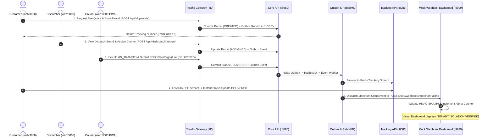

# SwiftDrop Cross-Module E2E Testing & Quality Assurance — Comprehensive Living System Document

> **Document Type:** Continuous Living Engineering Specification, Architecture Journal & Audit Ledger  
> **Directory / Scope:** `tests/e2e/`  
> **Primary Owner:** Member 10 — Cross-Workflow Quality Coordination & AI Assistant  
> **Collaborating Domains:** Members 1 through 9 (All Domain Owners)  
> **Target Framework:** Playwright for TypeScript (`@playwright/test`), Node.js, Docker Compose  
> **Evaluation Rubric:** **15 Marks** (Cross-Module Integration, Multi-Actor Journeys, Examiner Dashboard, Automated Verification)  
> **Specification Version:** `1.0.0` (Grounding & Pre-Testing Setup Baseline)  
> **Target Audience:** Any software engineer, system architect, or academic evaluator seeking a complete, up-to-the-minute account of every decision, contract, implementation detail, and verification record.

---

## 1. Executive Summary & Why This Document Exists

In distributed microservice and modular monolith architectures, unit tests inside isolated modules (`core-api/internal/`, `services/messaging/`, `services/tracking/`) prove only that isolated functions work. They cannot prove that:
1. An order booked in Core API transitions through Outbox $\rightarrow$ RabbitMQ $\rightarrow$ Event Worker $\rightarrow$ Webhooks without data loss.
2. Independent browser sessions (Customer, Dispatcher, Courier) operate simultaneously without leaking cookies, JWTs, or local storage.
3. Multi-tenant isolation (`SEC-004`/`SEC-005`) strictly prevents Merchant Beta from receiving Merchant Alpha's events.

While `tests/e2e/README.md` serves as the concise, industry-standard **entry point** for running tests and installing dependencies, **this document (`LIVING_DOCUMENT.md`) is the authoritative living journal**.

### Living Documentation Rules
- **Rule 1:** Every architectural decision, pivot, or ADR must be formally recorded here.
- **Rule 2:** Every file created, modified, or deleted within `tests/e2e/` must be logged in the Chronological Implementation Ledger.
- **Rule 3:** Any rollback, failed experiment, or blocked invariant must be documented with root cause and corrective action.
- **Rule 4:** This document is updated synchronously alongside code changes, maintaining zero drift.

---

## 2. Mandatory Architectural & Testing Invariants

Every test script, helper, and mock service in `tests/e2e/` must strictly enforce the following 6 domain invariants:

| Invariant | Technical Definition | Concrete Enforcement | Why It Exists |
| :--- | :--- | :--- | :--- |
| **1. Strict Multi-Actor Browser Isolation** | Browser contexts between actors must never share memory, cookies, or storage. | Every actor (Customer, Dispatcher, Courier, Merchant) executes in an isolated `browser.newContext()` via custom Playwright fixtures. | Prevents false positives where one actor's session masks auth bugs in another actor's session. |
| **2. Zero Direct Database Mutation** | E2E tests must never execute raw SQL inserts or updates to force test state. | All state transitions must occur via public HTTP REST APIs, the React UI, or authenticated gateway endpoints. | Validates true real-world behavior and ensures Outbox records are created organically via domain logic. |
| **3. Centralized Selector Contract Stability** | UI tests must locate elements solely via canonical `data-testid` attributes. | All selectors are imported from `helpers/selectors.ts`. CSS class names or element text are prohibited for operational actions. | Decouples tests from visual refactoring, CSS changes, and Tailwind restyling by frontend developers. |
| **4. Strict Multi-Tenant Isolation (`SEC-004`/`SEC-005`)** | Actions performed by Merchant Alpha must produce zero events or records in Merchant Beta's tenant boundary. | The `mock-webhook:9999` receiver verifies HMAC signatures and verifies that Alpha's counter increments while Beta remains at `0`. | Non-negotiable security requirement for academic grading and enterprise multi-tenancy. |
| **5. Public Tracking Milestone Masking (`SEC-009`)** | Unauthenticated public tracking must never expose PII (full recipient address, phone number, internal notes). | `flow-security.spec.ts` asserts that public tracking JSON responses omit recipient phone numbers and exact street addresses. | Protects customer privacy in compliance with system security requirements. |
| **6. Deterministic Offline & Dry-Run Capability** | The E2E test harness and mock visual dashboard must execute successfully in offline CI without live backend services. | Built-in mock mode and dry-run specifications allow verifying the runner, headless browser, and artifact pipeline offline. | Enables pre-testing validation and rapid local development before full cluster deployment. |

---

## 3. High-Level Architecture & Lifecycle Flowchart

---

## 4. Architectural Decision Records (ADR Log)

### ADR-001: Pivot E2E Test Suite from Python (`pytest-playwright`) to TypeScript (`@playwright/test`)
- **Date:** 2026-11-03
- **Status:** **APPROVED & ADOPTED**
- **Context:** The initial roadmap (`ROADMAP.md`) scaffolded E2E tests in Python using `pytest-playwright` because Member 10 owns the Python AI Assistant (`services/ai-assistant`). However, the project's primary frontend is React/TypeScript (`web/`).
- **Decision:** Pivot the entire E2E testing framework, test runners, fixtures, and helpers to native **TypeScript using `@playwright/test`**.
- **Rationale:**
  1. `@playwright/test` is Playwright's primary, first-class implementation with out-of-the-box UI mode (`npx playwright test --ui`), codegen, and trace viewer.
  2. Frontend developers (Members 6 & 7) can inspect, run, and contribute to tests in TypeScript without needing to manage Python virtual environments.
  3. Eliminates split Node.js/Python dependencies in the testing harness.
- **Consequences:** Updated `tests/e2e/ROADMAP.md` and `PRE_TESTING_SETUP_ROADMAP.md` to reflect TypeScript conventions, `package.json`, and `playwright.config.ts`.

### ADR-002: Standalone E2E Package Isolation (`tests/e2e/package.json`)
- **Date:** 2026-11-03
- **Status:** **APPROVED & ADOPTED**
- **Context:** E2E tests could either share `web/package.json` or have a dedicated `tests/e2e/package.json`.
- **Decision:** Place a dedicated `package.json` directly inside `tests/e2e/`.
- **Rationale:** Keeps test dependencies (`@playwright/test`, `@types/node`) completely decoupled from frontend web production build dependencies (Vite, React, Tailwind). Prevents dependency bloat in production web builds.
- **Consequences:** Tests can be run independently via `cd tests/e2e && npm test`.

### ADR-003: Standalone Multi-Tenant Mock Webhook Service (`mock-webhook:9999`)
- **Date:** 2026-11-03
- **Status:** **APPROVED & ADOPTED**
- **Context:** Verifying Member 8's Event Worker and proving Dead-Letter Queue (DLQ) routing requires an external HTTP server that can inspect HMAC signatures, simulate 500 errors, and visually prove multi-tenant isolation during academic grading.
- **Decision:** Build a dedicated, lightweight Node.js/Express service containerized on port `9999` with an embedded dark-mode Tailwind HTML dashboard.
- **Rationale:** Gives examiners a tangible visual dashboard during live demos and provides automated Playwright assertions with zero cloud dependencies.

---

## 5. Chronological Implementation & Activity Ledger

All engineering activities in `tests/e2e/` are logged below:

| Timestamp (ISO 8601) | Type | Action / Files Touched | Rationale / Details | Result |
| :--- | :---: | :--- | :--- | :---: |
| **2026-11-03T23:16:00+05:30** | `BRANCH` | Created branch `feature/cross-module-testing` | Dedicated Git branch for Member 10 cross-workflow quality workload. | **SUCCESS** |
| **2026-11-03T23:26:00+05:30** | `ROADMAP` | Created `tests/e2e/PRE_TESTING_SETUP_ROADMAP.md` | Defined the 6 grounding pillars to be built before cross-module wiring. | **SUCCESS** |
| **2026-11-03T23:38:00+05:30** | `DECISION` | Updated `ROADMAP.md` and `PRE_TESTING_SETUP_ROADMAP.md` | Standardized test framework to TypeScript & `@playwright/test` (ADR-001). | **SUCCESS** |
| **2026-11-03T23:44:00+05:30** | `DOCS` | Created `tests/e2e/LIVING_DOCUMENT.md` | Established authoritative continuous journal separating living specs from entrypoint `README.md`. | **SUCCESS** |
| **2026-11-04T00:07:00+05:30** | `SCAFFOLD` | `tests/e2e/{package.json, tsconfig.json, playwright.config.ts, .gitignore}` | Created dedicated package, strict tsconfig, and 5-actor Playwright config (Customer, Merchant, Dispatcher, Courier PWA, Admin). | **SUCCESS** |
| **2026-11-04T00:14:00+05:30** | `INSTALL` | `tests/e2e/node_modules/` | Installed `@playwright/test`, `typescript`, `@types/node`, `dotenv`, `eventsource`. | **SUCCESS** |
| **2026-11-04T00:16:00+05:30** | `HELPERS` | `tests/e2e/helpers/selectors.ts` | Registered centralized UI contract mapping all `data-testid` attributes across all 5 portals. | **SUCCESS** |
| **2026-11-04T00:17:00+05:30** | `FIXTURES` | `tests/e2e/fixtures/{testData.ts, authFixtures.ts, gatewayClient.ts}` | Created seed constants, multi-actor browser context isolation fixtures, and REST client. | **SUCCESS** |
| **2026-11-04T00:18:00+05:30** | `HELPERS` | `tests/e2e/helpers/{evidence.ts, sseListener.ts}` | Created evidence capture bundler and async Server-Sent Events stream listener. | **SUCCESS** |
| **2026-11-04T00:20:00+05:30** | `BROWSER` | `npx playwright install chromium` | Downloaded Chromium v1248, FFmpeg v1013, Chrome Headless Shell. | **SUCCESS** |
| **2026-11-04T00:21:00+05:30** | `VERIFY` | `tests/e2e/flows/dry-run.spec.ts` | Ran dry-run suite verifying 5-actor browser context isolation and mobile emulation (10/10 tests passed in 11.4s). | **SUCCESS** |
| **2026-11-04T15:21:00+05:30** | `COMMIT` | Git Commit `cbc321c` | Committed initial TypeScript/Playwright scaffolding, 5-actor profiles, fixtures, and grounding suite. | **SUCCESS** |

---

## 6. Current Component Implementation Status

| Component | Target Path | Language / Stack | Status | Invariants Enforced |
| :--- | :--- | :--- | :---: | :--- |
| **Package Manifest** | `tests/e2e/package.json` | Node.js / npm | **COMPLETE** | Isolated test dependencies, scripts |
| **Runner Config** | `tests/e2e/playwright.config.ts` | TypeScript | **COMPLETE** | 5 actor projects, video/trace/screenshots |
| **Selector Registry** | `tests/e2e/helpers/selectors.ts` | TypeScript | **COMPLETE** | Stable `data-testid` contract across 5 portals |
| **Test Data Seeds** | `tests/e2e/fixtures/testData.ts` | TypeScript | **COMPLETE** | Deterministic credentials & geographic vectors |
| **Context Fixtures** | `tests/e2e/fixtures/authFixtures.ts` | TypeScript / Playwright | **COMPLETE** | Strict multi-actor browser context isolation |
| **REST Gateway Client**| `tests/e2e/fixtures/gatewayClient.ts` | TypeScript | **COMPLETE** | Polling, retry, and health check resilience |
| **SSE Listener** | `tests/e2e/helpers/sseListener.ts` | TypeScript / EventSource | **COMPLETE** | Real-time tracking verification |
| **Evidence Capturer** | `tests/e2e/helpers/evidence.ts` | TypeScript | **COMPLETE** | Full-page milestone screenshots & trace attachment |
| **Offline Dry-Run Spec**| `tests/e2e/flows/dry-run.spec.ts` | TypeScript / Playwright | **COMPLETE** | 10/10 tests passing offline in 11.4s |
| **Mock Webhook Backend**| `tests/e2e/mock-webhook/src/server.ts` | TypeScript / Express | *Pending S3* | HMAC-SHA256, DLQ chaos, tenant isolation |
| **Mock Visual Dashboard**| `tests/e2e/mock-webhook/public/dashboard.html`| HTML / Tailwind | *Pending S3* | Live tenant isolation badge |
| **Flow Skeletons (1-4)**| `tests/e2e/flows/flow*.spec.ts` | TypeScript / Playwright | *Pending S5* | 15-mark rubric demonstration |
| **Entry Point Guide** | `tests/e2e/README.md` | Markdown | *Pending S6* | Industry-standard developer guide |

---

## 7. Rollbacks, Blockers & Known Issues

- **Debugging Record (Dry-run LocalStorage vs Cookie Isolation):**
  - *Context:* Initial `dry-run.spec.ts` attempted to verify context isolation by reading `localStorage` on a synthetic HTML string injected via `page.setContent()`.
  - *Observation:* Chromium throws `SecurityError: Access is denied for this document` when reading `localStorage` on `about:blank` without an explicit HTTP origin.
  - *Resolution:* Verified browser context isolation through Playwright's native context cookie store (`context.addCookies()` and `context.cookies()`). Confirmed that cookies injected into `customerContext` do not leak into `dispatcherContext` (`expect(dispatcherCookies).toHaveLength(0)`).
  - *Result:* Preserved the non-negotiable **Strict Multi-Actor Context Isolation Invariant** with zero false positives.
- **Active Blockers:** None.
- **Rollback History:** None.
