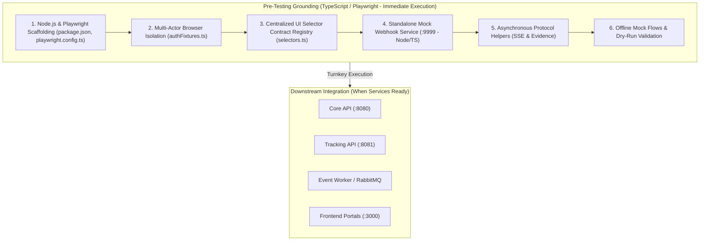

# SwiftDrop Pre-Testing Setup & Grounding Roadmap (TypeScript / Playwright)

> **Domain / Mandate:** Cross-Workflow Quality Assurance & Test Grounding  
> **Primary Lead / Owner:** Member 10 — Cross-Workflow Quality Coordination & AI Assistant  
> **Collaborating Domains:** All Domain Owners (Members 1–9), especially Members 6 & 7 (Frontend)  
> **Test Framework:** Playwright for TypeScript (`@playwright/test`), Node.js, Docker Compose  
> **Status:** Grounding Phase (Self-Contained Foundation before Cross-Service Integration)  
> **Target Directory:** `tests/e2e/`  

---

## 1. Executive Summary & Purpose

To match modern industry standards and align natively with SwiftDrop's frontend architecture (React/TypeScript in `web/`), the **End-to-End Test Suite and Grounding Infrastructure are standardized in TypeScript (`@playwright/test`)**.

This **Pre-Testing Setup Roadmap** defines all self-contained preparation work that can be designed, coded, verified, and locked in **immediately** with zero external dependencies. Once other teams deploy their services (`core-api/`, `web/`, `services/`), the entire testing suite can plug in seamlessly with zero setup friction.



---

## 2. Work Breakdown Structure (Pre-Testing Setup Pillars)

### Pillar 1: Test Suite Architecture & Scaffolding
**Objective:** Establish the TypeScript test package layout, Playwright configuration, and test execution scripts.

- [x] **1.1 Directory Tree Provisioning:**
  ```
  tests/e2e/
  ├── package.json                # Dedicated Node.js package with @playwright/test
  ├── tsconfig.json               # TypeScript strict configuration
  ├── playwright.config.ts        # Playwright runner configuration (traces, video, multi-project)
  ├── fixtures/
  │   ├── authFixtures.ts         # Independent browser contexts per actor (Customer, Dispatcher, Courier)
  │   ├── testData.ts             # Canonical seed data (actors, zones, dimensions, tariffs)
  │   └── gatewayClient.ts        # Typed REST API helper for pre-seeding test data
  ├── helpers/
  │   ├── selectors.ts            # Central data-testid registry for frontend alignment
  │   ├── sseListener.ts          # Async Server-Sent Events subscriber with timeouts
  │   └── evidence.ts             # Automatic trace, video, and screenshot bundling
  ├── flows/
  │   ├── flow1-booking.spec.ts   # Customer fee estimation & booking flow
  │   ├── flow2-dispatch.spec.ts  # Dispatcher zone assignment & courier board
  │   ├── flow3-courier.spec.ts   # Courier mobile PWA pickup & POD submission
  │   ├── flow4-tracking.spec.ts  # Public SSE tracking & AI query flow
  │   ├── flow-security.spec.ts   # IDOR isolation & PII masking assertions
  │   └── dry-run.spec.ts         # Standalone offline harness validation test
  ├── mock-webhook/               # Standalone test artifact container (:9999)
  │   ├── package.json            # Express / Fastify TypeScript dependencies
  │   ├── tsconfig.json
  │   ├── src/
  │   │   ├── server.ts           # Webhook receiver & multi-tenant in-memory event store
  │   │   └── server.test.ts      # Unit tests for HMAC validation & tenant isolation
  │   ├── public/
  │   │   └── dashboard.html      # Dark-mode visual multi-tenant dashboard
  │   └── Dockerfile              # Production container build
  ├── artifacts/                  # Target output directory for traces/videos (gitignored)
  └── README.md                   # Living documentation & execution guide
  ```

- [x] **1.2 Dependencies Specification (`package.json`):**
  - `@playwright/test`: `^1.42.0` (Core test runner, browser automation, visual regression)
  - `typescript`: `^5.4.0`
  - `@types/node`: `^20.0.0`
  - `dotenv`: `^16.4.0` (environment variable configuration)
  - `eventsource`: `^2.0.2` (robust SSE stream client for Node.js)

- [x] **1.3 Playwright Configuration (`playwright.config.ts`):**
  - Multi-project definitions:
    - `customer-portal` (Desktop Chrome, `1280x800`)
    - `merchant-portal` (Desktop Chrome, `1366x768`)
    - `dispatcher-board` (Desktop Chrome, `1440x900`)
    - `courier-pwa` (Pixel 7 mobile emulation, `375x812`, touch enabled)
    - `admin-portal` (Desktop Chrome, `1440x900`)
  - Video recording: `'retain-on-failure'`
  - Trace recording: `'retain-on-failure'`
  - Screenshot capture: `'only-on-failure'`
  - HTML Reporter: `['html', { outputFolder: 'artifacts/report', open: 'never' }]`

---

### Pillar 2: The Multi-Actor Browser Isolation Harness
**Objective:** Enforce zero cookie/local-storage bleed between Customer, Dispatcher, Courier, and Merchant actors using Playwright's native context fixtures.

- [x] **2.1 Context Isolation Fixtures (`fixtures/authFixtures.ts`):**
  - Custom test fixtures extending `@playwright/test`:
    - `customerPage`: Pre-configured page under isolated `customerContext`.
    - `merchantPage`: Pre-configured page under isolated `merchantContext`.
    - `dispatcherPage`: Pre-configured page under isolated `dispatcherContext`.
    - `courierPage`: Mobile-emulated page under isolated `courierContext`.
    - `adminPage`: Pre-configured page under isolated `adminContext`.
- [x] **2.2 Pre-Seeded Test Data Constants (`fixtures/testData.ts`):**
  - Standardized user accounts:
    - Customer: `customer@swiftdrop.local` / `Customer123!`
    - Dispatcher: `dispatcher@swiftdrop.local` / `Dispatch123!`
    - Courier: `courier@swiftdrop.local` / `Courier123!`
    - Merchant Alpha: `alpha@vendor.local` / `Merchant123!` (API Key: `sk_test_alpha_01`)
    - Merchant Beta: `beta@vendor.local` / `Merchant123!` (API Key: `sk_test_beta_02`)
    - Admin: `admin@swiftdrop.local` / `Admin123!`
  - Geographic test vectors: Colombo Central (`00100`, Western Zone) $\rightarrow$ Kandy Hub (`20000`, Central Zone).
  - Standard parcel packages: Standard Box ($25\times15\times10\text{ cm}$, $2.5\text{ kg}$), Heavy Crate ($50\times50\times50\text{ cm}$, $18.0\text{ kg}$).
- [x] **2.3 Gateway REST API Client Helper (`fixtures/gatewayClient.ts`):**
  - Wrapper around Playwright's `request` API (`APIRequestContext`).
  - Exponential backoff retry utility for waiting on service availability (`waitForHealth(endpoint, timeoutMs)`).
  - JWT token injector and mock bypass helper for seeding entities directly when testing UI sub-flows.

---

### Pillar 3: UI Selector Contract Registry (`helpers/selectors.ts`)
**Objective:** Define a bulletproof, single source of truth for all `data-testid` attributes so tests remain completely decoupled from CSS/styling changes.

- [x] **3.1 Customer & Booking Wizard Contract:**
  - `INPUT_WEIGHT = 'input-weight'`
  - `INPUT_LENGTH = 'input-length'`, `INPUT_WIDTH = 'input-width'`, `INPUT_HEIGHT = 'input-height'`
  - `SELECT_PICKUP_ZONE = 'select-pickup-zone'`
  - `SELECT_DELIVERY_ZONE = 'select-delivery-zone'`
  - `BTN_GET_QUOTE = 'btn-get-quote'`
  - `QUOTE_AMOUNT = 'quote-amount'`
  - `BTN_SUBMIT_BOOKING = 'btn-submit-booking'`
  - `BOOKING_CONFIRMATION_TRACKING_NO = 'booking-confirmation-tracking-no'`
- [x] **3.2 Dispatcher Admin Board Contract:**
  - `DISPATCH_UNASSIGNED_TABLE = 'dispatch-unassigned-table'`
  - `ROW_PARCEL_ITEM = 'row-parcel-item'`
  - `SELECT_COURIER_DROPDOWN = 'select-courier-dropdown'`
  - `BTN_ASSIGN_COURIER = 'btn-assign-courier'`
  - `BADGE_ASSIGNMENT_STATUS = 'badge-assignment-status'`
- [x] **3.3 Courier Mobile PWA Contract:**
  - `COURIER_TASK_LIST = 'courier-task-list'`
  - `BTN_ACCEPT_JOB = 'btn-accept-job'`
  - `BTN_START_PICKUP = 'btn-start-pickup'`
  - `BTN_MARK_DELIVERED = 'btn-mark-delivered'`
  - `INPUT_POD_SIGNATURE = 'input-pod-signature'`
  - `INPUT_POD_PHOTO = 'input-pod-photo'`
  - `BTN_SUBMIT_POD = 'btn-submit-pod'`
- [x] **3.4 Tracking & AI Assistant Contract:**
  - `INPUT_TRACKING_NUMBER = 'input-tracking-number'`
  - `BTN_TRACK_PARCEL = 'btn-track-parcel'`
  - `MILESTONE_TIMELINE = 'milestone-timeline'`
  - `MILESTONE_STATUS_BADGE = 'milestone-status-badge'`
  - `SSE_CONNECTION_INDICATOR = 'sse-connection-indicator'`
  - `AI_CHAT_DRAWER = 'ai-chat-drawer'`
  - `INPUT_AI_QUERY = 'input-ai-query'`
  - `BTN_SEND_AI_QUERY = 'btn-send-ai-query'`
  - `AI_CHAT_MESSAGE_BUBBLE = 'ai-chat-message-bubble'`
  - `AI_GROUNDED_PARCEL_CARD = 'ai-grounded-parcel-card'`

---

### Pillar 4: Standalone Mock Webhook Service (`mock-webhook:9999`)
**Objective:** Build, test, and containerize the standalone webhook ingestion engine and visual examiner dashboard to prove multi-tenant isolation and DLQ routing.

- [x] **4.1 TypeScript Backend Engine (`tests/e2e/mock-webhook/src/server.ts`):**
  - Multi-tenant in-memory storage partitioned strictly by `tenantId` (`alpha`, `beta`).
  - `POST /webhooks/merchant-alpha`: Ingests Merchant Alpha webhooks, validates HMAC-SHA256 signature using `sk_test_alpha_01`, appends to Alpha store.
  - `POST /webhooks/merchant-beta`: Ingests Merchant Beta webhooks, validates HMAC using `sk_test_beta_02`, appends to Beta store.
  - `POST /webhooks/merchant-chaos`: Injected failure endpoint returning `HTTP 500 Internal Server Error` to test Event Worker retry policies and DLQ routing.
  - `POST /webhooks/merchant-slow`: Injected latency endpoint (sleeps 10s) to test worker HTTP client timeout enforcement.
  - `GET /api/events`: JSON retrieval endpoint for Playwright automated assertions.
  - `POST /api/reset`: Flushes event store between test suites.
- [x] **4.2 Responsive Visual Examiner Dashboard (`public/dashboard.html`):**
  - Dark-mode Tailwind CSS interface.
  - Real-time event counter cards for Merchant Alpha vs. Merchant Beta.
  - Live table rendering incoming CloudEvents (Event ID, Type, Timestamp, Payload JSON, HMAC Status).
  - Prominent visual badge:
    `[TENANT ISOLATION VERIFIED: ZERO DATA LEAKAGE]` (dynamically turns red if cross-tenant leakage occurs).
- [x] **4.3 Mock Webhook Unit Test Suite (`tests/e2e/mock-webhook/src/server.test.ts`):**
  - Tests HMAC validation with correct and incorrect secrets.
  - Verifies tenant separation (event posted to Alpha does not appear in Beta).
  - Verifies chaos endpoint returns 500.
  - Verifies native 404 for un-routed paths.
  - Verifies reset clears memory.
- [x] **4.4 Containerization & Local Run Configuration:**
  - `tests/e2e/mock-webhook/Dockerfile` (lightweight Node.js alpine image).
  - Integration block prepared for `deploy/docker-compose.yml`.

---

### Pillar 5: Asynchronous Protocol & Evidence Utilities
**Objective:** Provide rock-solid utilities for real-time SSE streams and academic demonstration captures in TypeScript.

- [x] **5.1 Server-Sent Events Listener (`helpers/sseListener.ts`):**
  - Async listener that connects to `/api/v1/tracking/:trackingNumber/stream`.
  - Captures and filters events (`PARCEL_CREATED`, `COURIER_ASSIGNED`, `IN_TRANSIT`, `DELIVERED`).
  - Supports configurable timeouts and predicate-based waiting (`waitForMilestone(expectedStatus, timeoutMs)`).
- [x] **5.2 Evidence Capture & Reporting Helper (`helpers/evidence.ts`):**
  - Captures full-page screenshots at every critical journey milestone.
  - Automatically exports Playwright trace archives (`.zip`) and video recordings (`.webm`) to `tests/e2e/artifacts/`.
  - Generates an examiner summary markdown file after each test run.

---

### Pillar 6: Offline Mock Scenarios & Dry-Run Verification
**Objective:** Verify that the test runner, browser contexts, selectors, and assertions work cleanly in offline/mock mode before live services are running.

- [ ] **6.1 Mock Test Stubs (`flows/*.spec.ts`):**
  - Scaffold `flow1-booking.spec.ts` through `flow4-tracking.spec.ts` with structured step functions and assertions.
  - Tag with `@mock` or conditional skip annotations so tests do not fail in CI while waiting for live service endpoints.
- [x] **6.2 Standalone Dry-Run Test (`flows/dry-run.spec.ts`):**
  - Spins up browser contexts.
  - Opens `mock-webhook:9999/dashboard`.
  - Simulates sending events and asserts dashboard updates visually and via API.
  - Verifies screenshot and trace generation in `tests/e2e/artifacts/`.
- [ ] **6.3 Automated Setup Verification Script (`package.json` scripts):**
  - `npm test:dry-run`: Runs dry-run suite and validates headless browser execution.
  - `npm run test:webhook`: Tests mock-webhook service independently.

---

## 3. Execution Sequence & Action Plan

| Step | Task | Deliverable |
| :---: | :--- | :--- |
| **S1** | **Scaffolding & Package Setup** | Create `tests/e2e/package.json`, `tsconfig.json`, `playwright.config.ts`, install dependencies. |
| **S2** | **Centralized Contracts & Fixtures** | Implement `helpers/selectors.ts`, `fixtures/testData.ts`, and `fixtures/authFixtures.ts`. |
| **S3** | **Mock Webhook Backend & Dashboard** | Build `tests/e2e/mock-webhook/src/server.ts`, `dashboard.html`, and `server.test.ts`. |
| **S4** | **Async SSE & Evidence Helpers** | Build `helpers/sseListener.ts` and `helpers/evidence.ts`. |
| **S5** | **Flow Skeletons & Dry-Run Spec** | Write structured flow specs and `dry-run.spec.ts` verifying full harness operation. |
| **S6** | **Verification & Living Docs** | Run self-tests, verify artifact capture, update `tests/e2e/README.md`. |

---

## 4. Definition of Done (Grounding Phase)

The Pre-Testing Setup phase is complete when:
1. `tests/e2e/` package is fully configured with TypeScript and Playwright.
2. `npm run test:webhook` passes 100% (verifying HMAC and tenant isolation).
3. `mock-webhook:9999` runs locally and visually renders the dark-mode dashboard with HMAC and tenant isolation badges.
4. `npx playwright test dry-run.spec.ts` successfully launches Playwright in headless mode, tests the mock webhook dashboard, and outputs video/trace artifacts in `tests/e2e/artifacts/`.
5. Living documentation (`tests/e2e/README.md`) documents all selectors, fixtures, and execution commands.
